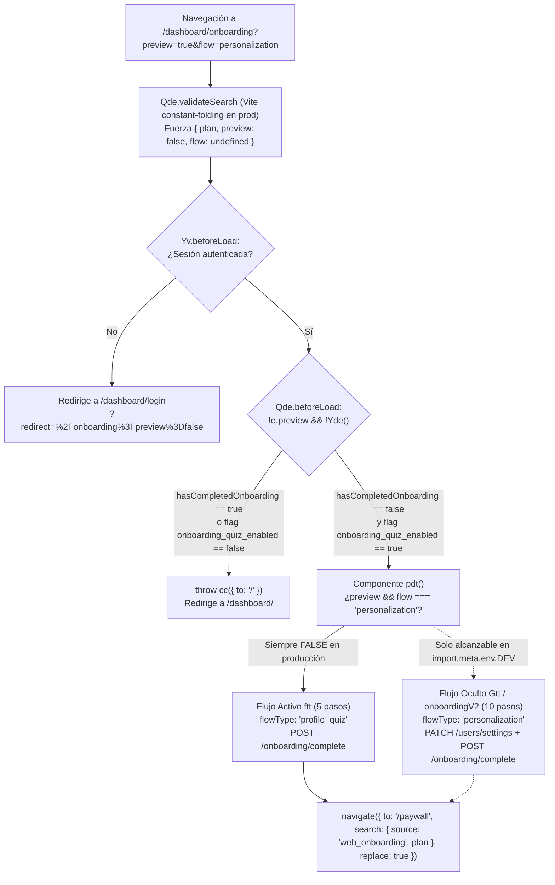
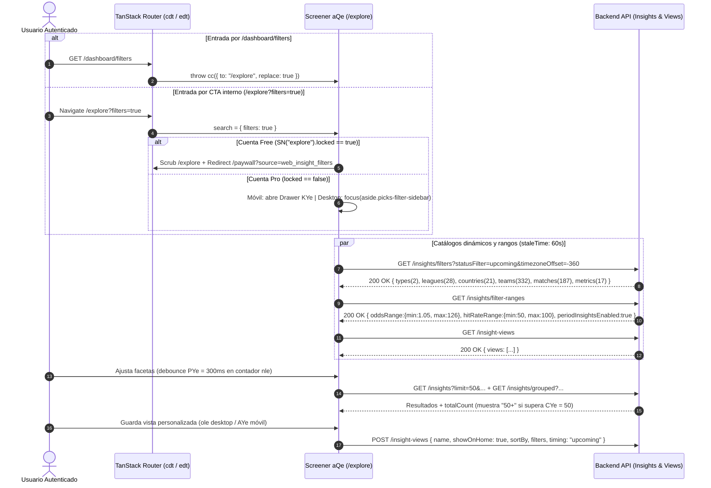
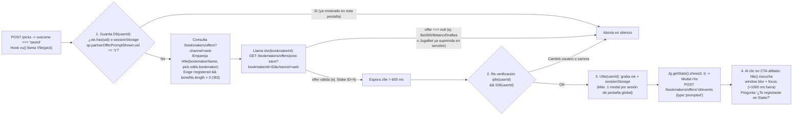

# 11. Rutas Faltantes (`/onboarding`, `/filters`, `/paywall`, `/checkout`), Motor CPA Post-Save y Radiografía Profunda de Liga MX (`leagueId: 68`)

> **Clasificación epistemológica:** Todo hallazgo de este informe lleva etiqueta explícita `[OBSERVADO]` (evidencia directa en código empaquetado de producción, capturas de red Wave 1/Wave 2 o capturas visuales), `[DERIVADO]` (cálculo o cruce determinista entre dos o más artefactos observados), `[RECONSTRUIDO]` (máquina de estados o contrato recompuesto desde código minificado + respuestas HTTP reales), `[INFERIDO]` (hipótesis arquitectónica o SQL de alta confianza respaldada por anomalías empíricas) o `[DESCONOCIDO]` (lógica opaca del servidor no expuesta al cliente), citando los identificadores canónicos `ev_...` registrados en [rea-wave2-evidence-ledger-summary.json](file:///C:/Users/T490s/.gemini/antigravity/worktrees/PitchLab/analyze_pitchlab_competitor_rea/Reportes/scoutpicks/evidence/rea/rea-wave2-evidence-ledger-summary.json).
>
> **Política estricta de privacidad y frontera operativa:** Cero PII y cero credenciales (`usr_redacted_0000000000000000000`, `[REDACTED_AUTH_TOKEN]`, `user@redacted.example`). Todos los datos estructurados verificables de esta auditoría se encuentran consolidados en [wave2-routes-and-ligamx-audit.json](file:///C:/Users/T490s/.gemini/antigravity/worktrees/PitchLab/analyze_pitchlab_competitor_rea/Reportes/scoutpicks/evidence/wave2-routes-and-ligamx-audit.json).

---

## 1. Disección Completa de `/dashboard/onboarding`: Flujo Activo `ftt` vs. Flujo Oculto `Gtt` (`onboardingV2`)

### 1.1 Arquitectura de Enrutamiento, Guarda Reactiva `Yde()` y Plegado Estático de `?preview=true`

En el árbol de rutas de TanStack Router compilado dentro de [mod_17_onboarding_and_paywall.js](file:///C:/Users/T490s/.gemini/antigravity/worktrees/PitchLab/analyze_pitchlab_competitor_rea/Reportes/scoutpicks/scoutpicks-first-party/mod_17_onboarding_and_paywall.js#L13) (`ev_0fb357d4a1453d5471dc808a4f58ca40c99849c2e422e22cda01df49487dad6d`, `ev_3b9c90fb0c981b84008f879d4097d98b90b43cd6e242d4ddf8387a8378b8229a`), la ruta `/dashboard/onboarding` se declara mediante el nodo `Qde` colgado del layout autenticado `Yv` (`id: "authed"`):

1. **Definición exacta de `Qde` en producción `[OBSERVADO]` (`ev_0fb357d4...`):**
   - `path`: `"/onboarding"` (resuelto bajo `basepath: "/dashboard"` a `https://scoutpicks.app/dashboard/onboarding`).
   - `validateSearch`: `e => ({ plan: zN(e).plan, preview: !1, flow: void 0 })`.
   - `beforeLoad`: `({ search: e }) => { if (!e.preview && !Yde()) throw cc({ to: "/" }) }`.
   - `component`: `pdt`, definido como:
     ```js
     function pdt() {
       const { preview: e, flow: t } = Qde.useSearch();
       return e && t === "personalization" ? jsx(Gtt, {}) : jsx(ftt, {});
     }
     ```
2. **Mecanismo bidireccional de la guarda `Yde()` y listener reactivo de PostHog `[OBSERVADO]` (`ev_0fb357d4...`, `ev_0d526b81...`):**
   - La función `Yde` evalúa `() => !Ee.getState().hasCompletedOnboarding && ec(lc.ONBOARDING_QUIZ_ENABLED)`, donde `Ee` es el store Zustand de autenticación ([mod_01_app_module.js](file:///C:/Users/T490s/.gemini/antigravity/worktrees/PitchLab/analyze_pitchlab_competitor_rea/Reportes/scoutpicks/scoutpicks-first-party/mod_01_app_module.js#L85-L125)) y `lc.ONBOARDING_QUIZ_ENABLED` corresponde al flag `Zfe = "onboarding_quiz_enabled"` en PostHog.
   - **Intercepción forzosa de entrada (`Yv.beforeLoad`):** Cuando un usuario recién registrado entra a cualquier ruta autenticada distinta de `"/onboarding"` y `Yde()` devuelve `true`, `Yv.beforeLoad` lanza `cc({ to: "/onboarding", search: { plan: ... } })`, preservando el parámetro `plan` si la navegación original apuntaba a `/checkout` o `/paywall`.
   - **Suscripción reactiva en caliente (`vdt()`):** Al arrancar el router `FN` en [mod_17_onboarding_and_paywall.js](file:///C:/Users/T490s/.gemini/antigravity/worktrees/PitchLab/analyze_pitchlab_competitor_rea/Reportes/scoutpicks/scoutpicks-first-party/mod_17_onboarding_and_paywall.js#L13-L19), `vdt()` registra `Go.onFeatureFlags(() => { ... FN.invalidate() })`. Si PostHog resuelve tardíamente `onboarding_quiz_enabled = true` mientras `isAuthenticated && !hasCompletedOnboarding`, el router invalida la ruta activa y empuja inmediatamente al usuario hacia `/dashboard/onboarding`.
3. **Por qué `/dashboard/onboarding?preview=true` redirigió a `/dashboard/` en producción `[DERIVADO]` (`ev_0fb357d4...`, `ev_a8cc2cac...`):**
   - En el código fuente original de TypeScript, `validateSearch` permitía `?preview=true&flow=personalization` únicamente bajo `import.meta.env.DEV`. Al compilar con Vite para producción, el optimizador reemplazó `import.meta.env.DEV` por la constante booleana `!1` (`false`), plegando las expresiones ternarias a `preview: !1, flow: void 0` (y fijando igualmente `const n = !1` dentro del cuerpo de `ftt` y `Gtt` en [mod_14_onboarding_and_paywall.js](file:///C:/Users/T490s/.gemini/antigravity/worktrees/PitchLab/analyze_pitchlab_competitor_rea/Reportes/scoutpicks/scoutpicks-first-party/mod_14_onboarding_and_paywall.js#L1-L59)).
   - **Doble prueba empírica en vivo** registrada en [wave2_ui_tour_audit.json](file:///C:/Users/T490s/.gemini/antigravity/brain/8e1bb7bd-e2dd-4687-97e2-e5f221d4e760/scratch/wave2_ui_tour_audit.json) y [28-onboarding-preview-step1-desktop.png](file:///C:/Users/T490s/.gemini/antigravity/worktrees/PitchLab/analyze_pitchlab_competitor_rea/Reportes/scoutpicks/evidence/screenshots/28-onboarding-preview-step1-desktop.png):
     - Con sesión activa cuya cuenta ya tenía `hasCompletedOnboarding: true`, navegar a `https://scoutpicks.app/dashboard/onboarding?preview=true` produjo `e.preview === false` y `Yde() === false`, disparando `throw cc({ to: "/" })` hacia `https://scoutpicks.app/dashboard/`.
     - Sin sesión activa (vista móvil del recorrido), TanStack Router ejecutó `Qde.validateSearch` antes de `Yv.beforeLoad`, reescribiendo literalmente `?preview=true` a `?preview=false` en la URL serializada de retorno: `https://scoutpicks.app/dashboard/login?redirect=%2Fonboarding%3Fpreview%3Dfalse` (`[OBSERVADO]`).
   - **Consecuencia arquitectónica crítica `[DERIVADO]`:** Dado que `pdt` exige `e && t === "personalization"` y ambos valores están plegados a `false` y `undefined`, **el flujo completo `Gtt` (`onboardingV2`, 10 pasos) es código muerto inalcanzable (*dead-gated*) en producción Web**, aunque el bundle descarga íntegros sus componentes, assets `.webp` y traducciones trilingües (`en`/`es`/`pt`).



---

### 1.2 Reconstrucción Paso por Paso del Flujo Activo `ftt` (`flowType: "profile_quiz"`, 5 Pasos)

El flujo activo `ftt` está implementado en [mod_14_onboarding_and_paywall.js](file:///C:/Users/T490s/.gemini/antigravity/worktrees/PitchLab/analyze_pitchlab_competitor_rea/Reportes/scoutpicks/scoutpicks-first-party/mod_14_onboarding_and_paywall.js#L1-L20), con activos multimedia mapeados en [mod_13_app_module.js](file:///C:/Users/T490s/.gemini/antigravity/worktrees/PitchLab/analyze_pitchlab_competitor_rea/Reportes/scoutpicks/scoutpicks-first-party/mod_13_app_module.js#L95-L115) y textos bajo el namespace `onboardingQuiz` en [mod_03_i18n_inline_en_es_pt.js](file:///C:/Users/T490s/.gemini/antigravity/worktrees/PitchLab/analyze_pitchlab_competitor_rea/Reportes/scoutpicks/scoutpicks-first-party/mod_03_i18n_inline_en_es_pt.js#L1-L38) (`ev_0fb357d4...`, `ev_15467abe...`). Llama la atención un rasgo lingüístico revelador de la autoría del producto: todo el copy en español de `onboardingQuiz` y `onboardingV2` está redactado en **voseo rioplatense** (*«Jugá con los datos de tu lado»*, *«¿Cómo apostás hoy?»*, *«Elegí mejor»*, *«Descubrí tu perfil»*) `[OBSERVADO]`.

| Paso (`Ad`) | Clave Interna | Controles UI y Opciones (`mod_14`) | Regla de Avance / Comportamiento Dinámico | Telemetría PostHog |
|---:|---|---|---|---|
| **1** | `welcome` | Portada de bienvenida (*«Jugá con los datos de tu lado»*) con 3 promesas de valor y botón primario *«Empezar»*. Sin barra de progreso superior (`y === 0`). | Avance libre al clic; inicializa sesión de quiz. | `onboarding_quiz_started`, `onboarding_quiz_step_viewed` |
| **2** | `style` | Grupo de tarjetas radio de selección única (`mH`) iterando `Wfe = ["intuitive", "social", "analytical", "conservative"]` (*Intuitivo*, *Social*, *Analítico*, *Conservador*). | Botón *«Continuar»* deshabilitado mientras `style === null`. | `onboarding_quiz_style_selected` (`{ style }`) |
| **3** | `goal` | Grupo de tarjetas radio (`mH`) iterando `Gfe = ["confidence", "value", "selection", "profitability"]` (*Apostar con más confianza*, *Detectar cuotas de valor*, *Elegir mejores mercados*, *Ser rentable a largo plazo*). | Botón *«Continuar»* deshabilitado mientras `goal === null`. | `onboarding_quiz_goal_selected` (`{ goal }`) |
| **4** | `profile` | Sintetizador personalizado (`gtt` + `Xfe`): cruza `style × goal` generando **16 combinaciones de copy** (`4 × 4`) más un `<video autoPlay loop muted playsInline>` localizado (`es`/`en`/`pt`) seleccionado vía `Qfe = { confidence: "context", value: "value", selection: "highlights", profitability: "performance" }` (`ptt` en `mod_13`). | Respeta `prefers-reduced-motion: reduce`: si está activo, sustituye el `<video>` MP4 por su `poster` PNG estático. | `onboarding_quiz_step_viewed` (`{ step: "profile" }`) |
| **5** | `how_it_works` | Diseño *split* de 2 columnas en escritorio: 3 pilares numerados (`01 Valor`, `02 Elegir mejor`, `03 Rentabilidad`) junto al reproductor con audio/controles `/dashboard/assets/how-it-works-{es,en,pt}-*.mp4`. | Al pulsar el CTA final invoca `Ee.completeOnboardingQuiz({ style, goal })`. | `onboarding_quiz_completed` (`{ style, goal, persisted }`) |

#### Mutación Exacta al Completar `ftt` `[OBSERVADO]` (`ev_0fb357d4...`)

> [!IMPORTANT]
> **Verificación forense del endpoint de escritura:** A diferencia de lo que podría suponerse por convención REST (`POST /users/onboarding` o `PATCH /users/settings`), el flujo activo `ftt` **NO invoca `PATCH /users/settings` ni `POST /users/onboarding`**. Su única llamada de red es **`POST /onboarding/complete`** a través de `Ige.complete` en [mod_01_app_module.js](file:///C:/Users/T490s/.gemini/antigravity/worktrees/PitchLab/analyze_pitchlab_competitor_rea/Reportes/scoutpicks/scoutpicks-first-party/mod_01_app_module.js#L95-L115):
> ```json
> {
>   "flowType": "profile_quiz",
>   "bettingStyle": "analytical",
>   "bettingGoal": "value",
>   "expectedUserId": "usr_redacted_0000000000000000000"
> }
> ```
> Antes incluso de recibir respuesta HTTP, `Ee.completeOnboardingQuiz` marca de forma **optimista** `hasCompletedOnboarding: true` en memoria, persiste la bandera en `localStorage["sp.cachedUser"]`, registra `onboarding_quiz_completed` (`persisted: true/false` según éxito de red) y ejecuta `navigate({ to: "/paywall", search: { source: "web_onboarding", plan }, replace: true })`.

---

### 1.3 Reconstrucción Paso por Paso del Flujo Oculto `Gtt` (`onboardingV2` / `flowType: "personalization"`, 10 Pasos)

El componente `Gtt` ([mod_14_onboarding_and_paywall.js](file:///C:/Users/T490s/.gemini/antigravity/worktrees/PitchLab/analyze_pitchlab_competitor_rea/Reportes/scoutpicks/scoutpicks-first-party/mod_14_onboarding_and_paywall.js#L21-L59), `AA = 10` pasos en el arreglo `Vf`) representa una arquitectura de personalización mucho más ambiciosa que el quiz psicológico actual `[RECONSTRUIDO]` (`ev_0fb357d4...`, `ev_15467abe...`):

| # | Paso (`Vf`) | Subcomponente | Opciones / Fuente de Datos | Reglas de Negocio, Límites y Efectos Secundarios |
|---:|---|---|---|---|
| **1** | `source` | `Dtt` | `_tt = ["instagram", "tiktok", "friend", "google", "store", "ai"]` | **Barajado aleatorio anti-sesgo** al montar mediante `[..._tt].sort(() => Math.random() - .5)`. Selección única obligatoria. |
| **2** | `experience` | `Ltt` | `vtt = ["beginner", "intermediate", "regular"]` | Selección única tipo radio; bloquea avance hasta elegir nivel de experiencia. |
| **3** | `markets` | `$tt` | `ytt = ["cards", "corners", "fouls", "goals", "offsides", "result", "saves", "shots", "tackles", "assists"]` (`10` mercados) | Selección múltiple por checkboxes; exige `markets.length >= 1`. |
| **4** | `leagues` | `ztt` | Consulta viva **`GET /leagues`** (`yN.list`) | Buscador instantáneo + ordenamiento prioritario `Stt` que coloca arriba `wtt = [2, 3, 6, 5, 12, 34, 1]` (*Premier League*, *LaLiga*, *Serie A*, *Bundesliga*, *Ligue 1*, *Brasileirão*, *Champions League*) y el resto en orden alfabético (donde aparecería **Liga MX `68`**). **Tope estricto `yR = 3` ligas máximas** (`disabled: !selected && leagues.length >= 3`), mínimo `1`. |
| **5** | `play_style` | `Ftt` | `btt = ["singles", "combos", "both"]` | Selección única (*Apuestas simples*, *Combinadas / Parlays*, *Ambas*). |
| **6** | `odds_format` | `Btt` | `"decimal"` (por defecto `1.85`) vs. `"american"` (`-118` / `+150`) | **Mutación inmediata al pulsar Continuar (`U()`):** invoca `D(x)` sobre el store `Kl`, actualizando optimistamente la UI y disparando **`PATCH /users/settings`** con `{ "oddsFormat": "decimal" | "american" }` (con *rollback* automático si falla el `PATCH`). |
| **7** | `bookmakers` | `qtt` | Consulta viva **`GET /bookmakers/preferences`** (`Sv.detail`) | Si el perfil ya tenía `configured === true`, preselecciona `selectedBookmakerIds`; si no (`jtt`), **marca por defecto todas las casas disponibles** (Bet365, Betano, Draftea, Stake, JugaBet). Exige `>= 1` salvo catálogo vacío. |
| **8** | `showcase` | `Utt` | Imagen estática `/dashboard/assets/showcase-active-picks-CkhF6gUP.webp` | Paso demostrativo visual de tarjetas de picks activas (equivalente funcional a *howItWorks* visual en V2). |
| **9** | `comparison` | `Htt` | Columna *«Sin Scout»* (`xtt = ["intuition", "noValue", "repeatErrors"]`) vs. *«Con Scout»* (`ktt = ["realData", "seeEdge", "trackRoi"]`) | Materializa los **puntos de dolor (`painPoints`)** frente al método cuantitativo e incrusta un badge estático hardcodeado de prueba social: **`82%`** (*«de acierto promedio en picks de los últimos 30 días»*). |
| **10** | `notifications` | `Vtt` + `Wtt` | Tarjetas simuladas (*«Barcelona gana vs Betis»*, *«Mbappé anota vs Lyon · 92%»*) | Al pulsar el CTA final (`B()`), `Wtt(userId)` solicita `Notification.requestPermission()`, registra el Service Worker `/dashboard/notification-worker.js` (`e$()`) y escribe `localStorage["notification-alerts:<userId>"] = "on"` (`dR`). |

#### Mutaciones de Red Ejecutadas por `Gtt` `[OBSERVADO]` (`ev_0fb357d4...`)

1. **En el Paso 6 (`odds_format`):** `PATCH /users/settings` con cuerpo `{ "oddsFormat": "decimal" | "american" }`.
2. **En el Paso 10 (`notifications`, cierre del flujo):** `POST /onboarding/complete` con el payload completo de personalización:
   ```json
   {
     "flowType": "personalization",
     "source": "tiktok",
     "experience": "regular",
     "markets": ["shots", "cards", "corners"],
     "leagues": [68, 2, 3],
     "playStyle": "both",
     "oddsFormat": "decimal",
     "notificationsEnabled": true,
     "bookmakerIds": [1, 2, 3, 4, 5],
     "expectedUserId": "usr_redacted_0000000000000000000"
   }
   ```
   Tras resolver, invalida las cachés de React Query `["bookmaker-preferences"]` y `["profile", userId]`, marca `hasCompletedOnboarding: true` y redirige con `replace: true` a `/paywall?source=web_onboarding&plan=<plan>`.

---

## 2. Ruta `/dashboard/filters` y el Wizard Completo del Screener (`/explore?filters=true`)

### 2.1 Redirección Alias `cdt` (`/filters`), Validación `edt` (`/explore`) y Compuerta Pro `SN("explore")`

El análisis cruzado de [mod_17_onboarding_and_paywall.js](file:///C:/Users/T490s/.gemini/antigravity/worktrees/PitchLab/analyze_pitchlab_competitor_rea/Reportes/scoutpicks/scoutpicks-first-party/mod_17_onboarding_and_paywall.js#L13), [mod_10_app_module.js](file:///C:/Users/T490s/.gemini/antigravity/worktrees/PitchLab/analyze_pitchlab_competitor_rea/Reportes/scoutpicks/scoutpicks-first-party/mod_10_app_module.js#L1-L66) y [mod_09_insights_engine_and_scoring.js](file:///C:/Users/T490s/.gemini/antigravity/worktrees/PitchLab/analyze_pitchlab_competitor_rea/Reportes/scoutpicks/scoutpicks-first-party/mod_09_insights_engine_and_scoring.js#L1-L68) (`ev_0fb357d4...`, `ev_542ac53c...`, `ev_90b1af38...`) demuestra que `/dashboard/filters` no monta vista propia alguna, sino que opera como un alias de compatibilidad hacia el Screener de `/dashboard/explore`:

1. **Ruta alias `cdt` (`/dashboard/filters`) `[OBSERVADO]`:**
   - Definida con `path: "/filters"` y `beforeLoad: () => { throw cc({ to: "/explore", replace: !0 }) }`.
   - Notablemente, `cdt` **descarta cualquier query string** al redirigir a `/explore` (no propaga `filters: true`). Si el usuario no está autenticado, `Yv.beforeLoad` intercepta antes y redirige a `/dashboard/login?redirect=%2Ffilters` (verificado empíricamente en el paso `34` de [wave2_ui_tour_audit.json](file:///C:/Users/T490s/.gemini/antigravity/brain/8e1bb7bd-e2dd-4687-97e2-e5f221d4e760/scratch/wave2_ui_tour_audit.json)).
2. **Ruta principal `edt` (`/dashboard/explore`, componente `aQe`) y puntos de entrada internos `[OBSERVADO]`:**
   - `edt.validateSearch` normaliza `e => ({ filters: e.filters === !0 || e.filters === "true" ? !0 : void 0 })`.
   - Dos controles de la interfaz navegan explícitamente a `{ to: "/explore", search: { filters: !0 } }`: el botón de filtros en la cabecera de *Mis Picks* (`trt` en [mod_14_onboarding_and_paywall.js](file:///C:/Users/T490s/.gemini/antigravity/worktrees/PitchLab/analyze_pitchlab_competitor_rea/Reportes/scoutpicks/scoutpicks-first-party/mod_14_onboarding_and_paywall.js#L60-L65)) y el menú flotante móvil de herramientas (`uXe` en [mod_11_leagues_teams_players_referees.js](file:///C:/Users/T490s/.gemini/antigravity/worktrees/PitchLab/analyze_pitchlab_competitor_rea/Reportes/scoutpicks/scoutpicks-first-party/mod_11_leagues_teams_players_referees.js#L95-L109)).
3. **Efecto de apertura automática y bloqueo monetizado (`SN("explore")`) `[OBSERVADO]`:**
   - Al montar `aQe` con `a.filters === true` una vez resuelto el estado de suscripción (`!B.pending` vía `SN("explore")`, donde `BGe` evalúa `planType === "free" && !tl(sub)`):
     - **Usuario Free (`B.locked === true`):** limpia la URL a `/explore` (`replace: true`) y redirige inmediatamente a `/paywall?source=web_insight_filters`.
     - **Usuario Scout Pro (`B.locked === false`):** en viewport móvil (`< 768px`) abre el cajón lateral completo del wizard `KYe` (`m("filters")`); en escritorio enfoca directamente la barra lateral `aside.picks-filter-sidebar` (`s.current.focus()`, visible en [05-dashboard-explore-desktop.png](file:///C:/Users/T490s/.gemini/antigravity/worktrees/PitchLab/analyze_pitchlab_competitor_rea/Reportes/scoutpicks/evidence/screenshots/05-dashboard-explore-desktop.png) y [06-dashboard-explore-filters-desktop.png](file:///C:/Users/T490s/.gemini/antigravity/worktrees/PitchLab/analyze_pitchlab_competitor_rea/Reportes/scoutpicks/evidence/screenshots/06-dashboard-explore-filters-desktop.png)) y limpia `?filters=true` del historial.



---

### 2.2 Las 12 Facetas del Screener, Discrepancias de Escala y Guardado de Vistas (`POST /insight-views`)

El estado canónico de filtros se inicializa mediante `Ll()` en [mod_09_insights_engine_and_scoring.js](file:///C:/Users/T490s/.gemini/antigravity/worktrees/PitchLab/analyze_pitchlab_competitor_rea/Reportes/scoutpicks/scoutpicks-first-party/mod_09_insights_engine_and_scoring.js#L15-L68) y se alimenta de [GET_insights_filters_statusFilter_upcoming_timezoneOffset_360.json](file:///C:/Users/T490s/.gemini/antigravity/worktrees/PitchLab/analyze_pitchlab_competitor_rea/Reportes/scoutpicks/evidence/live-payloads/GET_insights_filters_statusFilter_upcoming_timezoneOffset_360.json), [GET_insights_filter-ranges.json](file:///C:/Users/T490s/.gemini/antigravity/worktrees/PitchLab/analyze_pitchlab_competitor_rea/Reportes/scoutpicks/evidence/live-payloads/GET_insights_filter-ranges.json) y [GET_insight-views.json](file:///C:/Users/T490s/.gemini/antigravity/worktrees/PitchLab/analyze_pitchlab_competitor_rea/Reportes/scoutpicks/evidence/live-payloads/GET_insight-views.json) (`ev_03f837b1...`, `ev_542ac53c...`):

| # | Faceta (`Ll()`) | Opciones / Rango Vivo (`GET /insights/filter-ranges`) | Reglas de Acoplamiento, Serialización (`iR`) y Discrepancias UI |
|---:|---|---|---|
| **1** | `propType` | `undefined` (*Todos*), `"player"`, `"team"` (`2` tipos en vivo) | Cambiar `propType` **vacía automáticamente `metrics: []`**; elegir `"team"` limpia además `playerPositions: []`. Re-ejecuta `GET /insights/filters?type=...`. |
| **2** | `metrics` | `17` métricas activas (`shots`, `shotsOnTarget`, `goals`, `assists`, `tackles`, `fouls`, `cards`, `corners`, `saves`, `passes`, `offsides`, `btts`, `result`, etc.) | Multi-selección por chips/acordeón. Activa el filtro local anti-bloqueados `ale()`. |
| **3** | `direction` | `undefined` (*Ambos*), `"over"` (*Más de*), `"under"` (*Menos de*) | Toggle exclusivo; activa `ale()`. |
| **4** | `period` | `"full_match"`, `"first_half"`, `"second_half"`, `"both_halves"` | Gobernado por `periodInsightsEnabled: true` en `/insights/filter-ranges`. En `iR()`, `"both_halves"` se serializa en query string como `"first_half,second_half"`. |
| **5** | `minOddsValue` / `maxOddsValue` | Backend reporta **`min: 1.05, max: 126`** `[OBSERVADO]` | **Discrepancia triple `[DERIVADO]`:** (a) el backend soporta hasta `126.00`; (b) el slider doble `mP` (`mod_09:49`) usa una **tabla no lineal por tramos de 81 puntos** (`1.00..3.00` paso `0.05` [41 pts], `3.10..5.00` paso `0.10` [20 pts], `5.50..10.00` paso `0.50` [10 pts], `11.00..20.00` paso `1.00` [10 pts]), tratando el índice `80` (`20.00`) como techo abierto `20.00+`; (c) los inputs numéricos de escritorio (`YYe`, debounce `300ms`, `step="0.01"`) aceptan desde `1.00` hasta `Infinity`. |
| **6** | `minHitRate` / `maxHitRate` | Backend reporta **`min: 50, max: 100`** (`%`) `[OBSERVADO]` | **Discrepancia UI `[DERIVADO]`:** el slider `n0` permite bajar hasta `0%` en saltos de `5%` (`{ min: 0, max: 100, step: 5 }`), mientras los inputs numéricos permiten `0..100` con `step="1"`, aun cuando el motor del servidor descarta insights con `hitRate < 50%`. |
| **7** | `matchDateStart` / `matchDateEnd` | Atajos `today`, `tomorrow`, `weekend`, `next7Days` + selector de calendario `dle` | Ocultos cuando el selector superior `timing` está en `"live"` (*En Vivo*). |
| **8** | `leagueIds` | `28` ligas con insights próximos en la captura | Buscador + selección múltiple numérica. |
| **9** | `countryIds` | `21` países/confederaciones | Selección múltiple numérica. |
| **10** | `teamIds` | `332` equipos activos (arranca en `"2 de Mayo"`, **libre de placeholders** gracias al `INNER JOIN` con insights generados) | Selección múltiple con buscador local. |
| **11** | `matchIds` | `187` partidos próximos | Oculto cuando `timing === "live"`. |
| **12** | `playerPositions` | 4 macro-grupos `fP = ["GK", "DEF", "MID", "FWD"]` + 11 roles específicos (`CB`, `RB`, `LB`, `DM`, `CM`, `AM`, `RM`, `LM`, `RW`, `LW`, `CF`, `SS`) | Seleccionar cualquier posición **fuerza automáticamente `propType: "player"`**. |

#### Poda Silenciosa en Cliente (`gP` / `ale`), Previsualización `50+` y Persistencia de Vistas `[OBSERVADO]` (`ev_542ac53c...`)

- **Poda local de tarjetas bloqueadas (`gP`):** Cuando `ale(filters)` es `true` (basta con activar cualquiera entre `metrics`, `direction`, `minOddsValue`, `maxOddsValue` o `period`), el cliente ejecuta `t.filter(r => !r.isLocked)` antes de renderizar, ocultando en memoria cualquier tarjeta bloqueada devuelta por la API.
- **Contador en tiempo real (`nle`):** Tanto el wizard móvil `KYe` como el popover de guardado `ole` disparan con debounce de `PYe = 300` ms una consulta ligera `GET /insights?limit=50` (`CYe = 50`). Si `totalCount > 50`, el botón muestra el literal truncado `50+` resultados.
- **Guardado, edición y reseteo de Vistas (`POST / PATCH / DELETE /insight-views`):**
  - El generador automático de nombres `TYe` concatena hasta 4 facetas activas (`[ligas, métricas, propType, minHitRate]`) separadas por `" · "`.
  - **Inconsistencia de longitud máxima `[OBSERVADO]`:** el popover de escritorio `ole` permite `maxLength = 48` caracteres, mientras el modal móvil `AYe` restringe el nombre a `maxLength = 20` caracteres.
  - `POST /insight-views` envía `{ name, showOnHome, sortBy, filters, timing: "upcoming" }`, donde `showOnHome` viene activado (`true`) por defecto para inyectar el carrusel personalizado en `/dashboard/` y `sortBy` pertenece a `["recommended", "mostSaved", "closestMatch", "highestEV"]`.
  - El botón *Limpiar / Reset* invoca `gYe()` -> `Ll()`, restaurando las 12 facetas a vacío y desvinculando `activeViewId`.

---

## 3. Rutas `/dashboard/paywall` y `/dashboard/checkout`: Códigos `?promo=`, Afiliados `?offer=` y Motor CPA `post-save`

### 3.1 Divergencia de Enrutamiento entre `/paywall` (`fdt`) y `/checkout` (`mdt`)

Ambas rutas de monetización residen bajo `Yv` (`authed`) en [mod_17_onboarding_and_paywall.js](file:///C:/Users/T490s/.gemini/antigravity/worktrees/PitchLab/analyze_pitchlab_competitor_rea/Reportes/scoutpicks/scoutpicks-first-party/mod_17_onboarding_and_paywall.js#L13) ([13-dashboard-paywall-desktop.png](file:///C:/Users/T490s/.gemini/antigravity/worktrees/PitchLab/analyze_pitchlab_competitor_rea/Reportes/scoutpicks/evidence/screenshots/13-dashboard-paywall-desktop.png), [27-mobile-paywall.png](file:///C:/Users/T490s/.gemini/antigravity/worktrees/PitchLab/analyze_pitchlab_competitor_rea/Reportes/scoutpicks/evidence/screenshots/27-mobile-paywall.png)), pero presentan una asimetría sutil en su `validateSearch` que quedó demostrada en vivo en los pasos `36` y `37` de [wave2_ui_tour_audit.json](file:///C:/Users/T490s/.gemini/antigravity/brain/8e1bb7bd-e2dd-4687-97e2-e5f221d4e760/scratch/wave2_ui_tour_audit.json) `[OBSERVADO]` (`ev_0fb357d4...`, `ev_a8cc2cac...`):

- **`fdt` (`path: "/paywall"`):** Ejecuta `validateSearch: e => ({ ...zN(e), preview: !1 })`. Al navegar sin sesión a `/dashboard/paywall?preview=true&promo=SCOUT50`, TanStack Router pliega `preview` a `false` y redirige a `/dashboard/login?redirect=%2Fpaywall%3Fpreview%3Dfalse%26promo%3DSCOUT50`.
- **`mdt` (`path: "/checkout"`):** Usa directamente `validateSearch: zN` (que extrae únicamente `{ source, plan, promo: CN(e.promo) }`, sin definir clave `preview`) y en `beforeLoad` lanza `cc({ to: "/paywall", search: e, replace: !0 })`. Cuando un visitante anónimo entra a `/dashboard/checkout?preview=true&promo=SCOUT50&offer=jugabet`, `Yv.beforeLoad` corre **antes** que `mdt.beforeLoad` y serializa el `e.href` entrante íntegro: `/dashboard/login?redirect=%2Fcheckout%3Fpreview%3Dtrue%26promo%3DSCOUT50%26offer%3Djugabet`.

---

### 3.2 Ciclo Completo de `?promo=` vs. `?offer=`: Almacenamiento, `monthlyOnly` y el «Truco del Portapapeles» en Stripe/RevenueCat

El subsistema promocional y de atribución web se reparte entre [mod_12_app_module.js](file:///C:/Users/T490s/.gemini/antigravity/worktrees/PitchLab/analyze_pitchlab_competitor_rea/Reportes/scoutpicks/scoutpicks-first-party/mod_12_app_module.js#L1-L103) y [mod_17_onboarding_and_paywall.js](file:///C:/Users/T490s/.gemini/antigravity/worktrees/PitchLab/analyze_pitchlab_competitor_rea/Reportes/scoutpicks/scoutpicks-first-party/mod_17_onboarding_and_paywall.js#L1-L19) (`ev_0fb357d4...`, `ev_5fe2335a...`). La tabla siguiente contrasta ambos mecanismos de extremo a extremo `[OBSERVADO]`:

| Dimensión Técnica | Código Promocional (`?promo=`) | Oferta de Campaña / Afiliado (`?offer=`) |
|---|---|---|
| **Validador y Regex** | `CN(e)` contra `cZe = /^[A-Za-z0-9_-]{1,32}$/`, normalizado con `.trim().toUpperCase()`. | `sZe(e)` contra `Rle = /^[a-z0-9-]{3,40}$/`, normalizado a minúsculas. |
| **Instante de Captura** | **Post-autenticación** dentro de `Yv.beforeLoad` (solo si `pathname` es `"/checkout"` o `"/paywall"`): llama `dZe(CN(e.search.promo))`. | **En el *bootstrap* global del bundle** (`mod_17:13`, `const PV = iZe(window.location.search)`), **antes** de montar React, el router o verificar sesión. |
| **Persistencia en Navegador** | `sessionStorage["scoutpicks.webPromo"]` (`zle`). Se pierde al cerrar la pestaña; si redirige a `/login`, solo sobrevive si viaja codificado dentro de `?redirect=...`. | `localStorage["sp_web_offer"]` (`xP`), guardando `{ code, capturedAt }` con **TTL de 30 días** (`nZe = 2,592,000,000` ms). **Sobrevive cierres de navegador y el rebote completo por `/login?redirect=...`**. |
| **Resolución Backend** | `GET /app/pricing?promo=<CODE>` (`$le`), con *polling* cada **`60,000` ms (`DU = 6e4`)** más un `setTimeout` exacto a `promo.expiresAt` (formateado en huso `Etc/GMT+12` AoE). | `GET /app/pricing?offer=<code>` leyendo `Dle()`. Si el servidor responde `offer: null`, **`Lle()` borra de inmediato `localStorage["sp_web_offer"]`** y emite `web_offer_resolved` (`status: "rejected"`). |
| **Pruebas Reales en Vivo (`MX`)** | `GET /app/pricing?promo=SCOUT50` -> `HTTP 200` con `"promo": null` (código inexistente/expirado). | `?offer=jugabet` y `?offer=br_ios_webapp_2026_11` -> `HTTP 200` con `"offer": null` (`jugabet` es slug CPA de casa de apuestas, no oferta de suscripción; `br_ios_webapp_2026_11` está geocercada a Brasil). |
| **Restricción de Plan (`tZe`)** | En `tZe` (`mod_12`), `const p = o === "monthly" ? n : void 0` fuerza que el descuento de primer periodo (`fZe`: `(l - Math.floor(l * percentOff / 100)) / 10^s`) **solo aplique al paquete mensual**. Al elegir plan anual o semanal, `hZe` muestra la alerta `paywall.promo.monthlyOnly`. | Reemplaza el `offeringIdentifier` completo de RevenueCat cuando el backend devuelve `offer.rcOfferingId` válido para el país del usuario. |

> [!WARNING]
> **Hallazgo crítico de fricción en Checkout (`L9e` vs. portapapeles manual) `[OBSERVADO]` (`ev_0fb357d4...`):** El wrapper de compra de RevenueCat Web Billing (`L9e` en [mod_12_app_module.js](file:///C:/Users/T490s/.gemini/antigravity/worktrees/PitchLab/analyze_pitchlab_competitor_rea/Reportes/scoutpicks/scoutpicks-first-party/mod_12_app_module.js#L25-L65)) invoca `Purchases.purchase({ rcPackage, customerEmail, selectedLocale })` **sin pasar ningún parámetro de cupón o `promoCode` al SDK de RevenueCat/Stripe**. En su lugar, cuando el usuario pulsa *Comprar* (`Y()`), el cliente ejecuta `A && R && se(A.code, "purchase")` -> `navigator.clipboard.writeText(A.code)`, copiando silenciosamente el código al portapapeles y delegando en el usuario pegarlo manualmente dentro del formulario alojado de Stripe Checkout (`paywall.promo.howTo`). Si el navegador bloquea el portapapeles o el usuario no advierte el aviso, termina pagando tarifa completa.

---

### 3.3 Auditoría Forense de `GET /bookmakers/offers/post-save` (`bookmakerId = 1..8`) y Reglas de Enfriamiento CPA

Al guardar cualquier pick (`POST /picks` con `outcome === "saved"`), el hook `vu()` en [mod_04_insights_engine_and_scoring.js](file:///C:/Users/T490s/.gemini/antigravity/worktrees/PitchLab/analyze_pitchlab_competitor_rea/Reportes/scoutpicks/scoutpicks-first-party/mod_04_insights_engine_and_scoring.js#L19-L25) dispara de forma asíncrona `V9e(pick)` para intentar monetizar la intención de apuesta mediante un modal CPA (`tXe` / `rXe` en [mod_11_leagues_teams_players_referees.js](file:///C:/Users/T490s/.gemini/antigravity/worktrees/PitchLab/analyze_pitchlab_competitor_rea/Reportes/scoutpicks/scoutpicks-first-party/mod_11_leagues_teams_players_referees.js#L1-L35)) (`ev_d70f42bf...`, `ev_03f837b1...`).

Cruzando el barrido exhaustivo en vivo [GET_bookmakers_offers_post_save_all.json](file:///C:/Users/T490s/.gemini/antigravity/worktrees/PitchLab/analyze_pitchlab_competitor_rea/Reportes/scoutpicks/evidence/live-payloads/wave2/GET_bookmakers_offers_post_save_all.json) (`bookmakerId = 1..8`) con [GET_bookmakers.json](file:///C:/Users/T490s/.gemini/antigravity/worktrees/PitchLab/analyze_pitchlab_competitor_rea/Reportes/scoutpicks/evidence/live-payloads/GET_bookmakers.json), [GET_bookmakers_preferences.json](file:///C:/Users/T490s/.gemini/antigravity/worktrees/PitchLab/analyze_pitchlab_competitor_rea/Reportes/scoutpicks/evidence/live-payloads/GET_bookmakers_preferences.json), [GET_bookmakers_offers_channel_web.json](file:///C:/Users/T490s/.gemini/antigravity/worktrees/PitchLab/analyze_pitchlab_competitor_rea/Reportes/scoutpicks/evidence/live-payloads/GET_bookmakers_offers_channel_web.json) y el pick real guardado [GET_picks_cmwk4otqf0049oh01bymlilwy.json](file:///C:/Users/T490s/.gemini/antigravity/worktrees/PitchLab/analyze_pitchlab_competitor_rea/Reportes/scoutpicks/evidence/live-payloads/GET_picks_cmwk4otqf0049oh01bymlilwy.json), se reconstruye con precisión exacta el estado comercial y técnico de cada casa:

| `bookmakerId` | Casa de Apuestas | En `GET /bookmakers` | En `/bookmakers/offers?channel=web` | Respuesta Viva `GET /bookmakers/offers/post-save` | Diagnóstico Forense y Estructura CPA (`MX`) |
|---:|---|---|---|---|---|
| **`1`** | **Bet365** | Sí | `benefits: []` (sin campaña) | `{"offer": null}` `[OBSERVADO]` | Usada únicamente como referencia de momios/preferencias; sin acuerdo CPA activo en `post-save`. |
| **`2`** | **Betano** | Sí | `benefits: []` (sin campaña) | `{"offer": null}` `[OBSERVADO]` | Proveedor de momios sin campaña CPA activa en `post-save`. |
| **`3`** | **Draftea** | Sí | `benefits: []` (sin campaña) | `{"offer": null}` `[OBSERVADO]` | Proveedor mexicano de momios/props sin campaña CPA activa. |
| **`4`** | **Stake** | Sí | **Activa** (`stake-mx-welcome-2026-11`) | **`offer` CPA activa** `[OBSERVADO]` | Campaña `bkc_stake_mx_202611` (`linkId: bkl_stake_mx_202611`), destino `https://stake.mx/?offer=scoutpicks&c=scoutpicks`, bono `100%` `deposit_match` hasta **`MXN \$2,000.00`**. Dispara modal CPA inmediato al guardar un pick con momio de Stake. |
| **`5`** | **JugaBet** | **No** *(omitida por bug en `/bookmakers`, pero sí en `/preferences`)* | **Activa** (`jugabet-mx-welcome-2026-11`) | `{"offer": null}` *(suprimida por cooldown server-side)* `[DERIVADO]` | Campaña activa vía red de afiliados `https://trackinginflu.com/?serial=61372431&creative_id=7507` (`125%` `deposit_match` hasta **`MXN \$5,000.00`** + **1 mes gratis de Scout Pro** `scout_pro_month`). Devolvió `null` en Wave 2 porque la cuenta auditada ya había guardado el pick `cmwk4otqf0049oh01bymlilwy` con momio de **JugaBet (`1.37`)** a las `2026-11-17T03:24:05Z`, registrando `POST /bookmakers/offers/5/events` y activando la supresión *server-side* para `bookmakerId=5` mientras `bookmakerId=4` (Stake) permanecía virgen. |
| **`6..8`** | *(IDs no asignados / inactivos)* | No | No | `{"offer": null}` (`HTTP 200`) `[OBSERVADO]` | El endpoint no devuelve `404` ante IDs inexistentes; responde uniformemente `{"offer": null}`. |

#### Cadena de Disparo y las 4 Compuertas de Frecuencia/Enfriamiento (`mod_04` + `mod_11`) `[OBSERVADO]` (`ev_d70f42bf...`)



1. **Tope estricto de 1 impacto por sesión de pestaña (`D9` / `U9e`):** `D9(userId)` verifica tanto el `Set` en memoria `xie` como `sessionStorage["sp.partnerOfferPromptShown:" + userId] === "1"`. Una vez que `U9e(userId)` escribe esa llave, **ninguna otra casa de apuestas puede volver a abrir el modal `post-save` durante toda la sesión de esa pestaña**, incluso si el usuario guarda picks de casas distintas.
2. **Protección contra fuga entre cuentas (`q9e`):** `q9e(userId)` comprueba `Ee.getState().user?.id === userId` antes de consultar la red y vuelve a comprobarlo tras el retardo estético `z9e = 600` ms antes de invocar `Jg.getState().show(d, t)`.
3. **Detección heurística de registro por pérdida de foco (`Nle()`):** Cuando el usuario pulsa el botón de afiliado en `rXe` (`type: "clicked"`), `Nle()` instala listeners `blur` y `focus` sobre `window`. Si el usuario permanece más de `1,000` ms en la pestaña externa de Stake/JugaBet y regresa a ScoutPicks, el modal muta automáticamente a la pantalla de confirmación *«¿Te registraste en \<Bookmaker\>?»*, enviando `POST /bookmakers/offers/:id/events` con `{ type: "registered" }` para suprimir futuros impactos y acreditar el beneficio `scout_pro_month`.

---

## 4. Radiografía Profunda de Liga MX (`leagueId: 68`) y Nuevos Endpoints Deportivos

### 4.1 Metadatos del Torneo (`GET /leagues/68`), Fases Nulas y el Bug de la Pestaña Oculta de Árbitros

El payload vivo [GET_leagues_68_info.json](file:///C:/Users/T490s/.gemini/antigravity/worktrees/PitchLab/analyze_pitchlab_competitor_rea/Reportes/scoutpicks/evidence/live-payloads/wave2/GET_leagues_68_info.json) (`ev_3b9c90fb...`, `ev_6d836a06...`) expone la ficha maestra de la **Liga MX**:

- **Identificadores canónicos `[OBSERVADO]`:** `id: 68` interno en ScoutPicks, mapeado al `sportmonksId: 743` (`logo: https://cdn.sportmonks.com/images/soccer/leagues/7/743.png`), `country: { id: 83, name: "Mexico", code: "MX" }`, con **11 temporadas históricas** indexadas desde `2016/2017` hasta `2026/2027`.
- **Temporada activa y anomalía `phases: null` `[OBSERVADO]`:** `currentSeason` corresponde a `id: 699` (`sportmonksId: 28009`, `name: "2026/2027"`, ventana `2026-07-17` a `2026-12-05` para el torneo Apertura de `17` jornadas regulares). Mientras 9 temporadas previas declaran explícitamente su arreglo `phases` (`Apertura` y `Clausura`), la temporada actual `699` (al igual que `2019/2020`) devuelve **`phases: null`**, impidiendo conmutar entre Apertura y Clausura desde el selector de fase.
- **Banderas estructurales vs. bug de UI Web en Árbitros `[OBSERVADO]` (`ev_d70f42bf...`):**
  - `GET /leagues/68` declara `structure: { hasGroups: false, hasLeagueTable: true, hasKnockout: true, standingsAvailable: true, refereesAvailable: true }`.
  - Sin embargo, en el componente de detalle de liga `dHe` ([mod_05_market_alerts_and_ai_assistant.js](file:///C:/Users/T490s/.gemini/antigravity/worktrees/PitchLab/analyze_pitchlab_competitor_rea/Reportes/scoutpicks/scoutpicks-first-party/mod_05_market_alerts_and_ai_assistant.js#L1-L40)) y los helpers `dUe` / `Tie` ([mod_04_insights_engine_and_scoring.js](file:///C:/Users/T490s/.gemini/antigravity/worktrees/PitchLab/analyze_pitchlab_competitor_rea/Reportes/scoutpicks/scoutpicks-first-party/mod_04_insights_engine_and_scoring.js#L52-L75)), `dHe` invoca `dUe(p?.structure)` con el segundo argumento por defecto `t = {}` (`t.referees` indefinido) y `Tie()` filtra únicamente `["matches", "standings", "knockout"]`. **Resultado:** aunque el backend sirve los 25 árbitros en `GET /leagues/68/referees` y el portal SEO Astro sí publica `/es/estadisticas/futbol/liga-mx/arbitros` ([35-seo-ligamx-arbitros-es-desktop.png](file:///C:/Users/T490s/.gemini/antigravity/worktrees/PitchLab/analyze_pitchlab_competitor_rea/Reportes/scoutpicks/evidence/screenshots/35-seo-ligamx-arbitros-es-desktop.png)), **la pestaña de Árbitros es 100% inalcanzable dentro de `/dashboard/leagues/68` en la SPA Web**.

---

### 4.2 Tabla General Apertura 2026/2027 (`GET /leagues/68/standings`): Liguilla Directa Top-8, Atlante y Bug de Color `zoneRelegation`

El endpoint [GET_leagues_68_standings.json](file:///C:/Users/T490s/.gemini/antigravity/worktrees/PitchLab/analyze_pitchlab_competitor_rea/Reportes/scoutpicks/evidence/live-payloads/wave2/GET_leagues_68_standings.json) (`primaryStageId: 77482470`, `stageName: "Apertura"`) devuelve los **18 clubes** tras 16 jornadas disputadas (previo a la Jornada 17 de cierre regular) con desglose completo `home` y `away` `[OBSERVADO]`:

| Pos | Club (`teamId`) | Código | PJ | G | E (`draw`) | P | GF | GC | DG | Pts | Local (`PJ:G-E-P`) | Visita (`PJ:G-E-P`) | `ruleType` (Clasificación) |
|---:|---|---|---:|---:|---:|---:|---:|---:|---:|---:|---|---|---|
| **1** | **Cruz Azul** (`67600`) | `CAZ` | 16 | 10 | 2 | 4 | 37 | 26 | +11 | **32** | `8: 5-1-2 (16 pts)` | `8: 5-1-2 (16 pts)` | `Final Series Play-offs` |
| **2** | **América** (`67544`) | `AME` | 16 | 8 | 6 | 2 | 38 | 23 | +15 | **30** | `8: 5-2-1 (17 pts)` | `8: 3-4-1 (13 pts)` | `Final Series Play-offs` |
| **3** | **Guadalajara** (`67801`) | `GUA` | 16 | 8 | 6 | 2 | 26 | 15 | +11 | **30** | `8: 5-3-0 (18 pts)` | `8: 3-3-2 (12 pts)` | `Final Series Play-offs` |
| **4** | **Toluca** (`67561`) | `TOL` | 16 | 7 | 6 | 3 | 35 | 21 | +14 | **27** | `8: 5-2-1 (17 pts)` | `8: 2-4-2 (10 pts)` | `Final Series Play-offs` |
| **5** | **Atlas** (`67508`) | `ATS` | 16 | 8 | 3 | 5 | 27 | 30 | -3 | **27** | `8: 5-1-2 (16 pts)` | `8: 3-2-3 (11 pts)` | `Final Series Play-offs` |
| **6** | **Santos Laguna** (`67578`) | `SLA` | 16 | 8 | 1 | 7 | 23 | 20 | +3 | **25** | `8: 6-0-2 (18 pts)` | `8: 2-1-5 (7 pts)` | `Final Series Play-offs` |
| **7** | **Monterrey** (`67619`) | `MNT` | 16 | 7 | 3 | 6 | 27 | 25 | +2 | **24** | `8: 4-2-2 (14 pts)` | `8: 3-1-4 (10 pts)` | `Final Series Play-offs` |
| **8** | **León** (`67641`) | `LEO` | 16 | 6 | 5 | 5 | 23 | 21 | +2 | **23** | `8: 4-3-1 (15 pts)` | `8: 2-2-4 (8 pts)` | `Final Series Play-offs` |
| **9** | **Pachuca** (`67620`) | `PCH` | 16 | 6 | 4 | 6 | 29 | 20 | +9 | **22** | `8: 4-2-2 (14 pts)` | `8: 2-2-4 (8 pts)` | `null` |
| **10** | **Tijuana** (`67524`) | `TIJ` | 16 | 5 | 7 | 4 | 25 | 22 | +3 | **22** | `8: 4-3-1 (15 pts)` | `8: 1-4-3 (7 pts)` | `null` |
| **11** | **Pumas UNAM** (`67577`) | `PUM` | 16 | 5 | 6 | 5 | 24 | 26 | -2 | **21** | `8: 3-3-2 (12 pts)` | `8: 2-3-3 (9 pts)` | `null` |
| **12** | **Querétaro** (`67523`) | `QUE` | 16 | 6 | 2 | 8 | 18 | 24 | -6 | **20** | `8: 4-1-3 (13 pts)` | `8: 2-1-5 (7 pts)` | `null` |
| **13** | **Puebla** (`67507`) | `PUE` | 16 | 5 | 4 | 7 | 19 | 23 | -4 | **19** | `8: 3-2-3 (11 pts)` | `8: 2-2-4 (8 pts)` | `null` |
| **14** | **Atlético San Luis** (`67642`) | `ASL` | 16 | 5 | 4 | 7 | 19 | 24 | -5 | **19** | `8: 4-2-2 (14 pts)` | `8: 1-2-5 (5 pts)` | `null` |
| **15** | **Tigres UANL** (`67808`) | `TUA` | 16 | 3 | 6 | 7 | 17 | 25 | -8 | **15** | `8: 2-3-3 (9 pts)` | `8: 1-3-4 (6 pts)` | `null` |
| **16** | **Atlante** (`72126`) | `ATL` | 16 | 3 | 5 | 8 | 16 | 26 | -10 | **14** | `8: 2-3-3 (9 pts)` | `8: 1-2-5 (5 pts)` | `null` |
| **17** | **Necaxa** (`67560`) | `NXA` | 16 | 3 | 4 | 9 | 17 | 28 | -11 | **13** | `8: 2-2-4 (8 pts)` | `8: 1-2-5 (5 pts)` | `null` |
| **18** | **Juárez** (`67543`) | `JUA` | 16 | 3 | 2 | 11 | 13 | 34 | -21 | **11** | `8: 2-1-5 (7 pts)` | `8: 1-1-6 (4 pts)` | `null` |

1. **Formato Apertura 2026/2027 sin Play-In y relevo de franquicia `[OBSERVADO]`:** Las posiciones `1..8` portan `ruleType: "Final Series Play-offs"` (pase directo a Cuartos de Final de Liguilla, reflejando la eliminación del Play-In `7..10` en el año mundialista `2026/2027`) y figura **Atlante (`id: 72126`)** en primera división en sustitución de Mazatlán FC (`67599`).
2. **Bug semántico de color en la tabla (`yUe` en `mod_04:63`) `[OBSERVADO]` (`ev_d70f42bf...`):** El clasificador cromático `yUe(ruleType)` evalúa `if (r.includes("relegation") || r.includes("play-off")) return "zoneRelegation"` **antes** de verificar si se trata de un playoff por el título (`"Final Series Play-offs"`). Como resultado, **los 8 clasificados a la Liguilla de Liga MX se pintan en la UI con el indicador rojo/ámbar de zona de promoción de descenso (`zoneRelegation`)** en lugar de `zoneChampions`.

---

### 4.3 Auditoría del Cuadro Eliminatorio (`GET /leagues/68/bracket`): Cuartos Duplicados, Ida/Vuelta Rotas y Final Ausente

El payload [GET_leagues_68_bracket.json](file:///C:/Users/T490s/.gemini/antigravity/worktrees/PitchLab/analyze_pitchlab_competitor_rea/Reportes/scoutpicks/evidence/live-payloads/wave2/GET_leagues_68_bracket.json) declara `source: "derived"` y `connectors: []`, presentando **cuatro defectos estructurales severos** para modelar una Liguilla mexicana `[OBSERVADO]`:

1. **Ruptura de series a Ida y Vuelta (`legs.length === 1`, `aggregate: null`):** En lugar de agrupar cada serie de Cuartos o Semifinales como 1 llave (`tie`) con 2 partidos (`legs`), el derivador del backend emite cada partido individual como un `tie` aislado (`m_37224156`, `m_37224152`, etc.).
2. **11 llaves en `apertura_quarter_finals` por 3 fixtures fantasma duplicados en SportMonks:** En vez de 4 series (u 8 partidos de ida/vuelta), la ronda de Cuartos contiene **11 entradas**. Para el `2026-11-25T00:00:00.000Z` existen las 4 idas legítimas (`37224156` `5th vs 4th`, `37224157` `6th vs 3rd`, `37224158` `7th vs 2nd`, `37224159` `8th vs 1st`), seguidas inmediatamente por **3 IDs duplicados el mismo día** (`37521613` `5th vs 4th`, `37521614` `6th vs 3rd`, `37521615` `7th vs 2nd`), más las 4 vueltas del `2026-11-28` (`37224152..37224155`).
3. **Semifinales rígidas sin re-sembrado dinámico:** `apertura_semi_finals` lista 4 llaves sueltas (`37224162` y `37224163` el `2026-12-02`; `37224160` y `37224161` el `2026-12-05`) pre-asignadas estáticamente a `1st..4th ranked` (ignorando la regla de re-sembrado por posición en tabla general propia de la Liga MX).
4. **Ausencia total de la Gran Final:** El arreglo `rounds` termina en `order: 1` (`apertura_semi_finals`); **no existe nodo `apertura_final`** en la respuesta de `/leagues/68/bracket`.

---

### 4.4 Catálogo de Árbitros Mexicanos (`GET /leagues/68/referees`)

[GET_leagues_68_referees.json](file:///C:/Users/T490s/.gemini/antigravity/worktrees/PitchLab/analyze_pitchlab_competitor_rea/Reportes/scoutpicks/evidence/live-payloads/wave2/GET_leagues_68_referees.json) retorna **25 árbitros activos** en el Apertura `2026/2027`, posicionados sobre un universo histórico `populationSize: 54` de la competición `[OBSERVADO]`:

| ID | Árbitro | País Reportado | PJ Apertura 26/27 | PJ Históricos Liga MX | Promedio Amarillas (`avgYellows`) | Ranking Rigor (`rank / 54`) |
|---:|---|---|---:|---:|---:|---:|
| `9342` | **Ismael Rosario Lopez Peñuelas** | `MX` | **10** | 84 | `5.04` | `#5 / 54` |
| `9142` | **Marco Antonio Ortíz Nava** | `MX` | **10** | 224 | `4.42` | `#16 / 54` |
| `9264` | **Guillermo Pacheco Larios** | `MX` | **9** | 89 | `4.57` | `#14 / 54` |
| `3079` | **Óscar Mejía García** | `MX` | **9** | 164 | `4.33` | `#20 / 54` |
| `9249` | **Adonai Escobedo González** | `MX` | **9** | 154 | `4.39` | `#18 / 54` |
| `2043` | **César Arturo Ramos Palazuelos** | `MX` | **8** | **247** | `4.21` | `#23 / 54` |
| `3080` | **Daniel Quintero Huittrón** | `MX` | **8** | 109 | `4.68` | `#10 / 54` |
| `9220` | **Katia Itzel García** | `MX` | **8** | 35 | `4.91` | `#7 / 54` |
| `3117` | **Yonatan Peinado Aguirre** *(más estricto)* | `MX` | **5** | 18 | **`5.22`** | **`#1 / 54`** |
| `10374` | **Fernando Hernandez Gomez** *(anomalía)* | **`null`** | **5** | 189 | `4.47` | `#15 / 54` |
| `79413` | **Luis Rodriguez** *(anomalía)* | **`VE` (Venezuela)** | **1** | 1 | `3.00` | `#46 / 54` |

- **Anomalías de higiene de datos `[OBSERVADO]`:** Los 25 registros carecen de fotografía real (`placeholder.png`), `nextMatch` es `null` en todos pese a acercarse la Jornada 17, el árbitro FIFA mexicano **Fernando Hernández Gómez (`10374`)** aparece con `country: null`, y `Luis Rodriguez` (`79413`) aparece con bandera venezolana (`VE`).

---

### 4.5 Cobertura de Partidos, Sincronización con 5 Casas, Autopsia del Atlas 1–4 Pachuca (`10671591`) y `/matches/day/grouped`

1. **Volumen y cobertura 100% de 6 proveedores en Jornada 17 `[OBSERVADO]` (`ev_3b9c90fb...`):**
   - [GET_leagues_68_matches_past45d.json](file:///C:/Users/T490s/.gemini/antigravity/worktrees/PitchLab/analyze_pitchlab_competitor_rea/Reportes/scoutpicks/evidence/live-payloads/wave2/GET_leagues_68_matches_past45d.json) contiene **`56` partidos finalizados** en `19` grupos de fecha; [GET_leagues_68_matches_next21d.json](file:///C:/Users/T490s/.gemini/antigravity/worktrees/PitchLab/analyze_pitchlab_competitor_rea/Reportes/scoutpicks/evidence/live-payloads/wave2/GET_leagues_68_matches_next21d.json) contiene **`24` fixtures** (`9` partidos reales de la **Jornada 17** entre el 21 y 23 de noviembre + `15` fixtures placeholder de Liguilla).
   - En [upcoming_5leagues_relevance_corpus.json](file:///C:/Users/T490s/.gemini/antigravity/brain/8e1bb7bd-e2dd-4687-97e2-e5f221d4e760/scratch/wave2_backtest/upcoming_5leagues_relevance_corpus.json), los **8 partidos de Jornada 17 inspeccionados a nivel detalle (`GET /matches/:id`)** (`10671570` Guadalajara vs Cruz Azul, `10671571` Tigres vs América, `10671572` Pumas vs Monterrey, `10671573` Pachuca vs Toluca, `10671574` Santos vs León, `10671575` Tijuana vs Atlante, `10671578` Juárez vs Atlas y `10671579` Puebla vs Atlético San Luis) exhiben **sincronización `6/6` al 100%** en `oddsApiEventId`, `bet365EventId`, `betanoEventId`, `drafteaEventId`, `stakeEventSlug` y `jugabetEventId`, con `30` insights activos en el lote muestreado por encuentro (el 9.º encuentro, `10671569` Querétaro vs Necaxa, consta en la cartelera de `/leagues/68/matches`).
2. **Autopsia del partido finalizado `10671591` (Atlas 1–4 Pachuca, Jornada 16) `[OBSERVADO]`:**
   - Capturado íntegramente en [deep_finished_5leagues_corpus.json](file:///C:/Users/T490s/.gemini/antigravity/brain/8e1bb7bd-e2dd-4687-97e2-e5f221d4e760/scratch/wave2_backtest/deep_finished_5leagues_corpus.json) (`match` + `players` + `events` + `insights` liquidados): disputado en el **Estadio Jalisco** bajo arbitraje de **Fernando Hernández Gómez**, marcador `1-4` (`HT 0-3`), `19` eventos cronológicos (incluyendo penal de Salomón Rondón y revisión VAR de tarjeta) y `42` futbolistas en nómina (`30` con `minutesPlayed > 0`).
   - **Vacío global de Expected Goals (`xg: null`, `xgot: null`) `[OBSERVADO]`:** Aunque `GET /matches/:id/players` puebla métricas avanzadas estilo Opta (`touches`, `passesFinalThird`, `ballRecovery`, `bigChancesCreated`, `accurateCrosses`, `saves`, `rating`), **los campos `xg` y `xgot` son `null` en los 42 jugadores de Liga MX** —y se verificó que también son `null` en Premier League ([GET_matches_10618059_players_epl.json](file:///C:/Users/T490s/.gemini/antigravity/worktrees/PitchLab/analyze_pitchlab_competitor_rea/Reportes/scoutpicks/evidence/live-payloads/wave2/GET_matches_10618059_players_epl.json))—, demostrando que Aertech Labs no tiene contratado o no ingiere el add-on de xG por jugador de SportMonks.
3. **Estructura jerárquica de `GET /matches/day/grouped` `[OBSERVADO]`:**
   - Devuelve `dateGroups[] -> leagues[] -> groups[] -> matches[]` paginado por ligas/partidos (`hasMore`). En [GET_matches_day_grouped_ligamx.json](file:///C:/Users/T490s/.gemini/antigravity/worktrees/PitchLab/analyze_pitchlab_competitor_rea/Reportes/scoutpicks/evidence/live-payloads/wave2/GET_matches_day_grouped_ligamx.json) consolida `6` duelos sabatinos de J16; en [GET_matches_day_grouped_today.json](file:///C:/Users/T490s/.gemini/antigravity/worktrees/PitchLab/analyze_pitchlab_competitor_rea/Reportes/scoutpicks/evidence/live-payloads/wave2/GET_matches_day_grouped_today.json) (`2026-11-17`, fecha FIFA) agrupa `56` partidos en `7` torneos; y en [GET_matches_day_grouped_club_sunday.json](file:///C:/Users/T490s/.gemini/antigravity/worktrees/PitchLab/analyze_pitchlab_competitor_rea/Reportes/scoutpicks/evidence/live-payloads/wave2/GET_matches_day_grouped_club_sunday.json) (`2026-11-22`) entrega `99` partidos a través de `46` ligas con `hasMore: true`.

---

### 4.6 Plantillas (`GET /teams/:id/squad`) e Insights de Clubes de Liga MX (`GET /insights/team/:id`)

Se auditaron los cuatro clubes representativos capturados en Wave 2: **Querétaro** ([GET_teams_67523_ligamx_squad.json](file:///C:/Users/T490s/.gemini/antigravity/worktrees/PitchLab/analyze_pitchlab_competitor_rea/Reportes/scoutpicks/evidence/live-payloads/wave2/GET_teams_67523_ligamx_squad.json), [GET_insights_team_67523_ligamx.json](file:///C:/Users/T490s/.gemini/antigravity/worktrees/PitchLab/analyze_pitchlab_competitor_rea/Reportes/scoutpicks/evidence/live-payloads/wave2/GET_insights_team_67523_ligamx.json)), **León** ([GET_teams_67641_ligamx_squad.json](file:///C:/Users/T490s/.gemini/antigravity/worktrees/PitchLab/analyze_pitchlab_competitor_rea/Reportes/scoutpicks/evidence/live-payloads/wave2/GET_teams_67641_ligamx_squad.json), [GET_insights_team_67641_ligamx.json](file:///C:/Users/T490s/.gemini/antigravity/worktrees/PitchLab/analyze_pitchlab_competitor_rea/Reportes/scoutpicks/evidence/live-payloads/wave2/GET_insights_team_67641_ligamx.json)), **Pumas UNAM** ([GET_teams_67577_ligamx_squad.json](file:///C:/Users/T490s/.gemini/antigravity/worktrees/PitchLab/analyze_pitchlab_competitor_rea/Reportes/scoutpicks/evidence/live-payloads/wave2/GET_teams_67577_ligamx_squad.json), [GET_insights_team_67577_ligamx.json](file:///C:/Users/T490s/.gemini/antigravity/worktrees/PitchLab/analyze_pitchlab_competitor_rea/Reportes/scoutpicks/evidence/live-payloads/wave2/GET_insights_team_67577_ligamx.json)) y **Toluca** ([GET_teams_67561_ligamx_squad.json](file:///C:/Users/T490s/.gemini/antigravity/worktrees/PitchLab/analyze_pitchlab_competitor_rea/Reportes/scoutpicks/evidence/live-payloads/wave2/GET_teams_67561_ligamx_squad.json), [GET_insights_team_67561_ligamx.json](file:///C:/Users/T490s/.gemini/antigravity/worktrees/PitchLab/analyze_pitchlab_competitor_rea/Reportes/scoutpicks/evidence/live-payloads/wave2/GET_insights_team_67561_ligamx.json)) `[OBSERVADO]`:

| Club (`teamId`) | Fundación | Plantilla (`total`) | Desglose por Línea (`GK / DEF / MID / FWD`) | Capitán Reportado (`captain: true`) | Insights Activos (`/insights/team/:id`) |
|---|---:|---:|---|---|---:|
| **Querétaro** (`67523`) | `1950` | **23** | `2 GK / 8 DEF / 8 MID / 5 FWD` | **Diego Reyes** (`#13`, `id: 49886`) | **9** (`cards`, `corners`, `goals`, `btts`, `shots`) |
| **León** (`67641`) | `1944` | **26** | `3 GK / 9 DEF / 9 MID / 5 FWD` | **José Iván Rodríguez Rebollar** (`#29`, `id: 49464`) | **18** (`corners`, `goals`, `shots`, `cards`, `btts`) |
| **Pumas UNAM** (`67577`) | `1954` | **28** | `3 GK / 9 DEF / 10 MID / 6 FWD` | **Keylor Navas** (`#1`, `id: 15353`) | **22** (`shots`, `corners`, `cards`, `goals`, `shotsOnTarget`) |
| **Toluca** (`67561`) | `1917` | **28** | `2 GK / 10 DEF / 9 MID / 7 FWD` *(incl. Alexis Vega, Paulinho, Marcel Ruiz, Helinho)* | **Ninguno (`0` marcados con `captain: true`)** | **23** (`goals`, `shots`, `shotsOnTarget`, `corners`, `cards`) |

> [!NOTE]
> **¿Qué métricas por jugador expone realmente `GET /teams/:id/squad`? `[OBSERVADO]`:** Ninguna métrica deportiva ni de apuestas. Cada elemento de `squad.players[]` expone **exclusivamente 9 atributos biográficos/nominales**: `id`, `name`, `image`, `position`, `detailedPosition`, `positionGroup`, `shirtNumber`, `captain` y `age` (además, `venue` viene `null` en la cabecera del club). Más aún, el componente `xGe` en [mod_11_leagues_teams_players_referees.js](file:///C:/Users/T490s/.gemini/antigravity/worktrees/PitchLab/analyze_pitchlab_competitor_rea/Reportes/scoutpicks/scoutpicks-first-party/mod_11_leagues_teams_players_referees.js#L40-L85) ni siquiera renderiza `age` en pantalla. Para obtener promedios de tiros, faltas o goles de un futbolista, el cliente está obligado a navegar a `/players/:id` (`GET /players/:id/stats` + `GET /insights/player/:id`).

---

### 4.7 Anatomía de un Insight Individual Efímero (`GET /insights/draft%3Ap49516_m10671579_shots_0.5_over`)

El payload [GET_insights_individual_ligamx_draft.json](file:///C:/Users/T490s/.gemini/antigravity/worktrees/PitchLab/analyze_pitchlab_competitor_rea/Reportes/scoutpicks/evidence/live-payloads/wave2/GET_insights_individual_ligamx_draft.json) revela cómo ScoutPicks sirve insights bajo demanda aún no cristalizados con CUID permanente mediante el prefijo efímero **`draft:`** (`draft:p<playerId>_m<matchId>_<metric>_<line>_<direction>`) `[OBSERVADO]` (`ev_3b9c90fb...`):

- **Sujeto y mercado:** **Facundo Almada** (`playerId: 49516`, defensa central `CB` del **Puebla `67507`**) frente a **Atlético San Luis (`67642`)** en el partido `m10671579` (Jornada 17), mercado `Over 0.5 shots` (`type: "value_player_prop"`, `period: "full_match"`).
- **Evidencia estadística (`headlineScope`):** Ventana `L5` de local (`isHome: true`, `sampleSize: 5`), **`hitRate: 100%`** con serie `recentValues: [4, 2, 1, 2, 3]` remates (`average: 2.4`, `median: 2.0`) habiendo disputado `recentMinutesPlayed: [90, 90, 90, 90, 90]`.
- ** Matemática de valor y mejor casa:** Mejor momio en **JugaBet (`1.35`, `bookmakerId: 5`)** superando a Bet365 (`1.25`) y Stake (`1.13`); `impliedProbability: 74.07%`, **`edgePercentage: +25.93%`**, **`expectedValue: +0.35`** (`100% × 1.35 - 1`), `confidence: 90` y **`relevanceScore: 104.11`**.
- **Contexto defensivo del rival (`opponentMetricRank`):** Atlético San Luis figura en el puesto **`rank: 4` de `18`** como equipo que más remates concede en Liga MX (`16.31` remates/partido frente al promedio de liga `14.70`, `matchupRating: "favorable"`).
- **Bug de contaminación por transferencia previa en `variants` H2H `[OBSERVADO]`:** El objeto incluye `5` variantes multi-ángulo (`L20 Liga MX` `68.75%`, `L10 General` `60%`, `L5 General` `40%`, `L10 H2H` `42.86%` y `L5 H2H Home` `33.33%`). En las dos variantes `head_to_head`, el arreglo `teamIds` y `lensEntities` referencia a **Mazatlán FC (`id: 67599`, exclub de Facundo Almada)** en vez del Puebla (`67507`), mezclando partidos históricos de otra franquicia bajo el partido actual del Puebla.

---

### 4.8 Anomalía Crítica `"1st ranked"` en `GET /teams/featured` y `/leagues/68/filters`, `GET /guide/videos` y Matriz `HTTP 401`

#### A. Infiltración de Placeholders `"1st ranked".."8th ranked"` y Mutación No Determinista entre Olas `[OBSERVADO]` + `[INFERIDO]`

Al auditar [GET_teams_featured.json](file:///C:/Users/T490s/.gemini/antigravity/worktrees/PitchLab/analyze_pitchlab_competitor_rea/Reportes/scoutpicks/evidence/live-payloads/wave2/GET_teams_featured.json) (`GET /teams/featured?limit=50` en Wave 2) frente a [GET_teams_featured.json](file:///C:/Users/T490s/.gemini/antigravity/worktrees/PitchLab/analyze_pitchlab_competitor_rea/Reportes/scoutpicks/evidence/live-payloads/GET_teams_featured.json) (`limit=20` en Wave 1) y [GET_leagues_68_filters.json](file:///C:/Users/T490s/.gemini/antigravity/worktrees/PitchLab/analyze_pitchlab_competitor_rea/Reportes/scoutpicks/evidence/live-payloads/wave2/GET_leagues_68_filters.json), emergen cuatro fallas graves de backend (`ev_03f837b1...`, `ev_3b9c90fb...`):

1. **Endpoint huérfano sin ranking real (`ORDER BY name ASC` en bytes ASCII/UTF-8):** En el bundle Web, `qi.getFeatured` ([mod_04_insights_engine_and_scoring.js](file:///C:/Users/T490s/.gemini/antigravity/worktrees/PitchLab/analyze_pitchlab_competitor_rea/Reportes/scoutpicks/scoutpicks-first-party/mod_04_insights_engine_and_scoring.js#L1-L18)) tiene **cero invocadores**. En el servidor, «featured» no aplica ningún score de popularidad ni `WHERE placeholder = false`: ejecuta un `ORDER BY name ASC` crudo en intercalación binaria ASCII/UTF-8. Prueba irrefutable `[DERIVADO]`: los dígitos ASCII `'1'..'8'` (`0x31..0x38`) preceden a `'A'` (`0x41`), y en los puestos `#30` y `#31` **`"Academico Viseu"` (`'o' = 0x6F`) aparece antes que `"Académica"` (`'é' = 0xC3 0xA9`)**.
2. **Posiciones `#1` y `#3..#9` secuestradas por placeholders globales reutilizados:** SportMonks reutiliza los mismos 8 IDs de equipo placeholder (`67757036` `"1st ranked"` .. `67842046` `"8th ranked"`) a través de múltiples ligas latinoamericanas. Como la consulta SQL hace un `JOIN` sin `ORDER BY` determinista para adjuntar un `country` y `league`, **los equipos cambian aleatoriamente de país y liga entre llamadas separadas por 95 minutos**:

| Pos (`limit=50`) | `teamId` | `name` | País / Liga en Ola 1 (`15:25 UTC`) | País / Liga en Ola 2 (`17:00 UTC`) | Estado |
|---:|---:|---|---|---|---|
| **`#1`** | `67757036` | **`1st ranked`** | Costa Rica — Primera Division (`1268`) | Costa Rica — Primera Division (`1268`) | **Placeholder en `#1` global** |
| `#2` | `12796` | `2 de Mayo` | South America — Copa Libertadores (`13`) | South America — Copa Libertadores (`13`) | Club real (Paraguay) |
| **`#3`** | `67757040` | **`2nd ranked`** | **Mexico — Liga MX (`68`)** | **Costa Rica — Primera Division (`1268`)** | **Placeholder + Flip de país** |
| **`#4`** | `21351550` | **`3rd ranked`** | **Brazil — Serie B (`153`)** | **Costa Rica — Primera Division (`1268`)** | **Placeholder + Flip de país** |
| **`#5`** | `21351546` | **`4th ranked`** | **Brazil — Serie B (`153`)** | **Mexico — Liga de Expansión MX (`1272`)** | **Placeholder + Flip de país** |
| **`#6`** | `21351547` | **`5th ranked`** | **Brazil — Serie B (`153`)** | **Mexico — Liga de Expansión MX (`1272`)** | **Placeholder + Flip de país** |
| **`#7`** | `21351553` | **`6th ranked`** | **Brazil — Serie B (`153`)** | **Mexico — Liga de Expansión MX (`1272`)** | **Placeholder + Flip de país** |
| **`#8`** | `67842045` | **`7th ranked`** | Mexico — Liga MX (`68`) | Mexico — Liga MX (`68`) | Placeholder Liguilla MX |
| **`#9`** | `67842046` | **`8th ranked`** | Mexico — Liga MX (`68`) | Mexico — Liga MX (`68`) | Placeholder Liguilla MX |
| `#11` | `749` | `AC Milan` | **Europe — Europa League (`4`)** | **Italy — Serie A (`6`)** | **Flip no determinista** |
| `#15` | `1125` | `AFC Bournemouth` | **England — Carabao Cup (`22`)** | **England — Premier League (`2`)** | **Flip no determinista** |
| `#27` | `4298` | `Aberdeen` | *(fuera de top 20)* | **`country: "Wales"` — Premiership (`10`)** | **Corrupción geográfica (Escocia -> Gales)** |

3. **Contaminación directa de `GET /leagues/68/filters` `[OBSERVADO]`:** En [GET_leagues_68_filters.json](file:///C:/Users/T490s/.gemini/antigravity/worktrees/PitchLab/analyze_pitchlab_competitor_rea/Reportes/scoutpicks/evidence/live-payloads/wave2/GET_leagues_68_filters.json), el arreglo `teams` devuelve **`26` equipos en lugar de `18`**: los primeros 8 elementos del selector de equipos de Liga MX son literalmente `"1st ranked"`..`"8th ranked"` (extraídos de los fixtures de Liguilla de la temporada `699`), seguidos de los 18 clubes reales. Al consultar directamente [GET_teams_67757036_squad.json](file:///C:/Users/T490s/.gemini/antigravity/worktrees/PitchLab/analyze_pitchlab_competitor_rea/Reportes/scoutpicks/evidence/live-payloads/wave2/GET_teams_67757036_squad.json) y [GET_insights_team_67757036.json](file:///C:/Users/T490s/.gemini/antigravity/worktrees/PitchLab/analyze_pitchlab_competitor_rea/Reportes/scoutpicks/evidence/live-payloads/wave2/GET_insights_team_67757036.json), la API responde `200 OK` con listas vacías (`total: 0`, `count: 0`).

#### B. Nuevo Endpoint `GET /guide/videos` (Desplegado en Vivo en Build 3/4) y Exigencia `HTTP 401` `[OBSERVADO]`

Durante el monitoreo continuo de Wave 2 se detectó un redespliegue en caliente (`index-DyN-BnCU.js` / [mod_15_creator_pick_calendar_and_profile.js](file:///C:/Users/T490s/.gemini/antigravity/worktrees/PitchLab/analyze_pitchlab_competitor_rea/Reportes/scoutpicks/scoutpicks-first-party/mod_15_creator_pick_calendar_and_profile.js#L250-L312), `ev_3b9c90fb...`) que introdujo la sección de **Videos Guía** dentro de `/dashboard/profile` (`tat` -> `Jrt` / modal `Zrt`), controlada por el flag de PostHog `lc.GUIDE_VIDEOS_ENABLED` (`"guide_videos_enabled"`, `staleTime: 10 min`) y embebida mediante `https://www.youtube-nocookie.com/embed/${videoId}?rel=0&playsinline=1&autoplay=1`.

El payload real [GET_guide_videos.json](file:///C:/Users/T490s/.gemini/antigravity/worktrees/PitchLab/analyze_pitchlab_competitor_rea/Reportes/scoutpicks/evidence/live-payloads/wave2/GET_guide_videos.json) expone **3 tutoriales oficiales en español**:
1. `hpqwM_3Dwq8` (`2026-10-23T15:37:50Z`): *«Cómo usar la página del jugador en Scout Picks | Tutorial»*
2. `mXMmiafWr24` (`2026-10-22T15:45:17Z`): *«Cómo seguir su rendimiento en Scout Picks | Tutorial»*
3. `RFaz-TihDig` (`2026-10-20T18:33:04Z`): *«Cómo leer una tarjeta de pick en Scout Picks | Tutorial»*

Finalmente, la verificación de frontera de seguridad sin credenciales demostró que **todos los endpoints deportivos, de ofertas `post-save` y de videos guía exigen sesión autenticada** (`HTTP 401 {"error": "Authentication required"}` en peticiones anónimas a `GET /leagues/68`, `GET /teams/featured?limit=50`, `GET /guide/videos`, `GET /bookmakers/offers/post-save?bookmakerId=4&channel=web` y `GET /insights/draft%3Ap49516_m10671579_shots_0.5_over`), siendo `GET /app/pricing` la única excepción pública (`HTTP 200` anónimo para alimentar precios localizados) `[OBSERVADO]`.

---

## 5. Lecciones Arquitectónicas Directas para PitchLab

1. **Unificar personalización real desde el Día 1 (evitar el síndrome `Gtt` muerto):** En vez de pedir un quiz cosmético de 2 preguntas (`ftt`) y mantener apagado el selector real de ligas/mercados/casas (`Gtt`), PitchLab debe persistir preferencias accionables (Liga MX prioritaria en `MX`, formato de momio decimal/americano y casas preferidas) en una sola transacción atómica que hidrate inmediatamente el feed inicial.
2. **Modelado nativo de torneos cortos y Liguilla Liga MX:** Soportar explícitamente torneos `Apertura`/`Clausura` con fases activas, series agregadas de Ida y Vuelta (`2 legs` por `tie` con criterio de posición en tabla general en lugar de penales/gol visitante), re-sembrado dinámico en Semifinales y nodo explícito de Gran Final, corrigiendo además el clasificador semántico para que `"Final Series Play-offs"` jamás reciba tokens visuales de descenso.
3. **Saneamiento estricto anti-placeholders y colación Unicode en SQL:** Filtrar en la capa de ingesta y vistas materializadas `WHERE is_placeholder = FALSE` (excluyendo `"1st ranked".."8th ranked"` de SportMonks en selectores de equipos y endpoints de destacados), aplicar `ORDER BY popularity_score DESC, name COLLATE "und-x-icu"` y anclar cada club a su liga doméstica primaria determinista.
4. **Aplicación nativa de cupones Stripe/Billing sin fricción de portapapeles:** Pasar el `promotion_code` validado directamente a la sesión de Stripe Checkout / Billing API en lugar de copiarlo silenciosamente al portapapeles del navegador.
