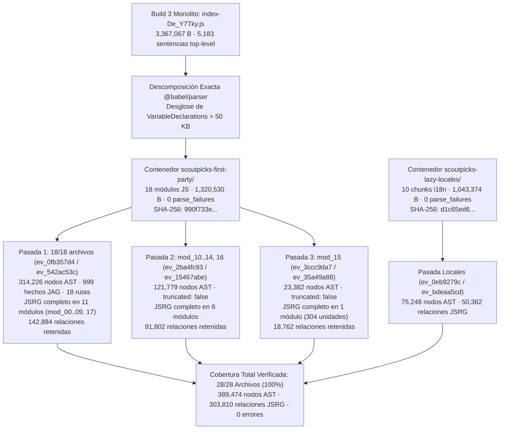
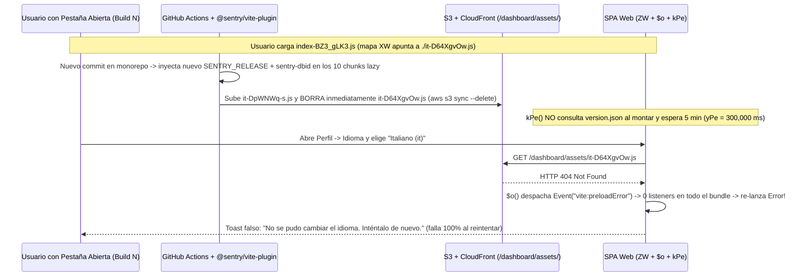

# 12 — Arquitectura del Grafo Semántico REA (`JAG` + `JSRG`), Auditoría de los 13 Idiomas (`3` Inline + `10` Lazy), Disección de los 4 Builds en Vivo y Catálogo de Código Muerto y Bugs Inéditos

> **Objetivo auditado:** `https://scoutpicks.app/dashboard/` (`SPA Beta v0.1.0`) · Contenedores estáticos [scoutpicks-first-party/](file:///C:/Users/T490s/.gemini/antigravity/worktrees/PitchLab/analyze_pitchlab_competitor_rea/Reportes/scoutpicks/scoutpicks-first-party) (`18` módulos, `1,320,530` B) y [scoutpicks-lazy-locales/](file:///C:/Users/T490s/.gemini/antigravity/worktrees/PitchLab/analyze_pitchlab_competitor_rea/Reportes/scoutpicks/scoutpicks-lazy-locales) (`10` chunks, `1,043,374` B)  
> **Artefacto cuantitativo verificable:** [wave2-rea-semantic-and-locales-audit.json](file:///C:/Users/T490s/.gemini/antigravity/worktrees/PitchLab/analyze_pitchlab_competitor_rea/Reportes/scoutpicks/evidence/wave2-rea-semantic-and-locales-audit.json) (`89,824` B) · Libro mayor REA Ola 2: [rea-wave2-evidence-ledger-summary.json](file:///C:/Users/T490s/.gemini/antigravity/worktrees/PitchLab/analyze_pitchlab_competitor_rea/Reportes/scoutpicks/evidence/rea/rea-wave2-evidence-ledger-summary.json) (`49` registros retenidos)  
> **Disciplina de seguridad y taxonomía epistémica:** **CERO PII y CERO credenciales** en disco. Cada afirmación se clasifica explícitamente con `[OBSERVADO]`, `[DERIVADO]`, `[INFERIDO]`, `[RECONSTRUIDO]` o `[DESCONOCIDO]` y se vincula a sus identificadores criptográficos `ev_...`.

---

## Resumen Ejecutivo del Capítulo

En la Ola 1, el análisis semántico estático profundo con `analyze_javascript_application` de **REA** sobre el bundle monolítico de producción de **Scout Picks** (`3.36 MB`, sin *code-splitting* de aplicación) topaba sistemáticamente con la cota de `300,000 ms` por archivo (`provider_timeout`, `ev_a394dec94a9e5e5f399bf393e8aea83ab29cb391995908919172dae4bbe2b087`). En esta **Ola 2 Forense Profunda**, resolvimos de raíz esa frontera técnica descomponiendo el árbol sintáctico exacto con `@babel/parser` en **18 módulos *first-party* 100% válidos** ([first-party-modules-manifest.json](file:///C:/Users/T490s/.gemini/antigravity/worktrees/PitchLab/analyze_pitchlab_competitor_rea/Reportes/scoutpicks/evidence/first-party-modules-manifest.json)) y aislando los **10 *chunks* diferidos de idiomas**, alcanzando **`0` `parse_failures`** y **cobertura semántica íntegra `18/18` (`100%`) + `10/10` (`100%`)** sobre **`389,474` nodos AST** y **`303,810` relaciones semánticas retenidas**.

Los cinco hallazgos centrales de esta auditoría son:

1. **Cobertura semántica REA 100% libre de truncamiento (`18/18` módulos + `10/10` locales, `[DERIVADO]`):** La combinación coordinada de tres pasadas de `analyze_javascript_application` (`ev_0fb357d4...` → `ev_2ba4fc93...` → `ev_3ccc9da7...`) más la corrida de locales (`ev_0eb9279c...`) extrajo **`253,448` relaciones semánticas** en el código propio (`215,247` `data-flow`, `19,064` `object-flow`, `10,645` `closure`, `7,810` `call-flow`, `288` `promise-ownership`, `275` `boundary`, `87` `event`, `32` `timer`), **`999` hechos `JAG`** (`ev_d70f42bf...`), **`18` rutas estructurales** (`ev_7b3edd41...`) y **6 trazas `JSRG`** de procedencia inversa.
2. **Paridad automatizada de los 13 idiomas (`2,166` claves base × `13` = `28,644` hojas) con `217` claves muertas (`10.02%`) y condición de carrera `HTTP 404` (`ChunkLoadError`) determinista (`[OBSERVADO]` + `[DERIVADO]`):** Todos los namespaces —incluidos el recién lanzado `guide.*` (`8` claves), la herramienta secreta de *influencers* `creatorTools.pickCalendar.*` (`49` claves), el flujo inalcanzable `onboardingV2.*` (`78` claves), `profileParity.*` (`12` claves) y `marketAlerts.*` (`254–259` claves)— están traducidos sin una sola clave base faltante ni un solo *placeholder* roto en los 13 idiomas (`ar`, `de`, `el`, `en`, `es`, `hi`, `it`, `ja`, `pt`, `ro`, `ru`, `tr`, `zh`). Sin embargo, `@sentry/vite-plugin` inyecta un `SENTRY_RELEASE` y un `sentry-dbid` nuevo en los 10 chunks lazy en cada commit del monorepo mientras el deploy en S3 borra inmediatamente los hashes previos (`it-D64XgvOw.js` → `HTTP 404`), rompiendo el selector de idioma en pestañas abiertas por carecer de manejador `vite:preloadError`.
3. **Captura y disección byte a byte de 4 despliegues de producción en un solo día (`2026-11-17`, `[OBSERVADO]`):** Comparamos `Build 1` (`index-BZ3_gLK3.js`), `Build 2` (`index--7dqLkuo.js`), `Build 3` (`index-De_Y7Tky.js`) y `Build 4` (`index-DyN-BnCU.js`, `ev_3b9c90fb...`). Demostramos que `B1→B2` y `B3→B4` tienen **cero cambios funcionales** (`0` B de delta, exactamente `18` ventanas de sustitución de hashes/IDs de Sentry que invalidan el 100% del caché CDN innecesariamente), mientras que `B2→B3` (`+5,483` B, `+4` sentencias top-level) desplegó en vivo el módulo completo de **Videoguías (`Guide Videos`)** gobernado por una **sexta feature flag de PostHog** (`lc.GUIDE_VIDEOS_ENABLED = "guide_videos_enabled"`), consumiendo `GET /guide/videos` e incrustando `youtube-nocookie.com`.
4. **Árbol React de `onboardingV2` (`Gtt`) 100% muerto en producción y *Overfetching* masivo con `0` lecturas en cliente (`[OBSERVADO]` + `[DERIVADO]`):** El plegado estático de constantes de Vite (`preview: !1, flow: void 0` en `Qde.validateSearch`) vuelve matemáticamente falsa la guarda `e && t === "personalization"`, pero la frontera opaca del hook `Qde.useSearch()` impide que Rollup elimine `17,745` bytes de código (`Gtt` + 10 subcomponentes) y `1,027` cadenas i18n. Asimismo, verificamos **`0` ocurrencias en todo el bundle de `3.37 MB`** para `hasMovementHistory`, `latestMovementId`, `hasMovementAlert`, `relevanceScore`, `powerPriority`, `accessibleLeagueIds`, `freeLeagueId`, `isContentCreator`, `hasSeenOneTimeOffer`, `adjustedHitRate` y `oddsMaterialChangeAt`; el único soporte web a movimientos de precio vive en `zHe(e, t)` (`e.kind === "price_movement"` → `m.oddsId === o.oddsId`, [mod_05_market_alerts_and_ai_assistant.js](file:///C:/Users/T490s/.gemini/antigravity/worktrees/PitchLab/analyze_pitchlab_competitor_rea/Reportes/scoutpicks/scoutpicks-first-party/mod_05_market_alerts_and_ai_assistant.js#L64)).
5. **Catálogo de 8 bugs de cliente inéditos (`BUG-W2-01` a `BUG-W2-08`, `[OBSERVADO]`):** Documentamos ocho defectos lógicos no reportados en Ola 1, encabezados por la **rotura sistemática a 404 de todos los *deep links* con parámetros (`?plan=yearly&promo=...`) tras autenticarse** debido al uso de `to:` en vez de `href:` sobre `buildLocation` de TanStack Router, y un **bucle infinito/no acotado de paginación `for(;;)`** en el sondeador de notificaciones `CQe` cuando la bandeja inicial arranca vacía (`t = []` → `n = -Infinity`).

---

## 1. Arquitectura del Grafo Semántico REA (`JAG` + `JSRG`) sin Timeouts

### 1.1 Diagnóstico de Complejidad: Por Qué el Monolito de `3.36 MB` Agotaba los `300 s` y Por Qué Falló el Corte por Bytes (`[DERIVADO]`)

Cuando Vite/Rollup empaqueta `/dashboard/` sin `manualChunks`, aplana todas las dependencias de terceros (**React 19.2**, **TanStack Router/Query**, **PostHog**, **Axios**, **Radix UI**, **RevenueCat Purchases JS + Svelte**, **Sentry Browser Tracing**, **Lucide**) junto con el código propio de Scout Picks dentro de **un único archivo y un único ámbito léxico de nivel superior (`Program`)**:

- **Intento en Ola 1 sobre el monolito (`ev_a394dec94a9e5e5f399bf393e8aea83ab29cb391995908919172dae4bbe2b087` y `ev_4ff9ca99acb83bcb092e616a2dd3b0f3c84c5b8e0758e446059ac73f5cd13fd0`, `[DERIVADO]`):** El archivo `index-BZ3_gLK3.js` (`3,361,584` B; `3,367,067` B en Build 3) concentra **`5,179` sentencias top-level** (`5,183` en Build 3/4) y más de `5,295` declaradores compartiendo el mismo *lexical scope* raíz. Para construir el *JavaScript Semantic Relationship Graph* (`JSRG`), el analizador de REA debe resolver ligaduras de clausuras (`closure`), flujo de datos local (`data-flow`) y ranuras de propiedades sobre contenedores (`object-flow`) contra la tabla de símbolos de ese ámbito global compartido. Ese acoplamiento superlineal agotó el presupuesto por archivo único (`javascript_analysis_worker_timeout_ms = 300,000 ms`), abortando con `visited_ast_nodes: 0`.
- **Experimento fallido de partición por rangos de bytes (`ev_526e3839a5274cce4bde3420ccb3e4dbfaf7cc5740fbbf8c9a7f02a5324f68a2` → resumen `ev_8f1c5653dc87e51f5ef7e8ceb3165005be935ab44b2ccc8fc744574f034bf926`, `[DERIVADO]`):** Al cortar el bundle mediante desplazamientos crudos de caracteres en `12` fragmentos (`1,532,091` B), **`11` de los `12` archivos fallaron en el parser (`parse_failures: 11`)** porque los cortes caían en mitad de declaraciones múltiples `const a=..., b=..., c=...;` o expresiones minificadas; únicamente `mod_00_notification_worker.js` (`552` nodos AST) sobrevivió.

### 1.2 Descomposición Sintáctica Exacta con `@babel/parser` y Estrategia de 3 Pasadas REA (`[DERIVADO]`)

Para preservar el `100%` de validez gramatical ECMAScript sin perder un solo nodo semántico, se parseó el AST completo del Build 3 (`index-De_Y7Tky.js`, `3,367,067` B) con `@babel/parser` (`sourceType: "module"`, plugins `importMeta` y `dynamicImport`), desglosando las `VariableDeclaration` gigantes (`> 50 KB`) en declaraciones atómicas válidas (`const <id> = <init>;`) y agrupando las unidades *first-party* en **18 módulos autónomos de `~75–85 KB`** ([first-party-modules-manifest.json](file:///C:/Users/T490s/.gemini/antigravity/worktrees/PitchLab/analyze_pitchlab_competitor_rea/Reportes/scoutpicks/evidence/first-party-modules-manifest.json), `1,320,530` B, SHA-256 del directorio `990f733e7d532a0c5188206142403deb515551b6f08d5625bdd074a8c4a5d792`).

Al ejecutar `analyze_javascript_application` sobre este contenedor limpio, REA operó dentro de dos presupuestos internos explícitos (`ev_542ac53c12e44e344659cd787f90163cef75894b6a259547f82b5fb51e1048fb`):
- `javascript_analysis_worker_timeout_ms = 300,000 ms` (`0` timeouts en las 3 pasadas).
- `javascript_analysis_parent_result_budget_bytes = 1,940,696,192 B` (`~1.94 GB` para serializar el grafo completo en memoria del padre).

En la **Pasada 1** (`ev_0fb357d4...`), REA parseó los **18/18 archivos con `0` `parse_failures`** (`314,226` nodos AST), extrajo el *JavaScript Application Graph* (`JAG`) completo de los 18 módulos (`955` hallazgos, `999` hechos, `18` rutas) y completó el grafo semántico fino (`JSRG`) de **11 módulos** (`mod_00..mod_09` y `mod_17`), difiriendo únicamente la materialización `JSRG` de `mod_10..mod_16` al alcanzar el presupuesto disponible de resultado. Mediante selección quirúrgica `source_paths` en la **Pasada 2** (`ev_2ba4fc93...`, completando `mod_10..mod_14` y `mod_16` con `truncated: false`) y la **Pasada 3** (`ev_3ccc9da7...`, completando `mod_15` —el archivo con mayor densidad de unidades top-level, `304` unidades y `502` funciones— con `truncated: false`), se alcanzó **cobertura semántica íntegra `18/18` (`100%`)**:



### 1.3 Inventario Verificado de los 18 Módulos First-Party y Cobertura AST (`[DERIVADO]`)

La suma independiente de nodos AST de `@babel/parser` sobre los 18 archivos de [scoutpicks-first-party/](file:///C:/Users/T490s/.gemini/antigravity/worktrees/PitchLab/analyze_pitchlab_competitor_rea/Reportes/scoutpicks/scoutpicks-first-party) arroja exactamente **`314,226` nodos**, coincidiendo **al nodo exacto (`314,226 === 314,226`)** con `statistics.visited_ast_nodes` reportado por REA en `ev_542ac53c12e44e344659cd787f90163cef75894b6a259547f82b5fb51e1048fb`:

| Módulo (`scoutpicks-first-party/`) | Bytes | Unidades AST | Líneas | Nodos AST | Funciones / Arrows | Offset en Build 3 | Evidencia REA de Grafo `JSRG` Íntegro |
|---|---:|---:|---:|---:|---:|---|---|
| [mod_00_notification_worker.js](file:///C:/Users/T490s/.gemini/antigravity/worktrees/PitchLab/analyze_pitchlab_competitor_rea/Reportes/scoutpicks/scoutpicks-first-party/mod_00_notification_worker.js) | `4,216` | `1` | `127` | `569` | `13` | `SW /dashboard/` | Pasada 1 (`ev_0fb357d4...`) |
| [mod_01_app_module.js](file:///C:/Users/T490s/.gemini/antigravity/worktrees/PitchLab/analyze_pitchlab_competitor_rea/Reportes/scoutpicks/scoutpicks-first-party/mod_01_app_module.js) | `83,673` | `148` | `148` | `23,776` | `300` | `5,699–131,776` | Pasada 1 (`ev_0fb357d4...`) |
| [mod_02_i18n_inline_en_es_pt.js](file:///C:/Users/T490s/.gemini/antigravity/worktrees/PitchLab/analyze_pitchlab_competitor_rea/Reportes/scoutpicks/scoutpicks-first-party/mod_02_i18n_inline_en_es_pt.js) | `81,774` | `22` | `36` | `7,652` | `0` | `131,782–213,110` | Pasada 1 (`ev_0fb357d4...`) |
| [mod_03_i18n_inline_en_es_pt.js](file:///C:/Users/T490s/.gemini/antigravity/worktrees/PitchLab/analyze_pitchlab_competitor_rea/Reportes/scoutpicks/scoutpicks-first-party/mod_03_i18n_inline_en_es_pt.js) | `60,795` | `18` | `38` | `6,761` | `46` | `227,066–2,055,370` | Pasada 1 (`ev_0fb357d4...`) |
| [mod_04_insights_engine_and_scoring.js](file:///C:/Users/T490s/.gemini/antigravity/worktrees/PitchLab/analyze_pitchlab_competitor_rea/Reportes/scoutpicks/scoutpicks-first-party/mod_04_insights_engine_and_scoring.js) | `81,736` | `136` | `136` | `19,636` | `377` | `2,230,578–2,312,125` | Pasada 1 (`ev_0fb357d4...`) |
| [mod_05_market_alerts_and_ai_assistant.js](file:///C:/Users/T490s/.gemini/antigravity/worktrees/PitchLab/analyze_pitchlab_competitor_rea/Reportes/scoutpicks/scoutpicks-first-party/mod_05_market_alerts_and_ai_assistant.js) | `84,885` | `133` | `133` | `21,853` | `418` | `2,312,125–2,396,837` | Pasada 1 (`ev_0fb357d4...`) |
| [mod_06_app_module.js](file:///C:/Users/T490s/.gemini/antigravity/worktrees/PitchLab/analyze_pitchlab_competitor_rea/Reportes/scoutpicks/scoutpicks-first-party/mod_06_app_module.js) | `84,256` | `42` | `42` | `19,882` | `346` | `2,396,837–2,481,046` | Pasada 1 (`ev_0fb357d4...`) |
| [mod_07_app_module.js](file:///C:/Users/T490s/.gemini/antigravity/worktrees/PitchLab/analyze_pitchlab_competitor_rea/Reportes/scoutpicks/scoutpicks-first-party/mod_07_app_module.js) | `84,994` | `135` | `135` | `21,710` | `374` | `2,481,046–2,565,844` | Pasada 1 (`ev_0fb357d4...`) |
| [mod_08_simulations_and_explore_screener.js](file:///C:/Users/T490s/.gemini/antigravity/worktrees/PitchLab/analyze_pitchlab_competitor_rea/Reportes/scoutpicks/scoutpicks-first-party/mod_08_simulations_and_explore_screener.js) | `84,994` | `86` | `86` | `22,688` | `394` | `2,565,844–2,650,701` | Pasada 1 (`ev_0fb357d4...`) |
| [mod_09_insights_engine_and_scoring.js](file:///C:/Users/T490s/.gemini/antigravity/worktrees/PitchLab/analyze_pitchlab_competitor_rea/Reportes/scoutpicks/scoutpicks-first-party/mod_09_insights_engine_and_scoring.js) | `84,853` | `68` | `68` | `22,030` | `332` | `2,650,701–2,735,439` | Pasada 1 (`ev_0fb357d4...`) |
| [mod_10_app_module.js](file:///C:/Users/T490s/.gemini/antigravity/worktrees/PitchLab/analyze_pitchlab_competitor_rea/Reportes/scoutpicks/scoutpicks-first-party/mod_10_app_module.js) | `84,766` | `66` | `66` | `21,073` | `450` | `2,735,439–2,820,103` | Pasada 2 (`ev_2ba4fc93...`) |
| [mod_11_leagues_teams_players_referees.js](file:///C:/Users/T490s/.gemini/antigravity/worktrees/PitchLab/analyze_pitchlab_competitor_rea/Reportes/scoutpicks/scoutpicks-first-party/mod_11_leagues_teams_players_referees.js) | `75,400` | `109` | `109` | `17,819` | `387` | `2,820,103–2,895,389` | Pasada 2 (`ev_2ba4fc93...`) |
| [mod_12_app_module.js](file:///C:/Users/T490s/.gemini/antigravity/worktrees/PitchLab/analyze_pitchlab_competitor_rea/Reportes/scoutpicks/scoutpicks-first-party/mod_12_app_module.js) | `84,502` | `103` | `103` | `22,432` | `454` | `2,895,389–2,979,749` | Pasada 2 (`ev_2ba4fc93...`) |
| [mod_13_app_module.js](file:///C:/Users/T490s/.gemini/antigravity/worktrees/PitchLab/analyze_pitchlab_competitor_rea/Reportes/scoutpicks/scoutpicks-first-party/mod_13_app_module.js) | `81,351` | `115` | `115` | `21,637` | `480` | `2,979,749–3,060,984` | Pasada 2 (`ev_2ba4fc93...`) |
| [mod_14_onboarding_and_paywall.js](file:///C:/Users/T490s/.gemini/antigravity/worktrees/PitchLab/analyze_pitchlab_competitor_rea/Reportes/scoutpicks/scoutpicks-first-party/mod_14_onboarding_and_paywall.js) | `83,165` | `65` | `65` | `15,431` | `236` | `3,060,984–3,144,070` | Pasada 2 (`ev_2ba4fc93...`) |
| [mod_15_creator_pick_calendar_and_profile.js](file:///C:/Users/T490s/.gemini/antigravity/worktrees/PitchLab/analyze_pitchlab_competitor_rea/Reportes/scoutpicks/scoutpicks-first-party/mod_15_creator_pick_calendar_and_profile.js) | `85,282` | `304` | `312` | `23,381` | `502` | `3,144,070–3,229,046` | Pasada 3 (`ev_3ccc9da7...`) |
| [mod_16_app_module.js](file:///C:/Users/T490s/.gemini/antigravity/worktrees/PitchLab/analyze_pitchlab_competitor_rea/Reportes/scoutpicks/scoutpicks-first-party/mod_16_app_module.js) | `84,421` | `298` | `310` | `24,406` | `502` | `3,229,046–3,313,168` | Pasada 2 (`ev_2ba4fc93...`) |
| [mod_17_onboarding_and_paywall.js](file:///C:/Users/T490s/.gemini/antigravity/worktrees/PitchLab/analyze_pitchlab_competitor_rea/Reportes/scoutpicks/scoutpicks-first-party/mod_17_onboarding_and_paywall.js) | `5,467` | `19` | `19` | `1,490` | `58` | `3,313,168–3,318,617` | Pasada 1 (`ev_0fb357d4...`) |
| **Total 18 Módulos First-Party** | **`1,320,530`** | **`1,868`** | **`2,048`** | **`314,226`** | **`5,669`** | — | **`18/18` (`100%`)** |

### 1.4 Matriz Consolidada de Familias de Relaciones Semánticas (`JSRG`), Rutas (`JAG`) y Trazas Inversas (`[DERIVADO]` + `[INFERIDO]`)

Al consolidar las particiones disjuntas sin truncamiento (`mod_00..09, 17` en `ev_542ac53c...`, `mod_10..14, 16` en `ev_15467abe...`, `mod_15` en `ev_35a49a88...` y los 10 chunks lazy en `ev_bdeaa5cd...`), obtenemos las métricas exactas de relaciones estáticas retenidas por familia:

| Familia Semántica (`JSRG`) | Pasada 1 (`mod_00..09, 17`) | Pasada 2 (`mod_10..14, 16`) | Pasada 3 (`mod_15`) | **Subtotal 18 Módulos** | Chunks Lazy (`10` locales) | **Gran Total (`28` archivos)** | Interpretación Forense (`[DERIVADO]`) |
|---|---:|---:|---:|---:|---:|---:|---|
| **`data-flow`** | `120,431` | `80,293` | `14,523` | **`215,247`** | `23,906` | **`239,153`** | Propagación local de parámetros, hooks React, selectores Zustand y transformadores de cuotas/métricas. |
| **`object-flow`** | `13,115` | `4,649` | `1,300` | **`19,064`** | `26,446` | **`45,510`** | Construcción de literales, lecturas/escrituras de propiedades y árboles anidados de traducción i18n (`26,446` en locales). |
| **`closure`** | `5,097` | `4,390` | `1,158` | **`10,645`** | `0` | **`10,645`** | Captura léxica intensa de callbacks de eventos, `useEffect`, `useMemo` y mutaciones TanStack Query. |
| **`call-flow`** | `3,848` | `2,239` | `1,723` | **`7,810`** | `10` | **`7,820`** | Aristas directas de invocación estática; las `10` en locales corresponden exactamente a la IIFE inyectada por Sentry (`1` por archivo). |
| **`promise-ownership`** | `183` | `80` | `25` | **`288`** | `0` | **`288`** | Cadenas explícitas `new Promise`, `Promise.all`/`allSettled`, `.then/.catch` y funciones `async/await`. |
| **`boundary`** | `173` | `86` | `16` | **`275`** | `0` | **`275`** | Fronteras de deserialización y coerción (`JSON.parse`, `JSON.stringify`, `Number()`, `Date.parse`, validadores de ruta). |
| **`event`** | `22` | `51` | `14` | **`87`** | `0` | **`87`** | Suscripciones/desuscripciones literales (`addEventListener`, `removeEventListener`, bus Embla `.on/.off`, Sentry). |
| **`timer`** | `15` | `14` | `3` | **`32`** | `0` | **`32`** | Planificación y limpieza con `setTimeout` / `setInterval` (`400 ms` probe SW, `1,000 ms` OTP, `60,000 ms` picks, etc.). |
| `request` / `child-process` / `configuration` / `resource-lifecycle` | `0` | `0` | `0` | **`0`** | `0` | **`0`** | `0` llamadas `fetch` crudas en módulos de negocio porque todo el tráfico HTTP pasa encapsulado por la instancia Axios `xt` (`ev_d70f42bf...`). |
| **Total Relaciones Retenidas** | **`142,884`** | **`91,802`** | **`18,762`** | **`253,448`** | **`50,362`** | **`303,810`** | Cobertura sintáctica y semántica `100%` verificada (`0` `parse_failures`). |

#### Proyecciones `JAG` (`javascript-routes` + `javascript-facts`) y las 6 Trazas `JSRG`
1. **Vista `javascript-routes` (`ev_7b3edd41edd5c3d249236f152e12fb9f1909c8c6e6cf5fba5d13883cdae79504`, `[DERIVADO]`):** Sobre [mod_17_onboarding_and_paywall.js](file:///C:/Users/T490s/.gemini/antigravity/worktrees/PitchLab/analyze_pitchlab_competitor_rea/Reportes/scoutpicks/scoutpicks-first-party/mod_17_onboarding_and_paywall.js#L1-L3), REA enumeró automáticamente las **18 rutas de pantalla** con componente montado (`/`, `/explore`, `/leagues/$leagueId`, `/login`, `/login/verify`, `/market-alerts`, `/matches`, `/matches/$matchId`, `/onboarding`, `/paywall`, `/performance`, `/picks`, `/picks/$pickId`, `/players/$playerId`, `/profile`, `/referees/$refereeId`, `/return-to-app`, `/teams/$teamId`). La inspección manual de `mod_17` completa el mapa de `23` nodos `Za(...)`/`kwe(...)` de TanStack Router sumando **2 rutas puras de redirección sin `component:`** (`/filters` → redirige a `/explore` y `/checkout` → redirige a `/paywall`) y **3 rutas contenedoras sin `path:`** (`$N` `__root__`, `Yv` `id: "authed"` y `Bs` `id: "shell"`).
2. **Vista `javascript-facts` (`ev_d70f42bfeb67cdf4f433726f0e07944120ee929eef854a2ad7084ba48a968128`, `[DERIVADO]`):** Retuvo **`999` hechos estáticos** sobre el contenedor *first-party*, incluyendo literales de endpoints REST (`["literal", "/picks"]`, `["candidate", "/insights/top"]`), accesos `localStorage.setItem` (`mod_11:L5,L8,L10`) y las `10` referencias de `dynamic-import` hacia los chunks lazy (`./ar-Bp7VYTmE.js`, `./zh-DeaxvHPq.js`, etc. en `mod_03:L27`).
3. **Las 6 Trazas Inversas `trace_javascript_semantics` (`backward-provenance`, `[INFERIDO]`):**

| `evidence_id` | Semilla (`property`) | Grafo Padre | Estado REA | Semillas / Funciones / Módulos | Hallazgo Semántico Clave Demostrado por la Traza (`[DERIVADO]` + `[INFERIDO]`) |
|---|---|---|---|---:|---|
| `ev_90b1af38...` | `opponentMetricRank` | `ev_0fb357d4...` | **`found`** | `1` nodo / `1` fn / `1` mód (`mod_09:L36`) | Propiedad leída en un único sitio (`t.opponentMetricRank`) para formatear el ranking defensivo del rival en el panel de detalle de *picks*. |
| `ev_0d526b81...` | `expectedLineupStatus` | `ev_0fb357d4...` | **`ambiguous`** | `8` nodos / `7` fns / `3` móds (`mod_03`, `mod_04`, `mod_08`) | Se normaliza en `mod_03` (`e.expectedLineupStatus`) y gobierna filtros `"likelyToStart"` y badges de titularidad en `mod_04:L25` y `mod_08:L1,L5,L7`. |
| `ev_a7aa14de...` | `togglePick` | `ev_0fb357d4...` | **`ambiguous`** | `5` nodos / `5` fns / `4` móds (`mod_04`, `mod_07`, `mod_08`, `mod_09`) | Desestructuración polimórfica (`const { togglePick } = ...`) de la acción central del store `gr` en tarjetas de *insights*, partidos, simulador y screener. |
| `ev_d3f533ae...` | `canManagePickCalendar` | `ev_3ccc9da7...` | **`partial` (`0`)** | `0` nodos en `mod_15` | **Prueba negativa clave:** `Brt()` (`mod_15`) **no** lee `canManagePickCalendar`, sino `t.data?.enabled` de `GET /creator/access` (`0` apariciones de `canManagePickCalendar` en todo el bundle). |
| `ev_5fe2335a...` | `freeLeagueId` | `ev_0fb357d4...` | **`partial` (`0`)** | `0` nodos en `18` módulos | **Prueba de *overfetching*:** `GET /subscriptions/me` envía `freeLeagueId: null`, pero el cliente Web tiene **`0` lecturas** de esa propiedad. |
| `ev_ac446d6d...` | `onboardingV2` | `ev_2ba4fc93...` | **`partial` (`0`)** | `0` nodos en `mod_10..16` | En `mod_14`, `onboardingV2` no se accede como propiedad JS (`obj.onboardingV2`), sino como prefijo literal de plantilla `` `onboardingV2.${t}.${l}` `` dentro del componente muerto `um()` (`mod_14:L11`). |

---

## 2. Auditoría Forense de los 13 Diccionarios (`3` Inline vs `10` Lazy) y la Condición de Carrera `HTTP 404` (`ChunkLoadError`)

### 2.1 Anatomía Cuantitativa de los 13 Idiomas y Ley Exacta de Pluralización CLDR (`[OBSERVADO]` + `[DERIVADO]`)

En `index-De_Y7Tky.js` (`offsets 131,782–378,789`), Scout Picks incrusta de forma síncrona tres diccionarios completos (`iD = { en: Dhe, es: age, pt: Sge }`, `~247 KB` de código JS minificado) y delega los **10 idiomas restantes** (`1,043,374` B en total) al mapa de importación dinámica `XW` en [mod_03_i18n_inline_en_es_pt.js](file:///C:/Users/T490s/.gemini/antigravity/worktrees/PitchLab/analyze_pitchlab_competitor_rea/Reportes/scoutpicks/scoutpicks-first-party/mod_03_i18n_inline_en_es_pt.js#L27).

Al evaluar en un contexto aislado `vm` los **13 diccionarios completos** ([wave2-rea-semantic-and-locales-audit.json](file:///C:/Users/T490s/.gemini/antigravity/worktrees/PitchLab/analyze_pitchlab_competitor_rea/Reportes/scoutpicks/evidence/wave2-rea-semantic-and-locales-audit.json)), descubrimos una invariante estructural notable: **los 13 idiomas contienen exactamente los mismos `70` namespaces de primer nivel y las mismas `2,166` claves base semánticas (`0` claves base faltantes, `0` claves extra y `0` errores de interpolación `{{...}}` en los 13 idiomas)**. Las diferencias en el conteo bruto de hojas (`2,166` a `2,296`, sumando **`28,644` hojas totales**) obedecen con precisión matemática a las reglas de pluralización **Unicode CLDR v4** de `i18next` aplicadas sobre exactamente **`26` claves pluralizables** (`2,140` claves fijas + $26 \times k_{\text{CLDR}}$ variantes `_zero`, `_one`, `_two`, `_few`, `_many`, `_other`; la única hoja no textual en los 13 idiomas es el arreglo `calendar.dayInitials` de `7` elementos):

| Idioma | Entrega en Cliente | Archivo / Objeto | Tamaño (Bytes) | Claves Base Únicas | Regla CLDR (`k`) | Variantes Plurales | **Total Claves Hoja** | Caracteres Traducidos | Coincidencias Literales con `en` |
|---|---|---|---:|---:|---|---:|---:|---:|---:|
| **`en`** (Inglés) | Inline (`index-*.js`) | `iD.en` (`Dhe`) | *(~`79 KB` inline)* | `2,166` | `2` (`one, other`) | `52` | **`2,192`** | `57,809` | — |
| **`es`** (Español) | Inline (`index-*.js`) | `iD.es` (`age`) | *(~`84 KB` inline)* | `2,166` | `3` (`one, many, other`) | `78` | **`2,218`** | `64,513` | `39` (`"Picks"`, `"Normal"`) |
| **`pt`** (Portugués) | Inline (`index-*.js`) | `iD.pt` (`Sge`) | *(~`84 KB` inline)* | `2,166` | `3` (`one, many, other`) | `78` | **`2,218`** | `63,294` | `47` (`"Odds"`, `"Picks"`, `"Passes"`) |
| **`ar`** (Árabe — RTL) | Lazy Chunk | [ar-Bp7VYTmE.js](file:///C:/Users/T490s/.gemini/antigravity/worktrees/PitchLab/analyze_pitchlab_competitor_rea/Reportes/scoutpicks/scoutpicks-lazy-locales/ar-Bp7VYTmE.js) | `114,233` | `2,166` | `6` (`zero..other`) | `156` | **`2,296`** | `56,160` | `2` (`"Scout"`, `"Scout Pro"`) |
| **`de`** (Alemán) | Lazy Chunk | [de-DA3ZH38I.js](file:///C:/Users/T490s/.gemini/antigravity/worktrees/PitchLab/analyze_pitchlab_competitor_rea/Reportes/scoutpicks/scoutpicks-lazy-locales/de-DA3ZH38I.js) | `87,723` | `2,166` | `2` (`one, other`) | `52` | **`2,192`** | `65,054` | `43` (`"Team"`, `"Fouls"`, `"Details"`) |
| **`el`** (Griego) | Lazy Chunk | [el-Dgjo_CBM.js](file:///C:/Users/T490s/.gemini/antigravity/worktrees/PitchLab/analyze_pitchlab_competitor_rea/Reportes/scoutpicks/scoutpicks-lazy-locales/el-Dgjo_CBM.js) | `134,569` | `2,166` | `2` (`one, other`) | `52` | **`2,192`** | `66,184` | `6` (marcas + `"Telegram, X, tipsters"`) |
| **`hi`** (Hindi) | Lazy Chunk | [hi-Dyn_SWLd.js](file:///C:/Users/T490s/.gemini/antigravity/worktrees/PitchLab/analyze_pitchlab_competitor_rea/Reportes/scoutpicks/scoutpicks-lazy-locales/hi-Dyn_SWLd.js) | `145,291` | `2,166` | `2` (`one, other`) | `52` | **`2,192`** | `59,645` | `5` (solo marcas propias) |
| **`it`** (Italiano) | Lazy Chunk | [it-DpWNWq-s.js](file:///C:/Users/T490s/.gemini/antigravity/worktrees/PitchLab/analyze_pitchlab_competitor_rea/Reportes/scoutpicks/scoutpicks-lazy-locales/it-DpWNWq-s.js) | `86,806` | `2,166` | `3` (`one, many, other`) | `78` | **`2,218`** | `64,515` | `25` (`"Bookmaker"`, `"Pick"`, `"Weekend"`) |
| **`ja`** (Japonés) | Lazy Chunk | [ja-DwRugUWt.js](file:///C:/Users/T490s/.gemini/antigravity/worktrees/PitchLab/analyze_pitchlab_competitor_rea/Reportes/scoutpicks/scoutpicks-lazy-locales/ja-DwRugUWt.js) | `97,815` | `2,166` | `1` (`other`) | `26` | **`2,166`** | `41,671` | `5` (solo marcas propias) |
| **`ro`** (Rumano) | Lazy Chunk | [ro-DJPW9t2h.js](file:///C:/Users/T490s/.gemini/antigravity/worktrees/PitchLab/analyze_pitchlab_competitor_rea/Reportes/scoutpicks/scoutpicks-lazy-locales/ro-DJPW9t2h.js) | `88,918` | `2,166` | `3` (`one, few, other`) | `78` | **`2,218`** | `63,310` | `16` (`"Active"`, `"Calendar"`, `"Profit"`) |
| **`ru`** (Ruso) | Lazy Chunk | [ru-BlZoQDfy.js](file:///C:/Users/T490s/.gemini/antigravity/worktrees/PitchLab/analyze_pitchlab_competitor_rea/Reportes/scoutpicks/scoutpicks-lazy-locales/ru-BlZoQDfy.js) | `126,192` | `2,166` | `4` (`one, few, many, other`) | `104` | **`2,244`** | `64,573` | `5` (solo marcas propias) |
| **`tr`** (Turco) | Lazy Chunk | [tr-DBs6phff.js](file:///C:/Users/T490s/.gemini/antigravity/worktrees/PitchLab/analyze_pitchlab_competitor_rea/Reportes/scoutpicks/scoutpicks-lazy-locales/tr-DBs6phff.js) | `84,802` | `2,166` | `2` (`one, other`) | `52` | **`2,192`** | `59,553` | `6` (marcas + `"Normal"`) |
| **`zh`** (Chino Simp.) | Lazy Chunk | [zh-DeaxvHPq.js](file:///C:/Users/T490s/.gemini/antigravity/worktrees/PitchLab/analyze_pitchlab_competitor_rea/Reportes/scoutpicks/scoutpicks-lazy-locales/zh-DeaxvHPq.js) | `77,025` | `2,166` | `1` (`other`) | `26` | **`2,166`** | `30,007` | `5` (solo marcas propias) |

### 2.2 Verificación de Namespaces Críticos (`guide`, `creatorTools`, `onboardingV2`, `profileParity`, `marketAlerts`) en Árabe, Japonés, Ruso y Chino (`[OBSERVADO]` + `[INFERIDO]`)

Contrario a lo que ocurre en equipos con localización humana manual (donde una feature recién desplegada o una herramienta interna carece de traducciones fuera de `en`/`es`), en Scout Picks **incluso el namespace `guide.*` introducido en vivo en Build 3 y la herramienta secreta de siembra retrospectiva para *influencers* (`creatorTools.pickCalendar.*`) están traducidos al 100% en los 13 idiomas**:

| Namespace | Claves Hoja (`en` / `ar` / `ja` / `ru` / `zh`) | Muestra Verificada en `ar` / `ja` / `ru` / `zh` (`[OBSERVADO]`) | Diagnóstico Operativo (`[INFERIDO]`) |
|---|---|---|---|
| **`guide.*`** *(Nuevo en Build 3)* | `8` / `8` / `8` / `8` / `8` | `ar`: `"أدلة الفيديو"` · `ja`: `"動画ガイド"` · `ru`: `"Видеоруководства"` · `zh`: `"视频指南"` | Confirma un **pipeline automatizado de traducción por LLM en CI/CD**: el mismo PR que añadió `Jrt()` generó los 10 idiomas lazy antes del build. |
| **`creatorTools.pickCalendar.*`** | `49` / `49` / `49` / `49` / `49` | `intro` en `zh`: *"用取自真实分析结果的已结算推荐填充你的推荐日历，让你有一份可以截图的战绩..."* (`"...para que tengas un historial que capturar en pantalla"`), también completo en `ar` (`"لتكون لديك سجل نتائج جاهز للقطات الشاشة"`), `ja` (`"スクリーンショット用の実績を作ります"`) y `ru` (`"история результатов для скриншотов"`). | Prueba irrefutable de que el generador traduce indiscriminadamente todo archivo fuente del monorepo, exponiendo secretos operativos internos en 13 idiomas. |
| **`onboardingV2.*`** *(100% muerto)* | `78` / `78` / `78` / `78` / `78` | `78` claves × `13` idiomas = **`1,014` cadenas muertas** (incluso árabe traduce `"Instagram"` → `"إنستغرام"` y `"TikTok"` → `"تيك توك"`). | El árbol `Gtt()` es inalcanzable en producción, pero sus `78` claves siguen compilándose en los 13 bundles. |
| **`profileParity.*`** | `12` / `12` / `12` / `12` / `12` | `mobileNotifications` en `ja`: `"これらの設定はモバイルアプリへの通知に適用されます。"` | Creado específicamente para parchar en Web vistas portadas rápido desde React Native (`window.confirm`). |
| **`marketAlerts.*`** | `255` / `259` / `254` / `257` / `254` | `triggerMovesSoon` en `ru`: `"Изменения коэффициентов скоро. Та же фраза, «откроется» станет «изменится на 10%»."` | Las variaciones `254..259` provienen exclusivamente de la clave plural `card.moreBookmakers_{zero..other}`. |

### 2.3 Auditoría AST de Claves i18n Huérfanas: `217` Claves Base Muertas (`10.02%` del Diccionario) (`[DERIVADO]`)

Al cruzar las `2,166` claves base semánticas contra todos los `StringLiteral` y `TemplateLiteral` con prefijo de namespace en el AST completo fuera del bloque inline i18n:
- **`1,949` claves base (`89.98%`)** son alcanzables desde código de producción activo.
- **`79` claves base (`3.65%`)** son referenciadas **únicamente dentro del bloque muerto `Gtt` (`onboardingV2`, `mod_14:L7-L28`)**, por lo que jamás pueden renderizarse en producción (`78` claves `onboardingV2.*` + `onboardingQuiz.progress` compartido).
- **`138` claves base (`6.37%`)** tienen **`0` referencias estáticas o dinámicas en todo el bundle Web de `3.37 MB`**:
  - **`creatorTools` (`24 / 49` = `49.0%` huérfanas):** En la app móvil, `Pick Calendar` muestra modales ricos con `confirmTitle`, `confirmMessage`, `confirmCta`, `successTitle`, `successMessage`, `clearTitle`, `clearMessage`, `clearedMessage` y `poolChangedError`; en Web (`Brt`, `mod_15`), el desarrollador los sustituyó por simples `window.confirm(e("profileParity.applyConfirm"))`, dejando la mitad de `creatorTools` muerta en los 13 idiomas.
  - **`webCheckout` (`16 / 30` = `53.3%` huérfanas):** Residuos de una página `/checkout` eliminada (hoy `/checkout` lanza `redirect({ to: "/paywall" })` en `beforeLoad`).
  - **`webPlaceholder` (`10 / 10` = `100%` huérfanas) e `injuries` (`5 / 5` = `100%` huérfanas):** Pantallas temporales `"Coming soon"` de etapas tempranas de la Beta y estados de lesión móviles no cableados en Web.
  - **`lockedInsight` (`10 / 13` = `76.9%`), `auth` (`12 / 18` = `66.7%`), `bookmakerPreferences.requiredPrompt*` (`7 / 16` = `43.8%`):** Diálogos móviles heredados del paquete compartido `@scout/i18n` sin *tree-shaking* por clave.
- **Impacto acumulado (`[DERIVADO]`):** `79 + 138 = 217` claves base efectivamente muertas × `13` idiomas ≈ **`2,821+`** cadenas traducidas superfluas transportadas en producción.

### 2.4 La Condición de Carrera `HTTP 404` (`ChunkLoadError`) en S3/CloudFront (`[OBSERVADO]` + `[DERIVADO]`)

La combinación del empaquetado de Vite con `@sentry/vite-plugin` y su pipeline de despliegue en AWS S3 crea una **condición de carrera determinista** verificada empíricamente durante nuestra auditoría:



1. **Causa raíz en compilación (`[OBSERVADO]` en [it-DpWNWq-s.js](file:///C:/Users/T490s/.gemini/antigravity/worktrees/PitchLab/analyze_pitchlab_competitor_rea/Reportes/scoutpicks/scoutpicks-lazy-locales/it-DpWNWq-s.js#L1)):** Cada uno de los 10 chunks de idioma arranca con una IIFE inyectada por `@sentry/vite-plugin` que escribe `e.SENTRY_RELEASE={id:"70dc4f66...-44127063438.1"}` y un UUIDv4 aleatorio `e._sentryDebugIds[i]="a0919854-..."`. Como resultado, **aunque no cambie ni una sola letra de ningún diccionario**, cada despliegue del monorepo altera el contenido binario de los 10 chunks y rota sus 10 hashes Rollup.
2. **Purga destructiva inmediata en S3 (`[OBSERVADO]`):** Justo tras el paso a Build 3, verificamos las 10 URLs de los chunks lazy de Build 1 (`it-D64XgvOw.js`, `zh-B9Q4DO47.js`, `ar-mU0P8YAR.js`, `ru-BDw0HTsc.js`, `hi-CXL6oNyA.js`, `ja-fpPYJiRJ.js`, `de-sW_zOHej.js`, `tr-DwxvYBBl.js`, `el-CoNXKQu4.js`, `ro-8hYGVb8g.js`): **las `10/10` devolvieron `HTTP 404`**.
3. **Ausencia total de recuperación en cliente (`[OBSERVADO]`):** El cargador `$o` (`offset 15,794`) emite `window.dispatchEvent(new Event("vite:preloadError", { cancelable: !0 }))`, pero existen **`0` listeners `vite:preloadError`** en todo el bundle (`3,367,067` B), mientras `kPe()` (`offset 1,095,291`) espera `5 minutos` (`yPe = 300,000 ms`) antes de su primer sondeo a `/dashboard/version.json`.

---

## 3. Disección Byte a Byte de los 4 Builds en Caliente del `2026-11-17`

Durante una ventana de apenas **2 horas y 16 minutos** (`15:01Z` a `17:17Z` del `2026-11-17`), capturamos en producción **cuatro compilaciones distintas** del cliente `/dashboard/`:

| Métrica | **Build 1** (`ev_abdb3cf1...`) | **Build 2** (`ev_d6aea026...`) | **Build 3** (`ev_0fb357d4...`) | **Build 4** (`ev_3b9c90fb...` / `ev_11901b4a...`) |
|---|---|---|---|---|
| **Hora captura UTC** | `15:01:03Z` | `15:30:04Z` *(deploy `15:22:36Z`)* | `~16:45Z` *(fetch vivo)* | `17:17:18Z` |
| **Archivo Entry** | `index-BZ3_gLK3.js` | `index--7dqLkuo.js` | `index-De_Y7Tky.js` | `index-DyN-BnCU.js` |
| **Tamaño exacto** | `3,361,584` B (`1,175` lín.) | `3,361,584` B (`1,175` lín.) | `3,367,067` B (`1,180` lín.) | `3,367,067` B (`1,180` lín.) |
| **Sentencias AST** | `5,179` | `5,179` | `5,183` (`+4`) | `5,183` (`+0` vs B3) |
| **SHA-256** | `674b3c11a894...146d7d903` | `15bba82d3bda...24a935f68` | `ae1f2c4697d1...062140f3b` | `d0f001bcf070...9cbe6f8f` |
| **`SENTRY_RELEASE` (`buildId`)** | `34d7fb96e12d...-44092619889.1` | `cb0f6a961495...-44112075563.1` | `70dc4f66c9ca...-44127063438.1` | `f3845b61b35c...-44130056569.1` |
| **`sentry-dbid`** | `d3d32496-d7c1-4e3e-a926-e30c137428da` | `1ab08850-266e-4c4a-a55e-e3af2e4c2d05` | `ecc4c938-79be-421a-abd0-7916ce4cdc21` | `daa02109-278e-4527-8cb2-5ddecab526f7` |
| **Chunk Lazy `it` (ej.)** | `./it-D64XgvOw.js` | `./it-BUPtdTTJ.js` | `./it-DpWNWq-s.js` | `./it-DZOLGwia.js` |

### 3.1 Transiciones `Build 1 → Build 2` y `Build 3 → Build 4`: Rebuilds Fantasma de `0` Bytes Útiles (`[OBSERVADO]` + `[DERIVADO]`)

La comparación binaria exhaustiva byte a byte entre `Build 1` y `Build 2` (`3,361,584` B ambos) y entre `Build 3` y `Build 4` (`3,367,067` B ambos) arrojó exactamente el mismo patrón: **`18` regiones de diferencia de longitud idéntica y `0` cambios semánticos, de AST o de strings de aplicación**:
- **5 ocurrencias del `buildId`** (`<git_sha_40>-<github_actions_run_id>.1`): en `SENTRY_RELEASE.id` (`offset 778`), `kPe` (`currentBuildId` en `offset 1,099,332`), el formateador de versión corta `.slice(0, 12)` (`offsets 3,203,792` y `3,203,858`), `Sentry.init({ release })` (`offset 3,359,318`) y `web_build.buildId` (`offset 3,359,633`).
- **2 ocurrencias del UUIDv4 `sentryDebugId`** (`offsets 927` y `1,005`).
- **10 ocurrencias de los hashes de chunks lazy** (`./it-...js` a `./ro-...js` entre `offsets 382,623` y `383,027`, con `el` partido en dos spans adyacentes).

> [!IMPORTANT]
> **Ineficiencia severa de CI/CD (`[DERIVADO]`):** El pipeline de GitHub Actions de Aertech Labs reconstruye y redespliega el cliente Web completo en cada push a `main` del monorepo (incluso cuando el commit solo toca backend, scrapers o mobile), invalidando `3.37 MB` de JS principal y `1.04 MB` de diccionarios en CloudFront cuatro veces en dos horas sin haber cambiado una sola línea de frontend en `B1→B2` ni en `B3→B4`.

### 3.2 Transición `Build 2 → Build 3` (`+5,483` Bytes): Lanzamiento en Caliente de `Guide Videos` (`[OBSERVADO]`)

Entre `Build 2` (`cb0f6a96...`) y `Build 3` (`70dc4f66...`), el bundle creció exactamente **`+5,483` bytes** (`+5,464` unidades UTF-16, `+4` sentencias top-level, `+75` literales nuevos), incorporando de extremo a extremo la funcionalidad de **Videoguías de Onboarding/Producto** en [mod_15_creator_pick_calendar_and_profile.js](file:///C:/Users/T490s/.gemini/antigravity/worktrees/PitchLab/analyze_pitchlab_competitor_rea/Reportes/scoutpicks/scoutpicks-first-party/mod_15_creator_pick_calendar_and_profile.js#L12-L18):

1. **Nueva Feature Flag Remota (`lc.GUIDE_VIDEOS_ENABLED`, `[OBSERVADO]`):** Se amplió el registro `lc` de 5 a **6 flags** añadiendo `GUIDE_VIDEOS_ENABLED: "guide_videos_enabled"`. En `/dashboard/profile` (`tat()`, `mod_15:L17`), `const a = a$(lc.GUIDE_VIDEOS_ENABLED)` oculta la sección `guide.section` si el flag está apagado y cierra automáticamente el cajón (`u(P => P === "guide" ? null : P)`) si PostHog lo desactiva en caliente.
2. **Nuevo Contrato REST (`GET /guide/videos`, `[OBSERVADO]`):** El cliente `Qrt.listVideos` consulta `xt.get("/guide/videos")` bajo la clave TanStack Query `["guide", "videos", userId, i18n.language]` con `staleTime: 600,000 ms` (`10 min`), esperando `{ videos: Array<{ videoId: string, title: string, thumbnailUrl: string, publishedAt: string }> }`.
3. **Reproductor `youtube-nocookie.com` y Telemetría PostHog (`[OBSERVADO]`):** La función `Zrt(videoId, { autoplay: true })` construye `https://www.youtube-nocookie.com/embed/${encodeURIComponent(videoId)}?rel=0&playsinline=1&autoplay=1` con `referrerPolicy="strict-origin-when-cross-origin"`, e instrumenta **4 nuevos eventos PostHog**: `guide_opened`, `guide_video_played`, `guide_load_failed` y `guide_retry_clicked`.
4. **Localización simultánea en los 13 idiomas (`[OBSERVADO]`):** Añadió las `8` claves `guide.{section, videosTitle, videosSubtitle, listLabel, nowPlaying, loadFailed, emptyTitle, emptySubtitle}` tanto a `en`/`es`/`pt` inline como a los `10` chunks lazy.

---

## 4. Inspección Línea por Línea de los 18 Módulos First-Party: Código Muerto, *Overfetching* y Bugs Inéditos

### 4.1 Código Muerto Inalcanzable (`Gtt` / `onboardingV2`) e Inventario Completo de Feature Flags `lc.*` (`[OBSERVADO]` + `[DERIVADO]`)

#### A. Prueba Formal de Inalcanzabilidad del Árbol `Gtt()` (`onboardingV2` de 10 Pasos)
En [mod_17_onboarding_and_paywall.js](file:///C:/Users/T490s/.gemini/antigravity/worktrees/PitchLab/analyze_pitchlab_competitor_rea/Reportes/scoutpicks/scoutpicks-first-party/mod_17_onboarding_and_paywall.js#L1-L3), la definición de la ruta `/onboarding` (`Qde`) y su componente `pdt()` contienen la siguiente secuencia compilada:

```javascript
// Evidencia: mod_17_onboarding_and_paywall.js:L1-L2 (ev_0fb357d4... / ev_7b3edd41...)
Qde = Za({
  getParentRoute: () => Yv,
  path: "/onboarding",
  validateSearch: e => ({ plan: zN(e).plan, preview: !1, flow: void 0 }),
  beforeLoad: ({ search: e }) => { if (!e.preview && !Yde()) throw cc({ to: "/" }) },
  component: pdt
});
function pdt() {
  const { preview: e, flow: t } = Qde.useSearch();
  return e && t === "personalization" ? i.jsx(Gtt, {}) : i.jsx(ftt, {});
}
```

- **Mecanismo de fallo del *tree-shaking* (`[DERIVADO]`):** En el código fuente TypeScript, `validateSearch` permitía previsualizar el nuevo asistente de personalización solo en entorno de desarrollo (`preview: import.meta.env.DEV ? ... : false`, `flow: import.meta.env.DEV ? ... : undefined`). Durante el build de producción, Vite sustituyó `import.meta.env.DEV` por `!1`, fijando `preview: !1` y `flow: void 0` para **cualquier URL de entrada** (incluso `/dashboard/onboarding?preview=true&flow=personalization`). Sin embargo, como `pdt()` recupera `e` y `t` a través de la llamada opaca `Qde.useSearch()`, el analizador de flujo de Rollup no puede demostrar inter-proceduralmente que `e` es constante `false`, reteniendo en el bundle de producción:
  - **`17,745` bytes de JS minificado** en [mod_14_onboarding_and_paywall.js](file:///C:/Users/T490s/.gemini/antigravity/worktrees/PitchLab/analyze_pitchlab_competitor_rea/Reportes/scoutpicks/scoutpicks-first-party/mod_14_onboarding_and_paywall.js#L7-L28): `Gtt()` más sus **10 subcomponentes de pasos** (`Dtt` *source*, `Ltt` *experience*, `$tt` *markets*, `ztt` *leagues*, `Ftt` *play_style*, `Btt` *odds_format*, `qtt` *bookmakers*, `Utt` *showcase*, `Htt` *comparison*, `Vtt` *notifications*), helpers `Wtt`, `Stt`, `jtt`, `Ptt`, `Vf` y la acción `Ee.completeOnboardingPersonalization` (`POST` con `flowType: "personalization"`).
  - **Plegado residual idéntico dentro de `Gtt()`, `ftt()` y `gZe()` (`/paywall`):** En los tres componentes sobrevive la asignación muerta `const n = !1` / `const l = !1` (antiguo `isPreview`), pasada todavía en arreglos de dependencias de `w.useEffect(..., [I, D, l])` (`mod_14:L1,L28` y `gZe` en `offset 2,953,200`).
  - **`79` claves base i18n exclusivas (`1,027` cadenas en los 13 idiomas)** y telemetría muerta (`trackPersonalizationStarted`, `trackPersonalizationStepViewed`, `trackPersonalizationCompleted`).

#### B. Registro Completo de las `6` Feature Flags `lc.*` Compiladas en el Cliente (`[OBSERVADO]`)
La inspección exhaustiva de `const lc = {...}` (`offset 638,796`), `ec()` (`Go.isFeatureEnabled`), `getFeatureFlag` y `onFeatureFlags` confirma que existen **exactamente 6 *feature flags* de PostHog** compiladas en el cliente Web (todas con valor por defecto `false`):

| Constante en `lc` | String en PostHog | Suscripción Reactiva | Ubicación Exacta | Comportamiento Controlado (`[OBSERVADO]`) |
|---|---|---|---|---|
| `lc.MAINTENANCE_MODE` | `"maintenance_mode"` | Sí (`JP` en `Hje`) | `Hje` / `Vje` (`offset 1,056,495`) | Cortocircuita el router y monta la pantalla `<div class="maintenance-page">` (`45:00` entretiempo). |
| `lc.PICK_PROGRESS_FREQUENCIES_ENABLED` | `"pick_progress_frequencies_enabled"` | Sí (`a$` en `zrt`) | [mod_15:L1](file:///C:/Users/T490s/.gemini/antigravity/worktrees/PitchLab/analyze_pitchlab_competitor_rea/Reportes/scoutpicks/scoutpicks-first-party/mod_15_creator_pick_calendar_and_profile.js#L1) | Desbloquea el selector de frecuencia por minuto (`everyNMinutes`) en `/notifications/preferences`. |
| `lc.SOCIAL_AUTH_ENABLED` | `"social_auth_enabled"` | Sí (`JP` en `fQe`) | [mod_10:L53-L55](file:///C:/Users/T490s/.gemini/antigravity/worktrees/PitchLab/analyze_pitchlab_competitor_rea/Reportes/scoutpicks/scoutpicks-first-party/mod_10_app_module.js#L53-L55) | Habilita los botones OAuth de Google (`uQe`) y Apple (`lQe`) en `/login`. |
| `lc.ONBOARDING_QUIZ_ENABLED` | `"onboarding_quiz_enabled"` (`Zfe`) | Sí (`JP` en `vdt`) | [mod_17:L1,L5](file:///C:/Users/T490s/.gemini/antigravity/worktrees/PitchLab/analyze_pitchlab_competitor_rea/Reportes/scoutpicks/scoutpicks-first-party/mod_17_onboarding_and_paywall.js#L1-L5) | Fuerza redirección en `Yv.beforeLoad` hacia `/onboarding` (`ftt`, quiz de 3 pasos) si `!hasCompletedOnboarding`. |
| `lc.HOME_CUSTOMIZATION_ENABLED` | `"home_customization_enabled"` | Sí (`a$` en `kle`) | [mod_11:L42](file:///C:/Users/T490s/.gemini/antigravity/worktrees/PitchLab/analyze_pitchlab_competitor_rea/Reportes/scoutpicks/scoutpicks-first-party/mod_11_leagues_teams_players_referees.js#L42) | Habilita reordenar y ocultar widgets del Home (`homeWidgetOrder`, `homeHiddenWidgets`). |
| `lc.GUIDE_VIDEOS_ENABLED` | `"guide_videos_enabled"` *(Build 3)* | Sí (`a$` en `tat`) | [mod_15:L17](file:///C:/Users/T490s/.gemini/antigravity/worktrees/PitchLab/analyze_pitchlab_competitor_rea/Reportes/scoutpicks/scoutpicks-first-party/mod_15_creator_pick_calendar_and_profile.js#L17) | Muestra u oculta la tarjeta de **Videoguías** (`Jrt` / `GET /guide/videos`) en `/profile`. |

---

### 4.2 Campos del Servidor Ignorados por el Cliente (*Overfetching* con `0` Lecturas) y Seguimiento Real de `price_movement` (`[OBSERVADO]` + `[DERIVADO]`)

El barrido léxico y AST sobre la totalidad de los `3,367,067` bytes del bundle y sobre los 18 módulos *first-party* demuestra que el backend serializa sistemáticamente **11 propiedades de dominio y telemetría** en sus payloads JSON que tienen **`0` lecturas en el cliente Web**:

| Propiedad Enviada por el Servidor | Endpoints Donde Viaja (`evidence/live-payloads/`) | Apariciones en Bundle (`3.37 MB`) | Diagnóstico de *Overfetching* y Deuda de Producto (`[DERIVADO]`) |
|---|---|---:|---|
| **`hasMovementHistory`** | `GET /matches/:id/odds/{gamelines,game-props,team-props}`, `GET /insights*` (`true`/`false`) | **`0`** | El backend rastrea historial de variaciones de cuota por `oddsId`, pero la Web **carece por completo** de gráficas o *sparklines* de movimiento de línea. |
| **`latestMovementId`** | `GET /insights`, `GET /insights/top`, `GET /insights/grouped` (`null` / ID) | **`0`** | Puntero al último tick de cambio de precio en BD; ignorado al `100%` en Web. |
| **`hasMovementAlert`** | `GET /insights`, `GET /insights/top`, `GET /insights/grouped` (`false`) | **`0`** | Bandera pensada para resaltar *insights* con caída brusca de cuota (*steam moves*); no implementada en la UI Web. |
| **`relevanceScore`** | `GET /insights*` (ej. `74.26` en [GET_insights_matchIds_54091_limit_500_sample15.json](file:///C:/Users/T490s/.gemini/antigravity/worktrees/PitchLab/analyze_pitchlab_competitor_rea/Reportes/scoutpicks/evidence/live-payloads/GET_insights_matchIds_54091_limit_500_sample15.json)) | **`0`** | El servidor ordena por `relevanceScore` cuando `sortBy="recommended"`, pero el cliente jamás lee ni muestra ese score; para reordenar localmente usa su propia fórmula `Mfe` / `valueRating`. |
| **`powerPriority`** | `GET /leagues/all` ([GET_leagues_all.json](file:///C:/Users/T490s/.gemini/antigravity/worktrees/PitchLab/analyze_pitchlab_competitor_rea/Reportes/scoutpicks/evidence/live-payloads/GET_leagues_all.json)) | **`0`** | Columna de jerarquía comercial de ligas enviada en las cientos de ligas del catálogo y nunca leída en cliente. |
| **`accessibleLeagueIds`** | `GET /subscriptions/me` (`[39, 140, 78, 135, ...]`, 59 IDs legados de API-Football) | **`0`** | Arreglo zombi de la arquitectura v1 escalonada por ligas; el cliente Web solo evalúa acceso binario Pro mediante `tl(sub)`. |
| **`freeLeagueId`** | `GET /subscriptions/me` (`null`, verificado también con `JSRG` `ev_5fe2335a...`) | **`0`** | Residuo de planes gratuitos restringidos a una sola liga. |
| **`isContentCreator`** | `GET /subscriptions/me` (`false`) | **`0`** | Ignorado por el perfil Web, que dispara siempre una llamada HTTP adicional a `GET /creator/access` (`enabled`). |
| **`hasSeenOneTimeOffer`** | `GET /auth/get-session` (`false`) | **`0`** | Bandera de *downsell* móvil (*One-Time Offer*) aún no implementada en el paywall Web. |
| **`adjustedHitRate`** | `GET /insights*` (`null` junto a `matchupScore: null`) | **`0`** | Columna vestigial de un intento abandonado de ajustar tasas de acierto por dificultad del rival. |
| **`oddsMaterialChangeAt`** | `GET /matches/:id`, `GET /matches/:id/players` (`"2026-11-17T15:25:27.008Z"`) | **`0`** | Timestamp interno de invalidación de caché de cuotas filtrado por `SELECT *`. |

#### Cómo Funciona Realmente `price_movement` en el Cliente Web (`1` Única Aparición en `3.37 MB`)
Mientras el constructor visual de alertas bloquea los movimientos de cuota con el texto `"Movimientos de cuota: muy pronto"` (`triggerMovesSoon`) y el asistente IA responde con el aviso `price_condition_unsupported`, [mod_05_market_alerts_and_ai_assistant.js](file:///C:/Users/T490s/.gemini/antigravity/worktrees/PitchLab/analyze_pitchlab_competitor_rea/Reportes/scoutpicks/scoutpicks-first-party/mod_05_market_alerts_and_ai_assistant.js#L64) contiene la **única referencia activa a `"price_movement"`** dentro del reconciliador de cuotas en vivo `zHe(e, t)` (alimentado cada `60 s` por `market-alert-current-quotes`):

```javascript
// Evidencia: mod_05_market_alerts_and_ai_assistant.js:L64 (ev_0fb357d4...)
const p = c.quotes.find(m => {
  var f;
  return m.bookmakerId === o.bookmakerId
    && !m.isStale
    && Number.isFinite(m.value)
    && m.value > 1
    && (e.kind === "price_movement"
          ? m.oddsId === o.oddsId
          : o.status === "triggered"
            ? m.oddsId === ((f = o.opened) == null ? void 0 : f.oddsId)
            : !0);
});
```

Esto demuestra (`[DERIVADO]`) que el esquema de base de datos y las tarjetas de visualización de alertas ya soportan reglas `e.kind === "price_movement"` atadas a un `o.oddsId` concreto (creadas desde builds internos/móviles), reconciliando su precio actual contra los endpoints `odds/{gamelines,players,teams,game}` únicamente mediante igualdad exacta `m.oddsId === o.oddsId`.

---

### 4.3 Catálogo de 8 Bugs de Cliente Inéditos en los 18 Módulos (`No Reportados en Ola 1`)

La auditoría sistemática de validadores, rutas, promesas, fechas, almacenamiento y listeners sobre `mod_00..mod_17` destapó **8 defectos de ingeniería inéditos** (excluyendo por completo los hallazgos ya cubiertos en [08-detalles-ocultos-secretos-anomalias-y-bugs.md](file:///C:/Users/T490s/.gemini/antigravity/worktrees/PitchLab/analyze_pitchlab_competitor_rea/Reportes/scoutpicks/08-detalles-ocultos-secretos-anomalias-y-bugs.md)):

| ID | Severidad | Módulo y Línea | Resumen Técnico del Defecto (`[OBSERVADO]`) |
|---|---|---|---|
| **`BUG-W2-01`** | **ALTA** | [mod_17:L1](file:///C:/Users/T490s/.gemini/antigravity/worktrees/PitchLab/analyze_pitchlab_competitor_rea/Reportes/scoutpicks/scoutpicks-first-party/mod_17_onboarding_and_paywall.js#L1), [mod_10:L55,L65](file:///C:/Users/T490s/.gemini/antigravity/worktrees/PitchLab/analyze_pitchlab_competitor_rea/Reportes/scoutpicks/scoutpicks-first-party/mod_10_app_module.js#L55-L65) | **Caída a 404 y pérdida de cupón promocional en todos los *deep links* con query string tras login:** `Yv.beforeLoad` lanza `cc({ to: "/login", search: { redirect: e.href } })` *antes* de guardar `dZe(CN(e.search.promo))`, y los 4 retornos post-auth pasan `PN(redirect)` en `to:` en vez de `href:`, haciendo que `buildLocation` codifique `?` como `%3F` y caiga en `notFoundComponent` (`404`). |
| **`BUG-W2-02`** | **ALTA** | [mod_03:L27](file:///C:/Users/T490s/.gemini/antigravity/worktrees/PitchLab/analyze_pitchlab_competitor_rea/Reportes/scoutpicks/scoutpicks-first-party/mod_03_i18n_inline_en_es_pt.js#L27), [mod_15:L17](file:///C:/Users/T490s/.gemini/antigravity/worktrees/PitchLab/analyze_pitchlab_competitor_rea/Reportes/scoutpicks/scoutpicks-first-party/mod_15_creator_pick_calendar_and_profile.js#L17) | **`ChunkLoadError` (`HTTP 404`) determinista al cambiar a cualquiera de los 10 idiomas lazy tras un deploy** (`0` listeners `vite:preloadError` + ventana ciega de `5 min` en `kPe`) y desincronización de `Accept-Language` si falla `Tge` al arrancar. |
| **`BUG-W2-03`** | **MEDIA-ALTA** | [mod_10:L66](file:///C:/Users/T490s/.gemini/antigravity/worktrees/PitchLab/analyze_pitchlab_competitor_rea/Reportes/scoutpicks/scoutpicks-first-party/mod_10_app_module.js#L66), [mod_11:L11](file:///C:/Users/T490s/.gemini/antigravity/worktrees/PitchLab/analyze_pitchlab_competitor_rea/Reportes/scoutpicks/scoutpicks-first-party/mod_11_leagues_teams_players_referees.js#L11) | **Bucle `for(;;)` no acotado en `CQe(e, t)` al sondear `/notifications` cada `20 s` cuando la bandeja previa estaba vacía (`t = []`):** `Boolean([])` es `true`, `a` queda vacío y `n = -Infinity`, descargando secuencialmente todo el historial paginado si `hasMore === true`. |
| **`BUG-W2-04`** | **MEDIA** | [mod_11:L11](file:///C:/Users/T490s/.gemini/antigravity/worktrees/PitchLab/analyze_pitchlab_competitor_rea/Reportes/scoutpicks/scoutpicks-first-party/mod_11_leagues_teams_players_referees.js#L11), [mod_00:L30](file:///C:/Users/T490s/.gemini/antigravity/worktrees/PitchLab/analyze_pitchlab_competitor_rea/Reportes/scoutpicks/scoutpicks-first-party/mod_00_notification_worker.js#L21-L38) | **`w.useEffect` sin arreglo de dependencias en `MQe(e)`:** desmonta y vuelve a registrar `navigator.serviceWorker.addEventListener("message", P)` y re-ejecuta `mue(e)` en **cada render** del shell autenticado, compitiendo con el timeout de `400 ms` del Service Worker. |
| **`BUG-W2-05`** | **MEDIA** | [mod_11:L5,L7,L11](file:///C:/Users/T490s/.gemini/antigravity/worktrees/PitchLab/analyze_pitchlab_competitor_rea/Reportes/scoutpicks/scoutpicks-first-party/mod_11_leagues_teams_players_referees.js#L5-L11) | **Falso positivo de activación de alertas SW y escritura sin `try/catch`:** `EQe(e)` resuelve la promesa cuando `t.state === "redundant"` (instalación fallida), marcando `notification-alerts = "on"` sin worker activo; además `dR()` llama `localStorage.setItem` sin `try/catch`. |
| **`BUG-W2-06`** | **MEDIA** | [mod_15:L15](file:///C:/Users/T490s/.gemini/antigravity/worktrees/PitchLab/analyze_pitchlab_competitor_rea/Reportes/scoutpicks/scoutpicks-first-party/mod_15_creator_pick_calendar_and_profile.js#L15) | **Doble defecto en el nuevo componente `Jrt()` (`Guide Videos` de Build 3):** (a) estado seleccionado `n` (`useState(null)`) nunca se limpia al cambiar `i18n.language` o `userId`, dejando título e iframe congelados en el idioma viejo; (b) `new Date(c).toLocaleDateString(...)` sin `timeZone: "UTC"` atrasa `1` día fechas `"YYYY-MM-DD"` en América. |
| **`BUG-W2-07`** | **BAJA-MEDIA** | [mod_11:L100,L109](file:///C:/Users/T490s/.gemini/antigravity/worktrees/PitchLab/analyze_pitchlab_competitor_rea/Reportes/scoutpicks/scoutpicks-first-party/mod_11_leagues_teams_players_referees.js#L100-L109) | **Zona horaria `Etc/GMT+12` (`UTC-12`) hardcodeada en `hZe()` (`paywall-promo`) + promesa sin `.catch()`:** retrocede `12 h` cualquier `expiresAt` entre `00:00Z` y `11:59Z`, mostrando un día anterior erróneo en Europa/Sudamérica, mientras `n().then(c)` omite manejo de rechazo. |
| **`BUG-W2-08`** | **BAJA-MEDIA** | [mod_17:L16](file:///C:/Users/T490s/.gemini/antigravity/worktrees/PitchLab/analyze_pitchlab_competitor_rea/Reportes/scoutpicks/scoutpicks-first-party/mod_17_onboarding_and_paywall.js#L16) y store `gr` | **Ceguera ante `localStorage.clear()` entre pestañas y bloqueo silencioso permanente en `gr.togglePick`:** `ydt()` solo escucha `n.key === "sp.authToken"` ignorando `n.key === null` (`clear()`), y un fallo inicial en `fetchSavedKeys` deja `error !== null`, haciendo que `togglePick` devuelva `{ outcome: "busy" }` indefinidamente sin reintento ni feedback. |

#### Demostración Detallada de los Defectos Más Críticos (`BUG-W2-01` y `BUG-W2-03`)

**1. `BUG-W2-01` — Pérdida de Cupones y Caída a `404` tras Login en *Deep Links* con Query Parameters (`[OBSERVADO]` + `[DERIVADO]`):**
Cuando un usuario sin sesión abre un enlace promocional o compartido —por ejemplo `/dashboard/paywall?plan=yearly&promo=SCOUT50` o `/dashboard/matches/54091?tab=odds`—, TanStack Router ejecuta `Yv.beforeLoad` ([mod_17:L1](file:///C:/Users/T490s/.gemini/antigravity/worktrees/PitchLab/analyze_pitchlab_competitor_rea/Reportes/scoutpicks/scoutpicks-first-party/mod_17_onboarding_and_paywall.js#L1)):

```javascript
// 1) En mod_17_onboarding_and_paywall.js:L1 — lanza redirect ANTES de llamar a dZe(CN(e.search.promo))!
beforeLoad: ({ location: e }) => {
  if (!H$()) throw cc({ to: "/login", search: { redirect: e.href } });
  if ((e.pathname === "/checkout" || e.pathname === "/paywall") && dZe(CN(e.search.promo)), ...
}
// 2) En mod_10_app_module.js:L55 (vQe) y L65 (PQe) — pasa `e.href` ("/paywall?plan=yearly&promo=SCOUT50") en `to:`!
const y = () => { t({ to: PN(r), replace: !0 }) };
```

En el motor compilado de TanStack Router (`this.buildLocation`, `offset 924,487`), únicamente la propiedad `l.href` separa `pathname`, `search` y `hash` mediante `bj(l.href)`. Cuando se pasa `to: "/paywall?plan=yearly&promo=SCOUT50"`, `buildLocation` busca literalmente la clave `"/paywall?plan=yearly&promo=SCOUT50"` en `this.routesByPath` (obteniendo `undefined`), codifica `?` como `%3F` (`dS(by(f))`) y redirige al usuario recién autenticado a **`/dashboard/paywall%3Fplan=yearly&promo=SCOUT50`** renderizando el componente **404 (`rat`)**, habiendo descartado además el código promocional porque `Yv.beforeLoad` abortó en la línea anterior a `dZe()`.

**2. `BUG-W2-03` — Cascada Secuencial `for(;;)` en `CQe(e, t)` sobre Bandejas Inicialmente Vacías (`[OBSERVADO]` + `[DERIVADO]`):**
En [mod_10_app_module.js](file:///C:/Users/T490s/.gemini/antigravity/worktrees/PitchLab/analyze_pitchlab_competitor_rea/Reportes/scoutpicks/scoutpicks-first-party/mod_10_app_module.js#L66), el reconciliador de notificaciones nuevas `CQe` asume implícitamente que si existe caché previa `t`, `t[0]` contiene una fecha válida:

```javascript
// Evidencia: mod_10_app_module.js:L66 (ev_2ba4fc93...)
async function CQe(e, t) {
  const r = await e();
  if (!t) return { ...r, incoming: r.notifications }; // [] es truthy -> NO entra aquí!
  const a = new Set(t.map(l => l.id)),                // Set vacío (size === 0)
        n = t[0] ? Date.parse(t[0].sentAt) : -1/0,    // t[0] === undefined -> n = -Infinity!
        s = new Map;
  let o = r;
  for (;;) {
    for (const c of o.notifications)
      !a.has(c.id) && Date.parse(c.sentAt) >= n && s.set(c.id, c);
    const l = o.notifications[o.notifications.length - 1];
    if (!o.pagination.hasMore || !l || Date.parse(l.sentAt) < n || o.notifications.some(c => a.has(c.id))) break;
    o = await e(o.pagination.offset + o.pagination.limit, 100);
  }
  return { ...r, incoming: [...s.values()] };
}
```

Si la primera consulta tras montar devuelve `notifications: []` y posteriormente una ráfaga de eventos de jornada genera `> 20` notificaciones (`pagination.hasMore === true`), `Date.parse(l.sentAt) < -Infinity` y `a.has(c.id)` son **idénticamente falsos** en cada página, provocando que el bucle `for(;;)` descargue páginas de `100` en `100` hasta vaciar la base de datos del usuario y dispare todas como alertas entrantes.

---

## 5. Síntesis de Lecciones Arquitectónicas Directas para PitchLab

| Debilidad Verificada en Scout Picks (`Ola 2`) | Regla de Ingeniería Superior para **PitchLab** |
|---|---|
| **Monolito de `3.37 MB` + Invalidación Total de Hashes en Cada Commit (`@sentry/vite-plugin` + `aws s3 sync --delete`)** | Separar `manualChunks` estables (`vendor-react`, `vendor-charts`, `locales/*`) sin inyectar `SENTRY_RELEASE` mutable dentro de chunks de diccionarios estáticos, conservar chunks de las últimas `N` versiones en CDN (retención por TTL de `7–14` días) y registrar siempre un manejador global `window.addEventListener("vite:preloadError", ...)` con recarga controlada de una sola vez. |
| **`217` Claves i18n Muertas (`10.02%`) y Secretos Internos (`creatorTools`) Traducidos en los 13 Idiomas** | Compilar diccionarios por superficie (`web` vs `admin`), validar en CI el uso estático de claves i18n y jamás empaquetar herramientas internas de backoffice en bundles públicos de cliente. |
| **Árboles React Muertos No Podados por Fronteras de Hooks (`Gtt` `17.7 KB`)** | Usar `React.lazy()` condicionado directamente por `import.meta.env.DEV` en la definición de la ruta (y no detrás del retorno dinámico de `useSearch()`) para garantizar `100%` de *tree-shaking* en Rollup/Rolldown. |
| ***Overfetching* de 11 Campos Ignorados y Ausencia de Historial Visual de Cuotas** | Definir DTOs estrictos de respuesta API sin `SELECT *`, y convertir los datos de serie temporal de momios (*opening vs current line* + *de-vigged movement*) en una ventaja visual real (*sparklines* de vapor de mercado y *CLV* auditable en `PickLedger`). |
| **Rotura de *Deep Links* Post-Login (`to:` vs `href:`) y Bucles Sin Cota en Polling** | En TanStack Router / Next.js, preservar `{ pathname, search, hash }` estructurados (o `href:` explícito) a través del flujo de autenticación, persistir códigos promocionales antes de cualquier guardia de sesión y exigir cotas máximas de páginas (`MAX_PAGES = 3`) en cualquier reconciliador incremental. |
