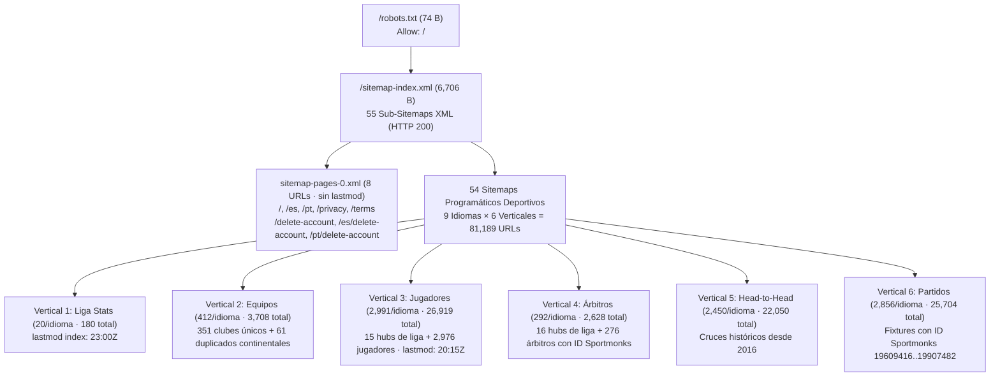
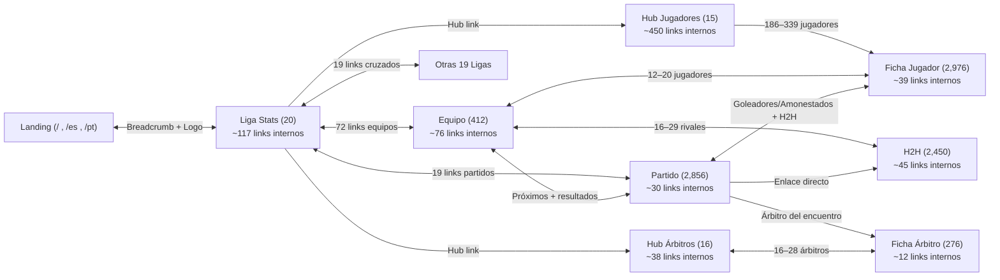

# 13. Fábrica de SEO Programático en Astro: Auditoría Forense de los 55 Sitemaps y `81,197` URLs (`scoutpicks.app`)

> **Alcance forense (Ola 2 Profunda):** Disección exhaustiva de la fábrica de adquisición orgánica pre-renderizada en **Astro SSG** de **Scout Picks** (`https://scoutpicks.app`), abarcando el parseo íntegro de los **55 sub-sitemaps XML** (`81,197` URLs indexadas), la matriz exacta por idioma y vertical, las asimetrías entre ligas y mercados, la anatomía de sus **8 plantillas HTML estáticas con cero JS inline**, la inyección de `Schema.org` (`JSON-LD`) y `hreflang`, la filtración cruzada de **IDs nativos de Sportmonks v3** frente a **claves primarias internas de PostgreSQL**, el geo-bloqueo regulatorio dinámico de CTAs (`/app/country`) y las fugas de conversión hacia `/dashboard/` y tiendas móviles.
>
> **Clasificación epistemológica:** `[OBSERVADO]` (verificado directamente en los 55 archivos XML, 45+ documentos HTML íntegros, capturas PNG, cabeceras CloudFront y scripts `/_astro/*.js`), `[DERIVADO]` (cálculo determinista o cruce exacto de artefactos observados), `[INFERIDO]` (conclusión arquitectónica u operativa de alta confianza), `[RECONSTRUIDO]` (flujo o contrato recompuesto desde código minificado y DOM), `[DESCONOCIDO]` (lógica interna del pipeline de build privado no expuesta al cliente).
>
> **Evidencia primaria consolidada:** [wave2-seo-and-mobile-osint-audit.json](file:///C:/Users/T490s/.gemini/antigravity/worktrees/PitchLab/analyze_pitchlab_competitor_rea/Reportes/scoutpicks/evidence/wave2-seo-and-mobile-osint-audit.json), [rea-wave2-evidence-ledger-summary.json](file:///C:/Users/T490s/.gemini/antigravity/worktrees/PitchLab/analyze_pitchlab_competitor_rea/Reportes/scoutpicks/evidence/rea/rea-wave2-evidence-ledger-summary.json) (`ev_9afb9a36732e3300accd2b8f883a71df7237be8d90d98f9704980890984abfb0`, `ev_5479d706f4bfb95dce77ce0f8c901533c28df2fba262247202d753b5e544fca7`, `ev_2042082f0b1a0b067ea501537d7537ec2aadf72e50c106be1b84700b7f8ee1d0`, `ev_4a13ea907ee1e5dd09372840f8324ff77cfce3c5a6be6aad33aed85739c6acfa`, `ev_74b541a57159f5b5975cfbe9c641d44f5355061d23a9f470fa1ff363bc832221`, `ev_0eb9279cfa7e2970ad6feec84923b3cdd551b1ac00b55b0058a723d6bd904ceb`).
>
> **Higiene forense:** Cero PII y cero credenciales activas; claves de telemetría y tokens han sido redactados (`[REDACTED]`).

---

## Resumen Ejecutivo del Capítulo

1. **Escala simétrica exacta (`81,197` URLs en 55 sub-sitemaps) `[OBSERVADO]` `[DERIVADO]`:** El índice maestro [sitemap-index.xml](file:///C:/Users/T490s/.gemini/antigravity/brain/8e1bb7bd-e2dd-4687-97e2-e5f221d4e760/scratch/wave2_osint_seo/sitemap-index.xml) (`6,706` bytes) declara **54 sub-sitemaps programáticos deportivos** organizados en **9 idiomas × 6 verticales**, conteniendo exactamente **`9,021` URLs idénticas por idioma** (`9 × 9,021 = 81,189` URLs deportivas, simetría inter-idioma del `100.00%`), más `sitemap-pages-0.xml` con **`8` rutas estáticas institucionales** (`/` , `/es`, `/pt`, `/privacy`, `/terms` y las tres variantes `/delete-account`), totalizando **`81,197` URLs indexadas** con `HTTP 200` en los 55 archivos XML.
2. **Paradoja de nomenclatura Español-First vs. Inglés-Root `[OBSERVADO]` `[DERIVADO]`:** Aunque los nombres de archivo XML para español carecen de código de idioma (`sitemap-estadisticas-0.xml`, `sitemap-jugadores-0.xml`) y los de inglés sí llevan `-en-` (`sitemap-en-stats-0.xml`, `sitemap-en-players-0.xml`), en las URLs reales ocurre **exactamente lo inverso**: **inglés (`en`) vive en la raíz sin prefijo** (`https://scoutpicks.app/stats/...`, `x-default`), mientras que **español (`es`) y los otros 7 idiomas viven bajo prefijo** (`/es/...`, `/fr/...`, `/pt/...`, `/id/...`, `/vi/...`, `/th/...`, `/hi/...`, `/ar/...`). Esta inversión corrige la inferencia preliminar de Ola 1 y confirma que el generador de sitemaps fue programado originalmente en español y adaptado después a `prefixDefaultLocale: false` en Astro para inglés `[INFERIDO]`.
3. **Desconexión producto-SEO en 4 idiomas (`36,084` páginas sin soporte en la app, `44.44%` del inventario) `[DERIVADO]`:** Scout Picks indexa `9,021` páginas en francés (`fr`), indonesio (`id`), vietnamita (`vi`) y tailandés (`th`) (`36,084` URLs combinadas), pese a que **ninguno de esos 4 idiomas existe** en los landings estáticos (`/fr`, `/id`, `/vi`, `/th`, `/hi`, `/ar` devuelven `HTTP 404`), ni en los 13 locales de la SPA `/dashboard/` (`ev_0eb9279cfa7e2970ad6feec84923b3cdd551b1ac00b55b0058a723d6bd904ceb`), ni en los 9 idiomas del binario iOS (`id6759328850`).
4. **Doble filtración de identificadores (Sportmonks v3 ↔ PostgreSQL interno) `[OBSERVADO]` `[DERIVADO]`:** Las URLs públicas exponen **IDs nativos crudos de Sportmonks v3** en `2,976` jugadores (`157`..`38,210,334`), `276` árbitros (`525`..`1,158,977`) y `2,856` partidos (`19,609,416`..`19,907,482`), además de IDs de ligas y clubes en `cdn.sportmonks.com` dentro del `JSON-LD`. Simultáneamente, cada página incrusta enlaces AppsFlyer OneLink (`scoutpicks.onelink.me/FDsu`) cuyo parámetro `deep_link_value` filtra el **ID primario secuencial interno de Neon PostgreSQL** (`league/68`, `team/67544`, `player/1628`, `match/32288930`), revelando además una inflación de `>32.28 millones` en la secuencia `matches_id_seq` por operaciones `INSERT ... ON CONFLICT DO UPDATE` `[INFERIDO]`.
5. **Fuga severa de conversión en Desktop y geo-ocultación regulatoria `[OBSERVADO]`:** Ninguna de las `81,189` páginas SEO contiene enlaces directos a `/dashboard/` (ni siquiera en el header). Sus dos únicos CTAs (*"Ver picks en la app"*) apuntan a `https://scoutpicks.onelink.me/FDsu`, el cual redirige mediante `HTTP 301` a usuarios de **Windows y macOS Desktop directamente hacia la App Store de iOS** en lugar de abrir la Web App `/dashboard/`. Adicionalmente, en `id`, `vi`, `th`, `hi` y `ar` los bloques `[data-seo-cta-block]` vienen ocultos con atributo `hidden` en el HTML estático y se conmutan vía `GET /app/country` bloqueando **13 jurisdicciones restringidas** (`IN`, `ID`, `VN`, `TH`, `CN`, `SA`, `AE`, `QA`, `KW`, `PK`, `BD`, `KH`, `BN`).

---

## 1. Matriz Exacta de las `81,197` URLs en los 55 Sub-Sitemaps

### 1.1 Descomposición Aritmética y Topología del Índice Maestro

`[OBSERVADO]` (`ev_5479d706f4bfb95dce77ce0f8c901533c28df2fba262247202d753b5e544fca7`, [sitemap-index.xml](file:///C:/Users/T490s/.gemini/antigravity/brain/8e1bb7bd-e2dd-4687-97e2-e5f221d4e760/scratch/wave2_osint_seo/sitemap-index.xml), [sitemaps_master_summary.json](file:///C:/Users/T490s/.gemini/antigravity/brain/8e1bb7bd-e2dd-4687-97e2-e5f221d4e760/scratch/wave2_osint_seo/sitemaps_master_summary.json)) El archivo `/robots.txt` (`74` bytes) permite el rastreo irrestricto (`User-agent: * / Allow: /`) y declara como único punto de entrada `Sitemap: https://scoutpicks.app/sitemap-index.xml`. El parseo completo de los **55 archivos XML** descargados en [wave2-seo-and-mobile-osint-audit.json](file:///C:/Users/T490s/.gemini/antigravity/worktrees/PitchLab/analyze_pitchlab_competitor_rea/Reportes/scoutpicks/evidence/wave2-seo-and-mobile-osint-audit.json) arroja la siguiente descomposición exacta `[DERIVADO]`:

$$
\text{Total URLs} = (9\text{ idiomas} \times 9{,}021\text{ URLs deportivas}) + 8\text{ URLs estáticas} = 81{,}189 + 8 = 81{,}197\text{ URLs}
$$

### 1.2 Matriz Exacta de Conteo de URLs por Idioma, Prefijo y Vertical

`[DERIVADO]` (`ev_5479d706f4bfb95dce77ce0f8c901533c28df2fba262247202d753b5e544fca7`, [wave2-seo-and-mobile-osint-audit.json](file:///C:/Users/T490s/.gemini/antigravity/worktrees/PitchLab/analyze_pitchlab_competitor_rea/Reportes/scoutpicks/evidence/wave2-seo-and-mobile-osint-audit.json)) La verificación por conjuntos de claves canónicas demuestra **simetría matemática perfecta (`0` faltantes, `0` excedentes)** entre los 9 idiomas publicados:

| Idioma (`htmlLang` / `dir`) | Prefijo en URL | Patrón de Archivo Sitemap | `stats` (Ligas) | `teams` (Equipos) | `players` (Hubs + Fichas) | `referees` (Hubs + Fichas) | `h2h` (Cara a Cara) | `matches` (Partidos) | Subtotal Deportivo | Páginas Raíz (`pages-0`) | **Total URLs** |
| :--- | :---: | :--- | :---: | :---: | :---: | :---: | :---: | :---: | :---: | :---: | :---: |
| **Inglés (`en`, `ltr`)** | **Sin prefijo (`/`)** | `sitemap-en-<slug>-0.xml` | `20` (`/stats/`) | `412` (`/teams/`) | `2,991` (`/players/`) | `292` (`/referees/`) | `2,450` (`/head-to-head/`) | `2,856` (`/matches/`) | `9,021` | `4` (`/`, `/privacy`, `/terms`, `/delete-account`) | **`9,025`** |
| **Español (`es`, `ltr`)** | **`/es/`** | **`sitemap-<slug>-0.xml` (sin `-es-`)** | `20` (`estadisticas`) | `412` (`equipos`) | `2,991` (`jugadores`) | `292` (`arbitros`) | `2,450` (`enfrentamientos`) | `2,856` (`partidos`) | `9,021` | `2` (`/es`, `/es/delete-account`) | **`9,023`** |
| **Portugués (`pt`, `ltr`)** | **`/pt/`** | `sitemap-pt-<slug>-0.xml` | `20` (`estatisticas`) | `412` (`equipas`) | `2,991` (`jogadores`) | `292` (`arbitros`) | `2,450` (`confrontos`) | `2,856` (`jogos`) | `9,021` | `2` (`/pt`, `/pt/delete-account`) | **`9,023`** |
| **Francés (`fr`, `ltr`)** | **`/fr/`** | `sitemap-fr-<slug>-0.xml` | `20` (`statistiques`) | `412` (`equipes`) | `2,991` (`joueurs`) | `292` (`arbitres`) | `2,450` (`face-a-face`) | `2,856` (`matchs`) | `9,021` | `0` (`/fr` → `404`) | **`9,021`** |
| **Indonesio (`id`, `ltr`)** | **`/id/`** | `sitemap-id-<slug>-0.xml` | `20` (`statistik`) | `412` (`tim`) | `2,991` (`pemain`) | `292` (`wasit`) | `2,450` (`head-to-head`) | `2,856` (`pertandingan`) | `9,021` | `0` (`/id` → `404`) | **`9,021`** |
| **Vietnamita (`vi`, `ltr`)** | **`/vi/`** | `sitemap-vi-<slug>-0.xml` | `20` (`thong-ke`) | `412` (`doi-bong`) | `2,991` (`cau-thu`) | `292` (`trong-tai`) | `2,450` (`doi-dau`) | `2,856` (`tran-dau`) | `9,021` | `0` (`/vi` → `404`) | **`9,021`** |
| **Tailandés (`th`, `ltr`)** | **`/th/`** | `sitemap-th-<slug>-0.xml` | `20` (`stats`) | `412` (`teams`) | `2,991` (`players`) | `292` (`/th/referees/`) | `2,450` (`head-to-head`) | `2,856` (`matches`) | `9,021` | `0` (`/th` → `404`) | **`9,021`** |
| **Hindi (`hi`, `ltr`)** | **`/hi/`** | `sitemap-hi-<slug>-0.xml` | `20` (`stats`) | `412` (`teams`) | `2,991` (`players`) | `292` (`/hi/referees/`) | `2,450` (`head-to-head`) | `2,856` (`matches`) | `9,021` | `0` (`/hi` → `404`) | **`9,021`** |
| **Árabe (`ar`, `rtl`)** | **`/ar/`** | `sitemap-ar-<slug>-0.xml` | `20` (`stats`) | `412` (`teams`) | `2,991` (`players`) | `292` (`/ar/referees/`) | `2,450` (`head-to-head`) | `2,856` (`matches`) | `9,021` | `0` (`/ar` → `404`) | **`9,021`** |
| **TOTAL GLOBAL** | **1 raíz + 8 prefijos** | **55 archivos XML** | **`180`** | **`3,708`** | **`26,919`** | **`2,628`** | **`22,050`** | **`25,704`** | **`81,189`** | **`8`** | **`81,197`** |

#### Observaciones Lingüísticas y de Arquitectura de Slugs (`[OBSERVADO]` / `[DERIVADO]`)
1. **Inversión Español vs. Inglés en sitemaps:** Los 6 primeros sub-sitemaps de `sitemap-index.xml` son los de español sin infijo de idioma (`sitemap-estadisticas-0.xml` .. `sitemap-partidos-0.xml`), pero todas sus `<loc>` llevan prefijo `/es/` (`https://scoutpicks.app/es/estadisticas/brasileirao`). A la inversa, inglés usa `sitemap-en-*-0.xml` pero sirve todas sus rutas en raíz sin `/en/` (`https://scoutpicks.app/stats/brasileirao`). En el módulo cliente `seo-page.D28xgYo3.js` (`ev_9afb9a36732e3300accd2b8f883a71df7237be8d90d98f9704980890984abfb0`), el fallback de idioma cuando no coincide `document.documentElement.lang` es explícitamente **`f.es`** (`Object.values(f).find(...) ?? f.es`), confirmando que el motor SEO fue concebido originalmente sobre español `[DERIVADO]`.
2. **Portugués europeo (`pt-PT`) pese al foco en Brasileirão:** El objeto de configuración en `seo-page.D28xgYo3.js` define `ogLocale: "pt_PT"`, `intl: "pt-PT"` y el slug `equipas` (junto con vocabulario lusitano *golos*, *cantos*, *remates enquadrados* en [sitemap-pt-jogos-0.xml___pt_jogos_brasileirao_athletico-pr-vs-atletico-mineiro-19621792.html](file:///C:/Users/T490s/.gemini/antigravity/brain/8e1bb7bd-e2dd-4687-97e2-e5f221d4e760/scratch/wave2_osint_seo/seo_samples/sitemap-pt-jogos-0.xml___pt_jogos_brasileirao_athletico-pr-vs-atletico-mineiro-19621792.html)), en lugar de portugués brasileño (`times`, *gols*, *escanteios*, *finalizações no alvo*), reduciendo la coincidencia léxica exacta para búsquedas en Brasil `[DERIVADO]`.
3. **Slugs en inglés para escrituras no latinas (`th`, `hi`, `ar`) y préstamos híbridos (`id`):** Tailandés, hindi y árabe reutilizan los segmentos de vertical en inglés (`stats`, `teams`, `players`, `referees`, `head-to-head`, `matches`) para evitar URLs codificadas en porcentaje (`%E0%B8...`), mientras que indonesio traduce 5 verticales (`statistik`, `tim`, `pemain`, `wasit`, `pertandingan`) pero conserva `head-to-head` en inglés `[OBSERVADO]`.
4. **Cadencia de regeneración (`<lastmod>`) `[OBSERVADO]`:** En `sitemap-index.xml`, los 9 sitemaps de `players/jugadores` marcan `2026-11-16T20:15:00.000Z`, mientras que los 45 sitemaps restantes de `stats`, `teams`, `referees`, `h2h` y `matches` marcan `2026-11-16T23:00:00.000Z` (evidenciando dos jobs programados de exportación/build separados por `2h 45m`). Dentro de cada XML individual, `<lastmod>` refleja el timestamp exacto del último partido computado de esa entidad (desde `2025-11-23T19:30:00.000Z` hasta `2026-11-16T23:00:00.000Z`). En cambio, `sitemap-pages-0.xml` carece de `<lastmod>` tanto en el índice como en sus 8 entradas `<url>` `[OBSERVADO]`.

---

### 1.3 Desglose Exacto de Entidades Únicas por las 20 Ligas Indexadas

`[DERIVADO]` (`ev_5479d706f4bfb95dce77ce0f8c901533c28df2fba262247202d753b5e544fca7`) Aunque el marketing en `/` y `/dashboard/` promociona cobertura de **"200+ ligas"**, la fábrica SEO indexa únicamente **20 competiciones seleccionadas** (8 europeas, 9 latinoamericanas incluyendo copas CONMEBOL, MLS, Liga Saudí y Segunda División española `laliga-hypermotion`). La auditoría por entidad de los sitemaps arroja la siguiente distribución por idioma:

| # | Slug de Liga (`stats`) | Región | Equipos (`teams`) | Hub Jugadores (`/players/<liga>`) | Fichas Jugadores (`players`) | Hub Árbitros (`/referees/<liga>`) | Cruces H2H (`head-to-head`) | Partidos (`matches`) | Total URLs / Idioma |
| :---: | :--- | :--- | :---: | :---: | :---: | :---: | :---: | :---: | :---: |
| 1 | `brasileirao` | Brasil | `20` | Sí (`1`) | `221` | Sí (`1`) | `152` | `185` | `581` |
| 2 | `bundesliga` | Alemania | `18` | Sí (`1`) | `143` | Sí (`1`) | `118` | `90` | `372` |
| 3 | `champions-league` | UEFA | `18` | **No (`0`)** | **`0`** | **No (`0`)** | `30` | `167` | `216` |
| 4 | `copa-libertadores` | CONMEBOL | `32` | **No (`0`)** | **`0`** | **No (`0`)** | `6` | `28` | `67` |
| 5 | `copa-sudamericana` | CONMEBOL | `32` | **No (`0`)** | **`0`** | **No (`0`)** | **`0`** | `44` | `77` |
| 6 | `europa-league` | UEFA | `8` | **No (`0`)** | **`0`** | **No (`0`)** | **`0`** | `152` | `161` |
| 7 | `laliga` | España (1ª) | `20` | Sí (`1`) | `186` | Sí (`1`) | `152` | `129` | `490` |
| 8 | `laliga-hypermotion` | España (2ª) | `22` | Sí (`1`) | `171` | Sí (`1`) | `114` | `162` | `472` |
| 9 | `liga-1-peru` | Perú | `18` | Sí (`1`) | `197` | Sí (`1`) | `105` | `153` | `476` |
| 10 | `liga-betplay` | Colombia | `20` | Sí (`1`) | `244` | Sí (`1`) | `169` | `195` | `630` |
| 11 | `liga-mx` | México | `18` | Sí (`1`) | `186` | Sí (`1`) | `136` | `153` | `496` |
| 12 | `liga-portugal` | Portugal | `18` | Sí (`1`) | `138` | Sí (`1`) | `116` | `98` | `373` |
| 13 | `liga-pro-ecuador` | Ecuador | `16` | Sí (`1`) | `191` | Sí (`1`) | `103` | `167` | `480` |
| 14 | `liga-profesional-argentina` | Argentina | `30` | Sí (`1`) | `299` | Sí (`1`) | `315` | `248` | `895` |
| 15 | `liga-saudi` | Arabia Saudí | `18` | Sí (`1`) | `146` | Sí (`1`) | `108` | `110` | `385` |
| 16 | `ligue-1-francia` | Francia | `18` | Sí (`1`) | `134` | Sí (`1`) | `116` | `99` | `370` |
| 17 | `mls` | EE. UU. / Canadá | `30` | Sí (`1`) | `339` | Sí (`1`) | `332` | `300` | `1,004` |
| 18 | `premier-league` | Inglaterra | `20` | Sí (`1`) | `194` | Sí (`1`) | `124` | `110` | `451` |
| 19 | `primera-division-uruguay` | Uruguay | `16` | **No (`0`)** | **`0`** | Sí (`1`) | `96` | `146` | `260` |
| 20 | `serie-a-italia` | Italia | `20` | Sí (`1`) | `187` | Sí (`1`) | `158` | `120` | `488` |
| — | *(Árbitros individuales sin segmento de liga)* | Global (16 ligas) | — | — | — | `276` fichas | — | — | `276` |
| **Σ** | **20 Ligas** | — | **`412` rutas (`351` clubes únicos)** | **`15` hubs** | **`2,976` jugadores únicos** | **`16` hubs + `276` árbitros = `292`** | **`2,450` pares** | **`2,856` partidos únicos** | **`9,021`** |

> [!IMPORTANT]
> **Hallazgos sobre cardinalidad real de entidades (`[DERIVADO]`):**
> - **Clubes únicos (`351` vs `412` URLs):** Existen `351` slugs de club distintos; exactamente **`61` clubes están indexados por duplicado** bajo su liga doméstica y su torneo continental (ej. `/es/equipos/brasileirao/flamengo` y `/es/equipos/copa-libertadores/flamengo`; `/es/equipos/bundesliga/fc-bayern-munchen` y `/es/equipos/champions-league/fc-bayern-munchen`).
> - **Jugadores únicos (`2,976`, cero duplicación continental):** A diferencia de los equipos, los `2,976` jugadores tienen `2,976` IDs únicos de Sportmonks (`multiLeaguePlayersCount = 0`), adscritos exclusivamente a una liga doméstica. El sitemap `sitemap-jugadores-0.xml` mezcla en el mismo archivo las `15` páginas índice de liga (`/es/jugadores/liga-mx`) con las `2,976` fichas individuales (`15 + 2,976 = 2,991`).
> - **Árbitros (`292` = `16` hubs + `276` fichas con colisión de nivel de ruta):** El sitemap `sitemap-arbitros-0.xml` agrupa en el mismo nivel jerárquico `/es/arbitros/<slug>` tanto los `16` hubs de liga (`/es/arbitros/liga-mx`) como los `276` perfiles individuales con sufijo numérico (`/es/arbitros/abdullah-al-harbi-69552`), prescindiendo del segmento de liga en la URL del árbitro.

---

### 1.4 Rutas Rotas, Anomalías de Sitemaps y Asimetrías Detectadas

1. **`/sitemap-0.xml` y `/sitemap.xml` devuelven `HTTP 404` HTML `[OBSERVADO]`:**
   - Como documenta la captura [40-astro-404-localized-es-desktop.png](file:///C:/Users/T490s/.gemini/antigravity/worktrees/PitchLab/analyze_pitchlab_competitor_rea/Reportes/scoutpicks/evidence/screenshots/40-astro-404-localized-es-desktop.png) y [wave2_extra_seo_screenshots_meta.json](file:///C:/Users/T490s/.gemini/antigravity/brain/8e1bb7bd-e2dd-4687-97e2-e5f221d4e760/scratch/wave2_osint_seo/wave2_extra_seo_screenshots_meta.json), solicitar `https://scoutpicks.app/sitemap-0.xml` (el nombre por defecto que genera `@astrojs/sitemap` estándar) o `https://scoutpicks.app/sitemap.xml` devuelve `HTTP 404` (`text/html; charset=utf-8`, `3,369` B sin comprimir / `2,959` B br) sirviendo `404.astro`. *(Nota de reconciliación con Ola 1: `sitemap-index.xml` en producción **no** enlaza a `/sitemap-0.xml`, sino a los 55 sub-sitemaps personalizados con sufijo `-0.xml` como `sitemap-pages-0.xml` y `sitemap-estadisticas-0.xml`, los cuales responden todos `HTTP 200` `application/xml` `[OBSERVADO]`).*
2. **Apagón total de jugadores en `primera-division-uruguay` y los 4 torneos continentales `[OBSERVADO]` `[INFERIDO]`:**
   - Cinco de las 20 ligas (`champions-league`, `europa-league`, `copa-libertadores`, `copa-sudamericana` y **`primera-division-uruguay`**) tienen **`0` fichas de jugadores y `0` hubs `/players/<liga>`**. En los torneos continentales esto responde a evitar canibalización con la ficha doméstica del jugador (`kylian-mbappe-96611` vive solo bajo `laliga`); en cambio, en **Primera División de Uruguay** (que sí tiene `16` equipos, `1` hub de árbitros, `96` H2H y `146` partidos) la ausencia total de jugadores se explica porque el feed de Sportmonks para la liga uruguaya carece de cobertura completa de *player shots / shots on target* por partido necesaria para poblar las tablas de *props* de `PlayerPage` `[INFERIDO]`.
3. **Sub-indexación severa en UEFA (`18/36` en Champions, `8/36` en Europa League) y `0` H2H en Sudamericana/UEL `[OBSERVADO]`:**
   - Pese a que la fase de liga de UEFA Champions League y Europa League cuenta con `36` clubes cada una, los sitemaps solo indexan `18` clubes en `champions-league` y apenas **`8` clubes en `europa-league`**, además de **`0` páginas H2H** en `europa-league` y `copa-sudamericana` (y solo `6` en `copa-libertadores`), probablemente por exigir un umbral mínimo de enfrentamientos históricos directos en la misma competición `[INFERIDO]`.
4. **Landings raíz inexistentes (`HTTP 404`) para 6 de los 9 idiomas SEO `[OBSERVADO]`:**
   - Al consultar `https://scoutpicks.app/fr` y `https://scoutpicks.app/ar` (así como `/id`, `/vi`, `/th`, `/hi`), CloudFront devuelve **`HTTP 404 Error from cloudfront`** (`Page not found — Scout Picks`). En `seo-page.D28xgYo3.js`, estos 6 idiomas tienen `landing: null` explícito, por lo que el logotipo superior y el ítem `position: 1` del `BreadcrumbList` (ej. `"الرئيسية"` en árabe o `"Accueil"` en francés) redirigen forzosamente a `https://scoutpicks.app/` **en inglés** `[OBSERVADO]`.

---

## 2. Anatomía Técnica del HTML SSG, `JSON-LD`, `hreflang` y Exposición de IDs

### 2.1 Cero JavaScript Ejecutable Inline y las 8 Plantillas Astro (`ev_9afb9a36...`)

`[OBSERVADO]` (`ev_9afb9a36732e3300accd2b8f883a71df7237be8d90d98f9704980890984abfb0`, `ev_5479d706f4bfb95dce77ce0f8c901533c28df2fba262247202d753b5e544fca7`) La auditoría estática de las **45 muestras HTML completas** en `seo_samples/` y las **67 páginas auditadas** en [seo_pages_deep_audit.json](file:///C:/Users/T490s/.gemini/antigravity/brain/8e1bb7bd-e2dd-4687-97e2-e5f221d4e760/scratch/wave2_osint_seo/seo_pages_deep_audit.json) confirma una disciplina SSG estricta:
- **`0` bloques `<script>` ejecutables inline (`inlineExecJs === 0` en el 100% de las páginas):** Los únicos bloques `<script>` en el cuerpo del HTML son bloques declarativos `<script type="application/ld+json">` (`1` a `3` por documento) más exactamente **2 módulos externos diferidos (`type="module"`)** al cierre del documento:
  1. `/_astro/ComplianceNote.astro_astro_type_script_index_0_lang.ZUL5yTpB.js` (`162` B)
  2. `/_astro/<TemplateName>.astro_astro_type_script_index_0_lang.jh8qhxTK.js` (`47` B — las **8 plantillas** compilan exactamente al mismo hash `.jh8qhxTK.js`, cuyo único contenido es `import{t as e}from"./seo-page.D28xgYo3.js";e();`) `[OBSERVADO]`.
- **Hoja de estilos única compartida:** `/_astro/Logo.DfIZ1AHK.css` (`50,785` B Tailwind CSS) y precarga tipográfica `/_astro/bebas-neue-latin-400-normal.9mHNbWWO.woff2` `[OBSERVADO]`.

Aunque existen **6 verticales de sitemap**, el sistema renderiza **8 plantillas `.astro` distintas** (ya que `players` y `referees` desdoblan en *League Hub* + *Individual Entity*):

| # | Plantilla Astro (`/_astro/*.jh8qhxTK.js`) | `data-seo-page-type` | Vertical Sitemap | URLs / Idioma | Tamaño Ejemplo | Bloques `JSON-LD` (`@type`) |
| :---: | :--- | :--- | :--- | :---: | :---: | :--- |
| 1 | `LeagueStatsPage.astro` | `league_stats` | `stats` | `20` | `83,119` B (Liga MX) | `BreadcrumbList` + `SportsOrganization` + `FAQPage` (5 Q&A) |
| 2 | `TeamStatsPage.astro` | `team_stats` | `teams` | `412` | `46,128` B (América) | `BreadcrumbList` + `SportsTeam` + `FAQPage` (5 Q&A) |
| 3 | `PlayerHubPage.astro` | `league_players` | `players` (hub) | `15` | **`310,482` B** (Liga MX) | `BreadcrumbList` *(único bloque; sin `FAQPage`)* |
| 4 | `PlayerPage.astro` | `player_stats` | `players` (ficha) | `2,976` | `65,773` B (Haaland) | `BreadcrumbList` + `Person` + `FAQPage` (5 Q&A) |
| 5 | `RefereeHubPage.astro` | `league_referees` | `referees` (hub) | `16` | `32,543` B (Liga MX) | `BreadcrumbList` *(único bloque; sin `FAQPage`)* |
| 6 | `RefereePage.astro` | `referee_stats` | `referees` (ficha) | `276` | `25,780` B (Al-Harbi) | `BreadcrumbList` + `Person` + `FAQPage` (5 Q&A) |
| 7 | `HeadToHeadPage.astro` | `head_to_head` | `h2h` | `2,450` | `44,172` B (Amé-CAZ) | `BreadcrumbList` + `FAQPage` (5 Q&A) |
| 8 | `MatchPage.astro` | `match_result` | `matches` | `2,856` | `44,059` B (Amé-ASL) | `BreadcrumbList` + `SportsEvent` + `FAQPage` (4 Q&A) |

---

### 2.2 Disección de `Schema.org` (`JSON-LD`), Anomalías Semánticas y Optimización GEO

`[OBSERVADO]` (`ev_5479d706f4bfb95dce77ce0f8c901533c28df2fba262247202d753b5e544fca7`) El grafo semántico inyectado en cada plantilla presenta características técnicas notables y un bug estructural verificable:

1. **`SportsOrganization` (`LeagueStatsPage`):** Declara `name`, `url`, `sport` localizado (`"Fútbol"` / `"Football"`), `logo` apuntando directamente a `https://cdn.sportmonks.com/images/soccer/leagues/...` y un arreglo `member` con todos los `SportsTeam` de la liga y sus URLs canónicas internas.
2. **`SportsTeam` (`TeamStatsPage`):** Incluye `logo` en `cdn.sportmonks.com`, `memberOf` apuntando a la `SportsOrganization` de la liga y un arreglo `athlete` con todos los `Person` indexados del plantel (ej. `12` jugadores en Club América en [es_equipos_liga_mx_america.html](file:///C:/Users/T490s/.gemini/antigravity/brain/8e1bb7bd-e2dd-4687-97e2-e5f221d4e760/scratch/wave2_osint_seo/seo_samples/es_equipos_liga_mx_america.html)).
3. **`Person` (`PlayerPage` y `RefereePage`) y omisión deliberada de fotografías:** En jugadores declara `jobTitle: "Footballer"` (ES: `"Futbolista"`) y `memberOf` (`SportsTeam`); en árbitros declara únicamente `name`, `url` y `jobTitle: "Árbitro de fútbol"`. Notablemente, a diferencia del `/dashboard/` autenticado, **las páginas SEO omiten por completo fotografías de rostros de jugadores y árbitros** tanto en `JSON-LD` como en el DOM visual, sustituyéndolas por círculos CSS con iniciales (`EH` en [36-seo-epl-player-haaland-en-desktop.png](file:///C:/Users/T490s/.gemini/antigravity/worktrees/PitchLab/analyze_pitchlab_competitor_rea/Reportes/scoutpicks/evidence/screenshots/36-seo-epl-player-haaland-en-desktop.png), `KM` en [37-seo-laliga-player-mbappe-es-mobile-retina.png](file:///C:/Users/T490s/.gemini/antigravity/worktrees/PitchLab/analyze_pitchlab_competitor_rea/Reportes/scoutpicks/evidence/screenshots/37-seo-laliga-player-mbappe-es-mobile-retina.png), `AA` en [50-seo-programatico-arbitros-es-desktop.png](file:///C:/Users/T490s/.gemini/antigravity/worktrees/PitchLab/analyze_pitchlab_competitor_rea/Reportes/scoutpicks/evidence/screenshots/50-seo-programatico-arbitros-es-desktop.png)) para mitigar riesgos de derechos de imagen (*personality rights*) en páginas públicas indexables `[INFERIDO]`.
4. **Bug en `SportsEvent` (`MatchPage`) `[OBSERVADO]`:** En [es_partidos_liga_mx_america_sanluis_19715284.html](file:///C:/Users/T490s/.gemini/antigravity/brain/8e1bb7bd-e2dd-4687-97e2-e5f221d4e760/scratch/wave2_osint_seo/seo_samples/es_partidos_liga_mx_america_sanluis_19715284.html) (partido disputado y finalizado `3-0` el `16 de agosto de 2026`), el bloque `SportsEvent` emite `"startDate": "2026-08-16T23:00:00.000Z"` junto con **`"eventStatus": "https://schema.org/EventScheduled"`** hardcodeado y sin marcador final estructurado, declarando erróneamente ante motores de búsqueda como "programado" cualquier partido histórico ya concluido.
5. **Estrategia `FAQPage` (`80,910` páginas) para AI Overviews / GEO `[DERIVADO]`:** Aunque Google restringió los *Rich Snippets* visuales de `FAQPage` en SERP en agosto de 2023 a sitios gubernamentales y de salud, Scout Picks inyecta `4`–`5` pares pregunta-respuesta numéricos exactos (`inLanguage` localizado) en `8,990 × 9 = 80,910` URLs (ej. *"¿Cuántos córners hace América por partido?" → "6,13 a favor por partido en el torneo actual (Apertura), 6º de 18 de la liga; en sus partidos se ven 11,50 en total."*). Esta estructura alimenta directamente motores de respuesta generativa (**Google AI Overviews, ChatGPT Search, Perplexity**) `[INFERIDO]`.

---

### 2.3 Fórmulas de `<title>` y `<meta name="description">` Orientadas a Intención de Apuesta (`Props`)

`[OBSERVADO]` (`ev_5479d706f4bfb95dce77ce0f8c901533c28df2fba262247202d753b5e544fca7`) A diferencia de portales generalistas (Sofascore, Flashscore, ESPN) centrados en resultados y fichajes, Scout Picks ataca sistemáticamente la *long-tail* transaccional de apostadores de mercados secundarios (*córners, tarjetas, tiros, remates al arco, over 2.5*):

| Vertical | `<title>` Real Observado | `<meta name="description">` Real Observada | Keywords de Apuesta Objetivo |
| :--- | :--- | :--- | :--- |
| **Liga (`es`)** | `Estadísticas de la Liga MX 2026/2027: córners, tarjetas y goles` | `Tabla y estadísticas de 144 partidos de la Liga MX (Apertura). Más córners: Guadalajara (7,56 por partido). Más goles: América (2,38 por partido).` | *estadísticas liga mx, córners, tarjetas, goles* |
| **Equipo (`es`)** | `Estadísticas de América 2026/2027: córners, tarjetas y goles \| Liga MX` | `América en la Liga MX (Apertura): 6,13 córners, 2,13 tarjetas y 2,38 goles por partido. Over 2.5 en el 68,8 % de sus partidos.` | *córners américa, tarjetas américa, over 2.5* |
| **Hub Jugadores (`es`)** | `Jugadores de la Liga MX: goleadores, tiros y tarjetas por partido` | `186 jugadores de la Liga MX: tiros, goles y tarjetas por partido (12 meses). Goleador del torneo actual (Apertura): Salomón Rondón, 16 goles.` | *tiros por partido liga mx, goleadores, tarjetas* |
| **Jugador (`en`)** | `Erling Haaland stats: shots, shots on target, goals and cards per game \| Premier League` | `Erling Haaland (Manchester City) averages 3.61 shots and 1.52 on target per game in the Premier League. 22 goals in 34 matches (last 12 months).` | *Haaland shots per game, shots on target, cards* |
| **Jugador (`es`)** | `Kylian Mbappé: tiros, remates al arco, goles y tarjetas por partido \| LaLiga` | `Kylian Mbappé (Real Madrid) promedia 5,10 tiros y 2,48 al arco por partido en LaLiga. 25 goles en 31 partidos (últimos 12 meses).` | *Mbappé tiros, remates al arco por partido* |
| **Hub Árbitros (`es`)** | `Árbitros de la Liga MX: tarjetas por partido` | `Liga MX: 4,61 tarjetas por partido en 328 partidos de los últimos 12 meses. Más tarjetas por árbitro: Jesus Rafael Lopez Valle (7,42).` | *árbitros liga mx tarjetas por partido* |
| **Árbitro (`es`)** | `Abdullah Al-Harbi: tarjetas por partido en la Liga Profesional Saudí` | `Abdullah Al-Harbi: 4,64 tarjetas por partido en 11 partidos de la Liga Profesional Saudí en los últimos 12 meses (liga: 4,09).` | *tarjetas por partido árbitro vs media liga* |
| **H2H (`es`)** | `América vs Cruz Azul: historial y estadísticas \| Liga MX` | `América vs Cruz Azul en la Liga MX: 33 partidos desde 2016. América 13 victorias, Cruz Azul 8, 12 empates.` | *América vs Cruz Azul historial estadísticas* |
| **Partido (`es`)** | `América 3-0 Atlético San Luis: resultado, goles y estadísticas \| Liga MX` | `América 3-0 Atlético San Luis (16 ago 2026). 15 córners y 5 tarjetas. Goles, tarjetas y estadísticas del partido.` | *resultado, córners y tarjetas del partido* |

*Detalle técnico RTL en árabe (`[OBSERVADO]`):* En [sitemap-ar-stats-0.xml___ar_stats_liga-mx.html](file:///C:/Users/T490s/.gemini/antigravity/brain/8e1bb7bd-e2dd-4687-97e2-e5f221d4e760/scratch/wave2_osint_seo/seo_samples/sitemap-ar-stats-0.xml___ar_stats_liga-mx.html) (captura [52-seo-programatico-arabic-rtl-mobile-retina.png](file:///C:/Users/T490s/.gemini/antigravity/worktrees/PitchLab/analyze_pitchlab_competitor_rea/Reportes/scoutpicks/evidence/screenshots/52-seo-programatico-arabic-rtl-mobile-retina.png)), el documento declara `<html lang="ar" dir="rtl">` y el formateador inserta caracteres invisibles Unicode de aislamiento bidireccional (`U+2068` *First-Strong Isolate* y `U+2069` *Pop Directional Isolate*) alrededor de nombres interpolados directamente dentro de `<title>` y `<meta name="description">`.

---

### 2.4 Enlazado Multi-Idioma `hreflang` + `x-default`

`[OBSERVADO]` (`ev_5479d706f4bfb95dce77ce0f8c901533c28df2fba262247202d753b5e544fca7`) Las **66 muestras SEO** en [seo_pages_deep_audit.json](file:///C:/Users/T490s/.gemini/antigravity/brain/8e1bb7bd-e2dd-4687-97e2-e5f221d4e760/scratch/wave2_osint_seo/seo_pages_deep_audit.json) incluyen un clúster recíproco exacto de **10 etiquetas `<link rel="alternate" hreflang="...">`** más `<link rel="canonical">` autorreferencial (mientras que los landings `/`, `/es`, `/pt` incluyen solo `4`: `en`, `es`, `pt` y `x-default`):
- `hreflang="es"` → `https://scoutpicks.app/es/<vertical-es>/<entidad>`
- `hreflang="en"` → `https://scoutpicks.app/<vertical-en>/<entidad>` *(sin prefijo)*
- `hreflang="fr"`, `"pt"`, `"id"`, `"vi"`, `"th"`, `"hi"`, `"ar"` → rutas localizadas respectivas con prefijo
- `hreflang="x-default"` → **apunta siempre a la URL en inglés sin prefijo** (`https://scoutpicks.app/<vertical-en>/<entidad>`).

---

### 2.5 Exposición de IDs Nativos de Sportmonks v3 y Crosswalk 1:1 con PostgreSQL Interno

`[OBSERVADO]` `[DERIVADO]` (`ev_5479d706f4bfb95dce77ce0f8c901533c28df2fba262247202d753b5e544fca7`) Scout Picks evita slugs puramente nominales en jugadores, árbitros y partidos para prevenir colisiones de homónimos, concatenando directamente el **ID primario crudo de Sportmonks Football API v3** al final del slug público (`<nombre-kebab>-<sportmonks_id>`), al tiempo que inyecta el **ID primario entero interno de su base de datos Neon PostgreSQL** dentro del parámetro `deep_link_value` de los botones CTA (`scoutpicks.onelink.me/FDsu`):

| Tipo de Entidad | Rango de IDs Sportmonks v3 en Slugs / Logos SEO | Ejemplos Reales en Slugs / `JSON-LD` | `deep_link_value` Interno Filtrado en el Mismo HTML | Diagnóstico Forense (`[DERIVADO]`) |
| :--- | :--- | :--- | :--- | :--- |
| **Ligas (`20`)** | En `JSON-LD` `logo`: `cdn.sportmonks.com/images/soccer/leagues/*/648.png` | Brasileirão = `648` (Sportmonks) | `league/1` (UCL), `league/9` (Saudi), `league/55` (Brasileirão), `league/68` (Liga MX) | IDs internos pequeños (`1`..`200+`) correspondientes a `leagues.id` autoincremental. |
| **Equipos (`351`)** | En `JSON-LD` `logo`: `.../teams/31/2687.png`, `.../teams/2/15522.png` | América = `2687`, Atl. San Luis = `15522` | `team/51709` (Athletico PR), `team/67544` (Club América) | Secuencia `teams.id` en el rango `50,000+` por ingesta global de ligas. |
| **Jugadores (`2,976`)** | En slug URL: **`157` .. `38,210,334`** | `kylian-mbappe-96611`, `erling-haaland-154421`, `isaías-violante-37543377` | `player/1487` (Mbappé), `player/1628` (Haaland) | Crosswalk público 1:1 entre `sportmonks_player_id` y `players.id` interno. |
| **Árbitros (`276`)** | En slug URL: **`525` .. `1,158,977`** | `abdullah-al-harbi-69552`, `yonatan-peinado-aguirre-74432` | `league/9`, `league/68` *(cae al ID de liga)* | La app carece de deep-link nativo `referee/<id>` y redirige a la liga del árbitro. |
| **Partidos (`2,856`)** | En slug URL: **`19,609,416` .. `19,907,482`** | `athletico-pr-vs-atletico-mineiro-19621792`, `america-vs-atletico-san-luis-19715284`, `aek-athens-vs-real-madrid-19873705` | `match/27062` (Brasileirão), `match/9647174` (ASL-CAZ), `match/10671389` (Amé-ASL), `match/32288930` (UCL) | **Inflación masiva de secuencia (`>32.28M`):** En PostgreSQL, cada `INSERT ... ON CONFLICT DO UPDATE` de los workers de sincronización consume `nextval('matches_id_seq')` aunque el partido ya exista `[INFERIDO]`. |

---

## 3. Qué Datos Regalan Sin Login, PageRank Sculpting y el Embudo de Conversión

### 3.1 Radiografía del Contenido Gratuito vs. *Teaser* Protegido (El Caso de los `310 KB` de Liga MX)

`[OBSERVADO]` (`ev_5479d706f4bfb95dce77ce0f8c901533c28df2fba262247202d753b5e544fca7`) Scout Picks ejecuta una estrategia de **generosidad estadística radical en datos históricos descriptivos** combinada con **retención absoluta de momios y predicciones (*value/edge*)**:

- **Por qué [es_jugadores_liga_mx.html](file:///C:/Users/T490s/.gemini/antigravity/brain/8e1bb7bd-e2dd-4687-97e2-e5f221d4e760/scratch/wave2_osint_seo/seo_samples/es_jugadores_liga_mx.html) alcanza `310,482` bytes (`303.2 KB` de HTML puro):**
  Sin paginación ni carga diferida por API, pre-renderiza en el DOM **6 tablas completas** (`298` filas `<tr>` en total) más el directorio íntegro de **186 futbolistas** (`418` enlaces internos a fichas de jugadores y `18` a clubes):
  1. *Goleadores de la Liga MX 2026/2027 (Apertura)*: **167 jugadores** con `Goles`, `Asist.`, `PJ`, `Min` y `Equipo`.
  2. *Más tiros por partido* (Top 25, filtro profesional de apariciones de **`45+ minutos`**): `PJ 45+`, `Por partido`, `Cada 90`, `% Más de 0.5`, `% Más de 1.5` y `% Más de 2.5`.
  3. *Más tiros al arco por partido* (Top 25): `% Más de 0.5` y `% Más de 1.5`.
  4. *Más goles por partido* (Top 25): `% Más de 0.5`.
  5. *Más asistencias por partido* (Top 25): `% Más de 0.5`.
  6. *Más tarjetas* (Top 25): `% Más de 0.5`.
- **Qué regalan gratis en las fichas estrella ([en_players_epl_erling_haaland_154421.html](file:///C:/Users/T490s/.gemini/antigravity/brain/8e1bb7bd-e2dd-4687-97e2-e5f221d4e760/scratch/wave2_osint_seo/seo_samples/en_players_epl_erling_haaland_154421.html), `65,773` B; [es_jugadores_laliga_kylian_mbappe_96611.html](file:///C:/Users/T490s/.gemini/antigravity/brain/8e1bb7bd-e2dd-4687-97e2-e5f221d4e760/scratch/wave2_osint_seo/seo_samples/es_jugadores_laliga_kylian_mbappe_96611.html), `62,658` B; capturas [36](file:///C:/Users/T490s/.gemini/antigravity/worktrees/PitchLab/analyze_pitchlab_competitor_rea/Reportes/scoutpicks/evidence/screenshots/36-seo-epl-player-haaland-en-desktop.png) y [37](file:///C:/Users/T490s/.gemini/antigravity/worktrees/PitchLab/analyze_pitchlab_competitor_rea/Reportes/scoutpicks/evidence/screenshots/37-seo-laliga-player-mbappe-es-mobile-retina.png)):**
  - **Matriz completa de frecuencias de acierto (`% of games over each line`)** con fracción exacta `(aciertos/total)` sobre apariciones de `45+ minutos` en **4 cortes** (`Últimos 10`, `12 meses`, `Local`, `Visitante`) para **8 líneas de apuesta**: *Tiros Over 0.5 / 1.5 / 2.5*, *Tiros al arco Over 0.5 / 1.5*, *Goles Over 0.5*, *Asistencias Over 0.5* y *Tarjetas amarillas Over 0.5*.
  - Tabla de promedios (`Total`, `Por partido`, `Cada 90`, `Local`, `Visitante`) y **bitácora partido a partido de los últimos 12 meses** (`34` partidos en Haaland; `31` en Mbappé) con minutos, goles, asistencias, tiros, tiros a puerta y amarillas.
- **Qué regalan gratis en Liga, Equipo, H2H, Árbitro y Partido (capturas [31](file:///C:/Users/T490s/.gemini/antigravity/worktrees/PitchLab/analyze_pitchlab_competitor_rea/Reportes/scoutpicks/evidence/screenshots/31-seo-ligamx-estadisticas-es-desktop.png)–[35](file:///C:/Users/T490s/.gemini/antigravity/worktrees/PitchLab/analyze_pitchlab_competitor_rea/Reportes/scoutpicks/evidence/screenshots/35-seo-ligamx-arbitros-es-desktop.png)):**
  - Tablas íntegras de córners (`A favor`, `En contra`, `Total`), tarjetas (`Propias`, `Total`), goles (`Over 2.5 %`, `Ambos marcan %`), ranking dentro de la liga (`6º de 18`), comparativa de cada árbitro contra la media de la liga (`% 5+ tarjetas`, `faltas/p`), historial H2H de 10 años (`33` clásicos América vs Cruz Azul desde 2016 con córners y tarjetas de cada uno) y comparativa post-partido contra el promedio móvil de los 10 encuentros previos.
- **Qué ocultan deliberadamente detrás del *teaser* hacia la App (`[DERIVADO]`):**
  1. **Cero cuotas/momios de casas de apuestas** (ni Bet365, ni Betano, ni Draftea aparecen en el HTML SEO).
  2. **Cero *Smart Insights* automatizados ni cálculo de probabilidad/valor esperado** (el copy del bloque CTA `data-seo-cta="mid"` explicita la promesa bloqueada: *"Scout Picks cruza estos datos con las cuotas de tu casa de apuestas y te muestra qué ángulos se sostienen en cada partido"*).
  3. **Cero filtros interactivos o contextuales** (no permite filtrar post-derrota, contra top-5 defensivo, sin un compañero titular, cambiar el corte de `45+` minutos, ni consultar las otras `22+` métricas granulares como entradas, faltas recibidas, pases o fueras de juego, ni las `180+` ligas secundarias no indexadas).

---

### 3.2 Malla de Enlazado Interno (*PageRank Sculpting*)

`[DERIVADO]` (`ev_5479d706f4bfb95dce77ce0f8c901533c28df2fba262247202d753b5e544fca7`) Las 8 plantillas forman un grafo fuertemente conexo sin callejones sin salida (*dead-ends*), distribuyendo autoridad orgánica entre verticales:

---

### 3.3 Runtime Cliente `/_astro/*.js`: Husos Horarios, PostHog y Geo-Bloqueo Regulatorio

`[OBSERVADO]` (`ev_9afb9a36732e3300accd2b8f883a71df7237be8d90d98f9704980890984abfb0`, [wave2-seo-and-mobile-osint-audit.json](file:///C:/Users/T490s/.gemini/antigravity/worktrees/PitchLab/analyze_pitchlab_competitor_rea/Reportes/scoutpicks/evidence/wave2-seo-and-mobile-osint-audit.json)) El análisis de `seo-page.D28xgYo3.js` (`4,871` B), `seo-cta.KzQJazLN.js` (`389` B) y `analytics.DvUUnk4I.js` (`3,055` B) revela cuatro operaciones en el navegador:

1. **Reescritura de huso horario local (`v()` en `seo-page.D28xgYo3.js`):** Detecta `Intl.DateTimeFormat().resolvedOptions().timeZone` del visitante y actualiza todos los nodos `<time data-kickoff-zone="...">` si difieren del huso horario base de la página, formateando incluso calendario gregoriano forzado en tailandés (`th-u-ca-gregory`) y numerales latinos en árabe (`ar-u-nu-latn`).
2. **Telemetría PostHog diferida (`analytics.DvUUnk4I.js`):** Registra `$pageview` bajo `app_namespace: "web-seo"` en una cola en RAM e importa perezosamente `/_astro/module.Dd44YI6l.js` (`234,928` B, SDK PostHog con clave `phc_[REDACTED_POSTHOG_PROJECT_KEY]` hacia `https://us.i.posthog.com`) mediante `requestIdleCallback(..., { timeout: 4000 })` (fallback `setTimeout` `2000` ms). Al hacer clic en un CTA (`seo_cta_clicked`), intercepta la navegación con `preventDefault()`, ejecuta `Promise.race` de `1,000` ms y despacha el evento con `{ transport: "sendBeacon" }` antes de ejecutar `location.assign(e.href)`.
3. **Geo-bloqueo dinámico de CTAs en 13 países (`seo-cta.KzQJazLN.js` + `d()` en `seo-page.D28xgYo3.js`):**
   - Consulta `GET https://api.scoutpicks.aertech-labs.com/app/country` (timeout `3,000` ms, cacheado en `sessionStorage["seo_visitor_country"]`).
   - Evalúa el código ISO-2 contra un `Set` hardcodeado de **13 países con prohibición estricta de promoción de apuestas**:
     `IN` (India), `ID` (Indonesia), `VN` (Vietnam), `TH` (Tailandia), `CN` (China), `SA` (Arabia Saudí), `AE` (EAU), `QA` (Catar), `KW` (Kuwait), `PK` (Pakistán), `BD` (Bangladés), `KH` (Camboya) y `BN` (Brunéi).
   - **Asimetría preventiva en SSG:** En `es`, `en`, `fr` y `pt`, los bloques `[data-seo-cta-block]` se renderizan visibles por defecto (`cta: "shown"`), ocultándose en cliente si el visitante entra desde uno de los 13 países bloqueados. En cambio, en **`id`, `vi`, `th`, `hi` y `ar`** (`45,105` páginas), los bloques `<section data-seo-cta-block hidden>` y `<a data-seo-cta="bottom" data-seo-cta-block hidden>` **vienen ocultos de fábrica en el HTML estático (`cta: "hidden"`)**, de modo que bots, reguladores locales o usuarios con JS deshabilitado jamás ven botones de descarga ni menciones a casas de apuestas, mostrándose únicamente si un hablante de esos idiomas navega desde un país permitido (ej. diáspora árabe o india en Europa/EE. UU.) y reportando la decisión en PostHog (`seo_cta_visibility` con `cta_reason: "restricted_country" | "allowed_country"`).

---

### 3.4 Fuga de Conversión hacia `/dashboard/` y Alcance Real de la Cookie `sp_signed_in=1`

`[OBSERVADO]` ([wave2-seo-and-mobile-osint-audit.json](file:///C:/Users/T490s/.gemini/antigravity/worktrees/PitchLab/analyze_pitchlab_competitor_rea/Reportes/scoutpicks/evidence/wave2-seo-and-mobile-osint-audit.json)) Nuestra verificación empírica cruzando las plantillas SEO, AppsFlyer OneLink y el borde AWS CloudFront descubrió una fractura crítica en el embudo de conversión frente a los landings principales:

| Escenario / Ruta | Sin Cookie `sp_signed_in=1` | Con Cookie `sp_signed_in=1` | Destino del CTA Principal en Desktop (Windows / macOS) | Destino del CTA en Móvil (iOS / Android) |
| :--- | :--- | :--- | :--- | :--- |
| **Landings Raíz (`/`, `/es`, `/pt`)** | `200 OK` (HTML Astro) | **`302 Found` → `/dashboard/?from=landing`** (`x-cache: FunctionGeneratedResponse from cloudfront`) | `LandingPage.ByMpcIC5.js` apunta a **`/dashboard/`** y `/dashboard/login?redirect=/checkout...` | `ByMpcIC5.js` reescribe `[data-download]` a App Store o Play Store directo. |
| **Páginas SEO (`81,189` URLs, ej. `/es/estadisticas/liga-mx`, Haaland)** | `200 OK` (`RefreshHit` / `Hit from cloudfront`) | **`200 OK` (NO redirige a `/dashboard/`)** | **FUGA DE CONVERSIÓN:** Cero enlaces a `/dashboard/`; `scoutpicks.onelink.me/FDsu` emite **`301` hacia `apps.apple.com/.../id6759328850`** | `301` a App Store (iOS) o `market://details?id=com.scoutpicks.app&referrer=...` (Android). |
| **Borrado de cuenta (`/delete-account`)** | `200 OK` (`15,870` B) | **`200 OK` (NO redirige)** | Enlace `mailto:team@aertech-labs.com` e instrucciones in-app. | Igual. |

1. **Prueba determinista de la CloudFront Function (`sp_signed_in=1`) `[OBSERVADO]`:** Al enviar `Cookie: sp_signed_in=1` en peticiones GET de solo lectura, CloudFront respondió `HTTP 302` con cabecera literal `x-cache: FunctionGeneratedResponse from cloudfront` y `Location: /dashboard/?from=landing` **exclusivamente** en `/`, `/es` y `/pt`, mientras que devolvió `HTTP 200` íntegro en `/es/estadisticas/liga-mx` y `/players/premier-league/erling-haaland-154421`. Esto demuestra que la función de borde está acotada deliberadamente a las 3 portadas de marketing para no secuestrar sesiones de búsqueda orgánica informacional.
2. **Error de embudo Desktop en las `81,189` páginas SEO `[OBSERVADO]` `[DERIVADO]`:** A diferencia de `LandingPage.astro` (que detecta OS y envía usuarios de escritorio a `/dashboard/`), `seo-cta.KzQJazLN.js` **no reescribe** el `href` de `a[data-seo-cta]` hacia `/dashboard/leagues/<id>`, `/dashboard/teams/<id>`, `/dashboard/players/<id>` o `/dashboard/matches/<id>` (rutas que **sí existen** en TanStack Router dentro de la SPA). Al delegar el 100% de los clics a `https://scoutpicks.onelink.me/FDsu` sin configurar `af_web_dp` hacia `/dashboard/`, cualquier apostador en PC o Mac que haga clic en *"Ver picks en la app"* aterriza forzosamente en la ficha web de la **App Store de iOS**, perdiendo la conversión inmediata al checkout web de Stripe/RevenueCat (donde además Aertech Labs retiene ~95% del ingreso frente al 70%–85% de Apple).

---

## 4. Síntesis Competitiva e Implicaciones Accionables para PitchLab

1. **Adoptar la arquitectura SSG de tablas de *props* (`45+ min`) corrigiendo el puente Web App (`[DERIVADO]`):** La tesis SEO de Scout Picks —atacar búsquedas de *córners, tarjetas, tiros y remates al arco* con tablas pre-calculadas sin JS bloqueante— es sobresaliente en *Core Web Vitals* (`LCP`/`INP`/`CLS` cercanos a cero) y en captura de tráfico *long-tail* y respuestas de IA (`FAQPage`). **PitchLab** puede replicar esta arquitectura estática pero conectando directamente los CTAs en escritorio a la ruta equivalente de la aplicación web (`/leagues/...`, `/players/...`, `/matches/...`) en lugar de expulsar tráfico Desktop hacia App Store.
2. **Evitar la filtración de IDs de proveedor e internos (`[DERIVADO]`):** Jamás concatenar IDs crudos de proveedores externos ni exponer secuencias enteras internas en enlaces públicos; emplear slugs canónicos deterministas o identificadores opacos (`ULID` / `NanoID`) desacoplados del proveedor de ingesta.
3. **Coherencia estricta entre idiomas SEO e idiomas del producto (`[DERIVADO]`):** No indexar decenas de miles de páginas en idiomas donde la aplicación carece de interfaz traducida (`fr`, `id`, `vi`, `th`), evitando tasas de rebote post-clic elevadas y enlaces de migas de pan rotos o en otro idioma.
