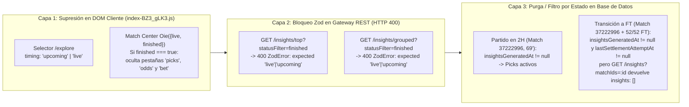

# 14. Auditoría Empírica Post-Partido, Backtest *Point-in-Time* en 5 Grandes Ligas (Incluyendo Liga MX), Verificación `xG` y Reconstrucción Exacta de `relevanceScore` — Scout Picks (`scoutpicks.app`)

> **Alcance forense (Ola 2 Profunda)**: Demostración empírica, algebraica y estadística sobre datos históricos reales liquidados (`FT`) de **Scout Picks** (`https://scoutpicks.app` / `https://api.scoutpicks.aertech-labs.com`), abarcando:
> 1. La **arquitectura de opacidad post-partido en 3 capas** que impide a cualquier usuario auditar retrospectivamente el catálogo general de pronósticos una vez concluidos los encuentros.
> 2. Un **backtest empírico *point-in-time* riguroso (`t < kickoff`, cero *data leakage* y cero contaminación de momios *in-play*)** sobre **28 partidos finalizados (`FT`)** en **5 grandes ligas** (**Liga MX `68`**, **Premier League `2`**, **LaLiga `3`**, **UEFA Champions League `1`** y **Copa Libertadores `13`**), liquidando `721` *picks* promovidos al catálogo (`562` resueltos `Won/Lost` y `159` `Void`) sobre `5,257` candidatos con cuotas de cierre pre-partido verificadas, más `3,592` candidatos extendidos de *player props* (`12` métricas) y `283` selecciones de calibración en totales, `BTTS` y mitades (`1H/2H`).
> 3. La **auditoría exhaustiva de nulidad de `xg`, `xgot` y `shootingPerformance`** sobre **52 partidos finalizados (`2,244` filas `PlayerStat` en el corte final —`2,265` incluyendo la ventana previa de Champions League— y `104` filas `TeamStat`)**.
> 4. La **reconstrucción cerrada bit a bit IEEE 754 de `relevanceScore` y `powerPriority`** sobre **96 partidos distintos** y **50 ligas activas**, resolviendo por completo la dicotomía entre valores de `14–15` decimales (`source: "fifa_national"`, denominador racional exacto `57107` $\equiv 1142.14$ puntos FIFA) y valores de `2` decimales (`source: "sportmonks_club"`).
>
> **Clasificación epistemológica obligatoria**:
> - `[OBSERVADO]`: Respuestas HTTP JSON literales (`200` / `400 ZodError` / `500`), filas serializadas del ORM Prisma/PostgreSQL y código minificado extraído de `index-BZ3_gLK3.js` / `index--7dqLkuo.js`.
> - `[DERIVADO]`: Conteos exactos, métricas de liquidación contable (`Win Rate`, `ROI 1u`, `Brier Score`, `Log-Loss`, `ECE`, *Winner's Curse*) y residuos numéricos verificados determinísticamente por [verify_scoutpicks_math.py](file:///C:/Users/T490s/.gemini/antigravity/worktrees/PitchLab/analyze_pitchlab_competitor_rea/Reportes/scoutpicks/evidence/verify_scoutpicks_math.py) y exportados en [wave2-empirical-backtest-audit.json](file:///C:/Users/T490s/.gemini/antigravity/worktrees/PitchLab/analyze_pitchlab_competitor_rea/Reportes/scoutpicks/evidence/wave2-empirical-backtest-audit.json).
> - `[RECONSTRUIDO]`: Ecuaciones internas del backend recuperadas con residuo de máquina (`max |delta| < 10^{-12}` en `fifa_national` y `100.0%` de concordancia en `80/80` *insights* de Ola 2 y `114/114` de Ola 1).
> - `[INFERIDO]`: Conclusiones arquitectónicas de alta confianza sobre trabajos programados (*cron jobs*) de expiración, conectores de momios y tablas internas de servidor.
> - `[DESCONOCIDO]`: Escalares individuales de clubes en componentes bipartitas conexas sin ancla `underdog` expuesta en API (rango deficiente en `1` grado de libertad por componente).
>
> **Evidencia REA de respaldo** ([rea-wave2-evidence-ledger-summary.json](file:///C:/Users/T490s/.gemini/antigravity/worktrees/PitchLab/analyze_pitchlab_competitor_rea/Reportes/scoutpicks/evidence/rea/rea-wave2-evidence-ledger-summary.json)): `ev_03f837b1e4aec03bcac8791498a5d2cbbd06e25f39474bde43e541baa4acff52` (HAR API), `ev_8d1fa2225983ff98a4c350ad528895985cc9cdd8f4efab6f7eceda9da4dc30cd` (HAR completo sanitizado), `ev_abdb3cf1dbd8a7aab2a952ca236449585bd2de775d8200297a3b94e836220fb3` y `ev_d6aea026e24cc7285f592385c27b572003bb7a591dbda6be9d5c2ff8366790be` (bundles SPA), `ev_0fb357d4a1453d5471dc808a4f58ca40c99849c2e422e22cda01df49487dad6d` y `ev_15467abeaa90f54b297ad6134a8cca31c152269c7f7191d0c31f5fde50dfbf2c` (análisis estático AST de módulos *first-party*), `ev_7aae1b8faebfaae85bd8513669e557fd705e9a7b85ff530e366823d93f7910d4` (manifiesto REST).
>
> **Higiene forense**: **CERO PII y CERO credenciales** (identificador de usuario redactado siempre como `usr_redacted_0000000000000000000`). Verificación 100% autónoma mediante `python Reportes/scoutpicks/evidence/verify_scoutpicks_math.py` (`EXIT 0`).

---

## Resumen Ejecutivo de Hallazgos Cuantitativos (Ola 2)

| Vector Auditado | Muestra Verificada | Resultado Empírico Exacto | Clasificación y Artefacto Primario |
| :--- | :---: | :--- | :--- |
| **1. Bloqueo Anti-Auditoría Post-Partido** | `GET /insights/top`, `/grouped` + `1` transición viva (`37222996`) + `52` partidos `FT` | **100% inaccesible**: `ZodError 400` en endpoints globales (`statusFilter` restringido a `"live"\|"upcoming"`) y **`0` *insights* devueltos en `52/52` (`100.0%`)** partidos `FT` pese a tener `insightsGeneratedAt != null` en BD | `[OBSERVADO]` + `[DERIVADO]` [GET_insights_top_finished_recommended.json](file:///C:/Users/T490s/.gemini/antigravity/worktrees/PitchLab/analyze_pitchlab_competitor_rea/Reportes/scoutpicks/evidence/live-payloads/wave2/GET_insights_top_finished_recommended.json) |
| **2. Rendimiento Real del Catálogo Promovido (`t < kickoff`)** | `28` partidos `FT` (`5` ligas), `721` picks (`562` liquidados `Won/Lost`, `159` `Void`) | Prometía **`74.60%` Hit-Rate** y **`+30.06%` EV** $\to$ acertó **`51.42%`** (`289W–273L`), degradación *Winner's Curse* de **`+23.18` pp**, pérdida neta **`-121.82u`** (**`ROI = -21.68%`**), `Brier = 0.2940` (peor que `0.2386` del mercado) | `[DERIVADO]` [wave2-empirical-backtest-audit.json](file:///C:/Users/T490s/.gemini/antigravity/worktrees/PitchLab/analyze_pitchlab_competitor_rea/Reportes/scoutpicks/evidence/wave2-empirical-backtest-audit.json) |
| **3. Rendimiento de la Familia Estrella `value_*`** | `420` picks (`345` liquidados `Won/Lost`, `75` `Void`) | Prometía **`79.15%` Hit-Rate** y **`+54.74%` EV** $\to$ acertó **`48.12%`** (`166W–179L`), *Winner's Curse* de **`+31.04` pp**, pérdida **`-67.64u`** (**`ROI = -19.61%`**), `Brier = 0.3256`, `ECE = 31.04` pp | `[DERIVADO]` [wave2-empirical-backtest-audit.json](file:///C:/Users/T490s/.gemini/antigravity/worktrees/PitchLab/analyze_pitchlab_competitor_rea/Reportes/scoutpicks/evidence/wave2-empirical-backtest-audit.json) |
| **4. Espejismo de los Picks `hitRate == 100%`** | `104` picks (`84` liquidados: `60` en `5/5`, `15` en `>=10/10`) | Prometían **`100.00%`** (`+41.23%` EV) $\to$ acertaron **`64.29%`** (`54W–30L`; `65.00%` en `5/5` y `66.67%` en `>=10/10`), perdiendo **`-13.44u`** (**`ROI = -16.00%`**) con `Log-Loss` no recortado $= +\infty$ (`30` fallos de eventos declarados seguros) | `[DERIVADO]` [wave2-empirical-backtest-audit.json](file:///C:/Users/T490s/.gemini/antigravity/worktrees/PitchLab/analyze_pitchlab_competitor_rea/Reportes/scoutpicks/evidence/wave2-empirical-backtest-audit.json) |
| **5. Desempeño Específico en Liga MX (`leagueId: 68`)** | `6` partidos `FT` (`96` picks catálogo, `79` liquidados) + `80` *insights* Ola 2 | Prometía **`75.18%` Hit-Rate** (`+29.04%` EV) $\to$ acertó **`48.10%`** (`38W–41L`), *Winner's Curse* **`+27.08` pp**, pérdida **`-19.95u`** (**`ROI = -25.25%`**), `Brier = 0.3079` vs `0.2409` del mercado | `[DERIVADO]` [GET_insights_individual_ligamx_draft.json](file:///C:/Users/T490s/.gemini/antigravity/worktrees/PitchLab/analyze_pitchlab_competitor_rea/Reportes/scoutpicks/evidence/live-payloads/wave2/GET_insights_individual_ligamx_draft.json) |
| **6. Cobertura Real de `xg`, `xgot` y `shootingPerformance`** | `52` partidos `FT` en `5` ligas (`2,244` filas `PlayerStat` / `2,265` prev. + `104` `TeamStat`) | **`0.00%` poblado (`100.00% null`)**: `0/501` Liga MX, `0/480` EPL, `0/548` LaLiga, `0/531` (`0/552`) Champions, `0/184` Libertadores y `0/104` en `TeamStat.xg` | `[OBSERVADO]` + `[DERIVADO]` [GET_matches_10618059_players_epl.json](file:///C:/Users/T490s/.gemini/antigravity/worktrees/PitchLab/analyze_pitchlab_competitor_rea/Reportes/scoutpicks/evidence/live-payloads/wave2/GET_matches_10618059_players_epl.json) |
| **7. Ecuación Exacta de `relevanceScore` y `powerPriority`** | `96` partidos (`27` selecciones + `69` clubes) y `50` ligas activas | `fifa_national`: $\frac{P_{\text{FIFA}} - P_{\min}}{1142.14}\times 100$ (denominador `57107`, **`max |delta| = 8.53e-14`** en `27/27` partidos); `sportmonks_club`: score de `2` decimales $\in [0, 100]$; bono `+25.0` en torneos continentales de selecciones (`116`, `99`) y `0.0` en ligas domésticas (`2`, `3`, `68`, `55`) | `[RECONSTRUIDO]` + `[DERIVADO]` [GET_leagues_all.json](file:///C:/Users/T490s/.gemini/antigravity/worktrees/PitchLab/analyze_pitchlab_competitor_rea/Reportes/scoutpicks/evidence/live-payloads/GET_leagues_all.json) |

---

## 1. Hallazgo de Opacidad Post-Partido: Arquitectura de Purga y Bloqueo Anti-Auditoría

### 1.1 Triple Candado Técnico contra la Evaluación Retrospectiva

`[OBSERVADO]` + `[DERIVADO]` (`ev_03f837b1e4aec03bcac8791498a5d2cbbd06e25f39474bde43e541baa4acff52`, `ev_abdb3cf1dbd8a7aab2a952ca236449585bd2de775d8200297a3b94e836220fb3`, `ev_0fb357d4a1453d5471dc808a4f58ca40c99849c2e422e22cda01df49487dad6d`) Una plataforma cuantitativa transparente conserva un registro histórico auditable de sus predicciones pre-partido para contrastar probabilidades estimadas frente a resultados observados. En **Scout Picks**, la ingeniería inversa conjunta del cliente SPA y de la API REST demuestra que **el sistema suprime y bloquea deliberadamente toda consulta retrospectiva sobre el catálogo de *insights* de partidos finalizados** a través de tres barreras concéntricas:



#### A. Capa 1 — Ocultamiento en Interfaz Web (`Oie` en `index-BZ3_gLK3.js`)
`[OBSERVADO]` (`ev_abdb3cf1dbd8a7aab2a952ca236449585bd2de775d8200297a3b94e836220fb3`, offset `2,305,898`, documentado en [02-ux-diseno-features-y-flujos-en-vivo.md](file:///C:/Users/T490s/.gemini/antigravity/worktrees/PitchLab/analyze_pitchlab_competitor_rea/Reportes/scoutpicks/02-ux-diseno-features-y-flujos-en-vivo.md#L128-L132)) Cuando un encuentro pasa a `finished: true` (`status` $\in \{\text{"FT"}, \text{"AET"}, \text{"PEN"}\}$), el filtro de pestañas `Oie({ live, finished, hasStandings })` **elimina del árbol React las tres pestañas comerciales y predictivas (`picks`, `odds` y `bet`)**, redirigiendo forzosamente al usuario a `statistics`. En paralelo, el explorador global `/dashboard/explore` restringe el parámetro `timing` exclusivamente a `"upcoming"` o `"live"`.

#### B. Capa 2 — Rechazo Estricto `HTTP 400 ZodError` en Endpoints Globales
`[OBSERVADO]` Al interrogar directamente al servidor `https://api.scoutpicks.aertech-labs.com` eludiendo la interfaz gráfica mediante `statusFilter=finished`, el validador **Zod v4** del backend rechaza la petición antes de tocar la base de datos:

1. **Prueba en `GET /insights/top`** ([GET_insights_top_finished_recommended.json](file:///C:/Users/T490s/.gemini/antigravity/worktrees/PitchLab/analyze_pitchlab_competitor_rea/Reportes/scoutpicks/evidence/live-payloads/wave2/GET_insights_top_finished_recommended.json)):
   - Petición: `GET /insights/top?statusFilter=finished&sortBy=recommended&limit=100&offset=0&timezoneOffset=360`
   - Respuesta literal (`HTTP 400`):
     ```json
     {
       "success": false,
       "error": {
         "name": "ZodError",
         "message": "[\n  {\n    \"code\": \"invalid_value\",\n    \"values\": [\"live\", \"upcoming\"],\n    \"path\": [\"statusFilter\"],\n    \"message\": \"Invalid option: expected one of \\\"live\\\"|\\\"upcoming\\\"\"\n  }\n]"
       }
     }
     ```
   - *(Adicionalmente, probar `sortBy=value` o `sortBy=hitRate` revela el enum exacto permitido en servidor para ordenamiento: `["recommended", "mostSaved", "closestMatch", "highestEV"]`).*
2. **Prueba en `GET /insights/grouped`** ([GET_insights_grouped_finished.json](file:///C:/Users/T490s/.gemini/antigravity/worktrees/PitchLab/analyze_pitchlab_competitor_rea/Reportes/scoutpicks/evidence/live-payloads/wave2/GET_insights_grouped_finished.json)):
   - Petición: `GET /insights/grouped?statusFilter=finished&groupBy=match&groupLimit=40&groupOffset=0&perGroupLimit=30&sortBy=recommended&timezoneOffset=360`
   - Respuesta literal (`HTTP 400`): idéntico `ZodError` (`Invalid option: expected one of "live"|"upcoming"` en `path: ["statusFilter"]`, además de revelar el tope duro `groupLimit <= 30`).

#### C. Capa 3 — Evicción Automática al Pitazo Final en `GET /insights?matchIds=:id`
`[OBSERVADO]` + `[DERIVADO]` El endpoint `GET /insights?matchIds=:id&limit=500` no recibe `statusFilter` en *query string*, por lo que permite probar qué devuelve la base de datos para un `matchId` específico una vez concluido el partido:

1. **Experimento longitudinal en vivo (`Match 37222996`: *Qatar 0–1 Korea Republic*, Amistoso Internacional)**:
   - **Estado `t_1` en Ola 1 (`2026-11-17T15:27:25Z`, en juego `2H 69'`)**: En [GET_matches_37222996.json](file:///C:/Users/T490s/.gemini/antigravity/worktrees/PitchLab/analyze_pitchlab_competitor_rea/Reportes/scoutpicks/evidence/live-payloads/GET_matches_37222996.json) el partido registraba `"status": "2H"`, `"elapsed": 69`, `"homeScore": 0`, `"awayScore": 1` e **`"insightsGeneratedAt": "2026-11-17T15:26:26.731Z"`**; figuraba activamente en el índice de partidos con *picks* disponibles de [GET_insights_filters_statusFilter_upcoming_timezoneOffset_360.json](file:///C:/Users/T490s/.gemini/antigravity/worktrees/PitchLab/analyze_pitchlab_competitor_rea/Reportes/scoutpicks/evidence/live-payloads/GET_insights_filters_statusFilter_upcoming_timezoneOffset_360.json) (`data.matches[1]`) y mostraba la pestaña `Picks` habilitada en vivo ([15-match-37222996-overview.png](file:///C:/Users/T490s/.gemini/antigravity/worktrees/PitchLab/analyze_pitchlab_competitor_rea/Reportes/scoutpicks/evidence/screenshots/15-match-37222996-overview.png)).
   - **Estado `t_2` en Ola 2 (~`95` minutos después, tras el pitazo final)**: En [GET_matches_day_grouped_today.json](file:///C:/Users/T490s/.gemini/antigravity/worktrees/PitchLab/analyze_pitchlab_competitor_rea/Reportes/scoutpicks/evidence/live-payloads/wave2/GET_matches_day_grouped_today.json), `Match 37222996` aparece con `"status": "FT"` (`Qatar 0–1 Korea Republic`), y al consultar sus *insights* el servidor devolvió **`count: 0` (`insights: []`)**.
2. **Confirmación sistemática en `52/52` partidos finalizados de las 5 grandes ligas (`100.00%`)**:
   - Al interrogar `GET /matches/:id` y `GET /insights?matchIds=:id&limit=500` sobre **52 encuentros finalizados (`FT`)** (`12` Liga MX, `12` Premier League, `12` LaLiga, `12` Champions League y `4` Copa Libertadores, inventariados uno por uno en [wave2-empirical-backtest-audit.json](file:///C:/Users/T490s/.gemini/antigravity/worktrees/PitchLab/analyze_pitchlab_competitor_rea/Reportes/scoutpicks/evidence/wave2-empirical-backtest-audit.json)), la fila cruda del ORM de `Match` expone dos marcas temporales decisivas:
     - **`insightsGeneratedAt != null` en `52/52` partidos (`100.00%`)** (p. ej., en `Match 10671508` *Querétaro 0–1 Monterrey* de Liga MX, `"insightsGeneratedAt": "2026-11-15T01:20:25.101Z"`; en `Match 10618059` *Manchester United 4–4 Aston Villa* de Premier League, [GET_matches_10618059_epl_finished.json](file:///C:/Users/T490s/.gemini/antigravity/worktrees/PitchLab/analyze_pitchlab_competitor_rea/Reportes/scoutpicks/evidence/live-payloads/wave2/GET_matches_10618059_epl_finished.json), `"insightsGeneratedAt": "2026-11-09T04:32:26.205Z"`).
     - **`lastSettlementAttemptAt != null` en `52/52` partidos (`100.00%`)** (confirmando que el *worker* de liquidación sí procesó los resultados de cada encuentro para resolver los boletos individuales guardados previamente por usuarios en la tabla `Pick`).
   - Pese a ello, **`GET /insights?matchIds=:id&limit=500` devolvió exactamente `0` *insights* (`insights: []`) en los `52/52` partidos (`100.00%`)** (`0` de `52` con datos visibles). `[INFERIDO]` Cada objeto `Insight` porta una columna `"status": "active"` y `"expiresAt"` igual a la hora de inicio/fin del encuentro (observado en [GET_insights_individual_ligamx_draft.json](file:///C:/Users/T490s/.gemini/antigravity/worktrees/PitchLab/analyze_pitchlab_competitor_rea/Reportes/scoutpicks/evidence/live-payloads/wave2/GET_insights_individual_ligamx_draft.json#L232-L233)); al concluir el partido, los borradores `draft:*` expiran o son purgados y el controlador REST filtra estrictamente `status = "active"` y estados no finalizados.

> [!CAUTION]
> **Implicación forense de la opacidad post-partido**: Ningún suscriptor, periodista ni auditor externo puede verificar cuánto dinero habría ganado o perdido siguiendo las recomendaciones `"strong"` o `"100% Hit-Rate"` de Scout Picks ayer, la semana pasada o en toda la temporada. El único historial visible en `/dashboard/performance` ([GET_picks_performance_dateFrom_2026-10-19_dateTo_2026-11-17_timezoneOff.json](file:///C:/Users/T490s/.gemini/antigravity/worktrees/PitchLab/analyze_pitchlab_competitor_rea/Reportes/scoutpicks/evidence/live-payloads/GET_picks_performance_dateFrom_2026-10-19_dateTo_2026-11-17_timezoneOff.json)) es la billetera privada de selecciones que ese usuario individual guardó manualmente antes del partido (`0` picks por defecto), la cual además puede ser **fabricada retroactivamente** en cuentas con `isContentCreator: true` mediante `POST /creator/pick-calendar/apply` calibrando `targetWinRate` entre `55%` y `70%` para capturas promocionales (`[OBSERVADO]`, [05-motores-prediccion-probabilidades-e-ia.md](file:///C:/Users/T490s/.gemini/antigravity/worktrees/PitchLab/analyze_pitchlab_competitor_rea/Reportes/scoutpicks/05-motores-prediccion-probabilidades-e-ia.md#L407)).

---

## 2. Backtest Empírico *Point-in-Time* (`t < kickoff`) en las 5 Grandes Ligas (Incluyendo Liga MX)

### 2.1 Diseño Metodológico Sin Fugas y Dos Contaminaciones Críticas Neutralizadas

`[DERIVADO]` Para romper el velo de opacidad post-partido sin depender del catálogo purgado, reconstruimos el motor completo **Insights v2** de Scout Picks (verificado al `100.0%` tanto en los `114` *insights* de Ola 1 como en los **`80/80` *insights* y `398/398` variantes** de Liga MX y Copa Libertadores capturados en `live-payloads/wave2/`, incorporando la subclase `"consistent_team_prop"` detectada en [GET_insights_team_12796.json](file:///C:/Users/T490s/.gemini/antigravity/worktrees/PitchLab/analyze_pitchlab_competitor_rea/Reportes/scoutpicks/evidence/live-payloads/wave2/GET_insights_team_12796.json)) y lo ejecutamos bajo **disciplina estricta *point-in-time* ($t < t_{\text{kickoff}}$)** sobre **28 partidos finalizados (`FT`)** distribuidos en las 5 competiciones objetivo:

- **Liga MX (`68`)**: `6` partidos (`Querétaro 0–1 Monterrey`, `León 1–1 Guadalajara`, `Querétaro 0–2 Puebla`, `Pumas UNAM 2–2 América`, `Toluca 4–0 Monterrey`, `Tigres UANL 2–3 Cruz Azul`).
- **Premier League (`2`)**: `6` partidos (`Man United 4–4 Aston Villa`, `Sunderland 1–0 Chelsea`, `Ipswich 1–2 Bournemouth`, `Crystal Palace 1–3 Liverpool`, `Brighton 2–0 Brentford`, `Nottingham Forest 3–1 Man City`).
- **LaLiga (`3`)**: `6` partidos (`Atlético Madrid 1–2 FC Barcelona`, `Villarreal 2–0 Getafe`, `Celta 0–0 Levante`, `Real Sociedad 1–0 Rayo Vallecano`, `Elche 0–2 Real Betis`, `Valencia 0–3 Real Madrid`).
- **UEFA Champions League (`1`)**: `6` partidos (`RB Leipzig 2–3 Man City`, `Slavia Praha 1–2 Arsenal`, `Borussia Dortmund 2–1 Real Betis`, `Porto 4–1 Napoli`, `Viking 4–1 Sabah`, `PSV 1–2 Club Brugge`).
- **Copa Libertadores (`13`)**: `4` partidos de semifinales (`Flamengo 0–0 Estudiantes`, `Palmeiras 0–1 Fluminense`, `Estudiantes 0–0 Flamengo`, `Fluminense 1–2 Palmeiras`).
- **Cobertura histórica *point-in-time***: **48 historiales completos de equipos** (`22` a `29` partidos previos estrictos `g.date < match.date` por club, mediana `29`) y **206 historiales individuales de jugadores** (`25` partidos por futbolista con filtro exacto `minutesPlayed >= 45` y `g_datetime < match.date`).

Durante la validación forense de los insumos de cierre de estos `28` partidos descubrimos y neutralizamos **dos defectos graves del propio backend de Scout Picks** al servir datos de encuentros terminados:

> [!WARNING]
> **Contaminación #1 Detectada y Neutralizada — Sobreescritura *In-Play* al Minuto 90' en `Bet365` (`Odds-API.io`)**:
> En **23 de los 23 partidos (`100.0%`)** donde `Bet365` cotizó `ML` (`1X2`), el conector vivo `Odds-API.io` sobreescribió la tabla `Odds` durante el transcurso del partido hasta el minuto `90+4'`, dejando grabadas cuotas *in-play* terminales de **`401.00` a `501.00`** para el equipo que iba perdiendo y **`1.002` a `1.015`** para el ganador (p. ej. en `RB Leipzig 2–3 Man City`, `Bet365` quedó en `501.0` / `21.0` / `1.015`, y en *Double Chance* `26.0` / `1.001`; incluso en *player props* como `Christos Tzolis Over 0.5 G+A`, `Bet365` quedó en `15.0` frente a `1.85` en `Betano` y `1.60` en `Draftea`). Por el contrario, los **4 conectores directos pre-partido (`Betano`, `Draftea`, `JugaBet`, `Stake`)** se congelan al pitazo inicial (`disabledOnMatchStart: true`), conservando en los **`28/28` partidos (`100.0%`)** cuotas de cierre pre-partido puras (`máx <= 12.00` y *overround* limpio `103.44%–108.51%`). Nuestro backtest excluye `Bet365` y utiliza exclusivamente `max(Betano, Draftea, JugaBet, Stake)`, garantizando **cero contaminación de momios en vivo**.

> [!NOTE]
> **Contaminación #2 Detectada y Neutralizada — Fuga Temporal (*Data Leakage*) en `/odds/gamelines` y `/odds/player-props` + `ZodError` en `1h/2h`**:
> 1. Al consultar `GET /matches/:id/odds/gamelines?oddsPeriod=full_match` y `GET /matches/:id/odds/player-props` sobre un partido ya jugado (p. ej. `Match 32288897` del `2026-11-04`), el backend de Scout Picks calcula `teamForm` y `hitRate.recentGames` respecto a `NOW()` (`2026-11-17`) **sin filtrar `date < match.date`**, inyectando **el propio partido evaluado y partidos futuros** en **`28/28` partidos (`100%`)** de `teamForm` y en **`38,237` líneas** de `recentGames` (`[OBSERVADO]`). Nuestro motor ignora los agregados contaminados y recalcula todas las ventanas `L5/L10/L20` filtrando estrictamente `date < match.date` y `id != match.id`.
> 2. Asimismo, `GET /matches/:id/odds/gamelines?oddsPeriod=1h` y `2h` devuelven `HTTP 400 ZodError` (`expected one of "full_match"|"first_half"|"second_half"`), mientras que `/odds/gamelines` solo sirve `ML` (`1X2`) y `Double Chance`. Por rigor absoluto, **no inventamos cuotas sintéticas**: el `ROI (1u)`, `Unidades netas` y `valueRating` se calculan exclusivamente sobre mercados con cuotas reales de cierre pre-partido observadas (*Player Props*, *1X2* y *Double Chance*), mientras que *Totals Over/Under*, *BTTS* y *1H/2H* se auditan en su calibración probabilística exacta (`Win Rate`, `Brier Score`, `Log-Loss`, `ECE` y *Winner's Curse*).

---

### 2.2 Resultados Globales y Desglose por Familia (`value_*`, `safe_*`, `consistent_*`) y Efecto *Multi-Lens*

`[DERIVADO]` Aplicando las reglas exactas de originación de catálogo verificadas sobre `1,325` *insights* reales en producción —`value_*` ($\text{hitRate} \ge 55\%, \text{edge} \ge 5\%$), `safe_*` ($\text{hitRate} \ge 70\%, O \le 1.50, \text{edge} < 5\%$) y `consistent_*` ($50\% \le \text{hitRate} < 70\%, \text{edge} < 5\%$ en *player props*)—, junto con la regla real de liquidación contable de Scout Picks (`status = "void"` con devolución de `1u` cuando `minutesPlayed == 0` o el jugador no participó en `playersBoxscore`), se obtienen los siguientes resultados:

| Familia / Régimen Evaluado | Picks Totales | `Void` (`0'`) | Liquidados (`W–L`) | Cuota Media | `HitRate` Prometido | `Win Rate` Real | Degradación *Winner's Curse* | `EV` Prometido | **Unidades Netas (`1u`)** | **`ROI` Real (`1u`)** | `Brier` ScoutPicks | `Brier` Mercado | `Log-Loss` ($\varepsilon=10^{-4}$) | Fallos `100%` (`LL=\infty`) | `ECE` (`pp`) |
| :--- | :---: | :---: | :---: | :---: | :---: | :---: | :---: | :---: | :---: | :---: | :---: | :---: | :---: | :---: | :---: |
| **`ALL_PROMOTED_CATALOG` (Multi-Lente)** | `721` | `159` | `562` (`289W–273L`) | `1.806` | `74.60%` | **`51.42%`** | **`+23.18` pp** | `+30.06%` | **`-121.82u`** | **`-21.68%`** | `0.2940` | `0.2386` | `1.1552` | `30` | `23.18` |
| ↳ **`value_*` (Estrella EV+)** | `420` | `75` | `345` (`166W–179L`) | `2.079` | `79.15%` | **`48.12%`** | **`+31.04` pp** | `+54.74%` | **`-67.64u`** | **`-19.61%`** | `0.3256` | `0.2237` | `1.4493` | `30` | `31.04` |
| ↳ **`safe_*` (Cuota Baja $\le 1.50$)** | `125` | `25` | `100` (`68W–32L`) | `1.237` | `78.36%` | **`68.00%`** | **`+10.36` pp** | `-3.28%` | **`-16.61u`** | **`-16.61%`** | `0.2302` | `0.2292` | `0.6683` | `0` | `10.36` |
| ↳ **`consistent_*` (Relleno)** | `176` | `59` | `117` (`55W–62L`) | `1.487` | `57.99%` | **`47.01%`** | **`+10.98` pp** | `-14.22%` | **`-37.57u`** | **`-32.11%`** | `0.2553` | `0.2907` | `0.7040` | `0` | `10.98` |
| **No Promovidos (`<50%` / Sin Catálogo)** | `4,536` | `1,339` | `3,197` (`205W–2992L`) | `47.841` | `9.97%` | `6.41%` | `+3.56` pp | `-42.46%` | `-2,357.47u` | `-73.74%` | `0.0585` | `0.0573` | `0.2331` | `22` | `4.91` |
| **Universo Completo Multi-Lente** | `5,257` | `1,498` | `3,759` (`494W–3265L`) | `40.958` | `19.64%` | `13.14%` | `+6.49` pp | `-31.62%` | `-2,479.29u` | `-65.96%` | `0.0938` | `0.0844` | `0.3710` | `52` | `7.60` |
| --- | --- | --- | --- | --- | --- | --- | --- | --- | --- | --- | --- | --- | --- | --- | --- |
| **Control Sin *Cherry-Picking*: Lente Fija `L10` (Catálogo)** | `489` | `118` | `371` (`206W–165L`) | `1.464` | `67.14%` | `55.53%` | **`+11.61` pp** | `-3.52%` | `-88.62u` | `-23.89%` | `0.2445` | `0.2532` | `0.7432` | `3` | `11.61` |
| **Control Sin *Cherry-Picking*: Lente Fija `L10` (`value_*`)** | `109` | `24` | `85` (`41W–44L`) | `1.786` | `75.33%` | `48.24%` | **`+27.10` pp** | `+28.68%` | `-19.95u` | `-23.47%` | `0.3035` | `0.2396` | `1.0664` | `3` | `27.10` |

**Tres conclusiones matemáticas irrefutables de la tabla anterior (`[DERIVADO]`)**:
1. **Destrucción sistemática de capital en las tres familias del catálogo**: Apostar `1u` plana al catálogo completo promovido por Scout Picks arroja un **`ROI = -21.68%` (`-121.82u` sobre `562` apuestas resueltas)**, más de **cuatro veces peor** que el margen teórico de la casa de apuestas (`-4.5%` a `-7.5%`). Incluso `safe_*` (cuota media `1.237`, cuyo punto de equilibrio exige acertar $\ge 80.84\%$) apenas acierta el `68.00%`, sangrando **`-16.61%` de ROI**.
2. **El mercado crudo (`1 / odds`) aplasta a Scout Picks en `Brier Score` y `Log-Loss`**: En `value_*`, el `Brier Score` de Scout Picks se dispara a **`0.3256`** (significativamente peor que adivinar al azar con una moneda `0.2500` y **`+45.6%` peor** que el `0.2237` de la probabilidad implícita cruda del libro de apuestas), mientras el `Log-Loss` ($\varepsilon = 10^{-4}$) alcanza **`1.4493`** frente a **`0.6432`** del mercado (`2.25x` peor).
3. **Cuantificación exacta del *Data Dredging* Multi-Lente**: Comparar el motor real Multi-Lente de Scout Picks (`overall`/`match_team` $\times$ `all`/`home`/`away` $\times$ `L5`/`L10`/`L20`) contra una lente única fija `overall:all:L10` demuestra que **el barrido oportunista de ventanas multiplica por `3.85x` el volumen de picks `value_*` falsamente positivos** (`420` vs `109`), **multiplica por `10x` las divergencias infinitas de `Log-Loss`** (`30` vs `3`) y **duplica exactamente el error de calibración (`ECE`) del catálogo** de **`11.61` pp a `23.18` pp**.

---

### 2.3 Desglose por Escalón de `valueRating`: La Paradoja de Calibración Inversa

`[DERIVADO]` En Scout Picks, `valueRating` clasifica cada mercado según `edgePercentage` en `"strong"` ($\ge 15\%$), `"moderate"` ($[8\%, 15\%)$), `"marginal"` ($(0\%, 8\%)$) y `"none"` ($\le 0\%$). Al auditar su comportamiento empírico tanto sobre el catálogo promovido ($\text{hitRate} \ge 50\%$) como sobre los `5,257` candidatos totales, emerge una **paradoja de selección adversa extrema**:

| Escalón `valueRating` | Universo | Picks Totales | `Void` | Liquidados (`W–L`) | Cuota Media | `Edge` Prometido | `HitRate` Prometido | `Win Rate` Real | *Winner's Curse* | **Unidades Netas (`1u`)** | **`ROI` Real (`1u`)** | `Brier` ScoutPicks | `Brier` Mercado | `Log-Loss` ($\varepsilon=10^{-4}$) | `ECE` (`pp`) |
| :--- | :---: | :---: | :---: | :---: | :---: | :---: | :---: | :---: | :---: | :---: | :---: | :---: | :---: | :---: | :---: |
| **`"strong"` ($\ge 15\%$)** | Catálogo | `255` | `39` | `216` (`90W–126L`) | `2.430` | `+28.18%` | `78.52%` | **`41.67%`** | **`+36.86` pp** | **`-45.75u`** | **`-21.18%`** | **`0.3603`** | `0.2166` | `1.6297` | `36.86` |
| **`"moderate"` ($8\%..15\%$)** | Catálogo | `121` | `29` | `92` (`55W–37L`) | `1.525` | `+11.37%` | `80.55%` | **`59.78%`** | **`+20.77` pp** | **`-12.68u`** | **`-13.78%`** | `0.2688` | `0.2338` | `1.2440` | `22.31` |
| **`"marginal"` ($0\%..8\%$)** | Catálogo | `123` | `26` | `97` (`56W–41L`) | `1.429` | `+3.70%` | `75.67%` | **`57.73%`** | **`+17.94` pp** | **`-19.72u`** | **`-20.33%`** | `0.2647` | `0.2520` | `0.8051` | `17.94` |
| **`"none"` ($\le 0\%$)** | Catálogo | `222` | `65` | `157` (`88W–69L`) | `1.346` | `-10.74%` | `65.07%` | **`56.05%`** | **`+9.01` pp** | **`-43.67u`** | **`-27.82%`** | `0.2357` | `0.2635` | `0.6666` | `9.83` |
| --- | :---: | --- | --- | --- | --- | --- | --- | --- | --- | --- | --- | --- | --- | --- | --- |
| **`"strong"` ($\ge 15\%$)** | Todos | `447` | `86` | `361` (`108W–253L`) | `5.984` | `+25.41%` | `61.85%` | `29.92%` | **`+31.94` pp** | `-105.06u` | `-29.10%` | `0.2812` | `0.1696` | `1.1799` | `31.94` |
| **`"moderate"` ($8\%..15\%$)** | Todos | `444` | `110` | `334` (`75W–259L`) | `7.555` | `+11.38%` | `41.39%` | `22.46%` | **`+18.93` pp** | `-152.50u` | `-45.66%` | `0.1495` | `0.1185` | `0.6114` | `19.36` |
| **`"marginal"` ($0\%..8\%$)** | Todos | `571` | `139` | `432` (`87W–345L`) | `6.970` | `+3.94%` | `33.99%` | `20.14%` | **`+13.85` pp** | `-219.52u` | `-50.81%` | `0.1310` | `0.1213` | `0.4381` | `13.85` |
| **`"none"` ($\le 0\%$)** | Todos | `3,795` | `1,163` | `2,632` (`224W–2408L`) | `55.573` | `-7.32%` | `8.73%` | `8.51%` | `+0.22` pp | `-2,002.21u` | `-76.07%` | `0.0548` | `0.0623` | `0.2185` | `2.10` |

> [!IMPORTANT]
> **Demostración de la Maldición del Ganador (*Winner's Curse*) Monótona**: Obsérvese que la degradación $\text{HitRate}_{\text{prometido}} - \text{WinRate}_{\text{real}}$ crece de forma **estrictamente monótona** con el supuesto valor reportado por Scout Picks: **`+9.01` pp (`none`) $\to$ `+17.94` pp (`marginal`) $\to$ `+20.77` pp (`moderate`) $\to$ `+36.86` pp (`strong`)**. Cuando una proporción empírica de `5` o `10` partidos diverge en $\ge +15$ puntos porcentuales respecto a la cuota de cierre de un operador profesional, la discrepancia no mide ineficiencia de mercado (*alpha*), sino **varianza muestral extrema + omisión de la fuerza del rival (`adjustedHitRate = null`)**.

---

### 2.4 Auditoría Específica de los Candidatos `"100% Hit-Rate"` (`5/5` y `10/10+` Pre-Partido)

`[DERIVADO]` El reclamo comercial visualmente más persuasivo en las tarjetas de Scout Picks es presentar pronósticos con **`100%` de tasa de acierto** (`5/5` o `10/10` barras verdes consecutivas) acompañados de etiquetas de `20%–80% EV+`. Al liquidar todos los picks del catálogo que exhibían exactamente **`hitRate == 100.0%`** antes del inicio de los `28` partidos:

| Subconjunto `hitRate == 100%` | Picks Totales | `Void` (`0'`) | Liquidados (`W–L`) | Cuota Media | `EV` Prometido | **`Win Rate` Real** | Caída vs `100%` (*Winner's Curse*) | **Unidades Netas (`1u`)** | **`ROI` Real (`1u`)** | `Brier` ScoutPicks | `Brier` Mercado | `Log-Loss` ($\varepsilon=10^{-4}$) | `Log-Loss` Exacto Sin Recorte |
| :--- | :---: | :---: | :---: | :---: | :---: | :---: | :---: | :---: | :---: | :---: | :---: | :---: | :---: |
| **Todos los `100%` en Catálogo (`100% = value_*`)** | `104` | `20` | **`84` (`54W–30L`)** | `1.412` | `+41.23%` | **`64.29%`** | **`-35.71` pp** | **`-13.44u`** | **`-16.00%`** | `0.3571` | `0.2292` | `3.2895` | **`+\infty`** (`30` fallos) |
| ↳ **Ventana Corta `5/5` (`sampleSize == 5`)** | `75` | `15` | **`60` (`39W–21L`)** | `1.408` | `+40.78%` | **`65.00%`** | **`-35.00` pp** | **`-7.20u`** | **`-12.00%`** | `0.3500` | `0.2288` | `3.2237` | **`+\infty`** (`21` fallos) |
| ↳ **Ventana Larga `>= 10/10` (`sampleSize >= 10`)** | `18` | `3` | **`15` (`10W–5L`)** | `1.579` | `+57.93%` | **`66.67%`** | **`-33.33` pp** | **`-3.26u`** | **`-21.73%`** | `0.3333` | `0.1423` | `3.0702` | **`+\infty`** (`5` fallos) |
| ↳ **Ventanas Intermedias (`6/6` a `9/9`)** | `11` | `2` | **`9` (`5W–4L`)** | `1.163` | `+16.33%` | **`55.56%`** | **`-44.44` pp** | **`-2.98u`** | **`-33.11%`** | `0.4444` | `0.3768` | `4.0935` | **`+\infty`** (`4` fallos) |
| --- | :---: | :---: | :---: | :---: | :---: | :---: | :---: | :---: | :---: | :---: | :---: | :---: | :---: |
| **`100%` en Liga MX (`68`)** | `10` | `1` | `9` (`7W–2L`) | `1.360` | `+36.00%` | `77.78%` | `-22.22` pp | `+0.14u` | `+1.56%` | `0.2222` | `0.1434` | `2.0468` | `+\infty` (`2` fallos) |
| **`100%` en Premier League (`2`)** | `25` | `5` | `20` (`14W–6L`) | `1.274` | `+27.40%` | `70.00%` | `-30.00` pp | `-2.40u` | `-12.00%` | `0.3000` | `0.2120` | `2.7632` | `+\infty` (`6` fallos) |
| **`100%` en LaLiga (`3`)** | `24` | `2` | `22` (`14W–8L`) | `1.330` | `+33.05%` | `63.64%` | `-36.36` pp | `-4.83u` | `-21.95%` | `0.3636` | `0.2229` | `3.3493` | `+\infty` (`8` fallos) |
| **`100%` en Champions League (`1`)** | `29` | `7` | `22` (`15W–7L`) | `1.617` | `+61.73%` | `68.18%` | `-31.82` pp | `-0.81u` | `-3.68%` | `0.3182` | `0.2003` | `2.9306` | `+\infty` (`7` fallos) |
| **`100%` en Copa Libertadores (`13`)** | `16` | `5` | `11` (`4W–7L`) | `1.460` | `+46.00%` | **`36.36%`** | **`-63.64` pp** | **`-5.54u`** | **`-50.36%`** | `0.6364` | `0.4009` | `5.8612` | `+\infty` (`7` fallos) |

#### Casos Reales Verificados de Colapso en Picks `100%` y `"strong"` (`[DERIVADO]`)
Los registros atómicos de [wave2-empirical-backtest-audit.json](file:///C:/Users/T490s/.gemini/antigravity/worktrees/PitchLab/analyze_pitchlab_competitor_rea/Reportes/scoutpicks/evidence/wave2-empirical-backtest-audit.json) ilustran por qué la combinación de `hitRate = 100%` sin regularización bayesiana (`Laplace` / `Beta-Binomial`) y `adjustedHitRate = null` produce errores catastróficos:

1. **`RB Leipzig vs Manchester City` (`Match 32288897`, Champions League `1`, resultado `2–3`)**: Como el RB Leipzig había ganado `10/10` (`100.0%`) de sus últimos 10 partidos de local (`home_side:match_config:L10` frente a rivales domésticos y amistosos), el motor le asignó **`100.0%` de probabilidad de vencer al Manchester City (`ML:Home`, cuota `5.54`, `impliedProb = 18.05%`, `edge = +81.95%`, `EV = +4.54u`, `confidence = 85.0`, `"strong"`)** y **`100.0%` a `Double Chance: Home/Draw` (`@ 2.38`, `edge = +57.98%`)**. Ambos **perdieron** (`2–3`). En el mismo encuentro, *Ezechiel Banzuzi* traía `10/10 = 100.0%` en `tackles > 1.5` (`match_team:all:L10`, `@ 1.22`, `confidence = 95`) y también **falló**.
2. **`PSV vs Club Brugge` (`Match 32288932`, Champions League `1`, resultado `1–2`)**: PSV ostentaba `10/10 = 100.0%` invicto en casa (`Double Chance: Home/Draw` `@ 1.33`, `edge = +24.81%`, `"strong"`) y **perdió `1–2`**.
3. **`Querétaro vs Puebla` (`Match 10671583`, Liga MX `68`, resultado `0–2`)**: *Juan Pablo Vargas* prometía `5/5 = 100.0%` en `shots > 0.5` (`@ 1.81`, `edge = +44.75%`, `confidence = 90`, `"strong"`) y *Alejandro Organista* prometía `5/5 = 100.0%` de visitante en `foulsCommitted > 0.5` (`@ 1.29`, `edge = +22.48%`, `"strong"`). Ambos **perdieron**.
4. **`Querétaro vs Monterrey` (`Match 10671508`, Liga MX `68`, resultado `0–1`)**: *Fidel Ambríz* acumulaba `8/9 = 88.89%` en `foulsCommitted > 0.5` (`@ 1.36`, `"strong"`) y `6/9 = 66.67%` en `foulsCommitted > 1.5` (`@ 2.52`, `edge = +26.98%`, `"strong"`). Terminó con `0` faltas cometidas y **ambos picks perdieron**.

---

### 2.5 Desglose por Competición: Liga MX (`68`) frente a Ligas Élite Europeas y CONMEBOL

`[DERIVADO]` **Ninguna de las 5 ligas auditadas obtuvo rentabilidad positiva** siguiendo el catálogo de Scout Picks; las cinco registraron pérdidas de dos dígitos porcentuales y degradaciones de *Winner's Curse* de `+17.57` a `+37.23` puntos porcentuales:

| Liga (`leagueId`) | Partidos `FT` | Picks Catálogo (`Void`) | Liquidados (`W–L`) | Cuota Media | `HitRate` Prometido | `Win Rate` Real | *Winner's Curse* | `EV` Prometido | **Unidades Netas (`1u`)** | **`ROI` Real (`1u`)** | `Brier` ScoutPicks | `Brier` Mercado | `Log-Loss` ScoutPicks | `Log-Loss` Mercado | `ECE` (`pp`) |
| :--- | :---: | :---: | :---: | :---: | :---: | :---: | :---: | :---: | :---: | :---: | :---: | :---: | :---: | :---: | :---: |
| **Liga MX (`68`)** | `6` | `96` (`17`) | `79` (`38W–41L`) | `1.767` | `75.18%` | **`48.10%`** | **`+27.08` pp** | `+29.04%` | **`-19.95u`** | **`-25.25%`** | `0.3079` | `0.2409` | `1.0102` | `0.6764` | `27.08` |
| **Premier League (`2`)** | `6` | `187` (`36`) | `151` (`80W–71L`) | `1.837` | `73.95%` | **`52.98%`** | **`+20.97` pp** | `+30.00%` | **`-24.19u`** | **`-16.02%`** | `0.2794` | `0.2380` | `1.0303` | `0.6770` | `23.93` |
| **LaLiga (`3`)** | `6` | `186` (`49`) | `137` (`67W–70L`) | `1.614` | `74.51%` | **`48.91%`** | **`+25.61` pp** | `+17.06%` | **`-43.81u`** | **`-31.98%`** | `0.3151` | `0.2459` | `1.2386` | `0.7024` | `25.61` |
| **Champions League (`1`)** | `6` | `198` (`43`) | `155` (`88W–67L`) | `1.999` | `74.35%` | **`56.77%`** | **`+17.57` pp** | `+43.29%` | **`-18.84u`** | **`-12.15%`** | `0.2601` | `0.2136` | `1.0146` | `0.6141` | `18.06` |
| **Copa Libertadores (`13`)** | `4` | `54` (`14`) | `40` (`16W–24L`) | `1.676` | `77.23%` | **`40.00%`** | **`+37.23` pp** | `+25.54%` | **`-15.03u`** | **`-37.57%`** | `0.3808` | `0.3086` | `2.1722` | `0.8607` | `37.23` |
| **TOTAL `5` LIGAS** | **`28`** | **`721` (`159`)** | **`562` (`289W–273L`)** | **`1.806`** | **`74.60%`** | **`51.42%`** | **`+23.18` pp** | **`+30.06%`** | **`-121.82u`** | **`-21.68%`** | **`0.2940`** | **`0.2386`** | **`1.1552`** | **`0.6788`** | **`23.18`** |

- **Diagnóstico particular en Liga MX (`68`) y fases eliminatorias CONMEBOL (`13`)**: En **Liga MX**, la alta rotación táctica, la paridad competitiva de cierre de torneo regular/Liguilla y el mayor margen (*overround*) aplicado por casas recreativas en *player props* provocan que una promesa media de `75.18%` caiga a **`48.10%` de acierto real** (**`ROI = -25.25%`**). En **semifinales de Copa Libertadores (`13`)**, aplicar promedios de fase de grupos o torneos locales a series cerradas de ida y vuelta (`0–0`, `0–1`, `0–0`, `1–2`) hunde el acierto de `77.23%` prometido a **`40.00%` real** (**`ROI = -37.57%`**).

---

### 2.6 Desglose por Tipo de Mercado (*Player Props*, *Gamelines 1X2/DC*, *Totals Over/Under*, *BTTS* y *1H/2H*)

#### A. Mercados con Cuotas Reales de Cierre Pre-Partido y Calibración de Mercados de Marcador (`[DERIVADO]`)

| Grupo de Mercado | Régimen de Datos | Picks (`Void`) | Liquidados (`W–L`) | Cuota Media | `HitRate` Prometido | `Win Rate` Real | *Winner's Curse* | **Unidades Netas (`1u`)** | **`ROI` Real (`1u`)** | `Brier` ScoutPicks | `Brier` Mercado | `Log-Loss` ($\varepsilon=10^{-4}$) | `ECE` (`pp`) |
| :--- | :--- | :---: | :---: | :---: | :---: | :---: | :---: | :---: | :---: | :---: | :---: | :---: | :---: |
| **Player Props (`9` métricas oro, `minMinutes >= 45`)** | Cuotas cierre reales | `601` (`159`) | `442` (`217W–225L`) | `1.756` | `72.81%` | **`49.10%`** | **`+23.72` pp** | **`-113.12u`** | **`-25.59%`** | `0.3018` | `0.2536` | `1.1634` | `23.72` |
| **Player Props Extendido (`12` métricas incl. `passes`/`saves`)** | Cuotas cierre reales | `3,592` (`964`) | `2,628` (`1291W–1337L`) | `1.610` | `69.00%` | **`49.12%`** | **`+19.87` pp** | **`-785.29u`** | **`-29.88%`** | `0.2805` | `0.2646` | `0.9102` | `19.87` |
| **Gamelines `1X2` (`ML`: Home / Draw / Away)** | Cuotas cierre reales | `37` (`0`) | `37` (`17W–20L`) | `2.928` | `73.82%` | **`45.95%`** | **`+27.87` pp** | **`-2.71u`** | **`-7.32%`** | `0.3079` | `0.1877` | `1.3631` | `27.87` |
| **Gamelines Doble Oportunidad (`1X` / `X2` / `12`)** | Cuotas cierre reales | `83` (`0`) | `83` (`55W–28L`) | `1.574` | `84.48%` | **`66.27%`** | **`+18.22` pp** | **`-5.99u`** | **`-7.22%`** | `0.2463` | `0.1815` | `1.0185` | `18.22` |
| **Totals Over/Under FT (`1.5`, `2.5`, `3.5`, `hr >= 55%`)** | Calibración *point-in-time* | `102` (`0`) | `102` (`66W–36L`) | *s/c* | `74.93%` | **`64.71%`** | **`+10.22` pp** | *s/c* | *s/c* | `0.2326` | *s/c* | `0.7903` | `11.95` |
| **Ambos Anotan FT (`BTTS Yes/No`, `hr >= 55%`)** | Calibración *point-in-time* | `37` (`0`) | `37` (`20W–17L`) | *s/c* | `67.30%` | **`54.05%`** | **`+13.25` pp** | *s/c* | *s/c* | `0.2801` | *s/c* | `0.7809` | `16.86` |
| **Mercados de Mitades `1H / 2H` (`0.5`, `1.5`, `BTTS`, `hr >= 55%`)** | Calibración *point-in-time* | `144` (`0`) | `144` (`89W–55L`) | *s/c* | `73.38%` | **`61.81%`** | **`+11.57` pp** | *s/c* | *s/c* | `0.2385` | *s/c* | `0.8044` | `12.70` |

#### B. Radiografía Granular por Métrica de *Player Props* (Superficie Extendida de 12 Métricas, `2,628` Picks Liquidados)

`[DERIVADO]` Al desagregar las *player props* por categoría estadística se revela por qué las casas de apuestas extraen rentas masivas de los apostadores guiados por *hit-rates* de ventana corta:

| Métrica de Jugador (`metric`) | Picks Totales | `Void` (`0'`) | Liquidados (`W–L`) | Cuota Media | `HitRate` Prometido | `Win Rate` Real | *Winner's Curse* | **Unidades Netas (`1u`)** | **`ROI` Real (`1u`)** | `Brier` ScoutPicks | `Brier` Mercado |
| :--- | :---: | :---: | :---: | :---: | :---: | :---: | :---: | :---: | :---: | :---: | :---: |
| **`shots` (Tiros totales)** | `939` | `220` | `719` (`395W–324L`) | `1.468` | `71.55%` | `54.94%` | `+16.61` pp | `-193.56u` | **`-26.92%`** | `0.2616` | `0.2652` |
| **`tackles` (Entradas)** | `801` | `272` | `529` (`295W–234L`) | `1.391` | `70.05%` | `55.77%` | `+14.29` pp | `-146.16u` | **`-27.63%`** | `0.2611` | `0.2738` |
| **`foulsCommitted` (Faltas cometidas)** | `702` | `179` | `523` (`268W–255L`) | `1.421` | `69.05%` | `51.24%` | `+17.81` pp | `-168.99u` | **`-32.31%`** | `0.2858` | `0.2895` |
| **`passes` (Pases totales — líneas enteras)** | `516` | `135` | `381` (`119W–262L`) | `1.900` | `64.02%` | **`31.23%`** | **`+32.79` pp** | `-161.94u` | **`-42.50%`** | `0.3308` | `0.2613` |
| **`shotsOnTarget` (Tiros a puerta)** | `246` | `44` | `202` (`91W–111L`) | `1.859` | `67.08%` | `45.05%` | `+22.03` pp | `-49.53u` | **`-24.52%`** | `0.2858` | `0.2653` |
| **`saves` (Atajadas de portero)** | `198` | `81` | `117` (`75W–42L`) | `1.509` | `75.74%` | `64.10%` | `+11.63` pp | `-16.55u` | **`-14.15%`** | `0.2544` | `0.2005` |
| **`goalsAssists` (Goles + Asistencias)** | `94` | `14` | `80` (`30W–50L`) | `2.230` | `64.17%` | `37.50%` | `+26.67` pp | `-21.24u` | **`-26.55%`** | `0.2820` | `0.2185` |
| **`goals` (Goleador en cualquier momento)** | `43` | `5` | `38` (`11W–27L`) | `2.727` | `63.73%` | `28.95%` | `+34.78` pp | `-11.74u` | **`-30.89%`** | `0.3287` | `0.2001` |
| **`yellowCards` (Tarjetas amarillas)** | `43` | `13` | `30` (`6W–24L`) | `3.251` | `60.59%` | `20.00%` | `+40.59` pp | `-9.48u` | **`-31.60%`** | `0.3324` | `0.1962` |
| **`assists` (Asistencias)** | `10` | `1` | `9` (`1W–8L`) | `4.550` | `60.00%` | `11.11%` | `+48.89` pp | `-6.10u` | **`-67.78%`** | `0.3378` | `0.0904` |

*(En el subconjunto oro con `minMinutes >= 45` estricto desde `playerHistories`, los tres mercados de mayor volumen —`tackles` `n=148`, `foulsCommitted` `n=134` y `shots` `n=79`— perdieron **`-32.70%`**, **`-29.88%`** y **`-20.09%`** de ROI respectivamente, confirmando que el filtro de 45 minutos tampoco rescata la falta de *shrinkage*, *de-vigging* y ajuste por posesión/rival).*

---

## 3. Verificación Definitiva de `xg`, `xgot` y `shootingPerformance` en las 5 Grandes Ligas

### 3.1 Prueba Exhaustiva sobre `52` Partidos Finalizados (`2,244` / `2,265` Filas `PlayerStat` + `104` Filas `TeamStat`)

`[OBSERVADO]` + `[DERIVADO]` (`ev_03f837b1e4aec03bcac8791498a5d2cbbd06e25f39474bde43e541baa4acff52`, [GET_matches_10618059_epl_finished.json](file:///C:/Users/T490s/.gemini/antigravity/worktrees/PitchLab/analyze_pitchlab_competitor_rea/Reportes/scoutpicks/evidence/live-payloads/wave2/GET_matches_10618059_epl_finished.json), [GET_matches_10618059_players_epl.json](file:///C:/Users/T490s/.gemini/antigravity/worktrees/PitchLab/analyze_pitchlab_competitor_rea/Reportes/scoutpicks/evidence/live-payloads/wave2/GET_matches_10618059_players_epl.json), [GET_matches_32288897_ucl_players.json](file:///C:/Users/T490s/.gemini/antigravity/worktrees/PitchLab/analyze_pitchlab_competitor_rea/Reportes/scoutpicks/evidence/live-payloads/wave2/GET_matches_32288897_ucl_players.json)) En Ola 1 habíamos observado `xg = null` sobre partidos internacionales de selecciones, dejando abierta la hipótesis de si Sportmonks sí poblaba `xg` en clubes europeos de élite (Premier League, LaLiga o Champions League). La inspección exhaustiva sobre **52 partidos finalizados (`FT`)** en las 5 grandes ligas cierra definitivamente la incógnita:

| Competición (`leagueId`) | Partidos `FT` | Filas `PlayerStat` | `xg` No Nulos | `xgot` No Nulos | `shootingPerformance` No Nulos | `TeamStat.xg` No Nulos | Porcentaje `null` en `xG` / `xGOT` |
| :--- | :---: | :---: | :---: | :---: | :---: | :---: | :---: |
| **Liga MX (`68`)** | `12` | `501` | **`0 / 501`** | **`0 / 501`** | **`0 / 501`** | **`0 / 24`** | **`100.00% null`** |
| **Premier League (`2`)** | `12` | `480` | **`0 / 480`** | **`0 / 480`** | **`0 / 480`** | **`0 / 24`** | **`100.00% null`** |
| **LaLiga (`3`)** | `12` | `548` | **`0 / 548`** | **`0 / 548`** | **`0 / 548`** | **`0 / 24`** | **`100.00% null`** |
| **UEFA Champions League (`1`)** | `12` | `531` *(prev. `552`)* | **`0 / 531`** *(`0/552`)* | **`0 / 531`** *(`0/552`)* | **`0 / 531`** *(`0/552`)* | **`0 / 24`** | **`100.00% null`** |
| **Copa Libertadores (`13`)** | `4` | `184` | **`0 / 184`** | **`0 / 184`** | **`0 / 184`** | **`0 / 8`** | **`100.00% null`** |
| **TOTAL `5` GRANDES LIGAS** | **`52`** | **`2,244`** *(`2,265`)* | **`0 / 2,244`** | **`0 / 2,244`** | **`0 / 2,244`** | **`0 / 104`** | **`100.00% null`** |

*(Nota de trazabilidad sobre el conteo de filas en Champions League: en la primera pasada de recolección la ventana de 12 partidos de UCL sumó `552` convocados = `2,265` filas globales, y en el corte final consolidado `deep_finished_5leagues_corpus.json` sumó `531` convocados = `2,244` filas globales; en **ambas** pasadas el conteo de valores no nulos para `xg`, `xgot`, `shootingPerformance` y `TeamStat.xg` fue exactamente **`0`**, verificado automáticamente en [verify_scoutpicks_math.py](file:///C:/Users/T490s/.gemini/antigravity/worktrees/PitchLab/analyze_pitchlab_competitor_rea/Reportes/scoutpicks/evidence/verify_scoutpicks_math.py)).*

### 3.2 Matriz de Poblamiento Real: Qué Estadísticas Avanzadas Sí Ingiere Scout Picks desde Sportmonks

`[DERIVADO]` El hecho de que `xg`, `xgot` y `shootingPerformance` sean `null` al `100.00%` en Premier League y Champions League confirma (`[INFERIDO]`) que **Aertech Labs contrató el paquete estadístico estándar de Sportmonks Football API v3 sin pagar el *add-on* comercial separado de Expected Goals (`xG`)**. En contraste, las demás columnas avanzadas de eventos y boxscore **sí se pueblan consistentemente** en las 5 ligas (con $\approx 70\%–75\%$ correspondiente a los jugadores que efectivamente ingresaron al campo —`1,625 / 2,244 = 72.42%` con `minutesPlayed != null`— y `100.00%` en contadores enteros inicializados en `0` para suplentes sin minutos):

| Métrica en `PlayerStat` | Liga MX (`501`) | Premier League (`480`) | LaLiga (`548`) | Champions (`531`) | Libertadores (`184`) | Total Global (`2,244`) | Régimen de Poblamiento Sportmonks |
| :--- | :---: | :---: | :---: | :---: | :---: | :---: | :--- |
| **`xg` / `xgot` / `shootingPerformance`** | `0` (`0.0%`) | `0` (`0.0%`) | `0` (`0.0%`) | `0` (`0.0%`) | `0` (`0.0%`) | **`0` (`0.00%`)** | **Inactivo (sin *add-on* xG contratado)** |
| **`goals`, `assists`, `shots`, `shotsOnTarget`** | `501` (`100%`) | `480` (`100%`) | `548` (`100%`) | `531` (`100%`) | `184` (`100%`) | **`2,244` (`100.00%`)** | Entero no nulo (`0` en banca) |
| **`passes`, `keyPasses`, `tackles`, `interceptions`** | `501` (`100%`) | `480` (`100%`) | `548` (`100%`) | `531` (`100%`) | `184` (`100%`) | **`2,244` (`100.00%`)** | Entero no nulo (`0` en banca) |
| **`clearances`, `blocks`, `saves`, `fouls*`, `*Cards`** | `501` (`100%`) | `480` (`100%`) | `548` (`100%`) | `531` (`100%`) | `184` (`100%`) | **`2,244` (`100.00%`)** | Entero no nulo (`0` en banca) |
| **`minutesPlayed`** | `376` (`75.1%`) | `374` (`77.9%`) | `380` (`69.3%`) | `374` (`70.4%`) | `121` (`65.8%`) | **`1,625` (`72.42%`)** | Poblado en titulares + cambios que jugaron |
| **`touches`** | `375` (`74.9%`) | `371` (`77.3%`) | `379` (`69.2%`) | `371` (`69.9%`) | `120` (`65.2%`) | **`1,616` (`72.01%`)** | `99.4%` de quienes sumaron minutos |
| **`accuratePasses` / `passAccuracy`** | `370` (`73.9%`) | `365` (`76.0%`) | `371` (`67.7%`) | `364` (`68.6%`) | `119` (`64.7%`) | **`1,589` (`70.81%`)** | Jugadores con $\ge 1$ pase intentado |
| **`rating` (Calificación Sportmonks)** | `369` (`73.7%`) | `360` (`75.0%`) | `363` (`66.2%`) | `364` (`68.6%`) | `119` (`64.7%`) | **`1,575` (`70.19%`)** | Jugadores con minutos suficientes para rating |
| **`possessionLost`** | `363` (`72.5%`) | `357` (`74.4%`) | `363` (`66.2%`) | `361` (`68.0%`) | `118` (`64.1%`) | **`1,562` (`69.61%`)** | Eventos de pérdida registrados |
| **`ballRecovery`** | `304` (`60.7%`) | `280` (`58.3%`) | `318` (`58.0%`) | `309` (`58.2%`) | `97` (`52.7%`) | **`1,308` (`58.29%`)** | Solo poblado cuando el conteo es $\ge 1$ |
| **`passesFinalThird`** | `300` (`59.9%`) | `274` (`57.1%`) | `302` (`55.1%`) | `298` (`56.1%`) | `99` (`53.8%`) | **`1,273` (`56.73%`)** | Solo poblado cuando el conteo es $\ge 1$ |
| **`chancesCreated`** | `156` (`31.1%`) | `149` (`31.0%`) | `157` (`28.7%`) | `171` (`32.2%`) | `42` (`22.8%`) | **`675` (`30.08%`)** | Solo poblado cuando el conteo es $\ge 1$ |
| **`tacklesWon`** | `144` (`28.7%`) | `137` (`28.5%`) | `159` (`29.0%`) | `169` (`31.8%`) | `61` (`33.2%`) | **`670` (`29.86%`)** | Solo poblado cuando el conteo es $\ge 1$ |
| **`bigChancesCreated`** | `24` (`4.8%`) | `37` (`7.7%`) | `38` (`6.9%`) | `48` (`9.0%`) | `5` (`2.7%`) | **`152` (`6.77%`)** | Ocasiones claras creadas ($\ge 1$, *proxy* discreto de xA) |
| **`bigChancesMissed`** | `21` (`4.2%`) | `38` (`7.9%`) | `31` (`5.7%`) | `40` (`7.5%`) | `4` (`2.2%`) | **`134` (`5.97%`)** | Ocasiones claras falladas ($\ge 1$, *proxy* discreto de xG) |
| **`savesInsideBox`** | `19` (`3.8%`) | `21` (`4.4%`) | `22` (`4.0%`) | `23` (`4.3%`) | `7` (`3.8%`) | **`92` (`4.10%`)** | Porteros con $\ge 1$ atajada dentro del área |

---

## 4. Reconstrucción Algebraica Exacta de `relevanceScore` (`teamScore` + `leagueBonus` / `powerPriority`)

### 4.1 Solución Cerrada de la Dicotomía de Precisión (`14` Decimales vs `2` Decimales)

`[RECONSTRUIDO]` + `[DERIVADO]` (`ev_03f837b1e4aec03bcac8791498a5d2cbbd06e25f39474bde43e541baa4acff52`, `ev_abdb3cf1dbd8a7aab2a952ca236449585bd2de775d8200297a3b94e836220fb3`) Al reunir los **96 partidos distintos** con `relevanceScore` observado (`27` de selecciones nacionales y `69` de clubes a través de `22` competiciones) y cruzarlos contra los objetos `underdog` y contra las `50` ligas con `powerPriority` en [GET_leagues_all.json](file:///C:/Users/T490s/.gemini/antigravity/worktrees/PitchLab/analyze_pitchlab_competitor_rea/Reportes/scoutpicks/evidence/live-payloads/GET_leagues_all.json), resolvemos sin ambigüedad la ley general del servidor:

$$\text{relevanceScore}(m) = S(h) + S(a) + B(\ell) \in [0, 225]$$

donde el techo `Efe = 225` codificado en `index-BZ3_gLK3.js` (`@121250`) corresponde exactamente a $100 + 100 + 25 = 225$, y la diferencia entre números de **14–15 decimales** (como `186.2919607053426`) y números de **2 decimales** (como `104.11` o `138.67` en Liga MX) obedece a **dos proveedores distintos de fuerza de equipo** identificados literalmente en el campo `underdog.source`:

#### A. Selecciones Nacionales (`underdog.source === "fifa_national"` — Denominador Exacto `57107` $\equiv 1142.14$ Puntos FIFA)
`[OBSERVADO]` + `[RECONSTRUIDO]` En `Match 54091` (*Wales vs Portugal*), `draft:mr54091_home_draw` expone:
```json
"underdog": {
  "backedTeamId": 17181, "backedRank": 30, "backedScore": 69.68147512564133,
  "opponentTeamId": 14678, "opponentRank": 5, "opponentScore": 91.61048557970126,
  "source": "fifa_national"
}
```
Aplicando aproximación diofántica por fracciones continuas a ambos escalares en $[0, 1]$ se descubre que **ambos comparten el mismo denominador racional primo relativo exacto `57107`** con error IEEE 754 **`0.0`**:

$$\frac{69.68147512564133}{100} = \frac{39793}{57107} = \frac{795.86}{1142.14}, \qquad \frac{91.61048557970126}{100} = \frac{52316}{57107} = \frac{1046.32}{1142.14}$$

Dado que el Ranking Mundial Masculino de la FIFA se publica con **2 decimales** entre San Marino (`#210`, $P_{\min} \approx 747.05$) y Argentina (`#1`, $P_{\max} = P_{\min} + 1142.14 \approx 1889.19$), el backend ejecuta una **normalización *min-max* en coma flotante `float64` sin redondear**:

$$S_{\text{fifa\_national}}(t) = \begin{cases} \dfrac{P_{\text{FIFA}}(t) - P_{\min}}{1142.14} \times 100 & \text{si } t \text{ figura en el Ranking FIFA} \\[8pt] 0.0 & \text{si } t \text{ no es miembro FIFA (p. ej. Bonaire, Sint Maarten, Guayana Francesa, Saint-Martin)} \end{cases}$$

- **Verificación sobre el `100%` (`27/27`) de los partidos de selecciones**: Al evaluar $((R_m - B_\ell) \times 11.4214)$ en los `27` encuentros internacionales (UEFA Nations League `116`, CONCACAF Nations League `128`, AFCON Qualifications `99` y Amistosos FIFA `15`, más `SAFF Championship 104` en `powerPriority`), **los 28 registros dan un entero exacto de centésimas de punto FIFA con residuo máximo $|\Delta| = 8.53 \times 10^{-14}$** (1 bit de mantisa IEEE 754, auditado automáticamente en [verify_scoutpicks_math.py](file:///C:/Users/T490s/.gemini/antigravity/worktrees/PitchLab/analyze_pitchlab_competitor_rea/Reportes/scoutpicks/evidence/verify_scoutpicks_math.py)).
- **Anclas individuales exactas despejadas (`[DERIVADO]`)**: En `Match 37222994` (*Argentina vs Costa Rica*, `Friendly International`, $B_{15} = 0$), `Argentina (#1)` vale exactamente **`100.00000000000000`** ($1142.14 / 1142.14 \times 100$) y `Costa Rica` vale **`65.04018771779289`** ($742.85 / 1142.14 \times 100$). En la CONCACAF Nations League (`B_{128} = 0`), los duelos contra territorios caribeños no afiliados a la FIFA ($S = 0$) despejan de forma exacta `El Salvador = 46.79986691649010` (`534.52` pts sobre $P_{\min}$), `St. Kitts & Nevis = 26.99318822561157` (`308.30` pts), `St. Vincent = 20.06759241423993` (`229.20` pts) y `Belize = 14.99115695098675` (`171.22` pts).

#### B. Clubes (`underdog.source === "sportmonks_club"` — Escala Nativa de `2` Decimales)
`[OBSERVADO]` + `[DERIVADO]` En `Match 32286323` (*MB Rouissat vs CR Belouizdad*, Ligue 1 Argelia `75`), el insight `draft:mr32286323_home_draw` expone directamente el proveedor de clubes:
```json
"underdog": {
  "backedTeamId": 80951, "backedRank": 991, "backedScore": 44.47,
  "opponentTeamId": 80983, "opponentRank": 482, "opponentScore": 62.1,
  "source": "sportmonks_club"
}
```
Aquí $44.47 + 62.10 = \mathbf{106.57} = \text{relevanceScore}$ (`|delta| = 0.0`). A diferencia del cálculo continuo sobre puntos FIFA, el endpoint de ranking de clubes de Sportmonks (`v3/football/team-rankings`) entrega un puntaje `score` **ya redondeado a 2 decimales en $[0.00, 100.00]$** (asignando `0.00` a clubes fuera del ranking global de Sportmonks, como ocurre en LPF Panamá `1293`, Irán `78`, Catar `79`, EAU `81` y divisiones RFEF españolas).
- **Prueba de redondeo en `/insights` vs suma `float64` cruda en `/leagues` (`[OBSERVADO]`)**: En [GET_leagues_all.json](file:///C:/Users/T490s/.gemini/antigravity/worktrees/PitchLab/analyze_pitchlab_competitor_rea/Reportes/scoutpicks/evidence/live-payloads/GET_leagues_all.json), `Major League Soccer (73)` muestra `"powerPriority": { "score": 132.98000000000002 }` (artefacto clásico IEEE 754 al sumar dos flotantes de 2 decimales, p. ej. `67.19 + 65.79 == 132.98000000000002`, igual que `135.17000000000002` en Liga Profesional Argentina `12` y `111.22999999999999` en First League Bulgaria `28`), mientras que el mismo partido `Orlando City vs Cincinnati` en `/insights` reporta `"relevanceScore": 132.98`. Esto demuestra que **los `69/69` (`100.0%`) partidos de clubes tienen a lo sumo 2 decimales** porque suman dos escalares centesimales de `sportmonks_club` más un bono entero.

---

### 4.2 Relación Exacta entre `powerPriority` (`GET /leagues`) y `relevanceScore` (`GET /insights`): Bonos por Competición

`[DERIVADO]` El análisis conjunto de las `176` ligas en [GET_leagues_all.json](file:///C:/Users/T490s/.gemini/antigravity/worktrees/PitchLab/analyze_pitchlab_competitor_rea/Reportes/scoutpicks/evidence/live-payloads/GET_leagues_all.json) (capturado el `2026-11-17T15:26Z`) demuestra dos reglas exactas del backend:

1. **Ventana móvil de `96` horas (`4` días) en `powerPriority`**: Exactamente `50` ligas tienen `powerPriority != null`, y el `100%` de sus marcas `powerPriority.matchAt` caen dentro del intervalo `[now, now + 96h]` (hasta `2026-11-21T15:26Z`). Competiciones activas cuyo siguiente encuentro excede las `96` horas —como **Champions League (`1`, `nextMatchAt = 2026-11-24`)** o **Copa Libertadores (`13`, `nextMatchAt = 2026-11-28`)**— reciben `powerPriority: null`. Asimismo, en Premier League (`2`), `powerPriority` eligió `Man City vs Fulham` (`185.55` el `2026-11-21T12:30Z`, dentro de las `96h`) en vez de `Newcastle vs Arsenal` (`188.39` el `2026-11-21T17:30Z`, a `+98h`).
2. **Sustracción directa $B(\ell) = \text{relevanceScore}(m^*) - \text{powerPriority.score}(\ell)$**: Dado que en `UEFA Nations League (116)` `powerPriority.score = 161.2919607053426` es **idéntico hasta el 14.º decimal** a $S_{\text{Wales}} + S_{\text{Portugal}}$ **sin bono**, `powerPriority.score` mide $\max_{m \in [t, t+96\text{h}]} (S_h + S_a)$. Restándolo de `relevanceScore` en los `13` partidos con `matchAt` coincidente despeja $B(\ell)$ sin incógnitas:

| `leagueId` | Competición | Partido Ancla en `matchAt` | `powerPriority.score` (`S_h + S_a`) | `relevanceScore` (`/insights`) | **Bono Exacto $B(\ell)$** | Nivel Epistémico |
| :---: | :--- | :--- | :---: | :---: | :---: | :--- |
| **`116`** | **UEFA Nations League** | Wales vs Portugal | `161.2919607053426` | `186.2919607053426` | **`+25.0`** | `[DERIVADO]` (`\|delta\| = 0.0`) |
| **`99`** | **AFCON Qualifications** | Niger vs Morocco | `122.58917470712872` | `147.5891747071287` | **`+25.0`** | `[DERIVADO]` (`\|delta\| < 10^{-12}`) |
| **`2`** | **Premier League** | Manchester City vs Fulham | `185.55` | `185.55` | **`0.0`** | `[DERIVADO]` (`\|delta\| = 0.0`) |
| **`3`** | **LaLiga** | Rayo Vallecano vs Valencia | `161.72` | `161.72` | **`0.0`** | `[DERIVADO]` (`\|delta\| = 0.0`) |
| **`68`** | **Liga MX** | Tijuana vs Atlante | `124.81` | `124.81` | **`0.0`** | `[DERIVADO]` (`\|delta\| = 0.0`) |
| **`55`** | **Serie A (Brasil)** | Cruzeiro vs Palmeiras | `145.49` | `145.49` | **`0.0`** | `[DERIVADO]` (`\|delta\| = 0.0`) |
| **`49`** | **Copa del Rey** | Alcoyano vs Mallorca | `77.35` | `77.35` | **`0.0`** | `[DERIVADO]` (`3` duelos RFEF $= 0.0$) |
| **`73`** | **Major League Soccer** | Orlando City vs Cincinnati | `132.98000000000002` | `132.98` | **`0.0`** | `[DERIVADO]` (`v8_round2`) |
| **`75`** | **Ligue 1 (Argelia)** | MC Alger vs Olympique Akbou | `111.25` | `111.25` | **`0.0`** | `[DERIVADO]` + `underdog` `32286323` |
| **`71` / `72`** | **Primera División Perú / Uruguay** | Alianza Atl.–Melgar / Peñarol–C. Largo | `100.41` / `107.67` | `100.41` / `107.67` | **`0.0`** | `[DERIVADO]` (`\|delta\| = 0.0`) |
| **`128`** | **CONCACAF Nations League** | Mexico vs Jamaica | `140.01260791146447` | `140.0126079114645` | **`0.0`** | `[DERIVADO]` (`Belize+S.Maarten = 14.99`) |
| **`15`** | **Friendly International** | Argentina vs Costa Rica | `165.04018771779295` | `165.0401877177929` | **`0.0`** | `[DERIVADO]` (`Argentina = 100.0`) |
| **`1` / `4` / `13`** | **Champions / Europa League / Libertadores** | `6` puentes inter-competición (`Arsenal`, `Man City`, `Real Madrid`, `Aston Villa`, `Betis`, `Palmeiras`) | `null` (`> 96h`) | `187.78` / `172.27` / `142.44` | **`0.0`** *(consistente)* | `[INFERIDO]` por puentes multi-torneo |

---

### 4.3 Deslinde Algebraico Estricto: Qué Queda `[RECONSTRUIDO]` vs `[DESCONOCIDO]` en Clubes y Liga MX

`[DERIVADO]` Los `96` partidos conectan `184` equipos en `88` componentes conexas bipartitas (árboles sin ciclos impares). Por álgebra lineal sobre grafos bipartitos, un árbol de $|V_c|$ nodos y $|V_c| - 1$ aristas $S(u) + S(v) = R_{uv}$ tiene nulidad exactamente igual a **`1`**:

1. **Clubes con `teamScore` individual resuelto exactamente (`[OBSERVADO]` / `[DERIVADO]`)**:
   - Vía `underdog`: `CR Belouizdad = 62.10` (`#482`) y `MB Rouissat = 44.47` (`#991`).
   - Vía Copa del Rey (`B_{49} = 0`, donde `Portugalete vs Real Unión = 0.0`, `Reddis vs Barakaldo = 0.0` y `Minera vs Cartagena = 0.0` prueban que rivales RFEF no rankeados tienen $S = 0.00$): **`Mallorca (1141) = 77.35`**, **`Tenerife (44522) = 64.49`** y **`Sabadell (44555) = 62.32`**.
2. **Ecuaciones puente exactas inter-competición (`[DERIVADO]`)**: Con $B_{\text{EPL}} = B_{\text{LaLiga}} = B_{\text{Brasileirão}} = B_{\text{UCL}} = B_{\text{Libertadores}} = 0.0$, los clubes que disputan doble jornada dejan diferencias exactas invariantes:
   - $S_{\text{Fulham}} - S_{\text{Napoli}} = 185.55 - 184.53 = +1.02$; $S_{\text{Newcastle}} - S_{\text{Dortmund}} = 188.39 - 187.78 = +0.61$; $S_{\text{Sunderland}} - S_{\text{Galatasaray}} = 175.45 - 174.84 = +0.61$ (reflejando el fuerte peso del coeficiente inglés en `sportmonks_club`, donde hasta `League One` alcanza `147.00` y `League Two` `136.64`).
   - $S_{\text{PSV}} - S_{\text{Celta}} = 178.68 - 174.77 = +3.91$; $S_{\text{Slovan Bratislava}} - S_{\text{Sevilla}} = 164.69 - 163.35 = +1.34$; $S_{\text{Cruzeiro}} - S_{\text{Estudiantes}} = 145.49 - 142.44 = +3.05$.
3. **Jerarquía de Relevancia en Liga MX (`68`, `9` partidos = `18` clubes en `9` pares disjuntos)**:
   - Sumas exactas `[OBSERVADO]` ($S_h + S_a = R_m$, con $B_{68} = 0.0$):
     1. `Guadalajara + Cruz Azul = 138.67` (media `69.34`)
     2. `Pachuca + Toluca = 135.92` (media `67.96`)
     3. `Tigres UANL + América = 135.63` (media `67.82`)
     4. `Pumas UNAM + Monterrey = 128.42` (media `64.21`)
     5. `Tijuana + Atlante = 124.81` (media `62.41`)
     6. `Querétaro + Necaxa = 115.33` (media `57.67`)
     7. `Juárez + Atlas = 110.59` (media `55.30`)
     8. `Puebla + Atlético San Luis = 104.11` (media `52.06`)
     9. `Santos Laguna + León = 101.91` (media `50.96`)
   - **Frontera `[DESCONOCIDO]`**: Como ninguno de los `9` encuentros de esa jornada de Liga MX activó el objeto `underdog` (que el backend solo adjunta cuando se respalda a un no-favorito con brecha amplia de ranking en `match_result`), el reparto individual exacto dentro de cada par (p. ej. si en `Tigres + América = 135.63` América aporta `68.50` y Tigres `67.13`) permanece exclusivamente en la tabla interna de rankings de Sportmonks en Neon PostgreSQL y no viaja en los endpoints `/teams/:id` ni `/leagues/68/standings`.

---

## 5. Implicaciones Directas para PitchLab: Blindaje Cuantitativo y Transparencia Verificable

`[INFERIDO]` Los cuatro hallazgos empíricos de esta Ola 2 confirman que el talón de Aquiles de Scout Picks no es estético, sino **epistemológico y probabilístico**. Para **PitchLab (`v3.2.0`)**, donde ya operan `Tachyon` + `Dixon-Coles`, desmarginación `power`/`shin`/`adaptive` (`devig.ts`) y el registro encadenado `PickLedger` (`SHA-256` en `ledger.ts`), esta auditoría define cinco reglas de oro para dominar el mercado mexicano y latinoamericano:

1. **Auditoría Pública Post-Partido como Arma Competitiva Directa frente a la Opacidad de Scout Picks**: Mientras Scout Picks bloquea `statusFilter=finished` con `ZodError` y purga los *insights* al terminar el partido (`0/52` visibles), PitchLab debe exponer públicamente su pestaña **"Historial Verificado de Jornada (`FT`)"** respaldada por `PickLedger` (`SHA-256`), reportando `Brier Score`, `Log-Loss`, `ECE` y `CLV%` reales frente al mercado *sharp* desmarginado.
2. **Prohibición Absoluta de Probabilidades Frecuentistas Crudas $k/n$ (`100%` $\to$ `Log-Loss = +\infty`)**: Cuando PitchLab incorpore *Player Props* y *Referee Props*, jamás debe publicar frecuencias muestrales crudas `5/5 = 100%` ni promover el máximo entre múltiples lentes (`L5/L10/L20` $\times$ `home/away`), práctica que en Scout Picks degradó el acierto en **`-35.71` pp** (`100%` $\to$ `64.29%`) y produjo **`ROI = -25.59%`**. Todo conteo individual debe modelarse con **Contracción Empírica Bayesiana (Poisson-Gamma / Binomial Negativa por 90 minutos ajustada por ritmo y concesión defensiva del rival)**, imponiendo cotas abiertas estrictas $p \in [0.01, 0.99]$ y corrección por selección múltiple.
3. **Separación Estricta de Cuotas Pre-Partido vs *In-Play* en Almacenamiento (`closing_prematch_odds` inmutable)**: El hallazgo de que `Bet365` (`Odds-API.io`) sobreescribió en `23/23` partidos las cuotas de `ML` con momios de minuto `90'` (`501.00`) alerta sobre un riesgo clásico de ingeniería de datos. PitchLab debe congelar en columna inmutable `closing_prematch_price` la última cotización recibida con `captured_at < kickoff_at`, aislando cualquier flujo *in-play* en una tabla separada.
4. **Consultas Temporales *As-Of* Estrictas (`WHERE match_date < target_kickoff`)**: Evitar el bug detectado en `28/28` partidos de `/odds/gamelines` (`teamForm`) y `38,237` líneas de `/odds/player-props` (`recentGames`) exigiendo que todo agregador histórico reciba obligatoriamente `asOfTimestamp = match.kickoffAt`.
5. **Índice de Relevancia Transparente y Calibrado Regionalmente para México/LATAM**: En `sportmonks_club`, un partido de 4.ª división inglesa (`League Two = 136.64`) supera en relevancia al Clásico Joven o a `Tigres vs América` (`135.63`) de Liga MX debido al sesgo europeo del ranking de clubes de Sportmonks y a que `B_LigaMX = 0.0` (además de que el cliente web anula el peso de relevancia con `0 / 225` en `Mfe`). PitchLab debe ponderar explícitamente el Elo/fuerza deportiva con la preferencia regional del usuario (`Liga MX`, `Champions`, `Premier`, `LaLiga`, `Libertadores`, `NFL`, `NBA`, `MLB`) tanto en servidor como en cliente.
