# 15. Superficie Móvil, Universal/App Links (`/.well-known/*`), Tiendas Nativas y OSINT Pasivo de Subdominios

> **Alcance forense (Ola 2 Profunda):** Auditoría técnica integral del ecosistema móvil y perimetral de **Scout Picks** (`https://scoutpicks.app`) y su sociedad operadora **Aertech Labs, LLC** (`https://aertech-labs.com`), cubriendo la verificación criptográfica de **Universal Links (iOS)** y **App Links (Android)** sobre cinco dominios (`scoutpicks.app`, `aertech-labs.com`, `api.scoutpicks.aertech-labs.com`, `link.scoutpicks.app` y `scoutpicks.onelink.me`), su coexistencia con el esquema URI propietario `scoutai://` y el *handoff* anti-comisión `#ott=...`, la radiografía forense de las aplicaciones nativas en **App Store (`id6759328850`)** y **Google Play (`com.scoutpicks.app`)** en 16 jurisdicciones, y el reconocimiento OSINT pasivo de registros DNS Wildcard, logs de Certificate Transparency (`crt.sh`) y cabeceras TLS/HTTPS.
>
> **Clasificación epistemológica:** `[OBSERVADO]` (verificado en respuestas HTTP/TLS pasivas, JSON de iTunes Lookup API, HTML/protobuf de Google Play, certificados X.509 y artefactos REA), `[DERIVADO]` (conclusión determinista obtenida al cruzar datos observados), `[INFERIDO]` (hipótesis arquitectónica, regulatoria o de negocio de alta confianza), `[RECONSTRUIDO]` (flujo multi-canal recompuesto desde el bundle minificado), `[DESCONOCIDO]` (código nativo compilado dentro del IPA/AAB no inspeccionado binariamente).
>
> **Evidencia primaria consolidada:** [wave2-seo-and-mobile-osint-audit.json](file:///C:/Users/T490s/.gemini/antigravity/worktrees/PitchLab/analyze_pitchlab_competitor_rea/Reportes/scoutpicks/evidence/wave2-seo-and-mobile-osint-audit.json), [wellknown_and_endpoints.json](file:///C:/Users/T490s/.gemini/antigravity/brain/8e1bb7bd-e2dd-4687-97e2-e5f221d4e760/scratch/wave2_osint_seo/wellknown_and_endpoints.json), [appstore_lookup.json](file:///C:/Users/T490s/.gemini/antigravity/brain/8e1bb7bd-e2dd-4687-97e2-e5f221d4e760/scratch/wave2_osint_seo/appstore_lookup.json), [crt_and_subdomains_audit.json](file:///C:/Users/T490s/.gemini/antigravity/brain/8e1bb7bd-e2dd-4687-97e2-e5f221d4e760/scratch/wave2_osint_seo/crt_and_subdomains_audit.json) y [rea-wave2-evidence-ledger-summary.json](file:///C:/Users/T490s/.gemini/antigravity/worktrees/PitchLab/analyze_pitchlab_competitor_rea/Reportes/scoutpicks/evidence/rea/rea-wave2-evidence-ledger-summary.json) (`ev_abdb3cf1dbd8a7aab2a952ca236449585bd2de775d8200297a3b94e836220fb3`, `ev_d6aea026e24cc7285f592385c27b572003bb7a591dbda6be9d5c2ff8366790be`, `ev_9afb9a36732e3300accd2b8f883a71df7237be8d90d98f9704980890984abfb0`, `ev_5479d706f4bfb95dce77ce0f8c901533c28df2fba262247202d753b5e544fca7`, `ev_eb381a1446763d94752838fd77caee295d4b64c43f3b7536a70f7c2183578a69`).
>
> **Higiene forense:** Cero PII de usuarios y cero credenciales privadas; últimos dígitos del teléfono corporativo verificado en Play Console han sido enmascarados (`+54 11 3350-[REDACTED]`). No se interactuó con `127.0.0.1:9222`.

---

## Resumen Ejecutivo del Capítulo

1. **Ruptura total de Universal Links (iOS) y App Links (Android) en todos los dominios — incluido AppsFlyer OneLink (`[OBSERVADO]` `[DERIVADO]`):** Tanto `scoutpicks.app`, `aertech-labs.com`, `api.scoutpicks.aertech-labs.com` como `link.scoutpicks.app` devuelven **`HTTP 404`** en `/.well-known/apple-app-site-association` y `/.well-known/assetlinks.json`. Más grave aún: el subdominio de atribución **AppsFlyer OneLink (`https://scoutpicks.onelink.me/FDsu`)** utilizado en las `81,189` páginas SEO sirve un AASA **vacío sin Apple Team ID** (`{"appclips":{"apps":null},"applinks":{"apps":[],"details":[]}}`) y devuelve **`HTTP 404 domain_not_found`** en `assetlinks.json` por falta de huella **SHA-256** del certificado Android. Como resultado, ningún enlace HTTPS abre directamente la app nativa ya instalada y el retorno Web-to-App depende del esquema URI legado **`scoutai://`**.
2. **Contador interno exacto en Google Play (`90,412` instalaciones, badge `50K+`) y ratio atípico de reseñas (`25.48%`) `[OBSERVADO]` `[DERIVADO]`:** El arreglo protobuf `ds:5[1][2][13]` de [gplay_mx.html](file:///C:/Users/T490s/.gemini/antigravity/brain/8e1bb7bd-e2dd-4687-97e2-e5f221d4e760/scratch/wave2_osint_seo/gplay_mx.html) y [gplay_us.html](file:///C:/Users/T490s/.gemini/antigravity/brain/8e1bb7bd-e2dd-4687-97e2-e5f221d4e760/scratch/wave2_osint_seo/gplay_us.html) revela el nivel público **`50,000+` (`50K+`)** y el entero interno exacto de **`90,412` instalaciones acumuladas en Android** desde su estreno el **`2 de febrero de 2026`**, con **`23,034` calificaciones globales** (`25.48%` de los instaladores han calificado la app, evidencia de *prompts* in-app agresivos). Sumando la huella iOS (`1,372` calificaciones en México, `230` en EE. UU., `217` en Colombia, `189` en Argentina, `128` en Perú, `88` en Chile y `70` en España), México es por amplio margen el mercado #1 de Scout Picks.
3. **Asimetría regulatoria crítica (`17+ Gambling` en iOS vs. `Everyone` en Android) y exclusión de la App Store de Brasil (`BR`) `[OBSERVADO]`:** En iOS (`id6759328850`), declarar `"Gambling"` y `"Frequent/Intense Simulated Gambling"` clasificó la app como **`17+`** y provocó su **ausencia total (`resultCount: 0`) en las App Stores de Brasil (`br`) y Arabia Saudí (`sa`)**, pese a mantener landing en `/pt` y al Brasileirão como liga principal. En contraste, en Google Play (`com.scoutpicks.app`) fue declarada como **`Everyone` / `Apto para todo público`**, contradiciendo sus propios Términos de Uso (`18+`).
4. **Confirmación documental del ADN en Buenos Aires (`+54 11`) y de Expo EAS Update (`[OBSERVADO]`):** El registro organizacional verificado por Google Play Console (`id=6392794809833910514`) combina la dirección de agente registrado en Delaware (`131 Continental Dr, Newark, DE`) con un **teléfono verificado con prefijo `+54 11` (Buenos Aires, Argentina)**, confirmando de forma observada el origen argentino del equipo. Asimismo, `/privacy` confirma explícitamente el uso de **Expo** para notificaciones push y actualizaciones OTA (*"Delivery of push notifications and app updates"*), corroborado por permisos residuales de plantilla Expo (`RECORD_AUDIO`, `SYSTEM_ALERT_WINDOW`) en Android.
5. **Explicación de la superficie DNS: registros Wildcard `*.scoutpicks.app` y `*.aertech-labs.com` hacia Vercel sin despliegue activo `[OBSERVADO]` `[DERIVADO]`:** Todos los subdominios probados (`api`, `staging`, `dev`, `admin`, `posthog`, `link`, `docs`, `status`) resuelven en DNS únicamente porque ambos dominios tienen **registros Wildcard `A` (`*`)** en `vercel-dns.com` apuntando al borde Anycast de Vercel con certificados TLS Wildcard de Let's Encrypt, devolviendo todos **`HTTP 404` (`x-vercel-error: DEPLOYMENT_NOT_FOUND`)**, salvo las 4 excepciones explícitas en producción (`scoutpicks.app`, `www.scoutpicks.app` → `d3lmzjp5k89ft.cloudfront.net`, `aertech-labs.com` y `api.scoutpicks.aertech-labs.com`).

---

## 1. Auditoría de Universal Links (iOS), App Links (Android) y Deep Linking (`/.well-known/*`)

### 1.1 Matriz Forense de Archivos de Asociación de Dominio y Manifiestos Web

`[OBSERVADO]` ([wellknown_and_endpoints.json](file:///C:/Users/T490s/.gemini/antigravity/brain/8e1bb7bd-e2dd-4687-97e2-e5f221d4e760/scratch/wave2_osint_seo/wellknown_and_endpoints.json), [wave2-seo-and-mobile-osint-audit.json](file:///C:/Users/T490s/.gemini/antigravity/worktrees/PitchLab/analyze_pitchlab_competitor_rea/Reportes/scoutpicks/evidence/wave2-seo-and-mobile-osint-audit.json)) Para que iOS (`applinks:`) y Android (`android:autoVerify="true"`) intercepten enlaces HTTPS sin pasar por el navegador ni tiendas, el servidor debe servir JSON válido con `HTTP 200` y `Content-Type: application/json` sin redirecciones en `/.well-known/apple-app-site-association` (AASA) y `/.well-known/assetlinks.json`. La inspección exhaustiva en los cinco hosts relevantes demuestra que **ninguno tiene credenciales criptográficas móviles configuradas**:

| Endpoint Auditado | HTTP Status | `Content-Type` | Servidor / Origen | Cuerpo / Diagnóstico Técnico Exacto (`[OBSERVADO]`) |
| :--- | :---: | :--- | :--- | :--- |
| `https://scoutpicks.app/.well-known/apple-app-site-association` | **`404`** | `text/html; charset=utf-8` | CloudFront + S3 | Renderiza `404.astro` (`Page not found — Scout Picks`). Sin `appID` ni rutas. |
| `https://scoutpicks.app/apple-app-site-association` | **`404`** | `text/html; charset=utf-8` | CloudFront + S3 | Fallback raíz iOS legado también ausente (`404.astro`). |
| `https://scoutpicks.app/.well-known/assetlinks.json` | **`404`** | `text/html; charset=utf-8` | CloudFront + S3 | Ausente (`404.astro`). Sin `package_name` ni huella `sha256_cert_fingerprints`. |
| `https://scoutpicks.app/.well-known/security.txt` | **`404`** | `text/html; charset=utf-8` | CloudFront + S3 | Sin canal RFC 9116 de divulgación de vulnerabilidades. |
| `https://scoutpicks.app/manifest.webmanifest` *(y `/site.webmanifest`, `/dashboard/manifest.webmanifest`, `/dashboard/manifest.json`)* | **`404`** | `text/html; charset=utf-8` | CloudFront + S3 | **Cero soporte PWA instalable:** deliberadamente omitido para forzar instalación desde App Store / Play Store `[INFERIDO]`. |
| `https://aertech-labs.com/.well-known/apple-app-site-association` | **`404`** | `text/html; charset=utf-8` | Vercel (Next.js) | Página `404: This page could not be found.` de Next.js App Router. |
| `https://aertech-labs.com/.well-known/assetlinks.json` | **`404`** | `text/html; charset=utf-8` | Vercel (Next.js) | Página `404` de Next.js App Router. |
| `https://api.scoutpicks.aertech-labs.com/.well-known/apple-app-site-association` | **`404`** | `text/plain; charset=UTF-8` | AWS ALB + Node.js | Respuesta plana `"404 Not Found"`. |
| `https://api.scoutpicks.aertech-labs.com/.well-known/assetlinks.json` | **`404`** | `text/plain; charset=UTF-8` | AWS ALB + Node.js | Respuesta plana `"404 Not Found"`. |
| `https://link.scoutpicks.app/.well-known/*` *(AASA y `assetlinks.json`)* | **`404`** | `text/plain; charset=utf-8` | Vercel Wildcard | `DEPLOYMENT_NOT_FOUND` (subdominio no aprovisionado). |
| **`https://scoutpicks.onelink.me/.well-known/apple-app-site-association`** | **`200`** | `application/json` | AppsFlyer Edge | **`{"appclips":{"apps":null},"applinks":{"apps":[],"details":[]}}`** — **VACÍO / ROTO:** nunca ingresaron el **Apple Team ID** (`<TeamID>.com.scoutpicks.ios`) en la plantilla OneLink `FDsu`. |
| **`https://scoutpicks.onelink.me/.well-known/assetlinks.json`** | **`404`** | `text/plain; charset=utf-8` | AppsFlyer Edge | **`"domain_not_found"`** — **ROTO:** nunca ingresaron la huella **SHA-256 del certificado de firma Android** (`com.scoutpicks.app`) en AppsFlyer OneLink `FDsu`. |

> [!WARNING]
> **Impacto operativo de la omisión de Team ID y SHA-256 en AppsFlyer OneLink (`[DERIVADO]`):**
> Como ni los dominios propios ni `scoutpicks.onelink.me` exponen un `appID` de Apple o un `sha256_cert_fingerprints` de Android:
> 1. Es **imposible extraer desde red pública el Apple Team ID o la huella SHA-256 del keystore Android** sin descargar y desempaquetar el binario APK/AAB desde un dispositivo autenticado en Google Play (`[DESCONOCIDO]` a nivel pasivo web).
> 2. Cuando un usuario móvil que **ya tiene instalada la app Scout Picks** pulsa cualquier botón *"Ver picks en la app"* en las `81,189` páginas SEO (`https://scoutpicks.onelink.me/FDsu?...&deep_link_value=league%2F68`), el sistema operativo **no intercepta el enlace como Universal Link / App Link**; en su lugar, el navegador sigue el `HTTP 301` hacia la ficha de App Store (`https://apps.apple.com/.../id6759328850?mt=8`) o Play Store (`market://details?id=com.scoutpicks.app&referrer=...`), funcionando únicamente el *Deferred Deep Linking* post-instalación vía Google Play Install Referrer en instalaciones nuevas de Android.

---

### 1.2 Coexistencia con el Esquema Custom `scoutai://` y el *Web-Handoff* `#ott=...`

`[OBSERVADO]` `[RECONSTRUIDO]` (`ev_abdb3cf1dbd8a7aab2a952ca236449585bd2de775d8200297a3b94e836220fb3`, `ev_d6aea026e24cc7285f592385c27b572003bb7a591dbda6be9d5c2ff8366790be`) Precisamente debido a la ausencia de Universal Links / App Links verificados sobre `https://scoutpicks.app`, la arquitectura bidireccional entre las apps nativas y el navegador web para eludir el `15%–30%` de comisión IAP (*External Purchase Steering* hacia Stripe / Link vía RevenueCat Web Billing) depende asimétricamente de HTTPS con fragmento hash en la ida y del esquema URI custom **`scoutai://`** en la vuelta:

```mermaid
sequenceDiagram
    autonumber
    participant App as App Nativa Expo (iOS / Android)
    participant API as api.scoutpicks.aertech-labs.com
    participant Browser as Safari / Chrome Sistema (/dashboard/*)
    participant OneLink as scoutpicks.onelink.me/FDsu

    rect rgb(25, 38, 32)
    Note over App,Browser: Flujo 1: App-to-Web Handoff (Compra Externa Stripe / RevenueCat)
    App->>Browser: Abre https://scoutpicks.app/dashboard/paywall?return=app#ott=<43-char-Base64URL>
    Note right of Browser: iue() valida /^[A-Za-z0-9_-]{43}$/ (256 bits)<br/>Graba sessionStorage["sp.appReturn"]="1"<br/>Purga ?return=app y #ott con history.replaceState<br/>(#ott jamás viaja a CloudFront ni en Referer)
    Browser->>API: POST /auth/web-handoff/redeem { token }
    API-->>Browser: 200 OK { token: "[REDACTED]", user }
    Browser->>Browser: Checkout RevenueCat Web (Stripe / Sold through Link) + POST /subscriptions/me/reconcile
    Browser->>Browser: Navega a /dashboard/return-to-app?status=purchased|closed
    Browser->>App: window.location.href = "scoutai://" (H$ = "scoutai://")
    Note left of App: Dispara diálogo modal del OS ("¿Abrir en Scout Picks?")<br/>por carecer de Universal Links / App Links HTTPS
    end

    rect rgb(42, 28, 28)
    Note over Browser,OneLink: Flujo 2: SEO Web-to-App (81,189 páginas Astro -> OneLink FDsu)
    Browser->>OneLink: Clic en data-seo-cta -> GET /FDsu?pid=seo&c=...&deep_link_value=player%2F1628
    alt iOS Safari o Desktop (Windows / macOS)
        OneLink-->>Browser: HTTP 301 -> https://apps.apple.com/<CC>/app/id6759328850?mt=8 (AASA vacío)
    else Android Chrome Mobile
        OneLink-->>Browser: HTTP 301 -> market://details?id=com.scoutpicks.app&referrer=... (assetlinks 404)
    end
    end
```

- **Huella histórica en `const H$ = "scoutai://"` `[DERIVADO]`:** La cadena constante compilada al inicio del monolito (`index--7dqLkuo.js`, línea 14) demuestra que el esquema registrado en `Info.plist` (`CFBundleURLSchemes`) y `AndroidManifest.xml` nunca fue migrado a `scoutpicks://` tras renombrar el prototipo original **"Scout AI"** a **Scout Picks**.
- **Fricción UX derivada `[DERIVADO]`:** Al invocar `window.location.href = "scoutai://"` sin parámetro de ruta ni respaldo Universal Link, Safari en iOS fuerza siempre un cuadro de diálogo de confirmación del sistema (*"¿Quieres abrir esta página en 'Scout Picks'?"*), y carece de degradación elegante si el enlace se abre en otro dispositivo.

---

## 2. Radiografía Forense de las Apps Nativas (`id6759328850` iOS y `com.scoutpicks.app` Android)

### 2.1 Especificaciones Técnicas Comparadas de Binarios y Publicación

`[OBSERVADO]` ([appstore_lookup.json](file:///C:/Users/T490s/.gemini/antigravity/brain/8e1bb7bd-e2dd-4687-97e2-e5f221d4e760/scratch/wave2_osint_seo/appstore_lookup.json), [gplay_mx.html](file:///C:/Users/T490s/.gemini/antigravity/brain/8e1bb7bd-e2dd-4687-97e2-e5f221d4e760/scratch/wave2_osint_seo/gplay_mx.html), [gplay_us.html](file:///C:/Users/T490s/.gemini/antigravity/brain/8e1bb7bd-e2dd-4687-97e2-e5f221d4e760/scratch/wave2_osint_seo/gplay_us.html))

| Atributo Forense | Apple App Store (iOS) | Google Play Store (Android) | Nivel y Fuente |
| :--- | :--- | :--- | :--- |
| **Identificador / Bundle ID** | `id6759328850` · **`com.scoutpicks.ios`** | **`com.scoutpicks.app`** | `[OBSERVADO]` |
| **Desarrollador / Seller ID** | `Aertech Labs, LLC` (`artistId: 1878105108`) | `Aertech Labs, LLC` (`id: 6392794809833910514`) | `[OBSERVADO]` |
| **Nombre Comercial Localizado** | US/GB/PT: `Scout Picks: Bet Smarter` MX/AR/ES: `Scout Picks: Juega con datos` FR: `Scout Picks : Jouer malin` | US: `Scout Picks: Bet Smarter` MX: **`Scout Picks: Jugá con datos`** *(nótese voseo `Jugá`)* | `[OBSERVADO]` |
| **Fecha Exacta de Lanzamiento Original** | **`2026-02-20T08:00:00Z`** (`US`, `MX`, `AR`, `GB`, `CO`, `PE`, `CL`) **`2026-03-02T08:00:00Z`** (`ES`, `PT`, `FR` — 10 días después) | **`2026-02-02` PST / `2026-02-03T01:30:53Z`** (epoch `1770082253` — **18 días antes que iOS**) | `[OBSERVADO]` |
| **Versión Actual y Fecha de Release** | **`1.5.4`** (`2026-11-02T14:15:34Z`) | **`1.5.4`** (`2026-11-01`, epoch `1793570225`) | `[OBSERVADO]` |
| **Tamaño del Binario / Requisitos OS** | **`80,572,416` bytes (`76.84 MiB`)** · **`iOS 15.1+`** (`ipadScreenshotUrls: []`) | Varía por ABI Split (AAB) · **`Android 7.0+` (`API 24`)**, **`targetSdk 36`** | `[OBSERVADO]` |
| **Clasificación de Edad y Avisos** | **`17+`** (`Gambling`, `Frequent/Intense Simulated Gambling`) | **`Everyone` (US) / `Apto para todo público` (MX)** *(discrepancia IARC)* | `[OBSERVADO]` |
| **Rango de Precios IAP** | `Gratis` (suscripciones vía StoreKit / RevenueCat) | US: **`\$4.99 - \$99.99`** por elemento MX: **`\$105.00 - \$2,049.00` MXN** por elemento | `[OBSERVADO]` |
| **Idiomas Declarados en Tienda** | **9 idiomas:** `AR`, `EN`, `ES`, `HI`, `IT`, `JA`, `PT`, `RU`, `ZH` *(sin `FR`, `ID`, `VI`, `TH`)* | Multilingüe (sincronizado con i18next del cliente React Native) | `[OBSERVADO]` |
| **`sellerUrl` Configurada** | `US`: `https://scoutpicks.app` · Resto (`MX`, `AR`, `ES`...): `https://aertech-labs.com` | Sitio web: `https://scoutpicks.app` · Privacidad: `https://scoutpicks.app/privacy` | `[OBSERVADO]` |

#### Análisis de las Notas de Versión `1.5.4` (`[OBSERVADO]`)
La comparación entre las notas de `1.5.4` en iOS y Android revela deuda técnica reciente en el cliente Android:
- En **Android (`gplay_mx.html` / `gplay_us.html`)**, el primer punto celebra literalmente: ***"Push notifications now work on Android, and the new bell keeps all your notifications in one place"*** (*"Las notificaciones push ahora funcionan en Android..."*), probando que desde el lanzamiento del `2 de febrero de 2026` hasta el `1 de noviembre de 2026` (**9 meses enteros**), las notificaciones push estuvieron rotas o deshabilitadas en Android `[DERIVADO]`.
- También corrigen en `1.5.4` un bug crítico de monetización móvil: *"A subscription bought on a weak connection is no longer lost if you sign out"*, y otro de asociación de cuenta en notificaciones: *"Notifications now always go to the account you're signed into"* (antes un cambio de cuenta seguía enviando alertas push de la sesión previa al mismo token de dispositivo) `[OBSERVADO]`.

---

### 2.2 Matriz Multinacional de Reseñas, Bloqueo en Brasil (`BR`) y Auditoría de Descargas (`50K+` / `90,412` vs `"200k+"`)

`[OBSERVADO]` `[DERIVADO]` ([appstore_lookup.json](file:///C:/Users/T490s/.gemini/antigravity/brain/8e1bb7bd-e2dd-4687-97e2-e5f221d4e760/scratch/wave2_osint_seo/appstore_lookup.json), [wave2-seo-and-mobile-osint-audit.json](file:///C:/Users/T490s/.gemini/antigravity/worktrees/PitchLab/analyze_pitchlab_competitor_rea/Reportes/scoutpicks/evidence/wave2-seo-and-mobile-osint-audit.json))

#### A. Apple App Store (`id6759328850`) por País Auditado

| País / Storefront | Estado en App Store | Calificaciones (`userRatingCount`) | Promedio Exacto (`averageUserRating`) | Moneda | Lanzamiento Local | Diagnóstico de Mercado (`[DERIVADO]`) |
| :--- | :---: | :---: | :---: | :---: | :---: | :--- |
| **México (`MX`)** | Publicada (`17+`) | **`1,372`** | **`4.86224` ★** | `MXN` | `2026-02-20` | **Mercado #1 absoluto en iOS** (~`59%` de las reseñas auditadas). |
| **Estados Unidos (`US`)** | Publicada (`17+`) | **`230`** | **`4.83043` ★** | `USD` | `2026-02-20` | Segundo mercado iOS (fuerte presencia hispana + MLS). |
| **Colombia (`CO`)** | Publicada (`17+`) | **`217`** | **`4.73271` ★** | `COP` | `2026-02-20` | Tercer mercado iOS; alta tracción en Liga BetPlay. |
| **Argentina (`AR`)** | Publicada (`17+`) | **`189`** | **`4.81480` ★** | `USD` | `2026-02-20` | Cuarto mercado iOS; país de origen del equipo desarrollador. |
| **Perú (`PE`)** | Publicada (`17+`) | **`128`** | **`4.76563` ★** | `PEN` | `2026-02-20` | Quinto mercado iOS; impulsado por Liga 1 Perú. |
| **Chile (`CL`)** | Publicada (`17+`) | **`88`** | **`4.75000` ★** | `CLP` | `2026-02-20` | Tracción orgánica LATAM pese a no tener liga chilena en SEO. |
| **España (`ES`)** | Publicada (`17+`) | **`70`** | **`4.68571` ★** | `EUR` | `2026-03-02` | Tracción moderada en Europa (`LaLiga` + `Hypermotion`). |
| **Portugal (`PT`) / Francia (`FR`) / Reino Unido (`GB`)** | Publicada (`17+`) | `5` / `5` / `4` | `4.20` / `4.60` / `4.75` ★ | `EUR` / `GBP` | `03-02` / `02-20` | Tracción marginal en Europa no hispanohablante. |
| **Sudeste Asiático e India (`ID`, `VN`, `TH`, `IN`)** | Publicada (`17+`) | `0` / `1` / `0` / `0` | `0` / `5.0` / `0` / `0` | Local | `2026-02-20` | **Cero adopción real** pese a tener `36,084` páginas SEO dedicadas. |
| **Brasil (`BR`)** | **NO DISPONIBLE (`resultCount: 0`)** | — | — | — | — | **Bloqueada / Retirada en App Store Brasil** por declarar *Gambling* bajo el nuevo régimen federal brasileño (SPA/MF, Lei 14.790/2023) `[INFERIDO]`. |
| **Arabia Saudí (`SA`)** | **NO DISPONIBLE (`resultCount: 0`)** | — | — | — | — | Geo-bloqueada en App Store por clasificación `17+ Gambling`. |

#### B. Google Play Store (`com.scoutpicks.app`) y Verificación Forense de Descargas Reales
En [gplay_mx.html](file:///C:/Users/T490s/.gemini/antigravity/brain/8e1bb7bd-e2dd-4687-97e2-e5f221d4e760/scratch/wave2_osint_seo/gplay_mx.html) y [gplay_us.html](file:///C:/Users/T490s/.gemini/antigravity/brain/8e1bb7bd-e2dd-4687-97e2-e5f221d4e760/scratch/wave2_osint_seo/gplay_us.html), Google Play expone tanto los indicadores públicos como las estructuras numéricas internas (`ds:5[1][2][13]` y `ds:5[1][2][51]`):

- **Descargas declaradas en Google Play (`[OBSERVADO]`):** El badge público oficial es **`50,000+` (`50K+` / `50 k+`)** — **aún no alcanza el escalón público de `100K+`**. Sin embargo, el tercer elemento de la tupla protobuf `["50,000+", 50000, 90412, "50K+"]` revela el **contador exacto acumulado de Google Play: `90,412` instalaciones totales en Android** (`90.4%` del camino hacia el badge `100K+`).
- **Calificaciones y reseñas en Google Play (`[OBSERVADO]`):**
  - **Total global de valoraciones Android:** **`23,034` calificaciones**.
  - **Vista México (`MX`):** Promedio exacto **`4.81589` ★** (mostrado `4.8`), **`380` reseñas escritas** en español latinoamericano, histograma `5★: 19,996` · `4★: 2,274` · `3★: 490` · `2★: 87` · `1★: 175`.
  - **Vista EE. UU. (`US`):** Promedio ponderado local **`4.86` ★** (mostrado `4.9`), apenas **`33` reseñas escritas** en inglés.
- **Contraste con el reclamo comercial `"200k+ users"` (`[DERIVADO]`):**
  1. La tasa de conversión de descarga a calificación en Android es extraordinariamente alta: `23,034 / 90,412 =` **`25.48%`** (frente al `1%–3%` orgánico de la industria), explicable únicamente mediante un *prompt* nativo `StoreReview` disparado sistemáticamente en momentos de éxito durante las primeras sesiones `[INFERIDO]`.
  2. Aplicando una tasa de calificación conservadora del `10%–20%` sobre las `~2,310+` calificaciones sumadas en iOS App Store, la base instalada histórica de iOS se estima entre **`12,000` y `25,000` descargas**, situando el **total real combinado iOS + Android en `~102,000–115,000` descargas históricas** `[DERIVADO]`. Cualquier afirmación de `"200k+ users"` solo podría sostenerse sumando sesiones web anónimas no registradas o inflando métricas de marketing `[INFERIDO]`.

---

### 2.3 Identidad del Desarrollador, Contradicciones en *Data Safety* y Huella de Expo (`EAS Update`)

1. **OSINT Organizacional en Google Play Console (`+54 11` Buenos Aires) `[OBSERVADO]`:**
   En el bloque de transparencia del desarrollador exigido por la verificación DUNS de Google Play (`ds:5[1][2][69][4]`), Aertech Labs publica:
   - **Razón social:** `Aertech Labs, LLC`
   - **Correo oficial:** `team@aertech-labs.com`
   - **Domicilio legal:** `131 Continental Dr, Newark, DE 19713-4305, United States` (agente registrado corporativo en Delaware)
   - **Teléfono verificado:** **`+54 11 3350-[REDACTED]`** — el código internacional `+54 11` corresponde inequívocamente al **Área Metropolitana de Buenos Aires (AMBA), Argentina**, confirmando con evidencia primaria observada el origen argentino del equipo fundador inferido previamente por el *voseo* rioplatense.

2. **Auditoría de la Sección *Data Safety* vs. Política de Privacidad (`/privacy`) `[OBSERVADO]` `[DERIVADO]`:**
   El cruce de `https://play.google.com/store/apps/datasafety?id=com.scoutpicks.app` (`ds:3`) contra [https_scoutpicks_app_privacy.txt](file:///C:/Users/T490s/.gemini/antigravity/worktrees/PitchLab/analyze_pitchlab_competitor_rea/Reportes/scoutpicks/astro-landing/https_scoutpicks_app_privacy.txt) expone una **contradicción regulatoria directa**:
   - **Declaración en Google Play:** Afirma taxativamente **`"No data shared with third parties"`** (*"No se comparten datos con terceros"*), declarando recolectar 6 categorías cifradas en tránsito con opción de borrado (`/delete-account`):
     1. *Location*: `Approximate location` (*Personalization*).
     2. *Personal info*: `Email address` y `User IDs` *(omite `Name` y `Profile photo` recibidos de Google/Apple Sign-In)*.
     3. *Financial info*: `Purchase history`.
     4. *App activity*: `App interactions`.
     5. *App info and performance*: `Crash logs`, `Diagnostics`, `Other app performance data`.
     6. *Device or other IDs*: `Device or other IDs`.
   - **Realidad admitida en `/privacy`:** Reconoce que **AppsFlyer** comparte resultados de atribución con plataformas publicitarias externas (*"AppsFlyer may share attribution results with the advertising platforms where we run campaigns"*), que **PostHog** recibe `account ID, name, and email address` junto con *session replay*, que reenvían alertas con `email address, country, and subscription details` a **Telegram**, y que en iOS exigen consentimiento para compartir telemetría de consumo de la cuenta con **Apple** ante solicitudes de reembolso.

3. **Presencia de Expo y Actualizaciones OTA (`EAS Update` / `u.expo.dev`) `[OBSERVADO]` `[DERIVADO]`:**
   - **En el plano Web (`/dashboard/`):** El bundle SPA (`index--7dqLkuo.js`) **no contiene referencias a `u.expo.dev`** porque las actualizaciones en caliente de la web se gestionan haciendo *polling* cada 5 minutos contra `/dashboard/version.json` (`buildId` `<git_sha>-<ci_run>.1`) `[OBSERVADO]`.
   - **En el plano Móvil Nativo (iOS/Android):** La Política de Privacidad (`/privacy`) confirma explícitamente el uso de **Expo** tanto para mensajería push como para **actualizaciones OTA de la aplicación (`EAS Update`)**:
     > *"Expo: Delivery of push notifications and **app updates** (Expo passes notifications to Apple and Google, which deliver them to your device)"* `[OBSERVADO]`.
   - **Prueba adicional en permisos de `AndroidManifest.xml` (`gplay_mx.html` `ds:5[1][2][74]`):** El binario Android solicita permisos intrusivos completamente ajenos a una app de estadísticas deportivas —**`Micrófono` (`Grabar audio` / `RECORD_AUDIO`)**, **`Cambiar configuración de audio` (`MODIFY_AUDIO_SETTINGS`)**, **`Mostrar sobre otras aplicaciones` (`SYSTEM_ALERT_WINDOW`)** y **`Ejecutarse al inicio` (`RECEIVE_BOOT_COMPLETED`)**— los cuales constituyen la huella clásica de un proyecto **Expo / React Native** compilado con módulos de plantilla (`expo-av` / `expo-notifications`) sin depurar mediante `android.blockedPermissions` en `app.json` `[DERIVADO]`.

---

## 3. OSINT Pasivo de Subdominios, Certificados TLS (`crt.sh`) y Superficie de Aertech Labs

### 3.1 Demostración del Registro DNS Wildcard (`*.scoutpicks.app` y `*.aertech-labs.com`)

`[OBSERVADO]` `[DERIVADO]` ([crt_and_subdomains_audit.json](file:///C:/Users/T490s/.gemini/antigravity/brain/8e1bb7bd-e2dd-4687-97e2-e5f221d4e760/scratch/wave2_osint_seo/crt_and_subdomains_audit.json), [wave2-seo-and-mobile-osint-audit.json](file:///C:/Users/T490s/.gemini/antigravity/worktrees/PitchLab/analyze_pitchlab_competitor_rea/Reportes/scoutpicks/evidence/wave2-seo-and-mobile-osint-audit.json)) En la enumeración DNS inicial, los 13 subdominios candidatos de `scoutpicks.app` (`api`, `staging`, `dev`, `admin`, `app`, `cdn`, `media`, `assets`, `docs`, `posthog`, `analytics`, `link`, `go`) y los de `aertech-labs.com` (`docs`, `status`, `www`) resolvieron todos a pares de IPs dentro de `{64.29.17.1, 64.29.17.65, 216.198.79.1, 216.198.79.65}`.

Para determinar si existían registros individuales o un comodín global, resolvimos nombres pseudoaleatorios inexistentes contra los servidores autoritativos `ns1.vercel-dns.com` y `ns2.vercel-dns.com`:
- `nonexistent-wildcard-check-98412.scoutpicks.app` → **`A: ["216.198.79.1", "216.198.79.65"]`** (`CNAME: ENODATA`) `[OBSERVADO]`.
- `another-random-sub-44109.scoutpicks.app` → **`A: ["64.29.17.65", "216.198.79.65"]`** `[OBSERVADO]`.
- `nonexistent-wildcard-check-98412.aertech-labs.com` → **`A: ["64.29.17.1", "216.198.79.1"]`** `[OBSERVADO]`.

**Conclusión determinista `[DERIVADO]`:** Ambos dominios mantienen **registros DNS Wildcard (`*.scoutpicks.app` y `*.aertech-labs.com`)** apuntando por defecto al borde Anycast de **Vercel**, respaldados por certificados TLS Wildcard emitidos automáticamente por **Let's Encrypt** (`CN=*.scoutpicks.app` y `CN=*.aertech-labs.com`), pero **ningún subdominio de trabajo tiene proyectos vinculados en Vercel**, respondiendo todos con `HTTP 404` y cabecera `x-vercel-error: DEPLOYMENT_NOT_FOUND`.

---

### 3.2 Línea de Tiempo en Certificate Transparency (`crt.sh`)

`[OBSERVADO]` ([crt_and_subdomains_audit.json](file:///C:/Users/T490s/.gemini/antigravity/brain/8e1bb7bd-e2dd-4687-97e2-e5f221d4e760/scratch/wave2_osint_seo/crt_and_subdomains_audit.json)) El historial de `crt.sh` para `aertech-labs.com` registra **17 entradas CT** (pares de pre-certificado + certificado hoja) únicamente para `aertech-labs.com` y `*.aertech-labs.com`, sin filtrar nombres de subdominios internos gracias al uso del certificado comodín:
- **Primer certificado histórico registrado (`id: 23726813967`):** `not_before: 2026-01-12T17:47:21` (`Let's Encrypt R12`) para `aertech-labs.com`, seguido el `2026-01-18T20:37:44` por el primer wildcard `*.aertech-labs.com` (`Let's Encrypt R13`). Esto data la puesta en marcha de la infraestructura cloud de Aertech Labs exactamente **21 días antes** del lanzamiento público en Google Play (`2026-02-02`) `[DERIVADO]`.
- **Renovaciones automatizadas cada ~60 días:** `2026-03-14` / `03-21`, `2026-05-14` / `05-21`, `2026-07-15` / `07-20` (`Let's Encrypt YR2`) y `2026-09-18` / `09-21` (`Let's Encrypt YR1`, vigente hasta `2026-12-20`). *(Nota: la consulta `crt.sh` para `scoutpicks.app` devolvió timeout/error `status: 0` del servidor público de `crt.sh`, suplida íntegramente mediante inspección directa del apretón de manos TLS en los puertos `443` en vivo `[OBSERVADO]`).*

---

### 3.3 Mapa Completo de Respuestas HTTPS y Certificados TLS en Producción

`[OBSERVADO]` ([wave2-seo-and-mobile-osint-audit.json](file:///C:/Users/T490s/.gemini/antigravity/worktrees/PitchLab/analyze_pitchlab_competitor_rea/Reportes/scoutpicks/evidence/wave2-seo-and-mobile-osint-audit.json))

| Host / Endpoint | Resolución DNS | Emisor y `Subject / SAN` TLS | HTTP Status y Cabeceras Clave | Diagnóstico Operativo |
| :--- | :--- | :--- | :--- | :--- |
| **`https://scoutpicks.app/`** | `A` + `AAAA` CloudFront (`108.138.159.*`) | **Amazon RSA 2048 M01** `CN=scoutpicks.app` `SAN=scoutpicks.app, www.scoutpicks.app` Vigencia: `2026-09-30` .. `2027-04-15` | `200 OK` (`Server: AmazonS3`, `X-Amz-Cf-Pop: DFW56-P1`) | Producción principal (Astro SSG + SPA `/dashboard/*`). |
| **`https://www.scoutpicks.app/`** | **`CNAME d3lmzjp5k89ft.cloudfront.net`** | **Amazon RSA 2048 M01** (mismo cert ACM) | **`301 Moved Permanently`** → `Location: https://scoutpicks.app/` (`Server: CloudFront`) | Revela el ID exacto de la distribución CloudFront principal (**`d3lmzjp5k89ft.cloudfront.net`**). |
| **`https://aertech-labs.com/`** y **`https://www.aertech-labs.com/`** | `A` Vercel (`64.29.17.1`, `64.29.17.65`, `216.198.79.65`) | **Let's Encrypt YR1** `CN=*.aertech-labs.com` Vigencia: `2026-09-21` .. `2026-12-20` | `200 OK` (`Server: Vercel`, Next.js `v0.app` corporate landing, captura [41](file:///C:/Users/T490s/.gemini/antigravity/worktrees/PitchLab/analyze_pitchlab_competitor_rea/Reportes/scoutpicks/evidence/screenshots/41-aertech-labs-corporate-site-desktop.png)) | Único despliegue activo en Vercel de toda la organización. |
| **`https://docs.aertech-labs.com/`** y **`https://status.aertech-labs.com/`** | Wildcard `A` Vercel | **Let's Encrypt** (`CN=*.aertech-labs.com`) | **`404 Not Found`** (`Server: Vercel`, `x-vercel-error: DEPLOYMENT_NOT_FOUND`) | Sin portal de documentación ni página de estado pública desplegada. |
| **`https://api.scoutpicks.app/`**, **`staging`**, **`dev`**, **`admin`**, **`app`**, **`posthog`**, **`link`**, **`go.scoutpicks.app`** | Wildcard `A` Vercel (`64.29.17.*` / `216.198.79.*`) | **Let's Encrypt** `CN=*.scoutpicks.app` `SAN=*.scoutpicks.app, scoutpicks.app` | **`404 Not Found`** (`Server: Vercel`, `x-vercel-error: DEPLOYMENT_NOT_FOUND`) | Huérfanos bajo el wildcard DNS de Vercel. No usan reverse-proxy first-party para PostHog (`posthog.scoutpicks.app` inactivo; envían directo a `us.i.posthog.com`, vulnerable a *ad-blockers*). |
| **`https://api.scoutpicks.aertech-labs.com/auth/ok`** | **`CNAME scoutpicks-api-343470550.us-east-1.elb.amazonaws.com`** (6 AZs) | **Amazon RSA 2048 M04** `CN=api.scoutpicks.aertech-labs.com` | **`200 OK`** (`application/json`, Helmet v8, cuerpo **`{"ok":true}`**) | Healthcheck nativo expuesto por **Better Auth** en el clúster backend Node.js. |
| **`https://api.scoutpicks.aertech-labs.com/health`** *(y `/openapi.json`, `/docs`)* | Mismo ALB `us-east-1` | **Amazon RSA 2048 M04** | **`404 Not Found`** (`text/plain; charset=UTF-8`, `"404 Not Found"`) | Sin especificación OpenAPI/Swagger pública; el healthcheck interno del ALB usa otra ruta o `/auth/ok` `[INFERIDO]`. |

---

## 4. Síntesis de Vulnerabilidades Perimetrales y Ventajas para PitchLab

1. **Configurar Universal Links y App Links reales desde el día 1 (`[DERIVADO]`):** **PitchLab** debe publicar `/.well-known/apple-app-site-association` (con Team ID y rutas explícitas) y `/.well-known/assetlinks.json` (con huella SHA-256 de Play App Signing) directamente sobre su dominio primario, garantizando transiciones instantáneas sin diálogos `scheme://` ni desvíos erróneos a tiendas para usuarios con la app instalada.
2. **Higiene de permisos Android y coherencia en *Data Safety* / IARC (`[DERIVADO]`):** Depurar siempre permisos innecesarios mediante `blockedPermissions` (jamás solicitar `RECORD_AUDIO` o `SYSTEM_ALERT_WINDOW` en una app analítica deportiva) y alinear rigurosamente las declaraciones de *Data Safety* y clasificación de edad entre Apple, Google y la Política de Privacidad para evitar suspensiones de tienda o bloqueos jurisdiccionales como el sufrido por Scout Picks en la App Store de Brasil (`BR`).
3. **Eliminar registros DNS Wildcard innecesarios y habilitar proxy First-Party de analítica (`[DERIVADO]`):** Evitar comodines `*.dominio` huérfanos hacia plataformas PaaS multi-tenant (mitigando vectores de *subdomain takeover* en caso de configuraciones colgantes) y aprovechar un subdominio propio activo para telemetría si se requiere resiliencia frente a bloqueadores de anuncios, siempre bajo consentimiento transparente.
