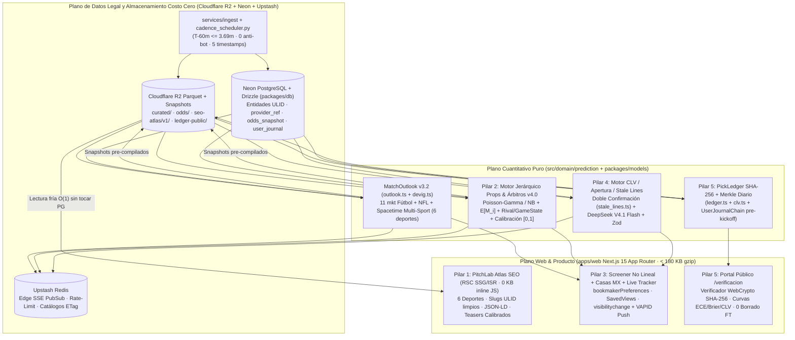
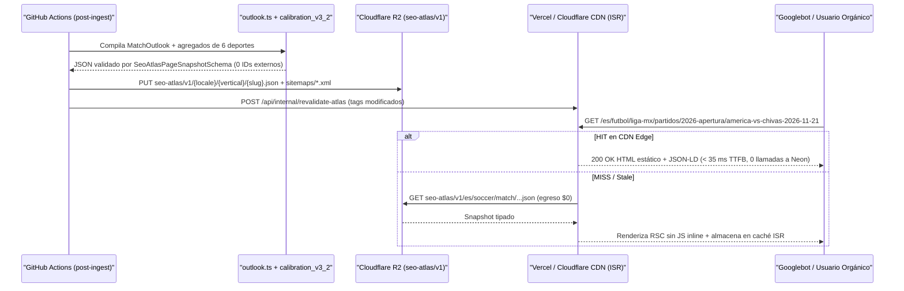
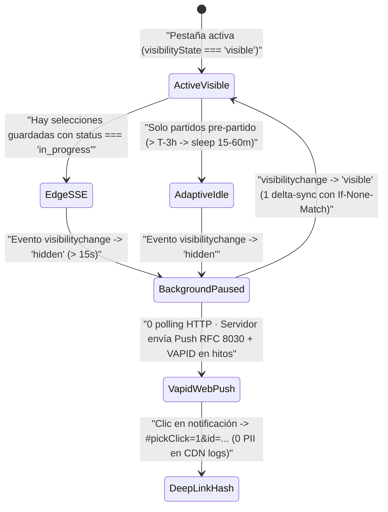
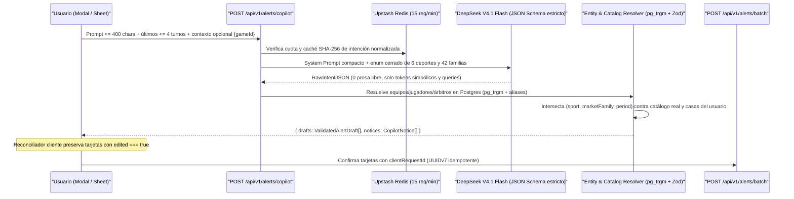
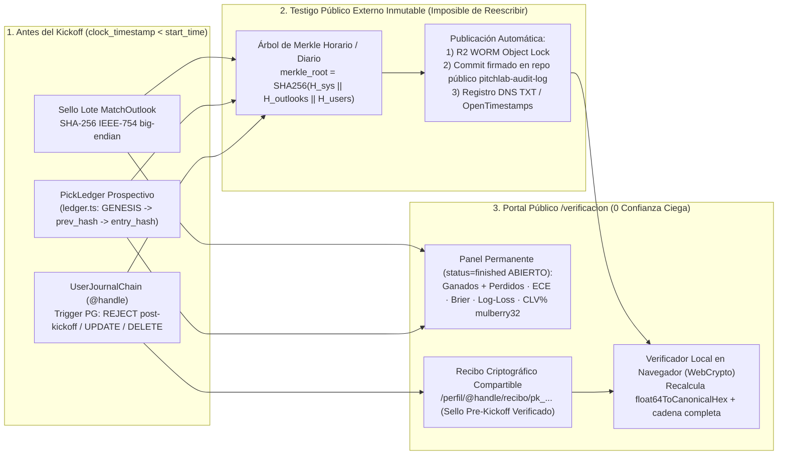
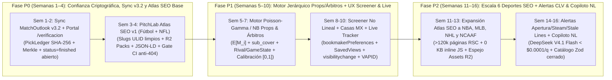

# 17 — Plan Maestro de Ingeniería y Producto para PitchLab (`v3.2` → `v4.0`): Atlas SEO Multi-Deporte, Motor Jerárquico de Props y Árbitros, UX Screener/Live Tracker, Alertas CLV + Copiloto NL y Auditoría Criptográfica `/verificacion`

> **Propósito:** Especificación arquitectónica ejecutable (`P0` → `P1` → `P2`) para absorber en **PitchLab (`PREDLAB-V3.2`)** las ventajas reales de adquisición orgánica, descubrimiento táctico y retención en vivo auditadas en **Scout Picks (`https://scoutpicks.app`)** durante las Olas 1 y 2 forenses, erradicando de raíz sus defectos matemáticos, fugas de proveedores, desperdicios de red y mecanismos de fabricación retrospectiva de historiales.  
> **Clasificación epistemológica:** `[OBSERVADO]` (verificado byte a byte en código o capturas vivas), `[DERIVADO]` (calculado de forma determinista desde evidencia primaria), `[INFERIDO]` (conclusión arquitectónica de alta confianza) y `[DISEÑO PROPUESTO]` (especificación objetivo para PitchLab).  
> **Evidencias primarias REA y Dossier Forense:**
> - **Scout Picks (Olas 1 y 2):** [00-REPORTE-MAESTRO-SCOUTPICKS.md](file:///C:/Users/T490s/.gemini/antigravity/worktrees/PitchLab/analyze_pitchlab_competitor_rea/Reportes/scoutpicks/00-REPORTE-MAESTRO-SCOUTPICKS.md), [01-arquitectura-frontend-rutas-y-landing.md](file:///C:/Users/T490s/.gemini/antigravity/worktrees/PitchLab/analyze_pitchlab_competitor_rea/Reportes/scoutpicks/01-arquitectura-frontend-rutas-y-landing.md), [02-ux-diseno-features-y-flujos-en-vivo.md](file:///C:/Users/T490s/.gemini/antigravity/worktrees/PitchLab/analyze_pitchlab_competitor_rea/Reportes/scoutpicks/02-ux-diseno-features-y-flujos-en-vivo.md), [04-proveedores-datos-escudos-nombres-y-momios.md](file:///C:/Users/T490s/.gemini/antigravity/worktrees/PitchLab/analyze_pitchlab_competitor_rea/Reportes/scoutpicks/04-proveedores-datos-escudos-nombres-y-momios.md), [05-motores-prediccion-probabilidades-e-ia.md](file:///C:/Users/T490s/.gemini/antigravity/worktrees/PitchLab/analyze_pitchlab_competitor_rea/Reportes/scoutpicks/05-motores-prediccion-probabilidades-e-ia.md), [08-detalles-ocultos-secretos-anomalias-y-bugs.md](file:///C:/Users/T490s/.gemini/antigravity/worktrees/PitchLab/analyze_pitchlab_competitor_rea/Reportes/scoutpicks/08-detalles-ocultos-secretos-anomalias-y-bugs.md), [09-comparativa-estrategica-y-mejoras-pitchlab.md](file:///C:/Users/T490s/.gemini/antigravity/worktrees/PitchLab/analyze_pitchlab_competitor_rea/Reportes/scoutpicks/09-comparativa-estrategica-y-mejoras-pitchlab.md) y [10-registro-evidencia-rea-y-limitaciones.md](file:///C:/Users/T490s/.gemini/antigravity/worktrees/PitchLab/analyze_pitchlab_competitor_rea/Reportes/scoutpicks/10-registro-evidencia-rea-y-limitaciones.md) (`ev_abdb3cf1dbd8a7aab2a952ca236449585bd2de775d8200297a3b94e836220fb3`, `ev_d6aea026e24cc7285f592385c27b572003bb7a591dbda6be9d5c2ff8366790be`, `ev_03f837b1e4aec03bcac8791498a5d2cbbd06e25f39474bde43e541baa4acff52`, `ev_8d1fa2225983ff98a4c350ad528895985cc9cdd8f4efab6f7eceda9da4dc30cd`, `ev_74b541a57159f5b5975cfbe9c641d44f5355061d23a9f470fa1ff363bc832221`, `ev_2042082f0b1a0b067ea501537d7537ec2aadf72e50c106be1b84700b7f8ee1d0`, `ev_7aae1b8faebfaae85bd8513669e557fd705e9a7b85ff530e366823d93f7910d4`, `ev_eb381a1446763d94752838fd77caee295d4b64c43f3b7536a70f7c2183578a69`, `ev_a394dec94a9e5e5f399bf393e8aea83ab29cb391995908919172dae4bbe2b087`).
> - **Referencia cruzada Astra AI:** [17-plan-mejoras-pitchlab-vs-astra-motores-y-funciones.md](file:///C:/Users/T490s/.gemini/antigravity/worktrees/PitchLab/analyze_pitchlab_competitor_rea/Reportes/analisis-astra/17-plan-mejoras-pitchlab-vs-astra-motores-y-funciones.md).
> - **Código y estado real de PitchLab (`v3.2.0`):** [PROJECT_STATE.md](file:///C:/Users/T490s/.gemini/antigravity/worktrees/PitchLab/analyze_pitchlab_competitor_rea/docs/execution/PROJECT_STATE.md), [PREDICTION_ARCHITECTURE.md](file:///C:/Users/T490s/.gemini/antigravity/worktrees/PitchLab/analyze_pitchlab_competitor_rea/docs/architecture/PREDICTION_ARCHITECTURE.md), [DATA_ARCHITECTURE.md](file:///C:/Users/T490s/.gemini/antigravity/worktrees/PitchLab/analyze_pitchlab_competitor_rea/docs/architecture/DATA_ARCHITECTURE.md), [SHARED_CONTRACTS.md](file:///C:/Users/T490s/.gemini/antigravity/worktrees/PitchLab/analyze_pitchlab_competitor_rea/docs/architecture/SHARED_CONTRACTS.md), [STACK_COSTO_CERO.md](file:///C:/Users/T490s/.gemini/antigravity/worktrees/PitchLab/analyze_pitchlab_competitor_rea/docs/architecture/STACK_COSTO_CERO.md), [19_HOJA_DE_RUTA_MOTORES_Y_PICKS_V4.md](file:///C:/Users/T490s/.gemini/antigravity/worktrees/PitchLab/analyze_pitchlab_competitor_rea/docs/predicciones/19_HOJA_DE_RUTA_MOTORES_Y_PICKS_V4.md), [SYNC_NOTES.md](file:///C:/Users/T490s/.gemini/antigravity/worktrees/PitchLab/analyze_pitchlab_competitor_rea/research/prediction-lab/coordination/v3_2/SYNC_NOTES.md), [sources_catalog.json](file:///C:/Users/T490s/.gemini/antigravity/worktrees/PitchLab/analyze_pitchlab_competitor_rea/config/sources_catalog.json), [outlook.ts](file:///C:/Users/T490s/.gemini/antigravity/worktrees/PitchLab/analyze_pitchlab_competitor_rea/src/domain/prediction/outlook.ts), [devig.ts](file:///C:/Users/T490s/.gemini/antigravity/worktrees/PitchLab/analyze_pitchlab_competitor_rea/src/domain/prediction/devig.ts), [stale_lines.ts](file:///C:/Users/T490s/.gemini/antigravity/worktrees/PitchLab/analyze_pitchlab_competitor_rea/src/domain/prediction/stale_lines.ts), [picks.ts](file:///C:/Users/T490s/.gemini/antigravity/worktrees/PitchLab/analyze_pitchlab_competitor_rea/src/domain/prediction/picks.ts), [ledger.ts](file:///C:/Users/T490s/.gemini/antigravity/worktrees/PitchLab/analyze_pitchlab_competitor_rea/src/domain/prediction/ledger.ts), [clv.ts](file:///C:/Users/T490s/.gemini/antigravity/worktrees/PitchLab/analyze_pitchlab_competitor_rea/src/domain/prediction/clv.ts), [multisport.ts](file:///C:/Users/T490s/.gemini/antigravity/worktrees/PitchLab/analyze_pitchlab_competitor_rea/src/domain/prediction/multisport.ts) y [props.ts](file:///C:/Users/T490s/.gemini/antigravity/worktrees/PitchLab/analyze_pitchlab_competitor_rea/src/domain/props.ts).
> - **Higiene estricta:** CERO PII, CERO credenciales y respeto absoluto a las fronteras de congelamiento de `v3.1`/`v3.2` (`holdout_sealed` marcado permanentemente como `"holdout consumido"`).

---

## 0. Diagnóstico Arquitectónico de Partida: Cimiento Institucional de PitchLab vs Envoltorio Comercial de Scout Picks

La auditoría forense cruzada demuestra una **asimetría complementaria exacta** entre ambas plataformas (`[OBSERVADO]` + `[DERIVADO]`):

1. **Qué tiene hoy PitchLab (`v3.2.0`) que Scout Picks carece por completo (`[OBSERVADO]`):**
   - **Rigor probabilístico y calibración auditable:** Motor `MatchOutlook` ([outlook.ts](file:///C:/Users/T490s/.gemini/antigravity/worktrees/PitchLab/analyze_pitchlab_competitor_rea/src/domain/prediction/outlook.ts)) que proyecta `11` mercados de fútbol + `topScorelines[3]` desde una única matriz Dixon-Coles coherente (`|Σp - 1| < 10^{-12}`) y `3` mercados NFL, calibrado en `walk_forward_dev` (`56,649` partidos, `ECE = 0.0025` en `GLOBAL::football::1x2`, [outlook_calibration_v3_2.json](file:///C:/Users/T490s/.gemini/antigravity/worktrees/PitchLab/analyze_pitchlab_competitor_rea/src/data/prediction/outlook_calibration_v3_2.json)), más motores verificados para **6 deportes** (`Fútbol` incl. `Liga MX`, `NFL`, `NBA`, `MLB`, `NHL` y `NCAAF` en [multisport.ts](file:///C:/Users/T490s/.gemini/antigravity/worktrees/PitchLab/analyze_pitchlab_competitor_rea/src/domain/prediction/multisport.ts)).
   - **Microestructura real de cuotas y *de-vigging*:** Desmarginación exacta `proportional`, `power`, `shin` y `adaptive` con interpolación Hermite $C^1$ entre régimen *sharp* (`Pinnacle ~3.22%`) y recreativo mexicano (`Caliente.mx ~6.62%+`) en [devig.ts](file:///C:/Users/T490s/.gemini/antigravity/worktrees/PitchLab/analyze_pitchlab_competitor_rea/src/domain/prediction/devig.ts), detector causal de líneas rezagadas de **Doble Confirmación** (`CLV% = +10.93% [+8.37%, +13.86%]` en `dev`, cadencia matemática `<= 3.69 min` en `T-60m` en [stale_lines.ts](file:///C:/Users/T490s/.gemini/antigravity/worktrees/PitchLab/analyze_pitchlab_competitor_rea/src/domain/prediction/stale_lines.ts)) y compuerta estricta `0/60` segmentos activos ([production_segments_v3_1.json](file:///C:/Users/T490s/.gemini/antigravity/worktrees/PitchLab/analyze_pitchlab_competitor_rea/src/data/prediction/production_segments_v3_1.json)) hasta acumular `>= 150` picks prospectivos reales con `CLV% > 0` bootstrap `mulberry32` ([clv.ts](file:///C:/Users/T490s/.gemini/antigravity/worktrees/PitchLab/analyze_pitchlab_competitor_rea/src/domain/prediction/clv.ts)).
   - **Inmutabilidad criptográfica nativa:** `PickLedger` append-only encadenado con `SHA-256` e IEEE-754 big-endian de 64 bits ([ledger.ts](file:///C:/Users/T490s/.gemini/antigravity/worktrees/PitchLab/analyze_pitchlab_competitor_rea/src/domain/prediction/ledger.ts) y [picks_v3_2_synthetic_fixture.jsonl](file:///C:/Users/T490s/.gemini/antigravity/worktrees/PitchLab/analyze_pitchlab_competitor_rea/data/ledger/fixtures/picks_v3_2_synthetic_fixture.jsonl)).

2. **Qué construyó Scout Picks que explica su tracción orgánica y retención diaria (`~4.8★` móvil), junto con sus fallas ocultas (`[OBSERVADO]` + `[DERIVADO]`):**
   - **Adquisición SEO industrial:** `81,197` URLs estáticas pre-renderizadas en Astro sobre `55` sub-sitemaps en `9` idiomas con `0 KB` de JS inline ejecutable (`ev_2042082f...` + auditoría Ola 2), pero filtrando `sportmonksId` crudos en `55,251` URLs, haciendo *hotlinking* a `cdn.sportmonks.com` (`41.67%` del tráfico HAR, `ev_8d1fa222...`) y limitada solo a fútbol.
   - **Descubrimiento granular de *props* y árbitros:** `22` familias de mercado con higiene `minMinutes = 45`, `expectedLineupStatus`, `substitutionPattern` y *perks* (`sub_cover`, `early_payout_2_goals`), pero gobernada por un conteo frecuentista ingenuo $k/n \times 100$ sin *de-vig*, `96.69%` de sesgo *winner's curse* multi-lente (`19.21%` con `hitRate = 100%`), `adjustedHitRate = null` en `527/527` *insights*, dos bugs en `confidence` (`under` sin inversión de signo y `Math.abs` en totales) y un triple bug catastrófico en `/simulations/calculate` (falso H2H `charts.vsOpponent`, contaminación club/selección y resta `[0..100] - [0..1]` que inventa `edge: +99.29%`, `ev_03f837b1...`).
   - **Hábito interactivo y alertas:** Preferencias de casas del usuario (`bookmakerPreferences`), slider no lineal de `81` pasos, vistas guardadas (`insight-views`), seguimiento en vivo `current / line`, video-guías embebidas (`/guide/videos` añadida en el Build 3 `ae1f2c46...` de `3.37 MB` invalidando todo el monolito por `+5,483` bytes) y asistente NL de alertas (`POST /market-alerts/assistant`), lastrados por `refetchIntervalInBackground: true` global, `45x` re-fetches redundantes de catálogos (`ev_7aae1b8f...`), bloqueo de auditoría `statusFilter=finished` (`ZodError`), purga de *insights* `FT` y la herramienta oculta `Drt()` (`Creator Pick Calendar`) diseñada literalmente *"so you have a track record to screenshot"* (`ev_abdb3cf1...`).



---

## 1. Pilar 1 — Fábrica de SEO Programático Multi-Deporte (`PitchLab Atlas SEO`, `P0/P1`)

### 1.1 Auditoría Forense de la Máquina SEO de Scout Picks y Sus 4 Vulnerabilidades Estructurales

La inspección completa en Ola 2 de `https://scoutpicks.app/sitemap-index.xml` y sus `55` sub-sitemaps (`[OBSERVADO]`, `ev_8d1fa222...`, `ev_2042082f...`) confirma la magnitud exacta de su motor de adquisición orgánica:
- **Volumen exacto (`[DERIVADO]`):** `54` sub-sitemaps programáticos (`9` idiomas: `es`, `en`, `fr`, `pt`, `id`, `vi`, `th`, `hi`, `ar` × `6` verticales: `estadisticas`/`stats` [`20` URLs], `equipos`/`teams` [`412`], `jugadores`/`players` [`2,991`], `arbitros`/`referees` [`292`], `enfrentamientos`/`head-to-head` [`2,450`] y `partidos`/`matches` [`2,856`] = **`9,021` URLs por idioma** = **`81,189` URLs**) más `sitemap-pages-0.xml` (`8` URLs legales/landing) para un total exacto de **`81,197` URLs indexadas**, con `0` sitemaps rotos y `67/67` páginas muestreadas devolviendo `HTTP 200 OK`.
- **Higiene de renderizado (`[OBSERVADO]`):** Páginas generadas con Astro SSG (`25 KB` a `433 KB` HTML puro con tablas completas de córners, tarjetas, tiros, goles, local/visitante y árbitros), **`0 KB` de JavaScript ejecutable inline** (únicamente bloques declarativos `<script type="application/ld+json">` y módulos diferidos `/_astro/{LeagueStatsPage,TeamStatsPage,PlayerHubPage,RefereePage,HeadToHeadPage}.*.js` + `ComplianceNote` de `162` bytes).

Sin embargo, el análisis profundo destapó **cuatro defectos arquitectónicos severos** que PitchLab corregirá por diseño:

1. **Filtración masiva de claves primarias de proveedor (`sportmonksId`) en `55,251` URLs y en JSON-LD (`[OBSERVADO]`):** Todas las rutas de jugadores (`/es/jugadores/liga-mx/ramon-juarez-37250424`), árbitros (`/es/arbitros/abdullah-al-harbi-69552`) y partidos (`/es/partidos/brasileirao/athletico-pr-vs-atletico-mineiro-19621792`) concatenan literalmente el ID interno de Sportmonks v3 (`(2,991 + 292 + 2,856) × 9 = 55,251` URLs), y el `JSON-LD` incrusta `"logo": "https://cdn.sportmonks.com/images/soccer/teams/8/3432.png"`. Si el proveedor cambia (como ya le ocurrió a Scout Picks al migrar de API-Football a Sportmonks en mayo de 2026, [04-proveedores-datos-escudos-nombres-y-momios.md](file:///C:/Users/T490s/.gemini/antigravity/worktrees/PitchLab/analyze_pitchlab_competitor_rea/Reportes/scoutpicks/04-proveedores-datos-escudos-nombres-y-momios.md) §2.1), toda su autoridad SEO colapsa o exige mapas perpetuos de redirección; en PitchLab además violaría frontalmente la regla fundacional `FD-16` ([STACK_COSTO_CERO.md](file:///C:/Users/T490s/.gemini/antigravity/worktrees/PitchLab/analyze_pitchlab_competitor_rea/docs/architecture/STACK_COSTO_CERO.md) §2).
2. **Asimetría incoherente de prefijos i18n (`[OBSERVADO]`):** En `sitemap-index.xml`, los archivos en español omiten el código de idioma (`sitemap-estadisticas-0.xml`), pero sus `<loc>` sí llevan `/es/estadisticas/...`; inversamente, el inglés usa prefijo en el archivo (`sitemap-en-stats-0.xml`) pero sirve sus `<loc>` en la raíz sin prefijo (`/stats/...`).
3. **Metadatos `SportsEvent` desincronizados tras el pitazo final (`[OBSERVADO]`):** En partidos ya finalizados semanas atrás (ej. `Athletico PR 2-2 Atlético Mineiro` del `2026-10-08T23:00:00Z`), el `<title>` muestra el `2-2`, pero el `JSON-LD` sigue declarando `"eventStatus": "https://schema.org/EventScheduled"`, degradando los *rich snippets* post-partido en Google Search.
4. **Cero deportes norteamericanos y ausencia de probabilidades calibradas (`[OBSERVADO]`):** Scout Picks deja desiertos `NFL`, `NBA`, `MLB`, `NHL` y `NCAAF` —donde el CPC orgánico en México y EE. UU. hispano es altísimo— y solo ofrece promedios descriptivos sin probabilidades calibradas ni `fairOdds`.

### 1.2 Arquitectura Híbrida RSC SSG/ISR sobre Snapshots en Cloudflare R2 (`[DISEÑO PROPUESTO]`)

Para servir `> 120,000` páginas multi-deporte en **Next.js 15 App Router** (`apps/web`) dentro del presupuesto de [STACK_COSTO_CERO.md](file:///C:/Users/T490s/.gemini/antigravity/worktrees/PitchLab/analyze_pitchlab_competitor_rea/docs/architecture/STACK_COSTO_CERO.md) sin despertar el cómputo de **Neon PostgreSQL** ante ráfagas de `Googlebot` / `Bingbot` / `Applebot`:

1. **Desacoplamiento total `Ingesta/Modelos → R2 Atlas Pack → Next.js RSC Puro`:**
   - Un job post-ingesta (`services/ingest/src/seo/build-atlas-packs.ts`) lee los artefactos curados (`data/snapshots/<liga>/latest.json`, [live_matchday_v3_snapshot.json](file:///C:/Users/T490s/.gemini/antigravity/worktrees/PitchLab/analyze_pitchlab_competitor_rea/src/data/prediction/live_matchday_v3_snapshot.json), [outlook_calibration_v3_2.json](file:///C:/Users/T490s/.gemini/antigravity/worktrees/PitchLab/analyze_pitchlab_competitor_rea/src/data/prediction/outlook_calibration_v3_2.json) y `curated/*.parquet`) y materializa documentos JSON compactos e inmutables en **Cloudflare R2** (`0` costo de egreso):
     `r2://pitchlab-data/seo-atlas/v1/{locale}/{sport}/{vertical}/{canonical_slug}.json`
   - Las rutas públicas de `apps/web/src/app/(atlas)/[locale]/...` son **React Server Components (`RSC`) 100% estáticos** sin `"use client"` en tablas, encabezados ni FAQs (`0 KB` de payload de hidratación para las tablas estadísticas). Solo dos islas minúsculas (`<FairOddsConverterIsland />` de `< 2.5 KB` gzip y `<TrackOutboundCtaIsland />` con `navigator.sendBeacon`) se hidratan bajo `loading="lazy"` / `IntersectionObserver`.
2. **Política ISR Determinista por Estado del Evento (`revalidate` + `revalidateTag`):**
   - **Páginas de Liga, Equipo, Jugador, Árbitro/Crew y H2H:** `revalidate = 21600` (`6 h`) + invalidación selectiva por `revalidateTag("atlas:league:" + leagueSlug)` al cerrar jornada.
   - **Páginas de Partido Pre-Kickoff (`status = "scheduled"`):** `revalidate = 1800` (`30 min`) para reflejar actualizaciones de `MatchOutlook` y `MarketPulse`.
   - **Páginas de Partido Liquidado (`status = "final"` tras `+24 h` de acta oficial):** transición a caché inmutable (`revalidate = false` / `Cache-Control: public, s-maxage=31536000, stale-while-revalidate=86400`), congelando para siempre la comparación entre el pronóstico pre-partido sellado y el marcador final real.



### 1.3 Gramática de Slugs Canónicos Sin Fuga de Proveedores (`FD-16`) y Matriz de 6 Deportes

Siguiendo el principio #1 de [DATA_ARCHITECTURE.md](file:///C:/Users/T490s/.gemini/antigravity/worktrees/PitchLab/analyze_pitchlab_competitor_rea/docs/architecture/DATA_ARCHITECTURE.md) (*"Ninguna tabla de dominio usa el ID de un proveedor como clave; el mapeo vive en `provider_ref`"*), **queda prohibido por validación CI que cualquier URL o JSON-LD contenga `sportmonksId`, `apiFootballId`, `gsis_id` o URLs de CDNs de terceros**. Todos los escudos y emblemas resuelven a rutas propias mediante `getEmblemPath()` y `getLeagueEmblemPath()` de [packages/sports-assets/src/index.ts](file:///C:/Users/T490s/.gemini/antigravity/worktrees/PitchLab/analyze_pitchlab_competitor_rea/packages/sports-assets/src/index.ts#L53-L70) bajo `https://cdn.pitchlab.mx/brand/...`.

- **Convención simétrica de *locales* (`es` canónico para México/LATAM en `/es/...`, `en` en `/en/...`, `pt` en `/pt/...`; `/` redirige con `308` o `x-default` negociado sin mezclar esquemas de prefijo en sitemaps):**
  - **Hub de Liga (`stats`):** `/{locale}/{sportSlug}/{leagueSlug}/estadisticas`  
    *(Ej.: `/es/futbol/liga-mx/estadisticas`, `/es/futbol-americano/nfl/estadisticas`, `/es/beisbol/mlb/estadisticas`)*
  - **Perfil de Equipo:** `/{locale}/{sportSlug}/{leagueSlug}/equipos/{teamSlug}`  
    *(Ej.: `/es/futbol/liga-mx/equipos/america`, mapeado 1:1 a `TeamId = "liga-mx.america"` en [ids.ts](file:///C:/Users/T490s/.gemini/antigravity/worktrees/PitchLab/analyze_pitchlab_competitor_rea/packages/contracts/src/ids.ts#L44-L50))*
  - **Cara a Cara (`H2H`):** `/{locale}/{sportSlug}/{leagueSlug}/enfrentamientos/{teamASlug}-vs-{teamBSlug}` *(orden lexicográfico canónico `teamASlug < teamBSlug`, redirigiendo con `301` el orden inverso para evitar contenido duplicado)*.
  - **Perfil de Jugador (desambiguación limpia sin ID externo):** `/{locale}/{sportSlug}/{leagueSlug}/jugadores/{playerSlug}` (p. ej. `henry-martin`, `patrick-mahomes`; solo ante colisión real de homónimos dentro del mismo deporte se sufija `-{birthYear}` o los `4` caracteres en minúsculas del sufijo canónico de su `ULID` interno en `player.id`).
  - **Perfil de Árbitro / Crew Oficial:** `/{locale}/{sportSlug}/arbitros/{officialSlug}` (cubre árbitros FIFA/Liga MX, *referee crews* de NFL por *Crew Chief*, *umpires* de home plate en MLB y ternas NBA/NHL).
  - **Ficha de Partido (Previa + Post-Partido Permanente):** `/{locale}/{sportSlug}/{leagueSlug}/partidos/{seasonSlug}/{homeSlug}-vs-{awaySlug}-{yyyy-mm-dd}` (sufijo `-g2` únicamente en *doubleheaders* de MLB el mismo día).

| Deporte (`SportId`) | Ligas Iniciales | Tablas Estadísticas Estáticas (`0 KB` JS) en Página SEO | Teaser Cuantitativo Verificable (`MatchOutlook` + Calibración) |
|---|---|---|---|
| **Fútbol** (`soccer`) | `liga-mx`, `premier-league`, `laliga`, `bundesliga`, `serie-a`, `ligue-1`, `champions-league`, `libertadores` | Goles `1H`/`2H`/`FT`, `npxG` (cuando aplique licencia), córners a favor/contra/total, tarjetas amarillas/rojas, tiros y tiros a puerta, faltas y rigor del árbitro designado. | Matriz `MatchOutlook` (`1X2`, `Over/Under 2.5`, `BTTS`, `topScorelines[3]`), `fairOdds = 1/p`, `ECE` del segmento y `MarketPulse`. |
| **NFL** (`american-football`) | `nfl` | Puntos por cuarto, `EPA/play` ofensivo/defensivo (`nflverse` `CC BY 4.0`), tasa de éxito, conversión 3rd Down / Red Zone, *pressure rate*, clima/viento (`Open-Meteo`) y *penalties/yds* de la cuadrilla arbitral. | `MatchOutlook` (`moneyline`, `spread`, `totals`), margen proyectado, `fairOdds`, cobertura viva (`83.83%` con candidato EPA) y `MarketPulse`. |
| **NBA** (`basketball`) | `nba` | `NetRtg`, `ORtg`, `DRtg`, `Pace` (posesiones/48m), *Four Factors* (`eFG%`, `TOV%`, `ORB%`, `FTR`), descanso (*back-to-back* / `3-in-4`), altitud (`DEN`/`UTA`) y reporte oficial de bajas. | Proyección `PitchLab Tensor NBA v3.0` (`pHome`, `pAway`, `expectedMargin`, `expectedTotalPoints`, `fairOdds`). |
| **MLB** (`baseball`) | `mlb` | `FIP`, `xFIP`, `K-BB%` del abridor confirmado, `FIP` de bullpen reciente, `wOBA` / `OPS+` con *platoon splits* (`vs LHP`/`RHP`), factor de parque + presión barométrica (`Coors`/viento) y zona de strike del *umpire*. | Proyección `PitchLab Kepler MLB v3.0` (`F5` y Juego Completo con cadena de extra innings, `expectedRuns`, `fairOdds`). |
| **NHL** (`hockey`) | `nhl` | `xGF%`, `Corsi%`, `Fenwick%` `5v5`, `HD xGF/60`, `PP%` / `PK%`, estado de confirmación y `SV%` / `GSAX` del portero titular (`Curvature NHL v3.0`). | Probabilidades en tiempo reglamentario (`pHomeReg`, `pOtReg`, `pAwayReg`) y finales (`pHome`, `pAway`, `expectedTotalGoals`, `fairOdds`). |
| **NCAAF** (`american-football`) | `ncaaf` (`138` FBS) | `SRS`, `FPI`, `SOS` (`Power-4` vs `G5`), `Net YPP`, diferencial de entregas, altitud severa (`WYO`/`AFA`/`BYU`/`COL`) y clima en estadio abierto. | Proyección `PitchLab Horizon NCAAF v3.0` (`pHome`, `pAway`, `expectedMargin`, `expectedTotalPoints`, `fairOdds`). |

### 1.4 Esquema SQL/Drizzle (`packages/db`) y Contratos TypeScript/Zod (`packages/contracts`)

```typescript
// [DISEÑO PROPUESTO] packages/db/src/schema/seo-atlas.ts
import {
  pgTable,
  text,
  timestamp,
  integer,
  boolean,
  jsonb,
  uniqueIndex,
  index,
  check,
} from "drizzle-orm/pg-core";
import { sql } from "drizzle-orm";

export const seoSlugRegistry = pgTable(
  "seo_slug_registry",
  {
    id: text("id").primaryKey(), // ULID propio, ej. "01JCXXX..."
    entityType: text("entity_type").notNull(), // 'league' | 'team' | 'player' | 'official' | 'h2h' | 'match'
    entityId: text("entity_id").notNull(), // FK lógica a tabla canónica (jamás ID externo)
    sportId: text("sport_id").notNull(),
    leagueId: text("league_id"),
    canonicalSlug: text("canonical_slug").notNull(),
    r2PackKeyPrefix: text("r2_pack_key_prefix").notNull(), // "seo-atlas/v1/{locale}/soccer/team/america"
    httpStatus: integer("http_status").notNull().default(200),
    indexable: boolean("indexable").notNull().default(true), // false si muestra < umbral mínimo anti-thin-content
    contentSha256: text("content_sha256").notNull(),
    sourceUpdatedAt: timestamp("source_updated_at", { withTimezone: true }).notNull(),
    lastBuiltAt: timestamp("last_built_at", { withTimezone: true }).notNull().defaultNow(),
  },
  (t) => [
    uniqueIndex("uq_seo_slug_entity").on(t.entityType, t.entityId),
    uniqueIndex("uq_seo_slug_path").on(t.sportId, t.entityType, t.leagueId, t.canonicalSlug),
    index("idx_seo_slug_sitemap").on(t.indexable, t.entityType, t.lastBuiltAt),
    // Guardia dura en BD contra filtración numérica estilo "-37250424" (>5 dígitos al final salvo fecha YYYY-MM-DD)
    check(
      "chk_no_provider_numeric_tail",
      sql`${t.canonicalSlug} !~ '-[0-9]{6,}$'`,
    ),
  ],
);

export const seoRedirect301 = pgTable(
  "seo_redirect_301",
  {
    fromPath: text("from_path").primaryKey(),
    toPath: text("to_path").notNull(),
    reason: text("reason").notNull(), // 'h2h_canonical_order' | 'team_rebrand' | 'slug_merge'
    createdAt: timestamp("created_at", { withTimezone: true }).notNull().defaultNow(),
  },
  (t) => [index("idx_seo_redirect_to").on(t.toPath)],
);
```

```typescript
// [DISEÑO PROPUESTO] packages/contracts/src/seo-atlas.ts
import { z } from "zod";
import { LeagueIdSchema, SportIdSchema } from "./ids.js";

export const AtlasLocaleSchema = z.enum(["es", "en", "pt"]);
export type AtlasLocale = z.infer<typeof AtlasLocaleSchema>;

export const AtlasVerticalSchema = z.enum([
  "league_stats",
  "team",
  "player",
  "official",
  "h2h",
  "match",
]);

/** Regla anti-fuga FD-16: rechaza cualquier URL de Sportmonks, API-Sports o cola numérica >= 6 dígitos. */
const SafePublicUrlSchema = z
  .string()
  .url()
  .refine(
    (u) => !/(sportmonks|api-sports|media\.api-sports|flagcdn)/i.test(u),
    "Prohibido hotlinking a CDNs de proveedores externos en SEO Atlas (FD-16)",
  );

export const VerifiableOutlookTeaserSchema = z.object({
  schemaVersion: z.literal("match_outlook_v3.2.0"),
  tsDecisionUtc: z.string().datetime(),
  headlineSelectionLabel: z.string().min(2),
  /** Escala única canónica (0, 1) — prohibido [0, 100] o p = 1.00. */
  calibratedProb: z.number().gt(0.001).lt(0.999),
  fairOddsDecimal: z.number().gte(1.01).lte(100),
  fairOddsAmerican: z.number().int(),
  pSource: z.enum(["market_sharp_novig", "blend_v3_1", "model", "base_rate"]),
  calibrationSegmentKey: z.string(),
  segmentEce: z.number().min(0).max(1).nullable(),
  binEmpiricalFreq: z.number().min(0).max(1).nullable(),
  binSampleSize: z.number().int().nonnegative(),
  dataQualityFlag: z.enum(["ok", "low_coverage", "fallback_base_rate"]),
  ledgerSealHash: z.string().regex(/^[0-9a-f]{64}$/).nullable(),
});

export const SeoAtlasPageSnapshotSchema = z.object({
  packVersion: z.literal(1),
  locale: AtlasLocaleSchema,
  vertical: AtlasVerticalSchema,
  sport: SportIdSchema,
  league: LeagueIdSchema.nullable(),
  canonicalUrl: SafePublicUrlSchema,
  alternates: z.record(z.enum(["es", "en", "pt", "x-default"]), SafePublicUrlSchema),
  lastmodUtc: z.string().datetime(),
  meta: z.object({
    title: z.string().min(15).max(70),
    description: z.string().min(50).max(165),
    ogImageUrl: SafePublicUrlSchema,
  }),
  jsonLdGraph: z.array(z.record(z.string(), z.unknown())).min(2),
  faqItems: z
    .array(z.object({ question: z.string().min(10), answer: z.string().min(15) }))
    .min(3)
    .max(8),
  tables: z.array(
    z.object({
      tableId: z.string(),
      caption: z.string(),
      columns: z.array(z.object({ key: z.string(), label: z.string(), numeric: z.boolean() })),
      rows: z.array(z.record(z.string(), z.union([z.string(), z.number(), z.null()]))),
    }),
  ),
  outlookTeaser: VerifiableOutlookTeaserSchema.nullable(),
  observedAtUtc: z.string().datetime(),
});
export type SeoAtlasPageSnapshot = z.infer<typeof SeoAtlasPageSnapshotSchema>;
```

### 1.5 Datos Estructurados `JSON-LD` (`@graph`) Dinámicos y Compuerta CI Anti-`404`

A diferencia de Scout Picks —que mantiene `EventScheduled` en partidos ya jugados y omite `Dataset`—, el generador `buildJsonLdGraph(snapshot)` en `apps/web` emite un grafo `@graph` determinista validado en compilación:
1. **`BreadcrumbList`** jerárquico (`Inicio` → `Deporte` → `Liga` → `Entidad`).
2. **`SportsEvent`** (con transición estricta `EventScheduled` → `EventInProgress` → `EventCompleted` + `homeTeam` / `awayTeam` con escudos SVG propios de `cdn.pitchlab.mx` + `referee: { "@type": "Person" }`), **`SportsTeam`**, **`Person`** (jugador o árbitro/umpire con `jobTitle` localizado) y **`Dataset`** en hubs de liga/calibración documentando la ventana temporal y el `ECE` del modelo.
3. **`FAQPage`** redactado desde plantillas deterministas libres de LLM alimentadas por cuantiles y tasas reales (ej. córners local/visitante, `EPA/play` en NFL, `F5` en MLB o rigor arbitral comparado contra la media de la liga).
4. **Gate obligatorio de CI (`scripts/verify-seo-sitemaps.ts`):**
   - Particiona `sitemap-index.xml` en chunks de máximo `25,000` URLs (`sitemap-{locale}-{sport}-{vertical}-{chunk}.xml`), asegurando que el `100%` de las `<loc>` tengan `seo_slug_registry.indexable = true` (`N_partidos >= 5` para equipos/árbitros y `minutos >= 180` o `snaps >= 60` para jugadores, evitando *thin content*).
   - Falla el build (`exit code 1`) si detecta: (a) cualquier `<loc>` ausente en el manifiesto R2 (`0%` `404`), (b) enlaces `hreflang` no recíprocos, (c) cualquier subcadena de proveedor B2B o regex `/-[0-9]{6,}(\/|$)/`, o (d) cualquier etiqueta `<script>` sin `type="application/ld+json"` o `src` externo diferido.

---

## 2. Pilar 2 — Motor Jerárquico Calibrado de Micro-Mercados, *Player Props* y Árbitros (`P0/P1`)

### 2.1 Qué Absorbemos de Scout Picks y Qué Defectos Matemáticos Erradicamos

| Dimensión del Motor | Hallazgo Forense en Scout Picks (`ev_03f837b1...`, `ev_abdb3cf1...`) | Solución Matemática en PitchLab `v4.0` (`[DISEÑO PROPUESTO]`) |
|---|---|---|
| **Filtro de exposición y rol táctico** | `[OBSERVADO]` Excelente higiene de producto: filtra apariciones con `minMinutes = 45` (`348/348` *props*), prioriza `expectedLineupStatus` (`starter < doubt < bench` en `Lz`) y alerta `substitutionPattern`. | Se absorbe íntegro y se eleva a un **submodelo explícito de exposición esperada $\mathbb{E}[M_{i,m}]$** sujeto al contrato anti-fuga `CONTRACT_XI_PUBLISHED.md` (`B7`). |
| **Promociones de casas (*Perks*)** | `[OBSERVADO]` Extrae `sub_cover` (*Sustituto Cuenta* en Betano/Draftea) y `early_payout_2_goals`, pero solo los pinta como ícono sin ajustar la probabilidad. | Se modela analíticamente la variable aleatoria compuesta Titular + Sustituto $Y_{\text{ticket}} = Y_i(0, T_{\text{out}}) + Y_j(T_{\text{out}}, 90)$, cuantificando $\Delta p_{\text{sub\_cover}}$ exacto. |
| **Estimación de probabilidad** | `[DERIVADO]` Conteo crudo $k/n \times 100$ + barrido multi-lente (`L5`/`L10`/`L20`/`home`/`H2H`) promoviendo el máximo en el `96.69%` (*Winner's Curse*; `19.21%` exhibe `P = 100%`, incluso con $n=3$). | **Conjugación jerárquica Poisson-Gamma / Binomial Negativa con decaimiento exponencial temporal y contracción Empirical Bayes** hacia el prior posicional; imposible emitir $p \in \{0, 1\}$. |
| **Ajuste por rival y árbitro** | `[OBSERVADO]` `adjustedHitRate = null` y `matchupScore = null` en `527/527` *insights*; `opponentMetricRank` es decorativo. | **Factor multiplicativo log-lineal real** por defensa rival contraída, rigurosidad arbitral Empirical Bayes y presión de marcador esperado ($\Delta\lambda_{\text{DC}}$). |
| **Calibración, escala y *de-vig*** | `[OBSERVADO]` Cero *de-vig* (`100/odds`), bugs en `confidence` (`under` truncado a `0` en `24/25` y `Math.abs` en totales) y resta `[0..100] - [0..1]` en simulador (`edge = +99.29%`). | **Escala única tipada `UnitProb` en `(0, 1)`**, calibración isotónica/temperatura en `walk_forward_dev` y **de-vig adaptativo Power/Shin** ([devig.ts](file:///C:/Users/T490s/.gemini/antigravity/worktrees/PitchLab/analyze_pitchlab_competitor_rea/src/domain/prediction/devig.ts)). |

> [!IMPORTANT]
> **Gobernanza Cuantitativa Obligatoria ([19_HOJA_DE_RUTA_MOTORES_Y_PICKS_V4.md](file:///C:/Users/T490s/.gemini/antigravity/worktrees/PitchLab/analyze_pitchlab_competitor_rea/docs/predicciones/19_HOJA_DE_RUTA_MOTORES_Y_PICKS_V4.md) §4.4):** Mientras no exista un corpus prospectivo suficiente con cierres *sharp* verificables por jugador (`Pinnacle` / `Smarkets` / `Betfair`), todas las salidas de este motor se publican exclusivamente bajo el contrato informativo de `MatchOutlook` (**probabilidad calibrada $p_{\text{cal}}$ + cuota justa `fairOdds = 1 / p_cal` + intervalo de incertidumbre**, con `0` stakes, `0` Kelly y `0` etiquetas de apuesta recomendada).

### 2.2 Formulación Matemática Cerrada (`PitchLab Hierarchical Props & Referees v4.0`)

#### A. Exposición Esperada $\mathbb{E}[M_{i,m}]$ y Cuantificación Exacta del Perk `sub_cover`
Sea el jugador $i$ en el partido futuro $m$ evaluado en el instante causal $t_{\text{dec}} < t_{\text{kickoff}} - 2\text{ min}$. Sea $S_{i,m} \in \{\text{confirmed\_starter}, \text{projected\_starter}, \text{doubt}, \text{bench}\}$ su estado de alineación verificable en $t_{\text{dec}}$ (donde `confirmed_starter` solo es válido si existe anuncio oficial con `ts_xi_published <= t_dec - 2 min` conforme a `CONTRACT_XI_PUBLISHED.md`). Modelamos la distribución de exposición efectiva $E_{i,m} = M_{i,m} / M_{\text{std}} \in [0, 1.12]$ (con $M_{\text{std}} = 90$ en fútbol, $48$ en NBA, $60$ en NHL, o snaps/apariciones al plato en NFL/MLB) como una mezcla discreta sobre tres regímenes de participación $c \in \{\text{full}, \text{early\_sub}, \text{cameo}\}$ más inactividad $E = 0$:

$$\mathbb{P}(E_{i,m} = e_c \mid S_{i,m}, \mathcal{H}_{i,<m}) = \pi_c(S_{i,m}, \mathcal{H}_{i,<m}), \qquad \sum_{c \in \{0, \text{full}, \text{early\_sub}, \text{cameo}\}} \pi_c = 1$$

donde la media esperada de minutos cuando inicia de titular incorpora el patrón histórico de cambio del entrenador ($\bar{t}_{\text{out},i}$ contraído hacia la media posicional $\bar{t}_{\text{out}}^{(g)}$, p. ej. extremos `LW/RW` $\approx 73'$, centrales `CB` $\approx 88'$):

$$\mathbb{E}[M_{i,m} \mid \text{titular}] = \frac{\sum_{k < m} w_{i,k}\,\mathbb{I}(\text{starter}_{i,k})\,M_{i,k} + \kappa_M \bar{M}_{\text{starter}}^{(g)}}{\sum_{k < m} w_{i,k}\,\mathbb{I}(\text{starter}_{i,k}) + \kappa_M}, \qquad \kappa_M = 4$$

**Valor matemático exacto del perk `sub_cover` (*Sustituto Cuenta*):** Cuando una casa ofrece `sub_cover` para una métrica aditiva de jugador (tiros, tiros a puerta, faltas, entradas) y el titular $i$ suele ser sustituido en el minuto $T_{\text{out}} \in (45, 90)$ por su reemplazo táctico habitual $j$ (con tasa contraída por 90' $\hat{\lambda}_{j,m}^{\text{EB}}$), el conteo efectivo liquidado bajo `sub_cover` condicionado a $T_{\text{out}} = \tau$ sigue una suma de procesos de Poisson independientes cuya intensidad integrada es:

$$\Lambda_{i \oplus j, m}(\tau) = \mu_{i,m}^{(90)}\cdot \frac{\tau}{90} + \mu_{j,m}^{(90)}\cdot \frac{\max(0, M_{\text{eff}} - \tau)}{90}$$

De este modo, PitchLab calcula dos probabilidades distintas y auditables: $p_{\text{std}} = \mathbb{P}(Y_i > L)$ para casas estándar y $p_{\text{sub\_cover}} = \mathbb{P}(Y_i + Y_j^{\text{rem}} > L) \ge p_{\text{std}}$ para casas con cobertura de sustituto, exponiendo al usuario el incremento exacto $\Delta p_{\text{sub\_cover}} = p_{\text{sub\_cover}} - p_{\text{std}}$ en lugar de un simple ícono promocional.

#### B. Tasas Base por 90' / Oportunidad mediante Conjugación Poisson-Gamma / Binomial Negativa con Decaimiento Causal
Para evitar tanto el sesgo de minutos basura (suplentes entrando al `87'`) como la pérdida de datos de un corte rígido `minMinutes = 45`, toda aparición histórica $k < m$ con $M_{i,k} \ge 15$ minutos entra ponderada naturalmente por su exposición $e_{i,k} = M_{i,k} / 90$ y un factor de olvido exponencial por antigüedad $\Delta d_{m,k} = (t_m - t_k)\text{ en días} > 0$:

$$w_{i,k} = \exp\!\big(-\ln(2)\cdot \Delta d_{m,k} / H_{\text{half}}\big) \cdot \psi_{\text{ctx}}(m, k)$$

donde $H_{\text{half}} = 120$ días (fútbol/NBA/NHL) y $\psi_{\text{ctx}}(m, k) \in (0, 1]$ evita la contaminación Club vs Selección que rompió el simulador de Scout Picks con António Silva (`ev_03f837b1...`): si $m$ es partido de selección nacional, los partidos con la propia selección reciben $\psi_{\text{ctx}} = 1.0$ y los partidos de club entran únicamente como señal auxiliar contraída ($\psi_{\text{ctx}} = 0.25$) ajustada por nivel Elo de competición.

Sea $g(i)$ el clúster posicional específico (`GK`, `CB`, `FB`, `DM`, `CM`, `AM`, `W`, `CF` en fútbol; `QB`, `RB`, `WR`, `TE` en NFL). Asumiendo $Y_{i,k} \mid \lambda_i \sim \text{Poisson}(\lambda_i e_{i,k})$ y el prior jerárquico conjugado $\lambda_i \sim \text{Gamma}(\alpha_0^{(g)}, \beta_0^{(g)})$ —donde $\mu_0^{(g)} = \alpha_0^{(g)} / \beta_0^{(g)}$ es la tasa climatológica de la posición en la liga y $\beta_0^{(g)} \in [5, 12]$ equivale a partidos completos de pseudomuestra estimados por *Empirical Bayes* en `walk_forward_dev`—, la distribución posterior de la intensidad intrínseca $\lambda_i$ antes del partido $m$ es exactamente Gamma con parámetros cerrados:

$$\alpha_{i,m} = \alpha_0^{(g)} + \sum_{k < m} w_{i,k}\,y_{i,k}, \qquad \beta_{i,m} = \beta_0^{(g)} + \sum_{k < m} w_{i,k}\,e_{i,k}$$

$$\hat{\lambda}_{i,m}^{\text{EB}} = \mathbb{E}[\lambda_i \mid \mathcal{H}_{i,<m}] = \frac{\alpha_{i,m}}{\beta_{i,m}} = \left(\frac{E_{\text{eff}}}{E_{\text{eff}} + \beta_0^{(g)}}\right)\bar{y}_{i,\text{w}} + \left(\frac{\beta_0^{(g)}}{E_{\text{eff}} + \beta_0^{(g)}}\right)\mu_0^{(g)}, \qquad E_{\text{eff}} = \sum_{k < m} w_{i,k}\,e_{i,k}$$

*Verificación contra el fallo extremo de Scout Picks (`sampleSize: 3`, `3/3` faltas $\Rightarrow$ `hitRate = 100%`):* Con $\mu_0^{(\text{MID})} = 1.15$ faltas/90', $\beta_0 = 6.0$, $E_{\text{eff}} = 2.6$ y $3$ faltas observadas, $\hat{\lambda}^{\text{EB}} = (6.0 \times 1.15 + 3) / 8.6 = 1.151$, produciendo $\mathbb{P}(Y \ge 1) \approx 65.4\%$ (`fairOdds = 1.53`) en vez del absurdo `100.0%` (`fairOdds = 1.00`).

#### C. Factor Multiplicativo Log-Lineal de Rival, Árbitro y Guion de Partido (*Game-State*)
En lugar de dejar `adjustedHitRate = null`, definimos los estimadores contraídos de permisividad defensiva específica del rival $o(m)$ para la métrica $q$ (frente a la posición $g$) y de rigurosidad del árbitro/cuadrilla $r(m)$:

$$\tilde{D}_{o,q}^{\text{EB}} = \frac{N_o \bar{D}_{o,q} + \kappa_{\text{def}}\bar{D}_{\text{liga},q}}{N_o + \kappa_{\text{def}}} \;\; (\kappa_{\text{def}} = 8), \qquad \tilde{R}_{r,q}^{\text{EB}} = \frac{N_r \bar{R}_{r,q} + \kappa_{\text{ref}}\bar{R}_{\text{liga},q}}{N_r + \kappa_{\text{ref}}} \;\; (\kappa_{\text{ref}} = 15)$$

La intensidad ajustada por exposición $e_c$ en el régimen $c$ se acopla directamente a los parámetros $(\lambda_H, \lambda_A)$ de la matriz Dixon-Coles ya calculada en [outlook.ts](file:///C:/Users/T490s/.gemini/antigravity/worktrees/PitchLab/analyze_pitchlab_competitor_rea/src/domain/prediction/outlook.ts#L259-L264):

$$\mu_{i,m}(e_c) = \hat{\lambda}_{i,m}^{\text{EB}} \cdot e_c \cdot \left(\frac{\tilde{D}_{o,q}^{\text{EB}}}{\bar{D}_{\text{liga},q}}\right)^{\eta_q^{\text{def}}} \cdot \left(\frac{\tilde{R}_{r,q}^{\text{EB}}}{\bar{R}_{\text{liga},q}}\right)^{\eta_q^{\text{ref}}} \cdot \exp\!\Big(\gamma_q^{\text{home}}\mathbb{I}_{\text{home}} + \gamma_q^{\text{gs}}(\lambda_{\text{team}} - \lambda_{\text{opp}}) + \gamma_q^{\text{tot}}(\lambda_H + \lambda_A - \bar{\Lambda}_{\text{liga}})\Big)$$

donde:
- $\eta_q^{\text{ref}} > 0$ actúa únicamente en mercados gobernados por el colegiado (`yellow_cards`, `red_cards`, `fouls_committed`, `fouls_drawn`, `penalties`, `nfl_penalty_yards`) y vale $0$ en tiros/pases/yardas limpias.
- $\gamma_q^{\text{gs}}, \gamma_q^{\text{tot}}$ capturan la física del guion de partido (p. ej. favoritos pesados presionando bloques bajos generan más córners y pases; duelos cerrados $|\lambda_H - \lambda_A| \to 0$ elevan tarjetas en el último cuarto de hora, superando también la limitación de `+1.84%` de Astra AI documentada en [17-plan-mejoras-pitchlab-vs-astra-motores-y-funciones.md](file:///C:/Users/T490s/.gemini/antigravity/worktrees/PitchLab/analyze_pitchlab_competitor_rea/Reportes/analisis-astra/17-plan-mejoras-pitchlab-vs-astra-motores-y-funciones.md) §2.1).

#### D. Distribución Predictiva Marginal Binomial Negativa, Líneas Enteras (`Push`) y Calibración en `[0, 1]`
Al integrar la incertidumbre Gamma de $\lambda_i$ más un parámetro estructural de sobredispersión intra-partido $\phi_q > 0$ (vital en córners, pases, tiros y ponches donde $\text{Var}(Y) > \mathbb{E}[Y]$), el conteo condicionado al régimen de minutos $e_c$ sigue una **Binomial Negativa** $\text{NB}(r_{i,m,c}, p_{i,m,c})$ con varianza $\sigma^2 = \mu + \mu^2 / r_{\text{eff}}$ ($r_{\text{eff}}^{-1} = \alpha_{i,m}^{-1} + \phi_q^{-1}$):

$$\mathbb{P}(Y_{i,m} = y) = \sum_{c \in \{0, \text{full}, \text{early\_sub}, \text{cameo}\}} \pi_c \cdot \frac{\Gamma(y + r_c)}{\Gamma(y + 1)\,\Gamma(r_c)} \left(\frac{r_c}{r_c + \mu_{i,m}(e_c)}\right)^{r_c} \left(\frac{\mu_{i,m}(e_c)}{r_c + \mu_{i,m}(e_c)}\right)^y$$

Para cualquier línea $L \ge 0$ (medio punto `.5` o entera `.0`), las probabilidades crudas del modelo respetan la partición exacta con *push*:

$$p_{\text{over}}^{\text{raw}}(L) = \sum_{y = \lfloor L \rfloor + 1}^{\infty} \mathbb{P}(Y_{i,m} = y), \qquad p_{\text{push}}^{\text{raw}}(L) = \mathbb{I}(L \in \mathbb{Z}_{\ge 0})\,\mathbb{P}(Y_{i,m} = L), \qquad p_{\text{under}}^{\text{raw}}(L) = 1 - p_{\text{over}}^{\text{raw}}(L) - p_{\text{push}}^{\text{raw}}(L)$$

En líneas enteras reembolsables (`Draw No Bet` / `Over 2.0`), la probabilidad condicional de liquidación efectiva es $\tilde{p}_{\text{over}} = p_{\text{over}}^{\text{raw}} / (1 - p_{\text{push}}^{\text{raw}})$. Finalmente, se aplica el mapeo de calibración monótono $g_{\text{cal}}^{(q)}$ (isotónica con suavizado PAVA o escalado de Platt en logit ajustado exclusivamente en `walk_forward_dev`) y, cuando existe par completo de cuotas $(O_{\text{over}}, O_{\text{under}})$, se desmargina con `devig2Way(O_over, O_under, "adaptive")` de [devig.ts](file:///C:/Users/T490s/.gemini/antigravity/worktrees/PitchLab/analyze_pitchlab_competitor_rea/src/domain/prediction/devig.ts#L325-L359):

$$p_{\text{cal}} = \operatorname{clamp}\!\big(g_{\text{cal}}^{(q)}(\tilde{p}_{\text{raw}}),\; 0.001,\; 0.999\big), \qquad \text{fairOdds} = \frac{1}{p_{\text{cal}}}$$

> [!NOTE]
> **Tratamiento riguroso de mercados recreativos de 1 sola vía (`Over-only`):** En *player props* donde casas como Bet365 o Stake publican únicamente la cuota `Over` sin contraparte `Under`, es imposible observar el *overround* instantáneo del par. En lugar de cometer el error de Scout Picks ($p_{\text{impl}} = 1/O_{\text{over}}$), PitchLab estima la probabilidad implícita desmarginada aproximada aplicando el exponente de potencia histórico $\hat{\alpha}_{\text{book},q} > 1$ calibrado sobre los pares completos de esa misma casa y familia ($p_{\text{book,est}} = O_{\text{over}}^{-\hat{\alpha}_{\text{book},q}}$), rotulando explícitamente en la UI `oneWayMarket: true` y **prohibiendo usar cuotas `Over-only` como referencia sharp o para cálculo de `CLV%`**.

### 2.3 Esquema SQL/Drizzle y Contratos TypeScript con Invariante Dimensional `[0, 1]`

```typescript
// [DISEÑO PROPUESTO] packages/db/src/schema/props-and-officials.ts
import {
  pgTable,
  text,
  integer,
  doublePrecision,
  boolean,
  timestamp,
  jsonb,
  uniqueIndex,
  index,
  check,
} from "drizzle-orm/pg-core";
import { sql } from "drizzle-orm";

export const official = pgTable("official", {
  id: text("id").primaryKey(), // ULID canónico
  sportId: text("sport_id").notNull(), // 'soccer' | 'american-football' | 'baseball' | 'basketball' | 'hockey'
  fullName: text("full_name").notNull(),
  role: text("role").notNull(), // 'referee' | 'nfl_crew_chief' | 'hp_umpire'
  countryCode: text("country_code"),
  active: boolean("active").notNull().default(true),
});

export const officialSeasonPrior = pgTable(
  "official_season_prior",
  {
    officialId: text("official_id").notNull().references(() => official.id),
    leagueId: text("league_id").notNull(),
    seasonId: text("season_id").notNull(),
    gamesOfficiated: integer("games_officiated").notNull(),
    rawMetricsPerGame: jsonb("raw_metrics_per_game").notNull(), // { yellow_cards: 4.64, fouls: 24.18, penalties: 0.31 }
    ebShrunkMetrics: jsonb("eb_shrunk_metrics").notNull(), // contraído con kappa_ref = 15 hacia media de liga
    strictnessPercentile: doublePrecision("strictness_percentile").notNull(), // [0, 1] (jamás [0, 100])
    asOfUtc: timestamp("as_of_utc", { withTimezone: true }).notNull(),
  },
  (t) => [
    uniqueIndex("uq_official_league_season").on(t.officialId, t.leagueId, t.seasonId),
    check("chk_strictness_01", sql`${t.strictnessPercentile} >= 0 AND ${t.strictnessPercentile} <= 1`),
  ],
);

export const propOutlookProjection = pgTable(
  "prop_outlook_projection",
  {
    id: text("id").primaryKey(),
    gameId: text("game_id").notNull(),
    subjectType: text("subject_type").notNull(), // 'player' | 'team' | 'official' | 'match_micro'
    subjectId: text("subject_id").notNull(),
    marketKey: text("market_key").notNull(), // 'player_shots_on_target' | 'team_corners' | 'match_cards' | 'nfl_pass_yds'
    period: text("period").notNull().default("full_match"), // 'full_match' | 'first_half' | 'second_half' | 'f5'
    line: doublePrecision("line").notNull(),
    lineupStatus: text("lineup_status"), // 'confirmed_starter' | 'projected_starter' | 'doubt' | 'bench'
    expectedExposureMean: doublePrecision("expected_exposure_mean"), // ej. 78.4 min o 36.2 dropbacks
    substitutionNote: jsonb("substitution_note"), // { medianExitMin: 72, usualReplacementId: "...", subRate: 0.68 }
    muAdjusted: doublePrecision("mu_adjusted").notNull(),
    dispersionR: doublePrecision("dispersion_r").notNull(),
    pOverCal: doublePrecision("p_over_cal").notNull(),
    pUnderCal: doublePrecision("p_under_cal").notNull(),
    pPush: doublePrecision("p_push").notNull().default(0),
    pOverSubCover: doublePrecision("p_over_sub_cover"), // Probabilidad exacta si aplica perk sub_cover
    effectiveSampleSize: doublePrecision("effective_sample_size").notNull(),
    opponentMultiplier: doublePrecision("opponent_multiplier").notNull(),
    officialMultiplier: doublePrecision("official_multiplier").notNull().default(1),
    modelVersionId: text("model_version_id").notNull(),
    inputsAsOfUtc: timestamp("inputs_as_of_utc", { withTimezone: true }).notNull(),
    predictedAtUtc: timestamp("predicted_at_utc", { withTimezone: true }).notNull(),
  },
  (t) => [
    uniqueIndex("uq_prop_outlook_line").on(
      t.gameId,
      t.subjectType,
      t.subjectId,
      t.marketKey,
      t.period,
      t.line,
      t.modelVersionId,
    ),
    index("idx_prop_outlook_game").on(t.gameId, t.marketKey),
    check("chk_p_over_01", sql`${t.pOverCal} > 0 AND ${t.pOverCal} < 1`),
    check("chk_p_under_01", sql`${t.pUnderCal} > 0 AND ${t.pUnderCal} < 1`),
    check("chk_anti_leakage", sql`${t.inputsAsOfUtc} <= ${t.predictedAtUtc}`),
  ],
);
```

```typescript
// [DISEÑO PROPUESTO] src/domain/prediction/hierarchical_props.ts (Contratos y Guardia Dimensional)
import { z } from "zod";
import { Brand } from "../../../packages/contracts/src/ids.js";
import { devig2Way, overround } from "./devig.js";
import { probabilityToFairOdds, type FairOdds } from "./outlook.js";

/**
 * Probabilidad estrictamente canónica en el intervalo abierto (0, 1).
 * Hace imposible en tiempo de compilación y runtime el bug 100x de Scout Picks ([0..100] - [0..1]).
 */
export type UnitProbability = Brand<number, "UnitProbability">;

export const UnitProbabilitySchema = z
  .number()
  .finite()
  .gt(0, "La probabilidad debe ser > 0 (prohibido 0% crudo)")
  .lt(1, "La probabilidad debe ser < 1 (prohibido 100% crudo; exige contracción bayesiana)")
  .transform((p) => p as UnitProbability);

export const LineupExpectationSchema = z.object({
  status: z.enum(["confirmed_starter", "projected_starter", "doubt", "bench"]),
  tsXiPublishedUtc: z.string().datetime().nullable(),
  expectedMinutesMean: z.number().min(0).max(105),
  expectedMinutesP25: z.number().min(0).max(105),
  expectedMinutesP75: z.number().min(0).max(105),
  substitutionPattern: z
    .object({
      medianOutMinute: z.number().min(1).max(95),
      subOutProbability: UnitProbabilitySchema,
      usualSubstituteName: z.string().nullable(),
    })
    .nullable(),
});

export interface PropMarketComparison {
  readonly pCalibrated: UnitProbability;
  readonly fairOdds: FairOdds;
  readonly pSubCoverCalibrated: UnitProbability | null;
  readonly bookmaker: string;
  readonly oddsOffered: number;
  readonly counterpartOdds: number | null;
  readonly oneWayQuoteOnly: boolean;
  readonly pBookNoVig: UnitProbability;
  readonly bookOverround: number | null;
  /** Diferencia informativa de probabilidad en escala canónica (-1, 1) — jamás mezcla 0..100 con 0..1. */
  readonly probDeltaVsBookNoVig: number;
  readonly activePerks: readonly ("sub_cover" | "early_payout_2_goals")[];
}

export function comparePropAgainstBookQuote(params: {
  pCalibrated: UnitProbability;
  pSubCoverCalibrated?: UnitProbability | null;
  bookmaker: string;
  oddsSelected: number;
  oddsOpposite: number | null;
  side: "over" | "under";
  oneWayPowerExponentFallback?: number;
  activePerks?: readonly ("sub_cover" | "early_payout_2_goals")[];
}): PropMarketComparison {
  const perks = params.activePerks ?? [];
  const effectiveP =
    params.side === "over" && perks.includes("sub_cover") && params.pSubCoverCalibrated != null
      ? params.pSubCoverCalibrated
      : params.pCalibrated;

  let pBookNoVigRaw: number;
  let bookOv: number | null = null;
  let oneWay = false;

  if (params.oddsOpposite !== null && Number.isFinite(params.oddsOpposite) && params.oddsOpposite > 1) {
    const [oHome, oAway] =
      params.side === "over"
        ? [params.oddsSelected, params.oddsOpposite]
        : [params.oddsOpposite, params.oddsSelected];
    const devigged = devig2Way(oHome, oAway, "adaptive");
    pBookNoVigRaw = params.side === "over" ? devigged.pHome : devigged.pAway;
    bookOv = overround([oHome, oAway]);
  } else {
    oneWay = true;
    const alpha = params.oneWayPowerExponentFallback ?? 1.075; // Penaliza ~7.5% de vig oculto en Over-only
    pBookNoVigRaw = Math.pow(1 / params.oddsSelected, alpha);
  }

  const pBookNoVig = UnitProbabilitySchema.parse(Math.min(0.999, Math.max(0.001, pBookNoVigRaw)));
  return {
    pCalibrated: effectiveP,
    fairOdds: probabilityToFairOdds(effectiveP),
    pSubCoverCalibrated: params.pSubCoverCalibrated ?? null,
    bookmaker: params.bookmaker,
    oddsOffered: params.oddsSelected,
    counterpartOdds: params.oddsOpposite,
    oneWayQuoteOnly: oneWay,
    pBookNoVig,
    bookOverround: bookOv,
    probDeltaVsBookNoVig: effectiveP - pBookNoVig,
    activePerks: perks,
  };
}
```

---

## 3. Pilar 3 — UX de Descubrimiento, Screener No Lineal, Preferencias de Casas y *Live Pick Tracker* (`P1`)

### 3.1 `bookmakerPreferences` en México/LATAM sin Campañas CPA Ocultas (`FD-16`)

En Scout Picks (`[OBSERVADO]`, `ev_03f837b1...`, `ev_eb381a14...`), `GET /bookmakers/preferences` resuelve una fricción real del usuario (ver únicamente cuotas donde tiene saldo), pero su ejecución está contaminada por: (a) inconsistencia entre endpoints (`GET /bookmakers` omite JugaBet `id: 5`), (b) un parche cableado en cliente para el logo roto de Bet365 (`XTe`), y (c) una contradicción jurídica directa entre la Sección 2 de `/terms` (*"does not receive payment from bookmakers"*) y las campañas CPA activas en `GET /bookmakers/offers?channel=web` (`trackinginflu.com` y `stake.mx/?offer=scoutpicks` con modal intrusivo `Jg` post-guardado).

**Diseño en PitchLab (`[DISEÑO PROPUESTO]`):**
1. **Independencia editorial verificable:** Catálogo declarativo único en `packages/contracts/src/odds.ts` con logos vectoriales alojados en `cdn.pitchlab.mx/brand/books/*.svg` (`0` overrides en JS cliente y `0` enlaces de afiliado CPA ocultos).
2. **Billetera de casas del usuario (`user_bookmaker_pref`):** Al iniciar sesión o desde la barra superior del Screener, el usuario activa sus operadores disponibles en México/LATAM (`caliente`, `codere`, `bet365`, `betano`, `draftea`, `stake`, `playdoit`, `betmgm`) más las referencias institucionales de lectura (`pinnacle`, `smarkets`).
3. **Cálculo instantáneo sobre el subconjunto del usuario $\mathcal{B}_u$:** Para cada mercado de `MatchOutlook` o `PropOutlookProjection` con cuotas frescas (`< 72 h` y `ts_captured < kickoff_utc`), el selector proyecta:
   $$O_u^* = \max_{b \in \mathcal{B}_u} O_{b,\text{sel}}, \qquad r_{b^*} = \sum_{j} \frac{1}{O_{b^*,j}} - 1, \qquad \Delta_{\text{fair}, u} = \frac{O_u^*}{\text{fairOdds}} - 1 = p_{\text{cal}}\cdot O_u^* - 1$$
   En la interfaz pública (`MatchOutlook` `v3.2`), se presenta como **Comparador de Eficiencia de Precio** (`Probabilidad PitchLab`, `Cuota Justa = 1/p`, `Mejor Precio en Tus Casas`, `Comisión de esa Casa (vig %)`), sin sugerir importes de apuesta ni *stakes* mientras un segmento no supere la compuerta prospectiva de `PickLedger`.

### 3.2 Slider No Lineal por Tramos Continuo y Función de Ranking $C^1$ (Sin el Salto Roto de `1.35`)

La auditoría del bundle de Scout Picks (`ev_abdb3cf1...`, `@121250` y `@2717483`) reveló un acierto UX acompañado de un grave defecto matemático:
- **El acierto UX (`mP`):** Dedicar más recorrido físico del slider a la zona densa de cuotas bajas/medias en vez de una escala lineal `[1.00, 20.00]` donde `[1.30, 3.00]` quedaría aplastado en `< 9%` del ancho.
- **El defecto matemático (`Afe(odds)`):** Su función interna de puntuación salta de `34.99` en `odds = 1.3499` a `100.0` en `odds = 1.3500` (`+65.01` puntos de salto discontinuo = `+26.00` puntos en `Mfe`), y además el cliente pliega `relevanceScore` a `0 / 225 = 0` (`peso muerto` del `30%`).

**Formulación Biyectiva en PitchLab (`101` posiciones discretas $s \in \{0, 1, \dots, 100\}$, `[DISEÑO PROPUESTO]`):**
Dedicamos exactamente el **`60%` central del recorrido físico ($s \in [12, 80]$, `68` pasos)** al tramo crítico **`[1.30, 3.00]` con resolución fina de `0.025`** (`1.30, 1.325, 1.35, ..., 3.00`), garantizando precisión milimétrica en líneas asiáticas y totales:

$$O(s) = \begin{cases} 1.01 + \dfrac{0.29}{12}\,s & \text{si } 0 \le s < 12 \quad (\text{tramo } [1.01, 1.30),\; \Delta \approx 0.024) \\[6pt] 1.30 + 0.025\,(s - 12) & \text{si } 12 \le s \le 80 \quad (\text{tramo fino } [1.30, 3.00],\; \Delta = 0.025,\; \mathbf{68\%}\text{ de ticks}) \\[6pt] 3.00 + 0.25\,(s - 80) & \text{si } 80 < s \le 92 \quad (\text{tramo } (3.00, 6.00],\; \Delta = 0.25) \\[6pt] 6.00 \cdot \left(\dfrac{25.0}{6.0}\right)^{(s - 92)/8} & \text{si } 92 < s < 100 \quad (\text{tramo logarítmico } (6.00, 25.00)) \\[6pt] +\infty \;\; (\text{etiqueta } \text{"25.00+"}) & \text{si } s = 100 \end{cases}$$

Y sustituimos la curva quebrada `Afe(odds)` por una **ventana suave de Hermite $C^1$ sin discontinuidades** (`smoothstep01` ya existente en [devig.ts](file:///C:/Users/T490s/.gemini/antigravity/worktrees/PitchLab/analyze_pitchlab_competitor_rea/src/domain/prediction/devig.ts#L107-L110)) centrada en liquidez ejecutable:

$$W_{\text{odds}}(O) = S_{01}\!\left(\frac{O - 1.15}{1.45 - 1.15}\right) \cdot \left(1 - 0.65\,S_{01}\!\left(\frac{O - 2.60}{6.00 - 2.60}\right)\right) \in [0, 1], \qquad S_{01}(u) = \operatorname{clamp}(u,0,1)^2\big(3 - 2\operatorname{clamp}(u,0,1)\big)$$

cuya derivada $\frac{\mathrm{d}W_{\text{odds}}}{\mathrm{d}O}$ es continua en todo $(1, \infty)$, eliminando por completo los arbitrajes artificiales de ordenamiento por `0.01` de cuota.

### 3.3 Vistas Guardadas Multi-Deporte (`savedViews`) y *Live Pick Tracker* Consciente de `visibilitychange`

La auditoría de tráfico de Scout Picks (`ev_7aae1b8f...`, [10-registro-evidencia-rea-y-limitaciones.md](file:///C:/Users/T490s/.gemini/antigravity/worktrees/PitchLab/analyze_pitchlab_competitor_rea/Reportes/scoutpicks/10-registro-evidencia-rea-y-limitaciones.md) §4) demostró dos patologías operativas severas:
1. **Tormenta de re-consultas de metadatos estáticos:** `45` llamadas a `GET /market-alerts/catalog`, `40` a `GET /users/settings` y `34` a `GET /subscriptions/me` en una sola sesión de usuario.
2. **Drenaje de batería y conexiones Neon en pestañas ocultas:** `refetchIntervalInBackground: true` activado globalmente en `QueryClient` junto con un polling constante de `20 s` a `GET /notifications` porque `notification-worker.js` **carece de suscripción Web Push VAPID**.

**Arquitectura de Estado y Tiempo Real en PitchLab (`[DISEÑO PROPUESTO]`):**



1. **Presupuesto estricto de red en TanStack Query v5 (`apps/web/src/lib/query-client.ts`):**
   - `refetchIntervalInBackground: false` **global e innegociable**.
   - Endpoints de configuración y catálogos (`/api/v1/bootstrap`, que consolida en `1` sola llamada `session + entitlements + bookmakerPreferences + savedViews + catalogVersion`): `staleTime: Infinity`, `gcTime: 24 * 3600_000`, invalidados **únicamente** por mutación local optimista (`mutationSeq`) o cambio de `ETag`. Reducción garantizada de `~153` peticiones redundantes por sesión a **`1` sola petición**.
2. **Seguimiento en Vivo `current / line` con Liquidación Asiática de 5 Estados y Hitos VAPID:**
   - En lugar de que `N` navegadores golpeen Postgres cada `10 s`, un único worker en servidor actualiza en **Upstash Redis** el hash compacto `live:game:{gameId}` (`TTL = 6h`) y lo expone tras caché Edge (`Cache-Control: public, s-maxage=10, stale-while-revalidate=5`) o canal SSE multiplexado.
   - El componente `<LiveSelectionProgress />` soporta nativamente:
     - **Conteos y *Props* (`over` / `under`):** barra `current / line`, proyección residual en vivo $\mathbb{E}[Y_{\text{final}} \mid Y_t, t]$ ajustada al minuto actual $t$, alerta inmediata `starter_not_in_xi` si el jugador seguido inicia en la banca al publicarse la alineación oficial (`T-60m`), e insignia provisional `line_reached_pending_ft` cuando un `over` ya cruzó la línea.
     - **Hándicaps Asiáticos de Cuartos de Línea (`.0`, `.25`, `.5`, `.75`):** integración directa con `settlePickPnl` ([ledger.ts](file:///C:/Users/T490s/.gemini/antigravity/worktrees/PitchLab/analyze_pitchlab_competitor_rea/src/domain/prediction/ledger.ts#L391-L419)) y `markets_2way.ts`, renderizando los 5 estados exactos (`winning_full`, `winning_half`, `push`, `losing_half`, `losing_full`).
   - **Web Push VAPID Real + Privacidad `#hash`:** Cuando la pestaña está cerrada u oculta, el backend despacha eventos Web Push estándar firmados con VAPID respetando el *throttling* elegido por el usuario (`on_milestone_only` vs `max_every_15m`), manteniendo las dos joyas de seguridad de Scout Picks: cerrojo multi-pestaña `navigator.locks.request("pitchlab-push-dedup")` y paso de metadatos post-clic en el fragmento `#` para no filtrar `userId` ni `pickId` en logs de acceso CDN.
3. **Partición de Bundle (`< 180 KB` gzip) y Micro-Guías bajo Demanda:**
   - Prohibido empaquetar pasarelas de cobro (Stripe/Mercado Pago) o módulos secundarios en el entrypoint raíz (evitando el monolito de `3.36 MB` —y `3.37 MB` en el Build 3 `ae1f2c46...` de `/guide/videos`— de Scout Picks). Cada ruta y el reproductor de guías (`youtube-nocookie.com`) se cargan mediante `next/dynamic` al abrirse.

```typescript
// [DISEÑO PROPUESTO] packages/contracts/src/screener-and-tracker.ts
import { z } from "zod";
import { BookmakerIdSchema, GameIdSchema, LeagueIdSchema, MarketKeySchema, SportIdSchema } from "./ids.js";

/** Discretización biyectiva de 101 pasos (0..100) con 68% de resolución fina en [1.30, 3.00]. */
export function sliderStepToOdds(step: number): number | null {
  const s = Math.max(0, Math.min(100, Math.round(step)));
  if (s === 100) return null; // "25.00+" sin tope superior
  if (s < 12) return Math.round((1.01 + (0.29 / 12) * s) * 1000) / 1000;
  if (s <= 80) return Math.round((1.3 + 0.025 * (s - 12)) * 1000) / 1000;
  if (s <= 92) return Math.round((3.0 + 0.25 * (s - 80)) * 100) / 100;
  return Math.round(6.0 * Math.pow(25.0 / 6.0, (s - 92) / 8) * 100) / 100;
}

export function oddsToSliderStep(odds: number | null | undefined): number {
  if (odds == null || !Number.isFinite(odds) || odds >= 25.0) return 100;
  if (odds <= 1.01) return 0;
  if (odds < 1.3) return Math.round(((odds - 1.01) / 0.29) * 12);
  if (odds <= 3.0) return 12 + Math.round((odds - 1.3) / 0.025);
  if (odds <= 6.0) return 80 + Math.round((odds - 3.0) / 0.25);
  return Math.min(99, 92 + Math.round((8 * Math.log(odds / 6.0)) / Math.log(25.0 / 6.0)));
}

export const SavedOutlookViewSchema = z.object({
  id: z.string().min(10),
  name: z.string().trim().min(2).max(48),
  sports: z.array(SportIdSchema).min(1).max(6),
  leagues: z.array(LeagueIdSchema).max(30).default([]),
  marketFamilies: z.array(MarketKeySchema).max(25).default([]),
  periods: z.array(z.enum(["full_match", "first_half", "second_half", "f5"])).default(["full_match"]),
  minStep: z.number().int().min(0).max(99).default(12), // 1.30 por defecto
  maxStep: z.number().int().min(1).max(100).default(80), // 3.00 por defecto
  minCalibratedProb: z.number().gt(0).lt(1).optional(),
  requireFreshSharpAnchor: z.boolean().default(false),
  minFeatureCoverageFlag: z.enum(["ok", "low_coverage"]).default("ok"),
  onlyConfirmedOrProjectedStarters: z.boolean().default(true),
  minExpectedMinutes: z.number().min(0).max(90).default(45),
  useUserBookmakersOnly: z.boolean().default(true),
  pinToHomeHub: z.boolean().default(false),
});
export type SavedOutlookView = z.infer<typeof SavedOutlookViewSchema>;

export const LiveTrackerItemStateSchema = z.object({
  pickId: z.string(),
  gameId: GameIdSchema,
  gameStatus: z.enum(["scheduled", "in_progress", "final", "postponed", "canceled"]),
  clockLabel: z.string().nullable(), // ej. "2H 69'" | "Q3 04:12" | "Bot 7th"
  currentValue: z.number().nullable(),
  targetLine: z.number().nullable(),
  direction: z.enum(["over", "under", "home", "away", "draw", "yes", "no"]),
  liveCoverageState: z.enum([
    "pre_match",
    "starter_benched_warning",
    "covering_full",
    "covering_half",
    "on_push",
    "losing_half",
    "not_covering",
    "line_reached_pending_ft",
    "settled",
  ]),
  liveRemainingProjectionMean: z.number().nullable(),
  lockedBeforeKickoff: z.literal(true),
  ledgerEntryHash: z.string().regex(/^[0-9a-f]{64}$/),
});
```

---

## 4. Pilar 4 — Alertas de Apertura / Movimiento de Línea (`CLV`) + Copiloto NL Determinista (`P2`)

### 4.1 Tres Motores de Alerta Reales sobre Serie Temporal `odds_snapshot` (`hasMovementHistory = true`)

En Scout Picks (`[OBSERVADO]`, `ev_abdb3cf1...`, `ev_03f837b1...`), el asistente de alertas rechaza cualquier condición de precio o valor con el código `price_condition_unsupported` (soportando únicamente `kind: "market_opened"`), mientras que las banderas `hasMovementAlert` y `latestMovementId` viajan apagadas (`false` / `null`).

Aprovechando que PitchLab ya cuenta con el programador multi-tick `cadence_scheduler.py` (`T-60m <= 3.69 min`, `B3`), la tabla particionada `odds_snapshot` ([DATA_ARCHITECTURE.md](file:///C:/Users/T490s/.gemini/antigravity/worktrees/PitchLab/analyze_pitchlab_competitor_rea/docs/architecture/DATA_ARCHITECTURE.md) §3.2) y el detector de **Doble Confirmación** en [stale_lines.ts](file:///C:/Users/T490s/.gemini/antigravity/worktrees/PitchLab/analyze_pitchlab_competitor_rea/src/domain/prediction/stale_lines.ts), construimos **tres tipos de alerta deterministas** evaluados en *stream* cada vez que `services/ingest` inserta un lote de cuotas:

1. **`market_opened` (Apertura de Mercado Secundario):** Dispara en la transición exacta $\emptyset \to \text{open}$ para `(game_id | team_id | player_id | official_id, market_family, period)` en cualquiera de las casas seleccionadas por el usuario ($\mathcal{B}_u$), adjuntando instantáneamente en la notificación la **`fairOdds` de PitchLab** frente a la cuota recién abierta.
2. **`sharp_price_movement` (Movimiento *Steam* / Deriva Real con `hasMovementHistory`):** Calcula sobre la serie temporal real de `odds_snapshot` (y archivo histórico Parquet en R2) el cambio en probabilidad desmarginada del ancla *sharp* (`pinnacle` / `smarkets`) en una ventana deslizante $W \in \{15\text{m}, 60\text{m}, 24\text{h}\}$:
   $$\Delta p_{\text{sharp}}(t, W) = p_{\text{sharp,novig}}(t) - p_{\text{sharp,novig}}(t - W)$$
   Dispara cuando $|\Delta p_{\text{sharp}}(t, W)| \ge \tau_{\text{steam}}$ (por defecto `0.035` = `3.5 pp`, equivalente a `7` ticks de `50 bps` definidos en `DEFAULT_SHARP_IMPLIED_PROB_TICK` de [picks.ts](file:///C:/Users/T490s/.gemini/antigravity/worktrees/PitchLab/analyze_pitchlab_competitor_rea/src/domain/prediction/picks.ts#L49)), entregando la minigráfica *sparkline* completa `(ts_captured, price_decimal, p_novig)` al cliente.
3. **`stale_line_clv_opportunity` (Línea Recreativa Rezagada — Doble Confirmación `A8`):** Ejecuta en vivo las Condiciones 1 y 2 de [stale_lines.ts](file:///C:/Users/T490s/.gemini/antigravity/worktrees/PitchLab/analyze_pitchlab_competitor_rea/src/domain/prediction/stale_lines.ts#L12-L19) sobre las casas recreativas del usuario:
   - **Condición 1 (Rezago frente a *Sharp* contemporánea `<= max_sharp_quote_age_minutes`):** $p_{\text{sharp,novig}} - \frac{1}{O_{\text{rec}}} \ge \tau_{\text{prob}}$ y $p_{\text{sharp,novig}}\cdot O_{\text{rec}} - 1 \ge \tau_{\text{ev}}$.
   - **Condición 2 (Confirmación direccional del modelo sin *steam* adverso):** $p_{\text{modelo}} > \frac{1}{O_{\text{rec}}} + \epsilon_{\text{edge}}$ y $p_{\text{modelo}} \ge p_{\text{sharp,novig}} - \delta_{\text{tol}}$.

### 4.2 Copiloto NL Determinista sobre `DeepSeek V4.1 Flash` (`< \$0.0001` / consulta, Cero Alucinaciones)

Siguiendo la arquitectura de [STACK_COSTO_CERO.md](file:///C:/Users/T490s/.gemini/antigravity/worktrees/PitchLab/analyze_pitchlab_competitor_rea/docs/architecture/STACK_COSTO_CERO.md) (`OpenRouter -> deepseek/deepseek-v4.1-flash-1017`, `~\$0.006/M` tokens de entrada y `~\$0.50/M` de salida, retención cero activada), el asistente traduce lenguaje natural multi-deporte (*"Avísame cuando abran tarjetas del árbitro en partidos del América o si una casa en México se queda rezagada en totales de Chiefs"*) a borradores `AlertDraft[]` bajo **cuatro compuertas deterministas**:



- **Economía unitaria exacta verificada (`[DERIVADO]`):**
  - Entrada promedio: `~520` tokens de sistema (esquema + reglas compactas cacheables) + `~130` tokens de historial del usuario = `650` tokens $\times \$0.006 / 10^6 = \$0.0000039\text{ USD}$.
  - Salida estructurada promedio (`1–3` borradores JSON sin texto conversacional): `~180` tokens $\times \$0.50 / 10^6 = \$0.0000900\text{ USD}$.
  - **Costo total por consulta:** **`\$0.0000939 USD` (`< \$0.0001 USD`, es decir, `3.2x` más barato que el tope objetivo de `\$0.0003 USD`)**; `10,000` consultas interactivas cuestan menos de **`\$0.95 USD`**.

```typescript
// [DISEÑO PROPUESTO] packages/contracts/src/alerts-copilot.ts
import { z } from "zod";
import { BookmakerIdSchema, GameIdSchema, LeagueIdSchema, SportIdSchema } from "./ids.js";

export const CLOSED_ALERT_FAMILIES = [
  // Fútbol (18)
  "soccer_match_1x2", "soccer_match_totals", "soccer_match_btts", "soccer_match_ah",
  "soccer_match_corners", "soccer_match_cards", "soccer_match_shots", "soccer_match_fouls",
  "soccer_team_goals", "soccer_team_corners", "soccer_team_cards", "soccer_team_shots_on_target",
  "soccer_player_shots", "soccer_player_shots_on_target", "soccer_player_fouls_committed",
  "soccer_player_fouls_drawn", "soccer_player_tackles", "soccer_player_cards",
  // NFL (8)
  "nfl_game_moneyline", "nfl_game_spread", "nfl_game_totals", "nfl_player_pass_yds",
  "nfl_player_pass_tds", "nfl_player_rush_yds", "nfl_player_rec_yds", "nfl_player_receptions",
  // NBA (6)
  "nba_game_moneyline", "nba_game_spread", "nba_game_totals",
  "nba_player_points", "nba_player_rebounds", "nba_player_assists",
  // MLB (5)
  "mlb_game_moneyline", "mlb_game_f5_totals", "mlb_game_totals",
  "mlb_pitcher_strikeouts", "mlb_batter_total_bases",
  // NHL (3) + NCAAF (2)
  "nhl_game_moneyline", "nhl_game_totals", "nhl_player_shots_on_goal",
  "ncaaf_game_spread", "ncaaf_game_totals",
] as const;

export const ClosedAlertFamilySchema = z.enum(CLOSED_ALERT_FAMILIES);

/** Esquema estricto pasado a response_format.json_schema de DeepSeek V4.1 Flash (0 campos libres peligrosos). */
export const LlmRawAlertExtractionSchema = z.object({
  intents: z
    .array(
      z.object({
        triggerKind: z.enum([
          "market_opened",
          "sharp_price_movement",
          "stale_line_clv_opportunity",
        ]),
        sport: SportIdSchema.nullable(),
        family: ClosedAlertFamilySchema,
        period: z.enum(["full_match", "first_half", "second_half", "f5"]).default("full_match"),
        scope: z.enum(["single_game", "recurring_entity", "recurring_league"]),
        entityMention: z
          .object({
            kind: z.enum(["team", "player", "official", "matchup"]),
            rawQuery: z.string().min(1).max(80),
          })
          .nullable(),
        leagueMention: z.string().max(50).nullable(),
        movementThresholdPp: z.number().min(1.5).max(20).nullable(), // ej. 3.5 pp para steam sharp
        minPriceDecimal: z.number().min(1.05).max(50).nullable(),
      }),
    )
    .max(5),
  unrecognizedReason: z
    .enum(["none", "not_understood", "unsupported_sport_or_market", "too_many_requests"])
    .default("none"),
});

export const CopilotNoticeCodeSchema = z.enum([
  "entity_ambiguous_select_one",
  "entity_not_found",
  "no_upcoming_game_switched_to_recurring",
  "bookmaker_filtered_by_market_support",
  "stale_line_requires_sharp_anchor_info",
]);

export const ValidatedAlertDraftSchema = z.object({
  draftId: z.string().uuid(),
  triggerKind: z.enum(["market_opened", "sharp_price_movement", "stale_line_clv_opportunity"]),
  sport: SportIdSchema,
  league: LeagueIdSchema.nullable(),
  family: ClosedAlertFamilySchema,
  period: z.enum(["full_match", "first_half", "second_half", "f5"]),
  scope: z.enum(["single_game", "recurring_entity", "recurring_league"]),
  resolvedGameId: GameIdSchema.nullable(),
  resolvedEntityId: z.string().nullable(),
  resolvedEntityLabel: z.string().nullable(),
  bookmakers: z.array(BookmakerIdSchema).min(1).max(10),
  movementThresholdProb: z.number().min(0.015).max(0.20).nullable(), // canónico [0, 1]
  minPriceDecimal: z.number().min(1.05).max(50).nullable(),
  editedByClient: z.boolean().default(false),
});
```

---

## 5. Pilar 5 — El Antídoto Definitivo al `Creator Pick Calendar`: Auditoría Pública `PickLedger SHA-256` (`/verificacion`, `P0`)

### 5.1 La Triada de Opacidad y Manipulación Probada en Scout Picks (`[OBSERVADO]`)

Las Olas 1 y 2 demostraron que la debilidad ética y estructural de Scout Picks no se limita a una herramienta aislada, sino a un **cerrojo triple contra la rendición de cuentas estadística**:
1. **Prohibición por esquema de auditar el pasado (`HTTP 400 ZodError`):** Invocar `GET /insights/grouped?statusFilter=finished` o `GET /insights/top?statusFilter=finished` devuelve `Invalid option: expected one of "live"|"upcoming"`, impidiendo consultar cómo les fue a las recomendaciones del motor una vez concluida la jornada (`[OBSERVADO]`).
2. **Evaporación post-partido (`FT` → `[]`):** Al re-consultar tras el pitazo final los mismos partidos cuyos *insights* fueron capturados en vivo durante la Ola 1, la API devuelve arreglos vacíos `[]`, borrando todo rastro público de los `hitRate = 100%` fallidos (`[OBSERVADO]`).
3. **Siembra retroactiva a la carta para influencers (`Drt()` / `POST /creator/pick-calendar/apply`):** En [08-detalles-ocultos-secretos-anomalias-y-bugs.md](file:///C:/Users/T490s/.gemini/antigravity/worktrees/PitchLab/analyze_pitchlab_competitor_rea/Reportes/scoutpicks/08-detalles-ocultos-secretos-anomalias-y-bugs.md) §1 (`ev_abdb3cf1...`), probamos que cuentas con `isContentCreator: true` fabrican entre `30` y `90` días pasados eligiendo `targetWinRate` (`55%–70%`) y `redDayShare` (`12%–35%` de "días rojos" artificiales) *"para que tengas un historial para capturar"*.

### 5.2 Arquitectura de Inmutabilidad de Doble Cadena + Anclaje Externo de Merkle (`/verificacion`, `[DISEÑO PROPUESTO]`)

PitchLab convierte esta vulnerabilidad competitiva en su **mayor foso institucional y viral** extendiendo [src/domain/prediction/ledger.ts](file:///C:/Users/T490s/.gemini/antigravity/worktrees/PitchLab/analyze_pitchlab_competitor_rea/src/domain/prediction/ledger.ts) y [src/domain/prediction/clv.ts](file:///C:/Users/T490s/.gemini/antigravity/worktrees/PitchLab/analyze_pitchlab_competitor_rea/src/domain/prediction/clv.ts) a toda la plataforma pública:



#### Garantías Criptográficas y de Base de Datos (Imposibilidad Física de un `Drt()`)

1. **Inmutabilidad por Triggers SQL en PostgreSQL (`packages/db/migrations/0004_immutable_ledger.sql`):**
   - Ningún rol de aplicación (ni siquiera un administrador desde backoffice) puede insertar un pronóstico o pick de usuario con `clock_timestamp() >= game.start_time`, ni ejecutar `UPDATE` o `DELETE` sobre `prediction`, `system_ledger_record` o `user_pick_journal`:

```sql
-- [DISEÑO PROPUESTO] packages/db/migrations/0004_immutable_ledger.sql
CREATE TABLE user_pick_journal (
  pick_id           TEXT PRIMARY KEY,              -- ULID monotónico
  user_id           TEXT NOT NULL REFERENCES "user"(id),
  seq_in_user_chain INTEGER NOT NULL,
  game_id           TEXT NOT NULL REFERENCES game(id),
  kickoff_utc       TIMESTAMPTZ NOT NULL,
  sealed_at_utc     TIMESTAMPTZ NOT NULL DEFAULT clock_timestamp(),
  market_key        TEXT NOT NULL,
  selection         TEXT NOT NULL,
  line              DOUBLE PRECISION,
  bookmaker_id      TEXT NOT NULL,
  odds_decimal      DOUBLE PRECISION NOT NULL CHECK (odds_decimal >= 1.01),
  units             DOUBLE PRECISION NOT NULL DEFAULT 1.0 CHECK (units > 0 AND units <= 5.0),
  prev_user_hash    CHAR(64) NOT NULL CHECK (prev_user_hash ~ '^[0-9a-f]{64}$'),
  user_entry_hash   CHAR(64) NOT NULL CHECK (user_entry_hash ~ '^[0-9a-f]{64}$'),
  UNIQUE (user_id, seq_in_user_chain)
);

CREATE OR REPLACE FUNCTION enforce_pre_kickoff_and_append_only()
RETURNS TRIGGER LANGUAGE plpgsql AS $$
DECLARE
  v_real_start TIMESTAMPTZ;
BEGIN
  IF TG_OP IN ('UPDATE', 'DELETE') THEN
    RAISE EXCEPTION 'IMMUTABLE_LEDGER_VIOLATION: Prohibido % sobre registros sellados en %', TG_OP, TG_TABLE_NAME
      USING ERRCODE = '55000';
  END IF;

  -- Fuerza reloj real del servidor PostgreSQL (ignora cualquier timestamp enviado por cliente/API)
  NEW.sealed_at_utc := clock_timestamp();

  SELECT start_time INTO STRICT v_real_start FROM game WHERE id = NEW.game_id;
  IF NEW.sealed_at_utc >= v_real_start THEN
    RAISE EXCEPTION 'RETROACTIVE_PICK_FORBIDDEN: Intento de registro post-kickoff (% >= %)',
      NEW.sealed_at_utc, v_real_start USING ERRCODE = '55000';
  END IF;

  NEW.kickoff_utc := v_real_start;
  RETURN NEW;
END;
$$;

CREATE TRIGGER trg_user_pick_journal_immutable
BEFORE INSERT OR UPDATE OR DELETE ON user_pick_journal
FOR EACH ROW EXECUTE FUNCTION enforce_pre_kickoff_and_append_only();
```

2. **Anclaje Externo Diario de Raíz de Merkle (`services/models/publish_merkle_anchor.py`):**
   - Aunque una base de datos interna tuviera triggers, un escéptico sofisticado podría preguntar si el operador truncó y regeneró toda la base de datos. Para cerrar ese último vector, cada hora en punto (`:00 UTC`) PitchLab calcula la raíz de Merkle `SHA-256` sobre `(headHash_PickLedger, headHash_MatchOutlookBatch, merkleRoot_UserJournals)` usando exactamente `sha256Hex` y `float64ToCanonicalHex` de [ledger.ts](file:///C:/Users/T490s/.gemini/antigravity/worktrees/PitchLab/analyze_pitchlab_competitor_rea/src/domain/prediction/ledger.ts#L227-L331), y la publica en un repositorio público de solo adición (`github.com/pitchlab-mx/public-audit-anchors`) y en `r2://pitchlab-data/ledger-public/anchors/YYYY-MM-DD.json`. Una vez publicado el hash horario, **ni siquiera el fundador de PitchLab puede alterar, ocultar o sembrar un solo pronóstico pasado sin romper públicamente la cadena criptográfica**.

3. **Arquitectura Funcional de la Ruta Pública `/verificacion` (`P0`):**
   - **Pestaña 1 — Historial Completo e Inborrable (`status=finished` como ciudadano de primera clase):** A diferencia del `HTTP 400 ZodError` de Scout Picks, cualquier visitante sin cuenta puede filtrar **todos los partidos ya finalizados** por deporte, liga, mercado y fecha, viendo lado a lado la probabilidad `MatchOutlook` sellada antes del inicio (`tsDecisionUtc`), el resultado final real, el error de Brier individual $(p - y)^2$ y el eslabón `picks_v3_2_prospective.jsonl` (ganados, medios ganados, *pushes*, medios perdidos y perdidos, sin ocultar jamás una racha negativa).
   - **Pestaña 2 — Curvas Vivas de Calibración `ECE`, `Log-Loss` y `CLV%` (`mulberry32`):** Renderiza directamente [outlook_calibration_v3_2.json](file:///C:/Users/T490s/.gemini/antigravity/worktrees/PitchLab/analyze_pitchlab_competitor_rea/src/data/prediction/outlook_calibration_v3_2.json) (`CalibrationPlot` interactivo con barras de confianza bootstrap al 95%) y el `ClvBootstrapReport` de [clv.ts](file:///C:/Users/T490s/.gemini/antigravity/worktrees/PitchLab/analyze_pitchlab_competitor_rea/src/domain/prediction/clv.ts#L172-L185), mostrando con transparencia absoluta cuándo un segmento tiene ventaja significativa (`IC 95% > 0`) y cuándo sigue en validación prospectiva (`0 / 150` picks hoy en [PROJECT_STATE.md](file:///C:/Users/T490s/.gemini/antigravity/worktrees/PitchLab/analyze_pitchlab_competitor_rea/docs/execution/PROJECT_STATE.md)).
   - **Pestaña 3 — Verificador Criptográfico Local (`Zero-Trust Browser Auditor`):** Importa directamente `verifyLedgerIntegrity` y `computeLedgerEntryHash` de [ledger.ts](file:///C:/Users/T490s/.gemini/antigravity/worktrees/PitchLab/analyze_pitchlab_competitor_rea/src/domain/prediction/ledger.ts#L434-L617) en el navegador del visitante para auditar en `< 50 ms` el archivo `.jsonl` completo descargado desde R2 o cualquier **Recibo Verificado de Creador** (`/perfil/@handle/recibo/pk_...`), mostrando el sello `"Sellado 2h 14m antes del kickoff · Cadena íntegra (0 picks ocultos / 0 inserciones retroactivas)"`.
   - **Pestaña 4 — Laboratorio Educativo *"Por qué un Hit-Rate del 80% o un Calendario de Captura Engañan"*:** Mini-simulador interactivo de `10` segundos donde el usuario comprueba: (a) cómo evaluar `12` lentes históricas (`L5`/`L10`/`home`/`competition`) fabrica tasas aparentes de `90%–100%` por puro ruido muestral, y (b) cómo apostar a cuota `1.35` con `72%` de acierto real destruye banca (`EV = -2.8%` por el `overround`).

---

## 6. Cronograma Maestro Ejecutable (`P0` → `P1` → `P2`) Mapeado al Monorepo de PitchLab

> [!WARNING]
> **Invariantes Inquebrantables de Ejecución (`PREDLAB-V3.2`):**
> 1. **Cero lectura ni re-tuning sobre `holdout_sealed`** (`"holdout consumido"` en [PROJECT_STATE.md](file:///C:/Users/T490s/.gemini/antigravity/worktrees/PitchLab/analyze_pitchlab_competitor_rea/docs/execution/PROJECT_STATE.md)); toda calibración de nuevos motores (Pilar 2) ocurre estrictamente sobre `walk_forward_dev` (`< 2025-02-02T17:30:00Z`, registrando `trial_seq >= 32` en `services/models/artifacts/holdout_trial_registry.jsonl`) y validación prospectiva en `data/ledger/picks_v3_2_prospective.jsonl`.
> 2. **Separación física `MatchOutlook` vs Apuesta:** `0` campos de `stake`/`kelly` en vistas públicas mientras `production_segments_v3_1.json` mantenga segmentos apagados (`< 150` picks reales prospectivos con `CLV% > 0`).
> 3. **Cero evasión anti-bot, cero `SELECT *`, cero `ZodError` crudos, cero tokens en `localStorage` y cero *hotlinking* a CDNs de proveedores (`FD-16`).**



### Matriz de Entregables por Prioridad y Directorio Exacto del Monorepo

| Prioridad y Ventana | Pilar | Directorios y Archivos Objetivo en el Monorepo de PitchLab | Entregable Técnico Concreto y Criterio de Aceptación (`DoD`) |
|---|---|---|---|
| **`P0.1` · Semanas 1–2** | Base `v3.2` + **Pilar 5** (`/verificacion`) | • `packages/spacetime/` y [outlook.ts](file:///C:/Users/T490s/.gemini/antigravity/worktrees/PitchLab/analyze_pitchlab_competitor_rea/src/domain/prediction/outlook.ts)<br>• [ledger.ts](file:///C:/Users/T490s/.gemini/antigravity/worktrees/PitchLab/analyze_pitchlab_competitor_rea/src/domain/prediction/ledger.ts) y [clv.ts](file:///C:/Users/T490s/.gemini/antigravity/worktrees/PitchLab/analyze_pitchlab_competitor_rea/src/domain/prediction/clv.ts)<br>• `packages/db/migrations/0004_immutable_ledger.sql`<br>• `services/models/publish_merkle_anchor.py`<br>• `apps/web/src/app/verificacion/page.tsx` | 1. Ejecutar sincronización de [SYNC_NOTES.md](file:///C:/Users/T490s/.gemini/antigravity/worktrees/PitchLab/analyze_pitchlab_competitor_rea/research/prediction-lab/coordination/v3_2/SYNC_NOTES.md) y aprovisionar credenciales `api_only` (`THE_ODDS_API_KEY`, `API_FOOTBALL_KEY`) en `cadence_scheduler.py`.<br>2. Desplegar triggers PostgreSQL anti-retroactivos (`user_pick_journal`), publicador horario de raíz de Merkle en R2/Git y ruta pública `/verificacion` con verificador WebCrypto `SHA-256`, curvas `ECE`/`CLV%` y consulta abierta de partidos `finished` (`0` purgas post-`FT`). |
| **`P0.2` · Semanas 3–4** | **Pilar 1** (`Atlas SEO` Fase 1: Fútbol + NFL) | • `packages/contracts/src/seo-atlas.ts` (junto a [ids.ts](file:///C:/Users/T490s/.gemini/antigravity/worktrees/PitchLab/analyze_pitchlab_competitor_rea/packages/contracts/src/ids.ts))<br>• `packages/db/src/schema/seo-atlas.ts`<br>• [packages/sports-assets/src/index.ts](file:///C:/Users/T490s/.gemini/antigravity/worktrees/PitchLab/analyze_pitchlab_competitor_rea/packages/sports-assets/src/index.ts)<br>• `services/ingest/src/seo/build-atlas-packs.ts`<br>• `apps/web/src/app/(atlas)/[locale]/...`<br>• `scripts/verify-seo-sitemaps.ts` | 1. Generador batch de snapshots SEO hacia Cloudflare R2 (`seo-atlas/v1/`) para `liga-mx`, top-5 europeas y `nfl` en `es`/`en`/`pt`.<br>2. Rutas RSC sin JS inline (`0 KB`), `JSON-LD` dinámico (`SportsEvent` con transición real a `EventCompleted`, `SportsTeam`, `Person`, `Dataset`, `FAQPage`) y *teasers* `MatchOutlook` honestos.<br>3. Gate CI en verde: `0` `404` en `sitemap-index.xml`, `0` colas numéricas de proveedor (`chk_no_provider_numeric_tail`) y `0` *hotlinks* externos. |
| **`P1.1` · Semanas 5–7** | **Pilar 2** (Motor Jerárquico de *Props* y Árbitros) | • `services/models/hierarchical_props.py` + tests Pytest<br>• `src/domain/prediction/hierarchical_props.ts` (evolucionando [props.ts](file:///C:/Users/T490s/.gemini/antigravity/worktrees/PitchLab/analyze_pitchlab_competitor_rea/src/domain/props.ts))<br>• `packages/db/src/schema/props-and-officials.ts`<br>• `services/ingest/src/adapters/` (árbitros y alineaciones `B7`) | 1. Entrenamiento causal en `walk_forward_dev` (`trial_seq >= 32`, `unlock_holdout = false`) del modelo Poisson-Gamma / Binomial Negativa con $\mathbb{E}[M_{i,m}]$, valuación analítica de `sub_cover`, multiplicador defensivo rival y contracción arbitral ($\kappa_{\text{ref}} = 15$).<br>2. Paridad numérica TS ↔ Python `< 10^{-12}`, tipo `UnitProbability` `(0, 1)` que impide por compilación errores `100x`, `ECE <= 0.03` OOF y de-vig adaptativo Power/Shin ([devig.ts](file:///C:/Users/T490s/.gemini/antigravity/worktrees/PitchLab/analyze_pitchlab_competitor_rea/src/domain/prediction/devig.ts)). |
| **`P1.2` · Semanas 8–10** | **Pilar 3** (Screener No Lineal, Casas MX y *Live Tracker*) | • `packages/contracts/src/screener-and-tracker.ts`<br>• `packages/db/src/schema/user-preferences.ts`<br>• `packages/ui/src/components/{OddsPiecewiseSlider,LiveSelectionProgress}.tsx`<br>• `apps/web/src/app/(app)/{explorar,seguimiento,rendimiento}/`<br>• `apps/web/public/push-sw.js` | 1. Selector persistente `bookmakerPreferences` (casas MX/LATAM sin CPA oculto) mostrando `fairOdds` vs mejor cuota del usuario + `vig%`.<br>2. Slider no lineal de `101` pasos (`68%` en `[1.30, 3.00]`), curva de ranking suave $C^1$ y `SavedOutlookView` transversal.<br>3. *Live Pick Tracker* (`current / line` + 5 estados asiáticos `.25`/`.75`) sobre SSE/Redis con pausa automática en `visibilitychange: hidden`, Web Push VAPID con enrutamiento `#hash` privado, endpoint único `/bootstrap` (`staleTime: Infinity`) y bundle inicial `< 180 KB` gzip. |
| **`P2.1` · Semanas 11–13** | **Pilar 1** (Expansión Atlas SEO a los 6 Deportes) | • [multisport.ts](file:///C:/Users/T490s/.gemini/antigravity/worktrees/PitchLab/analyze_pitchlab_competitor_rea/src/domain/prediction/multisport.ts) → adaptadores `build-atlas-packs.ts`<br>• `packages/sports-assets/scripts/sync-assets.mjs`<br>• `apps/web/src/app/(atlas)/` (plantillas `nba`, `mlb`, `nhl`, `ncaaf`) | 1. Incorporación completa de `NBA`, `MLB` (`F5` + abridores + *umpires*), `NHL` (porteros confirmados) y `NCAAF` (`138` programas FBS) al índice `sitemap-index.xml`, superando `> 120,000` URLs multi-deporte verificadas sin despertar Neon Postgres. |
| **`P2.2` · Semanas 14–16** | **Pilar 4** (Alertas Apertura / `CLV` + Copiloto NL) | • [stale_lines.ts](file:///C:/Users/T490s/.gemini/antigravity/worktrees/PitchLab/analyze_pitchlab_competitor_rea/src/domain/prediction/stale_lines.ts) → `services/ingest/src/alerts-evaluator.ts`<br>• `packages/contracts/src/alerts-copilot.ts`<br>• `apps/web/src/app/api/v1/alerts/{copilot,batch}/route.ts`<br>• `packages/ui/src/components/AlertsCopilotSheet.tsx` | 1. Evaluador en tiempo real sobre `odds_snapshot` para `market_opened`, `sharp_price_movement` (con sparkline real `hasMovementHistory`) y `stale_line_clv_opportunity` (Doble Confirmación `A8`).<br>2. Copiloto NL sobre `DeepSeek V4.1 Flash` (`< \$0.0001`/consulta, *rate-limit* Upstash `15/min`), `json_schema` cerrado de `42` familias, resolutor `pg_trgm` determinista y preservación de ediciones manuales `editedByClient` antes de `POST /alerts/batch`. |
