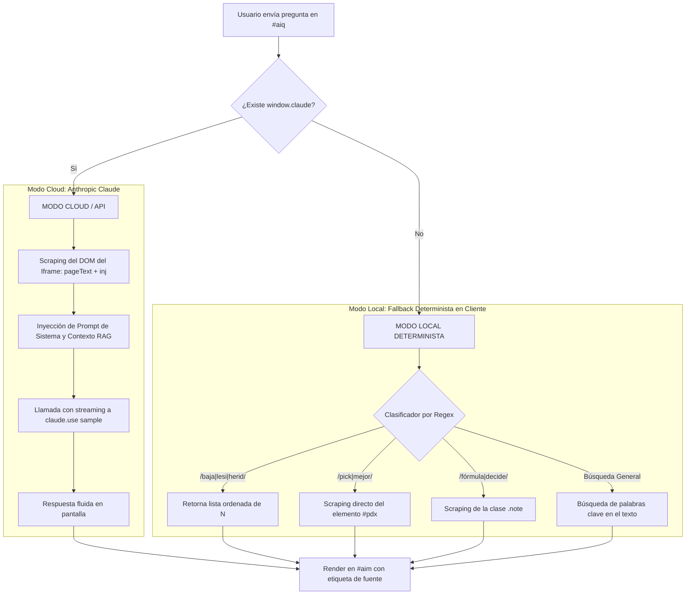

# Desensamblado y Arquitectura del Asistente de IA

> **Evidencia Asociada:** `Reportes/analisis-touchiq/js-tree/script_2.js`, capturas `14-desktop-assistant-open.png`, `15-desktop-assistant-response.png`  
> **Estado:** 100% `[OBSERVADO]` y `[RECONSTRUIDO]`  

---

## 1. El Concepto del Asistente en TouchIQ

`[OBSERVADO]` TouchIQ incorpora un asistente conversacional con estética robótica, accesible mediante el botón flotante `#aib` en el lateral de la interfaz.

Su propósito declarado es responder preguntas del usuario sobre:
- Cuál es el pick del día recomendado.
- Cuáles son las bajas y lesiones de mayor impacto.
- Cómo decide y calcula el modelo estadístico.
- Resumen analítico de los partidos visibles en la pantalla activa.

---

## 2. Arquitectura Dual-Mode: Claude API vs Local Determinista

El desensamblado de `script_2.js` reveló una **arquitectura híbrida de dos niveles con fallback transparente**:



---

## 3. Modo Cloud: El Pipeline de RAG por Scraping del DOM

Cuando la aplicación corre en un entorno que proporciona `window.claude`, el asistente construye un prompt dinámico utilizando una técnica ligera de **Generación Aumentada por Recuperación (RAG) sobre el DOM**:

### Funciones de Extracción de Contexto
1. **`pageDoc()`:** Obtiene una referencia segura al `contentDocument` del iframe activo (`#fr`).
2. **`pageText()`:** Extrae todo el texto plano visible en el cuerpo del iframe (`d.body.innerText`), normaliza espacios en blanco y trunca a un máximo de 9,000 caracteres.
3. **`inj()`:** Ejecuta un snippet en el contexto del iframe para extraer y ordenar las bajas por su severidad real ($i \cdot st$):
   ```javascript
   function inj() {
     try {
       const w = $("fr").contentWindow;
       return w.eval('(typeof N!=="undefined"&&Array.isArray(N)) ? ' +
         'N.filter(x => x.st > 0)' +
         '.sort((a,b) => b.i*b.st - a.i*a.st)' +
         '.slice(0, 45)' +
         '.map(x => x.t + ": " + x.n.replace(/ \\(.*\\)/,"") + " (" + (x.st<1?"duda":"fuera") + ")")' +
         '.join("; ") : ""');
     } catch(e) { return ""; }
   }
   ```

### El Prompt de Sistema Completo (`[OBSERVADO]`)
```text
Eres "la IA" de TOUCH IQ, una plataforma de estadística de NFL y fútbol americano universitario (NCAA). 
Responde en español, en máximo 100 palabras, directo y claro, usando SOLO los datos de abajo (probabilidades del modelo). 
No inventes cuotas, resultados ni jugadores. 
Si piden algo que no está en los datos, dilo y sugiere abrir la sección o el día correcto. 
Es una referencia estadística, no consejo de apuesta.

DATOS:
Deporte abierto: [NFL/NCAA]. Datos al 7 nov 2026. 
Lo siguiente es el texto que el usuario ve ahora en pantalla (día seleccionado, pick del día, partidos con probabilidades del modelo, bajas):
[Texto extraído por pageText() - hasta 9,000 caracteres]
Bajas registradas (ordenadas por impacto): [Texto extraído por inj()]

PREGUNTA: [Pregunta del usuario]
```

---

## 4. Modo Local Determinista (Web Pública)

En la web pública (`https://touchiq.com.mx/`), `window.claude` no está disponible. Para evitar que el asistente falle o muestre un error de red, la función `local(q)` procesa la pregunta de forma puramente determinista:

```javascript
function local(q) {
  const t = q.toLowerCase(), d = pageDoc();
  if (!d) return "Abre NFL o NCAA y te respondo con los picks y datos de esa pantalla.";

  // Rama 1: Lesiones y Bajas
  if (/baja|lesi|herid/.test(t)) {
    const j = inj();
    if (j) return "Bajas con más impacto:\n• " + j.split("; ").slice(0, 12).join("\n• ");
  }

  // Rama 2: Pick del Día
  const pdx = d.getElementById("pdx");
  if (/pick|mejor/.test(t) && pdx && pdx.innerText.trim()) {
    return pdx.innerText.trim().replace(/\n{2,}/g, "\n");
  }

  // Rama 3: Fórmulas y Metodología
  if (/f[oó]rmula|decide|c[oó]mo (funciona|calcula|piensa)/.test(t)) {
    const n = d.querySelector(".note");
    if (n) return n.innerText.trim();
  }

  // Rama 4: Búsqueda difusa por palabras clave de equipos
  const L = pageText().split("\n");
  const w = t.split(/[^a-záéíóúñ0-9]+/).filter(x => x.length > 3);
  const hit = L.filter(l => w.some(x => l.toLowerCase().includes(x))).slice(0, 6);
  return hit.length ? hit.join("\n") : "No encuentro eso en esta pantalla. Prueba con el nombre de un equipo o cambia de día/semana.";
}
```

**Resultado Observado:** La etiqueta inferior `#aisrc` informa con transparencia al usuario:
`"Modo local: responde con los datos de esta pantalla"`.

---

## 5. Diseño de Arquitectura para PitchLab AI

El modelo de TouchIQ es ingenioso pero limitado por el contexto del DOM. Para PitchLab, se diseñará un **Agente Deportivo con RAG Vectorial y Ejecución de Herramientas (Tool Calling)**:

```mermaid
flowchart LR
    User[Usuario PitchLab] --> Gateway[API Gateway / Chat WebSocket]
    Gateway --> Agent[PitchLab Sports Agent (LangChain / Semantic Kernel)]
    
    subgraph Agent_Tools[Herramientas Disponibles para el Agente]
        Tool1[QueryOddsTool: Consulta cuotas en vivo]
        Tool2[RunSimulationTool: Ejecuta simulación Monte Carlo]
        Tool3[GetInjuriesTool: Consulta historial médico de jugadores]
        Tool4[CalcEVTool: Evalúa rentabilidad de una propuesta]
    end
    
    subgraph Vector_DB[Base de Conocimiento Vectorial]
        VectorDB[(Qdrant / pgvector: Noticias, Reglamentos, Lesiones)]
    end
    
    Agent --> Agent_Tools
    Agent --> Vector_DB
    Agent --> LLM[LLM Foundation Model: Gemini 1.5 Pro / Claude 3.5 Sonnet]
    LLM --> Agent
    Agent --> Gateway
```

### Capacidades Superiores de PitchLab AI:
1. **Ejecución de Simulaciones a Pedido:** El usuario podrá pedir: *"¿Qué pasa si Patrick Mahomes se lesiona en el 2do cuarto?"*, y el agente correrá una simulación en el backend recalculando la distribución en segundos.
2. **Alertas Proactivas Personalizadas:** *"Avísame si el Moneyline de Chiefs supera 1.90 con EV positivo"*.
3. **Explicabilidad Cuantitativa:** Desglosar formalmente de qué variables proviene la ventaja del modelo (fuerza ofensiva, debilidad de secundaria rival o fatiga por descanso corto).
