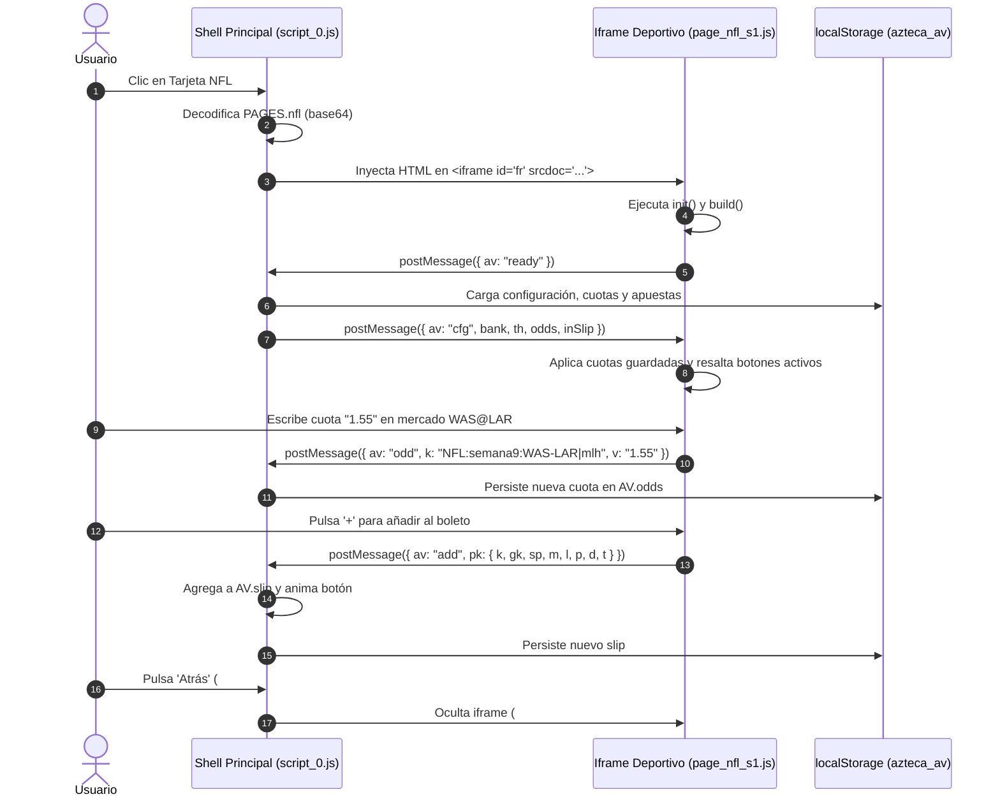

# Reconstrucción de la Arquitectura del Sistema y Análisis de Seguridad

> **Evidencia Asociada:** `index.html`, análisis estático de REA (`ev_b9a88162…`), trazas de memoria y storage  
> **Objetivo:** Mapear la topología de componentes del sistema, analizar el puente host y evaluar la seguridad del cliente  

---

## 1. Topología del Sistema Observado

TouchIQ está estructurado como un sistema distribuido en miniatura que corre completamente dentro de una sola pestaña del navegador web:

```mermaid
graph TD
    subgraph Browser_Tab[Pestaña del Navegador del Usuario]
        subgraph Shell_Application[Shell Principal (Dark Theme)]
            AudioEngine[Sintetizador Web Audio API]
            Gatekeeper[Puerta PIN: CODE='7779']
            BentoHome[Tablero Home: Bento Grid ROB]
            BoletoDrawer[Cajón: Boleto, Historial, Bankroll]
            AssistantModal[Modal Asistente IA]
            LocalStorage[(localStorage: azteca_av)]
        end

        subgraph Sandboxed_Microfrontends[Iframes srcdoc Aislados]
            NFL_Iframe[Iframe NFL: page_nfl_s1.js]
            NCAA_Iframe[Iframe NCAA: page_ncaa_s1.js]
        end

        BentoHome -->|openSport| Sandboxed_Microfrontends
        Sandboxed_Microfrontends -->|postMessage| BoletoDrawer
        BoletoDrawer -->|save| LocalStorage
        LocalStorage -->|read| BoletoDrawer
    end

    subgraph Hosting_Infrastructure[Infraestructura en la Nube]
        NetlifyEdge[Netlify Edge CDN] -->|GET / HTML 2.4 MB| Browser_Tab
    end
```

---

## 2. Protocolo de Comunicación Entre Procesos (IPC / postMessage)

Al operar a través de iframes aislados con `srcdoc`, el shell y las aplicaciones deportivas establecen un protocolo formal de mensajería asíncrona:



---

## 3. Análisis de Seguridad y Vulnerabilidades del Diseño

### A. La Puerta de PIN "7779" (Autenticación Inexistente)
- **Vulnerabilidad:** `[OBSERVADO]` La constante `const CODE = "7779"` reside en texto plano dentro del archivo público JavaScript.
- **Impacto:** Cualquier persona que inspeccione el código fuente o abra las herramientas de desarrollador (F12) puede leer la clave en menos de 5 segundos.
- **Bypass Directo:** Ni siquiera es necesario ingresar el PIN; basta con escribir en la consola del navegador:
  ```javascript
  document.getElementById("lock").classList.add("hide");
  document.getElementById("app").classList.remove("hide");
  drawHome();
  ```
  y el acceso se concede de inmediato.
- **Diagnóstico:** El control de acceso es una cortina puramente psicológica/cosmética para simular exclusividad; no protege datos confidenciales.

### B. Exposición Pública de Datos y Modelos
- Todos los datos de baselines, fórmulas estadísticas de Poisson y Pitágoras, y el código fuente de los motores se descargan completos en el dispositivo de cualquier visitante anónimo.
- No hay protección de propiedad intelectual en el backend.

### C. Persistencia No Cifrada en `localStorage`
- Las apuestas virtuales, el capital disponible y el historial del usuario se guardan en texto plano en `localStorage["azteca_av"]`.
- Cualquier script ejecutado en el mismo dominio o extensión maliciosa del navegador puede leer o manipular las apuestas y el balance del usuario.

---

## 4. Arquitectura de Seguridad y Backend para PitchLab

PitchLab adoptará un enfoque de **Seguridad por Diseño (Security by Design)** de estándar bancario y de apuestas profesional:

1. **Autenticación Fuerte:**
   - Registro de usuarios con correo, contraseña cifrada (Argon2id), inicio de sesión social (OAuth 2.0 con Google / Apple) y autenticación multifactor (MFA / TOTP).
   - Sesiones gestionadas mediante tokens JWT de corta duración (15 minutos) con refresh tokens seguros en cookies `HttpOnly; Secure; SameSite=Strict`.
2. **Protección del Algoritmo Propietario en Backend:**
   - Los modelos matemáticos avanzados de PitchLab correrán exclusivamente en servidores seguros en la nube.
   - El cliente web solo recibirá las probabilidades finales y las recomendaciones calculadas; el código de los modelos nunca se expondrá al navegador.
3. **Control de Acceso Basado en Roles (RBAC):**
   - Niveles de suscripción: Free (estadísticas básicas), Pro (cuotas en tiempo real y picks del día) y Enterprise (acceso a APIs de datos y backtesting institucional).
