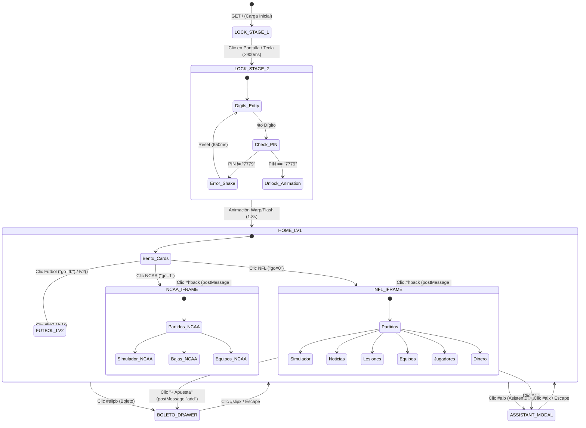

# Inventario de Vistas, Pantallas y Grafo de Navegación de TOUCHIQ

> **Evidencia Asociada:** Capturas `01-desktop-lock-stage1.png` a `18-mobile-nfl-dashboard.png`, traza de interacción `session-walkthrough.json`  
> **Herramienta:** Playwright CDP en tiempo real + inspección estática del DOM  
> **URL Base:** https://touchiq.com.mx/  

---

## 1. Arquitectura de Navegación (Single-Page sin Routing URL)

`[OBSERVADO]` TouchIQ **no utiliza History API (`pushState`) ni enrutamiento por hash (`#`)**. La URL del navegador permanece fija en `https://touchiq.com.mx/` en todo momento.

Toda la navegación y alternancia de pantallas se gestiona mediante:
1. Clases CSS condicionales (`.hide`, `.leave`, `.scr`) aplicadas a elementos estructurales de nivel superior (`#lock`, `#app`, `#s1`, `#s2`, `#fr`, `#slipv`, `#aip`).
2. Variables de estado globales en el shell:
   - `let stage = 1`: Controla la pantalla de bienvenida vs pad numérico.
   - `let LV = 1`: Controla la vista principal `#s1` vs la vista de ligas `#s2`.
   - `let SPOPEN = false`: Controla si el iframe deportivo (`#fr`) está visible o no.
   - `let busy = false`: Semáforo para prevenir clics repetidos durante animaciones.
3. Eventos `postMessage` bidireccionales entre el shell y el `<iframe>` activo.

---

## 2. Inventario Exhaustivo de Pantallas y Estados

### Pantalla 01: Lock Screen — Etapa 1 (Bienvenida Synthwave)
- **Screen ID:** `VIEW-LOCK-1`
- **Nombre:** Pantalla de Bienvenida y Carga
- **Selector DOM:** `<section id="lock">` con `#stg1` visible
- **Cómo se accede:** Carga inicial de la aplicación.
- **Componentes Visuales:**
  - Lienzo `<canvas id="bg">` renderizando animación procedural de cuadrícula en perspectiva synthwave y lluvia de estrellas.
  - Arte vectorial: Piedra del Sol azteca y pirámide escalonada con glifos interactivos.
  - Ticker animado de texto ("TOUCH IQ · INTELIGENCIA DEPORTIVA").
  - Botón de entrada: "ENTRA A LA CANCHA".
- **Comportamiento & Guardas:**
  - Ignora los clics antes de 900 ms de la carga (`Date.now() - T0 > 900`).
  - Un clic en cualquier parte de `#lock` o pulsar cualquier tecla avanza a la Etapa 2.
- **Evidencia Visual:** [01-desktop-lock-stage1.png](file:///c:/Users/jairb/Desktop/Proyectos/Pitch%20Lab/research/touchiq/evidence/screenshots/01-desktop-lock-stage1.png), [16-mobile-lock-stage1.png](file:///c:/Users/jairb/Desktop/Proyectos/Pitch%20Lab/research/touchiq/evidence/screenshots/16-mobile-lock-stage1.png).

---

### Pantalla 02: Lock Screen — Etapa 2 (Pad de Entrada de PIN)
- **Screen ID:** `VIEW-LOCK-2`
- **Nombre:** Teclado Numérico de Acceso
- **Selector DOM:** `<section id="lock">` con `#stg2` visible y `#pad` activo
- **Cómo se accede:** Clic en `VIEW-LOCK-1` tras 900 ms.
- **Componentes Visuales:**
  - Pad numérico de 12 teclas (1 al 9, hueco, 0, tecla retroceso `⌫`).
  - 4 indicadores circulares (`#dots i`) que se iluminan al ingresar dígitos.
  - Mensaje de estado (`#msg`): "INGRESA CÓDIGO DE ACCESO".
- **Lógica de Validación:**
  - Código hardcodeado: `const CODE = "7779"`.
  - Sonido: Cada dígito dispara una nota pentatónica en el sintetizador WebAudio.
  - Fallo (`buf !== CODE`): Acorde disonante (220 Hz / 233.1 Hz), animación CSS `shake`, mensaje "CÓDIGO INCORRECTO" y reseteo en 650 ms.
  - Éxito (`buf === CODE`): Sonido de apertura arpegiado, animación `warp/flash` de partículas (1,800 ms), `#lock` se oculta con `.hide` y se revela `<main id="app">`.
- **Evidencia Visual:** [02-desktop-lock-stage2-pad.png](file:///c:/Users/jairb/Desktop/Proyectos/Pitch%20Lab/research/touchiq/evidence/screenshots/02-desktop-lock-stage2-pad.png).

---

### Pantalla 03: Home Dashboard (Nivel 1 — `LV=1`)
- **Screen ID:** `VIEW-HOME-LV1`
- **Nombre:** Tablero Principal de Deportes
- **Selector DOM:** `<section id="s1" class="scr">` dentro de `<main id="app">`
- **Cómo se accede:** Desbloqueo exitoso con PIN 7779 o botón "Atrás" desde un deporte.
- **Componentes Visuales:**
  - Barra superior: Reloj digital (`#clk`, actualiza cada 20s), botón de audio (`#snd` 🔊/🔇).
  - Encabezado Hero: Chip "MODELO ACTIVO · NFL + NCAA · 7 NOV 2026", título "Cada jugada, calculada", botón "Explorar ›".
  - Grid Bento (`#bento`): Tarjetas interactivas 3D con efecto tilt sobre el puntero del mouse:
    1. **Tarjeta Robot NFL:** Atributo `data-go="0"`, badge "FÚTBOL AMERICANO", subtítulo "TEMPORADA 2026 · SEMANA 9".
    2. **Tarjeta Robot NCAA:** Atributo `data-go="1"`, badge "UNIVERSITARIO", subtítulo "AP TOP 25 · SEMANA 10".
  - Botón flotante lateral del Asistente IA (`#aib`).
  - Botón inferior derecho del Boleto (`#slipb`): Muestra el contador de apuestas activas (`#slipn`).
- **Evidencia Visual:** [03-desktop-home.png](file:///c:/Users/jairb/Desktop/Proyectos/Pitch%20Lab/research/touchiq/evidence/screenshots/03-desktop-home.png), [17-mobile-home.png](file:///c:/Users/jairb/Desktop/Proyectos/Pitch%20Lab/research/touchiq/evidence/screenshots/17-mobile-home.png).

---

### Pantalla 04: Selector de Ligas de Fútbol (Nivel 2 — `LV=2`)
- **Screen ID:** `VIEW-FUTBOL-LV2`
- **Nombre:** Cuatro Torneos de Fútbol (Staged / Oculto en producción)
- **Selector DOM:** `<section id="s2" class="scr">`
- **Cómo se accede:** Invocación de `lv2()` (preparado para clic en tarjeta `data-go="fb"`).
- **Componentes Visuales:**
  - Botón "‹ Deportes" (`#bk2`): Regresa a `LV=1` con animación fade/slide.
  - Encabezado: "FÚTBOL · 4 TORNEOS", "Elige tu liga. Cuatro torneos. Una sola fórmula."
  - Grid de ligas (`#lgrid`): Diseñado para albergar los torneos (Liga MX, La Liga, Premier League, Champions League).
- **Evidencia Visual:** [10-desktop-futbol-selector.png](file:///c:/Users/jairb/Desktop/Proyectos/Pitch%20Lab/research/touchiq/evidence/screenshots/10-desktop-futbol-selector.png).

---

### Pantalla 05: Tablero NFL (7 Pestañas en Iframe)
- **Screen ID:** `VIEW-SPORT-NFL`
- **Nombre:** Módulo Deportivo de la NFL
- **Selector DOM:** `<iframe id="fr">` cargando `PAGES.nfl` vía `srcdoc`
- **Cómo se accede:** Clic en la tarjeta NFL (`data-go="0"`).
- **Pestañas Internas (`nav#nav button`):**
  1. **Tab `Partidos` (data-t="g"):** Lista de 14 juegos de la Semana 9. Selector de días, tarjeta de "PICK DEL DÍA" (WAS@LAR ML 67.8%), desglose de 15 mercados por partido con inputs para cuotas decimales o americanas, cálculo de EV y sugerencias automáticas.
  2. **Tab `Simulador` (data-t="s"):** Selectores desplegables para elegir cualquier equipo local y visitante. Simulación instantánea con cálculo de probabilidades, hándicap y total proyectado.
  3. **Tab `Noticias` (data-t="n"):** Feed editorial de noticias deportivas relevantes para la jornada.
  4. **Tab `Lesiones` (data-t="w"):** Lista de 154 bajas con fuente periodística y fecha. Cada lesión tiene editor de estado (disponible / duda / fuera) e impacto (puntos) con recálculo dinámico de todos los partidos.
  5. **Tab `Equipos` (data-t="e"):** Tabla comparativa de estadísticas de temporada (PF, PA, JJ, ratings).
  6. **Tab `Jugadores` (data-t="j"):** Estadísticas individuales de jugadores y líneas proyectadas de yardas y touchdowns (props).
  7. **Tab `💰 Dinero` (data-t="m"):** Splits de apuestas de DraftKings (porcentaje de boletos vs porcentaje de dinero) con etiquetas de alerta ("Fuerte", "Público", "Alerta IA").
- **Barra de Salida:** Barra `#hintbar` con botón `#hback` ("Atrás") para cerrar el iframe y volver al Home.
- **Evidencia Visual:** [04-desktop-nfl-dashboard.png](file:///c:/Users/jairb/Desktop/Proyectos/Pitch%20Lab/research/touchiq/evidence/screenshots/04-desktop-nfl-dashboard.png), [05-desktop-nfl-tab-partidos.png](file:///c:/Users/jairb/Desktop/Proyectos/Pitch%20Lab/research/touchiq/evidence/screenshots/05-desktop-nfl-tab-partidos.png), [06-desktop-nfl-tab-simulador.png](file:///c:/Users/jairb/Desktop/Proyectos/Pitch%20Lab/research/touchiq/evidence/screenshots/06-desktop-nfl-tab-simulador.png), [07-desktop-nfl-tab-lesiones.png](file:///c:/Users/jairb/Desktop/Proyectos/Pitch%20Lab/research/touchiq/evidence/screenshots/07-desktop-nfl-tab-lesiones.png), [08-desktop-nfl-tab-dinero.png](file:///c:/Users/jairb/Desktop/Proyectos/Pitch%20Lab/research/touchiq/evidence/screenshots/08-desktop-nfl-tab-dinero.png).

---

### Pantalla 06: Tablero NCAA (4 Pestañas en Iframe)
- **Screen ID:** `VIEW-SPORT-NCAA`
- **Nombre:** Módulo de Fútbol Americano Universitario (AP Top 25)
- **Selector DOM:** `<iframe id="fr">` cargando `PAGES.ncaa` vía `srcdoc`
- **Cómo se accede:** Clic en tarjeta NCAA (`data-go="1"`).
- **Pestañas Internas:**
  1. **Partidos:** 32 juegos universitarios de la Semana 10. Pick del día destacado (MICH ML 71.5%).
  2. **Simulador:** Simulación entre equipos colegiales considerando ajuste de conferencias.
  3. **Bajas:** Módulo de bajas (en este build array `N` se encuentra vacío).
  4. **Equipos:** Tabla con factores de conferencia y promedios por juego.
- **Evidencia Visual:** [09-desktop-ncaa-dashboard.png](file:///c:/Users/jairb/Desktop/Proyectos/Pitch%20Lab/research/touchiq/evidence/screenshots/09-desktop-ncaa-dashboard.png).

---

### Pantalla 07: Cajón "Mi Boleto" (Boleto, Historial y Bankroll)
- **Screen ID:** `VIEW-BOLETO`
- **Nombre:** Cajón Lateral de Gestión de Apuestas y Capital
- **Selector DOM:** `
`
- **Cómo se accede:** Clic en botón `#slipb` o presionar un botón de selección de apuesta en cualquier tarjeta de partido.
- **Pestañas Internas (`.sp-tabs button`):**
  1. **Tab Boleto (`data-st="b"`):** Selecciones activas, cuotas ingresadas, cálculo de parlay combinado, advertencia de correlación si dos apuestas son del mismo juego, cuota justa (sin vig), ganancia potencial estimada y botón de registro.
  2. **Tab Historial (`data-st="h"`):** Lista de apuestas resueltas y pendientes. Filtros por estado, resolución manual de apuestas (Ganada / Perdida / Nula) y desglose de ROI por tipo de apuesta.
  3. **Tab Bankroll (`data-st="c"`):** Capital virtual inicial ($1,000 MXN default), capital actual, gráfica de evolución de balance, métricas de drawdown, tasa de acierto y porcentaje en riesgo.
- **Evidencia Visual:** [11-desktop-boleto-drawer.png](file:///c:/Users/jairb/Desktop/Proyectos/Pitch%20Lab/research/touchiq/evidence/screenshots/11-desktop-boleto-drawer.png), [12-desktop-boleto-historial.png](file:///c:/Users/jairb/Desktop/Proyectos/Pitch%20Lab/research/touchiq/evidence/screenshots/12-desktop-boleto-historial.png), [13-desktop-boleto-bankroll.png](file:///c:/Users/jairb/Desktop/Proyectos/Pitch%20Lab/research/touchiq/evidence/screenshots/13-desktop-boleto-bankroll.png).

---

### Pantalla 08: Modal del Asistente de IA
- **Screen ID:** `VIEW-ASSISTANT`
- **Nombre:** Chatbot Deportivo Inteligente
- **Selector DOM:** `
`
- **Cómo se accede:** Clic en botón flotante `#aib`.
- **Componentes Visuales:**
  - Avatar con robot animado y botón de cierre (`#aix`).
  - Chips de preguntas rápidas (`#aic`): "Mejor pick de hoy", "Bajas importantes", "¿Cómo decide la IA?", "Resumen de esta pantalla".
  - Área de mensajes (`#aim`): Burbujas de usuario (`.am.u`) y de respuesta (`.am.a`).
  - Formulario de entrada (`#aif`): Input `#aiq` y botón de envío.
  - Indicador de fuente (`#aisrc`): Muestra si la respuesta provino de Claude o de "Modo local".
- **Evidencia Visual:** [14-desktop-assistant-open.png](file:///c:/Users/jairb/Desktop/Proyectos/Pitch%20Lab/research/touchiq/evidence/screenshots/14-desktop-assistant-open.png), [15-desktop-assistant-response.png](file:///c:/Users/jairb/Desktop/Proyectos/Pitch%20Lab/research/touchiq/evidence/screenshots/15-desktop-assistant-response.png).

---

## 3. Grafo de Navegación y Transiciones de Estado

