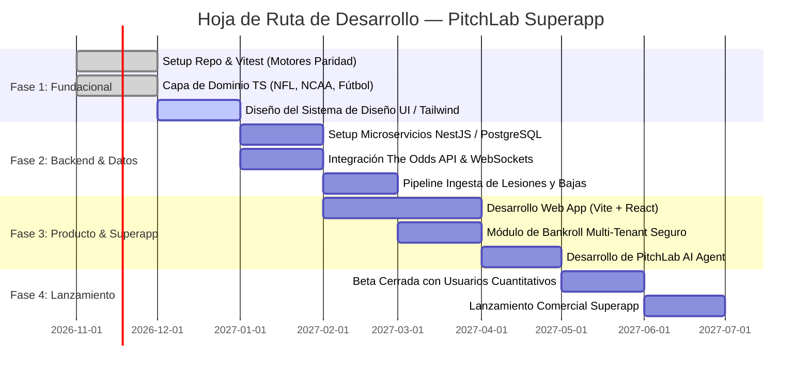

# Oportunidades Estratégicas y Hoja de Ruta para PitchLab

> **Destinatarios:** Dirección de Producto y Arquitectura de PitchLab  
> **Objetivo:** Transformar los aprendizajes de la ingeniería inversa de TouchIQ en una ventaja competitiva insuperable  

---

## 1. La Gran Oportunidad de PitchLab

TouchIQ demostró que existe un mercado entusiasta para herramientas que combinan:
- Modelos matemáticos serios (no corazonadas ni "tipsters" tradicionales).
- Visualización interactiva de valor esperado ($EV$).
- Una experiencia de usuario atractiva e inmersiva.

Sin embargo, TouchIQ está **atrapada en su propia arquitectura**: al ser un archivo HTML estático de 2.4 MB dependiente del trabajo manual de un solo desarrollador, no puede actualizarse en tiempo real, no puede escalar a más ligas, no puede ofrecer cuotas en vivo de múltiples casas de apuestas y no puede monetizar mediante suscripciones seguras.

**PitchLab puede capturar el 100% de ese mercado y expandirlo exponencialmente** construyendo una superapp nativa de la nube, automatizada y multi-deporte.

---

## 2. Los Cuatro Pilares de Diferenciación de PitchLab

```
┌─────────────────────────────────────────────────────────────────┐
│                    PITCHLAB SUPERAPP CORE                       │
├─────────────────┬───────────────────┬───────────────────────────┤
│ 1. DATA EN VIVO │ 2. MOTORES PRO    │ 3. BANCO & PORTAFOLIO     │
│ Feeds streaming │ Híbridos ML       │ Multi-casa, BetSync       │
│ cuotas sub-seg  │ Monte Carlo xG    │ Optimización Markowitz    │
├─────────────────┴───────────────────┴───────────────────────────┤
│ 4. AGENTE IA CONVERSACIONAL (RAG Vectorial + Tool Calling)      │
│ Invocación de simulaciones, análisis de valor, alertas push     │
└─────────────────────────────────────────────────────────────────┘
```

---

### Pilar 1: Feeds Automatizados y Cuotas en Tiempo Real
- **En TouchIQ:** Las cuotas son una instantánea manual fija del sábado a las 2:00 PM. Si una línea cambia 1 punto, el usuario debe corregirla a mano.
- **En PitchLab:** Integración de **The Odds API** con streaming vía WebSockets. PitchLab monitoreará simultáneamente más de 15 casas de apuestas (Caliente, Bet365, DraftKings, Pinnacle, BetMGM, Codere).
- **Detección de Desviaciones de Mercado (Arbitraje & Value Bets):** Alertar automáticamente a los usuarios cuando una casa rezagada esté ofreciendo una cuota descalibrada respecto a las casas formadoras de mercado (*Sharp Books* como Pinnacle).

---

### Pilar 2: Motores Predictivos Híbridos de Nueva Generación
En lugar de depender exclusivamente de fórmulas paramétricas fijas de los años 80 (Pitágoras y Log5), PitchLab implementará una **arquitectura de ensamble híbrido**:

1. **Capa Base (Mecánica):**
   - Pitágoras (con exponente adaptativo) + Log5 + Poisson Dixon-Coles (adoptando lo mejor de TouchIQ).
2. **Capa de Aprendizaje Automático (Machine Learning):**
   - Modelos de Gradient Boosting (**XGBoost / LightGBM**) entrenados con datos jugada a jugada (EPA - Expected Points Added, Success Rate, DVOA, yardas por intento en 3er down).
3. **Capa de Simulación Monte Carlo:**
   - Para cada partido, simular 10,000 enfrentamientos completos jugada a jugada en el backend. Esto captura automáticamente la distribución de números clave en la NFL (3, 7, 10) y la correlación entre touchdowns y victorias, permitiendo cotizar *Same Game Parlays* con precisión matemática absoluta.

---

### Pilar 3: Gestión Avanzada de Portafolio y Bankroll
- **Sincronización Automática de Apuestas (BetSync):** Integración con plataformas de agregación de cuentas o lectura de boletos por OCR para liquidar las apuestas automáticamente al silbatazo final.
- **Criterio de Kelly Fraccional Continuo:** Sugerencias dinámicas de apuesta (1% al 5%) ajustadas al perfil de aversión al riesgo del suscriptor.
- **Auditoría Criptográfica Inmutable:** Cada predicción emitida por PitchLab se registrará en un log público inmutable con timestamping antes de que empiece el partido, construyendo una reputación de transparencia que ningún competidor informal podrá igualar.

---

### Pilar 4: PitchLab AI (Copiloto Cuantitativo)
- Mientras el asistente de TouchIQ es un scraper de DOM con fallback por regex, **PitchLab AI** será un agente autónomo potenciado por modelos de lenguaje de última generación (Gemini / Claude / GPT-4o) con acceso a herramientas:
  - *"PitchLab, simula el partido de Chiefs vs Bills si el viento supera los 35 km/h"*.
  - *"Encuentra las 3 apuestas de la Liga MX con más de 8% de EV en Caliente"*.
  - *"Optimiza un parlay de 3 patas para mi bankroll de $5,000 MXN con riesgo moderado"*.

---

## 3. Hoja de Ruta de Implementación Técnica (Fases)



---

## 4. Estrategia de Monetización y Cumplimiento

1. **Modelo Freemium Inteligente:**
   - **Nivel Gratuito:** Estadísticas de partidos, promedios de equipos, simulación básica y pick del día general.
   - **Nivel Pro ($19 USD/mes o $399 MXN/mes):** Cuotas en tiempo real de 15 casas de apuestas, cálculo continuo de EV, todos los picks del modelo, alertas por Telegram/WhatsApp y Asistente PitchLab AI ilimitado.
   - **Nivel Syndicate / Baller ($99 USD/mes):** Simulador Monte Carlo personalizado, exportación de datos a CSV/API, optimización de portafolios y alertas de arbitraje.
2. **Cumplimiento y Regulación:**
   - PitchLab debe operar exclusivamente como **plataforma de inteligencia de datos y software analítico**, nunca como casa de apuestas o intermediario financiero.
   - Mantener descargos de responsabilidad claros (*"Herramienta analítica y estadística; no procesa apuestas reales ni ofrece garantías de ganancias"*).
   - Oportunidad de monetización B2B adicional: Programa de afiliados regulado con casas de apuestas que remunere a PitchLab cuando los usuarios registren sus cuentas para aprovechar cuotas de valor.
