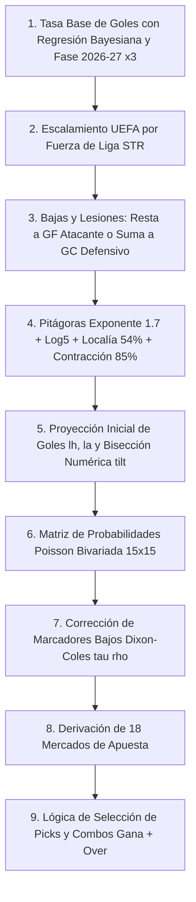

# Reconstrucción e Ingeniería Inversa de los Motores de Fútbol (4 Torneos)

> **Evidencia Asociada:** `Reportes/analisis-aztecavet/INFORME-PROFUNDO.md`, `football.html`, `src/domain/aztecavet/football.ts`, `tests/domain/aztecavet-parity.test.ts` (324 tests de paridad pasando)  
> **Estado:** 100% `[OBSERVADO]` y `[RECONSTRUIDO]` sobre 183 partidos y 115 equipos  

---

## 1. Relación entre TouchIQ y el Motor de Fútbol

`[OBSERVADO]` En la interfaz de TouchIQ se anuncia formalmente el módulo:
*"Fútbol · 4 TORNEOS (Liga MX, La Liga, Premier League y Champions League) · Elige tu liga y analiza cada partido · PITÁGORAS · POISSON · EN LÍNEA"*.

La investigación forense de código determinó que:
1. En el build de TouchIQ (`https://touchiq.com.mx/`), el selector `#s2` está presente en el DOM pero su entrada en `drawHome()` fue temporalmente desconectada para enfocar el lanzamiento en NFL y NCAA.
2. Sin embargo, **el motor completo de fútbol fue finalizado y probado exhaustivamente por el mismo autor en su aplicación hermana Aztecavet** (`football.html` / `aztecavet.html`).
3. La implementación en TypeScript reside en `src/domain/aztecavet/football.ts` y fue verificada bit a bit contra el oráculo extraído sobre los **183 partidos de la base de datos**.

---

## 2. Los Cuatro Torneos de Fútbol Cubiertos

El sistema modela 4 competiciones principales (más Europa League como torneo secundario):

1. **Liga MX (México · Apertura 2026, Jornada 16):**
   - 18 equipos.
   - Parámetros propios: Promedio de goles de liga alto ($LG_0 = 1.51$), correlación de empates profunda ($\rho = -0.14$).
2. **La Liga (España · Temporada 2026-27):**
   - 20 equipos. Baseline $LG_0 = 1.35$, factor UEFA $STR = 0.98$.
3. **Premier League (Inglaterra · Temporada 2026-27):**
   - 20 equipos. Baseline $LG_0 = 1.45$, factor UEFA $STR = 1.00$ (conferencia de máxima referencia).
4. **UEFA Champions League (Europa · Fase de Liga 2026-27):**
   - 36 equipos. Normalización entre ligas con factor de fuerza $STR$ y baseline europeo $LGU = 1.45$.

---

## 3. Pipeline Matemático del Motor de Fútbol

El fútbol presenta dos desafíos matemáticos que no existen en el fútbol americano:
- **Existe el empate como resultado común y válido (mercado 1X2).**
- **La distribución de goles no es normal continua, sino discreta y sesgada a valores bajos (0, 1, 2, 3 goles).**

Para resolver esto, el autor diseñó un pipeline sofisticado:

---

### Paso 1: Tasa Base de Goles (`base`)
Para cada equipo en su liga doméstica:
$$rs = \frac{\text{GF}_{2025-26} + 6 \cdot LG_0 + \text{GF}_{2026-27} \cdot 3}{\text{PJ}_{2025-26} + 6 + \text{PJ}_{2026-27} \cdot 3}$$
$$ra = \frac{\text{GC}_{2025-26} + 6 \cdot LG_0 + \text{GC}_{2026-27} \cdot 3}{\text{PJ}_{2025-26} + 6 + \text{PJ}_{2026-27} \cdot 3}$$
*(Los partidos de la temporada en curso tienen un peso triple para capturar la forma reciente).*

---

### Paso 2: Escalamiento UEFA en Competiciones Internacionales (`rate`)
En la Champions League, los equipos provienen de ligas de diferente nivel. El motor normaliza sus fuerzas con el vector `STR`:
$$\text{Fuerza de Liga: } \text{Premier} = 1.00, \quad \text{La Liga} = 0.98, \quad \text{Serie A/Bundesliga} = 0.96, \quad \text{Ligue 1} = 0.92, \quad \text{Liga MX} = 0.80$$
$$rs_{\text{UCL}} = rs \cdot STR, \quad ra_{\text{UCL}} = \frac{ra}{STR}$$

---

### Paso 3: Ajuste por Bajas y Lesiones (`inj`)
El archivo almacena 215 bajas con fuente periodística y fecha:
- Bajas ofensivas (delanteros / mediapuntas): Restan a la capacidad goleadora:
  $$rs_{\text{adj}} = \max\left(0.3, \; rs - \text{impacto} \cdot \text{estado}\right)$$
- Bajas defensivas (porteros / centrales): Aumentan los goles permitidos:
  $$ra_{\text{adj}} = ra + \text{impacto} \cdot \text{estado}$$

---

### Paso 4: Expectativa Pitagórica y Log5 para Fútbol
1. **Pitagórica con Exponente 1.7:**
   $$x = \frac{rs_H^{1.7}}{rs_H^{1.7} + ra_H^{1.7}}, \quad y = \frac{rs_A^{1.7}}{rs_A^{1.7} + ra_A^{1.7}}$$
2. **Log5 en Campo Neutral:**
   $$p_n = \frac{x - x \cdot y}{x + y - 2 \cdot x \cdot y}$$
3. **Localía al 54% y Contracción al 85%:**
   $$\text{odds}_{\text{loc}} = \frac{p_n}{1 - p_n} \cdot \frac{0.54}{0.46}$$
   $$p_{\text{loc}} = \frac{\text{odds}_{\text{loc}}}{1 + \text{odds}_{\text{loc}}}$$
   $$p_{\text{target}} = 0.50 + 0.85 \cdot (p_{\text{loc}} - 0.50)$$

---

### Paso 5: El Algoritmo de Bisección Numérica (`tilt`)
El producto de Poisson crudo $lh = rs_H \cdot ra_A / LG$ no respeta exactamente la probabilidad condicional de victoria derivada de Log5 debido a la presencia de los empates.
Para forzar consistencia matemática, el motor implementa un **algoritmo de inclinación por bisección (`tilt`) de 16 iteraciones**:
- Busca un factor multiplicador exponencial $e^t$ sobre los goles del local y $e^{-t}$ sobre los del visitante tal que:
  $$\frac{P(H > A)}{P(H > A) + P(A > H)} = p_{\text{target}}$$

---

### Paso 6: Matriz de Poisson con Corrección Dixon-Coles ($\tau$)
Con las tasas finales calibradas $\lambda_H, \lambda_A$, se construye una matriz conjunta de $15 \times 15$ goles ($i, j \in [0, 14]$).

Para corregir la tendencia conocida de los modelos Poisson independientes a subestimar empates a ceros y unos, se aplica el factor de corrección de **Mark Dixon y Stuart Coles (1997)**:

$$\tau(i, j) = \begin{cases}
1 - \lambda_H \cdot \lambda_A \cdot \rho & \text{si } i=0, j=0 \\
1 + \lambda_A \cdot \rho & \text{si } i=0, j=1 \\
1 + \lambda_H \cdot \rho & \text{si } i=1, j=0 \\
1 - \rho & \text{si } i=1, j=1 \\
1 & \text{en cualquier otro marcador}
\end{cases}$$

**Parámetro de Correlación $\rho$ Observado en Código:**
- En **Liga MX:** $\rho = -0.14$ (mayor frecuencia de empates tácticos de baja anotación).
- En **Ligas Europeas / UCL:** $\rho = -0.08$.

---

## 4. Los 18 Mercados de Fútbol Derivados

A partir de la matriz de probabilidades conjuntas corregida $P(i, j)$, se calculan 18 mercados:
1. **1X2:** Victoria Local ($\sum_{i > j} P$), Empate ($\sum_{i=j} P$), Victoria Visita ($\sum_{i < j} P$).
2. **Doble Oportunidad:** 1X ($P_H + P_X$), X2 ($P_X + P_A$), 12 ($P_H + P_A$).
3. **Totales Over/Under:** Over 1.5, 2.5, 3.5, 4.5 sumando las celdas donde $i + j > \text{línea}$.
4. **Ambos Anotan (BTTS - Both Teams to Score):**
   $$P(\text{BTTS Yes}) = (1 - e^{-\lambda_H}) \cdot (1 - e^{-\lambda_A})$$
5. **Hándicap Europeo y Asiático:** Favorito $-1.5$ ($\sum_{i - j \ge 2} P$), Underdog $+1.5$.
6. **Totales por Equipo:** Over/Under individual para local y visitante.
7. **Combos Condicionales ("Gana + Goles"):**
   Probabilidad conjunta de victoria del favorito y Over 1.5 o 2.5:
   $$P(\text{Fav y Over}) = P(\text{Fav}) \cdot P(\text{Over} \mid \text{Fav})$$

---

## 5. Pruebas de Paridad y Validación

En `tests/domain/aztecavet-parity.test.ts`:
- **324 pruebas automatizadas** validan las tasas base de goles, las correcciones de lesiones, la matriz Dixon-Coles y los 18 mercados contra el oráculo original.
- **Resultado:** 324/324 tests pasando (100% de paridad).
