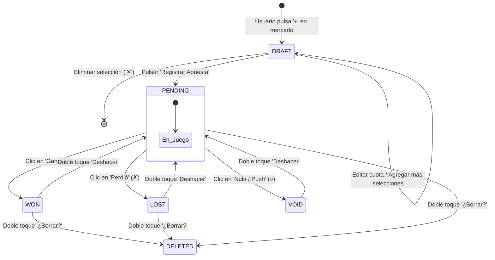

# Sistema de Boleto, Historial y Gestión de Bankroll

> **Evidencia Asociada:** `script_0.js` funciones de boleto, historial y bankroll; capturas `11-desktop-boleto-drawer.png`, `12-desktop-boleto-historial.png`, `13-desktop-boleto-bankroll.png`  
> **Objetivo:** Desensamblar la lógica de negocio del flujo de apuestas virtuales, ciclo de vida del boleto y contabilidad de riesgo  

---

## 1. Arquitectura del Módulo "Mi Boleto"

`[OBSERVADO]` El componente de apuestas de TouchIQ es un sistema de contabilidad y simulación virtual de tres pestañas integradas en un solo drawer lateral:
1. **Boleto (`spb`):** Armado de apuestas simples o combinadas (parlays).
2. **Historial (`sph`):** Registro cronológico y resolución de apuestas.
3. **Bankroll (`spc`):** Métricas cuantitativas de desempeño financiero y calibración.

---

## 2. Ciclo de Vida de una Apuesta (State Machine)

Toda apuesta creada en TouchIQ sigue una máquina de estados determinista:



### Estructura de Datos de una Apuesta en `AV.bets`
```javascript
{
  id: "b" + Date.now().toString(36) + Math.random().toString(36).slice(2, 6),
  ts: Date.now(),             // Timestamp de creación
  legs: [                     // Lista de selecciones (1 para sencilla, 2+ para parlay)
    {
      k: "NFL:semana9:WAS-LAR|mlh",
      gk: "NFL:semana9:WAS-LAR",
      sp: "NFL",
      m: "ML",
      l: "LAR",
      p: 0.678,
      d: 1.55,
      t: "Los Angeles Rams"
    }
  ],
  p: 0.678,                   // Probabilidad combinada
  d: 1.55,                    // Cuota final aplicada
  stake: 100.0,               // Monto apostado en moneda virtual (MXN)
  u: 10,                      // Porcentaje de unidad (5% o 10%)
  st: "p"                     // Estado: "p" (pendiente), "w" (won), "l" (lost), "v" (void)
}
```

---

## 3. Matemática de Liquidación y Rendimiento

Al resolver una apuesta, el sistema calcula el beneficio neto ($\Pi$) según el estado:

$$\Pi = \begin{cases}
\text{stake} \cdot (d - 1) & \text{si estado es } \mathbf{Won} \text{ (Ganada)} \\
-\text{stake} & \text{si estado es } \mathbf{Lost} \text{ (Perdida)} \\
0 & \text{si estado es } \mathbf{Void} \text{ (Nula / Empate / Cancelada)} \\
0 & \text{si estado es } \mathbf{Pending} \text{ (Pendiente)}
\end{cases}$$

---

## 4. Contabilidad del Bankroll y Métricas Financieras

El tab de Bankroll (`#spc`) calcula y despliega métricas de desempeño:

1. **Capital Actual ($B_{\text{actual}}$):**
   $$B_{\text{actual}} = \max\left(0, \; B_{\text{inicial}} + \sum_{i \in \text{resueltas}} \Pi_i\right)$$
   *(Cuenta con piso en $0$: el bankroll no puede ser negativo)*.

2. **Beneficio Neto Acumulado:**
   $$\text{Profit} = \sum_{i \in \text{resueltas}} \Pi_i$$

3. **Retorno de Inversión (ROI):**
   $$\text{ROI} = \frac{\text{Profit}}{\sum_{i \in \text{resueltas}} \text{stake}_i} \cdot 100\%$$

4. **Tasa de Acierto (*Strike Rate*):**
   $$\text{Strike Rate} = \frac{\text{Apuestas Ganadas}}{\text{Apuestas Ganadas} + \text{Apuestas Perdidas}} \cdot 100\%$$

5. **Capital en Riesgo:**
   $$\text{Riesgo en Juego} = \sum_{i \in \text{pendientes}} \text{stake}_i, \quad \% \text{ en Juego} = \frac{\text{Riesgo en Juego}}{B_{\text{actual}}} \cdot 100\%$$

---

## 5. Algoritmo de Calibración del Modelo (`[OBSERVADO]`)

TouchIQ incluye una función de autodiagnóstico empírico de calibración (`calib()`):
- Compara la **probabilidad media predicha por el modelo** para las apuestas registradas frente a la **tasa de acierto real observada**.
- **Reglas de Diagnóstico Observadas en Código:**
  - Si el número total de apuestas es $< 30$:
    `"Menos de 30 apuestas: la muestra es pequeña, el resultado refleja sobre todo varianza/suerte"`.
  - Si el número de apuestas es $\ge 30$ y $|\Delta| < 4\text{ pp}$ ($|p_{\text{media}} - \text{acierto}| < 0.04$):
    `"Modelo bien calibrado: la tasa de acierto real coincide con las probabilidades proyectadas"`.
  - Si el acierto supera a la predicción por más de 4 pp:
    `"Acertando más de lo esperado: posible racha positiva o cuotas con valor desproporcionado"`.
  - Si el acierto es inferior por más de 4 pp:
    `"Acertando menos de lo esperado: posible racha negativa o sesgo en el modelo"`.

---

## 6. Oportunidades de Mejora para PitchLab

1. **Sincronización Automática con Casas de Apuestas (BetSync):** En TouchIQ, el usuario debe marcar manualmente si la apuesta ganó o perdió. PitchLab automatizará la resolución en tiempo real al finalizar los partidos contra los marcadores oficiales.
2. **Soporte Multi-Divisa y Cripto:** Permitir configurar bankrolls en MXN, USD, EUR, BTC y USDT.
3. **Cálculo de Máximo Drawdown y Ratio de Sharpe:** Incorporar métricas financieras institucionales:
   $$\text{Max Drawdown} = \max_{t} \left(\frac{\text{Peak}_t - B_t}{\text{Peak}_t}\right)$$
   $$\text{Sharpe Ratio} = \frac{\mathbb{E}[R] - R_f}{\sigma_R}$$
