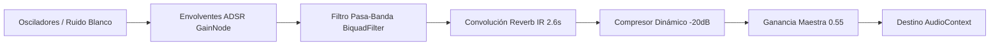

# Análisis de Componentes, Sistema de Diseño y UX de TOUCHIQ

> **Evidencia Asociada:** Capturas en alta resolución en `research/touchiq/evidence/screenshots/`, tokens CSS extraídos de `script_0.js` e `index.html`  
> **Enfoque de Análisis:** Patrones de interacción, accesibilidad, microinteracciones, audio procedural y aplicabilidad para PitchLab  

---

## 1. Identidad Visual y Paradigma de Diseño

`[OBSERVADO]` TouchIQ implementa una dirección de arte fuertemente diferenciada respecto a las casas de apuestas tradicionales:
- **Corriente Estética:** *Cyberpunk Neo-Prehispánico / Retro-Synthwave*. Combina iconografía prehispánica (Piedra del Sol, pirámides escalonadas, grecas ceremoniales) con tipografías monoespaciadas y pantallas fluorescentes inspiradas en terminales de trading cuantitativo.
- **Doble Atmósfera Cromática:**
  1. **Shell Principal (Dark Theme):** Fondo negro profundo (`#050811`), gradientes cian (`#00f0ff`), púrpura neón (`#bf00ff`) y dorado azteca (`#c9952b`). Diseñado para generar inmersión y misterio en la fase de desbloqueo y dashboard.
  2. **Vistas Deportivas Interiores (Light Theme Uniforme):** En contraste radical con el shell, el interior de los iframes (`page_nfl_s1.js`, `page_ncaa_s1.js`) adopta un fondo blanco limpio con verde jade (`--c1: #0e7a46`), acentos esmeralda (`#13995a`) y un patrón zigzag dorado de fondo. Este esquema prioriza la legibilidad de tablas numéricas extensas y comparativas de cuotas.

---

## 2. Tokens de Diseño y Variables CSS

### Paleta de Colores Observada
```css
:root {
  /* Fondos y Superficies */
  --bg-primary: #050811;
  --bg-surface: rgba(15, 23, 42, 0.75);
  --bg-card: rgba(255, 255, 255, 0.04);
  --bg-card-hover: rgba(255, 255, 255, 0.08);

  /* Acentos de Marca */
  --gold-aztec: #c9952b;
  --cyan-neon: #00f0ff;
  --purple-neon: #bf00ff;
  --green-win: #30d158;
  --red-loss: #ff453a;
  --blue-nfl: #1f6bff;
  --red-ncaa: #e63946;

  /* Tipografía y Textos */
  --text-main: #f8fafc;
  --text-muted: #94a3b8;
  --text-dim: #64748b;

  /* Bordes y Sombras */
  --border-subtle: rgba(255, 255, 255, 0.1);
  --border-active: rgba(0, 240, 255, 0.4);
  --glow-cyan: 0 0 25px rgba(0, 240, 255, 0.35);
  --glow-gold: 0 0 20px rgba(201, 149, 43, 0.3);
}
```

### Tipografía
- **Titulares:** Fuente geométrica sans-serif de alto impacto con espaciado cerrado (`letter-spacing: -0.03em`), renderizada en pesos 700 y 800.
- **Datos Numéricos y Probabilidades:** Monoespaciado estilizado (`ui-monospace, SFMono-Regular, Menlo, monospace`) para evitar el temblor o desalineación de columnas cuando cambian las cuotas o porcentajes.

---

## 3. Catálogo de Componentes de Interfaz

### A. La Piedra del Sol SVG y Balón Ray-Traced (`[OBSERVADO]`)
- **Piedra del Sol Vectorial (`sunSVG`):** Componente SVG puro de 16 rayos, 104 marcas de graduación periféricas, 20 celdas interiores con 5 glifos aztecas rotativos y 4 cartuchos astronómicos. Rota suavemente en el eje Z mediante CSS `@keyframes rotate`.
- **Balón Ray-Traced por Píxel:** En el lienzo de fondo se computa una proyección matemática de un icosaedro (12 vértices, 20 caras) con proyección esférica que simula un balón deportivo en 3D con luz especular, rim-lighting y costuras que reaccionan con efecto de paralaje al mover el puntero del mouse.

### B. Tarjetas Bento con Efecto Tilt 3D
- Las tarjetas de deportes en `#bento` (`ROB[0]` y `ROB[1]`) implementan una función JavaScript llamada `tilt(element)`:
  - Registra eventos `pointermove`.
  - Calcula la desviación relativa respecto al centro de la tarjeta:
    $$\Delta x = \frac{x - x_{\text{center}}}{w_{\text{half}}}, \quad \Delta y = \frac{y - y_{\text{center}}}{h_{\text{half}}}$$
  - Aplica una transformación CSS 3D interactiva:
    `transform: perspective(800px) rotateX(${-12 \cdot \Delta y}deg) rotateY(${12 \cdot \Delta x}deg) scale3d(1.02, 1.02, 1.02)`.
  - Al salir el puntero (`pointerleave`), resetea suavemente con transición CSS.

### C. Tarjeta "Pick del Día"
- Componente de máxima jerarquía visual en los tableros deportivos.
- Elementos clave:
  - Badge pulsante de alta confianza ("PICK DEL DÍA").
  - Identificación clara de contendientes con logos vectoriales.
  - Mercado seleccionado en negrita (ej. `LAR gana (ML)`).
  - Probabilidad del modelo desplegada prominentemente (ej. `67.8%`).
  - Cuota estimada de mercado (`≈ 1.40`).
  - Texto explicativo de valor esperado: *"Tiene valor si tu casa de apuestas paga 1.53 o más"*.

### D. Selector de Cuotas y Badge de EV Dinámico
- Cada fila de mercado en la tarjeta de partido cuenta con:
  1. **Etiqueta del mercado** (ej. `ML`, `Spread −4.5`, `Over 43.5`).
  2. **Probabilidad del modelo** en porcentaje con un decimal (ej. `61.3%`).
  3. **Input de Cuota Editable (`<input>`):** Acepta cuota en formato decimal (ej. `1.85`) o americana (ej. `+110`, `-130`).
  4. **Badge de Valor Esperado (EV):** Si el usuario ingresa una cuota y el EV resultante es $\ge +4\%$, el badge se ilumina en verde brillante (`+12.4% EV`) y activa la recomendación de tamaño de apuesta (`Sizing: 10%`). Si el EV es negativo, se muestra en gris atenuado o rojo (`No apostar`).
  5. **Botón "+":** Agrega la selección al boleto y dispara una animación de rebote (*bump*) en el botón flotante inferior.

### E. Cajón Lateral "Mi Boleto" (Drawer)
- Se desliza desde el lateral derecho ocupando 420px de ancho en escritorio y el 100% del viewport en móvil.
- Cabecera con pestañas intercambiables (`Boleto`, `Historial`, `Bankroll`).
- Botón de cierre `✕` y tecla rápida `Escape` para cerrar.
- Footer con descargo de responsabilidad legal: *"Referencia estadística: no garantiza resultados ni es consejo de apuesta. Apuesta solo lo que puedas perder"*.

---

## 4. Motor de Audio Sintético (Web Audio API)

`[OBSERVADO]` TouchIQ **no descarga ningún archivo MP3 o WAV**. Todo el paisaje sonoro se sintetiza en tiempo real mediante el `AudioContext` nativo del navegador, lo que ahorra ancho de banda y garantiza latencia cero.

### Cadena de Procesamiento de Audio


### Instrumentos y Cues Implementados
- **Escala Pentatónica:** Frecuencias en Hz: `[440, 523.25, 587.33, 659.25, 783.99, 880, 1046.5, 1174.66, 1318.5, 1568]`.
- **Dígito de PIN (`keySound`):** Dispara la nota pentatónica correspondiente al índice numérico pulsado, con decaimiento percusivo tipo campana.
- **Acceso Concedido (`unlockSound`):** Arpegio ascendente rápido de 7 notas pentatónicas complementado con dos golpes graves de sintetizador que emulan un tambor tradicional (*huehuetl*, barrido senoidal de 135 Hz a 46 Hz).
- **Código Incorrecto (`failSound`):** Disonancia agresiva generada por dos osciladores desfasados a 220 Hz y 233.1 Hz con forma de onda diente de sierra.
- **Navegación / Clic:** Breve chasquido sutil (*tick*) de 8 ms para retroalimentación táctil en botones.
- **Control de Usuario:** Botones `#snd` en la barra superior permiten silenciar todo el audio con un solo clic.

---

## 5. Adaptabilidad Responsive: Desktop vs Mobile

| Elemento UI | Versión Desktop (1440x900) | Versión Mobile (390x844 iPhone) |
|---|---|---|
| **Pad Numérico** | Centrado en pantalla, teclas de 64x64px | Teclas ampliadas a 72x72px con área táctil optimizada |
| **Grid Bento** | Disposición en 2 o 3 columnas paralelas | Disposición en tarjeta vertical apilada de ancho completo |
| **Pestañas de Deportes** | 7 pestañas horizontales con etiquetas de texto | Scroll horizontal con badges compactos y scroll-snap |
| **Mercados de Partido** | Tabla de 2 columnas con inputs integrados | Fichas colapsables (*accordions*) por tipo de mercado |
| **Boleto de Apuesta** | Cajón lateral flotante de 420px sobrepuesto | Modal de pantalla completa con barra de acción fija inferior |
| **Asistente de IA** | Ventana flotante de 380x520px en la esquina | Modal pantalla completa anclado al teclado virtual |

---

## 6. Recomendaciones de UX para PitchLab

1. **Conservar la retroalimentación inmediata:** El cálculo en tiempo real de EV y sizing mientras el usuario teclea su cuota es una de las mejores experiencias de usuario encontradas. PitchLab debe conservar esta interactividad instantánea mediante señales reactivas (Zustand / Vue Reactivity).
2. **Reemplazar la ambientación de nicho por una estética financiera moderna:** La temática azteca-synthwave de TouchIQ es original pero aliena a usuarios corporativos, apostadores profesionales y fondos de inversión deportiva. PitchLab debe adoptar un lenguaje visual tipo *Bloomberg Terminal para Deportes* o *Linear Dark*, con modos claro y oscuro profesionales.
3. **Audio opcional deshabilitado por defecto:** Aunque el sintetizador WebAudio es técnicamente brillante, en entornos de oficina o uso profesional el sonido puede resultar intrusivo. Debe estar apagado por defecto.
