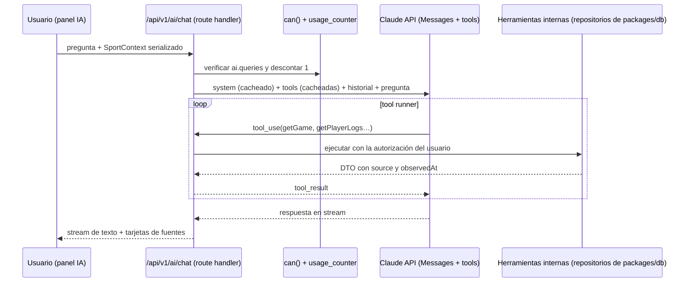

# Arquitectura de PitchLab AI (W5)

> **Propósito:** un asistente que responde **solo** con los datos de PitchLab, mediante herramientas tipadas, con fuentes, hora e incertidumbre, y con costo controlado.
> **Consumidores:** sección 24, `apps/web/app/api/v1/ai/*` y `packages/ai` (se crea en W5).
> **Fecha:** 2026-11-08 · ADR-013. La referencia de la API se consultó en la guía oficial del SDK de Anthropic (snapshot del 6 oct 2026). Al implementar se verifica de nuevo en la documentación en vivo.

## 1. Flujo

## 2. Implementación (TypeScript, SDK oficial `@anthropic-ai/sdk`)

- **Bucle:** el *Tool Runner* del SDK (`client.beta.messages.toolRunner` con herramientas definidas con `betaZodTool`). El esquema Zod de cada herramienta es el mismo de `packages/contracts`.
- **Selección de herramienta:** `tool_choice: auto`. Los modelos 5.5 rechazan el uso forzado (`any`/`tool`), así que se usa `strict: true` en las herramientas y se guía desde el system prompt.
- **Streaming:** `.stream()` con `finalMessage()` para cerrar. Con streaming y herramientas de cliente se activa `eager_input_streaming: true` y se valida cada input contra su esquema antes de ejecutarlo.
- **Prompt caching:** el orden del prefijo es `tools → system → messages`. Tools y system son **estáticos y deterministas** (sin fecha ni IDs de usuario dentro) con `cache_control: { type: "ephemeral" }`. El contexto variable (la fecha actual, el `SportContext`) va **después** del último breakpoint, como mensaje. Se verifica con `usage.cache_read_input_tokens` en los logs.
- **Pensamiento y esfuerzo:** pensamiento adaptativo (por defecto en los modelos 5.5) y `output_config.effort` por ruta: `low` para preguntas directas y `medium` para análisis. Se mide antes de subirlo.
- **Rechazos:** antes de leer `content` se comprueba `stop_reason`. En `refusal` se muestra un mensaje neutro. En los modelos Opus y Sonnet 5.5 se habilita el *fallback* del lado del servidor (`fallbacks: "default"` con su beta), según la guía.
- **Errores:** cadena de excepciones tipadas del SDK (`RateLimitError` → reintento diferido; `APIError` ≥ 500 → mensaje «intenta de nuevo»). La consulta fallida no consume cuota.

## 3. Herramientas (solo lectura, autorizadas como el usuario)

| Herramienta | Entrada | Devuelve | Feature requerida |
|---|---|---|---|
| `searchEntities` | `q`, `league?` | Ligas, equipos, jugadores y partidos con IDs canónicos | `sports.core` |
| `getGame` | `gameId` | Partido, estado, resultado y frescura | `game.center` |
| `getTeamStats` | `teamId`, `season`, `window?` | Stats de equipo con n | `sports.core` |
| `getPlayerLogs` | `playerId`, `season?`, `window?`, `split?` | Game logs y agregados | `props.lab` |
| `analyzeProp` | `playerId`, `market`, `line`, `window`, `split?` | Hit rate (n, IC y push), distribución y promedio | `props.lab` |
| `getOdds` | `gameId`, `market?` | Cuotas por casa con la hora del snapshot, implícita y sin vig | `odds.current` |
| `getOddsHistory` | `gameId`, `market` | Apertura, cierre aproximado y movimiento | `odds.history` |
| `getPrediction` | `gameId`, `market?` | Solo predicciones **publicadas**, con versión y métricas del modelo | `predictions.view` |
| `explainMetric` | `metricKey` | Definición del glosario (Metodología) | — |

Si una herramienta no está permitida para el plan del usuario, se devuelve un `tool_result` con `is_error: true` y el código `NOT_ENTITLED`. El modelo explica que esa información requiere otro plan, sin inventarla.

**No existen** herramientas de escritura (registrar picks, cambiar la cuenta) ni de SQL libre. Las de escritura podrían llegar después, siempre con confirmación explícita del usuario en la UI.

## 4. System prompt (reglas que debe contener)

1. Responde solo con información obtenida de las herramientas en esta conversación. Si no hay datos, dilo.
2. Cada cifra va con su fuente y hora (`source` y `observedAt`) y, cuando aplique, con n.
3. Distingue observación (frecuencia), estimación (modelo publicado) y simulación.
4. No recomiendes apostar, no sugieras montos ni sizing y no prometas resultados. Ante preguntas como «¿a qué le apuesto?», ofrece los datos y su incertidumbre.
5. Usa español de México, con la voz de marca (`pitchlab-brand/guidelines/VOICE.md`).
6. Si el usuario expresa problemas con el juego, comparte el enlace de ayuda de juego responsable.

## 5. Modelos y costo (precios oficiales por 1M de tokens, snapshot del 6 oct 2026)

| Modelo | ID | Entrada | Salida | Uso propuesto |
|---|---|---:|---:|---|
| Claude Haiku 5.5 | `claude-haiku-5-5` | $0.10 | $0.50 | Preguntas directas (consulta y resumen de datos) y clasificación de intención |
| Claude Sonnet 5.5 | `claude-sonnet-5-5` | $2.00 | $10.00 | Análisis de varios pasos (comparar, explicar modelos) |
| Claude Opus 5.5 | `claude-opus-5-5` | $4.00 | $20.00 | Opción de máxima calidad. Es el default que recomienda la guía del SDK. **Lo decide el fundador (FD-15).** |

**Estimación por consulta** (supuesto: ~6k tokens de system y tools cacheados, ~8k de resultados de herramientas, ~1k de salida y ~3 vueltas del bucle):

| Modelo | Costo aproximado por consulta |
|---|---:|
| Haiku 5.5 | ≈ US$0.005 |
| Sonnet 5.5 | ≈ US$0.07 |
| Opus 5.5 | ≈ US$0.14 |

**Hallazgo:** con Sonnet y las cuotas que se propusieron en F2 (Pro con 150 al mes), la IA costaría ≈ US$10 por usuario Pro al mes, **más que el ingreso neto de Pro** (US$6.6–11). Por eso se ajusta:

- **Enrutamiento:** Haiku por defecto y escalar a Sonnet solo cuando el clasificador detecte un análisis complejo.
- **Cuotas provisionales:** Free 5, Pro 60 y Elite 250 consultas al mes (se actualizan en `INFORMATION_ARCHITECTURE.md` §4).
- **Medición real** de `usage` por consulta durante la beta antes de fijar las cuotas definitivas (`COST_MODEL.md`).

## 6. Observabilidad y privacidad

- Log por consulta en `ai_usage(user_id, model, input_tokens, cached_tokens, output_tokens, tools_called[], latency_ms, cost_estimate, refusal?)`, sin guardar el texto completo salvo con consentimiento explícito para mejorar el servicio.
- Feedback 👍/👎 con motivo opcional, que alimenta una evaluación offline antes de cambiar de modelo o de prompt.
- Las conversaciones del usuario se pueden borrar desde Cuenta (ARCO).
