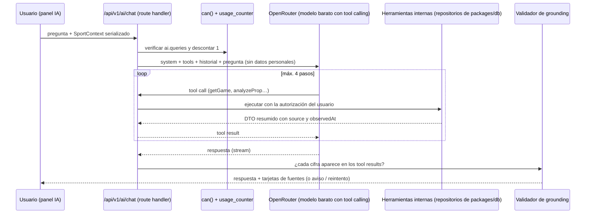

# Arquitectura de PitchLab AI (W5)

> **Propósito:** un asistente que responde **solo** con los datos de PitchLab, mediante herramientas tipadas, con fuentes, hora e incertidumbre, y al menor costo posible.
> **Consumidores:** sección 24, `apps/web/app/api/v1/ai/*` y `packages/ai` (se crea en W5).
> **Fecha:** 2026-11-08 · **Decisión del fundador:** usar **OpenRouter con un modelo muy barato** (ADR-013 rev. 2). La IA es opcional: solo se activa en W5 (flag `ai.enabled`).

## 1. Flujo

## 2. Implementación

- **SDK:** Vercel AI SDK (`ai`) con el proveedor oficial `@openrouter/ai-sdk-provider` (`createOpenRouter`). Llamadas `streamText` con `tools` definidas con los esquemas Zod de `packages/contracts` y un límite de 4 pasos. Las versiones de ambos paquetes se fijan al implementar en W5, comprobando en su README la compatibilidad entre versiones.
- **Agnóstico de modelo:** el modelo es configuración, no código: `AI_MODEL_DEFAULT` (barato) y `AI_MODEL_ESCALATION` (opcional, un poco mejor para análisis de varios pasos). Cambiar de modelo no requiere desplegar código.
- **Enrutamiento en OpenRouter** (parámetro `provider`):
  - `require_parameters: true`: solo proveedores que soporten tools y los parámetros enviados.
  - `data_collection: "deny"`: excluye a los proveedores que guardan o entrenan con los prompts.
  - `zdr: true` si el modelo elegido tiene endpoints con zero data retention.
  - Si ningún proveedor cumple, la petición falla y se muestra «el asistente no está disponible». No se degrada la privacidad en silencio.
- **Parámetros:** temperatura baja (≤ 0.2) y `max_tokens` acotado (~800 de salida).
- **Herramientas que devuelven poco:** cada herramienta regresa agregados ya calculados (hit rate, n, IC, mejores cuotas) y no tablas crudas. Así se reducen tokens y errores de un modelo pequeño.
- **Caching:** el prefijo (system y tools) es estable y determinista. Si el modelo o el proveedor soporta caché de prompt se aprovecha; si no, el costo ya es bajo.

## 3. Herramientas (solo lectura, autorizadas como el usuario)

| Herramienta | Entrada | Devuelve | Feature requerida |
|---|---|---|---|
| `searchEntities` | `q`, `league?` | Ligas, equipos, jugadores y partidos con IDs canónicos | `sports.core` |
| `getGame` | `gameId` | Partido, estado, resultado y frescura | `game.center` |
| `getTeamStats` | `teamId`, `season`, `window?` | Stats agregadas de equipo con n | `sports.core` |
| `getPlayerSummary` | `playerId`, `season?`, `window?`, `split?` | Promedios y últimos N juegos (resumido) | `props.lab` |
| `analyzeProp` | `playerId`, `market`, `line`, `window`, `split?` | Hit rate (n, IC y push), percentiles de la distribución y promedio | `props.lab` |
| `getOdds` | `gameId`, `market?` | Mejor cuota por selección, hora del snapshot, implícita y sin vig | `odds.current` |
| `getOddsHistory` | `gameId`, `market` | Apertura, cierre aproximado y variación | `odds.history` |
| `getPrediction` | `gameId`, `market?` | Solo predicciones **publicadas**, con versión y métricas del modelo | `predictions.view` |
| `explainMetric` | `metricKey` | Definición del glosario (Metodología) | — |

Si el plan del usuario no incluye una herramienta, esta devuelve un error `NOT_ENTITLED` y el modelo explica que esa información requiere otro plan. **No hay** herramientas de escritura ni SQL libre.

## 4. Salvaguardas para un modelo barato (más alucinación posible)

1. **Validador de grounding** (en el servidor, sin LLM): extrae las cifras de la respuesta (porcentajes, cuotas, promedios, n) y comprueba que existan, con tolerancia de redondeo, en los tool results de la conversación.
   - Si alguna no aparece, se reintenta **una** vez con la instrucción «usa solo cifras de las herramientas».
   - Si vuelve a fallar, se muestra la respuesta con el aviso «Algunas cifras no pudieron verificarse», o solo las tarjetas de datos.
2. **Tarjetas de fuentes:** la UI muestra los datos que devolvieron las herramientas (con `source` y `observedAt`) junto al texto, para que el usuario vea el dato real aunque el texto sea pobre.
3. **Intención fuera de alcance** (pedir picks seguros, montos o sizing): el system prompt la rechaza y un filtro simple de palabras clave en la salida bloquea frases como «apuesta segura».
4. **Sin datos personales en el prompt:** solo se envían la pregunta, el contexto deportivo y los resultados de las herramientas. Nunca el email, el nombre ni el historial de pagos.

## 5. System prompt (reglas)

1. Responde solo con información de las herramientas de esta conversación. Si no hay datos, dilo.
2. Cada cifra va con su fuente y hora y, cuando aplique, con n.
3. Distingue observación (frecuencia), estimación (modelo publicado) y simulación.
4. No recomiendes apostar, no sugieras montos y no prometas resultados.
5. Responde en español de México, breve y con la voz de marca (`pitchlab-brand/guidelines/VOICE.md`).
6. Ante señales de problemas con el juego, comparte la ayuda de juego responsable.

## 6. Selección del modelo (antes de activar W5)

1. **Candidatos:** los modelos más baratos de OpenRouter que soporten tool calling (filtro `supported_parameters=tools` en su catálogo) y que tengan proveedores compatibles con `data_collection: "deny"`.
2. **Evaluación:** 40 preguntas reales en español sobre NFL, Liga MX y Premier League, con las herramientas y los datos de staging. Se mide:
   - % de llamadas a herramienta correctas;
   - % de respuestas que pasan el validador de grounding a la primera;
   - calidad del español;
   - latencia p95;
   - costo por consulta.
3. **Regla:** gana el más barato que supere 90 % de grounding y 90 % de herramientas correctas. Si ninguno lo logra, se prueba el escalamiento con `AI_MODEL_ESCALATION` solo para las preguntas complejas.
4. La evaluación se guarda en `services/ai-eval/` y se vuelve a correr antes de cambiar de modelo.

## 7. Costo y control

- OpenRouter funciona con **créditos prepagados**. El límite mensual de gasto se fija en la cuenta y actúa como tope duro, de modo que la factura no puede dispararse.
- **Estimación** (supuesto de ~12k tokens de entrada y ~0.8k de salida por consulta con 2–3 pasos): con un modelo de ≈ US$0.10–0.30 por 1M de tokens de entrada, la consulta cuesta **≈ US$0.002–0.005**. El precio real se toma del catálogo de OpenRouter al elegir el modelo.
- **Cuotas provisionales:** Free 5, Pro 60 y Elite 250 consultas al mes (`INFORMATION_ARCHITECTURE.md` §4). Con un modelo barato, Pro costaría ≈ US$0.12–0.30 al mes por usuario. Las cuotas podrían subir tras medir el uso real.
- **Log por consulta:** `ai_usage(user_id, model, provider, input_tokens, output_tokens, steps, tools_called[], grounding_passed, latency_ms, cost_usd)` con el costo que reporta OpenRouter.

## 8. Privacidad

- OpenRouter y el proveedor final procesan el texto de las consultas. Se declaran como **encargados o remisión de datos** en el aviso de privacidad (`COMPLIANCE_REGISTER.md` C-04 y C-14).
- `data_collection: "deny"` (y `zdr` cuando exista) es obligatorio en producción.
- Las conversaciones se guardan solo si el usuario lo permite. Se pueden borrar desde Cuenta.
