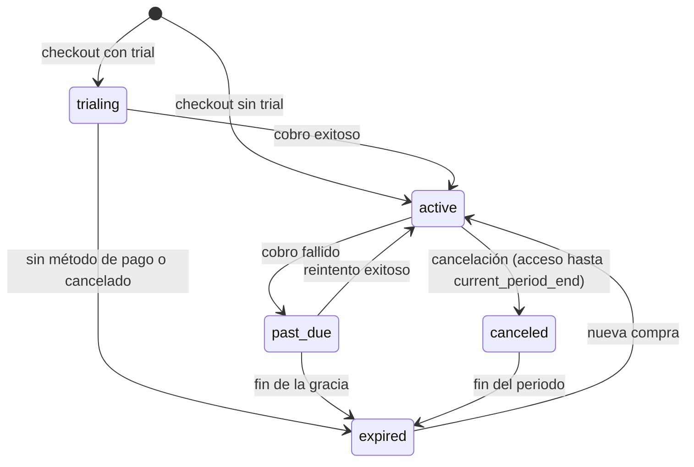

# Auth, billing y crecimiento

> **Propósito:** cuentas, sesiones, roles, planes, trial de 7 días, referidos, invitaciones y pasarela, como un solo sistema coherente.
> **Consumidores:** `packages/auth`, `packages/billing`, `packages/social` (referidos) y las secciones 02, 03, 04, 28, 32 y 38.
> **Fecha:** 2026-11-08 · Decisiones en ADR-010 y ADR-011. Reglas legales en `COMPLIANCE_REGISTER.md`.

## 1. Autenticación (Better Auth)

| Aspecto | Decisión |
|---|---|
| Métodos | Email y contraseña (mínimo 10 caracteres y verificación contra contraseñas filtradas), Google y magic link (Apple descartado: su programa de desarrollador cobra) |
| Verificación | Email verificado obligatorio antes del onboarding |
| Edad | `birth_date` obligatoria en el registro. Si es menor de 18, se rechaza y no se crea la cuenta (no se guardan datos). |
| Consentimientos | Términos y aviso de privacidad (obligatorios, con versión), analítica y marketing (opcionales). Tabla `consent`. |
| Sesiones | Cookie HttpOnly, Secure y SameSite=Lax en `pitchlab.mx`. Sesiones listadas y revocables en `/app/account/security`. |
| Roles | `user` (default), `staff` y `admin`. Staff y admin requieren 2FA (TOTP o passkey) para entrar a `/admin`. |
| Rate limit | Login, signup y reset con límite por IP y por cuenta (Upstash) |

## 2. Planes y entitlements

- **Plan efectivo** = el máximo entre (a) la suscripción con estado `active`, `trialing` o `past_due` en gracia, y (b) las `entitlement_grant` vigentes.
- `can(user, featureKey, ctx?)` en `packages/billing` usa la matriz de `INFORMATION_ARCHITECTURE.md` §4 (`plan-matrix.ts` en `contracts`) y los contadores de cuota (por ejemplo, `props.lab` al día y `ai.queries` al mes).
- **Las cuotas** se cuentan en `usage_counter(user_id, feature, period, count)` con incremento atómico.
- La UI pregunta `GET /me/entitlements` para pintar `LockedPreview`. El servidor **siempre** vuelve a verificar.

## 3. Trial de 7 días

| Camino | Mecanismo | Tarjeta (FD-04) |
|---|---|---|
| Directo desde Pricing | Suscripción del proveedor con 7 días de trial | Sí (supuesto) |
| Por referido o invitación | `entitlement_grant(plan='pro', source='referral_trial' o 'invite', ends_at=+7d)` | No |

**Un trial por persona.** `trial_claim` guarda hashes de identidad y tiene restricciones únicas:

- `email_canonical_hash`: correo en minúsculas, sin los puntos ni el `+tag` de Gmail y similares.
- `device_hash`: cookie de primer partido más una huella ligera, solo como señal.
- `payment_fingerprint_hash`: cuando el proveedor lo expone.

Ante un conflicto no se otorga el trial y se ofrece la compra directa.

**Emails** (Resend + React Email): día 0 (bienvenida y qué probar), día 5 («quedan 2 días», con el precio exacto con IVA y cómo cancelar) y día 7 (fin: pasó a Free o se renovó).

## 4. Referidos e invitaciones

### Referidos

- Cada usuario verificado obtiene un `referral_code` (8 caracteres, sin ambigüedades). Link: `pitchlab.mx/r/:code`.
- La visita guarda una cookie `pl_ref` (30 días) más el UTM en `attribution`.
- Estados de `referral_redemption`: `signed_up → trial → converted → rewarded`, o `rejected` (motivo: autorreferido, trial ya usado, fraude o reembolso).
- **Recompensa** (FD-05): al pasar a `converted` y superar el periodo de reembolso, se crea `entitlement_grant(plan = plan del referente o pro, source='referral_reward', +30 días)`. Tope de 6 al año por referente.
- **Sin premios por acertar pronósticos**: la recompensa depende solo de la conversión (C-01).
- Antifraude: mismo `email_canonical_hash`, `device_hash` o método de pago que el referente → `rejected`. Límite de 20 canjes al día por código. Revisión en `/admin/users`.

### Invitaciones

- `invite(token_hash, issuer_id, kind: 'admin' | 'user', grant_plan, grant_days, max_uses, uses, expires_at, campaign)`.
- Se guarda el hash del token (sha-256) y el token solo aparece en el link.
- Los usuarios pueden emitir invitaciones si el plan lo permite (por ejemplo, Elite con 3 al mes). Las de admin sirven para beta, prensa y creadores.

## 5. Tablas (además de las de Better Auth: `user`, `session`, `account`, `verification`)

| Tabla | Columnas clave |
|---|---|
| `profile` | `user_id`, `handle` (único, 3–20 caracteres, `[a-z0-9_]`), `display_name`, `avatar_key?`, `bio?`, `is_public` (default false), `birth_date`, `favorite_leagues[]`, `favorite_teams[]`, `social_paused_until?` |
| `consent` | `user_id`, `purpose`, `granted`, `policy_version`, `at`, `ip_hash` |
| `plan` | `id` (`free`, `pro`, `elite`), `rank`, `prices` (jsonb por pasarela, moneda e intervalo) |
| `subscription` | `id`, `user_id`, `provider`, `provider_subscription_id`, `plan_id`, `status` (`trialing`, `active`, `past_due`, `canceled`, `expired`), `trial_end?`, `current_period_end`, `cancel_at?` |
| `entitlement_grant` | `id`, `user_id`, `plan_id`, `source` (`referral_trial`, `invite`, `referral_reward`, `admin`), `starts_at`, `ends_at`, `ref_id?` |
| `billing_event` | `id`, `provider`, `provider_event_id` (**único**, idempotencia), `type`, `payload` (jsonb), `processed_at?`, `error?` |
| `usage_counter` | `user_id`, `feature`, `period_key`, `count` |
| `trial_claim` | `user_id`, `email_canonical_hash` (único), `device_hash?`, `payment_fingerprint_hash?` (único si existe), `claimed_at` |
| `referral_code` | `code` (PK), `owner_id`, `created_at`, `disabled_at?` |
| `referral_redemption` | `id`, `code`, `referee_id` (único), `status`, `reason?`, `converted_at?`, `rewarded_at?` |
| `invite` | (ver §4) |
| `attribution` | `user_id`, `first_utm` (jsonb), `last_utm`, `referral_code?`, `invite_id?`, `landing_path`, `first_seen_at` |
| `fiscal_profile` | `user_id`, `rfc`, `razon_social`, `regimen`, `cp`, `uso_cfdi` (opcional, para CFDI) |

## 6. `BillingProvider`

```ts
interface BillingProvider {
  id: 'stripe' | 'mercadopago';
  createCheckout(input: { userId: string; planId: PlanId; interval: 'month' | 'year'; trialDays?: number; returnUrl: string }): Promise<{ url: string }>;
  createPortalSession?(userId: string): Promise<{ url: string }>;   // si el proveedor no tiene portal, la UI propia de 28 gestiona
  cancel(subscriptionId: string, opts: { atPeriodEnd: boolean }): Promise<void>;
  parseWebhook(req: Request): Promise<NormalizedBillingEvent>;       // verifica la firma; lanza un error si es inválida
}
```

**Webhooks** en `/api/webhooks/[provider]`:

1. Verificar la firma.
2. Insertar en `billing_event` (si `provider_event_id` ya existe → 200 sin efecto).
3. Aplicar la transición a `subscription` en una transacción.
4. Emitir eventos de dominio (`subscription.activated`, `.past_due`, `.canceled`) que alimentan referidos, emails y analítica.

**Reconciliación:** un job diario compara las suscripciones activas con el proveedor y registra las diferencias en `/admin/billing`.

**Pago fallido:** `past_due` con 7 días de gracia (banner y reintento). Después pasa a `expired`, el plan efectivo vuelve a Free y los datos del usuario se conservan.

## 7. Estados de suscripción



## 8. Cumplimiento (resumen operativo)

- Pricing y checkout muestran el precio final con IVA, la periodicidad y la fecha del primer cargo.
- La cancelación está en ≤ 2 clics desde `/app/account/billing`.
- Hay aviso antes de cada renovación anual.
- CFDI bajo pedido con un PAC (en la Wave de billing, tras definir la persona moral).
- No se guardan datos de tarjeta en PitchLab: solo la pasarela los maneja.
