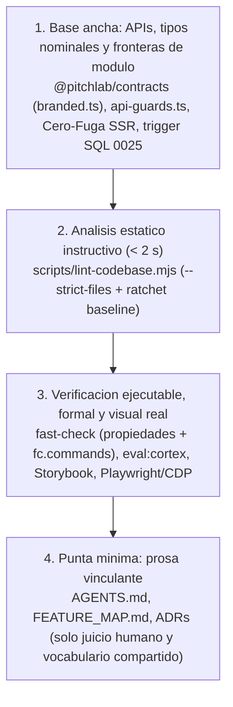
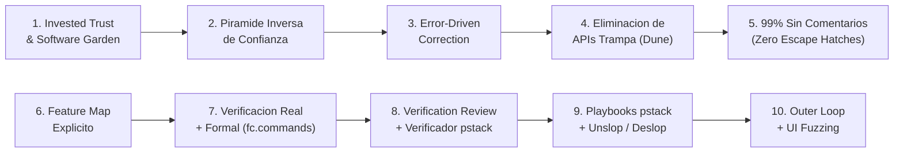

# Playbook Operativo *Constraint-First* y Anti-Slop de PitchLab

> **Propósito:** protocolo técnico permanente para el desarrollo asistido por agentes y equipos multiagente (`/swarm`) en PitchLab. Traduce la metodología *Constraint-First* («All Code Is Slop (Except Mine)», arquitectura *Dune* y playbooks `pstack` de Lauren Tan) a barreras ejecutables, reglas de verificación y disciplina de sustracción sobre este repositorio.
> **Relación con estándares:** complementa `AGENTS.md`, `ADR-050`–`ADR-055`, `docs/design/FEATURE_MAP.md` y `docs/execution/QUALITY_GATES.md`.

---

## 1. Tesis Central: *Invested Trust* y *Software Garden*

En ingeniería asistida por agentes, producir volumen de código carece de valor por sí solo: cualquier agente puede generar miles de líneas de *slop* (código plausible a primera vista, pero verboso, acoplado, lleno de coerciones laxas, comentarios disculpándose y estados frágiles).

El objetivo de PitchLab no es acelerar la generación ciega, sino cambiar el modelo operativo:

- **De *Blind Trust* a *Invested Trust*:** nunca confíes ciegamente en un prompt ni pretendas revisar a ojo diffs de 3,000 líneas. Invierte confianza en el **entorno ejecutable** (tipos nominales, fronteras de módulo, linter instructivo, pruebas de propiedades/máquinas de estado y verificación en navegador real) para que el código incorrecto sea mecánicamente difícil o imposible de escribir.
- **El repositorio es un *Software Garden*:** el código existente es la ventana de contexto más influyente que leen los agentes. Cualquier hack, casteo perezoso (`as any`), `useEffect` en una vista o componente *slop* que permanezca en el árbol será copiado como convención oficial por los siguientes agentes. Podar deuda antes de escalar es condición de velocidad sostenible.
- **Blindar el *inner loop* antes de abrir el *outer loop*:** paralelizar agentes sobre un *inner loop* lento, ruidoso o sin guardrails solo multiplica bugs a escala.

---

## 2. Pirámide Inversa de Confianza en PitchLab

La inversión de ingeniería se concentra en la base mecánica y reduce la prosa al mínimo indispensable:



1. **Base ancha — Diseño de APIs, tipos nominales y fronteras de módulo:**
   - Estados inválidos irrepresentables en compilación mediante tipos nominales y constructores validados en `packages/contracts/src/branded.ts` (`parseStrictFiniteNumber`, `UnitProbability`, `PositiveDecimalOdds`, `SpacetimeAnchoredQuote`, `RedactedVisitorPick`, `CanonicalPublicSlug`, `SanitizedErrorPayload`).
   - Seguridad uniforme en el borde HTTP con wrappers obligatorios en `apps/web/src/server/api-guards.ts` (`withPublicRead`, `withSessionRead`, `withMemberMutation`, `withActivePaseMutation`, `withAdminMutation`, `withCronSecret`), política `Cero-Fuga` y saneamiento `FD-16` / Licencia Bzzoiro v4.0.
   - Inmutabilidad en base de datos mediante triggers PostgreSQL (`packages/db/migrations/0025_seguridad_rate_limit_inmutable_y_preferencias.sql` en `sealed_picks`), nunca confiada únicamente a la capa de UI.
2. **Capa media-baja — Análisis estático e instructivo (`scripts/lint-codebase.mjs`):**
   - Ejecuta en `< 2 s` sobre todo el monorepo sin consumir memoria de compilador.
   - Todo diagnóstico entrega 3 partes obligatorias: **QUÉ** falló (`[regla] archivo:linea`), **POR QUÉ** es riesgoso y **USA EN SU LUGAR:** la primitiva exacta del repositorio.
   - Mecanismo de *ratchet* (`scripts/lint-ratchet-baseline.json`) que impide introducir deuda nueva en cualquier archivo y modo `--strict-files` (`0` deuda) para todo archivo creado o rediseñado.
3. **Capa media-alta — Verificación ejecutable, formal y en ejecución real:**
   - Property-Based Testing (`apps/web/tests/property-invariants.test.ts`) y pruebas de máquina de estados `fc.commands` (`apps/web/tests/state-machines-fc.test.ts`).
   - Evals deterministas de narrativa y anti-alucinación (`pnpm eval:cortex`), Storybook oscuro/claro y Playwright/CDP sobre servidor loopback real.
4. **Punta mínima — Prosa (`AGENTS.md`, `docs/design/FEATURE_MAP.md`, ADRs):**
   - Reservada exclusivamente para criterios de producto, vocabulario compartido, arquitectura de marca y decisiones que exigen juicio humano. Ninguna regla mecánica que pueda expresarse en tipos o lint debe vivir solo como párrafo en un documento.

---

## 3. Los 10 Pilares Operativos (Lauren Tan · *Dune* · `pstack`)



### Pilar 1 · *Invested Trust* y *Software Garden*
- El costo de auditar y corregir *slop* siempre supera el costo de generarlo.
- Mantén limpio el árbol de código y CSS antes de abrir trabajo paralelo: cada patrón vivo en el repo entrena implícitamente al siguiente agente.

### Pilar 2 · Pirámide Inversa de Confianza
- Ante cualquier requisito de integridad, seguridad o UX, empuja la garantía tan abajo en la pirámide como sea posible: primero **tipo/esquema/trigger**, después **regla estática**, después **test generativo**, y solo al final **documentación**.

### Pilar 3 · *Error-Driven Correction* (Corrección Orientada a Errores)
- Cuando un agente o una revisión encuentra un bug repetido, una regresión de contrato o un patrón *slop*, **está prohibido** cerrarlo únicamente corrigiendo la instancia o añadiendo una nota en prosa.
- Toda corrección recurrente debe dejar al menos **una barrera mecánica permanente**:
  1. Un tipo nominal o esquema Zod más estricto en `@pitchlab/contracts`.
  2. Un wrapper canónico o guardia en servidor (`api-guards.ts`, `picks-catalog.ts`).
  3. Una regla estática instructiva en `scripts/lint-codebase.mjs` (con su prueba en `scripts/tests/lint-codebase.test.mjs`).
  4. Una propiedad o máquina de estados en `fast-check` (`property-invariants.test.ts` o `state-machines-fc.test.ts`).

### Pilar 4 · Eliminación Categórica de APIs Trampa (Lección *Dune*)
- Si una API requiere recordar múltiples matices sutiles para no introducir fallos (limpieza de efectos, orden de headers CSRF, coerción `Number("") === 0`, casteos `as any`, contextos monolíticos), encapsúlala en una primitiva canónica y **prohíbe la API cruda en producción**.
- Primitivas prohibidas en código de producto de PitchLab:
  - `useEffect` / `useLayoutEffect` en vistas (`club/`, `public/`, `apps/web/app/`) → usar estado derivado puro, handlers explícitos o hooks auditados en `packages/ui/src/platform/hooks/*` / `apps/web/src/client/*`.
  - `usePlatform()` monolítico → usar hooks divididos (`usePlatformCore`, `usePlatformActions`, `useParlayState`, `useSocialState`, `useOverlayState`, `useJournalEntries`, `useWatchlistGameIds`).
  - `Number(x)` laxo → usar `parseStrictFiniteNumber`, `parsePositiveDecimalOdds` o `parseUnitProbability` de `@pitchlab/contracts`.
  - Rutas API sin wrapper canónico → usar `withPublicRead`, `withSessionRead`, `withMemberMutation`, `withActivePaseMutation`, `withAdminMutation` o `withCronSecret`.
  - Aserciones inseguras `as any` / `as unknown as` → usar narrowing real, type guards o esquemas Zod de `@pitchlab/contracts`.
  - Supresiones y marcadores pendientes (`@ts-ignore`, `@ts-nocheck`, `eslint-disable` sin causa estructural, `TODO` / `FIXME`) → resolver la causa raíz antes de integrar.

### Pilar 5 · Regla del 99 % Sin Comentarios (*Zero Escape Hatches*)
- Los comentarios literales (`//` y `/* */`) están prohibidos en producción nueva o rediseñada (`no-prod-comments`), porque:
  1. Sirven como válvulas de escape donde el agente racionaliza un parche temporal en lugar de diseñar bien.
  2. Se desactualizan sin romper la compilación y envenenan el contexto de futuros agentes (*context poisoning*).
- La intención se expresa en nombres explícitos, tipos nominales, pruebas legibles y ADRs en `docs/architecture/adr/`.

### Pilar 6 · *Feature Map* Explícito (Vocabulario Compartido)
- Ningún agente adivina qué archivos corresponden a una pantalla ni qué partes son intocables.
- `docs/design/FEATURE_MAP.md` es la fuente única de verdad que enlaza cada sección visible con su(s) ruta(s), clasificación vinculante (`ZONA PROTEGIDA`, `REDISEÑO TOTAL` o `MEJORA FUNCIONAL`), archivos/widgets exactos e invariantes irrompibles.

### Pilar 7 · Verificación en Ejecución Real + Verificación Formal
- Los tests escritos únicamente con mocks sobre el mismo código que produjo el autor tienden a verificar «que el mock devuelve el mock».
- PitchLab combina dos capas independientes de evidencia:
  1. **Runtime real:** navegador real (Playwright / CDP sobre `127.0.0.1`), inspección de DOM, consola, red, viewports `1440×900` y `375×812`, temas oscuro y claro, y PostgreSQL real en memoria (PGlite con migraciones reales).
  2. **Verificación formal generativa (`fast-check`):** pruebas de propiedades sobre miles de combinaciones aleatorias y pruebas de máquinas de estado (`fc.commands`) para transiciones críticas con estado e invariantes temporales.

### Pilar 8 · De *Code Review* a *Verification Review* + Verificadores Independientes (`pstack`)
- La revisión humana se centra en **artefactos de verificación verificables** (capturas antes/después en el mismo viewport y tema, trazas de pruebas formales, salidas de linter estricto y evals), no en lectura manual línea por línea de diffs masivos.
- **Regla de independencia (`pstack`):** el agente autor nunca es el verificador final de su propio bloque. Por cada `3–4` agentes escritores (`workspace: "share"`), se asigna `1` verificador independiente (`workspace: "inherit"` o solo lectura) que valida contra `FEATURE_MAP.md`, seguridad, tipos y runtime real, y devuelve fallos puntuales al autor.

### Pilar 9 · Playbooks Estructurados (`pstack`) y *Unslop / Deslop* por Sustracción
Todo trabajo sigue un playbook explícito en lugar de improvisar:
- **`investigation`:** ante un bug o defecto UX, prohibido editar código antes de reproducir el fallo y aislar su causa raíz verificable.
- **`refactoring`:** migración mecánica con preservación explícita de contratos/exports y verificación antes/después.
- **`shipping`:** checklist rígido de lint estricto, pruebas pertinentes, `check-no-demo-prod.mjs`, artefactos visuales y commit limpio sin push no autorizado.
- **`session-pickup`:** reanudación limpia leyendo `docs/execution/PROJECT_STATE.md`, `FEATURE_MAP.md` y el estado git real sin asumir contexto ausente.
- **`unslop` / *Deslop*:** pasadas dedicadas exclusivamente a **restar** superficie contaminada (código muerto, duplicados, CSS huérfano, exports no usados, casteos perezosos y copy/tarjetas AI-slop).

### Pilar 10 · *Outer Loop* Automatizado y *UI Fuzzing* Exploratorio
- Con el *inner loop* blindado, se ejecutan recorridos exploratorios en navegador real actuando como usuario final (desktop y móvil `375 px`, oscuro y claro) para detectar botones muertos, filtros rotos, estados vacíos sin salida, respuestas `4xx/5xx` y desbordamiento horizontal `> 0 px`.

---

## 4. Reglas *Unslop* y Uso de `scripts/lint-codebase.mjs`

### 4.1 Catálogo de reglas activas

| Regla | Modo | Alcance | Qué bloquea | Primitiva / acción requerida |
|---|---|---|---|---|
| `no-hex-outside-tokens` | Inmediato (`0`) | Todo salvo `packages/tokens/`, `packages/emails/src/`, `registry.generated.ts` | Colores `#hex` literales | Tokens CSS `var(--pl-*)` en `@pitchlab/tokens` |
| `no-empty-catch` | Inmediato (`0`) | `.ts`, `.tsx`, `.mjs` | Bloques `catch {}` vacíos | Manejo tipado o `safeLogger` (`apps/web/src/server/safe-logger.ts`) |
| `no-cloud-sdk-lockin` | Inmediato (`0`) | Todo salvo `avatar-storage.ts` | Imports `@vercel/*`, `@google-cloud/*`, `@cloudflare/*`, `@neondatabase/*`, `@aws-sdk/*` | Estándares abiertos (`ADR-050`) o adaptador opt-in |
| `no-web-barrels` | Inmediato (`0`) | `apps/web/` | Imports desde `@pitchlab/ui` o `@pitchlab/ui/platform` | Subpaths explícitos (`@pitchlab/ui/atomic`, `@pitchlab/ui/picks-catalog`, `@pitchlab/ui/primitives`, etc.) |
| `no-css-jank` | Inmediato (`0`) | `apps/web/`, `packages/ui/src/` (`.css`, `.tsx`, excl. stories) | `backdrop-filter`, `backdrop-blur-*`, `transition-all`, transición en `box-shadow` | Superficies sólidas `--pl-*` y transiciones en `transform`, `opacity`, `border-color`, `background-color`, `color` |
| `no-forbidden-ui-copy` | Inmediato (`0`) | `packages/ui/src/`, `apps/web/` (excl. tests/stories) | «Confianza N», «Datos completos/parciales» | Probabilidad calibrada, `fairOdds` y evidencia en `MatchPicksEvidenceBoard` (`ADR-054`) |
| `no-monolithic-use-platform` | Ratchet (`0` en nuevos / `--strict-files`) | Producción (excl. `platform-provider.tsx`, tests/stories) | `usePlatform()` completo | Hooks divididos (`usePlatformCore`, `usePlatformActions`, `useParlayState`, etc.) |
| `no-prod-comments` | Ratchet (`0` en nuevos / `--files` / `--strict-files`) | Producción `.ts/.tsx/.mjs` (excl. tests/stories/generated) | Comentarios `//` y `/* */` | Nombres claros, tipos nominales, tests y ADRs |
| `no-view-use-effect` | Ratchet (`0` en nuevos / `--strict-files`) | `club/`, `public/`, `apps/web/app/` (excl. tests/stories) | `useEffect` / `useLayoutEffect` en vistas | Estado derivado, handlers o hooks auditados en `platform/hooks/*` |
| `no-unsafe-number-cast` | Ratchet (`0` en nuevos / `--strict-files`) | Producción `.ts/.tsx/.mjs` | Coerción laxa `Number(...)` | `parseStrictFiniteNumber`, `parsePositiveDecimalOdds`, `parseUnitProbability` |
| `require-api-wrapper` | Ratchet (`0` en nuevos / `--strict-files`) | `apps/web/app/api/**/route.ts` (salvo 4 excepciones documentadas) | Handlers API sin wrapper canónico | `withPublicRead`, `withSessionRead`, `withMemberMutation`, `withActivePaseMutation`, `withAdminMutation`, `withCronSecret` |
| `no-unsafe-type-assertion` | Ratchet (`0` en nuevos / `--strict-files`) | Producción `.ts/.tsx/.mjs` (excl. tests/stories/generated) | `as any` y `as unknown as` | Narrowing real, type guard o `parseStrictFiniteNumber` / esquemas Zod de `@pitchlab/contracts` |
| `no-slop-wrapper-bloat` | Ratchet (`0` en nuevos / `--strict-files`) | Producción `.ts/.tsx/.mjs` (excl. tests/stories/generated) | `@ts-ignore`, `@ts-nocheck`, `eslint-disable` sin regla y causa estructural (`-- <razón>`), marcadores `TODO` / `FIXME` | Corregir el tipo o diseño raíz en lugar de suprimir chequeos o dejar deuda abierta |

### 4.2 Comandos del *inner loop*

- **Validación estricta obligatoria en archivos nuevos o rediseñados (`0` deuda en todas las reglas):**
  ```bash
  node scripts/lint-codebase.mjs --strict-files <ruta1>,<ruta2>
  ```
- **Escaneo global del repositorio con *ratchet* (impide introducir cualquier deuda nueva):**
  ```bash
  node scripts/lint-codebase.mjs
  ```
- **Validación de la suite unitaria del propio linter (`< 1 s`):**
  ```bash
  node --test scripts/tests/lint-codebase.test.mjs
  ```
- **Encoger el baseline tras limpiar deuda heredada (solo baja, nunca sube):**
  ```bash
  node scripts/lint-codebase.mjs --shrink-baseline
  ```

---

## 5. Verificadores Independientes (`pstack`) y *Verification Review* Visual

### 5.1 Protocolo de verificadores independientes
- **Separación de roles:** ningún bloque de escritura en paralelo se integra únicamente con el auto-reporte del autor.
- **Proporción operativa:** `1` verificador independiente (en workspace de lectura `inherit`) por cada `3–4` agentes escritores (`workspace: "share"`).
- **Alcance del verificador:**
  1. Verifica propiedad exclusiva de archivos y ausencia de ediciones accidentales en `ZONA PROTEGIDA` (`docs/design/FEATURE_MAP.md`).
  2. Contrasta contratos exportados, seguridad (`Cero-Fuga`, `FD-16`, wrappers API) y cero violaciones en `lint-codebase.mjs --strict-files`.
  3. Comprueba el comportamiento real (pruebas de propiedades/máquinas de estado o navegador real) y reporta hallazgos accionables directamente al autor para corrección antes de integrar.

### 5.2 Protocolo de *Verification Review* visual (*antes / después*)
Para todo rediseño o cambio de superficie UI:
1. **Captura base (*antes*):** antes de iniciar cambios sobre una sección de `docs/design/FEATURE_MAP.md`, capturar las URLs canónicas de la sección en:
   - Escritorio: **`1440×900`** en tema **`dark`** y **`light`**.
   - Móvil: **`375×812`** en tema **`dark`** y **`light`**.
2. **Captura final (*después*):** al cerrar la implementación, el verificador visual captura exactamente las mismas URLs, viewports y temas (incluyendo Storybook `PitchLab/Sofascore Kit` y `PitchLab/Atomic/*` cuando cambien primitivas).
3. **Checklist de aprobación visual:**
   - `0 px` de desbordamiento horizontal entre `320 px` y `1440 px`.
   - Objetivos táctiles `>= 44 px` en móvil y `font-size >= 16 px` en inputs móviles (anti-zoom iOS).
   - Máximo `2` indicadores/chips compactos por fila tabular (cero muros de pills ni tarjetas vidrio infladas).
   - Cero errores en consola del navegador y cero respuestas `4xx/5xx` inesperadas.
   - Publicación de evidencia emparejada con formato `Screenshot: <ruta> | <qué cambió>` para revisión humana rápida.

---

## 6. Verificación Formal con Máquinas de Estado (`fast-check` `fc.commands`)

Para lógica crítica con estado mutable, reglas de seguridad o invariantes matemáticas secuenciales, PitchLab exige pruebas basadas en modelos con `fc.commands` + `fc.modelRun` / `fc.asyncModelRun` en `apps/web/tests/state-machines-fc.test.ts`:

1. **Ciclo de vida de `sealed_picks` (PGlite real + migración `0025`):**
   - Comandos modelados: `InsertPreKickoff`, `AttemptPostKickoffInsert`, `AttemptDirectDelete`, `AttemptModifySealedColumns`, `SettlePendingToTerminal`, `AttemptModifySettledRow`.
   - Invariantes verificadas en cada transición: nunca se inserta un pick con `kickoff_at <= sealed_at` (`RETROACTIVE_SEALED_PICK_FORBIDDEN`), nunca prospera un `DELETE` directo mientras exista el usuario (`IMMUTABLE_SEALED_PICK_DELETE`), nunca mutan las 19 columnas selladas (`IMMUTABLE_SEALED_PICK_UPDATE`), toda transición `pending -> won|lost|void` persiste y bloquea cualquier mutación posterior (`IMMUTABLE_SETTLED_PICK_UPDATE`).
2. **Ciclo de `BetBuilder` SGP (`checkBetBuilderCompatibility` + `evaluateBetBuilder`):**
   - Comandos modelados: `AddValidLeg`, `AddDuplicateLeg`, `AddConflictingLeg`, `AddFinishedOrLiveLeg`, `RemoveLeg`, `ClearSlip`.
   - Invariantes verificadas en cada paso: cero piernas duplicadas, contradictorias o `FT`/`LIVE` admitidas; cumplimiento estricto del tope `maxLegsPerGame`; `jointProbability` finita y acotada siempre por Fréchet-Hoeffding (`max(0, Σp - (k - 1)) <= P_joint <= min(p_i)` para SGP de mismo partido) y `fairCombinedDecimal >= 1.01`.
3. **Ciclo *Scraping Velocity* (`withSessionRead` + `resetScrapingVelocityForTests`):**
   - Comandos modelados: `LegalBurstRead` (relectura de recursos ya vistos) y `DistinctResourceRead` (extracción de recursos distintos nuevos).
   - Invariantes verificadas en cada solicitud: transición determinista por cardinalidad de recursos distintos `200` (`< 50`) → `429` (`>= 50` y `< 75`, sin revocar sesión) → revocación única de sesiones activas + `403 sesion_revocada` (`>= 75`, manteniéndose `403` en solicitudes posteriores).

Toda nueva máquina de estados crítica (pagos SPEI, cupones de un uso, pases expirados en navegación cliente o moderación) debe añadir un modelo equivalente en `state-machines-fc.test.ts`.

---

## 7. *Deslop* por Sustracción y *UI Fuzzing* Adversarial

### 7.1 Pasada dedicada de *Deslop* (sustracción activa)
Tras cada ciclo de entrega importante, dedicar una pasada enfocada **únicamente a eliminar**:
- Código muerto, wrappers redundantes, ramas de compatibilidad fósiles y exports sin consumidores.
- Hojas o reglas CSS huérfanas, clases de botón duplicadas y estilos `style={{...}}` reemplazables por primitivas planas del sistema.
- Entradas de `scripts/lint-ratchet-baseline.json` reducibles mediante `node scripts/lint-codebase.mjs --shrink-baseline`.
- Copy genérico o relleno editorial generado por IA que no responda datos concretos (`Prob.`, `Momio justo`, `Mejor casa`, `EV+`, evidencia verificable).

### 7.2 *UI Fuzzing* adversarial en navegador real
Antes del cierre de release o rediseño mayor, un agente con navegador real recorre sistemáticamente las rutas de `docs/design/FEATURE_MAP.md` en `1440×900` y `375×812` (tema oscuro y claro):
- Hace clic real en cada botón, chip de filtro, pestaña, menú, modal/hoja inferior y botón de cierre/retroceso.
- Prueba búsquedas vacías, caracteres límite, cambios rápidos de pestaña/liga y recargas con query strings (`?tab=`, `?modo=`, `?liga=`).
- Registra y abre corrección (siguiendo el playbook `investigation` + *Error-Driven Correction*) ante cualquier botón inerte, excepción de consola, error HTTP `4xx/5xx`, texto truncado ilegible u overflow horizontal `> 0 px`.

---

## 8. Checklist *Error-Driven Correction* al Cerrar Cada Ciclo

Antes de marcar una entrega o iteración como terminada:

1. ¿Apareció un fallo nuevo en pruebas, QA o revisión visual?
   - **Paso 1:** Reproducir causa raíz (`investigation`).
   - **Paso 2:** Convertir la lección en barrera permanente (tipo nominal en `@pitchlab/contracts` → regla en `scripts/lint-codebase.mjs` → propiedad/FSM en `fast-check`).
2. ¿Todos los archivos nuevos o rediseñados pasan `node scripts/lint-codebase.mjs --strict-files ...` con `0` violaciones?
3. ¿Se verificó el trabajo por un verificador independiente contra `docs/design/FEATURE_MAP.md` y, si toca UI, con capturas *antes/después* (`1440×900` y `375×812`, `dark` y `light`)?
4. ¿Se ejecutó `--shrink-baseline` si se redujo deuda en archivos heredados?
