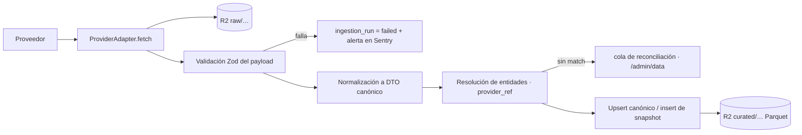

# Arquitectura de datos e histórico

> **Propósito:** el modelo canónico, la ingesta, el almacenamiento histórico y las reglas de integridad temporal. Este documento reúne DATA_ARCHITECTURE y HISTORICAL_STORAGE.
> **Consumidores:** `packages/db`, `services/ingest`, `services/models` y agentes de secciones con datos.
> **Fecha:** 2026-11-08 · Fuentes vigentes en `FREE_DATA_STRATEGY.md`.

## 1. Principios

1. **IDs propios.** Ninguna tabla de dominio usa el ID de un proveedor como clave. El mapeo vive en `provider_ref`.
2. **Cinco tiempos** en todo hecho relevante: `event_time` (cuándo ocurrió), `source_updated_at` (cuándo lo actualizó la fuente), `observed_at` (cuándo lo vimos válido), `ingested_at` (cuándo lo guardamos) y `available_at` (desde cuándo se considera conocible, ver §6).
3. **Inmutabilidad de lo observado.** Los snapshots de cuotas, las predicciones y los picks bloqueados no se actualizan nunca. Las correcciones de la fuente se guardan como una fila nueva con `supersedes_id`.
4. **Crudo primero.** Cada respuesta de proveedor se guarda tal cual en R2 antes de normalizarse, para poder reprocesar.
5. **Procedencia registrada.** Toda lectura lleva `source` y `observedAt` (contrato `DataState`) para auditoría y Admin. La UI pública muestra solo la hora (`observedAt`), nunca el proveedor (FD-16).

## 2. Pipeline de ingesta



**Contrato `ProviderAdapter`** (en `services/ingest/src/adapters/`):

```ts
interface ProviderAdapter<TRaw, TOut> {
  provider: ProviderId;            // 'nflverse' | 'openfootball' | 'the-odds-api' | 'api-football'
  dataset: string;                 // 'schedules' | 'player_weekly' | 'odds_featured' | …
  fetch(ctx: RunContext): Promise<TRaw>;     // respeta presupuestos y rate limits
  validate(raw: unknown): TRaw;               // Zod; lanza un error tipado
  normalize(raw: TRaw, ctx: RunContext): TOut[]; // DTOs de packages/contracts
}
```

| Job (GitHub Actions) | Frecuencia (fase $0) | Fuente |
|---|---|---|
| `ingest-nfl-schedules` | Diario a las 09:00 UTC y cada 3 h en día de partido | nflverse |
| `ingest-nfl-player-weekly` | Diario (temporada) | nflverse |
| `ingest-nfl-history-backfill` | Manual (una vez; temporadas desde 1999) | nflverse |
| `ingest-epl-fixtures` | Diario | openfootball |
| `ingest-ligamx` / `ingest-epl-player-stats` | Diario, con ≤ 100 requests al día en total | API-Football Free |
| `ingest-odds-snapshots` | Según el calendario de `FREE_DATA_STRATEGY.md` §3 | The Odds API |
| `grade-picks` | Cada hora | Interno |
| `refresh-aggregates` | Cada hora y nocturno | Interno |

## 3. Modelo canónico (Postgres, `packages/db`)

### 3.1 Deportes

| Tabla | Columnas clave | Notas |
|---|---|---|
| `sport` | `id` (`american-football`, `soccer`…), `name` | |
| `league` | `id` (`nfl`, `liga-mx`, `premier-league`…), `sport_id`, `name`, `country`, `enabled`, `asset_edition` | El slug coincide con `[league]` de `ROUTE_MAP.md` |
| `season` | `id` (`nfl-2026`, `liga-mx-2026-apertura`), `league_id`, `label`, `start_date`, `end_date`, `structure` (jsonb: semanas, jornadas, fases) | |
| `team` | `id` (`<league>.<slug>`, por ejemplo `liga-mx.atlante`), `league_id`, `name`, `short_name`, `code`, `active` | El slug coincide con el `id` del manifiesto de emblemas cuando existe |
| `player` | `id` (ULID), `sport_id`, `full_name`, `position`, `birth_date?`, `status` | |
| `player_team` | `player_id`, `team_id`, `season_id`, `from`, `to?`, `jersey?` | Rosters en el tiempo |
| `game` | `id` (ULID), `league_id`, `season_id`, `week`/`round`, `phase`, `start_time`, `status` (`scheduled`, `in_progress`, `final`, `postponed`, `canceled`), `home_team_id`, `away_team_id`, `venue?`, `neutral_site` | `start_time` define el lock de los picks |
| `game_result` | `game_id`, `home_score`, `away_score`, `periods` (jsonb), `final_status`, `observed_at`, `source`, `supersedes_id?` | Las correcciones generan una fila nueva |
| `team_game_stat` | `game_id`, `team_id`, `stats` (jsonb validado por `SportConfig`), `source`, `observed_at` | |
| `player_game_stat` | `game_id`, `player_id`, `team_id`, `stats` (jsonb validado), `participation` (snaps o minutos), `source`, `observed_at` | Base de game logs y Prop Lab. Índice `(player_id, game_id)`. |
| `provider_ref` | `entity_type`, `entity_id`, `provider`, `external_id`, `confidence`, `verified_by?` | Único `(provider, entity_type, external_id)` |
| `ingestion_run` | `id`, `provider`, `dataset`, `started_at`, `finished_at`, `status`, `rows_in`, `rows_out`, `raw_uri`, `error?`, `credits_used?` | Alimenta `/admin/data` |

Las claves de `stats` por deporte se definen en `packages/contracts/src/sports/<sport>/stats.ts` (Zod) y en la `SportConfig`.

### 3.2 Cuotas

| Tabla | Columnas clave | Notas |
|---|---|---|
| `bookmaker` | `id` (`draftkings`, `bet365`…), `name`, `regions[]`, `active` | |
| `market` | `key` (`h2h`, `spreads`, `totals`, `player_*`), `sport_id`, `kind` (`game` o `prop`) | |
| `odds_snapshot` | `id`, `game_id`, `bookmaker_id`, `market_key`, `selection` (`home`, `away`, `draw`, `over`, `under`, `player:<id>:over`…), `line?`, `price_decimal`, `source_updated_at`, `captured_at`, `run_id` | **Particionada por mes** sobre `captured_at`. Solo inserción. Índice `(game_id, market_key, captured_at)`. |
| `odds_open_close` (vista materializada) | `game_id`, `bookmaker_id`, `market_key`, `selection`, `open_*`, `close_*`, `close_captured_at`, `close_minutes_before_start` | El «cierre» es el último snapshot con `captured_at < start_time`. `close_minutes_before_start` hace visible la aproximación. |

**Probabilidades derivadas** (en los repositorios, no se guardan): implícita `1/d`, sin vig multiplicativo `(1/dᵢ)/Σ(1/dⱼ)` por mercado, casa y snapshot, y consenso como mediana de las sin vig entre casas.

### 3.3 Usuarios, crecimiento, social y modelos

Se definen en `AUTH_BILLING_GROWTH.md` §5, `SOCIAL_ARCHITECTURE.md` §2 y `PREDICTION_ARCHITECTURE.md` §3. Todas viven en la misma base y las migraciones del mismo paquete.

## 4. Almacenamiento histórico (R2)

```text
r2://pitchlab-data/
  raw/{provider}/{dataset}/dt=YYYY-MM-DD/{run_id}.{json|parquet|csv}
  curated/{league}/{table}/season={season}/part-*.parquet      # games, player_game_stat, team_game_stat
  odds/{league}/month=YYYY-MM/part-*.parquet                     # copia de odds_snapshot (export mensual)
  models/{model_id}/{version}/artifacts/…                        # parámetros, features usadas y métricas
  backtests/{run_id}/…                                           # resultados reproducibles
```

- **Retención:** `raw/` 24 meses. `curated/` y `odds/` para siempre (son activo histórico; los términos de The Odds API permiten conservarlo).
- **Postgres** guarda la temporada actual más las 2 anteriores de stats que consulta la app, y todo `odds_snapshot`. El histórico profundo de NFL (desde 1999) vive en Parquet y lo consultan DuckDB (backtests) y el Archive bajo demanda.
- Un export mensual de `odds_snapshot` a Parquet sirve como respaldo independiente de la DB.
- **Corpus local de arranque:** mientras `packages/db` y R2 no existen, `data/history/` guarda el histórico normalizado (34,168 partidos: fútbol 2010-11–2026-27 y NFL 1999–2026) con `manifest.json` de digests, licencias, cobertura y calidad. Se regenera con `pnpm history`; contrato en `HISTORICAL_DATA.md`. Es la entrada de `services/models` y del futuro export a `curated/`.
- **Dataset de investigación:** `data/history/research/` (fuera de git, `pnpm history:odds`) añade cuotas de cierre y estadísticas de partido de las cinco grandes ligas para backtests y features. Es **research-only** por licencia y nunca se publica ni se redistribuye.

## 5. Frescura (SLA por fuente)

| Dato | SLA objetivo (fase $0) | Indicador en la UI |
|---|---|---|
| Calendario NFL | ≤ 24 h (≤ 3 h en día de partido) | `DataFreshnessIndicator` en el hub |
| Resultados y stats NFL | ≤ 24 h tras el partido | Ídem, en el Game Center |
| Calendario y resultados de la Premier League | ≤ 24 h | Ídem |
| Liga MX | ≤ 24 h (detrás del flag) | Ídem |
| Cuotas | Hora exacta del snapshot. *Stale* si supera 6 h antes del día del partido o 90 min el día del partido. | Badge *stale* en `OddsCell` |

Los SLA viven en `packages/contracts/src/freshness.ts`. `/admin/data` muestra su cumplimiento.

## 6. Integridad temporal y as-of (Replay y backtest)

**Pregunta que el sistema debe responder:** «¿qué sabía PitchLab (o qué se podía saber) antes del instante T?».

- **`available_at`** se calcula por fuente:
  - En los datos capturados por nosotros (cuotas): `available_at = captured_at`, un hecho exacto.
  - En los históricos que no capturamos en vivo (nflverse y openfootball): `available_at = event_end + lag_conservador`, con un lag de 24 h para stats y resultados. Es una aproximación declarada.
- **Consultas as-of:** cada repositorio de lectura acepta un `asOf?: Date` opcional y filtra `available_at <= asOf`. Replay y los features de modelos **solo** usan esta vía.
- **Test de leakage obligatorio en CI:** para cada feature set, ninguna fila usada para predecir el juego G tiene `available_at > predicted_at`.
- **Sin snapshots fabricados:** si no hay un snapshot de cuotas antes de T, Replay muestra «sin datos de cuotas en este instante», nunca una interpolación.

## 7. Datos demo (fixtures)

- Seeds en `packages/db/seeds/demo/` con IDs prefijados `demo_` y `provenance: 'demo'`.
- El registro de adaptadores rechaza `demo` cuando `NODE_ENV=production` (falla el build).
- La UI muestra el badge DEMO en cualquier `DataState` con `isDemo: true`.
