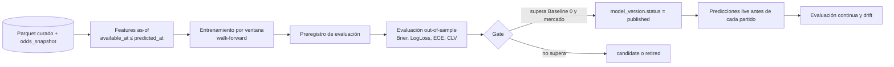

# Arquitectura de predicción

> **Propósito:** cómo se construyen, validan, publican y auditan los modelos de PitchLab.
> **Consumidores:** `services/models`, el job de Baseline 0, Model Lab (22), Prediction Center (21), Backtest (23) y Admin Models (31).
> **Fecha:** 2026-11-08 · Fundamentos en `docs/research/PREDICTION_ENGINE_FINDINGS.md`.

## 1. Pipeline

## 2. Dos tipos de predicción (no mezclarlos nunca)

| `kind` | Qué es | Dónde se usa |
|---|---|---|
| `live` | Registrada **antes** del partido con los datos disponibles en ese momento. Inmutable. | Prediction Center, track record público y CLV del modelo |
| `retro` | Reconstruida después con datos as-of (backtest) | Model Lab (pestaña «backtest») y Backtesting Studio. **Nunca** cuenta como track record. |

La UI rotula cada métrica con su tipo («histórico simulado» frente a «registrado en vivo»).

## 3. Tablas

| Tabla | Columnas clave | Reglas |
|---|---|---|
| `model` | `id` (`nfl-margin-elo`, `baseline0-touchiq-nfl`…), `league_id`, `market_scope[]`, `description`, `owner` | |
| `model_version` | `id`, `model_id`, `semver`, `code_ref` (commit), `params` (jsonb), `features[]`, `train_window`, `status` (`candidate`, `validated`, `published`, `retired`), `published_at?`, `published_by?` | Solo `admin` cambia `status` (queda auditado) |
| `preregistration` | `model_version_id`, `eval_window`, `metrics[]`, `thresholds` (jsonb), `created_at` | Se crea **antes** de evaluar. No se edita. |
| `prediction` | `id`, `model_version_id`, `kind`, `game_id`, `market_key`, `selection`, `line?`, `p`, `projection?` (media y dispersión), `inputs_as_of`, `predicted_at` | **Solo inserción.** Un trigger rechaza `UPDATE` y `DELETE`. Único `(model_version_id, kind, game_id, market_key, selection, line)`. |
| `evaluation` | `model_version_id`, `kind`, `window`, `n`, `brier`, `log_loss`, `ece`, `clv_mean?`, `mae?`, `crps?`, `baseline_ref`, `market_ref`, `created_at` | Una fila por ventana evaluada |

## 4. Modelos por etapa

| Etapa | NFL | Fútbol (Liga MX y Premier League) |
|---|---|---|
| **Baseline 0** (referencia) | `engines-reference` NFL (Pitágoras, Log5 y normal) | `engines-reference` de fútbol (Poisson con Dixon-Coles y parámetros fijos) |
| Candidato 1 | Elo con margen y ajuste de localía estimado | Dixon-Coles con MLE y decaimiento temporal |
| Candidato 2 | Regresión del margen o total con features de eficiencia (nflverse PBP) | Poisson bivariado con covariables |
| Candidato 3 | GBM (LightGBM) sobre features más la línea de apertura | GBM con features de forma |
| Props NFL (W5+) | Distribución empírica con shrinkage o binomial negativa por mercado | — |

**Benchmark de mercado:** probabilidad de consenso sin vig del **cierre aproximado** (`odds_open_close`). Como en la fase $0 el histórico de cuotas propio empieza desde el día 1, el gate frente al mercado se evalúa sobre la ventana con snapshots. El gate frente al Baseline 0 puede usar todo el histórico de nflverse (que incluye líneas de cierre de spread y total en `schedules`; se usan **solo para investigación interna**, y se confirma su licencia antes de mostrarlas).

## 5. Gate de publicación

Un `model_version` pasa a `published` solo si, en la ventana preregistrada:

1. `brier` y `log_loss` son mejores que el Baseline 0, con un bootstrap pareado y un IC del 95 % que excluya el 0.
2. `ece` ≤ 0.03.
3. En la ventana con cuotas: `log_loss` no peor que el mercado sin vig (o se publica explícitamente como «por debajo del mercado» si el fundador decide mostrarlo con esa advertencia).
4. `n` ≥ 200 predicciones (en NFL, ~1 temporada de partidos y mercados).
5. Pasan el test de leakage y la reproducibilidad (`code_ref` más `params` regeneran las métricas).

Hasta que algún modelo pase el gate, Prediction Center muestra metodología y el estado «en validación» (MVP).

## 6. Producción de predicciones `live`

- Job `models-predict-<league>` (Python o Node para el Baseline 0) en GitHub Actions: corre tras la ingesta y antes de la ventana de partidos, y escribe `kind='live'` con `inputs_as_of = max(available_at)` usado.
- Job `models-evaluate`: tras cada jornada, calcula `evaluation` incremental y alerta de drift (ECE móvil > 0.05).

## 7. Qué ve el usuario

- Probabilidad, cuota justa (`1/p`), diferencia frente al consenso sin vig, la hora de la predicción y la versión del modelo.
- Un enlace «¿qué tan bueno es este modelo?» a Model Lab, con la calibración (CalibrationPlot), Brier, log loss y CLV frente al Baseline 0 y al mercado, por temporada.
- **Nunca:** «apuesta», «pick seguro», sizing ni porcentaje de aciertos como métrica principal.
