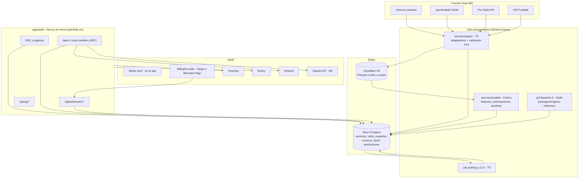

# Arquitectura del sistema

> **Propósito:** la vista completa de cómo encajan las piezas, los límites de los módulos y la API interna.
> **Consumidores:** todos los agentes de código y el owner de F4.
> **Fecha:** 2026-11-08 · Decisiones en `adr/`. Rutas en `ROUTE_MAP.md`.

## 1. Vista general

**Principio:** un monolito modular para la app (un deploy) más jobs especializados para datos y modelos. No hay microservicios ni servicios siempre encendidos aparte de la web.

## 2. Módulos y límites

| Paquete | Responsabilidad | Puede importar | No puede importar |
|---|---|---|---|
| `packages/contracts` | Tipos, esquemas Zod, `href()`, catálogo de eventos, IDs canónicos, `social.ts` (redes) | — (hoja) | Nada interno |
| `packages/tokens` | Tokens de marca → Tailwind `@theme` y TS | — | — |
| `packages/ui` | Primitivas y componentes del DS con sus stories | tokens, contracts (tipos) | db, auth, billing |
| `packages/sports-ui` | Componentes deportivos (TeamBadge, MatchCard, OddsCell…) | ui, tokens, contracts, sports-assets | db |
| `packages/charts` | Gráficas visx/uPlot | ui, tokens, contracts | db |
| `packages/sports-assets` | Registro de emblemas y fallbacks | contracts | — |
| `packages/db` | Esquema Drizzle, migraciones, queries de dominio (repositorios) y seeds demo | contracts | ui |
| `packages/auth` | Config de Better Auth, roles y helpers de sesión | db, contracts | ui |
| `packages/billing` | `BillingProvider`, adaptadores, `can()` y entitlements | db, contracts | ui |
| `packages/social` | Picks, lock, grading, métricas, leaderboard, referidos e invitaciones | db, contracts | ui |
| `packages/engines-reference` | Baseline 0 (motores reconstruidos) | contracts | db |
| `packages/ai` (W5) | Orquestador de PitchLab AI, herramientas y prompts | db (repositorios), billing (`can`), contracts | ui |
| `apps/web` | Rutas, layouts, composición y handlers | todos los paquetes | — |
| `services/ingest` | Adaptadores de proveedor y jobs | db, contracts | ui, apps |
| `services/models` | Python. Solo usa SQL y Parquet. | (contrato = tablas) | — |

Lo hace cumplir ESLint `boundaries` en CI. **Los componentes de UI nunca consultan la DB**: reciben datos tipados por props (`DataState<T>`).

## 3. Flujo de datos de lectura (ejemplo: Game Center)

1. RSC `app/app/[league]/games/[gameId]/page.tsx` valida los params con Zod.
2. Llama a repositorios de `packages/db` (por ejemplo, `getGame`, `getOddsSummary`), que devuelven DTOs de `contracts`.
3. Arma los `DataState<T>` con `source`, `observedAt` y `provenance`.
4. Pasa los datos a componentes de `sports-ui` y `charts`.
5. La interacción del cliente (cambiar de pestaña o de línea) actualiza la URL (nuqs). Los datos adicionales se piden a `/api/v1` con TanStack Query.

## 4. API interna `/api/v1` (BFF)

Todas las rutas validan la entrada con Zod, comprueban `can(user, feature)` y devuelven DTOs de `contracts`. Las de solo lectura cachean con `revalidate` según la frescura de la fuente.

| Recurso | Endpoints | Feature |
|---|---|---|
| Ligas y temporadas | `GET /leagues`, `GET /leagues/:league/seasons` | `sports.core` |
| Partidos | `GET /leagues/:league/games?season&week`, `GET /games/:gameId` | `sports.core` / `game.center` |
| Equipos | `GET /leagues/:league/teams`, `GET /teams/:teamId?season` | `sports.core` |
| Jugadores | `GET /leagues/:league/players?q&team&pos`, `GET /players/:playerId`, `GET /players/:playerId/logs?season&window&split` | `sports.core` / `props.lab` |
| Props | `GET /players/:playerId/props/analysis?market&line&window&split` (hit rate, distribución, IC) | `props.lab` (+ `props.splits.advanced`) |
| Cuotas | `GET /games/:gameId/odds?books`, `GET /games/:gameId/odds/history?market` | `odds.current` / `odds.history` |
| Predicciones | `GET /predictions?league&market`, `GET /models`, `GET /models/:id/evaluations` | `predictions.view` / `models.lab` |
| Búsqueda | `GET /search?q` | `sports.core` |
| Picks | `POST /picks`, `PATCH /picks/:id` (solo antes del lock), `POST /picks/:id/hide`, `GET /me/picks`, `GET /users/:handle/picks` | `social.journal` |
| Social | `GET /leaderboards?league&period`, `POST /follows`, `DELETE /follows/:id`, `POST /reports` | `social.*` |
| Cuenta | `GET/PATCH /me/profile`, `GET /me/entitlements`, `GET/PUT /me/consents`, `POST /me/export`, `POST /me/delete` | sesión |
| Crecimiento | `GET /me/referral`, `POST /referrals/redeem`, `POST /invites/:token/accept` | sesión |
| Billing | `POST /billing/checkout`, `POST /billing/portal`, `POST /billing/cancel` | sesión |
| Watchlists y alertas | `GET/POST/DELETE /watchlists`, `GET/POST/DELETE /alerts` | `alerts` |
| Notificaciones | `GET /notifications`, `POST /notifications/read` | sesión |
| IA (W5) | `POST /ai/chat` (stream) | `ai.queries` |
| Admin | `/admin/*` (rol `admin`/`staff` + 2FA) | rol |

Errores con forma uniforme `{ error: { code, message, details? } }` y códigos estables (`NOT_ENTITLED`, `LOCKED`, `RATE_LIMITED`, `VALIDATION`, `NOT_FOUND`).

## 5. Rendimiento

- Las páginas públicas son SSG/ISR. `/app` es SSR o RSC con streaming y `loading.tsx` con esqueletos del DS.
- Las tablas de más de 200 filas usan virtualización (TanStack Virtual).
- Las agregaciones pesadas (hit rate por ventana, leaderboards) son consultas indexadas o vistas materializadas que refrescan los jobs.
- Presupuesto de JS por ruta (`DEPLOYMENT.md` §5). Ninguna librería de gráficas entra en el bundle inicial de las rutas públicas.
