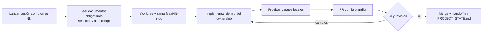

# Plan de ejecución multiagente

> **Propósito:** cómo se ejecutan los prompts en sesiones independientes, en qué orden, qué puede ir en paralelo y cómo se cierra cada sesión.
> **Consumidores:** el fundador (quien lanza las sesiones) y el owner de arquitectura.
> **Fecha:** 2026-11-08 · Waves en `ROADMAP.md`. Ownership en `AGENT_OWNERSHIP.md`. Integración en `INTEGRATION_STRATEGY.md`. Gates en `QUALITY_GATES.md`.

## 1. Ciclo de vida de una sesión



**Lectura obligatoria al iniciar** (todas las sesiones):

1. `docs/PITCHLAB_MASTER_PLAN.md`
2. `docs/execution/PROJECT_STATE.md`
3. El prompt de la sección
4. `docs/architecture/SHARED_CONTRACTS.md`
5. `docs/architecture/FRONTEND_ARCHITECTURE.md`
6. `docs/execution/AGENT_OWNERSHIP.md`
7. `docs/execution/QUALITY_GATES.md`
8. Los documentos específicos que liste el prompt
9. Storybook (componentes existentes)

## 2. Paralelismo por wave

| Wave | Sesiones en paralelo (máximo) | Secuencia obligatoria dentro de la wave |
|---|---:|---|
| W0 | 3: (a) primitivas `ui`, (b) `sports-ui` + `sports-assets`, (c) `charts` | `tokens` y shells primero (un agente). Luego a ∥ b ∥ c. |
| W1 | 4: 01 Landing, 02 Pricing, 35 Help/Legal y la cadena 03 Auth → 04 Onboarding → 38 Growth → 28 Account | Datos (`db` base) y auth antes de 04, 28 y 38 |
| W2 | 3: 07 SportHub (luego 08 y 11b), 12 Game Center (después de 07), 05 Dashboard + 06 Explore + 33 Search | Ingesta de calendario y resultados lista |
| W3 | 3: 13 → 14 → 15, 16 Teams, y modelos (Baseline 0 en jobs) | Ingesta de stats de jugador lista |
| W4 | 3: 17 Odds, 36 Profile y Pick Journal → 25 My Lab → 37 Leaderboards, y datos (snapshots y grading) | Snapshots de cuotas activos |
| W5 | 3: 22 → 21, 20 Replay → 23 Backtest y 24 IA | Un modelo cerca del gate e histórico as-of |
| W6 | 2: 26 Watchlists y 34 Notifications | — |
| W7 | 4: 29, 30, 31 y 32 | — |

Nunca hay más de 4 sesiones de código simultáneas: el cuello de botella es la revisión, no la escritura.

## 3. Sesiones que no son de sección

| Sesión | Cuándo | Qué hace |
|---|---|---|
| Arquitectura | Antes de cada wave y al cerrarla | Contratos que la wave necesita, revisión cruzada de PRs, cierre de wave y actualización de documentos |
| Datos | W1–W4 (continua) | Adaptadores, tablas, migraciones y jobs |
| Modelos | W2+ | Baseline 0 en el pipeline, candidatos, evaluación y gate |
| QA transversal | Al final de cada wave | E2E de los journeys de la wave, revisión visual, accesibilidad y rendimiento. Abre issues, no hace features. |
| Pre-MVP | Cuando lo indique el fundador | `docs/product/PRE_MVP.md` §9 |

## 4. Handoff (sección R de cada prompt)

Al terminar, el agente agrega en `docs/execution/PROJECT_STATE.md` (bajo «Handoffs»):

```markdown
### NN · Sección — YYYY-MM-DD — PR #…
- Hecho: …
- No hecho / fuera de alcance: …
- Contratos, tablas o componentes pedidos a otros owners: …
- Decisiones tomadas (y por qué): …
- Riesgos o deuda: …
- Cómo probarlo: rutas, stories y comandos
```

Un handoff que diga «todo listo» sin la verificación (comandos y capturas) no se acepta.

## 5. Cuándo se generan los prompts (F5)

- El **prompt 00** se genera al cerrar la preparación (F3b) y la decisión de diseño base, porque define la librería que citan los demás.
- Los prompts de **cada wave se generan justo antes de esa wave**, con el código real de las waves anteriores ya en `main` (rutas, componentes y stories existentes). Así ningún prompt describe APIs imaginarias.
- Cada prompt sigue `prompts/_TEMPLATE.md` y pasa `scripts/lint-prompts.mjs` (`QUALITY_GATES.md` §4).
