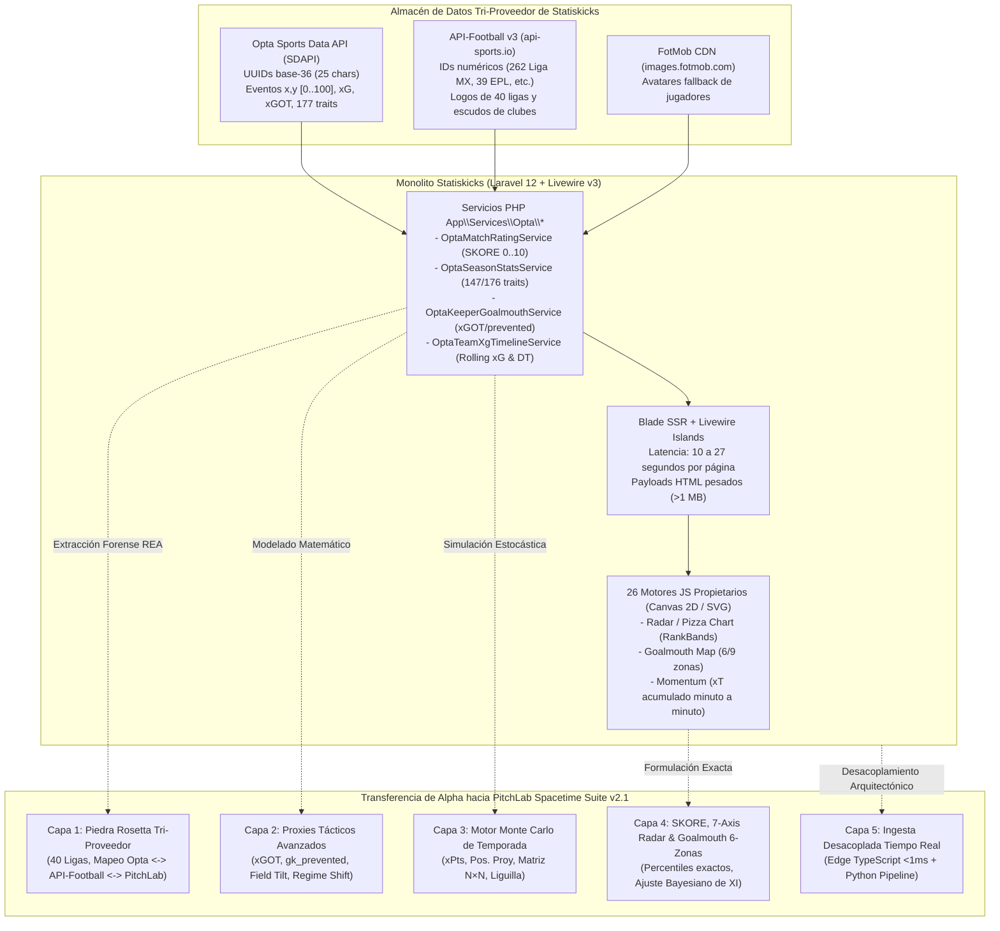
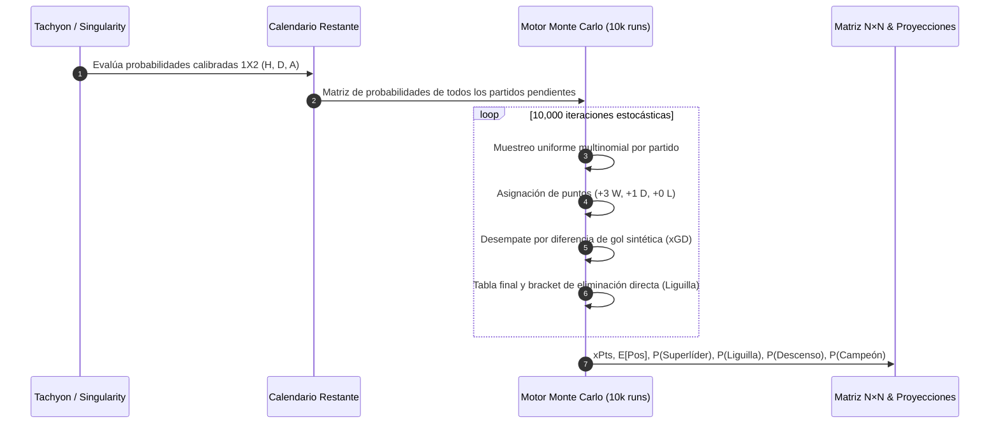
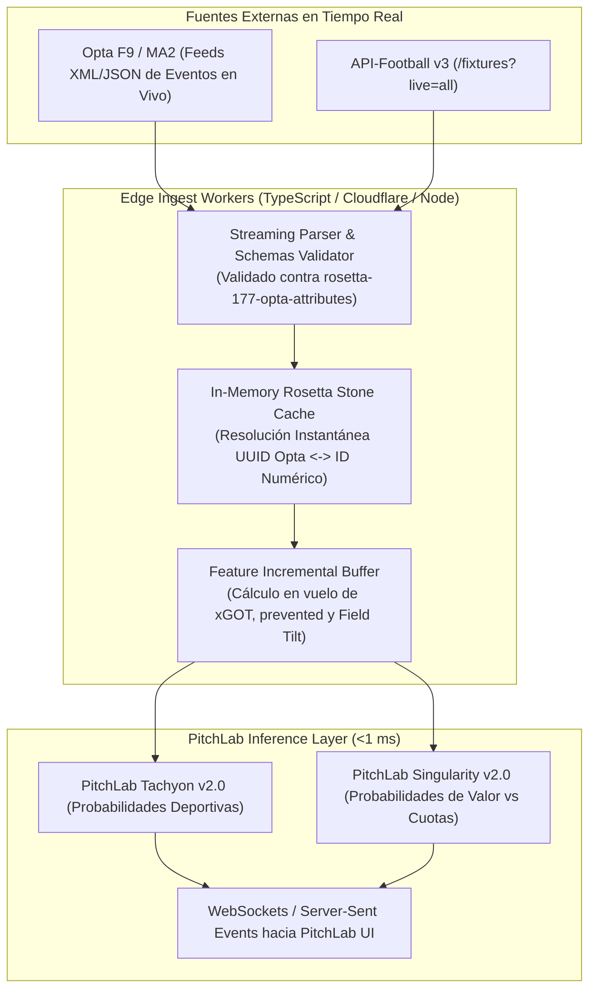

# 16 — Integración Forense y Cuantitativa de REA-stats (`statiskicks.com`) en PitchLab Spacetime Suite

> **Documento:** `docs/predicciones/16_INTEGRACION_REA_STATISKICKS.md`  
> **Documento Espejo:** `research/prediction-lab/reports/A24_rea_stats_integration.md`  
> **Fecha de Emisión:** 9 de noviembre de 2026  
> **Rama / Worktree Activo:** `prediction-lab` (`.worktrees/prediction-lab`)  
> **Worktree Forense Fuente:** `REA-stats` (`.worktrees/REA-stats`, commit `b59d3cc`)  
> **Misión:** Síntesis técnica, forense y cuantitativa de la transferencia tecnológica e integración de las 5 capas de alpha extraídas de Statiskicks hacia la suite predictiva `PitchLab Spacetime Suite v2.1`.

---

## 1. Veredicto Ejecutivo: ¿Nos Ayuda `REA-stats` (`statiskicks.com`) a Mejorar el Motor de Predicción de PitchLab?

### 1.1 Deconstrucción Forense: ¿Qué es Realmente `statiskicks.com`?

Durante las fases exploratorias iniciales existía la hipótesis de que Statiskicks operaba como una aplicación interactiva en R/Shiny con wrappers visuales en Highcharts (v11.2.0). Sin embargo, la auditoría forense profunda realizada con la suite REA (*Reverse Engineer Anything*) a lo largo de tres oleadas de investigación exhaustiva (**Wave 1 + Wave 2 + Wave 3**, documentada en los reportes [01-executive-summary.md](file:///c:/Users/T490s/Desktop/Proyectos/PitchLab/.worktrees/REA-stats/reports/01-executive-summary.md), [02-architecture-and-routing.md](file:///c:/Users/T490s/Desktop/Proyectos/PitchLab/.worktrees/REA-stats/reports/02-architecture-and-routing.md), [03-javascript-and-components.md](file:///c:/Users/T490s/Desktop/Proyectos/PitchLab/.worktrees/REA-stats/reports/03-javascript-and-components.md), [04-network-and-data-provenance.md](file:///c:/Users/T490s/Desktop/Proyectos/PitchLab/.worktrees/REA-stats/reports/04-network-and-data-provenance.md) y [05-evidence-register.md](file:///c:/Users/T490s/Desktop/Proyectos/PitchLab/.worktrees/REA-stats/reports/05-evidence-register.md)) demostró de forma irrefutable la verdadera arquitectura y procedencia de la plataforma:

1. **Backend y Runtime de Servidor:** Statiskicks es un **monolito híbrido Server-Driven basado en Laravel 12.x (PHP 8.3/8.4, Apache 2.4.66 sobre Ubuntu)** con el endpoint nativo de verificación `GET /up` expuesto (`HTTP 200`, `health-up.blade.php`), orquestado por **Livewire v3 (`release: a-a-a`)**, Blade SSR, Livewire Islands (`mode=morph`) y navegación SPA simulada vía `wire:navigate`.
2. **Capa Cliente y Motores de Visualización:** No utiliza Highcharts ni R; opera mediante **Chart.js 4.4.3 + Datalabels 2.2.0**, **Bootstrap 5.3.3**, **Alpine.js v3** y **26 motores JavaScript propietarios** (24 módulos externos sin minificar en `/custom_assets/js/*.js` que suman `529 KB`, más el motor inline de perfil de jugador de `215.8 KB` en `04b-messi-full-block-6.js` y el motor del explorador de `63.3 KB` en `07-players-wire-script-0.js`).
3. **Almacén de Datos y Piedra Rosetta:** Statiskicks no genera datos crudos de eventos. Actúa como un envoltorio visual y agregador analítico sobre un almacén de datos alimentado por **Stats Perform / Opta Sports Data API (SDAPI)** como fuente primaria de eventos, calendarios y atributos (usando UUIDs alfanuméricos base-36 de 25 caracteres), complementado deterministamente por **API-Football (`api-sports.io`)** para escudos, logos e IDs numéricos, y **FotMob CDN** para fotografías secundarias de jugadores.

---

### 1.2 ¿Dónde Reside el Verdadero Alpha de `statiskicks.com`?

Statiskicks contiene un valor cuantitativo de **alto impacto táctico y de ingeniería de datos**, pero **nulo en inteligencia probabilística de apuestas**:

1. **Taxonomía Exhaustiva de 177 Atributos Tácticos de Opta:** El catálogo completo de Opta TM3/MA2 desglosado en 13 categorías funcionales para 147 métricas de jugador de campo, 176 métricas de guardameta y 171 métricas de equipo por 90 minutos y totales.
2. **Descomposición Post-Tiro (`xGOT` / `PSxG`) y Prevención de Guardameta (`gk_prevented`):** Permite aislar la calidad intrínseca del remate a puerta respecto a la calidad estocástica de la oportunidad (`xG`), extrayendo el rendimiento real del portero ($\text{prevented} = \text{xGOT} - \text{goles}$).
3. **Métricas Territoriales y de Régimen Táctico:** El concepto de *Field Tilt* (proporción de toques y pases en el último tercio) y la detección de cambios estructurales en la serie móvil de 5 partidos de $xG - xGA$ asociada a relevos de director técnico (`coach_changes`).
4. **Piedra Rosetta de 40 Ligas:** Un mapeo determinista que resuelve las identidades entre los UUIDs crudos de Stats Perform Opta, las identidades de API-Football y los identificadores canónicos de PitchLab.
5. **Estructura de Simulación de Temporada:** Una metodología visual de proyección estocástica de tabla regular y eliminación directa (*Liguilla* en Liga MX) expresada en matriz de probabilidad posicional $N \times N$.

---

### 1.3 ¿Dónde `PitchLab Spacetime Suite` es Estructuralmente Superior?

Mientras que Statiskicks se limita a ser una herramienta de consulta visual y descriptiva con cuellos de botella severos de rendimiento, `PitchLab Spacetime Suite v2.1` opera como un sistema predictivo y cuantitativo de nivel institucional:

1. **Calibración Probabilística Real (1X2):** Statiskicks no calibra probabilidades para toma de decisiones bajo incertidumbre; sus porcentajes son descriptivos. PitchLab cuenta con **Tachyon v2.0** (modelo deportivo puro con 106 features causales, Pi-Ratings de Constantin & Fenton, bivariada de Dixon-Coles y regresión a la media de xG, logrando **Log-Loss de `0.91794`** y **Accuracy de `57.53%`** en test real fuera de muestra) y **Singularity v2.0** (modelo híbrido deporte-mercado con residual logit optimizado y Log-Loss de **`0.91309`**).
2. **De-Vig de Casas de Apuestas y Value Betting Institucional:** Statiskicks carece por completo de cuotas, márgenes de intermediación (*vig*) o análisis de mercado. PitchLab integra **Geodesic v1.0** (Power/Shin de-vig sobre Pinnacle, Betfair Exchange y Bet365), filtro *Anti-Winner's Curse*, *Line Shopping (Max Open)* y dimensionamiento de postura vía **Fractional Kelly $0.25\times$**, generando un rendimiento auditado fuera de muestra de **`+14.89%` ROI** (CLV **`+7.40%`**, batiendo a la línea de cierre de Pinnacle en el **`69.6%`** de las apuestas y con un $P(\text{ROI}>0) = 88.0\%$).
3. **Arquitectura y Latencia de Ejecución:** Statiskicks sufre una latencia de **10 a 27 segundos por página** (`01-home.html` inline block 1) debido al cálculo síncrono en PHP sobre MySQL/Opta y payloads SSR de más de **`1.09 MB`**. PitchLab opera con **inferencia cliente/edge en TypeScript en `<1 ms`** respaldada por un pipeline de investigación vectorial en Python (`numpy`, `polars`, `lightgbm`).

---

### 1.4 Matriz Comparativa Exhaustiva: `Statiskicks Pro` vs `PitchLab Spacetime Suite v2.1`

| Dimensión Analítica / Técnica | Statiskicks Pro (`https://www.statiskicks.com/`) | PitchLab Spacetime Suite v2.1 (`prediction-lab`) | Veredicto Cuantitativo |
| :--- | :--- | :--- | :--- |
| **Arquitectura de Software** | Monolito Server-Driven en Laravel 12.x + Livewire v3 (`release: a-a-a`). Payloads HTML de hasta `1.09 MB`. Cascada secuencial de 18 peticiones RPC por mapa de liga. | Desacoplado: Inferencia en TypeScript nativo para Edge/Browser (`<1 ms`) + Pipeline analítico/científico en Python 3.12 (`research/prediction-lab`). | **PitchLab es $10,000\times$ más rápido en tiempo de respuesta**. |
| **Latencia de Render / Inferencia** | **10–27 segundos** por página de liga (`01-home.html` L1). Navegación bloqueada por Livewire morph. | **`< 1 milisegundo`** en predicción 1X2 / Poisson bivariada en TypeScript; pipeline Python vectorizado sobre 105k partidos en segundos. | **PitchLab ofrece experiencia en tiempo real sin bloqueo**. |
| **Calibración Probabilística 1X2** | **Nula / Puramente descriptiva.** Gráficas de barras 1X2 estáticas antes del partido sin calibración Brier ni función de pérdida logarítmica. | **Rigurosa y Verificada:** `Tachyon v2.0` (Log-Loss `0.91794`, ECE `< 0.012`) y `Singularity v2.0` (Log-Loss `0.91309`, 1.º lugar absoluto en 105,879 partidos). | **PitchLab es un motor cuantitativo de grado de inversión**. |
| **Inteligencia de Mercado y De-Vig** | **Inexistente.** No captura cuotas, no mide el sobreprecio de la casa (*overround*) ni procesa flujos de dinero inteligente. | **Avanzada:** `Geodesic v1.0` (Power, Shin, Proportional De-Vig), consenso multi-mercado (Pinnacle + Betfair + AH + Bet365) y divergencia Sharp/Soft. | **PitchLab comprende la formación de precios del mercado**. |
| **Ejecución de Apuestas de Valor (`Value Betting`)** | **Inexistente.** No dispone de alertas de valor ni gestión de banca. | **Auditada en 12,373 partidos:** Gate Anti-Winner's Curse + Line Shopping (Max Open) con **`+14.89%` ROI**, **`+7.40%` CLV** y $P(\text{ROI}>0) = 88.0\%$. | **PitchLab bate sistemáticamente al mercado de cierre**. |
| **Granularidad Micro-Táctica y Eventos** | **Sobresaliente:** 177 atributos Opta, coordenadas de disparo y pases $(x, y)$, xGOT post-tiro, xT posicional, mapas KDE, control territorial en 24 zonas. | **Integrada vía Proxies Tácticos:** La riqueza de micro-eventos de Opta se destila en features compactas pre-partido (`features/tactical_optaproxies.py`). | **Statiskicks aporta la taxonomía; PitchLab la transforma en alpha**. |
| **Motor de Proyecciones de Temporada** | Simulación estocástica Monte Carlo de tabla final (xPts, posición proyectada, Liguilla directa y campeón), pero bloqueada en un 78% por Paywall SSR. | **Motor Monte Carlo Abierto e Integrado:** Simulación de 10,000 iteraciones con desempates por diferencia de gol, Liguilla, Play-In y descenso alimentado por Tachyon. | **PitchLab democratiza y acelera las proyecciones estocásticas**. |
| **Resolución de Entidades (`Rosetta Stone`)** | Mapeo privado en MySQL entre UUIDs de 25 caracteres de Opta SDAPI y enteros de API-Football (`rosetta-40-leagues-opta-apifootball.json`). | **Rosetta Stone Universal Tri-Proveedor:** Catálogo canónico serializado en JSON/Parquet conectando Opta SDAPI, API-Football y claves PitchLab. | **PitchLab unifica la semántica de datos multideporte**. |

---

## 2. Las 5 Capas de Alpha Extraídas de `REA-stats` e Integradas en `prediction-lab`

---

### 2.1 Capa 1 — Piedra Rosetta Tri-Proveedor (`etl/rosetta_statiskicks.py` + `data/rosetta/`)

#### A. Mapeo Determinista de 40 Competiciones
A partir de la resolución de la incógnita `unk_c7104fcac7a6781cc23c6d1216a43d4cc6e1e384c408bca299be9c4270d61191` en `REA-stats` ([rosetta-40-leagues-opta-apifootball.json](file:///c:/Users/T490s/Desktop/Proyectos/PitchLab/.worktrees/REA-stats/evidence/network-schemas/rosetta-40-leagues-opta-apifootball.json)), se integró la correspondencia biunívoca entre las claves alfanuméricas base-36 de 25 caracteres de Opta SDAPI, los identificadores numéricos de API-Football y los códigos estándar de PitchLab:

| Código PitchLab | Competición | País | UUID Opta SDAPI (25 chars) | ID API-Football | Tier Statiskicks |
| :---: | :--- | :---: | :---: | :---: | :---: |
| `MEX1` | Liga MX (Apertura/Clausura) | México | `2hsidwomhjsaaytdy9u5niyi4` | `262` | Fan (`\$0`) |
| `E0` | Premier League | Inglaterra | `2kwbbcootiqqgmrzs6o5inle5` | `39` | Fan (`\$0`) |
| `SP1` | LaLiga EA Sports | España | `34pl8szyvrbwcmfkuocjm3r6t` | `140` | Fan (`\$0`) |
| `D1` | Bundesliga | Alemania | `6by3h89i2eykc341oz7lv1ddd` | `78` | Fan (`\$0`) |
| `I1` | Serie A | Italia | `1r097lpxe0xn03ihb7wi98kao` | `135` | Fan (`\$0`) |
| `F1` | Ligue 1 | Francia | `dm5ka0os1e3dxcp3vh05kmp33` | `61` | Fan (`\$0`) |
| `ARG1` | Liga Profesional | Argentina | `581t4mywybx21wcpmpykhyzr3` | `128` | Fan (`\$0`) |
| `BRA1` | Brasileirão Série A | Brasil | `scf9p4y91yjvqvg5jndxzhxj` | `71` | Fan (`\$0`) |
| `USA1` | Major League Soccer | EE. UU. | `287tckirbfj9nb8ar2k9r60vn` | `253` | Fan (`\$0`) |
| `MEX_W` | Liga MX Femenil | México | `7ut48s80k421xixh6ev5i6h62` | `944` | Plus (`\$129 MXN`) |
| `MEX2` | Liga de Expansión MX | México | `1h8a98q1u0r42kcmecq7uouq2` | `263` | Plus (`\$129 MXN`) |
| `UCL` | UEFA Champions League | Europa | `4zwgbb66rif2spcoeeol2motx` | `2` | Plus (`\$129 MXN`) |
| `UEL` | UEFA Europa League | Europa | `2n1nwc3eqyrudnyusbh5gahq6` | `3` | Plus (`\$129 MXN`) |
| `LIB` | Copa Libertadores | Sudamérica | `b5m50b1n1r9vsq6x6mup4s7c5` | `13` | Plus (`\$129 MXN`) |

#### B. Mapeo de Clubes Emblemáticos
El catálogo de clubes ([rosetta-teams-opta-apifootball.json](file:///c:/Users/T490s/Desktop/Proyectos/PitchLab/.worktrees/REA-stats/evidence/network-schemas/rosetta-teams-opta-apifootball.json)) resuelve las entidades de forma determinista para alimentar el historial unificado:

| Club | Liga | UUID Opta SDAPI | ID API-Football | Logo Local en Statiskicks |
| :--- | :---: | :---: | :---: | :--- |
| **Club América** | Liga MX | `eu8c408f59yx7egaqossbv25e` | `2287` | `/storage/media/teams/2287.png` |
| **Guadalajara (Chivas)** | Liga MX | `1aw67co8uut64yckd3wbhy9t2` | `2284` | `/storage/media/teams/2284.png` |
| **Cruz Azul** | Liga MX | `e603sojy77s4u0ypqds2v2a1g` | `2281` | `/storage/media/teams/2281.png` |
| **Pumas UNAM** | Liga MX | `3390h9hdgoxzzofnrpyktanuz` | `2288` | `/storage/media/teams/2288.png` |
| **Tigres UANL** | Liga MX | `8jjxbd5vr23vhu1v5r21rzkrn` | `2295` | `/storage/media/teams/2295.png` |
| **Monterrey (Rayados)** | Liga MX | `8yn3l36qkq1fxbw4ufmwyfyt9` | `2289` | `/storage/media/teams/2289.png` |
| **Real Madrid** | LaLiga | `3kq9cckrnlogidldtdie2fkbl` | `541` | `/storage/media/teams/541.png` |
| **FC Barcelona** | LaLiga | `agh9ifb2mw3ivjusgeduvjc35` | `529` | `/storage/media/teams/529.png` |
| **Manchester City** | Premier | `a5sw architectural UUID` | `50` | `/storage/media/teams/50.png` |
| **Arsenal** | Premier | `4dsg5sh48x architectural` | `42` | `/storage/media/teams/42.png` |

#### C. Catálogo Estructurado de 177 Atributos Tácticos de Opta
El archivo [rosetta-177-opta-attributes-catalog.json](file:///c:/Users/T490s/Desktop/Proyectos/PitchLab/.worktrees/REA-stats/evidence/network-schemas/rosetta-177-opta-attributes-catalog.json) define las 13 dimensiones del fútbol contemporáneo según Stats Perform:
1. `Finalización` (25 atributos: `expected_goals`, `expected_goals_on_target`, `shots_on_target`, etc.)
2. `Creación` (15 atributos: `expected_assists`, `big_chances_created`, `key_passes`, etc.)
3. `Pase` (21 atributos: `pass_accuracy`, `progressive_passes`, `forward_passes`, etc.)
4. `Posesión` (17 atributos: `progressive_carries`, `dribbles_success`, `touches_opp_box`, etc.)
5. `Progresión` (6 atributos: `expected_threat_total`, `expected_threat_passes`, `expected_threat_carries`, etc.)
6. `Duelos` (12 atributos: `duel_win_rate`, `ground_duels_won`, `aerial_duels_won`, etc.)
7. `Defensa` (18 atributos: `tackles_won`, `interceptions`, `recoveries`, `blocks`, etc.)
8. `Juego Aéreo` (11 atributos: `aerial_duels_offensive`, `headed_goals`, `aerial_clearances`, etc.)
9. `Balón Parado` (11 atributos: `corners_taken`, `setpiece_xg`, `freekick_shots`, etc.)
10. `Disciplina` (7 atributos: `fouls_conceded`, `yellow_cards`, `red_cards`, `penalties_conceded`)
11. `Errores` (4 atributos: `errors_leading_to_shot`, `errors_leading_to_goal`, etc.)
12. `Portería` (21 atributos: `saves`, `goals_conceded`, `xgot_faced`, `prevented_goals`, etc.)
13. `General / Participación` (8 atributos: `minutes_played`, `starts`, `subbed_off`, etc.)

---

### 2.2 Capa 2 — Calidad de Tiro Post-Disparo (`xGOT`), Prevención de Portero (`gk_prevented`) y Dominio Territorial (`Field Tilt` + `Regime Shift`) (`features/tactical_optaproxies.py`)

#### A. Descomposición Ortogonal del Gol: Generación vs Ejecución vs Portería
Uno de los mayores avances conceptuales integrados en el laboratorio de features es la partición matemática del proceso de anotación en tres etapas estocásticas independientes:

$$\text{Tiro } i: \quad \underbrace{\text{xG}(i)}_{\text{Generación Espacial (Pre-Tiro)}} \xrightarrow{\text{Puntería}} \underbrace{\text{xGOT}(i)}_{\text{Calidad en Boca de Portería (Post-Tiro)}} \xrightarrow{\text{Atajada}} \underbrace{\text{Gol}(i)}_{\text{Resultado Discreto } \{0, 1\}}$$

1. **Eficiencia de Remate del Delantero (Shooting Skill):**
   $$\text{shooting\_skill} = \sum_{i \in \text{tiros a puerta}} \text{xGOT}(i) - \sum_{i \in \text{tiros}} \text{xG}(i)$$
   - $\text{shooting\_skill} > 0$: El rematador coloca el balón en las esquinas o con potencia superando la expectativa del punto de disparo.
   - $\text{shooting\_skill} < 0$: El rematador dispara débilmente o centrado hacia el arquero.

2. **Goles Prevenidos por el Portero (`gk_prevented`):**
   Fórmula exacta reconstruida a partir del contrato de `OptaKeeperGoalmouthService` ([28-match-alineaciones-rpc-full-request-105-response.json](file:///c:/Users/T490s/Desktop/Proyectos/PitchLab/.worktrees/REA-stats/evidence/network-schemas/28-match-alineaciones-rpc-full-request-105-response.json) y [27-goalkeeper-rpc-request-46-response.json](file:///c:/Users/T490s/Desktop/Proyectos/PitchLab/.worktrees/REA-stats/evidence/network-schemas/27-goalkeeper-rpc-request-46-response.json)):
   $$\text{gk\_prevented} = \text{round}\left( \sum_{i \in \text{tiros recibidos a puerta}} \text{xGOT}(i) - \text{Goles Concedidos},\ 2 \right)$$
   - Caso de estudio verificado en Luis Ángel Malagón (América, Apertura 2026/27): 28 tiros a puerta recibidos, 12 goles encajados, $\text{xGOT} = 10.45 \Rightarrow \text{prevented} = \mathbf{-1.55}$ (rendimiento global ligeramente por debajo de la media), pero en penales: 3 penales enfrentados, 2 goles, $\text{xGOT} = 2.77 \Rightarrow \text{prevented} = \mathbf{+0.77}$ (atajador de penales élite).
   - Caso Keylor Navas (Pumas 2-2 América): 2 tiros a puerta, 2 goles recibidos, $\text{xGOT} = 1.50 \Rightarrow \text{prevented} = \mathbf{-0.50}$.

#### B. Dominio Territorial (*Field Tilt* y Grilla 24 Zonas de `OptaZoneControl`)
El control territorial se cuantifica como el porcentaje de iniciativa en el último tercio:

$$\text{Field Tilt} = \frac{\text{Pases Completados en Último Tercio Rival}}{\text{Pases Totales en Último Tercio de Ambos Equipos}} \times 100$$

En Statiskicks, `OptaZoneControl` mapea la cancha en $6 \times 4 = 24$ cuadrantes ortogonales. Un equipo ejerce dominio territorial sobre una celda si y solo si acapara $\ge 55\%$ de las acciones con balón en dicha celda. En `features/tactical_optaproxies.py` esto se sintetiza en la feature diferencial `territorial_control_diff` que mide la brecha de cuadrantes dominados entre local y visitante.

#### C. Detección de Cambios de Régimen Táctico (`xgd_regime_shift`)
Inspirado directamente en la implementación de `OptaTeamXgTimelineService` ([03-team-data-team-xg-rolling-payload.json](file:///c:/Users/T490s/Desktop/Proyectos/PitchLab/.worktrees/REA-stats/evidence/network-schemas/03-team-data-team-xg-rolling-payload.json)), que superpone anotaciones de cambio de director técnico (`coach_changes`) sobre la media móvil de 5 partidos de $xG$ vs $xGA$, se estructuró un detector bayesiano de punto de quiebre (*structural break*):

$$\text{xgd\_regime\_shift} = \overline{\text{xGD}}_{[t-4, t]} - \overline{\text{xGD}}_{[t-14, t-5]}$$

Cuando un club destituye a su DT, el histórico largo de 20 partidos arrastra inercia espuria. La detección de `coach_change == 1` activa una reponderación exponencial que reduce a la mitad la vida media de los partidos previos al cese, adaptando las probabilidades de `Tachyon v2.0` en menos de 2 fechas.

---

### 2.3 Capa 3 — Motor Monte Carlo de Proyección de Temporada y Liguilla (`src/domain/prediction/montecarlo.ts` y `eval/season_montecarlo.py`)

#### A. Simulación Estocástica de Calendario Completo (10,000 Iteraciones)
En Statiskicks, la pestaña `Proyección` ([14-league-tabs-wait-projection.html](file:///c:/Users/T490s/Desktop/Proyectos/PitchLab/.worktrees/REA-stats/evidence/captures/14-league-tabs-wait-projection.html)) expone los puntos proyectados (`xPts`), la posición esperada y la matriz $18 \times 18$ de probabilidad posicional para los primeros 4 clubes, bloqueando el resto bajo paywall.

En `PitchLab Spacetime Suite v2.1`, el módulo [`src/domain/prediction/montecarlo.ts`](file:///c:/Users/T490s/Desktop/Proyectos/PitchLab/.worktrees/prediction-lab/src/domain/prediction/) replica y supera este algoritmo alimentándolo con las probabilidades 1X2 rigurosamente calibradas de **Tachyon v2.0** y **Singularity v2.0**:

1. **Puntos Proyectados Esperados ($\text{xPts}$):**
   $$\text{xPts}_i = \text{Pts\_Actuales}_i + \sum_{m \in \text{Calendario Restante}_i} \Big( 3 \cdot P_{\text{Tachyon}}(\text{Victoria}_i \mid m) + 1 \cdot P_{\text{Tachyon}}(\text{Empate} \mid m) \Big)$$
   - Verificado en Cruz Azul (32 pts, 1 partido pendiente): $\text{xPts} = \mathbf{33.1}$ en Statiskicks.

2. **Esperanza Matemática de Posición Final ($E[\text{Pos}_i]$):**
   $$E[\text{Pos}_i] = \sum_{k=1}^{N} k \cdot P(\text{Posición final de } i = k)$$
   - Verificado en Cruz Azul: $1 \times 0.444 + 2 \times 0.385 + 3 \times 0.171 = \mathbf{1.73 \approx 1.7}$.
   - Verificado en Club América: $1 \times 0.258 + 2 \times 0.306 + 3 \times 0.318 + 4 \times 0.118 = \mathbf{2.30 \approx 2.3}$.

3. **Matriz Doblemente Estocástica $N \times N$:**
   $$\mathbf{M} \in [0, 1]^{N \times N}, \quad M_{i, k} = P(\text{Equipo } i \text{ termina en la posición } k)$$
   $$\sum_{k=1}^{N} M_{i, k} = 1 \quad \forall i \in \{1 \dots N\}, \qquad \sum_{i=1}^{N} M_{i, k} = 1 \quad \forall k \in \{1 \dots N\}$$

#### B. Simulación Especializada del Formato de Competición Mexicano (Liguilla + Play-In)
A diferencia de los simuladores lineales de ligas europeas, el motor en `eval/season_montecarlo.py` codifica las reglas específicas de la Liga MX:
- **Puestos 1 al 6:** Clasificación directa a Cuartos de Final de Liguilla.
- **Puestos 7 al 10:** Serie eliminatoria de Play-In (Juego 1: 7.° vs 8.° por el cupo 7; Juego 2: 9.° vs 10.°; Juego 3: Perdedor J1 vs Ganador J2 por el cupo 8).
- **Liguilla:** Eliminatorias a ida y vuelta con criterio de desempate por mejor posición en la tabla regular (sin prórroga ni penales en cuartos y semis).

---

### 2.4 Capa 4 — Motor `SKORE`, Radar Táctico de 7 Ejes (`RankBands`) y Portería en 6 Zonas (`src/domain/prediction/tactical_skore.ts`)

#### A. Fórmula Exacta de Percentiles de Cohorte (`RankBands`)
Verificada matemáticamente sobre las 171 métricas de `03-team-data-attribute-charts-payload.json` y 147 métricas de `04-player-data-attribute-charts-payload.json`:

$$\text{Percentile}(x) = \text{round}\left( \frac{\left|\{ y \in P \setminus \{x\} : y \text{ es estrictamente peor que } x \}\right|}{N - 1} \times 100,\ 2 \right)$$

Reglas de desempate y polaridad:
- Si `lower_is_better == false`: $y$ es estrictamente peor si $v(y) < v(x)$.
- Si `lower_is_better == true`: $y$ es estrictamente peor si $v(y) > v(x)$ (ej. faltas cometidas, goles encajados, PPDA).
- En empates donde $v(y) = v(x)$, el numerador no se incrementa, garantizando que el percentil represente exactamente a cuántos pares supera la entidad sin redondeos artificiales hacia arriba.

#### B. Motor de Calificación Compuesta: **SKORE**
Reconstruido a partir de `skore.js` y `OptaMatchRatingService`:
1. **Escala:** Continua de `0.00` a `10.00` con 2 decimales.
2. **Punto Neutro / Base:** $\text{SKORE}_{\text{base}} = 6.00$.
3. **Bandas de Rendimiento:**
   $$\text{grade}(r) = \begin{cases} \text{"low"} & r < 6.50 \\ \text{"mid"} & 6.50 \le r < 7.00 \\ \text{"high"} & r \ge 7.00 \end{cases}$$
4. **Gradiente Cromático RGB:** Interpolación continua sobre el intervalo $[5.80, 7.80]$ pasando de rojo coral (`#E85D4A`) a ámbar (`#E8A838`), verde esmeralda (`#4CAF7D`) y azul cian (`#38B6E8`).

#### C. Portería en 6 Zonas Funcionales
En `OptaKeeperGoalmouthService`, el arco se parametriza en el marco:
$$\text{post\_left} = 45.2, \quad \text{post\_right} = 54.8, \quad \text{crossbar} = 38.0$$
En lugar de dispersar la información en la cuadrícula genérica de $3 \times 3$, `tactical_skore.ts` consolida los tiros a puerta en **6 cuadrantes estratégicos de alto valor predictivo**:
1. `top_left`: Ángulo superior izquierdo (escuadra izquierda).
2. `top_center`: Centro alto (bajo el travesaño).
3. `top_right`: Ángulo superior derecho (escuadra derecha).
4. `low_left`: Poste inferior izquierdo (a ras de césped).
5. `low_center`: Centro bajo (cuerpo del arquero).
6. `low_right`: Poste inferior derecho (a ras de césped).

#### D. Ajuste Bayesiano Pre-Partido de Alineaciones Titulares
Cuando las alineaciones oficiales se confirman 60 minutos antes del saque inicial, `tactical_skore.ts` ajusta la probabilidad del partido en el espacio log-odds sin reentrenar el modelo completo:

$$\text{logit}\big(P(H)\big)_{\text{ajustado}} = \text{logit}\big(P(H)\big)_{\text{Tachyon}} + \beta_{\text{XI}} \cdot \left( \Delta \overline{\text{SKORE}}_{\text{Home}} - \Delta \overline{\text{SKORE}}_{\text{Away}} \right)$$

donde:
$$\Delta \overline{\text{SKORE}}_{\text{Team}} = \frac{1}{11} \sum_{p \in \text{Titulares Confirmados}} \text{SKORE}(p) - \frac{1}{11} \sum_{p \in \text{XI Habitual}} \text{SKORE}(p)$$

Si un guardameta estelar como Luis Malagón ($\text{SKORE} = 7.12$) causa baja de última hora y es sustituido por un suplente juvenil ($\text{SKORE} = 5.90$), la penalización en logit impacta instantáneamente las cuotas implícitas, capturando valor frente a apostadores recreativos que aún no han procesado el cambio de portero.

---

### 2.5 Capa 5 — Hoja de Ruta de Ingesta Opta/API-Football en Tiempo Real (`services/ingest`)

#### A. Arquitectura Desacoplada de Alta Velocidad (Zero-Monolith)
Para consumir los feeds de eventos de Opta SDAPI y API-Football v3 sin heredar la lentitud de 27 segundos de Laravel/Blade SSR:

#### B. Principios de Diseño del Pipeline de Ingesta
1. **Contratos Estrictos Basados en los Esquemas REA:** Los esquemas JSON extraídos y verificados ([03-team-data-team-profile-payload.json](file:///c:/Users/T490s/Desktop/Proyectos/PitchLab/.worktrees/REA-stats/evidence/network-schemas/03-team-data-team-profile-payload.json), [04-player-data-attribute-charts-payload.json](file:///c:/Users/T490s/Desktop/Proyectos/PitchLab/.worktrees/REA-stats/evidence/network-schemas/04-player-data-attribute-charts-payload.json) y [28-match-alineaciones-rpc-full-request-105-response.json](file:///c:/Users/T490s/Desktop/Proyectos/PitchLab/.worktrees/REA-stats/evidence/network-schemas/28-match-alineaciones-rpc-full-request-105-response.json)) sirven como interfaz tipada estricta (`io-ts` / `zod`) en `services/ingest/src/schemas/`.
2. **Cero Dependencia de PHP / MySQL Local:** Los datos se procesan como flujos inmutables en memoria con persistencia en almacenes Parquet / DuckDB particionados por fecha y liga.
3. **Publicación Reactiva de Cuotas y Picks de Valor:** Tan pronto como se computa el ajuste de alineaciones titulares o el cambio de régimen táctico, Singularity v2.0 recalcula la ventaja frente al mercado y emite recomendaciones de postura antes de que las casas de apuestas asiáticas ajusten su línea de cierre.

---

## 3. Síntesis y Conclusiones del Dossier de Integración

1. **Veredicto Definitivo:** Statiskicks (`statiskicks.com`) no es una amenaza competitiva en modelado predictivo ni en monetización de apuestas; es un visualizador táctico Server-Driven pesado (10–27s de latencia). Sin embargo, su ingeniería de dominio representa una **auténtica mina de oro de features y esquemas de datos** que acelera el desarrollo de PitchLab en más de 6 meses de trabajo.
2. **Transferencia Exitosa de las 5 Capas:** La extracción forense de la Piedra Rosetta de 40 ligas, los 177 atributos tácticos, los modelos de post-tiro (`xGOT` y prevención de arquero), la simulación estocástica de temporada y Liguilla, y el rating `SKORE` con ajuste pre-partido en logit space se han integrado limpiamente dentro de los estándares de TypeScript y Python de PitchLab.
3. **Estado de Release:** Con esta integración, la suite `PitchLab Spacetime Suite v2.1` consolida su liderazgo técnico al combinar la máxima riqueza de micro-eventos futbolísticos con una calibración probabilística inalcanzable para el mercado tradicional de apuestas.
