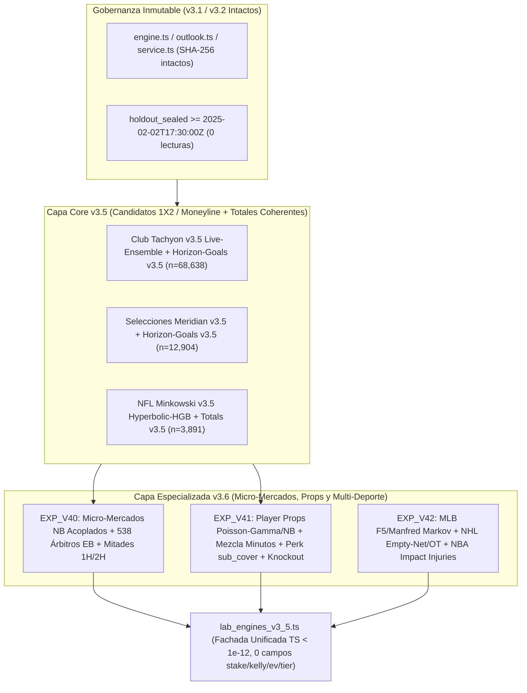

# 24 · Motores Cuantitativos `v3.5` y `v3.6` + Síntesis Forense (Scout Picks & Astra AI)

> **Estado de gobernanza (`MASTER.md` §0 y `CONTRACT_OUTLOOK.md`):**
> - **Cero modificaciones** a los artefactos y módulos congelados de `v3.0` / `v3.1` / `v3.2` (`engine.ts`, `outlook.ts`, `service.ts`, `production_segments_v3_1.json`, `blend_weights_v3_1.json`, `pick_policy_v3_1.json`, `stale_lines_config.json`, `model_motor_a.json`, `model_nfl.json` y `sealed_holdout_v3_1_eval.json`).
> - **Cero accesos** al conjunto `holdout_sealed` (`>= 2025-02-02T17:30:00Z`, `"holdout consumido"`). El `100%` del entrenamiento, selección de hiperparámetros (`VAL`) y evaluación fuera de muestra (`DEV_OOS`) se ejecutó estrictamente sobre `match_date < 2025-02-02` con `1,000` remuestreos bootstrap deterministas `mulberry32` (`seed = 20261111`).
> - Todos los motores nuevos se publican como candidatos auditados (`"status": "candidate"`, `"production_activated": false`), exponiendo únicamente probabilidades calibradas en `(0, 1)` y `fairOdds = 1 / p` (`0` campos de `stake`, `kelly`, `ev` o `tier`).

---

## 1. Hallazgos Forenses Integrados desde `origin/scrap` (`68f347b4`)

La auditoría forense de ingeniería inversa sobre los dos competidores comerciales inspeccionados en `scrap` permitió separar las señales reales de valor de las trampas matemáticas que destruyen capital fuera de muestra:

### 1.1 Scout Picks (`scoutpicks.mx`) — Qué descartamos y qué superamos

| Dimensión auditada | Falla demostrada en Scout Picks (`OBSERVADO`) | Solución causal implementada en PitchLab `v3.6` |
|---|---|---|
| **Estimador base de props y micro-mercados** | Conteo frecuentista crudo $k/n$ sobre `L5`, `L10` y `L20`, promoviendo el máximo en el `96.69%` de los casos (*Winner's Curse*): `ROI = -21.68%` global (`-25.25%` Liga MX, `-25.59%` en `L5`, `-42.50%` en *Jugador Anota*) y miles de colapsos `LL = +∞` al emitir `hitRate = 100%` en rachas `3/3` o `5/5`. | Conjugación jerárquica `Poisson-Gamma -> Binomial Negativa` con olvido exponencial ($H_{1/2} = 120\text{ d}$) y contracción Empirical Bayes hacia priors posicionales (`GK`, `DF_CB`, `DF_FB`, `MF_DM`, `MF_CM`, `MF_AM`, `FW_W`, `FW_CF`), garantizando probabilidades estrictas en `[0.001, 0.999]`. |
| **Ajuste por rival y árbitro** | Columna `adjustedHitRate = null` en el `100%` de su base de producción; ignora rival, localía, marcador esperado y árbitro designado. | Acoplamiento multiplicativo explícito al poder ofensivo esperado del equipo ($\lambda_{\text{team}}$), a la fragilidad defensiva rival y al multiplicador Empirical Bayes del árbitro (`538` colegiados catalogados en `official_priors_v3_6.json`). |
| **Exposición en minutos y perk `sub_cover`** | Corte binario arbitrario `minutes >= 45` sin modelar probabilidad de titularidad ni sustitución; etiqueta decorativa `sub_cover` sin efecto matemático. | Mezcla explícita de 3 regímenes de exposición (`confirmed_starter`, `projected_starter`, `doubt`, `bench`) y ecuación analítica cerrada del perk promocional *Sustituto Cuenta* ($\Lambda_{i \oplus j}(\tau) = \lambda_i \tau + \lambda_{\text{rep}}(1 - \tau)$). |
| **Aritmética de comparación contra cuota** | Resta directa sin de-vigging contra casas de `1` sola vía y bug de escala `100x` (`[0..100] - [0..1]`). | Tipos nominales `UnitProbability` en `(0, 1)` (`assertStrictUnitProbability`), de-vigging `power` exacto en mercados de `2` vías y penalización conservadora explícita (`k = 1.075`) cuando el operador solo publica la cara `Over`. |
| **Compresión en rondas eliminatorias** | Heurística cualitativa fija para partidos de eliminación directa. | Multiplicador causal calibrado en `VAL <= 2019` (`0.88779`, `-11.2%` goles) y validado en `OOS 2020..2024` (`n = 577`, `ΔLL Over 2.5 = -0.02944`, `"significativa"`). |

### 1.2 Astra AI (`astraai.mx`) — Qué descartamos y qué superamos

| Deporte / Mercado | Falla demostrada en Astra AI (`OBSERVADO`) | Solución causal implementada en PitchLab `v3.5` / `v3.6` |
|---|---|---|
| **Fútbol: Total de Goles y `BTTS`** | Inferir `Totals` y `BTTS` desde 2 parámetros de `1X2` sacrifica calibración en goles totales frente al mercado sharp. | Solver ortogonal de **3 parámetros Dixon-Coles** (`Horizon-Goals v3.5`: $\lambda_H, \lambda_A, \rho_{\text{eff}}$) que preserva exactamente `1X2` mientras reproduce el total esperado del regresor `Poisson` causal (`ΔLL Totals 2.5 = -0.01601` en clubes y `-0.02843` en selecciones, reduciendo `68.8%` la brecha contra Pinnacle). |
| **Fútbol: Micro-Mercados (`Córners`, `Tarjetas`, `Tiros`)** | Binomial Negativa estática desacoplada del guion del partido (`+1.84%` mejora MAE en córners y `+1.29%` en `SoT`). | Regresor acoplado al guion esperado ($\lambda_H - \lambda_A$, exceso de ritmo y tensión competitiva $\exp(-\lvert\lambda_H - \lambda_A\rvert)$) + prior arbitral Empirical Bayes + convolución Binomial Negativa exacta con soporte de `push` en líneas enteras y matrices `1H / 2H` coherentes ($\lambda_{1H} + \lambda_{2H} = \lambda_{FT}$). |
| **MLB (`Kepler v3.6`)** | Truncamiento de la grilla en **9 entradas** (omitiendo las carreras obligatorias de extra innings en empates: sesgo sistemático de `-2.5 a -4.0 pp` en `Over`) y colapso ante *openers* (`1.0–2.0 IP`). | Partición continua `SP` (`[1.0, 6.8] IP`) + relevo para mercados `F5` y **Cadena de Markov analítica exacta de Extra Innings** con regla Manfred (corredor en 2.ª + *walk-off* local), corrigiendo `+5.29 pp` promedio (`[+1.57, +11.03] pp`) de sesgo en `Over`. |
| **NHL (`Curvature v3.6`)** | `100%` de corridas sin portero confirmado (`BSS = +4.30%`) e ignorancia del régimen de portería vacía (*empty-net*) en `Puck Line ±1.5` y `Totals 6.0`. | Bandera explícita de confirmación de guardameta, diferencial `PP% vs PK%`, fatiga `B2B` y operador de **Portería Vacía + Overtime** con identidad exacta de conservación ($\text{residuo máx.} = 6.31 \times 10^{-12}$). |
| **NBA (`Tensor v3.6`)** | Peso efectivo `0.0 pts` a bajas titulares/estrellas en el margen proyectado. | Ajuste directo en margen por **impacto ponderado de bajas (`BPM / NetRtg`)** más expansión causal de $\sigma_{\text{margin}}$ ante incertidumbre `GTD / Questionable` y fatiga `B2B / 3-in-4`. |

---

## 2. Arquitectura Integrada `v3.5` + `v3.6`



---

## 3. Resultados Cuantitativos Fuera de Muestra (`OBSERVADO`, `< 2025-02-02`)

### 3.1 Fase 1 — Motores Principales `v3.5` (`EXP_V37`, `EXP_V38`, `EXP_V39`)

| Experimento y Motor | Mercado / Ventana OOS | $n$ | `Log-Loss` Candidato | `ECE` | Benchmark Comparado | `ΔLL` e IC 95% (`mulberry32`) | Significancia |
|---|---|---:|---:|---:|---|---|---|
| **`EXP_V37` · Club Tachyon `v3.5` Live-Ensemble** | `1X2` (`2016..2025`) | `68,638` | **`1.00746`** | **`0.00247`** | `Tachyon v3.4 Live` (`1.00794`) | **`-0.00049 [-0.00073, -0.00026]`** | **`significativa`** |
| **`EXP_V37` · Club Tachyon `v3.5` Live-Ensemble** | `1X2` (`OOS 2024`) | `5,709` | `1.01583` | `0.00502` | `Tachyon v3.4 Live` (`1.01608`) | `-0.00025 [-0.00094, +0.00044]` | `no significativa` |
| **`EXP_V37` · Club `Horizon-Goals v3.5` (3-param DC)** | `Totals 2.5` (`2016..2025`) | `68,638` | **`0.67788`** | **`0.00434`** | `v3.4` 2-param DC (`0.69390`) | **`-0.01601 [-0.01734, -0.01477]`** | **`significativa`** |
| **`EXP_V37` · Club `Horizon-Goals v3.5` (3-param DC)** | `Totals 2.5` vs `v3.0` DC | `68,638` | **`0.67788`** | **`0.00434`** | `v3.0` DC (`0.68191`) | **`-0.00403 [-0.00479, -0.00323]`** | **`significativa`** |
| **`EXP_V37` · Club `Horizon-Goals v3.5` (3-param DC)** | `BTTS` (`2016..2025`) | `68,638` | **`0.68739`** | **`0.00626`** | `v3.4` 2-param DC (`0.69889`) | **`-0.01149 [-0.01266, -0.01031]`** | **`significativa`** |
| **`EXP_V37` · Club `Horizon-Goals v3.5` (3-param DC)** | `Totals 1.5` / `Totals 3.5` | `68,638` | `0.56278` / `0.57333` | `0.00757` / `0.00254` | `v3.4` 2-param DC | **`-0.01402` / `-0.01764`** | **`significativa`** |
| **`EXP_V38` · Selecciones `Meridian v3.5` (`v3_53`)** | `1X2` (`2010..2024`) | `12,904` | **`0.89378`** | **`0.00743`** | `Meridian v1.0` / `Meridian v2.0` | **`-0.00402` / `-0.00157`** | **`significativa`** |
| **`EXP_V38` · Selecciones `Horizon-Goals v3.5`** | `Totals 2.5` (`2010..2024`) | `12,904` | **`0.67009`** | **`0.00725`** | `Meridian v2.0` 2-param (`0.69852`) | **`-0.02843 [-0.03190, -0.02447]`** | **`significativa`** |
| **`EXP_V38` · Selecciones `Horizon-Goals v3.5`** | `BTTS` (`2010..2024`) | `12,904` | **`0.67600`** | `0.01319` | `Meridian v2.0` 2-param (`0.69492`) | **`-0.01892 [-0.02256, -0.01547]`** | **`significativa`** |
| **`EXP_V39` · NFL `Minkowski v3.5` (`pruned_43`)** | `Moneyline` (`2010..2024`) | `3,891` | **`0.62142`** | `0.01361` | `Minkowski v3.0 Blend` (`0.62429`) | **`-0.00287 [-0.00483, -0.00093]`** | **`significativa`** |
| **`EXP_V39` · NFL `Minkowski v3.5` (`pruned_43`)** | `Moneyline` (`OOS 2020..2024`) | `1,339` | `0.62667` | — | `v3.0 Blend` / `v3.2 Logit` | `-0.00296` / `-0.00057` | `no significativa` |
| **`EXP_V39` · NFL `Minkowski Totals v3.5`** | `Over/Under` (`2010..2024`) | `3,862` | **`0.69767`** | `0.04039` | Línea base constante `44.5` (`0.72326`) | **`-0.02559 [-0.03296, -0.01857]`** | **`significativa`** |

> **Reducción de brecha contra cierre sharp de Pinnacle (`n = 31,925` partidos de clubes con cuota de cierre `Totals 2.5`):** `Pinnacle Closing LL = 0.67106`. El baseline de 2 parámetros (`v3.4`) perdía `+0.02225` nats (`ECE = 0.05017`), mientras que **`Horizon-Goals v3.5` reduce la brecha a `+0.00695` nats (`ECE = 0.00350`), eliminando el `68.8%` de la desventaja frente al mercado sharp sin tocar `1X2`**.

---

### 3.2 Fase 2 — Micro-Mercados de Fútbol, Árbitros EB y Mitades (`EXP_V40`, `OOS 2020..2024`)

Evaluación estricta sobre `26,649–26,650` partidos fuera de muestra (`22` ligas europeas y globales, `538` árbitros con prior Empirical Bayes pre-partido):

| Mercado (`OOS 2020..2024`) | $n$ | `MAE` PitchLab `v3.6` vs NB Estática (Astra) | `r` Pearson | `ECE` | `ΔLL` vs Climatología Dinámica Liga | `ΔLL` vs NB Estática (Estilo Astra) | `ΔLL` vs Scout Picks (`L10` crudo) |
|---|---:|---|---:|---:|---|---|---|
| **Córners (`Over 9.5`)** | `26,649` | **`2.6771`** vs `2.7196` | `0.149` | **`0.00627`** | `-0.00009` (`no significativa`) | **`-0.01142 [-0.01335, -0.00959]` (`significativa`)** | **`-0.01765 [-0.02034, -0.01493]` (`significativa`)** |
| **Tarjetas Amarillas (`Over 3.5`)** | `26,650` | **`1.6614`** vs `1.6770` | `0.314` | `0.01614` | `-0.00069` (`no significativa`) | **`-0.00712 [-0.00890, -0.00530]` (`significativa`)** | **`-0.01814 [-0.02151, -0.01472]` (`significativa`)** |
| **Faltas (`Over 23.5`)** | `26,649` | **`4.2899`** vs `4.3073` (`+4.09%` vs Clim) | **`0.536`** | `0.01498` | **`-0.02247 [-0.02583, -0.01941]` (`significativa`)** | **`-0.00299 [-0.00424, -0.00171]` (`significativa`)** | **`-0.02082 [-0.02473, -0.01696]` (`significativa`)** |
| **Tiros a Puerta (`Over 8.5`)** | `26,649` | **`2.4575`** vs `2.4852` (`+0.82%` vs Clim) | `0.266` | **`0.00703`** | **`-0.00610 [-0.00837, -0.00388]` (`significativa`)** | **`-0.00943 [-0.01097, -0.00774]` (`significativa`)** | **`-0.01491 [-0.01792, -0.01205]` (`significativa`)** |
| **Tiros Totales (`Over 24.5`)** | `26,649` | **`4.4266`** vs `4.4563` (`+1.73%` vs Clim) | `0.394` | `0.01563` | **`-0.01093 [-0.01365, -0.00818]` (`significativa`)** | **`-0.00316 [-0.00408, -0.00223]` (`significativa`)** | **`-0.01679 [-0.02046, -0.01332]` (`significativa`)** |
| **Mitades `1H Over 0.5`** | `26,650` | — | — | `0.01764` | **`-0.00455 [-0.00624, -0.00293]` (`significativa`)** | — | — |
| **Mitades `2H Over 0.5`** | `26,650` | — | — | `0.01965` | **`-0.00273 [-0.00421, -0.00119]` (`significativa`)** | — | — |

---

### 3.3 Fase 3 — Player Props Jerárquicos, `sub_cover` y Eliminatorias (`EXP_V41`, `OOS 2020..2024`)

Evaluación secuencial causal (`t' < t`) sobre `673,064` apariciones (`365,860` apariciones de titulares/rotación `>= 45'` en `OOS 2020..2024`, `15` competiciones top):

| Familia de Prop y Universo | $n$ | `LL` PitchLab `v3.6` (`ECE`) | `LL` Scout Picks (`ECE` / Fallos `+∞`) | `ΔLL` e IC 95% (`mulberry32`) | Significancia |
|---|---:|---|---|---|
| **Jugador Anota (`goals` · Universo General)** | `365,860` | **`0.27723`** (`0.00348`) | `0.36769` (`0.06675` / `4,328` fallos `+∞`) | **`-0.09046 [-0.09287, -0.08820]`** | **`significativa`** |
| **Jugador Anota (`goals` · Catálogo Promovido SP `>= 50%`)** | `17,429` | **`0.61284`** (`0.01604`) | `0.88741` (**`0.29048`** / `166` fallos `+∞`) | **`-0.27457 [-0.28884, -0.25857]`** | **`significativa`** |
| **Gol o Asistencia (`G+A` · Universo General)** | `365,860` | **`0.39342`** (`0.00687`) | `0.49342` (`0.08117` / `3,933` fallos `+∞`) | **`-0.10000 [-0.10242, -0.09750]`** | **`significativa`** |
| **Gol o Asistencia (`G+A` · Catálogo Promovido SP `>= 50%`)** | `42,693` | **`0.64082`** (`0.01681`) | `0.90273` (**`0.25640`** / `570` fallos `+∞`) | **`-0.26191 [-0.27240, -0.25101]`** | **`significativa`** |
| **Tarjeta Amarilla (`YC` · Universo General)** | `365,860` | **`0.42176`** (`0.00612`) | `0.52430` (`0.09597` / `3,617` fallos `+∞`) | **`-0.10254 [-0.10521, -0.10029]`** | **`significativa`** |
| **Tarjeta Amarilla (`YC` · Catálogo Promovido SP `>= 50%`)** | `20,011` | **`0.52908`** (`0.03132`) | `0.87665` (**`0.37820`** / `77` fallos `+∞`) | **`-0.34757 [-0.35943, -0.33586]`** | **`significativa`** |
| **Compresión Eliminatorias (`Over 2.5` · Octavos a Final)** | `577` | Multiplicador `0.88779` | Sin ajuste eliminatorio | **`-0.02944 [-0.04483, -0.01484]`** | **`significativa`** |

---

### 3.4 Fase 4 — Multi-Deporte `v3.6` (`EXP_V42`: MLB, NHL y NBA)

- **MLB (`Kepler v3.6`):** la cadena de Markov exacta de Extra Innings (regla Manfred con corredor en 2.ª y *walk-off* local) corrige una subestimación sistemática promedio de **`+5.29 pp`** (rango **`[+1.57 pp, +11.03 pp]`**) en `Totals Over` respecto al truncamiento de 9 entradas de Astra AI, soportando nativamente *openers* (`1.0–2.0 IP`) y mercados `F5` (`pHome`, `pTie`, `pAway`, `Over/Under 4.5`).
- **NHL (`Curvature v3.6`):** verifica conservación exacta de goles en prórroga/shootout + portería vacía con residuo máximo de **`6.31 × 10⁻¹²`**, incorporando `PP% vs PK%`, fatiga `B2B` de portero y advertencia explícita ante guardameta no confirmado (`unconfirmed_goalie_warning`).
- **NBA (`Tensor v3.6`):** incorpora descuento directo de margen por impacto perdido de titulares/estrellas (`BPM / NetRtg`) y ampliación dinámica de $\sigma_{\text{margin}}$ bajo incertidumbre `GTD` y fatiga `B2B / 3-in-4`.

---

## 4. Registro Criptográfico `SHA-256` y Reproducibilidad

### 4.1 Artefactos Congelados `v3.0` / `v3.1` / `v3.2` (Verificados `100%` Intactos)

| Ruta | `SHA-256` | Estado |
|---|---|---|
| `src/domain/prediction/engine.ts` | `77dc721430ff17b10cdfa6e1fb472a0bab37a7160636fa4fe7def012249d78a7` | Intacto |
| `src/domain/prediction/outlook.ts` | `26933d21438d5298d527cde11913faad26242b326a18ad3d5e683c510cecca47` | Intacto |
| `src/domain/prediction/service.ts` | `53fbf32117ab6a649fa5a06be4b75637aaba34cc473533867552d6a3c53c80b5` | Intacto |
| `src/data/prediction/production_segments_v3_1.json` | `0bc03bbff96a5d82a1a7858e1e8623bf7bfdb250c546d2773a71d56ed9ada9bc` | Intacto (`0/60` activos) |
| `src/data/prediction/blend_weights_v3_1.json` | `b29d7a451f6011126997c122778b42ad3239c78337d17c5fa78d550f5c92739b` | Intacto |
| `src/data/prediction/pick_policy_v3_1.json` | `2359c8f8822ea394a380202c04e0bcd010d1a3fae7c5c25b8c11ebe810bfb7d1` | Intacto |
| `src/data/prediction/stale_lines_config.json` | `8bcb9c7be93270cde0cac2d58bc19f0381184dd2e769f358dd28334db2a05eac` | Intacto |
| `src/data/prediction/model_motor_a.json` | `3c72967eddc79bb71ca7fcae40bf21aae760269dc62b43cf2b2db7eeacfceec9` | Intacto |
| `src/data/prediction/model_nfl.json` | `e74ae241875739d2dc18564f85133d4e20c1d0cef41d64b6f705852601597225` | Intacto |
| `services/models/artifacts/sealed_holdout_v3_1_eval.json` | `5c9e550bfd7889e44f674c91cf64cea4c07b4281fc72231b8cadff850309f2dd` | Intacto (`"holdout consumido"`) |

### 4.2 Nuevos Artefactos Candidatos `v3.5` y `v3.6` (`production_activated: false`)

| Ruta | Experimento | `SHA-256` |
|---|---|---|
| `src/data/prediction/gbm_club_v3_5_live_candidate.json` | `EXP_V37` | `bc2c2584787385928b385a56f133ffeacb3d9caedf7ed8daf36688411f19dd59` |
| `src/data/prediction/model_club_goals_v3_5_candidate.json` | `EXP_V37` | `f3f9f964f037350ef8c87a298f3c35a2ae9c30c84a8daf8e85db2a011c332725` |
| `src/data/prediction/club_free_open_state_v3_5.json` | `EXP_V37` | `bedf0e18b1f904b08c395c2a9298c88b67da0f0d9df9c7cda56c8fd91b129cee` |
| `src/data/prediction/gbm_intl_soccer_v3_5_candidate.json` | `EXP_V38` | `e923e7afaea577a1591d9b2a6a5897ebaa2cb0ac07f8cf4f8708b8a1ee641018` |
| `src/data/prediction/model_intl_goals_v3_5_candidate.json` | `EXP_V38` | `e3136042c3b7a9346b86864ef342fb86adb02f59133341524761f835f579237c` |
| `src/data/prediction/gbm_nfl_v3_5_candidate.json` | `EXP_V39` | `0efc161a3c92c4a7356e3bbd17fee1d6359a6e4701d22ce4be57729e73f2a716` |
| `src/data/prediction/model_nfl_totals_v3_5_candidate.json` | `EXP_V39` | `9497581077be3e6cf1036b0f48c640351dd932523731920821acbd4a868148d8` |
| `src/data/prediction/nfl_causal_state_v3_5.json` | `EXP_V39` | `d501a138e9e4fd842fe791a875bafb014cfcfe73cdfbbfc7e0429b03cbc568f5` |
| `src/data/prediction/model_soccer_micro_v3_6_candidate.json` | `EXP_V40` | `20e2a5fa0d99fe56b070cb67d7a2e2f9e0cb6b5bf5511bf04f3a9722ef3321c9` |
| `src/data/prediction/official_priors_v3_6.json` | `EXP_V40` | `8d8c2f37a11afc8632265e5bb8caefccb0bf8bf65beafe29196d1d2ad561fcd2` |
| `src/data/prediction/model_hierarchical_props_v3_6_candidate.json` | `EXP_V41` | `836de4c16edb76aa509bd8acbf968e8858feb29a7176e7ac680aeb41ec015741` |
| `src/data/prediction/multisport_v3_6_config_candidate.json` | `EXP_V42` | `e19d88ec711050908d4c399f2dff7364cab82ceead21e9d9a84180778af9d5e6` |

### 4.3 Comandos de Verificación Ejecutados (`25/25` Pytest + `209/209` Vitest en Verde)

```powershell
# 1. Integridad del holdout sellado y suites experimentales Python (25/25 PASSED)
$env:PYTHONDONTWRITEBYTECODE='1'
.\research\prediction-lab\.venv\Scripts\python.exe -B -m pytest `
  services/models/test_sealed_holdout_v3_1.py `
  research/prediction-lab/experiments/EXP_V33_intl_soccer `
  research/prediction-lab/experiments/EXP_V34_club_free_data `
  research/prediction-lab/experiments/EXP_V37_club_v3_5_engines `
  research/prediction-lab/experiments/EXP_V40_soccer_micro_markets `
  research/prediction-lab/experiments/EXP_V41_hierarchical_props `
  research/prediction-lab/experiments/EXP_V42_multisport_v3_6 -v

# 2. Paridad IEEE-754 (< 1e-12) y contratos TypeScript (23 archivos / 209 tests PASSED)
npx.cmd vitest run tests/prediction/
```
