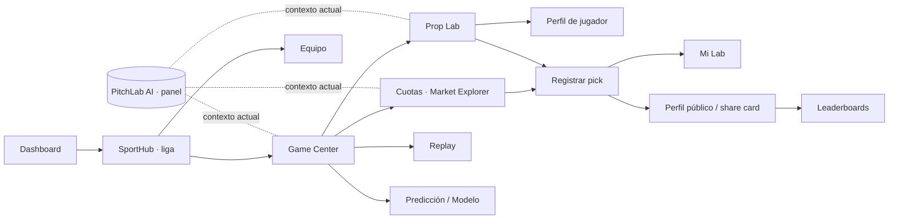

# Arquitectura de información

> **Propósito:** cómo se organiza y navega PitchLab, cómo viaja el contexto entre secciones y qué ve cada plan.
> **Consumidores:** prompt 00 (Shell), agentes de sección y `AUTH_BILLING_GROWTH.md`.
> **Fecha:** 2026-11-08 · Rutas en `docs/architecture/ROUTE_MAP.md`.

## 1. Modelo mental

La navegación se organiza por **tareas**, no por catálogo. La unidad central es el **partido** dentro de una **liga**: casi todo el trabajo empieza o termina en un Game Center.

## 2. Navegación

### Escritorio (≥ 1200 px): sidebar de 232 px (reglas de la marca)

| Grupo | Destinos |
|---|---|
| — | **Inicio** (`/app`) |
| **Deportes** | Selector de liga (NFL, Liga MX, Premier League…) → `/app/[league]` · Explorar (`/app/explore`) |
| **Investigar** | Jugadores · Equipos · Prop Lab (en la liga activa) |
| **Mercados** | Cuotas (`/app/[league]/odds`) |
| **Inteligencia** | Predicciones · Modelos · Backtest · Replay |
| **Comunidad** | Leaderboards · Mi perfil público |
| **Personal** | Mi Lab · Watchlists |

**Header (64 px):** firma horizontal, búsqueda global (⌘K), selector de liga activa, botón de PitchLab AI, notificaciones, indicador de plan o trial y menú de usuario.

### Tablet (768–1199 px)

Rail de 64 px con iconos y etiqueta en el tooltip. Los grupos se abren en un panel.

### Móvil (< 768 px)

Barra inferior de 64 px con 4 destinos más «Más» (regla de la marca):

| Inicio | Partidos (hub de la liga activa) | Investigar (Jugadores, Prop Lab, Equipos) | Mi Lab | Más |
|---|---|---|---|---|

«Más» abre una bottom sheet con Cuotas, Inteligencia, Comunidad, Watchlists, Cuenta y Ayuda. La búsqueda y la IA viven en el header compacto (firma compacta de 124 px).

**Regla:** no hay más de 7 entradas de primer nivel en el sidebar ni más de 5 en la barra móvil. Las secciones nuevas se agregan a un grupo existente.

## 3. Contexto compartido (`SportContext`)

| Campo | Fuente de verdad | Persistencia |
|---|---|---|
| `league` | Segmento de la ruta | URL y preferencia de usuario («liga activa») |
| `season`, `week`/`round` | Query | URL (default: actual) |
| `gameId`, `teamId`, `playerId` | Segmento o query | URL |
| `market`, `line`, `side`, `window`, `split` | Query | URL |
| `books` | Query | URL y preferencia de usuario |
| Filtros avanzados | Query | URL |

Reglas:

1. Todo enlace interno entre secciones **propaga** los parámetros pertinentes (por ejemplo, Game Center → Prop Lab lleva `player`, `market` y `season`). Un helper tipado `href(route, ctx)` en `packages/contracts` lo garantiza.
2. Recargar o compartir una URL reproduce la vista.
3. La IA recibe el `SportContext` serializado de la vista actual.

## 4. Planes y entitlements (provisional; precios en FD-03)

| Feature key | Free | Pro | Elite |
|---|:-:|:-:|:-:|
| `sports.core` (calendario, resultados, posiciones) | ✅ | ✅ | ✅ |
| `game.center` (resumen y stats) | ✅ | ✅ | ✅ |
| `props.lab` | 3 consultas al día, ventana L5/L10 | Ilimitado, todas las ventanas | ✅ |
| `props.splits.advanced` (vs rival, with/without) | — | ✅ | ✅ |
| `odds.current` | Mejor cuota y 2 casas | Todas las casas | ✅ |
| `odds.history` (apertura, cierre y movimiento) | — | Temporada actual | Todo el histórico |
| `predictions.view` | Metodología y 1 partido al día | ✅ | ✅ |
| `models.lab` | Resumen | ✅ | ✅ |
| `backtest.run` | — | — | ✅ |
| `replay` | — | Temporada actual | Todo |
| `ai.queries` | 5 al mes | 150 al mes | 600 al mes (cuotas a recalcular con el costo real) |
| `alerts` | 3 | 50 | 200 |
| `export.csv` | — | — | ✅ |
| `social.journal` / `social.public_profile` | ✅ | ✅ | ✅ |
| `social.leaderboards` | Ver | Ver y aparecer | Ver y aparecer |

- El trial de 7 días otorga Pro (o Elite si así lo concede una `Invite`).
- Las vistas bloqueadas usan el componente `LockedPreview` (motivo y plan que lo desbloquea), nunca un dato falso difuminado.
- **La autorización siempre se evalúa en el servidor** (`can(user, key)`); la UI solo refleja el resultado.
- El Pick Journal y el perfil público son gratis: alimentan la comunidad y el crecimiento.

## 5. Estados globales que el Shell debe expresar

- Plan y trial (días restantes), pago fallido (banner) y modo demo (badge DEMO si hay fixtures).
- Frescura de datos por liga (indicador en el header del hub).
- Liga sin licencia o fuera de cobertura: estado explicativo, no un 404.
