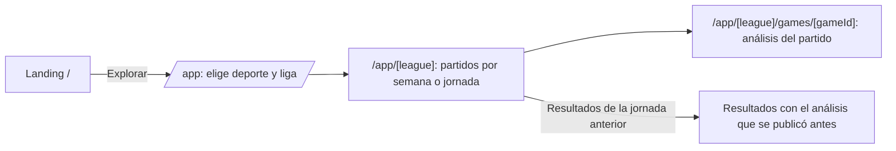

# Pre-MVP: vista para socios (landing + panel de partidos y análisis)

> **Propósito:** poner algo real en pitchlab.mx **para que lo vean los socios** cuanto antes. Solo dos superficies: **landing** y **panel** (deporte → liga → partidos → análisis). No es el MVP ni una fase del producto. Es una vitrina construida sobre un subconjunto de la arquitectura definitiva, para no tirar nada después.
> **Decisión del fundador (2026-11-08):** el pre-MVP tiene su propio plan (este documento) y **no reemplaza ni retrasa el plan robusto**, que sigue su curso (F3b → diseño → F4 → F5 → waves).
> **Consumidores:** fundador, socios y el owner del pre-MVP.
> **Fecha:** 2026-11-08

## 1. Alcance

| Incluye | No incluye (llega después) |
|---|---|
| Landing pública (`/`) con propuesta de valor, ligas disponibles, metodología breve y redes oficiales | Cuentas, login, trial, referidos, pagos |
| Panel `/app`: selector de deporte y liga → partidos por semana o jornada → detalle de análisis por partido | Pick Journal, perfiles, leaderboards |
| Análisis por partido: probabilidades por mercado, cuota justa, marcador o margen proyectado, factores del modelo y frescura | Prop Lab, jugadores, equipos detallados, comparador de cuotas |
| Página de Metodología y Legal mínima (aviso de privacidad, términos y juego responsable) | IA, alertas, notificaciones, backtest, Replay |
| Registro de cada análisis publicado (inicio del historial `live`) | Admin (la operación es por GitHub Actions) |

**Acceso:** sin cuentas. `noindex` en todo el sitio (no aparece en buscadores mientras sea pre-MVP). La landing es abierta. El panel requiere el **código de socio** (FD-17): pantalla de login con «Entrar a la beta» y teclado de PIN; el código se valida en el servidor (variable `PREVIEW_ACCESS_CODE`, cookie HttpOnly firmada, máximo 5 intentos y bloqueo de 30 s). Login y crear cuenta aparecen bloqueados («las cuentas abren pronto»). No se cobra, por lo que Vercel Hobby es válido (uso no comercial).

## 2. Ligas en el pre-MVP

| Liga | Datos (gratis y legales, `FREE_DATA_STRATEGY.md`) | Estado |
|---|---|---|
| NFL | nflverse: calendario y resultados 2026 (CC-BY, con atribución visible) | ✅ |
| Premier League | openfootball `2026-27/en.1.json` (CC0) | ✅ |
| Liga MX | API-Football Free (requiere que el fundador cree una clave gratuita) | ◐ Solo si existe `API_FOOTBALL_KEY`. Si no, aparece como «Próximamente». |

El selector muestra los emblemas propios de Liga MX y Premier League y el fallback neutro para NFL (ADR-017).

## 3. Flujo de pantallas

Es el mismo patrón de navegación que se observó en las referencias (deporte → liga → jornada → partido → análisis), pero con identidad, lenguaje y reglas de PitchLab.

## 4. Qué muestra el análisis (y qué no)

**Sí:**

- Probabilidades por mercado con barra y porcentaje.
  - Fútbol: 1X2, doble oportunidad, over/under 1.5, 2.5 y 3.5, y ambos anotan.
  - NFL: ganador, spread de la línea proyectada y total.
- La **cuota justa** (`1/p`) de cada mercado y el marcador o margen proyectado.
- Los factores del modelo en lenguaje claro: ataque y defensa (goles o puntos a favor y en contra), ventaja de local, muestra (partidos jugados) y el ajuste de regresión al promedio.
- La etiqueta fija «**Modelo de referencia · en validación**», con enlace a Metodología (fórmulas: Pitágoras → Log5 → localía → Poisson/Dixon-Coles o normal).
- La frescura: «Datos actualizados: [fecha y hora] · Fuente: nflverse / openfootball / API-Football».
- En partidos terminados: el resultado junto al análisis publicado antes del partido (con la hora de publicación), sin editarlo.
- Campo opcional «tu cuota», con cálculo local de la probabilidad implícita y la diferencia frente al modelo **como dato**. No se guarda.

**No** (aunque las referencias lo hagan):

- «Pick del día», «parlay del domingo», «apuesta sugerida» ni porcentaje del bankroll.
- Robots, mascotas, animaciones de «analizando en tiempo real» ni el rótulo LIVE en datos estáticos.
- Lenguaje de «gana», «seguro» o «cobra».

## 5. Excepción explícita al gate de predicciones

El plan exige que ningún modelo se publique sin pasar su gate (`PREDICTION_ARCHITECTURE.md` §5). En el pre-MVP el fundador decide mostrar el **Baseline 0** (motores reconstruidos, `src/domain`) con estas condiciones:

1. La etiqueta «Modelo de referencia · en validación» es visible en cada análisis.
2. Metodología explica qué es, de dónde viene la fórmula y que **todavía no tiene calibración publicada**.
3. Cada análisis se archiva con la hora de publicación (inicio del historial `live`). Al acumular muestra se publica su calibración, aunque sea mala.
4. Los parámetros heredados (E, HFA, SHR, ρ) se documentan como **no estimados por PitchLab**.

## 6. Arquitectura mínima (subconjunto del plan: no se reescribe después)

| Pieza | Pre-MVP | Crece a (F4/W1+) |
|---|---|---|
| Repo | Monorepo pnpm + Turborepo con `apps/web`, `packages/tokens`, `packages/contracts` (mínimo), `packages/engines-reference` (migrado de `src/domain`) y `packages/sports-assets` | La estructura completa de `PITCHLAB_MASTER_PLAN.md` §4 |
| Web | Next.js App Router con rutas de `ROUTE_MAP.md` (`/`, `/app`, `/app/[league]`, `/app/[league]/games/[gameId]`, `/metodologia`, `/legal/*`) | Igual, más el resto de las rutas |
| Datos | Job programado (GitHub Actions, diario y cada 3 h en día de partido) que descarga las fuentes, valida con Zod, calcula los ratings y las probabilidades con `engines-reference` y escribe **snapshots JSON versionados** en `data/snapshots/<league>/<fecha>.json` (archivados en git y en R2) | Postgres + `ingestion_run` + tablas `prediction` (los snapshots se importan como `kind='live'`) |
| Render | Páginas estáticas o ISR regeneradas al publicar un snapshot (deploy hook de Vercel) | RSC + repositorios de `packages/db` |
| Componentes | Desde el DS: Shell público, LeagueSelector, MatchCard, ProbabilityBar, MarketTable, DataFreshnessIndicator, TeamBadge, EmptyState y ErrorState, cada uno con sus stories | La librería completa (prompt 00) |
| Analítica | PostHog con consentimiento (visitas a liga y partido) | Embudos completos |
| Dominio | `pitchlab.mx` en Vercel (requiere DNS) | Igual |

## 7. Prerrequisitos (deliberadamente pocos: es para mostrar rápido)

1. **Arquitectura mínima ya definida:** ADRs, `ROUTE_MAP.md`, `FREE_DATA_STRATEGY.md` y el subconjunto de `SHARED_CONTRACTS.md` que usa el pre-MVP (`League`, `Game`, `MarketProbability`, `DataState`). No espera al resto del plan.
2. **Diseño ligero:** la landing y el panel se diseñan directamente con los tokens y las reglas de la marca (`PITCHLAB_BRAND_HANDOFF.md`, mockups `applications/*.svg`) y se validan con el fundador en el navegador. Los componentes que se creen aquí son la semilla del Design System, con sus stories.
3. **Acciones del fundador:** cuentas de Vercel, GitHub y Cloudflare (DNS y R2) y PostHog. Clave de API-Football si se quiere Liga MX.
4. **Legal mínimo:** aviso de privacidad, términos y juego responsable publicados (C-04, C-05 y C-08).

## 8. Criterios para mostrarlo a los socios

- Las 3 rutas del panel funcionan con datos reales de NFL y Premier League (y de Liga MX si hay clave) y **ninguna cifra es inventada**: todas salen de `engines-reference` sobre datos con fuente y fecha visibles.
- El snapshot del día pasa la validación (Zod) y la prueba de que **los motores dan los mismos resultados en el panel que en los tests dorados**.
- Lighthouse ≥ 90 en `/` y `/app/[league]`. Sin scroll horizontal a 375 px. axe sin violaciones.
- La etiqueta «Modelo PitchLab · en validación», la página «Créditos y licencias» (atribución CC-BY) y los avisos legales están publicados. La UI no muestra proveedores ni nombres de algoritmos (FD-16).
- Cada análisis publicado queda archivado con su hora de publicación y no se puede modificar después.

## 9. Plan de ejecución del pre-MVP

Lo ejecuta una sola sesión de agente, en orden. Cada paso termina con algo verificable.

| # | Paso | Entregable | Verificación |
|---|---|---|---|
| 1 | Rama `archive/touchiq-reconstruction` y monorepo mínimo (pnpm + Turbo): `apps/web`, `packages/tokens`, `packages/contracts`, `packages/engines-reference` y `packages/sports-assets` | Estructura y scripts | `pnpm install && pnpm build` |
| 2 | Migrar `src/domain` y sus tests a `packages/engines-reference` | Motores con sus tests | 24 tests dorados en verde |
| 3 | `packages/tokens` desde `brand-tokens.css` + Tailwind v4 + Inter local | Tokens y fuente | Una página de prueba con los tokens |
| 4 | Adaptadores de nflverse (calendario y resultados) y openfootball (Premier League), y opcionalmente API-Football (Liga MX). Validación Zod y cálculo de ratings desde los resultados de la temporada | `scripts/build-snapshot.ts` → `data/snapshots/<league>/<fecha>.json` | Tests con fixtures grabados y un snapshot real generado |
| 5 | Análisis por partido con `engines-reference` (probabilidades, cuota justa y proyección) | Campo `analysis` en el snapshot | Coincide con los motores sobre las mismas entradas |
| 6 | UI: landing, `/app`, `/app/[league]`, `/app/[league]/games/[gameId]`, `/metodologia` y `/legal/*`, con los componentes semilla y sus stories | Páginas | Navegación completa en 375 y 1440 px. axe sin violaciones. |
| 7 | Workflow `pre-mvp-snapshot.yml` (cron diario y cada 3 h en día de partido) que genera el snapshot, hace commit y dispara el deploy hook | Actualización automática | Una corrida manual exitosa |
| 8 | Deploy a Vercel con `noindex`, el código de socios opcional y el dominio `pitchlab.mx` | URL pública | Criterios del §8 |

**Esfuerzo estimado:** 1 sesión larga de agente para los pasos 1–6 y una sesión corta para 7–8, siempre que las cuentas y el DNS estén listos (`DEPLOYMENT.md` §6).

**Después del pre-MVP:** el plan robusto continúa sin cambios. Los componentes semilla pasan por el gate del Design System (prompt 00) y los snapshots JSON se importan a Postgres en F4.

