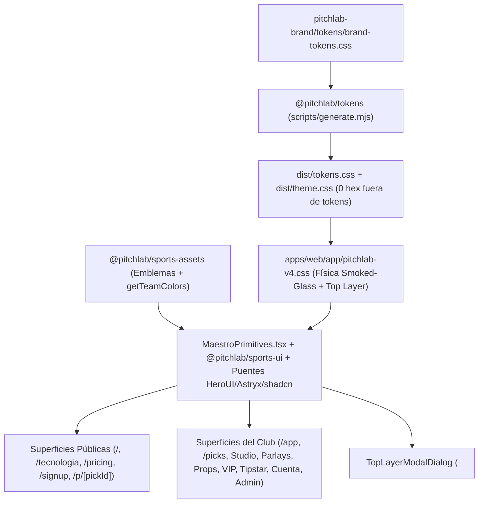
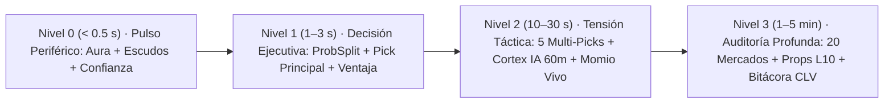

# Visión de Producto, Sistema de Diseño y Arquitectura UX (`gemini-reestructura`)

> **Audiencia:** Fundador de PitchLab y Claude (sesión de continuación en casa sobre la rama `gemini-reestructura` rumbo a F4).
> **Estrella polar visual y funcional:** [`design/prototipo-maestro/prototipo-maestro-pitchlab.html`](../../design/prototipo-maestro/prototipo-maestro-pitchlab.html) (`6,960` líneas autocontenidas).
> **Decisiones rectoras:** [ADR-020](../architecture/adr/ADR-020-sistema-visual-liquid-glass-v4-y-aislamiento-de-tokens.md) · [ADR-023](../architecture/adr/ADR-023-smoked-glass-maestro-ui-physics.md) · [ADR-024](../architecture/adr/ADR-024-hybrid-snapshot-spacetime-quant-engine.md) · [ADR-025](../architecture/adr/ADR-025-zero-leak-subscription-tipstar-referrals.md) · [`GLOSSARY.md`](../../GLOSSARY.md).

---

## 1. Identidad Visual: «El Súper-Tipster Cuantitativo de Grado Apple»

En México y Latinoamérica, el aficionado analítico vive atrapado entre dos extremos rotos: canales informales de apuestas saturados de ruido visual, capturas maquilladas y promesas falsas, o tableros estadísticos anglosajones fríos, desconectados de la Liga MX, sin español natural ni guía accionable por perfil de riesgo.

**PitchLab inaugura una categoría visual y funcional propia: el *Súper-Tipster Cuantitativo de Grado Apple*.**

Su tesis estética parte de una regla innegociable: **cuando la inteligencia matemática es profunda, la interfaz debe sentirse serena, táctil e inevitable**. Tomamos la física de cristal ahumado (*smoked glass*) y refracción atmosférica de referencias contemporáneas como `shows.link` y las *Human Interface Guidelines* de Apple, y la ponemos al servicio exclusivo de la **Spacetime Suite v2.1** (`Tachyon`, `Singularity`, `Minkowski`, `Geodesic` y `Cortex IA`, auditados bajo calibración `Horizon`).

> [!IMPORTANT]
> **Estrella Polar Canónica en el Repositorio:** Cualquier duda sobre ritmo editorial, densidad de una tarjeta, bisel óptico, jerarquía de botones o flujo entre vistas se contrasta directamente abriendo `design/prototipo-maestro/prototipo-maestro-pitchlab.html` frente a la aplicación Next.js viva (`packages/ui/src/platform/` + `apps/web/app/pitchlab-v4.css`).

### Los cinco pilares del oficio visual PitchLab v4.1

1. **Obsidiana profunda + Cristal Ahumado Real (`Smoked Glass`):** En el tema oscuro predeterminado, el lienzo es negro absoluto (`#000000`). Las superficies no son cajas grises opacas, sino lentes de velo blanco translúcido (`--pl-glass-lens: rgba(255, 255, 255, 0.068)` con `blur(18px)`; `--pl-glass-card: rgba(255, 255, 255, 0.052)` con `blur(14px)`) que refractan con sutileza la luz cromática del encuentro.
2. **El color nunca es adorno; siempre significa club, motor o ventaja:** El cromo permanece estrictamente acromático. El color proviene únicamente de (a) la identidad oficial de los clubes en cancha (`getTeamColors`), (b) la firma de los 5 motores de `Spacetime Suite` (`--engine-*`), y (c) señales semánticas verificadas con contraste WCAG 2.1 AA (`--pl-pill-*`, siempre acompañadas de texto e icono `MaestroIcon`).
3. **Bisel especular único (`.glass-ring`) sin *wireframes* dobles:** La separación entre capas se logra con refracción perimetral de `1px` (`mask-composite: exclude`) y destellos radiales en las esquinas superiores, jamás apilando bordes sólidos redundantes.
4. **Autoridad tipográfica y rigor numérico (`.num`):** Encabezados compactos en `Host Grotesk` / `Inter` (`letter-spacing: -0.011em` a `-0.03em`) combinados con cifras estrictamente tabulares (`tabular-nums lining-nums`), porcentajes en formato `es-MX` (`69.6 %`), `Unidades Simuladas` (`0.25u`–`5.0u`) y un único CTA primario blanco puro (`#FFFFFF` sobre negro; `#09090B` sobre alabastro en modo claro) por región.
5. **Confidencialidad `Cero-Fuga` visible como atributo de lujo:** Los candados pre-partido (`[data-locked-pick]`), las líneas de corte perforadas (`.ticket-perf`) y las marcas de agua dinámicas por sesión (`PL-XXXX`) no se perciben como muros punitivos, sino como el sello de autenticidad de un club privado cuya información no se filtra antes del silbatazo.

---

## 2. Anatomía de las 11 Superficies Nucleares

El ecosistema completo de PitchLab se recorre a través de **11 superficies nucleares** conectadas en tiempo real mediante la barra flotante colapsable `FloatingQuickJumpBar` (`.pl-quick-jump-bar`), el riel izquierdo de 4 grupos en escritorio (`ClubWorkspaceShell`, `244px` expandido / `72px` colapsado) y el dock inferior de 5 accesos en móvil (`.mobile-dock`).

| # | Superficie Maestro | Ruta en `apps/web` | Módulo propietario en `packages/ui/src/platform/` | Misión de producto y piezas clave de interfaz |
|---|---|---|---|---|
| **1** | **Landing Editorial** | `/` (más vistas dedicadas `/tecnologia` y `/pricing`) | `public/LandingSurface.tsx` + `public/TechAndPricingSurfaces.tsx` | Conversión inmediata sin humo. Barra superior de lanzamiento (`Mes 1 sin tarjeta` + `RoleSwitcherPill`), Hero `6+6` con conmutador de 5 ligas, boleto interactivo con 1 `Pick Abierto del Día` + 3 ranuras protegidas bajo `Cero-Fuga`, calculadora `Geodesic v1.0` en vivo, matriz de 5 motores + 4 cubetas de calibración (`ECE 0.009`), `Pick Abierto de la Semana` (`@sofia_nfl` · `SOFIA5`), auditoría pública de partidos `FT` y bloque íntegro de `Pase Total` + `Referido Doble Vía`. |
| **2** | **Acceso $0 y Onboarding** | `/signup`, `/login`, `/onboarding` | `public/AuthAndOnboardingSurfaces.tsx` | Alta sin fricción con blindaje anti-abuso `$0 MXN`. Lente con `.seg-well` de 2 pestañas (`Prueba / Código` con reconocimiento instantáneo de `SOFIA5` 5d o `JAIR` 7d + 30 % dto., canonicalización Gmail y bloqueo de correos desechables; `PIN Socio` con teclado táctil de 4 rombos), seguida de `/onboarding` para elegir ligas favoritas, perfil de riesgo y equivalencia referencial en MXN de `1.0u`. |
| **3** | **Centro de Mando · Jornada** | `/app` | `club/CoreMatchViews.tsx` (`JornadaClubView`) | Lectura ejecutiva del día. Tira `.seg-well` de 7 ligas y Spotlight asimétrico `7/5`: a la izquierda, lente protagonista con `<LensGlowOrbs>` del duelo, `CalendarSquare`, `CrestPedestal`, marcador proyectado, `ProbSplit`, `NoticeCard` de `Cortex IA` y 2 picks principales; a la derecha, generador rápido de `Boleto Combinado` en 1 clic (*Conservador / Medio / Arriesgado*) y lista accionable *Top 3 Picks de la Jornada*, sobre cuadrícula de 3 columnas de `MatchTicketCard`. |
| **4** | **Radar Multi-Picks** | `/app/picks` | `club/CoreMatchViews.tsx` (`MultiPicksClubView`) | Explorador transversal de las `4 a 5` selecciones por encuentro. Incorpora en la cabecera la barra interactiva *«Probar tu momio»* (`Geodesic v1.0`), que recalcula al vuelo la ventaja esperada (`pts`) en cada fila conforme el socio teclea la cuota de su casa (`-110` o `1.95`), combinada con filtros por banda de riesgo, liga y umbral `Prob. ≥ 62 %`. |
| **5** | **Match Studio (5 Picks)** | `/app/[league]/games/[gameId]` (y hub `/app/[league]`) | `club/CoreMatchViews.tsx` (`MatchStudioClubView`, `LeagueHubClubView`) | Laboratorio profundo del partido. Cabecera `[data-match-studio]` bañada por los colores de ambos clubes, fila ejecutiva de 3 tarjetas pre-partido (`Síntesis Cortex IA`, `Alineaciones y Bajas 60m`, `¿Dónde está el dinero?`) y 4 pestañas: `picks` (layout `7/5` con los 5 `Multi-Picks` a la izquierda y el hilo en vivo `Debate de Suscriptores` con `StackedAvatars` a la derecha), `mercados` (~20 mercados con filtros por familia y probador de cuota en línea), `contexto` (factores, descanso, H2H) y `dinero` (apertura vs actual). |
| **6** | **Armador de Parlays y SGP** | `/app/parlays` | `club/ParlayAndQuantViews.tsx` (`ParlayBuilderClubView`) | Construcción matemática de `Boletos Combinados` (`2 a 6` selecciones). Flujo guiado en 4 pasos numerados (`1. Ligas`, `2. Riesgo`, `3. Selecciones 2–6`, `4. SGP`), botón blanco de auto-armado cuantitativo, piscina manual que explica explícitamente cualquier bloqueo (`Mercado contradictorio` o `Mismo partido — activa SGP`) y boleto derecho pegajoso con perforación `.ticket-perf` y ajuste de correlación `Mismo Partido (SGP)`. |
| **7** | **Player Props Lab y Momios** | `/app/props` (y `/app/momios`) | `club/ParlayAndQuantViews.tsx` (`PropsLabClubView`, `MomiosExplorerClubView`) | Evaluación continua de jugadores y líneas de mercado. Cada lente `[data-prop-card]` integra pedestal de club, stepper táctil `.sl-stepper` (`− / +` + reset `Base`) que recalcula probabilidad y `Momio Justo` al mover la línea medio punto, gráfica de forma `L10`, calculadora individual `Geodesic` y sellado directo en `Bitácora`. `/app/momios` complementa con rastreo de movimiento de línea (`↓ dinero entra` / `↑ valor`). |
| **8** | **Comunidad VIP Cero-Ruido** | `/app/social` | `club/SocialAndTipstarViews.tsx` (`SocialVipClubView`) | Inteligencia colectiva sin spam. Tres pestañas: `Boletos & Debate` (compositor con selector de origen `Spacetime Suite` vs `Bitácora Propia`, escudo `containsExternalLink` que bloquea Telegram/WhatsApp/URLs, botón `+ Llevar a mi bitácora` y contador de utilidad), `Consenso vs. Suite` (barras duales que detectan convergencia o divergencia *contrarian*) y `Ranking CLV (IC 95 %)` filtrable por `Temporada` / `30 días` sin premios monetarios ni materiales. |
| **9** | **Portal Tipstar Oficial** | `/app/tipstar` + ruta pública `/p/[pickId]` | `club/SocialAndTipstarViews.tsx` (`TipstarPortalClubView`) + `public/AuthAndOnboardingSurfaces.tsx` | Motor de creadores afiliados (`25 %` comisión recurrente). Muestra 4 KPIs del creador (`SOFIA5`, referidos activos, comisión acumulada, cupo `1/1` semanal), selector de origen del `Pick Abierto de la Semana`, redactor de tesis, vista previa viva del `.share-ticket-card` y botón *«Simular vista visitante (`/p/sofia-sem`)»* en `<dialog>` nativo que demuestra cómo el público ve 1 pick abierto mientras los otros 4 picks del duelo permanecen bajo llave `Pase Total`. |
| **10** | **Cuenta, Referidos, Bitácora y CFDI** | `/app/account` (más `/app/lab`, `/app/historial`, `/app/u/[handle]`) | `club/LedgerAccountAdminViews.tsx` | Retención, lealtad y auditoría personal. `/app/account` organiza 4 pestañas con `Referidos (+15 días)` activo por defecto (`Referido Doble Vía` de 3 pasos + barra de progreso hacia `Embajador PitchLab` a los 5 amigos pagados con `+30d` extra), `Pase Total` (`$299` mensual vs `$2,390` anual), `Preferencias` (unidad simulada base y `Modo Pausa Social`) y `CFDI 4.0` (RFC, CP y regímenes SAT `601`/`612`/`626`/`605`). Se articula con `Bitácora` (`/app/lab`), `Historial` (`/app/historial`) y `Perfil Analista` (`/app/u/[handle]`). |
| **11** | **Consola Founder Admin** | `/app/admin` | `club/LedgerAccountAdminViews.tsx` (`FounderAdminClubView`) | Gobierno operativo en tiempo real. Interruptor maestro entre *Mes 1 Lanzamiento sin tarjeta* y *Mes 2 Verificación `$0.00 MXN`*, 4 indicadores de seguridad/crecimiento (`Watermarks`, links spam bloqueados, referidos activos, snapshots), tabla emisora de códigos de `Tipstar Oficial` y panel de telemetría de los 5 motores `Spacetime Suite v2.1` con disparo interactivo de reentrenamiento post-jornada. |

### Capas Transversales en Top Layer (`PlatformOverlays.tsx`)

Sobre las 11 superficies operan cinco herramientas modales montadas con `<TopLayerModalDialog>` (`<dialog>` nativo):

1. **`PickComposerModal`:** Sellado inmutable en `Bitácora` con píldoras rápidas de cuota (`Justa`, `Mercado`, `Valor +5 %`), stepper de `Unidades Simuladas` (`0.25u`–`5.0u`), previsualización viva de `CLV / Ventaja` y nota táctica opcional.
2. **`ShareTicketModal`:** Estudio de exportación social con conmutador en vivo `4:5 Feed` / `9:16 Stories` y aplicación estricta de `canRevealPickOnShare`.
3. **`CommandPaletteModal` (`⌘K`):** Búsqueda instantánea por teclado a través de las 11 vistas, las 7 ligas, todos los partidos de la jornada y perfiles verificados (`@sofia_nfl`, `@carlos_quant`, `@diego_tactico`).
4. **`AlertsDrawer`:** Cajón lateral derecho (`pl-native-drawer`) para cortes de `Vigilancia 60m`, movimientos de `Momio Justo` y avisos de referidos acreditados.
5. **`BetaPinModal`:** Compuerta táctil de 4 dígitos (`2026` en entorno preview) para autorización de sesión en servidor (`pl_beta` firmada con HMAC-SHA256).

---

## 3. Jerarquía de Densidad Informativa (Revelación Progresiva)

Uno de los mayores logros del *Prototipo Maestro* es resolver la tensión entre el **Fan Analítico móvil (P1)** —que dispone de 3 segundos antes del partido para entender dónde está el valor— y el **Investigador Serio de escritorio (P2)** —que exige inspeccionar 20 mercados, probar su propia cuota y auditar calibración— sin abrumar al primero ni limitar al segundo.

La arquitectura de información aplica una **revelación progresiva en cuatro estratos**:

### Nivel 0 · Pulso Periférico (`< 0.5 segundos`)
- **Qué percibe el ojo antes de leer una palabra:** el resplandor cromático de ambos clubes en `<LensGlowOrbs>`, los escudos oficiales sobre `<CrestPedestal>`, el bloque de fecha `<CalendarSquare>`, la píldora de confianza máxima y el marcador proyectado en el centro (`1.8 – 1.1` para socios; `🔒 – 🔒` para visitantes).
- **Regla de diseño:** máximo 3 pesos tipográficos y cero bordes internos cruzados en el encabezado del partido.

### Nivel 1 · Decisión Ejecutiva (`1 a 3 segundos`)
- **Qué resuelve la duda inmediata:** la barra segmentada `ProbSplit` (donde solo el resultado líder se ilumina en `--pl-brand` con halo `--pl-glow`) y las dos primeras ranuras de `Multi-Picks` (*Pick Principal* y *Escudo Conservador*).
- **Tríada numérica fija a la derecha (`.num`):** `Probabilidad` calibrada (`%`) · `Justa / Casa` · `Ventaja` en puntos porcentuales (`+4.8 pts`), acompañada de dos acciones táctiles directas (`+ Parlay` y `Sellar`).

### Nivel 2 · Tensión Táctica y Liquidez (`10 a 30 segundos`)
- **Al expandir hacia Match Studio o interactuar con la cabecera:** se despliegan los **5 ángulos completos** del encuentro (*Pick Principal*, *Escudo Conservador*, *Línea de Totales*, *Lectura Táctica* y *Cuota Alta · Valor*), la `Radiografía Previa` de `Cortex IA`, el semáforo de `Vigilancia 60m` (XI titular confirmado, bajas y dudas) y el comparador interactivo `Geodesic v1.0` donde el socio introduce la cuota exacta de su casa para verificar si todavía existe ventaja matemática.
- En paralelo, `Consenso vs. Suite` contrasta la probabilidad fría del modelo contra el porcentaje de boletos sellados por la comunidad, alertando cuando el público sobrevalora emocionalmente a un favorito.

### Nivel 3 · Auditoría Profunda (`1 a 5 minutos`)
- **Bajo demanda en pestañas dedicadas y regiones diferidas (`.pl-deferred-section`):**
  - Tabla `.pl-table-region` (`container-type: inline-size`, `thead` pegajoso con `blur(16px)` y foco accesible por teclado) con los **~20 mercados calibrados** del partido filtrables por familia (*Resultado*, *Totales*, *Ambos Anotan / Hándicap*, *Doble Oportunidad*).
  - Simulación continua de líneas de jugador en `Player Props Lab` con historial `L10`.
  - Desglose explícito del factor de amortiguación por correlación en `Mismo Partido (SGP)`.
  - Trazabilidad histórica íntegra en `Bitácora` (`/app/lab`, exportable a CSV) y curvas de calibración prometida vs. real auditada (`ECE 0.009`) en `/tecnologia` y `/app/historial`.

---

## 4. Coreografía de Auras de Estadio (`getTeamColors`) y Micro-Interacciones

En PitchLab la atmósfera nunca es un fondo estático desconectado del contenido: **el estadio respira al ritmo del partido que el usuario inspecciona**.

### Sincronización cromática en tres capas

1. **Disparo contextual (`setAuraFromGame` en `PlatformProvider`):**
   - Al alternar entre los chips de partido del Hero en `/`, al entrar a `Jornada` (`/app`) o al abrir cualquier `Match Studio` (`/app/[league]/games/[gameId]`), `PlatformProvider` consulta `getTeamColors(game.league, slug)` en `@pitchlab/sports-assets` y actualiza el par `[homeColor, awayColor]` inyectado como `--home-color` y `--away-color` en `.pl-stage`.
2. **Atmósfera global amortiguada (`.pl-atmo-canvas` + `.pl-atmo-scrim`):**
   - Dos elipses radiales (`.pl-aura--home` arriba a la izquierda y `.pl-aura--away` arriba a la derecha) transicionan suavemente durante `650ms ease` bajo un filtro `blur(92px) saturate(185%)` y un velo óptico radial (`.pl-atmo-scrim`) que funde hacia `#000000` al `100 %` de caída vertical, garantizando que las tablas inferiores reposen siempre sobre obsidiana pura.
3. **Lentes y pedestales locales (`<LensGlowOrbs>` + `<CrestPedestal glowColor>`):**
   - Mientras el escenario global ambienta la vista activa, cada tarjeta protagonista en una cuadrícula puede portar sus propios `<LensGlowOrbs>` y pedestales con `--crest-glow` locales, permitiendo distinguir de un vistazo un duelo de Liga MX frente a uno de NFL o Premier League sin contaminar el contraste del texto.

### Catálogo de micro-interacciones con causa

| Interacción | Mecánica CSS / DOM | Tiempo y curva | Propósito perceptivo |
|---|---|---|---|
| **Cambio de partido activo** | Transición de `--home-color` / `--away-color` en `.pl-aura` | `650ms ease` | Sensación de cambio de estadio sin parpadeo de layout |
| **Barras `ProbSplit` y `ProbBar`** | Interpolación de `flex` / `width` desde el origen izquierdo | `340ms–360ms var(--ease-out)` | Visualizar magnitud relativa de probabilidad al filtrar o mover un stepper de línea |
| **Elevación de tarjeta interactiva (`.hover-lift`)** | `transform: translateY(-2px)` + `--pl-surface-elevated` | `140ms var(--ease-out)` | Confirmar capacidad de clic sin sombras exageradas |
| **Compresión táctil en botones y filas** | `scale(0.98)` en `.pl-btn-*`, `scale(0.992)` en `.glass-action-row`, `scale(0.95)` en `.sl-stepper` | `80ms–120ms ease` | Respuesta física inmediata tipo iOS en pantallas táctiles y ratón |
| **Conmutación Oscuro ↔ Claro (`ThemeToggle`)** | Atributo `html[data-theme-switching="true"]` que congela `transition: none !important` durante 1 frame | `0ms` (instantáneo) | Evitar estados intermedios grises con contraste roto entre `#000000` y `#F4F4F5` |
| **Apertura y cierre de `<dialog>` Top Layer** | `dialog.showModal()`, `::backdrop` con `blur(12px)`, `closedby="any"` + `Esc` | Nativo del navegador | Foco accesible automático, cero saltos de barra de scroll en `<body>` |
| **Preferencia `prefers-reduced-motion: reduce`** | Desactiva transiciones en `.pl-aura`, `.glass-card`, `.glass-action-row` y `.hover-lift` | `0ms` | Accesibilidad vestibular completa sin perder ningún estado informativo |

---

## 5. Artefactos Sociales Compartibles `4:5` y `9:16`

Cada boleto que sale de PitchLab hacia Instagram, TikTok, X o WhatsApp está diseñado para funcionar simultáneamente como **objeto de estatus analítico** para quien lo comparte y como **embudo de adquisición sin fuga** para la plataforma.

### Arquitectura visual de `.share-ticket-card`

- **Aislamiento nocturno permanente (`color-scheme: only dark`):** Aunque el socio use PitchLab en modo claro alabastro a pleno día, el boleto exportable fuerza `--share-card-bg: #07070A` y re-mapea todas las variables internas hacia `--share-card-*`. Así, la marca proyecta en redes sociales una firma nocturna inconfundible y de alto contraste (`>= 7:1`).
- **Doble geometría nativa en `ShareTicketModal`:**
  - **`4:5 Feed`:** Proporción compacta ideal para publicaciones de X, Instagram Feed, Threads y grupos de amigos.
  - **`9:16 Stories`:** Lienzo vertical extendido con aire superior e inferior calibrado para no chocar con los stickers, avatares ni barras de respuesta de Instagram Stories y TikTok.
- **Sello físico de autenticidad:** Cabecera con logotipo oficial e insignia del motor `Spacetime Suite`, `<LensGlowOrbs>` atmosféricos, línea de corte perforada `.ticket-perf`, métricas tabulares (`Probabilidad`, `Momio Justo`, `Unidades Simuladas`), marca de agua de sesión (`PL-XXXX`) e identificador verificado de `CLV` / racha cuando proviene de `Bitácora` o de un `Tipstar Oficial`.

### Matriz de revelación según regla `Cero-Fuga` (`canRevealPickOnShare`)

| Actor y momento del partido | ¿Qué muestra el boleto `4:5` / `9:16`? | ¿Qué permanece protegido? | Objetivo de crecimiento |
|---|---|---|---|
| **Socio regular · Pre-partido (`NS` / `LIVE`)** | Encuentro, liga, nivel de confianza (`%`), `Unidades Simuladas` selladas y sello inmutable de hora | La selección exacta se muestra **sellada bajo llave `Cero-Fuga`** hasta concluir el juego | Generar curiosidad social y prueba de compromiso pre-partido sin regalar los picks del club |
| **Socio regular · Partido finalizado (`FT`)** | Selección completa destapada, resultado oficial (`CUMPLIDO` / `CLV +pts`) y enlace de invitación `Referido Doble Vía` | Nada (auditoría post-partido `100 %` transparente) | Demostrar criterio auditable frente a capturas editables y activar `+15 días gratis` |
| **`Tipstar Oficial` · Pick Abierto Semanal (`/p/sofia-sem`)** | Selección abierta completa, tesis firmada, récord auditado (`+18.4u · CLV +4.2 %`) y código `SOFIA5` (`5 días gratis`) | Los **otros 4 `Multi-Picks`** de ese mismo encuentro permanecen bloqueados en `/p/sofia-sem` | Adquisición masiva de creadores con atribución directa y comisión recurrente del `25 %` |
| **Socio / Analista · Resumen de `Bitácora`** | Balance verificado en `Unidades Simuladas`, `CLV Promedio`, tasa de acierto resuelta y muestra `n` | Picks futuros no liquidados en su `Bitácora` | Construir reputación verificable en `Comunidad VIP` y redes externas |

---

## 6. Propuestas Abiertas de Evolución UX y Design System para Claude

El código en la rama `gemini-reestructura` compila limpio (`0` errores de TypeScript, `0` literales hexadecimales fuera de `@pitchlab/tokens`) y tiene las 11 superficies conectadas de extremo a extremo. Para la sesión en casa con Claude y el inicio de la fase **F4**, proponemos seis líneas de evolución de alto impacto ordenadas por prioridad:

### 6.1 Auditoría Visual Lado a Lado y Contrato de Regresión en Storybook (`Prioridad P0 — Inmediata`)
- **Contexto:** Los tres bloques de auditoría automatizada en Chromium se pausaron al cierre de la sesión de trabajo para entregar la rama lista al fundador.
- **Acción recomendada para Claude:**
  1. Ejecutar una corrida completa en Playwright + `@axe-core/playwright` (`1440×900` y `390×844`, temas `dark` y `light`) comparando cada ruta viva contra `design/prototipo-maestro/prototipo-maestro-pitchlab.html`.
  2. Expandir `packages/ui/src/stories/platform-v4.stories.tsx` ([ADR-004](../architecture/adr/ADR-004-storybook-como-contrato-del-design-system.md)) con stories individuales para las 8 primitivas de `MaestroPrimitives.tsx` y estados críticos de las 11 superficies (visitante `Cero-Fuga`, socio desbloqueado, `Tipstar Oficial` y modo claro alabastro).

### 6.2 Exportación Real en Vivo a `PNG` / `WebP` Retina (`2×` / `3×`) + Web Share API (`Prioridad P1`)
- **Oportunidad UX:** Hoy `ShareTicketModal` renderiza en DOM la vista previa exacta `4:5` y `9:16` y copia el resumen/enlace con confirmación por toast, pero la descarga de imagen rasterizada lista para subir a Instagram Stories o TikTok es el multiplicador viral definitivo.
- **Diseño técnico sugerido:**
  - **Ruta dual:** (a) Endpoint Edge `/api/og/ticket/[ticketId]` con `next/og` (`Satori`) alimentado exclusivamente por tokens `--share-card-*` para generar tanto tarjetas OpenGraph automáticas en `/p/[pickId]` como descargas `PNG` `1080×1350` (`4:5`) y `1080×1920` (`9:16`) firmadas por servidor (garantizando que nadie altere el HTML antes de exportar); y (b) integración en móvil con `navigator.share({ files: [pngFile] })` para abrir en un toque la hoja nativa de iOS/Android hacia Instagram Stories o WhatsApp.

### 6.3 View Transitions API entre Jornada, Hero y Match Studio (`Prioridad P1`)
- **Oportunidad UX:** El paso desde una `MatchTicketCard` en `/` o `/app` hacia `MatchStudioClubView` (`/app/[league]/games/[gameId]`) comparte exactamente los mismos anclajes visuales: ambos `<CrestPedestal>`, el marcador proyectado, la barra `ProbSplit` y la lente `.glass-lens`.
- **Diseño técnico sugerido:**
  - Asignar `view-transition-name` dinámicos por `game.id` (`pl-crest-home-${id}`, `pl-crest-away-${id}`, `pl-lens-${id}`) al hacer clic en la tarjeta activa e invocar `document.startViewTransition()` en el adaptador de navegación de Next.js, degradando de forma transparente en navegadores sin soporte o cuando `prefers-reduced-motion: reduce` esté activo. El resultado es una continuidad espacial idéntica a Apple Sports / iOS nativo.

### 6.4 Coreografía Móvil de Una Mano (`375px–430px`) y Orquestación de Barras Flotantes (`Prioridad P1`)
- **Oportunidad UX:** En pantallas pequeñas coexisten potencialmente tres elementos fijos inferiores: `.mobile-dock` (`bottom: 12px`), `.pl-quick-jump-bar` / `.role-sim-pill` (solo en preview/dev) y `.parlay-dock` (`bottom: 118px` cuando hay selecciones en el `Boleto Combinado`).
- **Diseño técnico sugerido:**
  - En producción comercial (donde `FloatingQuickJumpBar` y `RoleSwitcherPill` se apagan por flag de entorno), acoplar `.parlay-dock` justo encima de `.mobile-dock` con `padding-bottom: env(safe-area-inset-bottom)` y modo *mini-píldora* colapsable al hacer scroll hacia abajo (`scroll-direction` pasivo), expandiéndose al tocarla hacia un `<TopLayerModalDialog variant="drawer">` inferior tipo *Bottom Sheet*.

### 6.5 Pulso Visual de `Vigilancia 60m`: Diff Pre/Post Alineación Confirmada (`Prioridad P2`)
- **Oportunidad UX:** Cuando `Cortex IA` ejecuta el corte `60 minutos` antes del inicio (al confirmarse titulares o una baja clave como un mariscal o delantero centro), el socio merece ver no solo la nueva probabilidad, sino **cuánto y por qué se movió**.
- **Diseño técnico sugerido:**
  - Incorporar en `MatchStudioClubView` y `AlertsDrawer` un micro-componente `ProbabilityDeltaBadge` (`61.4 % → 65.8 % · +4.4 pts tras XI titular`) con doble marca en `ProbBar` (sombra tenue en la probabilidad de apertura y relleno sólido en la probabilidad actualizada 60m).

### 6.6 Consolidación Documental de `DESIGN_SYSTEM.md` y Tipografía Local WOFF2 (`Prioridad P2`)
- **Higiene arquitectónica para Claude:**
  - Actualizar `docs/design/DESIGN_SYSTEM.md` y `apps/web/PRODUCT.md` (redactados en la etapa previa D1, donde aún figuraban tres planes escalonados y se prohibía el cristal en tarjetas) para que apunten formalmente a [ADR-023](../architecture/adr/ADR-023-smoked-glass-maestro-ui-physics.md) y [ADR-025](../architecture/adr/ADR-025-zero-leak-subscription-tipstar-referrals.md) como fuente vigente.
  - Verificar en `apps/web/app/layout.tsx` la carga 100 % local mediante `next/font/local` de `Host Grotesk` e `InterVariable.woff2` con métricas `size-adjust` calibradas, logrando cero solicitudes externas a Google Fonts, `CLS = 0.00` y paridad tipográfica exacta con `prototipo-maestro-pitchlab.html`.

---

> [!TIP]
> **Punto de partida sugerido para la sesión en casa con Claude:** Abrir en dos pestañas `design/prototipo-maestro/prototipo-maestro-pitchlab.html` y `http://localhost:8787`, usar `FloatingQuickJumpBar` (`1. Landing` → `11. Admin`) junto con `RoleSwitcherPill` (`Visitante` ↔ `Suscriptor` ↔ `Tipstar` ↔ `Admin`) para validar la experiencia de principio a fin, ejecutar el barrido Playwright + Axe (§6.1) y elegir cuál de las evoluciones UX (§6.2–§6.5) acompañar primero mientras se conectan las tablas F4 de persistencia.
