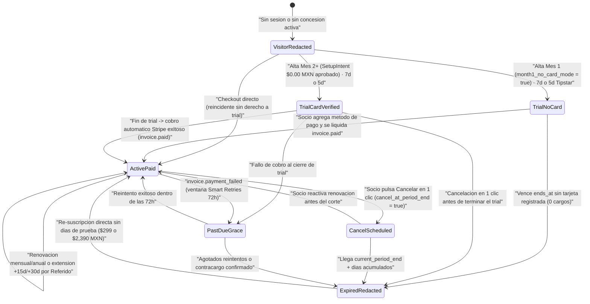
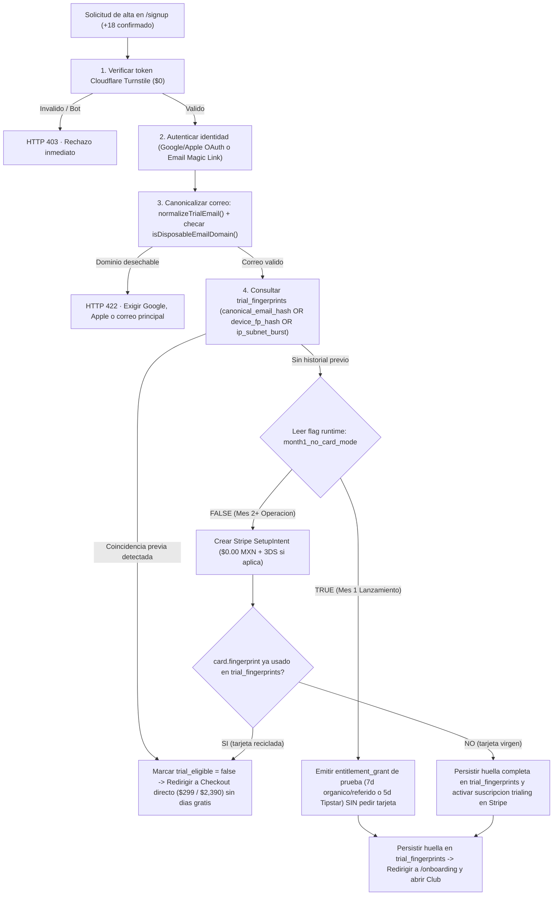
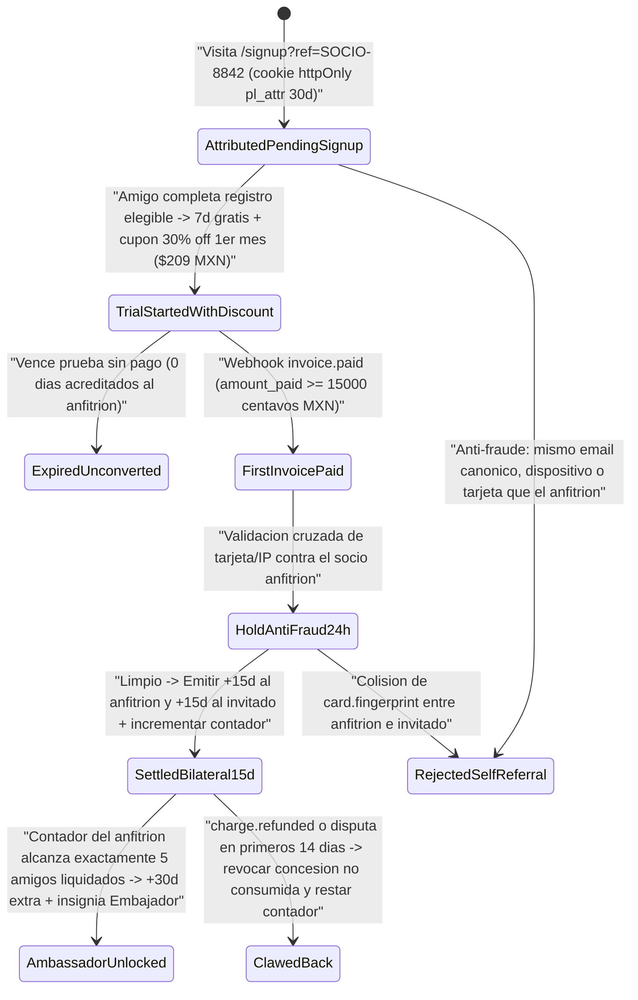
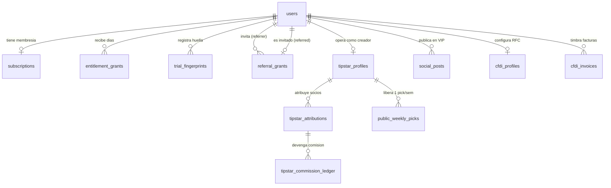
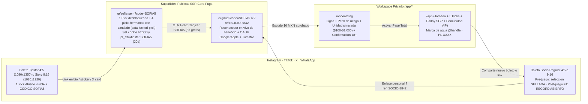

# Visión de Producto e Ingeniería (Crecimiento, Monetización Cero-Fuga, Tipstars, Referidos y CFDI 4.0)

> **Audiencia:** Fundador (Jair) y Claude (sesión de continuación en casa sobre la rama `gemini-reestructura`).
> **Documento normativo asociado:** [ADR-025](../architecture/adr/ADR-025-zero-leak-subscription-tipstar-referrals.md), en conjunto con [ADR-010](../architecture/adr/ADR-010-autenticacion-con-better-auth.md), [ADR-011](../architecture/adr/ADR-011-billing-desacoplado-y-entitlements-por-concesiones.md) y [ADR-023](../architecture/adr/ADR-023-paridad-prototipo-maestro-cristal-ahumado-y-primitivas-maestro.md).
> **Propósito:** Servir como plano ejecutivo y técnico de nivel producción para construir en Fase 4 (F4) el motor de suscripción **Pase Total**, el escudo anti-abuso `$0 MXN` (Mes 1 sin tarjeta → Mes 2 `SetupIntent`), la frontera **Cero-Fuga** conectada a sesiones reales, el programa de **Tipstars Oficiales**, el motor de **Referido Doble Vía**, la moderación de **Comunidad VIP** y la facturación automática **CFDI 4.0** en México.

---

## 1. Dónde estamos hoy en `gemini-reestructura` vs. Qué construye Claude en F4

La reestructura `UI-MAESTRO-V4.1` dejó implementadas, tipadas y verificadas todas las superficies públicas y del Club junto con la redacción `Cero-Fuga` en servidor. Antes de escribir migraciones o endpoints en F4, esta matriz delimita qué ya existe en código y qué debe evolucionar de simulación local a persistencia transaccional:

| Dominio | Implementado hoy en `gemini-reestructura` | Evolución exacta en Fase 4 (Claude) |
|---|---|---|
| **Frontera Cero-Fuga SSR** | `redactDatasetForVisitor()`, `isPickUnlocked()`, `isPreGameIntelUnlocked()` y `canRevealPickOnShare()` en [`access-guard.ts`](../../packages/ui/src/platform/access-guard.ts); `loadPublicPlatformState()` y `loadClubPlatformState()` en [`platform-data.ts`](../../apps/web/src/server/platform-data.ts) leen cookie HMAC `pl_beta` ([`beta-auth.ts`](../../apps/web/src/server/beta-auth.ts)). | Sustituir la lectura exclusiva de `pl_beta` por resolución unificada de sesión Better Auth + consulta en servidor a `hasActivePaseTotal(userId)` (`subscriptions` ∪ `entitlement_grants`), conservando `pl_beta` solo detrás de `ENABLE_PREVIEW_PIN=true` en entornos no productivos. |
| **Membresía `Pase Total`** | Constante canónica `MEMBERSHIP_SPEC` (`$299 MXN/mes`, `$2,390 MXN/año`, `-33 %`, CFDI 4.0) en [`spacetime-catalog.ts`](../../packages/ui/src/platform/spacetime-catalog.ts), `/pricing` y pestaña `Pase Total` en `/app/account`. | Conectar `BillingProvider` (ADR-011) con Stripe MX Billing (`Checkout`, `Customer Portal`, `SetupIntent` `$0.00 MXN` y webhooks idempotentes) + tabla `subscriptions`. |
| **Escudo Trial `$0` (Mes 1 / Mes 2)** | `normalizeTrialEmail()` y `isDisposableEmailDomain()` en [`access-guard.ts`](../../packages/ui/src/platform/access-guard.ts); validación interactiva en [`AuthSurfaceV4`](../../packages/ui/src/platform/public/AuthAndOnboardingSurfaces.tsx); switch `month1NoCardMode` en [`FounderAdminClubView`](../../packages/ui/src/platform/club/LedgerAccountAdminViews.tsx). | Persistir `month1_no_card_mode` en BD (`platform_runtime_flags`), validar Cloudflare Turnstile en servidor, integrar Google/Apple OAuth en Better Auth y registrar `trial_fingerprints` para bloquear multicuentas. |
| **Tipstars Oficiales y `/p/[slug]`** | Catálogo `TIPSTAR_CREATORS` (`SOFIA5`, `CARLOS5`, `DIEGO5`), configurador `/app/tipstar` con simulador visitante `<dialog>` en [`SocialAndTipstarViews.tsx`](../../packages/ui/src/platform/club/SocialAndTipstarViews.tsx), ruta pública SSR [`/p/[pickId]`](../../apps/web/app/p/[pickId]/page.tsx) que desbloquea 1 pick y deja 4 con candado. | Persistir `tipstar_profiles`, `public_weekly_picks` (cupo `1/semana`), `tipstar_attributions` y `tipstar_commission_ledger` (`25 %` recurrente); sincronizar alta de códigos desde `/app/admin` con Stripe Promotion Codes. |
| **Referido Doble Vía (`+15d` ambos)** | Pestaña predeterminada en `/app/account` (`SOCIO-8842`, barra `Embajador PitchLab` `5/5`, simulador `+15d`) en [`LedgerAccountAdminViews.tsx`](../../packages/ui/src/platform/club/LedgerAccountAdminViews.tsx). | Persistir códigos únicos por socio, tabla `referral_grants`, cupón Stripe `30 % off` Mes 1 (`$209 MXN`) y acreditación bilateral automática (`+15d` ambos + `+30d` al 5.º amigo) disparada exclusivamente por `invoice.paid`. |
| **Comunidad VIP y Marcas de Agua** | Feed 2 columnas `/app/social`, filtro `containsExternalLink()`, `getSessionWatermark()`, `Ranking CLV (IC 95 %)`, `Consenso vs. Suite` y `Modo Pausa Social`. | Persistir `social_posts`, `social_comments`, reacciones y bitácora de moderación en PostgreSQL; generar marca de agua determinista derivada de `user.public_code` (`PL-XXXX`) real por sesión. |
| **Facturación CFDI 4.0** | Formulario fiscal SAT (`601`, `612`, `626`, `605`, RFC, Razón Social, CP) en `/app/account` (`CFDI 4.0`). | Persistir `cfdi_profiles` y `cfdi_invoices`; timbrar automáticamente PDF + XML vía Facturapi tras cada `invoice.paid` y emitir Factura Global mensual para cobros sin RFC. |

> [!IMPORTANT]
> **Invariantes de UI y pruebas E2E que Claude NO debe romper al conectar el backend:**
> 1. En modo visitante (`!hasActivePaseTotal`), `dataset.isServerRedactedForVisitor` **siempre** debe ser `true` desde RSC/SSR; jamás enviar picks futuros al cliente para ocultarlos con CSS.
> 2. Preservar intactos los atributos `data-*` auditados por Playwright: `[data-locked-pick]`, `[data-unlocked-pick]` en `/` y `/p/[pickId]`, y `[data-referrals-card]`, `[data-referral-friends]`, `[data-referral-days]`, `[data-simulate-referral]` (este último solo visible en entorno dev/test) en `/app/account`.

---

## 2. Economía Unitaria del `Pase Total` y Blindaje Regulatorio (Stripe MX + SAT)

### 2.1 Desglose financiero por ciclo y canal de adquisición

Todos los precios al público en México incluyen **IVA del 16 %** (`tax_behavior: "inclusive"` en Stripe MX). Asumiendo la tarifa estándar publicada de Stripe México (`3.6 % + $3.00 MXN` más IVA sobre la comisión = `4.176 % + $3.48 MXN`):

| Concepto | Mensual Orgánico (`$299`) | Mensual con `Tipstar` (`SOFIA5`) | 1.er Mes `Referido` (`30 % off`) | Anual Orgánico (`$2,390`) | Anual con `Tipstar` (`25 %`) |
|---|---:|---:|---:|---:|---:|
| **Cobro bruto al socio (con IVA)** | `$299.00 MXN` | `$299.00 MXN` | `$209.30 MXN` (`$209` red.) | `$2,390.00 MXN` | `$2,390.00 MXN` |
| **IVA trasladado (16 %)** | `$41.24 MXN` | `$41.24 MXN` | `$28.83 MXN` | `$329.66 MXN` | `$329.66 MXN` |
| **Ingreso base ex-IVA** | `$257.76 MXN` | `$257.76 MXN` | `$180.17 MXN` | `$2,060.34 MXN` | `$2,060.34 MXN` |
| **Comisión Stripe MX est. (con IVA)** | `-$15.97 MXN` | `-$15.97 MXN` | `-$12.21 MXN` | `-$103.29 MXN` | `-$103.29 MXN` |
| **Recaudación neta ex-IVA y pasarela** | **`$241.79 MXN`** | `$241.79 MXN` | **`$167.96 MXN`** | **`$1,957.05 MXN`** | `$1,957.05 MXN` |
| **Comisión `Tipstar Oficial` (25 % neto)** | `$0.00 MXN` | `-$60.45 MXN` | `$0.00 MXN` | `$0.00 MXN` | `-$489.26 MXN` |
| **Costo efectivo en caja de días gratis** | `$0.00 MXN` | `$0.00 MXN` | `$0.00 MXN` *(+15d/+15d en especie)* | `$0.00 MXN` | `$0.00 MXN` |
| **Contribución bruta PitchLab (antes de infra/IA)** | **`$241.79 MXN`** | **`$181.34 MXN`** | **`$167.96 MXN`** | **`$1,957.05 MXN`** | **`$1,467.79 MXN`** |

**Propiedades clave de este diseño económico:**
1. **CAC en efectivo `$0 MXN` antes de cobrar:** ni el trial del Mes 1, ni los 5 días del código Tipstar, ni el enlace de Referido Doble Vía generan salidas de efectivo si el usuario no paga su primera factura.
2. **Alineación de retención con el `Tipstar Oficial`:** como el `25 %` es recurrente mientras el referido permanezca activo (calculado sobre la recaudación neta ex-IVA y ex-comisión de pasarela, ≈ `$60.45 MXN/mes` por socio activo; con 47 socios activos un creador supera `~$2,840 MXN/mes`), el creador tiene incentivo directo en educar sobre gestión en `Unidades Simuladas` y `CLV`, no en vender humo de un fin de semana.
3. **Sostenibilidad del `Referido Doble Vía`:** en el primer cobro del amigo (`$209 MXN`), PitchLab ingresa `~$168 MXN` netos y entrega `+15 días` a cada parte en especie (cuyo costo marginal de infraestructura serverless + OpenRouter es `< $4 MXN`). Incluso al quinto amigo (cuando se dispara el bono único de `+30 días` de `Embajador PitchLab`), los 5 amigos ya generaron `~$840 MXN` netos solo en su primer mes.

### 2.2 Reglas innegociables de cumplimiento para Stripe MX y regulación mexicana (+18)

Para evitar congelamiento de fondos, cierres de cuenta por *restricted business* en Stripe México o contingencias ante SEGOB / PROFECO:

- **Naturaleza estricta del servicio:** PitchLab es una suscripción SaaS de software analítico, visualización estadística y periodismo cuantitativo deportivo para mayores de 18 años (`ClaveProdServ SAT`: `81112105` *Servicios de acceso a aplicaciones de software* o `81162000` *Servicios de entrega de información en línea*). **PitchLab no capta dinero para apostar, no intermedia apuestas, no procesa depósitos de juego ni liquida premios.**
- **Unidades Simuladas obligatorias:** toda la `Bitácora`, el `Portal Tipstar`, los perfiles `/app/u/[handle]` y la `Comunidad VIP` operan exclusivamente en `Unidades Simuladas` (`0.25u` a `5.0u`). El simulador de equivalencia en `/app/account` (`$100` a `$1,000 MXN`) es una calculadora local privada de gestión de riesgo, jamás un saldo depositado.
- **Prohibición total de premios en `Ranking CLV`:** ninguna tabla de posiciones mensual o de temporada puede otorgar dinero, tarjetas de regalo, mercancía física ni condonaciones por ganar un concurso de pronósticos. Las recompensas de tiempo gratis provienen únicamente del programa comercial de referidos (`Referido Doble Vía`).
- **Cero enlaces externos y cero arbitraje clandestino:** el backend rechaza cualquier post o comentario que dispare `containsExternalLink()` y prohíbe enlaces de afiliado CPA/RevShare hacia casas de apuestas no reguladas.

---

## 3. Máquinas de Estados de Producción

### 3.1 Máquina de estados de Suscripción y Derecho de Acceso (`Subscription & Entitlements`)

Siguiendo [ADR-011](../architecture/adr/ADR-011-billing-desacoplado-y-entitlements-por-concesiones.md), la autorización `hasActivePaseTotal(userId, now)` evalúa `TRUE` si y solo si existe una fila en `subscriptions` con `status IN ('trialing', 'active', 'past_due_grace')` y `current_period_end > now`, **o bien** al menos una fila vigente en `entitlement_grants` con `starts_at <= now AND ends_at > now AND revoked_at IS NULL`.

**Invariante de degradación limpia (`ExpiredRedacted`):** cuando una cuenta pasa a `ExpiredRedacted`, el socio conserva intactos su usuario, sus preferencias y el historial de su `Bitácora` pasada para consulta personal o exportación CSV, pero el servidor reactiva inmediatamente `redactDatasetForVisitor` sobre todos los encuentros futuros (`status !== "FT"`) y revoca lectura/escritura en `Comunidad VIP`.

---

### 3.2 Máquina de estados Anti-Abuso de Prueba Gratis (`$0 Cost Shield`: Mes 1 ↔ Mes 2)

**Regla de experiencia de usuario ante detección de multicuenta:** si `trial_fingerprints` detecta que el `canonical_email_hash`, el `device_fp_hash` o el `stripe_card_fingerprint` ya consumieron una prueba gratuita en el pasado, el sistema **no bloquea la compra** ni acusa agresivamente al usuario; informa con cortesía que *«Este dispositivo o medio de pago ya utilizó su periodo de prueba gratuita; puedes activar tu Pase Total de inmediato por $299 MXN/mes»* y abre Stripe Checkout sin `trial_period_days`.

---

### 3.3 Máquina de estados de `Referido Doble Vía` (`Socio ↔ Socio`)

---

### 3.4 Matriz de precedencia y exclusión mutua de códigos promocionales

Para proteger la economía unitaria (evitando acumular simultáneamente `30 % off`, `+30 días` bilaterales y `25 %` de comisión perpetua a un creador sobre una misma cuenta), el motor de atribución aplica la siguiente regla determinista en el momento de crear el usuario:

| Escenario de entrada en `/signup` | Canal ganador (`attribution_kind`) | Beneficio para el nuevo socio | Recompensa / Comisión a terceros |
|---|---|---|---|
| Código explícito escrito en el input (p. ej. `SOFIA5`) aunque exista cookie previa `?ref=` | `tipstar` (`SOFIA5`) | **5 días gratis** de `Pase Total` (sin tarjeta en Mes 1; con `$0` SetupIntent en Mes 2+) | `25 %` de comisión recurrente al Tipstar sobre cada factura neta pagada. |
| Enlace `/p/sofia-sem?code=SOFIA5` o cookie `pl_attr=tipstar:SOFIA5` sin otro código manual | `tipstar` (`SOFIA5`) | **5 días gratis** de `Pase Total` | `25 %` de comisión recurrente al Tipstar. |
| Enlace `/signup?ref=SOCIO-8842` o código manual `SOCIO-8842` / `JAIR` | `member_referral` (`SOCIO-8842`) | **7 días gratis** + **30 % de descuento en el 1.er mes (`$209 MXN`)** + **`+15 días` gratis** al pagar su 1.er mes | **`+15 días` gratis** para el socio anfitrión al liquidarse el 1.er mes (+ bono **`+30 días`** en el 5.º amigo). |
| Registro directo sin código ni cookie (Mes 1 `month1NoCardMode = true`) | `organic_m1` | **7 días gratis** sin pedir tarjeta | `$0` (100 % margen neto PitchLab). |
| Registro directo sin código ni cookie (Mes 2+ `month1NoCardMode = false`) | `organic_m2` | **7 días gratis** con verificación bancaria `$0.00 MXN` | `$0` (100 % margen neto PitchLab). |

---

## 4. Esquema Relacional PostgreSQL en Fase 4 (Neon + Drizzle ORM)

### 4.1 Diagrama Entidad-Relación del dominio de Crecimiento y Monetización

### 4.2 Definición exacta de tablas (Drizzle / PostgreSQL)

Todas las cantidades monetarias se almacenan en **enteros de centavos MXN (`integer`, p. ej. `29900` = `$299.00 MXN`)** y todas las marcas temporales en `timestamptz` (`UTC`).

#### A. `platform_runtime_flags` (Control operativo en vivo desde `/app/admin`)
Permite que el switch `month1NoCardMode` de `FounderAdminClubView` surta efecto global inmediato en el servidor sin redesplegar Next.js:
- `key` (`text`, PK) — p. ej. `'month1_no_card_mode'`, `'daily_open_promo_pick_override'`.
- `bool_value` (`boolean`, NOT NULL, default `true` en el lanzamiento del Mes 1).
- `json_value` (`jsonb`, nullable).
- `updated_by_user_id` (`uuid`, FK → `users.id`).
- `updated_at` (`timestamptz`, NOT NULL, default `now()`).

#### B. `subscriptions` y `entitlement_grants` (Membresía `Pase Total` + días acumulados)
`subscriptions` refleja el estado del contrato recurrente con la pasarela (`BillingProvider`, ADR-011):
- `id` (`uuid`, PK, default `gen_random_uuid()`).
- `user_id` (`uuid`, NOT NULL, UNIQUE FK → `users.id`).
- `provider` (`text`, NOT NULL, CHECK `IN ('stripe', 'mercadopago', 'manual')`).
- `provider_customer_id` (`text`, NOT NULL, INDEX).
- `provider_subscription_id` (`text`, UNIQUE, nullable mientras está en `trial_no_card`).
- `plan_interval` (`text`, NOT NULL, CHECK `IN ('monthly', 'annual')`).
- `status` (`text`, NOT NULL, CHECK `IN ('trialing_no_card', 'trialing_card', 'active', 'past_due_grace', 'canceled', 'expired')`).
- `price_centavos_mxn` (`integer`, NOT NULL) — `29900` o `239000`.
- `current_period_start` (`timestamptz`, NOT NULL).
- `current_period_end` (`timestamptz`, NOT NULL, INDEX).
- `cancel_at_period_end` (`boolean`, NOT NULL, default `false`).
- `canceled_at` (`timestamptz`, nullable).
- `grace_until` (`timestamptz`, nullable) — `now() + interval '72 hours'` tras `invoice.payment_failed`.
- `created_at` / `updated_at` (`timestamptz`, NOT NULL).

`entitlement_grants` materializa todos los días sin costo (Mes 1 sin tarjeta, 5d Tipstar, `+15d` Referido Doble Vía, `+30d` Embajador, cortesía vitalicia de `Tipstar Oficial`):
- `id` (`uuid`, PK).
- `user_id` (`uuid`, NOT NULL, FK → `users.id`, INDEX `(user_id, ends_at)`).
- `source_kind` (`text`, NOT NULL, CHECK `IN ('trial_m1_nocard', 'trial_tipstar_5d', 'referral_host_15d', 'referral_friend_15d', 'ambassador_bonus_30d', 'tipstar_comp_pass', 'admin_grant')`).
- `days_granted` (`integer`, NOT NULL, CHECK `days_granted > 0`).
- `starts_at` (`timestamptz`, NOT NULL).
- `ends_at` (`timestamptz`, NOT NULL).
- `idempotency_key` (`text`, NOT NULL, UNIQUE) — p. ej. `'ref_host_15d:' || referral_grant_id` o `'trial_once:' || user_id`.
- `applied_to_stripe_sub_at` (`timestamptz`, nullable) — marca cuándo esos días ya recorrieron `trial_end` en una suscripción activa de Stripe para nunca duplicarlos.
- `revoked_at` (`timestamptz`, nullable) y `revoke_reason` (`text`, nullable).
- `created_at` (`timestamptz`, NOT NULL).

#### C. `trial_fingerprints` (Escudo Anti-Abuso `$0 MXN`)
- `id` (`uuid`, PK).
- `user_id` (`uuid`, NOT NULL, FK → `users.id`).
- `canonical_email` (`text`, NOT NULL) — salida exacta de `normalizeTrialEmail()`.
- `canonical_email_sha256` (`char(64)`, NOT NULL, UNIQUE INDEX).
- `oauth_provider` (`text`, nullable, CHECK `IN ('google', 'apple', 'email')`).
- `oauth_subject` (`text`, nullable, INDEX `(oauth_provider, oauth_subject)`).
- `device_fp_hash` (`char(64)`, NOT NULL, INDEX) — hash SHA-256 con *pepper* de servidor sobre señales estables de navegador/dispositivo.
- `ip_subnet_hash` (`char(64)`, NOT NULL, INDEX) — hash de `/24` IPv4 o `/48` IPv6 para limitar ráfagas (`<= 2` pruebas por subred en 24 h).
- `turnstile_ray_id` (`text`, nullable).
- `stripe_card_fingerprint` (`text`, nullable, UNIQUE WHERE `stripe_card_fingerprint IS NOT NULL`) — poblado en Mes 2+ vía `SetupIntent`.
- `trial_phase` (`text`, NOT NULL, CHECK `IN ('month1_no_card', 'month2_setup_intent')`).
- `decision` (`text`, NOT NULL, CHECK `IN ('granted', 'denied_duplicate_email', 'denied_duplicate_device', 'denied_duplicate_card', 'denied_subnet_rate')`).
- `created_at` (`timestamptz`, NOT NULL).

#### D. `referral_grants` (Programa `Referido Doble Vía` + Hito `Embajador PitchLab`)
Nota: además de `users.referral_code` (`UNIQUE`, formato `SOCIO-XXXX` que alimenta también la marca de agua `PL-XXXX`) y `users.is_ambassador` (`boolean`, default `false`), la tabla transaccional es:
- `id` (`uuid`, PK).
- `referrer_user_id` (`uuid`, NOT NULL, FK → `users.id`, INDEX).
- `referred_user_id` (`uuid`, NOT NULL, UNIQUE FK → `users.id`) — un usuario solo puede ser referido una vez en su vida.
- `referral_code_used` (`text`, NOT NULL).
- `status` (`text`, NOT NULL, CHECK `IN ('trial_started', 'qualified_paid', 'rewarded_bilateral', 'rejected_fraud', 'clawed_back')`).
- `friend_discount_coupon_id` (`text`, nullable) — cupón `30 % off` aplicado al primer mes (`$209 MXN`).
- `qualifying_stripe_invoice_id` (`text`, UNIQUE, nullable) — garantiza idempotencia absoluta ante reenvíos de webhooks.
- `qualifying_paid_centavos_mxn` (`integer`, nullable, CHECK `qualifying_paid_centavos_mxn >= 15000`).
- `referrer_grant_id` (`uuid`, nullable, FK → `entitlement_grants.id`) — fila de `+15 días` del anfitrión.
- `referred_grant_id` (`uuid`, nullable, FK → `entitlement_grants.id`) — fila de `+15 días` del invitado.
- `triggered_ambassador_bonus_grant_id` (`uuid`, nullable, FK → `entitlement_grants.id`) — poblado únicamente cuando este registro es el **5.º amigo pagado** del anfitrión (`+30 días` extra).
- `qualified_at` / `rewarded_at` / `clawed_back_at` (`timestamptz`, nullable).
- `created_at` (`timestamptz`, NOT NULL).
- Constraint `CHECK (referrer_user_id <> referred_user_id)`.

#### E. `tipstar_profiles`, `tipstar_attributions` y `tipstar_commission_ledger`
1. **`tipstar_profiles`** (catálogo administrable desde `/app/admin`):
   - `user_id` (`uuid`, PK, FK → `users.id`).
   - `handle` (`text`, NOT NULL, UNIQUE) — p. ej. `'sofia_nfl'`, `'carlos_quant'`, `'diego_tactico'`.
   - `display_name` (`text`, NOT NULL), `specialty` (`text`, NOT NULL).
   - `promo_code` (`text`, NOT NULL, UNIQUE) — p. ej. `'SOFIA5'` (normalizado en mayúsculas).
   - `stripe_promotion_code_id` (`text`, UNIQUE, nullable).
   - `free_trial_days` (`integer`, NOT NULL, default `5`).
   - `commission_bps` (`integer`, NOT NULL, default `2500`) — `2500 bps = 25.00 %`.
   - `default_weekly_slug` (`text`, NOT NULL, UNIQUE) — p. ej. `'sofia-sem'`.
   - `payout_method` (`text`, NOT NULL, default `'spei_manual'`, CHECK `IN ('spei_manual', 'stripe_connect')`).
   - `stripe_connect_account_id` (`text`, nullable), `clabe_encrypted` (`text`, nullable).
   - `is_active` (`boolean`, NOT NULL, default `true`).
   - `created_at` (`timestamptz`, NOT NULL).

2. **`tipstar_attributions`** (vínculo permanente creador → suscriptor referido):
   - `id` (`uuid`, PK).
   - `tipstar_user_id` (`uuid`, NOT NULL, FK → `tipstar_profiles.user_id`, INDEX).
   - `referred_user_id` (`uuid`, NOT NULL, UNIQUE FK → `users.id`).
   - `promo_code_used` (`text`, NOT NULL).
   - `utm_source` / `utm_medium` / `landing_slug` (`text`, nullable) — p. ej. `'instagram'`, `'story_9_16'`, `'sofia-sem'`.
   - `status` (`text`, NOT NULL, CHECK `IN ('trial_5d', 'active_paying', 'churned', 'fraud_blocked')`).
   - `first_paid_at` / `last_paid_at` (`timestamptz`, nullable).
   - `created_at` (`timestamptz`, NOT NULL).
   - Constraint `CHECK (tipstar_user_id <> referred_user_id)`.

3. **`tipstar_commission_ledger`** (libro mayor inmutable de comisiones `25 %` por factura):
   - `id` (`uuid`, PK).
   - `attribution_id` (`uuid`, NOT NULL, FK → `tipstar_attributions.id`, INDEX).
   - `tipstar_user_id` (`uuid`, NOT NULL, FK → `tipstar_profiles.user_id`, INDEX).
   - `stripe_invoice_id` (`text`, NOT NULL, UNIQUE) — idempotencia 1:1 por cobro.
   - `gross_paid_centavos_mxn` (`integer`, NOT NULL) — p. ej. `29900`.
   - `vat_centavos_mxn` (`integer`, NOT NULL) — p. ej. `4124`.
   - `gateway_fee_centavos_mxn` (`integer`, NOT NULL) — comisión real reportada en `balance_transaction.fee` de Stripe.
   - `net_commissionable_centavos_mxn` (`integer`, NOT NULL) — `gross - vat - gateway_fee`.
   - `commission_bps` (`integer`, NOT NULL) — `2500`.
   - `commission_centavos_mxn` (`integer`, NOT NULL) — `round(net_commissionable * commission_bps / 10000)`.
   - `status` (`text`, NOT NULL, CHECK `IN ('pending_clearance', 'payable', 'paid_out', 'reversed_refund')`).
   - `clears_at` (`timestamptz`, NOT NULL) — `paid_at + interval '14 days'` (ventana anti-contracargo).
   - `payout_batch_id` (`uuid`, nullable), `paid_out_at` (`timestamptz`, nullable).
   - `created_at` (`timestamptz`, NOT NULL).

#### F. `public_weekly_picks` (Cupo semanal auditado de `1 Pick Abierto` en `/p/[slug]`)
- `id` (`uuid`, PK).
- `tipstar_user_id` (`uuid`, NOT NULL, FK → `tipstar_profiles.user_id`).
- `iso_year_week` (`char(8)`, NOT NULL) — formato `'2026-W46'`, con **`UNIQUE (tipstar_user_id, iso_year_week)`** para garantizar en motor relacional el límite estricto de `1 / 1 disp.` por semana.
- `public_slug` (`text`, NOT NULL, INDEX) — permite tanto URLs permanentes por creador (`/p/sofia-sem` apuntando a su publicación activa más reciente) como URLs históricas inmutables (`/p/sofia-2026-w46`).
- `origin_type` (`text`, NOT NULL, CHECK `IN ('spacetime', 'bitacora')`).
- `game_id` (`text`, NOT NULL, INDEX).
- `unlocked_pick_id` (`text`, NOT NULL) — el **único** `pick.id` que `loadPublicPlatformState(slug)` agrega a `extraUnlockedPickIds`; los otros 4 picks de `game_id` permanecen redactados en servidor.
- `sealed_journal_entry_id` (`uuid`, nullable, FK → `sealed_picks.id`) — obligatorio (`CHECK`) cuando `origin_type = 'bitacora'`, asegurando que incluso la tesis propia del Tipstar fue sellada criptográficamente antes del kickoff.
- `thesis_copy` (`varchar(240)`, NOT NULL).
- `views_count` (`integer`, NOT NULL, default `0`), `signup_clicks_count` (`integer`, NOT NULL, default `0`).
- `published_at` (`timestamptz`, NOT NULL) — validado `published_at < game_kickoff_utc`.

#### G. `social_posts`, `social_comments` y moderación de `Comunidad VIP`
- **`social_posts`:**
  - `id` (`uuid`, PK).
  - `author_user_id` (`uuid`, NOT NULL, FK → `users.id`, INDEX).
  - `game_id` (`text`, NOT NULL, INDEX).
  - `league_label` (`text`, NOT NULL), `match_label` (`text`, NOT NULL).
  - `origin_type` (`text`, NOT NULL, CHECK `IN ('Spacetime Suite', 'Bitácora Propia')`).
  - `pick_badge` (`text`, NOT NULL) — etiqueta estructurada del boleto vinculado.
  - `sealed_journal_entry_id` (`uuid`, nullable, FK → `sealed_picks.id`).
  - `author_role_badge_snapshot` (`text`, NOT NULL) — `'Tipstar Oficial'`, `'Embajador PitchLab'`, `'Analista Verificado'` o `'Socio Pase Total'`.
  - `author_record_snapshot` (`text`, NOT NULL) y `author_clv_snapshot` (`text`, NOT NULL) — métricas congeladas al instante de publicar (u ocultas si el socio desactivó visibilidad pública en `/app/lab`).
  - `body` (`varchar(600)`, NOT NULL).
  - `likes_count` (`integer`, NOT NULL, default `0`), `copies_to_journal_count` (`integer`, NOT NULL, default `0`).
  - `is_hidden_by_moderation` (`boolean`, NOT NULL, default `false`).
  - `created_at` (`timestamptz`, NOT NULL, INDEX DESC).
- **Reglas de integridad en el endpoint `POST /api/club/social/posts`:**
  1. Verificar `hasActivePaseTotal(userId) === true` y `user.social_pause_enabled === false`.
  2. Ejecutar en servidor `containsExternalLink(body)` (reutilizando exactamente `packages/ui/src/platform/access-guard.ts` más normalización Unicode NFKC para detectar ofuscaciones tipo `t . m e` o homógrafos). Si coincide, rechazar con `HTTP 422`, incrementar contador `social_moderation_logs` (mostrado en `FounderAdminClubView` como `Links Spam Bloqueados`) y no insertar la fila.
  3. Límite de frecuencia (*rate limit* Upstash): máximo `5` publicaciones por hora y `15` comentarios por hora por socio.

#### H. `cfdi_profiles` y `cfdi_invoices` (Facturación Fiscal Automática México CFDI 4.0)
1. **`cfdi_profiles`** (1:1 con el formulario de `/app/account` → `CFDI 4.0`):
   - `user_id` (`uuid`, PK, FK → `users.id`).
   - `rfc` (`varchar(13)`, NOT NULL) — validado con expresión regular oficial SAT personas físicas (13) y morales (12).
   - `legal_name` (`text`, NOT NULL) — Razón Social en mayúsculas **sin régimen societario** (`SA DE CV`, `SAPI DE CV` se limpian al guardar para evitar rechazo de timbrado CFDI 4.0).
   - `tax_zip_code` (`char(5)`, NOT NULL).
   - `sat_tax_system` (`char(3)`, NOT NULL, CHECK `IN ('601', '605', '612', '616', '626')`).
   - `cfdi_use` (`char(3)`, NOT NULL, default `'G03'`).
   - `billing_email` (`text`, NOT NULL).
   - `facturapi_customer_id` (`text`, nullable, UNIQUE) — sincronizado y validado contra padrón SAT vía Facturapi.
   - `auto_invoice_enabled` (`boolean`, NOT NULL, default `true`).
   - `updated_at` (`timestamptz`, NOT NULL).

2. **`cfdi_invoices`** (registro fiscal por pago liquidado):
   - `id` (`uuid`, PK).
   - `user_id` (`uuid`, nullable, FK → `users.id`, INDEX) — `NULL` únicamente en la fila mensual de Factura Global.
   - `stripe_invoice_id` (`text`, UNIQUE, nullable) — `NULL` en Factura Global (que agrupa múltiples facturas mediante tabla puente o arreglo `included_stripe_invoice_ids`).
   - `invoice_kind` (`text`, NOT NULL, CHECK `IN ('individual_auto', 'individual_self_service', 'global_monthly', 'egreso_refund')`).
   - `facturapi_invoice_id` (`text`, NOT NULL, UNIQUE).
   - `sat_uuid` (`uuid`, NOT NULL, UNIQUE) — Folio Fiscal oficial del SAT.
   - `total_centavos_mxn` (`integer`, NOT NULL), `vat_centavos_mxn` (`integer`, NOT NULL).
   - `status` (`text`, NOT NULL, CHECK `IN ('valid', 'cancellation_pending', 'canceled')`).
   - `xml_storage_key` (`text`, NOT NULL) y `pdf_storage_key` (`text`, NOT NULL) — respaldados en Cloudflare R2 por obligación de conservación de 5 años.
   - `stamped_at` (`timestamptz`, NOT NULL).

---

## 5. Arquitectura Stripe MX Billing + Promotion Codes + Liquidación de Comisiones

### 5.1 Configuración de catálogo y descuentos en Stripe MX

1. **Un solo Producto (`prod_pitchlab_pase_total`) con dos Precios recurrentes en `MXN` (`tax_behavior: "inclusive"`):**
   - `price_pase_total_monthly`: `$299.00 MXN` / mes (`29900` centavos).
   - `price_pase_total_annual`: `$2,390.00 MXN` / año (`239000` centavos).
2. **Cupón de `Referido Doble Vía` (`coupon_ref_30_once`):**
   - `percent_off: 30` (o `amount_off: 9000` centavos MXN para fijar exactamente **`$209.00 MXN`** cerrados tal como promete la UI en `MEMBERSHIP_SPEC.referralFriendBenefit` — **recomendado usar `amount_off: 9000` en `MXN` exclusivamente sobre el ciclo mensual** para que el cobro sea `$209.00 MXN` exactos sin decimales).
   - `duration: "once"`.
3. **Emisión sincronizada de códigos de `Tipstar Oficial` desde `/app/admin`:**
   - Cuando el fundador pulsa `Emitir código` en `FounderAdminClubView` (p. ej. `ALEX5` para `@alex_futbol`), el endpoint `POST /api/admin/tipstars` crea en una misma transacción el registro en `tipstar_profiles` y el `PromotionCode` correspondiente en Stripe con `metadata: { attribution_kind: "tipstar", tipstar_handle: "alex_futbol", free_days: "5" }`.

### 5.2 Cómo acreditar `+15 días` y `+30 días` gratis sin desincronizar Stripe

El reto clásico al regalar días a dos cuentas activas (`+15d` al anfitrión y `+15d` al invitado) es que Stripe cobra por fecha de corte. La solución limpia bajo ADR-011 es:

1. **Fuente de verdad canónica:** siempre insertar primero las filas en `entitlement_grants` (`+15d` anfitrión, `+15d` invitado y, si aplica, `+30d` embajador) dentro de la transacción de base de datos.
2. **Sincronización con la fecha de próximo cobro en Stripe:**
   - Si el socio **no tiene suscripción activa en Stripe todavía** (p. ej. está en prueba Mes 1 sin tarjeta), `entitlement_grants.ends_at` simplemente se extiende `+15 días`; cuando más adelante contrate en Stripe, el servidor calculará los días restantes no consumidos y los pasará como `trial_end`.
   - Si el socio **ya tiene una suscripción `active` o `trialing` en Stripe**, un worker actualiza la suscripción en Stripe desplazando el corte futuro exactamente `N × 86,400` segundos mediante `stripe.subscriptions.update(subId, { trial_end: baseTimestamp + days * 86400, proration_behavior: "none" })`, marcando `applied_to_stripe_sub_at = now()` en `entitlement_grants` y actualizando `subscriptions.current_period_end`. Así el socio ve reflejados sus `+15 días` en `/app/account` al instante y Stripe retrasa realmente su siguiente cargo bancario sin generar facturas prorrateadas confusas.

### 5.3 Contrato de Webhooks Idempotentes (`POST /api/webhooks/stripe`)

Toda recepción verifica la firma `stripe-signature` contra el cuerpo crudo y registra `event.id` en una tabla `stripe_webhook_events (event_id text PRIMARY KEY, event_type text, processed_at timestamptz)` antes de ejecutar efectos secundarios:

| Evento Stripe | Acción transaccional en PitchLab |
|---|---|
| `setup_intent.succeeded` | *(Mes 2+)* Extrae `payment_method.card.fingerprint`; si es virgen en `trial_fingerprints`, guarda la huella y crea la suscripción con 7d (o 5d Tipstar) de prueba; si está repetida, anula elegibilidad de prueba. |
| `checkout.session.completed` | Vincula `provider_customer_id` y `provider_subscription_id` con `user_id` (`client_reference_id`) y congela la atribución (`tipstar` o `member_referral`) si aún no estaba fijada. |
| `invoice.paid` | **Evento central de monetización:** (1) Extiende `subscriptions.current_period_end` y pone `status = 'active'`; (2) si `amount_paid >= 15000` y existe `referral_grants` en `trial_started`, dispara la recompensa bilateral `+15d / +15d` (+ evaluación `5/5` Embajador `+30d`); (3) si existe `tipstar_attributions`, inserta asiento en `tipstar_commission_ledger` (`25 %` neto con `clears_at = now() + 14d`); (4) encola job de timbrado automático CFDI 4.0 si el socio tiene `cfdi_profiles.auto_invoice_enabled = true`. |
| `invoice.payment_failed` | Cambia `subscriptions.status = 'past_due_grace'` con `grace_until = now() + 72h` y envía alerta transaccional por Resend con enlace directo al portal de actualización de tarjeta. |
| `customer.subscription.updated` / `deleted` | Sincroniza `cancel_at_period_end`, cambio de ciclo `monthly ↔ annual` o paso final a `expired` (reactivando de inmediato `Cero-Fuga` SSR). |
| `charge.refunded` / `charge.dispute.created` | Revierte asientos de `tipstar_commission_ledger` en `pending_clearance`, ejecuta *clawback* de `referral_grants` si ocurrió dentro de los primeros 14 días, revoca acceso si fue disputa y encola CFDI de Egreso en Facturapi. |

### 5.4 Liquidación de comisiones a `Tipstars Oficiales` en México (2 etapas)

- **Fase 4A (Lanzamiento inmediato — Dispersión mensual SPEI sobre Ledger auditable):** `tipstar_commission_ledger` promueve automáticamente de `pending_clearance` a `payable` los asientos que cumplen 14 días sin reembolso ni contracargo. El día 5 de cada mes, `/app/admin` exporta el corte de saldos `payable` por creador (p. ej. `@sofia_nfl`: `$2,840 MXN`), el creador emite su factura CFDI (normalmente RESICO `626`) o recibo correspondiente y el fundador dispersa por SPEI marcando el lote como `paid_out`. Cero fricción de *onboarding* bancario para los primeros 5 a 15 creadores.
- **Fase 4B (Escala > 20 creadores — Stripe Connect Express México):** se habilita `stripe_connect_account_id` en `tipstar_profiles` y un job diario ejecuta `stripe.transfers.create()` en `MXN` por cada asiento que pasa a `payable`, depositando automáticamente a la CLABE del creador.

---

## 6. Automatización Fiscal CFDI 4.0 con Facturapi

En México, ofrecer **factura CFDI 4.0 instantánea** eleva la confianza institucional del club y reduce tickets de soporte a cero siempre que se respeten las validaciones estrictas del Anexo 20 del SAT:

1. **Validación preventiva al guardar en `/app/account` (`PUT /api/club/account/cfdi`):**
   - Sanitizar `legal_name`: mayúsculas, sin puntuación superflua y **recortando sufijos societarios** (`S.A. DE C.V.`, `S.A.P.I. DE C.V.`, `S.C.`) tal como figura en la Constancia de Situación Fiscal.
   - Crear o actualizar el cliente en Facturapi (`facturapi.customers.create` + validación fiscal SAT). Si el CP fiscal o el régimen (`601`, `612`, `626`, `605`) no coinciden con la lista oficial del SAT para ese RFC, devolver el error exacto en el formulario antes del próximo cobro.
2. **Timbrado automático post-cobro (`invoice_kind = 'individual_auto'`):**
   - Al recibir `invoice.paid`, un job asíncrono consulta si el usuario tiene `cfdi_profiles` válido. De ser así, timbra en Facturapi con `payment_form: "04"` (*Tarjeta de crédito*) o `"28"` (*Tarjeta de débito*, detectado desde `charge.payment_method_details.card.funding` de Stripe), `payment_method: "PUE"`, `use: "G03"`, clave de producto `81112105` e impuesto IVA `16 %` incluido.
   - Descarga XML y PDF, los guarda en Cloudflare R2 (`cfdi/{year}/{month}/{sat_uuid}.xml|pdf`), registra `cfdi_invoices` y envía ambos adjuntos vía Resend.
3. **Autofacturación tardía dentro del mes calendario (`individual_self_service`) y Factura Global (`global_monthly`):**
   - Si un socio paga el día 10 sin RFC configurado y el día 18 llena su pestaña `CFDI 4.0`, puede pulsar *«Facturar mi pago de este mes»* siempre que siga dentro del mismo mes calendario.
   - El último día del mes a las `23:30 America/Mexico_City`, un cron agrupa todos los cobros `invoice.paid` del mes que no tienen fila en `cfdi_invoices` y emite una única **Factura Global CFDI 4.0** a `RFC: XAXX010101000` (*PUBLICO EN GENERAL*, Régimen `616`, Uso `S01`, Periodicidad mensual), manteniendo la contabilidad fiscal de PitchLab 100 % cuadrada con los depósitos de Stripe MX.

---

## 7. Embudos Virales desde Instagram / TikTok / X hacia `/p/[slug]` y `/signup`

### 7.1 Arquitectura extremo a extremo del bucle viral

### 7.2 Rasterización real de boletos `4:5` y `9:16` + OpenGraph dinámico

Para cerrar el último tramo visual pendiente entre `ShareTicketModal` / `TipstarPortalClubView` y las apps nativas de redes sociales:

1. **Exportación descargable `PNG` / `WebP` de alta densidad (`1080×1350` para Feed `4:5` y `1080×1920` para Stories/TikTok `9:16`):**
   - Generar la imagen desde una ruta firmada de servidor (`GET /api/share-ticket/render?...` con `next/og` / Satori + Resvg usando los tokens oscuros `--share-card-*` y escudos oficiales SVG/PNG de `@pitchlab/sports-assets`) o renderizador determinista en canvas, invocando siempre `canRevealPickOnShare(gameStatus, viewerRole, isTipstarPromoShare)` en servidor para que ningún socio regular pueda falsificar parámetros y exportar un pick futuro sin sellar.
   - En dispositivos móviles iOS/Android, conectar el botón `Descargar / Compartir` a `navigator.share({ files: [pngFile], url })` (Web Share API Nivel 2) con *fallback* a descarga directa del PNG.
2. **Previsualización social automática en X, WhatsApp, Discord e iMessage (`apps/web/app/p/[pickId]/opengraph-image.tsx`):**
   - Renderizar dinámicamente la tarjeta `1200×630` mostrando el avatar e insignia verificada de `@sofia_nfl` (`+18.4u · CLV +4.2 %`), los escudos del partido, el `Pick Abierto de la Semana` y la franja `4 PICKS ADICIONALES RESERVADOS PASE TOTAL · CÓDIGO SOFIA5 (5 DÍAS GRATIS)`.
3. **Psicología cuantitativa en `/p/[slug]`:**
   - A diferencia de una landing genérica, `/p/sofia-sem` entrega primero utilidad inmediata y verificable (probabilidad de `Spacetime Suite`, `Momio Justo` de `Geodesic v1.0` y tesis escrita del creador) y justo debajo exhibe los **4 ángulos hermanos del mismo encuentro redactados en servidor** (*Escudo Conservador*, *Línea de Totales*, *Ángulo Táctico*, *Valor Geodesic*). El aficionado que ya está interesado en ese partido específico percibe al instante qué le falta para armar su lectura completa o su `Mismo Partido (SGP)`, disparando el clic hacia `/signup?code=SOFIA5`.

### 7.3 Telemetría de embudo en PostHog y criterios para apagar `month1NoCardMode`

Instrumentar en PostHog (ADR-012) los siguientes eventos con `attribution_kind`, `promo_code` y `trial_phase`:
1. `public_shared_pick_viewed` (`/p/[slug]`)
2. `share_ticket_exported` (`ratio: '4:5' | '9:16'`, `role`, `sealed_pre_game: boolean`)
3. `signup_started` → `signup_antifraud_blocked` (`reason`) → `trial_activated` (`month1_no_card` vs `month2_setup_intent`)
4. `onboarding_completed` → `first_pick_sealed_in_journal` (métrica *Aha! Moment* en las primeras 24 h)
5. `trial_converted_to_paid` (`plan_interval`, `attribution_kind`) y `referral_bilateral_rewarded`

**Regla operativa para que el fundador conmute `month1NoCardMode → false` en `/app/admin`:**
Activar el modo Mes 2 (`SetupIntent $0.00 MXN`) en cuanto se cumpla cualquiera de estas tres condiciones:
- Se superen **250–400 cuentas activas** con densidad diaria suficiente en `Consenso vs. Suite` y `Comunidad VIP`; o
- Se cumplan **30 días calendario** desde la apertura pública; o
- La tasa de denegación por huella repetida (`denied_duplicate_device` + `denied_subnet_rate`) supere el **12 %** de los intentos de registro diarios.

---

## 8. Hoja de Ruta de Ejecución para Claude en Casa (Checklist Fase 4)

Orden estricto recomendado para implementar este blueprint sin regresiones:

1. **Entrega F4.1 — Esquema Drizzle + Better Auth + Frontera Cero-Fuga real:**
   - Crear migraciones Drizzle en Neon para `platform_runtime_flags`, `subscriptions`, `entitlement_grants` y `trial_fingerprints`.
   - Conectar Google OAuth y Apple Sign-In en Better Auth; implementar el guardián server-side `evaluateTrialEligibility()` (`Turnstile` + `normalizeTrialEmail` + `isDisposableEmailDomain` + `trial_fingerprints`).
   - Actualizar `loadPublicPlatformState` y `loadClubPlatformState` en `apps/web/src/server/platform-data.ts` para consultar `hasActivePaseTotal(userId)` manteniendo 100 % verdes las pruebas de `redactDatasetForVisitor` y Playwright.
2. **Entrega F4.2 — Stripe MX Billing + Switch `month1NoCardMode` en `/app/admin`:**
   - Implementar el adaptador `StripeBillingProvider` (`Checkout`, `SetupIntent $0.00 MXN`, `Customer Portal`, `cancel_at_period_end`) y `/api/webhooks/stripe` con `stripe_webhook_events`.
   - Conectar el `<Switch>` de `FounderAdminClubView` a `platform_runtime_flags.month1_no_card_mode`.
3. **Entrega F4.3 — Motor `Referido Doble Vía` (`+15d / +15d` + `Embajador PitchLab`):**
   - Activar `users.referral_code` (`SOCIO-XXXX`), captura de cookie `httpOnly` `pl_attr` en middleware, cupón de `$90.00 MXN` off en el 1.er mes (`$209.00 MXN`) y acreditación bilateral en `invoice.paid` con extensión de `trial_end` en Stripe.
4. **Entrega F4.4 — Programa `Tipstar Oficial`, `/p/[slug]` dinámico y exportación PNG `4:5` / `9:16`:**
   - Conectar `tipstar_profiles`, `public_weekly_picks` (`UNIQUE (tipstar_user_id, iso_year_week)`), `tipstar_attributions` y `tipstar_commission_ledger` (`25 %` neto con *clearing* de 14 días).
   - Añadir `/api/share-ticket/render` y `apps/web/app/p/[pickId]/opengraph-image.tsx` respetando `canRevealPickOnShare`.
5. **Entrega F4.5 — Persistencia de `Comunidad VIP` y Moderación Server-Side:**
   - Conectar `social_posts`, `social_comments`, validación server-side `containsExternalLink` + normalización Unicode, `Modo Pausa Social` y marcas de agua reales `@handle · PL-XXXX`.
6. **Entrega F4.6 — Facturapi CFDI 4.0 Automático + Factura Global Mensual:**
   - Conectar `cfdi_profiles`, validación contra padrón SAT, timbrado post-`invoice.paid`, almacenamiento XML/PDF en R2 y job mensual de Factura Global (`XAXX010101000`).

### Decisiones puntuales para confirmar con el fundador antes de encender llaves productivas (`live`)

1. **Razón social o RFC emisor en Facturapi:** ¿PitchLab facturará inicialmente bajo Persona Física (p. ej. RESICO `626` / Actividad Empresarial `612` del fundador) o bajo Persona Moral (`601`) ya constituida con CSD vigente?
2. **Base exacta del `25 %` de los Tipstars en contrato:** confirmar el estándar recomendado en §2.1 (**25 % sobre recaudación neta descontando IVA 16 % y comisión real de Stripe**, ≈ `$60.45 MXN/mes` por referido mensual) frente a calcularlo sobre base ex-IVA bruta (`$64.44 MXN/mes`).
3. **Cupón del 1.er mes de `Referido Doble Vía`:** ¿aplicar el descuento del `30 %` únicamente sobre el plan mensual (`$209.00 MXN` en el 1.er mes) o permitir un equivalente porcentual si el amigo elige pagar de entrada el plan anual (`$2,390 MXN`)? *(Recomendación: aplicarlo exclusivamente al 1.er mes del plan mensual, ya que el anual ya incorpora `33 %` de ahorro).*
4. **Umbral exacto del Mes 1 sin tarjeta:** fijar el número objetivo de cuentas activas (`250` vs `500`) en el que se apagará `month1NoCardMode` desde `/app/admin`.
5. **Dispersión inicial a Tipstars:** arrancar con corte mensual SPEI el día 5 de cada mes (Fase 4A) para los primeros 3–10 creadores antes de activar Stripe Connect Express (Fase 4B).
