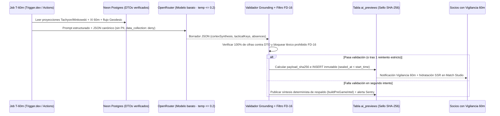

# Visión Técnica y de Producto Cuantitativo · Evolución `Spacetime Suite v2.1` hacia F4

- **Rama base:** `gemini-reestructura`
- **Audiencia:** Fundador (Jair) y Claude (sesión de arquitectura e implementación F4)
- **Fecha:** `2026-11-10`
- **Decisiones rectoras vinculadas:** [ADR-007](../architecture/adr/ADR-007-base-de-datos-postgresql-en-neon-drizzle-historico.md), [ADR-009](../architecture/adr/ADR-009-modelos-en-python-por-lotes-la-tabla-de-prediccion.md), [ADR-013](../architecture/adr/ADR-013-pitchlab-ai-openrouter-modelo-barato-w5.md), [ADR-014](../architecture/adr/ADR-014-fuentes-de-datos-gratuitas-en-la-fase-inicial.md), [ADR-023](../architecture/adr/ADR-023-smoked-glass-maestro-ui-physics.md), [ADR-024](../architecture/adr/ADR-024-hybrid-snapshot-spacetime-quant-engine.md) y [ADR-025](../architecture/adr/ADR-025-zero-leak-subscription-tipstar-referrals.md).
- **Documentos hermanos:** [VISION_REESTRUCTURA_CLAUDE_DS_UX.md](VISION_REESTRUCTURA_CLAUDE_DS_UX.md) y [VISION_REESTRUCTURA_CLAUDE_GROWTH.md](VISION_REESTRUCTURA_CLAUDE_GROWTH.md).
- **Vocabulario canónico:** [GLOSSARY.md](../../GLOSSARY.md).

---

## 1. Tesis de Producto: Del Visor Estadístico al «Super-Tipster Cuantitativo»

En México y Latinoamérica el mercado deportivo de paga está polarizado entre dos extremos rotos: por un lado, *tipsters* informales en Telegram/WhatsApp que venden corazonadas sin registro auditable ni control de varianza; por el otro, tableros estadísticos académicos que muestran un frío `48 % / 25 % / 27 %` y obligan al usuario a traducir por su cuenta cómo cubrir riesgo, qué cuota exigirle a su casa o qué combinaciones chocan entre sí.

La re-versión ejecutada en `gemini-reestructura` posiciona a **PitchLab** —bajo una única membresía **Pase Total** (\$299 MXN/mes o \$2,390 MXN/año)— como una **estación cuantitativa integral** donde cada partido pasa por una cadena de cinco motores especializados (**PitchLab Spacetime Suite v2.1**) auditados por **Calibración Horizon**:

1. **Multi-Picks estructurados (4 a 5 ángulos por partido):** en lugar de un tip aislado, cada encuentro entrega cinco selecciones tipadas por perfil de riesgo en Unidades Simuladas (`0.75u` a `2.0u`): *Pick Principal PitchLab*, *Escudo Conservador*, *Línea de Totales*, *Lectura Táctica* y *Cuota Alta · Valor*.
2. **Momio Justo y ventaja en vivo (`Geodesic v1.0`):** elimina el margen oculto (*vig*) para mostrar la cuota limpia del evento y permite al socio teclear el momio exacto de su casa (americano o decimal) para conocer al instante su ventaja real en puntos porcentuales (`+Edge`).
3. **Boleto Combinado y Mismo Partido (`SGP`) sin contradicciones:** un Auto-Armador en 4 pasos y constructor manual que bloquea colisiones lógicas de mercado y amortigua explícitamente la correlación cuando dos selecciones provienen del mismo encuentro.
4. **Props Lab de distribución continua:** evaluación interactiva de líneas alternativas individuales (`− / +` y retorno a `Base`) para NFL y fútbol con probabilidad recalculada al vuelo, Momio Justo y sellado directo en la **Bitácora**.
5. **Radiografía Previa y Vigilancia 60m (`Cortex IA`):** síntesis ejecutiva sin alucinaciones conectada exclusivamente a las matrices numéricas de la Suite, confirmando cuadros titulares, bajas de última hora y divergencias entre flujo de dinero (`¿Dónde está el dinero?` / `Consenso vs. Suite`) sesenta minutos antes del silbatazo inicial.

### 1.1 Frontera Estricta FD-16: Identidad Propietaria vs. Implementación Interna

Por regla innegociable de marca y protección de propiedad intelectual (**FD-16**), **ninguna superficie de UI, JSON hidratado al navegador ni boleto compartible** puede mencionar nombres de estimadores estadísticos académicos ni proveedores externos de ingesta (salvo las atribuciones legales obligatorias circunscritas a `/legal/creditos` y metadatos requeridos por CC-BY).

| Motor / Capa Pública (UI Comercial) | Pilar Declarado | Rol en Producto | Base Actual en `gemini-reestructura` | Evolución Productiva en `F4+` |
|---|---|---|---|---|
| **PitchLab Tachyon v2.1** | Data Science | Fútbol puro: goles esperados, `1X2`, totales y marcadores probables (6 → 23 ligas) | `@pitchlab/models` (`dixon-coles.ts` MLE con decaimiento + mezcla 50/50 `elo.ts` + `calibration.ts`) sobre snapshots reales | Matriz bivariada enriquecida con tiros a puerta / proxies xG, descanso, altitud/viaje (Liga MX) y calibración isotónica/temperatura por liga |
| **PitchLab Singularity v2.1** | Machine Learning | Detección de valor institucional multi-mercado, *Escudo Conservador* y *Lectura Táctica* | Selector estructurado en `match-picks-engine.ts` sobre `marketGroups` y pulsos de liquidez (`market-pulse.json`) | Meta-modelo apilado (probabilidad deportiva pura + velocidad de apertura/consenso + shrinkage anti-ruido) optimizado para batir línea de cierre (`CLV`) |
| **PitchLab Minkowski v2.1** | Data Science | Especialista NFL: margen, totales, trincheras, impacto de QB titular/suplente y clima | `@pitchlab/models` (`nfl/ratings.ts` + `nfl/analyze.ts`) + artefacto validado `services/models/nfl_blend.py` (LightGBM situacional) | Pipeline batch automatizado martes/jueves sobre `nflverse` CC-BY, mezcla discreta en números clave NFL (`3, 7, 6, 10, 14`) y prior de caída `QB1 → QB2` a 60m |
| **PitchLab Geodesic v1.0** | Machine Learning | De-vigging, Momio Justo, calculadora de ventaja en vivo y correlación `SGP` | `parlay-engine.ts` (`OPPOSING_GROUPS`, factor `SGP` `0.95^k`) + calculadora interactiva `parseUserOdds` en estudio, momios y props | Ingesta programada `The Odds API` (`odds_snapshot` + `odds_open_close`), de-vigging Shin/Power multi-casa, suma exacta en rejilla bivariada (fútbol) y cópula `(Margen, Total)` (NFL) |
| **PitchLab Cortex IA** | Inteligencia Artificial | Síntesis ejecutiva pre-partido y corte oficial **Vigilancia 60m** de alineaciones y bajas | `buildPreGameIntel` determinista en `match-picks-engine.ts` coherente con proyección, descanso y `marketPulse` | Job batch T-60m vía `OpenRouter` (`ADR-013`) sobre DTOs de solo lectura, validador determinista de grounding numérico y sello inmutable `SHA-256` pre-kickoff en `ai_previews` |
| **Calibración Horizon** | Auditoría Transversal | Contraste público entre probabilidad prometida y frecuencia real de acierto (`4` bandas, `ECE`) | `PRECISION_BUCKETS` en `spacetime-catalog.ts` + `fitTemperature` / `expectedCalibrationError` en `@pitchlab/models` | Agregación walk-forward automática sobre tabla `predictions` (`kind = 'live'` separado estrictamente de `kind = 'retro'`) y alertas de drift (`ECE > 0.05`) |

---

## 2. Auditoría Honesta en `gemini-reestructura`: Qué Es Real Hoy vs. Qué Es Puente Pre-F4

Para que Claude aborde **F4** sin regresiones ni suposiciones erróneas, es indispensable distinguir con exactitud quirúrgica qué partes del flujo cuantitativo ya operan con datos y modelos reales y cuáles funcionan hoy como **adaptadores deterministas puros** sobre esos snapshots.

```mermaid
flowchart LR
  ING["services/ingest + @pitchlab/models"] --> SNAP["data/snapshots/<liga>/latest.json + market-pulse.json"]
  SNAP --> SRV["apps/web/src/server/snapshots.ts (Zod + matchForClient FD-16)"]
  SRV --> PDATA["apps/web/src/server/platform-data.ts (Cero-Fuga SSR)"]
  PDATA --> MPE["packages/ui/src/platform/match-picks-engine.ts (5 Multi-Picks + Mercados + Props + Cortex)"]
  MPE --> PAR["packages/ui/src/platform/parlay-engine.ts (Bloqueo contradicciones + SGP)"]
  PAR --> UI["Superficies v4.1 (Club /app/* y Públicas)"]
```

### 2.1 Capacidades 100 % Reales y Verificadas Hoy en el Repositorio

1. **Snapshots reales de 7 competiciones (`data/snapshots/<liga>/latest.json`):** `liga-mx`, `premier-league`, `laliga`, `bundesliga`, `serie-a`, `ligue-1` y `nfl`, validados con `LeagueSnapshotSchema` y `assertNotDemoInProduction` en `apps/web/src/server/snapshots.ts`, con invalidación en memoria por `mtime`.
2. **Motores estadísticos base auditados en `@pitchlab/models` y `services/models`:**
   - **Fútbol (`analyzeFootballGameV2`):** ajuste Dixon-Coles con decaimiento temporal mezclado 50/50 con ratings incrementales Elo (`outcomeBlend`), produciendo probabilidades reales para `1X2`, `Doble oportunidad`, `Goles totales (1.5, 2.5, 3.5)`, `Ambos anotan`, `Goles por equipo` y `Marcador exacto`.
   - **NFL (`analyzeNflGameV2` + `services/models/nfl_blend.py`):** ratings ofensivos/defensivos ajustados por fuerza de calendario con proyecciones normales de margen ($\sigma_{\text{margin}}$) y total ($\sigma_{\text{total}}$), más un modelo LightGBM situacional validado out-of-sample (2020–2026: mejora el log-loss de moneyline de `0.6691` a `0.6433` combinando descanso, post-bye, clima y `qb_shrunk_epa_diff`).
   - **Calibración matemática (`packages/models/src/calibration.ts`):** escalamiento por temperatura `fitTemperature` y cálculo exacto de `expectedCalibrationError` sobre 10 bins.
3. **Saneamiento FD-16 y Redacción Cero-Fuga en Servidor:**
   - `matchForClient()` en `apps/web/src/server/snapshots.ts` elimina `steps`, `why`, `trace` y `confidence.reasons` internos antes de construir el estado de plataforma.
   - `loadPublicPlatformState()` en `apps/web/src/server/platform-data.ts` invoca `redactDatasetForVisitor()` (`packages/ui/src/platform/access-guard.ts`) antes del renderizado RSC, sustituyendo etiquetas y síntesis de juegos no finalizados (`status !== "FT"`) por marcadores neutros salvo el único *Pick Abierto del Día* y el *Pick Abierto de la Semana* del Tipstar.
4. **Liquidación Post-Partido (`FT`), Bloqueo de Contradicciones y Calculadora de Momio del Usuario:**
   - `gradePick()` califica automáticamente selecciones de partidos `FT` usando `selectionHolds` (`@pitchlab/contracts`).
   - `checkParlayCompatibility()` (`parlay-engine.ts`) aplica el grafo simétrico `OPPOSING_GROUPS` y las reglas de `2–6` patas y `SGP` (`1` selección por juego sin SGP; hasta `2` compatibles con SGP).
   - `parseUserOdds()` permite ingresar cualquier cuota americana (`-110`, `+145`) o decimal (`1.91`, `2.45`) en Match Studio, Parlay Builder y Props Lab para recalcular ventaja real en vivo.

### 2.2 Adaptadores Deterministas Pre-F4 (Costuras que Claude Reemplazará por Persistencia Real)

| Función / Constante Actual | Ubicación | Qué hace hoy (Determinista con semilla FNV-1a `hashSeed`, cero `Math.random()`) | Por qué se diseñó así en Pre-MVP | Destino en `F4` |
|---|---|---|---|---|
| `buildSimulatedMarketDecimal` | `packages/ui/src/platform/match-picks-engine.ts` | Deriva una cuota de casa determinista alrededor de `fairDecimal` (diferencial implícito entre `-1.2` y `+5.4` pts) cuando el snapshot no incluye cuota real de casa | En fase `$0` aún no corre la captura continua de cuotas por mercado secundario en Postgres | Lectura real de `odds_snapshot` / `odds_open_close` (`The Odds API`), mostrando `"Sin cuota registrada — ingresa tu momio"` cuando un mercado secundario no tenga feed |
| `sgpFactor = 0.95^k` y `0.94` book | `packages/ui/src/platform/parlay-engine.ts` (`computeParlaySummary`) | Penaliza de forma conservadora cada par del mismo partido antes de invertir a cuota justa | Evita la sobreestimación ingenua $p_A \cdot p_B$ sin requerir la matriz bivariada completa en cliente | Suma exacta sobre la rejilla $11 \times 11$ de marcador en fútbol y cópula bivariada $(\text{Margen}, \text{Total})$ en NFL |
| `buildPreGameIntel` | `packages/ui/src/platform/match-picks-engine.ts` | Construye `cortexSynthesis`, `tacticalKeys`, `absences` y `moneyFlow` interpolando proyección real, `restDays` y `marketPulse` | Provee el contrato exacto de 3 columnas en Match Studio sin pagar llamadas LLM en cada visita | Tabla `ai_previews` poblada 60m antes del kickoff vía `OpenRouter` con validación numérica y hash `SHA-256` |
| `buildPlayerPropsCatalog` + `evaluatePropLineProbability` | `packages/ui/src/platform/match-picks-engine.ts` | Genera 4 arquetipos reales de club (`QB1`, `WR1`, `9 Titular`, `Organizador`) vinculados a juegos próximos del snapshot y evalúa el scrubber con CDF logística-normal ($\Phi(z) \approx (1 + e^{-1.702z})^{-1}$) | `The Odds API` cobra créditos por evento en mercados de props ([FREE_DATA_STRATEGY.md](../architecture/FREE_DATA_STRATEGY.md) §2) | Tabla `player_prop_projections` alimentada por `nflverse` `player_weekly` y stats de jugador por liga, con distribución Binomial Negativa (conteos) y Normal/Student-$t$ con shrinkage (yardas) |
| `SPACETIME_METRICS_HEADLINE` y `PRECISION_BUCKETS` | `packages/ui/src/platform/spacetime-catalog.ts` | Constantes editoriales de referencia (`+358,400` juegos, `0.009 ECE`, `69.6 %` beat close y 4 bandas de calibración) | Fija la narrativa visual y las tarjetas de `/metodologia` en el *Prototipo Maestro* | Consultas agregadas sobre `evaluations` y `horizon_bucket_rollups` distinguiendo corpus histórico auditado vs. récord `live` registrado |

---

## 3. Evolución Productiva de los Cinco Motores de `Spacetime Suite v2.1`

### 3.1 `PitchLab Tachyon v2.1` · Data Science de Fútbol Puro

**Lección empírica ya demostrada en el repositorio (`services/models/README.md`):**
Al entrenar un LightGBM walk-forward (`services/models/train_gbm.py`) sobre las 12 features actuales sin xG ni alineaciones, el boosting quedó entre `+0.0015` y `+0.0027` de log-loss por detrás de la mezcla 50/50 de Dixon-Coles y Elo (IC 95 % incluye el `0`). Es decir: **sobre resultados puros, la mezcla paramétrica Dixon-Coles + Elo ya extrae casi toda la señal disponible; el salto real proviene de mejores covariables pre-partido, no de cambiar el clasificador a ciegas.**

**Hoja de ruta hacia producción en F4:**
1. ** Enriquecimiento de covariables pre-partido (`available_at <= predicted_at`):**
   - Incorporar diferencial de tiros a puerta / estimador xG as-of (`services/ingest/src/history/xg-estimate.ts` y `native-stats`), congestión de calendario (minutos acumulados en ventana de 10 días) y, específicamente para **Liga MX**, **diferencial de altitud** ($\Delta \text{msnm}$ entre sedes como Toluca/CDMX/Pachuca frente a nivel del mar) y viaje corto de media semana.
2. **Matriz bivariada canónica exportada a `predictions`:**
   - Persistir para cada partido de las 6 ligas actuales (y expansión progresiva hacia las 23 ligas del catálogo histórico) tanto el vector de parámetros $(\lambda_{\text{home}}, \lambda_{\text{away}}, \rho_{\text{DC}}, T_{\text{cal}})$ como las probabilidades calibradas de todos los mercados derivados (`h2h`, `double_chance`, `totals` `1.5/2.5/3.5`, `btts`, `team_totals`, `correct_score`).
   - Conservar la matriz compacta $11 \times 11$ ($0\text{–}10$ goles por lado, 121 flotantes cuantizados) en `prediction.meta_json` para que `Geodesic v1.0` resuelva parlays `SGP` de fútbol por suma exacta de celdas sin aproximaciones heurísticas.

### 3.2 `PitchLab Singularity v2.1` · Machine Learning de Valor Institucional Multi-Mercado

**Problema cuantitativo que resuelve:**
Cuando un modelo deportivo puro discrepa del mercado por `+6` puntos porcentuales, pueden ocurrir dos cosas opuestas: o la casa dejó una línea colgada/sesgada por dinero público (oportunidad real con `+CLV`), o el mercado ya descontó información contextual que el modelo base aún no vio.

**Hoja de ruta hacia producción en F4:**
1. **Filtro de divergencia con shrinkage hacia consenso sin vig:**
   - `Singularity v2.1` toma como entrada la probabilidad deportiva de `Tachyon v2.1` / `Minkowski v2.1` ($p_{\text{sport}}$), la probabilidad limpia de apertura ($p_{\text{open, novig}}$), la mediana actual sin vig entre casas ($p_{\text{mkt, novig}}$), la dispersión inter-casas ($\sigma_{\text{books}}$) y el sesgo de volumen público (`market_pulse`):
     $$p_{\text{singularity}} = w(\tau, \sigma_{\text{books}}, \Delta_{\text{open}}) \, p_{\text{sport}} + \bigl(1 - w(\tau, \sigma_{\text{books}}, \Delta_{\text{open}})\bigr) \, p_{\text{mkt, novig}}$$
   - Donde el peso $w \in [0, 1]$ se aprende out-of-sample por ventana walk-forward maximizando **CLV esperado y log-loss conjuntamente**, encogiendo discrepancias espurias cerca del cierre cuando todas las casas líquidas convergen y amplificando señales tempranas cuando una casa minorista queda rezagada respecto al movimiento institucional.
2. **Selección óptima de los 5 `Multi-Picks` por partido:**
   - Reemplazar las reglas heurísticas de `buildFiveMatchPicks` por un optimizador determinista con restricciones por ranura:
     - *Ranura 1 (`principal`):* $\arg\max \text{Utility}(p, \text{edgePts})$ sujeto a $p \in [0.54, 0.72]$ en mercados líquidos primarios (`h2h`, `spreads`, `totals`).
     - *Ranura 2 (`conservador` · Escudo):* $\arg\max p$ sujeto a $p \in [0.72, 0.89]$ y $\text{edgePts} \ge -0.5$, garantizando baja varianza para constructores de Parlays.
     - *Ranura 3 (`totales`):* mejor línea Over/Under por información mutua con el ritmo proyectado.
     - *Ranura 4 (`tactico`):* mejor mercado asimétrico (`btts`, `team_totals`, `spread` alternativo) distinto de las ranuras 1–3.
     - *Ranura 5 (`valor` · Cuota Alta):* $\arg\max \text{EV}$ sujeto a $d_{\text{justo}} \ge 2.00$ ($p \in [0.35, 0.50]$) y $\text{edgePts} > 0$.

### 3.3 `PitchLab Minkowski v2.1` · Data Science Especialista en NFL

**Ventaja competitiva ya validada en el código:**
`services/models/artifacts/nfl_blend/metadata.json` demuestra sobre `6,630` juegos NFL hasta 2026 que mezclar los ratings ajustados por rival (`weightRatings = 0.40`) con el LightGBM situacional de 19 variables (`rest_diff`, `home_post_bye`, `away_post_bye`, `div_game`, `is_dome`, `temp`, `wind`, `rolling4_net_diff`, `qb_shrunk_epa_diff`, `week`) reduce sustancialmente la pérdida logarítmica frente a ratings puros (`0.6691 → 0.6433`).

**Hoja de ruta hacia producción en F4:**
1. **Promoción del artefacto `nfl_blend` de `research-only` a pipeline `live`:**
   - Ejecutar dos corridas programadas por semana en temporada NFL sobre `nflverse` CC-BY 4.0 (manteniendo el bloqueo estricto contra tablas FTN `CC-BY-SA 4.0` documentado en [FREE_DATA_STRATEGY.md](../architecture/FREE_DATA_STRATEGY.md)):
     - **Corte Martes Post-MNF (Apertura):** recalcula EPA encogido por intento de cada QB, actualiza ratings de trincheras/eficiencia y publica líneas tempranas.
     - **Corte Jueves Pre-TNF y Domingo T-90m (Inactivos NFL):** re-ejecuta `nfl_predict.py` sustituyendo `home_qb_shrunk_epa_per_att` / `away_qb_shrunk_epa_per_att` cuando cambia el Quarterback titular reportado y actualiza viento/temperatura en estadios abiertos.
2. **Distribución discreta consciente de números clave NFL (*Key Numbers*):**
   - En lugar de evaluar spreads alternativos (`+7.5`, `-2.5`, `-3.5`) únicamente con `normalCdf` continua (`packages/models/src/nfl/analyze.ts`), `Minkowski v2.1` proyectará una distribución discreta de margen $\Delta = S_{\text{home}} - S_{\text{away}}$ reponderando masa empírica en los márgenes canónicos de NFL (`±3` ~15 %, `±7` ~9 %, `±6`, `±10`, `±4`, `±14`). Esto evita subestimar drásticamente el valor protector de cruzar el `+3` o el `+7` en el *Escudo Conservador* (`+7.5`).

### 3.4 `PitchLab Geodesic v1.0` · De-Vigging Institucional, Movimiento de Línea y Correlación SGP

`Geodesic v1.0` es el puente financiero-matemático entre las probabilidades de la Suite y los precios reales del mercado. Su evolución en **F4** abarca tres frentes:

1. **Ingesta escalonada de cuotas reales (`The Odds API` → `odds_snapshot` + `odds_open_close`):**
   - **Día 1 (Presupuesto `$0` · 500 créditos/mes):** el job `ingest-odds-snapshots` captura `h2h`, `spreads` y `totals` siguiendo el calendario de [FREE_DATA_STRATEGY.md](../architecture/FREE_DATA_STRATEGY.md) §3, leyendo encabezados de cuota restante para detenerse antes de agotar la reserva y priorizando la captura previa al inicio (cierre aproximado con columna `close_minutes_before_start` explícita).
   - **Escalamiento por ingresos (20K créditos · US$30/mes → 100K créditos · US$59/mes):** un único cambio de configuración amplía la frecuencia a cada 15–30 minutos en día de juego, habilita las 7 ligas completas con múltiples casas de referencia en México/EE. UU./Europa y desbloquea cuotas reales de `Player Props`.
2. **De-vigging de precisión (Método de Shin / Potencia sobre Consenso):**
   - Para mercados de 2 vías parejos el método multiplicativo basta, pero en mercados `1X2` de fútbol con favoritos pesados o cuotas largas (`Cuota Alta · Valor`), el margen de la casa se concentra desproporcionadamente en el *longshot*. `Geodesic v1.0` implementará **de-vigging por método de potencia (Power Method)** resolviendo $k > 1$ tal que $\sum_i (1/d_i)^k = 1$, definiendo la probabilidad limpia de cada casa como $q_i = (1/d_i)^k$ y el consenso como la mediana $\operatorname{med}_b(q_{i,b})$.
   - El **CLV auditado en Bitácora** se calculará de forma inmutable al cerrar el mercado como:
     $$\text{CLV (\%)} = \left(\frac{d_{\text{usuario}}}{d_{\text{cierre, justo}}} - 1\right) \times 100 = \bigl(d_{\text{usuario}} \cdot q_{\text{cierre, consenso}} - 1\bigr) \times 100$$
3. **Correlación `SGP` exacta (reemplazo del factor escalar `0.95^k`):**
   - **En Fútbol (`Tachyon` $\to$ `Geodesic`):** cualquier par `SGP` de mercados de equipo sobre un mismo partido $(M_1, M_2)$ se evalúa sumando exactamente las celdas compatibles de la matriz bivariada $11 \times 11$ de marcador:
     $$P(M_1 \cap M_2) = \sum_{h=0}^{10} \sum_{a=0}^{10} \mathbf{1}\{(h,a) \in M_1\} \cdot \mathbf{1}\{(h,a) \in M_2\} \cdot P(H=h, A=a)$$
     Si $P(M_1 \cap M_2) = 0$, el par queda bloqueado automáticamente como contradicción matemática exacta; si $P(M_1 \cap M_2) > 0$, `Geodesic` muestra tanto el factor de interacción real $\gamma = \frac{P(M_1 \cap M_2)}{P(M_1)P(M_2)}$ (positivo o negativo) como el Momio Justo conjunto exacto $1 / P(M_1 \cap M_2)$.
   - **En NFL (`Minkowski` $\to$ `Geodesic`):** evaluación sobre una cópula gaussiana bivariada $(\text{Margen } M, \text{Total } T)$ con matriz de covarianza condicionada a la magnitud del spread (capturando la correlación empírica entre favoritos que cubren y totales altos o juegos divisionales cerrados de bajo puntaje).

### 3.5 `PitchLab Cortex IA` · Síntesis 60m Grounded en OpenRouter e Inmutabilidad `SHA-256`

En `gemini-reestructura`, `Cortex IA` no es un chatbot libre donde el usuario conversa sin rumbo, sino ante todo el **autor verificable de la Radiografía Previa y del corte oficial Vigilancia 60m** en cada partido. En **F4** se materializa combinando el diseño de costo ultrabajo de [ADR-013](../architecture/adr/ADR-013-pitchlab-ai-openrouter-modelo-barato-w5.md) con garantías criptográficas pre-partido:

**Reglas arquitectónicas clave de `Cortex IA` en producción:**
1. **Costo $O(\text{partidos})$, nunca $O(\text{usuarios})$:** la Radiografía Previa y el corte 60m se generan **dos veces por encuentro** (una síntesis inicial al publicar la jornada y una actualización definitiva a `T-60m` al confirmarse alineaciones titulares / inactivos NFL). Con ~70 partidos semanales entre las 7 ligas y un costo de `~US$0.002–0.004` por corrida en OpenRouter, **el costo total de IA para toda la plataforma es menor a US$3.00 al mes**, independientemente de si la leen 100 o 50,000 suscriptores.
2. **Cero alucinaciones por construcción (Grounding Determinista + Fallback Seguro):**
   - El validador del servidor extrae toda expresión numérica del JSON devuelto por el modelo (porcentajes, goles/puntos proyectados, días de descanso, cuotas, minutos) y exige correspondencia exacta (dentro de tolerancia de redondeo $\pm 0.1$) con el DTO de entrada.
   - Un segundo filtro rechaza cualquier aparición de términos internos prohibidos por **FD-16** (nombres de algoritmos o proveedores) o lenguaje prohibido de apuestas («apuesta segura», «dinero fácil», montos en efectivo).
   - Si tras un único reintento el modelo barato falla el validador, el job degrada limpiamente hacia el motor determinista actual (`buildPreGameIntel`), garantizando **100 % de disponibilidad y 0 % de alucinaciones publicadas**.
3. **Sello criptográfico pre-kickoff (`SHA-256`):**
   - Al insertar en `ai_previews` y `predictions` (`kind = 'live'`), el pipeline calcula `sha256` sobre el JSON canónico ordenado (`game_id`, `model_version_id`, `predicted_at`, `picks`, `cortex_synthesis`, `absences`) antes de `game.start_time`. Un trigger PostgreSQL bloquea cualquier `UPDATE` o `DELETE` una vez cruzado `start_time`, respaldando con evidencia matemática la insignia `Integridad SHA-256 · 0 fuga temporal` visible en `/metodologia`.

### 3.6 `Calibración Horizon` y `Player Props Lab` en Producción

#### A. Bandas Walk-Forward de `Calibración Horizon`
En producción, las cuatro bandas de `PRECISION_BUCKETS` (*Confianza Máxima · Escudo*, *Confianza Alta · Principal*, *Confianza Media · Balanceado* y *Alto Valor Arriesgado*) se calculan automáticamente tras cada jornada mediante el job `models-evaluate`:
- **Separación estricta `live` vs. `retro` ([PREDICTION_ARCHITECTURE.md](../architecture/PREDICTION_ARCHITECTURE.md) §2):** `/metodologia` y `/app/picks` distinguirán con total transparencia entre (a) el **Corpus Histórico Walk-Forward** (`kind = 'retro'` as-of sobre el acervo de investigación `+358,400` encuentros) y (b) el **Récord En Vivo Auditado** (`kind = 'live'`, selecciones selladas en base de datos antes del inicio desde el día 1 de operación).
- **Recalibración y alerta de deriva:** si el `ECE` móvil de los últimos 200 partidos de una liga supera `0.05`, se dispara alerta en `/app/admin` y se reajusta el parámetro de temperatura $T$ (`fitTemperature` en `@pitchlab/models`) sobre la ventana histórica cerrada antes de la siguiente jornada.

#### B. Distribuciones Reales en `Player Props Lab`
Para mantener la respuesta instantánea (`0 ms` de red al mover el scrubber `− / +` en `PropsLabClubView`) cuando se conecten datos reales de jugadores:
- **Conteos discretos (remates a puerta, goles, recepciones, pases de TD):** el job batch ajusta una distribución **Binomial Negativa** $(\mu, r)$ con shrinkage empírico de Bayes hacia el promedio posicional del equipo, ponderando minutos/snaps esperados y fortaleza defensiva rival.
- **Variables continuas de yardaje (yardas por pase, recepción, acarreo):** ajuste de media y dispersión $(\mu, \sigma, \nu)$ con shrinkage sobre los últimos 10 juegos (`player_game_stat` desde `nflverse` `player_weekly`).
- **Contrato ligero hacia cliente:** la tabla `player_prop_projections` entrega `(projectionMean, projectionSd, distributionKind, dispersionParam, last10, baseLine)` para que `evaluatePropLineProbability()` evalúe en cliente la CDF exacta (Binomial Negativa o Student-$t$ / logística-normal) en cada clic del stepper, conservando intacta la calculadora `Geodesic` donde el socio ingresa su propio momio Over/Under mientras no se active el plan de 100K créditos de `The Odds API`.

---

## 4. Mapa de Contratos y Esquema Relacional F4 (`packages/ui` ↔ `packages/db`)

La gran ventaja de [ADR-024](../architecture/adr/ADR-024-hybrid-snapshot-spacetime-quant-engine.md) es que `packages/ui` ya consume el contrato final `PlatformDataset`. En **F4**, Claude solo debe reemplazar el origen de `apps/web/src/server/platform-data.ts` para hidratar ese mismo grafo desde Neon PostgreSQL + Drizzle ORM:

| Contrato actual en `@pitchlab/ui` | Tabla(s) destino en `packages/db` (F4) | Columnas críticas nuevas o reforzadas | Regla de inmutabilidad / seguridad |
|---|---|---|---|
| `MatchPick` (`5` picks por juego) | `prediction` + vista/tabla `prediction_multi_picks` | `slot_index (1..5)`, `category`, `risk_band`, `engine_key`, `conflict_group`, `suggested_units`, `p`, `fair_decimal`, `score_matrix_compact?`, `payload_sha256` | Trigger rechaza `UPDATE`/`DELETE` cuando `kind = 'live'`; `predicted_at < game.start_time` obligatorio |
| `PlatformMarketRow` + `/app/momios` | `odds_snapshot` (particionada mensual) + vista `odds_open_close` | `open_decimal`, `current_decimal`, `close_decimal`, `consensus_novig_p`, `close_minutes_before_start` | Solo inserción (`INSERT`-only); nunca exponer `bookmaker_id` crudo si restringe licencia, ni exportar feed crudo |
| `PreGameIntel` (`Cortex IA` 60m) | `ai_previews` + `lineup_confirmations` | `game_id`, `cut_type ('initial' \| 't60m')`, `cortex_synthesis`, `tactical_keys[]`, `absences_json`, `grounding_passed`, `model_slug`, `sealed_at`, `payload_sha256` | `sealed_at < game.start_time`; validación de grounding numérico + filtro FD-16 antes de `INSERT` |
| `PlayerPropItem` (`Props Lab`) | `player_prop_projections` + `player_game_stat` | `player_id`, `game_id`, `stat_key`, `base_line`, `step`, `projection_mean`, `projection_sd`, `dist_kind ('negbin' \| 'normal')`, `dispersion_r?`, `last10_values[]` | Atribución CC-BY a `nflverse` en pie legal; cuotas manuales marcadas como ingresadas por el socio en fase `$0` |
| `JournalEntry` (`Bitácora` + Parlays) | `journal_entries` + `journal_parlay_legs` | `user_id`, `origin_type`, `stake_units (0.25..5.0)`, `user_decimal`, `fair_decimal_at_seal`, `close_novig_decimal?`, `clv_pct?`, `sealed_at`, `entry_sha256` | Bloqueo estricto: `sealed_at < min(leg.game.start_time)`; inmutable tras sellarse para alimentar Ranking CLV y `Consenso vs. Suite` |
| `PrecisionBucket` (`Horizon`) | `evaluation` + `horizon_bucket_rollups` | `bucket_id ('shield' \| 'core' \| 'balanced' \| 'value')`, `kind ('live' \| 'retro')`, `promised_mean_p`, `actual_hit_rate`, `audited_count`, `closing_beat_rate`, `ece` | Nunca mezclar filas `retro` con `live` en el mismo agregado; etiquetado explícito en UI |
| `watchlistGameIds` (`Vigilancia 60m`) | `game_watchlist` | `user_id`, `game_id`, `notify_channel ('in_app' \| 'email' \| 'web_push')`, `notified_t60m_at?` | Reservado a socios con concesión activa de **Pase Total** (`entitlement_grants`) |

---

## 5. Preguntas Arquitectónicas Abiertas para Resolver entre el Fundador y Claude en F4

Antes o al inicio de la implementación de `packages/db` y los jobs productivos, recomendamos alinear estas **7 decisiones de diseño**:

1. **Etiquetado dual en `/metodologia` (Corpus `+358,400` vs. Récord `live` desde el Día 1):**
   - *Contexto:* En el arranque comercial habrá miles de partidos validados walk-forward (`retro`) pero pocas semanas de picks `live` sellados en producción.
   - *Recomendación:* Mantener las dos pestañas o insignias explícitas en `Calibración Horizon`: **«Entrenamiento & Backtest Walk-Forward (+358,400 juegos)»** y **«Auditoría En Vivo Club PitchLab (Temporada actual, sellado SHA-256)»**, conmutando el protagonismo al récord `live` conforme supere $n \ge 500$ selecciones liquidadas.
2. **Cobertura de `The Odds API` (500 créditos gratis vs. nivel de US$30/mes para 7 ligas):**
   - *Contexto:* El presupuesto gratuito de 500 créditos/mes ([FREE_DATA_STRATEGY.md](../architecture/FREE_DATA_STRATEGY.md) §3) alcanza holgadamente para **3 ligas núcleo** (`NFL`, `Premier League`, `Liga MX`) a ~5–6 snapshots semanales, pero queda justo si se suman `LaLiga`, `Bundesliga`, `Serie A` y `Ligue 1` al mismo ritmo.
   - *Pregunta para el fundador:* ¿En el Mes 1 operamos cuotas automáticas en las 3 ligas estelares (dejando calculadora manual `Geodesic` en las otras 4 europeas) para mantener costo `$0`, o activamos desde el lanzamiento el plan de **US$30/mes (20K créditos)** para cubrir las 7 ligas con actualización horaria?
3. **Licenciamiento comercial de Liga MX y estadísticas de jugadores de fútbol (`API-Football`):**
   - *Contexto:* `nflverse` (CC-BY) y `openfootball` (CC0) permiten cobro comercial inmediato, mientras que el plan Free de `API-Football` restringe derechos comerciales sobre competiciones ([FREE_DATA_STRATEGY.md](../architecture/FREE_DATA_STRATEGY.md) §1 y §5).
   - *Decisión requerida:* Confirmar proveedor/plan comercial para **Liga MX** antes de abrir cobro abierto fuera de la beta privada, manteniendo toda ingesta detrás de `ProviderAdapter` para que cambiar la fuente no toque ni una línea de `Tachyon v2.1` ni de la UI.
4. **Fuente primaria para confirmación de alineaciones `T-60m` (`Cortex IA` y `Vigilancia 60m`):**
   - *Contexto:* En NFL la lista oficial de inactivos se publica 90 minutos antes del kickoff; en fútbol los once titulares salen entre 60 y 75 minutos antes.
   - *Recomendación:* Usar `nflverse` / feeds oficiales de roster activo en NFL y `API-Football` `/fixtures/lineups` (1 llamada por partido exactamente en `kickoff - 58 min`, consumiendo solo ~45–60 llamadas por fin de semana dentro del límite gratuito de 100/día) para disparar el job `cortex-t60m`.
5. **Alcance de `SGP` en `ParlayBuilder` respecto a `Player Props`:**
   - *Contexto:* Hoy `SGP` une hasta 2 mercados de equipo del mismo partido (`MatchPick`). Los usuarios avanzados suelen preguntar si pueden combinar un *Pick de Partido* con un *Player Prop* del mismo encuentro (p. ej. `Chiefs gana + QB1 Más de 248.5 yardas`).
   - *Recomendación para F4.1:* Mantener en F4.0 `SGP` restringido a mercados de equipo (donde la matriz $11 \times 11$ de fútbol y la cópula `(Margen, Total)` de NFL dan correlación exacta) y dejar `SGP + Props` para F4.2 una vez estimada la matriz empírica de correlación jugador-guion en DuckDB.
6. **Canal de entrega de `Vigilancia 60m` sin inflar costos variables:**
   - *Recomendación:* Implementar **Web Push (VAPID nativo en PWA/navegador, costo US$0)** más bandeja interna en tiempo real como canal primario de `Vigilancia 60m`, reservando correo transaccional (`Resend`) únicamente para resúmenes de cuenta/facturación CFDI para no agotar cupos diarios gratuitos.
7. **Regla de liquidación de `CLV` cuando un snapshot de cierre tiene más de 60 minutos de antigüedad:**
   - *Recomendación:* Si `close_minutes_before_start <= 90`, computar `clv_pct` oficial para el **Ranking CLV** de la Comunidad VIP; si por caída de proveedor el último snapshot quedó a `> 90 min` del inicio, liquidar unidades normalmente en la `Bitácora` pero marcar `clv_status = 'approx_stale'` y excluir ese pick del cálculo del leaderboard para evitar arbitraje sobre líneas viejas.

---

## 6. Secuencia de Hitos de Ingeniería en F4 para Claude (`F4-Q1` → `F4-Q6`)

Esta secuencia permite migrar el motor cuantitativo de `gemini-reestructura` hacia producción manteniendo la app desplegable y con tests en verde tras cada PR:

| Hito | Paquetes objetivo | Entregable concreto | Compuerta de verificación (DoD) |
|---|---|---|---|
| **F4-Q1 · Esquema Cuantitativo e Inmutabilidad** | `packages/db`, `packages/contracts` | Migraciones Drizzle para `model`, `model_version`, `prediction` (con `score_matrix_compact` y `payload_sha256`), `odds_snapshot` particionada, `odds_open_close`, `ai_previews`, `player_prop_projections` y `journal_entries`, más triggers SQL anti-mutación post-kickoff | Tests de integración sobre branch efímero de Neon verificando que `UPDATE`/`DELETE` en `prediction(kind='live')` y `journal_entries` selladas fallen con error SQL |
| **F4-Q2 · Jobs Batch `Tachyon v2.1` y `Minkowski v2.1`** | `services/models`, `packages/models`, `.github/workflows` | Integración productiva de `nfl_blend` + distribución de números clave NFL y exportación de matrices bivariadas $11 \times 11$ de fútbol hacia `prediction`, con gate automático de no-fuga temporal (`available_at <= predicted_at`) | CI falla si cualquier feature usa datos posteriores a `predicted_at`; suma de celdas bivariadas $= 1 \pm 10^{-6}$; `ECE <= 0.03` en ventana walk-forward |
| **F4-Q3 · `Geodesic v1.0` Real + SGP Exacto** | `services/ingest`, `packages/ui/src/platform/parlay-engine.ts` | Adaptador `The Odds API` con control automático de presupuesto de créditos, de-vigging por método de potencia (Power/Shin), reemplazo de `buildSimulatedMarketDecimal` por lecturas reales y cálculo `SGP` exacto sobre matriz $11 \times 11$ / cópula NFL | Pruebas unitarias en Vitest comprobando incompatibilidad exacta ($P(A \cap B) = 0$), monotonía de probabilidades conjuntas y cálculo de `CLV` contra `odds_open_close` |
| **F4-Q4 · `Singularity v2.1` Meta-Selector de 5 Picks** | `packages/models`, `packages/ui/src/platform/match-picks-engine.ts` | Optimizador determinista de las 5 ranuras (`principal`, `conservador`, `totales`, `tactico`, `valor`) con shrinkage hacia consenso sin vig y persistencia previa al kickoff | Cada partido próximo en las 7 ligas emite 5 `Multi-Picks` sin etiquetas duplicadas, respetando bandas de probabilidad y `PickConflictGroup` |
| **F4-Q5 · Pipeline `Cortex IA` T-60m + Sello `SHA-256`** | `packages/ai` (nuevo), `services/ingest`, `apps/web` | Job programado a `T-60m` conectado a `@openrouter/ai-sdk-provider` (`data_collection: "deny"`), validador numérico determinista, filtro léxico **FD-16**, fallback automático a `buildPreGameIntel`, sello `SHA-256` en `ai_previews` y disparo Web Push para **Vigilancia 60m** | Suite de evaluación de 40 casos reales (`>= 90 %` grounding a la primera, `0 %` alucinaciones tras fallback, `0` fugas FD-16) |
| **F4-Q6 · Costura Final `platform-data.ts` y `Props Lab` Real** | `apps/web/src/server/platform-data.ts`, `services/ingest` | Conmutación de `buildServerRawPlatformDataset()` hacia repositorios Drizzle con caché incremental + ingesta de `player_prop_projections` reales (Binomial Negativa / Normal con shrinkage), manteniendo intacta la redacción `redactDatasetForVisitor()` | `pnpm lint`, `pnpm typecheck`, `pnpm test` y suite Playwright E2E completas en verde con `0` fugas en HTML público SSR |
