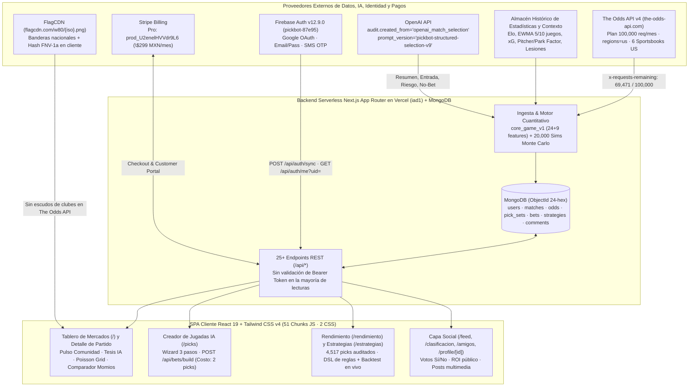

# 01 — Resumen Ejecutivo y Veredicto Forense Integral de PickBot (`pickbot.mx`)

> **Objetivo Auditado:** `https://www.pickbot.mx/` (`deployment_id: dpl_7NUCdW69BaU9CMQePVhfQtRBwC3n`)  
> **Directorio Aislado del Dossier:** `pickbot/` (Worktree `explore_pickbot_architecture`)  
> **Motor Forense:** REA (`rea-agents@6.8.0`, Skill `reverse-engineer-anything`) — **49 registros `ev_*` retenidos en sesión + 2 `ev_*` de exportación `AgentEnv`**, **5 incógnitas formales `unk_*` (6 revisiones: 1 resuelta y verificada `valid: true, truthVerified: true` + 4 abiertas de severidad `low`)**, y **171 artefactos verificados por SHA-256 (`58,558,363` bytes / `55.85 MiB`)**  
> **Índice Maestro y Registro de Evidencias:** [README.md](file:///C:/Users/T490s/.gemini/antigravity/worktrees/PitchLab/explore_pickbot_architecture/pickbot/README.md) · [05-evidence-register.md](file:///C:/Users/T490s/.gemini/antigravity/worktrees/PitchLab/explore_pickbot_architecture/pickbot/reports/05-evidence-register.md) · [rea-evidence-summary.json](file:///C:/Users/T490s/.gemini/antigravity/worktrees/PitchLab/explore_pickbot_architecture/pickbot/evidence/rea-evidence-summary.json)

---

## 1. Síntesis Ejecutiva: ¿Qué es y cómo funciona PickBot (`pickbot.mx`)?

**PickBot (`https://www.pickbot.mx/`)** es una plataforma web y móvil (`iOS App Store ID: 6776936420`) de pronósticos deportivos cuantitativos, comparación de momios, simulación Monte Carlo, backtesting de estrategias y red social de apostadores orientada al mercado hispanohablante (con huso horario maestro `America/Mexico_City` y cobro en pesos mexicanos `MXN`).

> [!IMPORTANT]
> **Veredicto Arquitectónico Central (`[OBSERVADO]`):** A diferencia de lo que aparenta su interfaz conversacional y su modal animado de *"IA analizando jugadores, momios e historial"*, PickBot **no consulta un LLM en tiempo real cada vez que un usuario abre un partido**. Es un monolito serverless en **Next.js App Router + Turbopack** desplegado en **Vercel** (`iad1` US-East) respaldado por **Firebase Authentication (`pickbot-87e95`)** y **MongoDB**, donde un pipeline híbrido precalcula y almacena documentos `pick_set` por partido combinando: **(1)** momios de **The Odds API v4** (`regions=us`, plan de `100,000` créditos/mes), **(2)** un modelo supervisado **ML (`core_game_v1`)** + **20,000 simulaciones Monte Carlo**, y **(3)** síntesis narrativa estructurada con **OpenAI (`openai_match_selection`, `pickbot-structured-selection-v9`)**.

---

## 2. Respuesta Directa a las Preguntas Clave de la Auditoría

### 2.1 ¿De dónde obtiene PickBot los datos deportivos, momios y escudos? (`[OBSERVADO]` — `truthVerified: true`)

La incógnita formal `unk_3c9b39a9352dda731d4f16f01b336135e7ee9528232b9ba0aae51deb232cd6e1` fue resuelta y verificada criptográficamente en REA ([rea-unknowns.json](file:///C:/Users/T490s/.gemini/antigravity/worktrees/PitchLab/explore_pickbot_architecture/pickbot/evidence/rea-unknowns.json)) mediante las capturas [19-api_match_ucl_galatasaray_aston_villa.json](file:///C:/Users/T490s/.gemini/antigravity/worktrees/PitchLab/explore_pickbot_architecture/pickbot/evidence/network-schemas/19-api_match_ucl_galatasaray_aston_villa.json) y [19-api_match_ligamx_queretaro_monterrey.json](file:///C:/Users/T490s/.gemini/antigravity/worktrees/PitchLab/explore_pickbot_architecture/pickbot/evidence/network-schemas/19-api_match_ligamx_queretaro_monterrey.json):

| Dominio de Datos | Proveedor / Fuente Confirmada | Prueba Forense Irrefutable (`[OBSERVADO]`) |
|---|---|---|
| **Calendario de partidos, marcadores en vivo/finales y momios multi-casa** | **The Odds API v4 (`the-odds-api.com`)** | `event_id` hexadecimal MD5 de 32 caracteres (`e422af92d1fc06c0a330838c1c2f2e08`), taxonomía exacta de **33 `sport_key`s** (`basketball_nba`, `soccer_mexico_ligamx`, `baseball_mlb`, etc.), `regions: "us"`, `odds_format: "american"`, **6 sportsbooks de EE. UU.** (`BetMGM`, `BetRivers`, `Bovada`, `DraftKings`, `Fanatics`, `FanDuel`), y filtración literal de las cabeceras de cuota en `odds.quota`: `requests_remaining: "69471", requests_used: "30529", requests_last: "7"` (**plan mensual de `100,000` créditos**, `\$59 USD/mes`). |
| **Banderas nacionales y avatares de clubes (`TeamAvatar`)** | **FlagCDN (`flagcdn.com`) + Gradientes hexadecimales / FNV-1a local** | Debido a que The Odds API entrega únicamente nombres en texto plano sin logotipos de clubes, el módulo `44259` en [edabb558bc566d6c.js](file:///C:/Users/T490s/.gemini/antigravity/worktrees/PitchLab/explore_pickbot_architecture/pickbot/evidence/javascript/route-chunks/edabb558bc566d6c.js) usa `https://flagcdn.com/w80/{code}.png` para >100 selecciones nacionales, una tabla estática de ~90 clubes populares (ej. `"club america": {#F7D117 -> #002B7F}`) con iniciales de 2 letras y contraste de luminancia WCAG, y un hash determinista **FNV-1a de 32 bits** (`0x811c9dc5`) a `hsl(...)` para el resto del mundo. |
| **Estadísticas históricas para simulación y features ML** | **Base histórica propia en MongoDB alimentada por ETL deportivo** | `pick_set.simulation` reporta muestras históricas profundas por equipo (`1,499` partidos de Toronto Raptors, `1,617` de Boston Celtics, `600` de Monterrey, `533` de Querétaro), mientras [01e832ac972c5620.js](file:///C:/Users/T490s/.gemini/antigravity/worktrees/PitchLab/explore_pickbot_architecture/pickbot/evidence/javascript/route-chunks/01e832ac972c5620.js) expone **24 variables base (`V1`) + 9 grupos contextuales** (Elo, EWMA 5/10 juegos, `xg_*` en fútbol, `pitcher`/`bullpen`/`park_factor`/`weather` en MLB, `starting_goalie` en NHL y lesiones). |
| **Narrativa de análisis, tesis, entrada y riesgo** | **OpenAI API** | El objeto `pick_set.bets[0].audit` expone literalmente `"created_from": "openai_match_selection"`, acompañado de `pick_set.prompt_version: "pickbot-structured-selection-v9"` y `allowedModels: ["fast", "enhanced"]` (`"Modo Rápido + Analista"`). |
| **Avatares y medios sociales de usuarios** | **Google OAuth (`lh3.googleusercontent.com`) + Bucket S3-compatible vía Presigned PUT** | Avatares subidos por el usuario se redimensionan en cliente a `256×256` JPEG (`q=0.9`), solicitan URL firmada en `POST /api/uploads/presign` y se sirven o proxifican bajo `/api/media/...`. |

---

### 2.2 ¿Cómo funciona el motor matemático, de simulación e IA? (`[OBSERVADO]` & `[RECONSTRUIDO]`)

1. **Consenso de Mercado Sin Vig (`market_anchor_probability`):** El backend agrupa las cuotas americanas de las 6 casas (`BetMGM`, `BetRivers`, `Bovada`, `DraftKings`, `Fanatics`, `FanDuel`), elimina el sobre-margen (*overround/vig*) para estimar la probabilidad implícita limpia del mercado y calcula el punto de equilibrio (`break_even_probability`) de la mejor casa disponible.
2. **Modelo Supervisado Campeón (`quant_engine: "ml"`, `model_version: "core_game_v1"`):** Genera una probabilidad calibrada independiente (`est_prob` / `final_probability`, ej. `0.688184` en `Aston Villa or Draw @ -200` frente a `break_even_probability: 0.6667`), calcula la ventaja en puntos porcentuales (`edge_pp = +2.15 pp`), el valor esperado (`ev_percent = +3.23%`) y asigna calificaciones alfabéticas `value_grade` y `market_grade` (`A+` a `F`). Si ninguna línea supera los umbrales de valor y calidad de ancla, el partido se marca como `status: "no_bet"` (ej. Querétaro vs Monterrey en Liga MX).
3. **Simulación Monte Carlo de 20,000 Iteraciones (`pick_set.simulation`) + Malla Poisson en Cliente:** El backend ejecuta `n_sims: 20000` simulaciones sobre $(\mu_{\text{home}}, \mu_{\text{away}})$ (ej. `108.9` vs `108.3` puntos esperados en Raptors @ Celtics; `1.235` vs `1.873` goles en Galatasaray vs Aston Villa). En deportes de baja anotación, [01e832ac972c5620.js](file:///C:/Users/T490s/.gemini/antigravity/worktrees/PitchLab/explore_pickbot_architecture/pickbot/evidence/javascript/route-chunks/01e832ac972c5620.js) reconstruye en el navegador la matriz de marcadores exactos (`Mapa de marcadores`) asumiendo independencia de Poisson.
4. **Ilusión UX en el Creador de Jugadas (`/picks`):** En [e62978f1d163b3ba.js](file:///C:/Users/T490s/.gemini/antigravity/worktrees/PitchLab/explore_pickbot_architecture/pickbot/evidence/javascript/route-chunks/e62978f1d163b3ba.js), tanto la animación de 7 pasos (*"Revisando lesiones, clima, historial..."*) controlada por `setTimeout(2200 + 2800 * t)` como los **6 testimonios de usuarios Pro** son **arreglos estáticos codificados en el cliente** mientras se espera la respuesta de `POST /api/bets/build`.

---

### 2.3 Hallazgos Críticos de Seguridad, Autorización y Rendimiento Real (`[OBSERVADO]`)

> [!WARNING]
> **Hallazgo Forense de Control de Acceso (`[OBSERVADO]`):** El paywall de **"Pick Energy"** (`MATCH_UNLOCK_COST = 1`, `MAX_PICK_ENERGY = 5`, regeneración de 1 pick cada `4 horas`) para desbloquear análisis de partidos **se aplica únicamente en la interfaz React del cliente**. En la captura anónima sin sesión `ev_cbc3003215c32d1934f73b2a1bd3650554bea0953a1ae810f13217f4336a600a`, la petición directa `GET /api/markets/matches/e422af92d1fc06c0a330838c1c2f2e08?sportKey=soccer_uefa_champs_league` devolvió `HTTP 200` (`88,653 B`) con el `pick_set` íntegro, la selección recomendada (`Aston Villa or Draw @ -200` en `BetRivers`), las notas de OpenAI, las 20,000 simulaciones y los créditos restantes de The Odds API (`odds.quota`). Asimismo, la mayoría de endpoints de usuario reciben `uid` o `mongoUserId` por query/body sin exigir cabecera `Authorization: Bearer <Firebase_ID_Token>` desde los `fetch` observados.

- **Auditoría Cuantitativa del Historial Completo (`4,517` Picks en 30 Ligas):**
  Desde el primer registro (`2026-06-21`) hasta `2026-11-11` ([15-alltime-api_rendimiento_allTime_1_sportKey_all_strategyId_none.json](file:///C:/Users/T490s/.gemini/antigravity/worktrees/PitchLab/explore_pickbot_architecture/pickbot/evidence/network-schemas/15-alltime-api_rendimiento_allTime_1_sportKey_all_strategyId_none.json)), el motor sin filtro acumula **3,884 picks decididos (`2,204G - 1,680P - 89 Push`)**, **56.7% de acierto**, momio decimal medio `1.76` y **ROI bruto de `-3.0%` (`-115.7u`)**.
- **Causa Raíz Matemática del ROI Negativo sin Filtro:** La curva `calibration` oficial demuestra **sobreconfianza severa en favoritos pesados (`>= 70%`)**: en la cubeta `80–85%` (`n = 330`), el modelo predice `82.5%` pero acierta solo `68.8%` (`-13.7 pp`), erosionando el retorno en NCAAF (`-10.1%` ROI con momio medio `1.37`) y Champions League (`-31.2%` ROI). En cambio, logra ROI positivo en **MLB (`+2.1%`, `+30.03u` en `1,410` picks)**, **World Cup (`+20.3%`)**, **MMA (`+22.2%`)**, **ATP US Open (`+8.3%`)** y **Premier League (`+5.4%`)**. Por ello, la estrategia oficial `/api/strategies/pickbot` recorta el `edge_pp` exclusivamente a la banda **`1.25 <= edge_pp <= 1.75`**.

---

## 3. Ficha Técnica Consolidada de PickBot (`[OBSERVADO]`)

| Dimensión | Detalle Verificado | Evidencia Principal |
|---|---|---|
| **Identidad Operativa y Soporte** | Contacto oficial: `pickbot.mx@gmail.com` · Comunidad WhatsApp (`EIapr0nYOacLVvSjkVJfbq`) · App iOS `id6776936420` · Textos legales fechados `5 de junio de 2026`. | [09-privacidad-document.html](file:///C:/Users/T490s/.gemini/antigravity/worktrees/PitchLab/explore_pickbot_architecture/pickbot/evidence/captures/09-privacidad-document.html), [19-soporte-document.html](file:///C:/Users/T490s/.gemini/antigravity/worktrees/PitchLab/explore_pickbot_architecture/pickbot/evidence/captures/19-soporte-document.html) |
| **Stack Frontend y Build** | **Next.js App Router + Turbopack** (`dpl_7NUCdW69BaU9CMQePVhfQtRBwC3n`, meta `generator: "v0.app"`), React 19, **Tailwind CSS v4** (`ba18d09ff3b83e99.css`, `212,947 B`), Radix UI, Lucide Icons, `sonner`, `modern-screenshot`. **51 chunks JS** (`32` propios + `19` vendor/runtime) y **2 hojas CSS**. | [scripts-index.json](file:///C:/Users/T490s/.gemini/antigravity/worktrees/PitchLab/explore_pickbot_architecture/pickbot/evidence/javascript/scripts-index.json) |
| **Infraestructura y Telemetría** | **Vercel** (`Server: Vercel`, cómputo `iad1`, POPs `cle1`/`sfo1`), Vercel Web Analytics (`/_vercel/insights/script.js`), Google Analytics 4 + Google Ads Conversion (`AW-18023655475`). | [01-home-scenario-capture.json](file:///C:/Users/T490s/.gemini/antigravity/worktrees/PitchLab/explore_pickbot_architecture/pickbot/evidence/captures/01-home-scenario-capture.json), [16-infra-and-pickbot-30d-capture.json](file:///C:/Users/T490s/.gemini/antigravity/worktrees/PitchLab/explore_pickbot_architecture/pickbot/evidence/captures/16-infra-and-pickbot-30d-capture.json) |
| **Autenticación y Persistencia** | **Firebase Auth v12.9.0** (`projectId: "pickbot-87e95"`) sincronizado con **MongoDB** (`ObjectId` de 24 hex) mediante `POST /api/auth/sync` y `GET /api/auth/me`. | [f9c2a762374fe321.js](file:///C:/Users/T490s/.gemini/antigravity/worktrees/PitchLab/explore_pickbot_architecture/pickbot/evidence/javascript/route-chunks/f9c2a762374fe321.js), [21-authenticated-endpoints-redacted.json](file:///C:/Users/T490s/.gemini/antigravity/worktrees/PitchLab/explore_pickbot_architecture/pickbot/evidence/network-schemas/21-authenticated-endpoints-redacted.json) |
| **Planes y Monetización** | **Gratis (`\$0 MXN/mes`):** 5 picks máx. (1 cada 4h), 10 msgs/chat, modelo `fast`, +10 picks por referido (`/api/invitations/redeem`). **PickBot Pro (`\$299 MXN/mes`):** Stripe `prod_U2enelHVVdr9L6`, picks ilimitados en UI (`picksPerMonth: 250` en cuota interna), 60 msgs/chat, modelos `["fast", "enhanced"]`. Planes legacy ocultos: `principiante` (`prod_U4UkFwZCraWKEL`) y `esencial` (`prod_U2enSWK2BqKQOR`). | [a5f8094c4c08cf24.js](file:///C:/Users/T490s/.gemini/antigravity/worktrees/PitchLab/explore_pickbot_architecture/pickbot/evidence/javascript/route-chunks/a5f8094c4c08cf24.js), [08-plan-document.html](file:///C:/Users/T490s/.gemini/antigravity/worktrees/PitchLab/explore_pickbot_architecture/pickbot/evidence/captures/08-plan-document.html) |

---

## 4. Guía de Navegación del Dossier Forense (`pickbot/reports/`)

1. **[01-executive-summary.md](file:///C:/Users/T490s/.gemini/antigravity/worktrees/PitchLab/explore_pickbot_architecture/pickbot/reports/01-executive-summary.md)** *(este documento)* — Síntesis ejecutiva, diagrama de extremo a extremo, procedencia de datos, hallazgos de seguridad y rentabilidad real.
2. **[02-architecture-and-routing.md](file:///C:/Users/T490s/.gemini/antigravity/worktrees/PitchLab/explore_pickbot_architecture/pickbot/reports/02-architecture-and-routing.md)** — Infraestructura Vercel/Next.js App Router, catálogo completo de rutas públicas/autenticadas/dinámicas/admin, anomalía catch-all `app/[conversationId]` (`GET /robots.txt -> /picks`), flujo Firebase ↔ MongoDB, economía de Pick Energy y facturación Stripe + iOS.
3. **[03-javascript-and-components.md](file:///C:/Users/T490s/.gemini/antigravity/worktrees/PitchLab/explore_pickbot_architecture/pickbot/reports/03-javascript-and-components.md)** — Inventario criptográfico de los **51 chunks JS** y **2 hojas CSS**, grafo estático AST en REA (`217,257` nodos AST visitados sin errores), algoritmo `TeamAvatar` (FlagCDN + FNV-1a + luminancia WCAG), malla Poisson en cliente, DSL de estrategias, wizard de `/picks` y compartición de tarjetas con `modern-screenshot`.
4. **[04-network-and-data-provenance.md](file:///C:/Users/T490s/.gemini/antigravity/worktrees/PitchLab/explore_pickbot_architecture/pickbot/reports/04-network-and-data-provenance.md)** — Pruebas forenses de **The Odds API v4**, **OpenAI** y el motor **ML `core_game_v1`**, catálogo de las **33 competiciones configuradas** y desglose financiero/estadístico de las **30 ligas con historial**, curva de calibración empírica y esquemas JSON completos de los endpoints `/api/*`.
5. **[05-evidence-register.md](file:///C:/Users/T490s/.gemini/antigravity/worktrees/PitchLab/explore_pickbot_architecture/pickbot/reports/05-evidence-register.md)** — Ledger canónico de los **49 registros `ev_*` retenidos** + **2 `ev_*` de `AgentEnv`**, las **5 incógnitas `unk_*` (6 revisiones)**, auditoría de redacción cero-PII, paquete reproducible `pickbot-web-env` e inventario SHA-256 de los **171 artefactos**.
