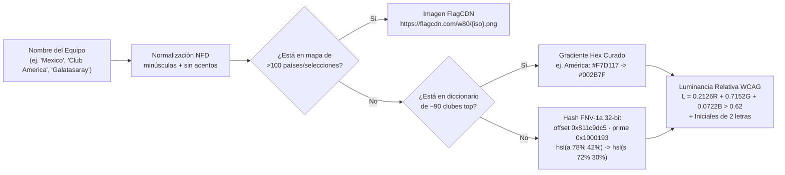

# 03 — Ingeniería Inversa de los 51 Chunks JavaScript, Grafo AST en REA, Algoritmos Cliente y Sistema de Diseño CSS

> **Objetivo Auditado:** `https://www.pickbot.mx/` (`deployment_id: dpl_7NUCdW69BaU9CMQePVhfQtRBwC3n`)  
> **Artefacto Contenedor Auditado:** [route-chunks](file:///C:/Users/T490s/.gemini/antigravity/worktrees/PitchLab/explore_pickbot_architecture/pickbot/evidence/javascript/route-chunks) (`SHA-256` de directorio: `b904c905aa54f4aa658ac457cc7d962e731ee27df0fb154f6a53740e156939fe`)  
> **Evidencias Primarias REA:** `ev_db2af549...` (`export_web_scripts`), `ev_c770ce4e...` + `ev_8f52fd0e...` (`analyze_javascript_application` — **217,257 nodos AST visitados, 1,280 hallazgos semánticos, 0 errores de parseo**), `ev_7a7a7986...`, `ev_01b1849b...`, `ev_7c9334c3...`, `ev_bd519a4f...`  
> **Referencias Cruzadas:** [01-executive-summary.md](file:///C:/Users/T490s/.gemini/antigravity/worktrees/PitchLab/explore_pickbot_architecture/pickbot/reports/01-executive-summary.md) · [02-architecture-and-routing.md](file:///C:/Users/T490s/.gemini/antigravity/worktrees/PitchLab/explore_pickbot_architecture/pickbot/reports/02-architecture-and-routing.md) · [scripts-index.json](file:///C:/Users/T490s/.gemini/antigravity/worktrees/PitchLab/explore_pickbot_architecture/pickbot/evidence/javascript/scripts-index.json)

---

## 1. Panorama del Empaquetado Cliente y Análisis Estático AST con REA (`[OBSERVADO]`)

Toda la interfaz de PickBot se distribuye como una aplicación **React 19** compilada por **Next.js App Router + Turbopack** bajo `/_next/static/chunks/*.js?dpl=dpl_7NUCdW69BaU9CMQePVhfQtRBwC3n`. A lo largo de las 24 rutas de la plataforma se recolectaron, verificaron por SHA-256 y auditaron **51 archivos JavaScript (`2,068,535` bytes / `1.97 MiB`)** y **2 hojas de estilo CSS (`214,943` bytes)**.

| Métrica del Bundle Cliente y Grafo AST REA | Valor Exacto Verificado | Evidencia Fuente |
|---|---|---|
| **Total de Chunks JavaScript Recolectados** | **51 archivos `.js`** (`32` propios `first-party` + `19` `vendor-or-runtime`) | [scripts-index.json](file:///C:/Users/T490s/.gemini/antigravity/worktrees/PitchLab/explore_pickbot_architecture/pickbot/evidence/javascript/scripts-index.json) |
| **Chunks Exportados desde la Carga Inicial (`/`)** | **21 scripts** extraídos automáticamente por `export_web_scripts` (`ev_db2af5491cf2e2198041dc6e61e21a3f75062b61d137fddc7b3d58da71770e88`) | [01-home-export-web-scripts.json](file:///C:/Users/T490s/.gemini/antigravity/worktrees/PitchLab/explore_pickbot_architecture/pickbot/evidence/captures/01-home-export-web-scripts.json) |
| **Grafo AST — Lote A (23 Chunks Propios Distintos)** | `652,552 B` leídos · **`157,060` nodos AST visitados** · `1,042` hallazgos · `825` nodos en grafo · `13` rutas estáticas · **`parse_failures: 0`** (`ev_c770ce4e...`) | [22-js-app-core-23-chunks-summary.json](file:///C:/Users/T490s/.gemini/antigravity/worktrees/PitchLab/explore_pickbot_architecture/pickbot/evidence/captures/22-js-app-core-23-chunks-summary.json), [22-js-routes-core-23-chunks.json](file:///C:/Users/T490s/.gemini/antigravity/worktrees/PitchLab/explore_pickbot_architecture/pickbot/evidence/captures/22-js-routes-core-23-chunks.json) |
| **Grafo AST — Lote B (2 Megachunks Cuantitativo + Auth)** | `257,803 B` leídos (`01e832ac972c5620.js` + `f9c2a762374fe321.js`) · **`60,197` nodos AST visitados** · `238` hallazgos · `214` nodos en grafo · **`parse_failures: 0`** (`ev_8f52fd0e...`) | [22-js-app-quant-auth-2-chunks-summary.json](file:///C:/Users/T490s/.gemini/antigravity/worktrees/PitchLab/explore_pickbot_architecture/pickbot/evidence/captures/22-js-app-quant-auth-2-chunks-summary.json) |
| **Cobertura Estática Consolidada (Sin Duplicados Wrapper)** | **`910,355 B` de código de dominio** · **`217,257` nodos AST** · **`1,280` hallazgos semánticos** · **`1,039` nodos de grafo** | `ev_c770ce4e...` + `ev_8f52fd0e...` |

> [!NOTE]
> **Por qué existen 32 chunks propios pero 25 cuerpos únicos de código (`[OBSERVADO]`):** Turbopack genera *entry chunks* independientes por cada hoja `page.tsx` de Next.js App Router aunque compartan exactamente el mismo árbol de componentes cliente, variando únicamente el identificador numérico de registro del módulo de entrada. Por ello, los **6 chunks de `/settings/*`** (`05d2295083ef64ec.js`, `1e2ca6f8d312a2a8.js`, `460a38ce63931d07.js`, `702ff714edc3e029.js`, `968c97a841ab948b.js`, `fb543dd1c9c685b7.js`) miden exactamente **`24,267` bytes** cada uno; el par `cb5b69c89a2e494c.js` / `d2bd7b725bbeda1b.js` mide exactamente **`47,565` bytes**; y el par `dbfeeb57e0254ad3.js` / `ec11f1e503e95a75.js` mide exactamente **`26,070` bytes**. Al consolidar un representante de cada grupo (`23` chunks base + los `2` megachunks `01e832ac972c5620.js` y `f9c2a762374fe321.js`), REA analizó el **100% de la lógica propia de PickBot** sin redundancia.

---

## 2. Inventario Criptográfico Completo de los 51 Chunks JS y 2 Hojas CSS (`[OBSERVADO]`)

### 2.1 Los 32 Chunks JavaScript Propios (`first-party`)

| # | Archivo (`route-chunks/`) | Tamaño (Bytes) | SHA-256 | Endpoints `/api/*` y Responsabilidad Funcional Reconstruida |
|---:|---|---:|---|---|
| 01 | [01e832ac972c5620.js](file:///C:/Users/T490s/.gemini/antigravity/worktrees/PitchLab/explore_pickbot_architecture/pickbot/evidence/javascript/route-chunks/01e832ac972c5620.js) | `127,081` | `7270c2cf2aa6402ef9534ae8bb70325982ff0db7f8b9ddd70df6385cc61e889e` | **Motor Cuantitativo y Detalle de Partido (`/`):** tablero `Mercados`, `Pulso de la comunidad`, pestañas `Resumen`/`Tesis`/`Simulación`/`Momios`/`Comunidad`, malla Poisson (`Mapa de marcadores`), inspector admin de **24+9 features ML** (`/api/admin/match-pick-context`, `/api/admin/match-pick-settlement`, `/api/markets/history`). |
| 02 | [f9c2a762374fe321.js](file:///C:/Users/T490s/.gemini/antigravity/worktrees/PitchLab/explore_pickbot_architecture/pickbot/evidence/javascript/route-chunks/f9c2a762374fe321.js) | `130,722` | `640493f52d0a0ce9aaffbec91d131ebdae0a4fc29e38fdf3d40cc385b11778ea` | **Núcleo de Identidad, Economía y Shell Global:** configuración Firebase (`pickbot-87e95`), `POST /api/auth/sync`, `GET /api/auth/me`, canje de referidos (`/api/invitations/redeem`), constantes `MAX_PICK_ENERGY` (mód. `32890`), planes (mód. `23747`), `gtagEvent` (mód. `43082`) y recorte Canvas `256×256` de avatares. |
| 03 | [e62978f1d163b3ba.js](file:///C:/Users/T490s/.gemini/antigravity/worktrees/PitchLab/explore_pickbot_architecture/pickbot/evidence/javascript/route-chunks/e62978f1d163b3ba.js) | `78,018` | `10a1a3d5364dffd2261d4eeb80e7828fe0e45155722a42cd7ccbd357d6b23106` | **Creador de Jugadas IA (`/picks`) y Gestor de Bets:** wizard de 3 pasos (`matches`, `play`, `review`), `POST /api/bets/build` (`BUILDER_COST = 2`), cronómetro cosmético `2200 + 2800*t`, 6 testimonios estáticos, `GET/DELETE /api/bets`, `/api/bets/stats` y `/api/admin/pro-picks/`. |
| 04 | [6d05e03f6d9857e7.js](file:///C:/Users/T490s/.gemini/antigravity/worktrees/PitchLab/explore_pickbot_architecture/pickbot/evidence/javascript/route-chunks/6d05e03f6d9857e7.js) | `65,500` | `01f481aeb863d11d25f8ca676b5b6af04ec216b14b5423d2a9f57645abfa30fc` | **Feed Social Multimedia (`/feed`):** pestañas `Global` y `Amigos`, compositor de publicaciones (`post` con imagen/video y `pick_save`), likes, guardados, comentarios y `TeamAvatar`. |
| 05 | [edabb558bc566d6c.js](file:///C:/Users/T490s/.gemini/antigravity/worktrees/PitchLab/explore_pickbot_architecture/pickbot/evidence/javascript/route-chunks/edabb558bc566d6c.js) | `50,306` | `04fc7353558d690fe0f7f76d11d5e666bf4c617eebd287a4e2d271b9095825ca` | **Módulo Maestro `TeamAvatar` (mód. `44259`), Perfil y Subidas:** cascada FlagCDN + ~90 clubes + hash FNV-1a (`0x811c9dc5`), `PATCH/DELETE /api/account`, `POST /api/uploads/presign`, tarjeta social exportable (`captureElementAsFile`). |
| 06 | [cb5b69c89a2e494c.js](file:///C:/Users/T490s/.gemini/antigravity/worktrees/PitchLab/explore_pickbot_architecture/pickbot/evidence/javascript/route-chunks/cb5b69c89a2e494c.js) | `47,565` | `8f2c913788ac789e71127ab41d54948daa4a3aba16c71e530b153c65ea3c46a8` | **Tarjetas Compartibles y Vista `/rendimiento` (Par A):** exporta `captureElementAsFile`, `captureElementAsImage` y `sanitizeFilename` (mód. `19129` sobre `modern-screenshot`), `/api/bets/share/[id]` y badges cromáticos `A+`..`F`. |
| 07 | [d2bd7b725bbeda1b.js](file:///C:/Users/T490s/.gemini/antigravity/worktrees/PitchLab/explore_pickbot_architecture/pickbot/evidence/javascript/route-chunks/d2bd7b725bbeda1b.js) | `47,565` | `d5a4987929e2410267d65bbd886cdd011243a15446156fa1ddc64e7a30e4c619` | **Tarjetas Compartibles y Vista `/estrategias` (Par B):** variante gemela de `47,565 B` montada en la ruta `/estrategias` con el mismo motor de captura PNG/Web Share. |
| 08 | [a5f8094c4c08cf24.js](file:///C:/Users/T490s/.gemini/antigravity/worktrees/PitchLab/explore_pickbot_architecture/pickbot/evidence/javascript/route-chunks/a5f8094c4c08cf24.js) | `44,882` | `f94744aa8a39bdacf17f090a8fcd83a8818a88e9927e9883c8f00a72ff79d054` | **Catálogo de Planes y Paywall PickBot Pro (`/plan`):** definición de `gratis`, `pro` (`prod_U2enelHVVdr9L6`, `\$299 MXN/mes`) y planes legacy `principiante`/`esencial`, toasts `sonner` y diálogos Radix. |
| 09 | [e28be9743872cf14.js](file:///C:/Users/T490s/.gemini/antigravity/worktrees/PitchLab/explore_pickbot_architecture/pickbot/evidence/javascript/route-chunks/e28be9743872cf14.js) | `37,048` | `57813b6f44ca5bc4c740127f82cb6392cc3ecfe8142cc8ad239848fcb677d24c` | **Motor DSL de Estrategias y Auto-Etiquetador NLP:** parser de reglas (`1–6` condiciones sobre `edge_pp`, `est_prob`, `implied_prob`, `odds`), reconocimiento automático de ligas y 6 mercados, `POST /api/rendimiento/preview` y CRUD `/api/strategies`. |
| 10 | [5d3ff053c1cadced.js](file:///C:/Users/T490s/.gemini/antigravity/worktrees/PitchLab/explore_pickbot_architecture/pickbot/evidence/javascript/route-chunks/5d3ff053c1cadced.js) | `36,823` | `b788cba43fb3d83b5a9b2ede8211db8bb3ccfe2d0f38affaae297bf76841a9fb` | **Explorador de Estrategias Públicas y Buscador (`/buscar`, `/estrategias`):** ranking `/api/strategies/public?limit=50`, importación `/api/strategies/shared/` y navegación lateral. |
| 11 | [dae971cea01c1720.js](file:///C:/Users/T490s/.gemini/antigravity/worktrees/PitchLab/explore_pickbot_architecture/pickbot/evidence/javascript/route-chunks/dae971cea01c1720.js) | `36,618` | `90fd7e07154bf9267abc4c6ed6edb9b19a3c946de66a06df43fa95b80f56cb80` | **Documentos Legales (`/privacidad`, `/terminos`, `/soporte`):** renderizado completo del clausulado legal (`5 de junio de 2026`), tratamiento de datos y contacto `pickbot.mx@gmail.com`. |
| 12 | [46d33aee8f2857f7.js](file:///C:/Users/T490s/.gemini/antigravity/worktrees/PitchLab/explore_pickbot_architecture/pickbot/evidence/javascript/route-chunks/46d33aee8f2857f7.js) | `35,077` | `0aa99e83842e0bfb09407aec07294d7544daa7e8c0e2259449ec2c18c54a00a1` | **Dashboard Analítico de Rendimiento (`/rendimiento`):** gráficas acumuladas, tabla por liga, cubetas de calibración y descarga CSV `/api/rendimiento/export`. |
| 13 | [b1a4fab04b669688.js](file:///C:/Users/T490s/.gemini/antigravity/worktrees/PitchLab/explore_pickbot_architecture/pickbot/evidence/javascript/route-chunks/b1a4fab04b669688.js) | `34,533` | `8740546adc3d94adccf8525c097bb10eb817af6462b0724b040a41f15c79f6f2` | **Telemetría de Vistas de Feed y Ranking de Amigos (`/amigos`):** tracking `POST /api/feed/views` y componentes de tarjetas sociales. |
| 14 | [e730e2375a473fd6.js](file:///C:/Users/T490s/.gemini/antigravity/worktrees/PitchLab/explore_pickbot_architecture/pickbot/evidence/javascript/route-chunks/e730e2375a473fd6.js) | `29,257` | `7ad06498b7f5c8ff39ca1969057ca25203c2e63a2a09610cfbc1ff0e54f8b817` | **Hook `usePickEnergy` y Modales de Recarga/Checkout:** sincronización de `/api/pick-energy`, `/api/pick-energy/unlocks`, cuenta regresiva de 4 horas (`PickEnergyEmptyDialog`) y disparo de `/api/stripe/checkout` / `/api/stripe/portal`. |
| 15 | [dbfeeb57e0254ad3.js](file:///C:/Users/T490s/.gemini/antigravity/worktrees/PitchLab/explore_pickbot_architecture/pickbot/evidence/javascript/route-chunks/dbfeeb57e0254ad3.js) | `26,070` | `d6464b6dd1295c39e5977cbe05df8a56661e1efbebb81f51f6d5c716d081c9f4` | **Shell de Perfil Propio (`/perfil`, Par A):** contenedor de navegación de perfil y registro de impresiones `/api/feed/views`. |
| 16 | [ec11f1e503e95a75.js](file:///C:/Users/T490s/.gemini/antigravity/worktrees/PitchLab/explore_pickbot_architecture/pickbot/evidence/javascript/route-chunks/ec11f1e503e95a75.js) | `26,070` | `3af4261216d3d94ad33a7d9766f13352e9803b583b409255828086d5f6a31351` | **Shell de Perfil Público (`/profile/[id]`, Par B):** variante gemela de `26,070 B` para la ruta dinámica de perfiles de terceros. |
| 17 | [f97f9e3beeabf139.js](file:///C:/Users/T490s/.gemini/antigravity/worktrees/PitchLab/explore_pickbot_architecture/pickbot/evidence/javascript/route-chunks/f97f9e3beeabf139.js) | `24,365` | `6c7b5c3ece68d4df0b5413254b232550df681f4babe84275bc25fc422965cfb4` | **Barra Lateral y Cabecera Responsiva (`AppShell`):** navegación principal (`Mercados`, `Creador IA`, `Rendimiento`, `Estrategias`, `Clasificación`, `Actividad`, `Amigos`, `Buscar`) y badge `⚡ 4/5`. |
| 18 | [05d2295083ef64ec.js](file:///C:/Users/T490s/.gemini/antigravity/worktrees/PitchLab/explore_pickbot_architecture/pickbot/evidence/javascript/route-chunks/05d2295083ef64ec.js) | `24,267` | `e1532c410f2327c2685fe62e338883a4418c0dbbba0d1c7eac55717a8872aed2` | **Layout Wrapper de Ajustes (1/6):** contenedor compartido de `/settings/*` con navegación lateral Radix. |
| 19 | [1e2ca6f8d312a2a8.js](file:///C:/Users/T490s/.gemini/antigravity/worktrees/PitchLab/explore_pickbot_architecture/pickbot/evidence/javascript/route-chunks/1e2ca6f8d312a2a8.js) | `24,267` | `5546bfbc9bb0c1a6fe4fb3b67ebf641530dc0c767d890b111b7aae4d79105425` | **Layout Wrapper de Ajustes (2/6):** entry wrapper idéntico (`24,267 B`) para subruta de `/settings`. |
| 20 | [460a38ce63931d07.js](file:///C:/Users/T490s/.gemini/antigravity/worktrees/PitchLab/explore_pickbot_architecture/pickbot/evidence/javascript/route-chunks/460a38ce63931d07.js) | `24,267` | `6abdd5520a7c11d77245ecf9ca38ae67e046d8d31c01c3affa2e25cfbf7c9d27` | **Layout Wrapper de Ajustes (3/6):** entry wrapper idéntico (`24,267 B`) para subruta de `/settings`. |
| 21 | [702ff714edc3e029.js](file:///C:/Users/T490s/.gemini/antigravity/worktrees/PitchLab/explore_pickbot_architecture/pickbot/evidence/javascript/route-chunks/702ff714edc3e029.js) | `24,267` | `a78ad9ded6f5b342667dedfaa7fe2041c1ce6b5e34572244b9029e050e023890` | **Layout Wrapper de Ajustes (4/6):** entry wrapper idéntico (`24,267 B`) para subruta de `/settings`. |
| 22 | [968c97a841ab948b.js](file:///C:/Users/T490s/.gemini/antigravity/worktrees/PitchLab/explore_pickbot_architecture/pickbot/evidence/javascript/route-chunks/968c97a841ab948b.js) | `24,267` | `9ec64e53ce3765839854311abdcce2c427e7e59a9696153f082a2c1b7333b13b` | **Layout Wrapper de Ajustes (5/6):** entry wrapper idéntico (`24,267 B`) para subruta de `/settings`. |
| 23 | [fb543dd1c9c685b7.js](file:///C:/Users/T490s/.gemini/antigravity/worktrees/PitchLab/explore_pickbot_architecture/pickbot/evidence/javascript/route-chunks/fb543dd1c9c685b7.js) | `24,267` | `d1ae2acf20fe02fc87af046e57553f17a21377e570974849d45d73beb22ea8d8` | **Layout Wrapper de Ajustes (6/6):** entry wrapper idéntico (`24,267 B`) para subruta de `/settings`. |
| 24 | [25a9d165fa657b38.js](file:///C:/Users/T490s/.gemini/antigravity/worktrees/PitchLab/explore_pickbot_architecture/pickbot/evidence/javascript/route-chunks/25a9d165fa657b38.js) | `21,635` | `24d488b007a493b42eaac1f7d1c32a620a06ab7523f9e77c482216afc3a4a2ba` | **Vista de Búsqueda Unificada (`/buscar`):** consume `/api/markets/matches?scope=upcoming&limit=24`, `/api/users/search?q=...` y `/api/friends` con `TeamAvatar`. |
| 25 | [66c68b8fed519b4e.js](file:///C:/Users/T490s/.gemini/antigravity/worktrees/PitchLab/explore_pickbot_architecture/pickbot/evidence/javascript/route-chunks/66c68b8fed519b4e.js) | `15,943` | `79460bdde64098552d2f90d07fa1baf249eee56c1eb93b652dcb83dd49d9c12d` | **Cliente de Facturación Stripe (`/plan`, `/settings`):** invoca `POST /api/stripe/checkout`, `POST /api/stripe/portal` y `POST /api/stripe/cancel`. |
| 26 | [30f459f5ca7d514d.js](file:///C:/Users/T490s/.gemini/antigravity/worktrees/PitchLab/explore_pickbot_architecture/pickbot/evidence/javascript/route-chunks/30f459f5ca7d514d.js) | `9,485` | `c21cf4696c89c75f97a1eda31f46bccc91d435015b0aee1a667e0de2517c1e4a` | **Hilo de Comentarios y Actividad:** gestiona comentarios en partidos (`/api/markets/comments/`) y acciones sociales en `/api/feed`. |
| 27 | [5281a79d8fbe5d0e.js](file:///C:/Users/T490s/.gemini/antigravity/worktrees/PitchLab/explore_pickbot_architecture/pickbot/evidence/javascript/route-chunks/5281a79d8fbe5d0e.js) | `8,060` | `ce7b5bd1398e5104755930538d6cc2d5c4800830b899b981eaf57a8ff6f9bed8` | **Grafo Social de Amigos (`/amigos`):** consulta `/api/friends`, `/api/friends/suggested` y seguimiento `/api/users/[id]/follow`. |
| 28 | [9f3bf131c0c314ee.js](file:///C:/Users/T490s/.gemini/antigravity/worktrees/PitchLab/explore_pickbot_architecture/pickbot/evidence/javascript/route-chunks/9f3bf131c0c314ee.js) | `7,957` | `da034d28e7f89c5813a923f5586b295ce4aacf4147011c4ae014865f8df98b8f` | **Preferencias de Notificaciones (`/settings/notifications`):** lectura/escritura de `/api/notifications/preferences`. |
| 29 | [066560ba39974a4f.js](file:///C:/Users/T490s/.gemini/antigravity/worktrees/PitchLab/explore_pickbot_architecture/pickbot/evidence/javascript/route-chunks/066560ba39974a4f.js) | `5,533` | `058c4e29620d591610e01afbdf09e9f1760ce08eb77a8e7c089d20cd35c245b0` | **Seguridad y Baja de Cuenta (`/settings/security`, `/settings/account`):** cambio de contraseña y confirmación destructiva `Eliminar cuenta`. |
| 30 | [17103e43d84cc7f5.js](file:///C:/Users/T490s/.gemini/antigravity/worktrees/PitchLab/explore_pickbot_architecture/pickbot/evidence/javascript/route-chunks/17103e43d84cc7f5.js) | `5,229` | `32f01483810b7143c2236448d8a3d64fbf25f3c605a0ed6051f82a08dce91b23` | **Tabla de Clasificación (`/clasificacion`):** consume `GET /api/leaderboard?period=7d|30d|all` y renderiza el podio Top-3. |
| 31 | [ac282bd7cb74dc3b.js](file:///C:/Users/T490s/.gemini/antigravity/worktrees/PitchLab/explore_pickbot_architecture/pickbot/evidence/javascript/route-chunks/ac282bd7cb74dc3b.js) | `5,210` | `2ba0b7d7fb2aae52af3e3e7fce649e22b292327b60eaf03b7dde696c005d36c3` | **Índice de Ajustes y Vista Auxiliar (`/settings`):** tarjetas de menú hacia sub-secciones de cuenta, seguridad y avisos. |
| 32 | [b297d412266b6464.js](file:///C:/Users/T490s/.gemini/antigravity/worktrees/PitchLab/explore_pickbot_architecture/pickbot/evidence/javascript/route-chunks/b297d412266b6464.js) | `3,171` | `8eb789f99e53cfbacde482a9a24aaa511d2b3944490c78bf36664e4fbe3b8c09` | **Hidratador de Estrategia Compartida (`/estrategia/[token]`):** consume `/api/strategies/shared/[token]` y clona reglas en la cuenta del visitante. |

---

### 2.2 Los 19 Chunks Vendor y Runtime (`vendor-or-runtime`)

| # | Archivo (`route-chunks/`) | Tamaño (Bytes) | SHA-256 | Librería / Rol en Tiempo de Ejecución |
|---:|---|---:|---|---|
| 33 | [ccce59f1fd59f1da.js](file:///C:/Users/T490s/.gemini/antigravity/worktrees/PitchLab/explore_pickbot_architecture/pickbot/evidence/javascript/route-chunks/ccce59f1fd59f1da.js) | `394,570` | `2ce57043231179537840e74c221354c5f6955fea029f4398eb941e9111a460fe` | **Firebase JS SDK v12.9.0 (`@firebase/auth`, `@firebase/app`):** cliente OAuth, correo/contraseña, SMS OTP, persistencia IndexedDB y `RecaptchaVerifier`. |
| 34 | [a130cbc376d20297.js](file:///C:/Users/T490s/.gemini/antigravity/worktrees/PitchLab/explore_pickbot_architecture/pickbot/evidence/javascript/route-chunks/a130cbc376d20297.js) | `223,454` | `a46162cb5e269b33e41354cc4dede5004b55eb0806053986ba6c58e01df5050c` | **React 19 + `react-dom/client`:** reconciliador concurrente, hidratación RSC y hooks primitivos. |
| 35 | [a6dad97d9634a72d.js](file:///C:/Users/T490s/.gemini/antigravity/worktrees/PitchLab/explore_pickbot_architecture/pickbot/evidence/javascript/route-chunks/a6dad97d9634a72d.js) | `112,594` | `0973c1d64c88adc8e3c950410cb58b288f72118d5965b78049438deb8f2f9683` | **Polyfills de Plataforma Next.js (`polyfill-nomodule`):** compatibilidad estándar ES/DOM. |
| 36 | [496e8db270f37fdc.js](file:///C:/Users/T490s/.gemini/antigravity/worktrees/PitchLab/explore_pickbot_architecture/pickbot/evidence/javascript/route-chunks/496e8db270f37fdc.js) | `111,416` | `47a631732868f311dafbcbfb0f8603ef1458086b20e31eedad0785d0f74f9c67` | **Next.js App Router Core Runtime:** cliente Flight/RSC, caché de segmentos, `next/navigation` y `next/link`. |
| 37 | [1e758b07176114e4.js](file:///C:/Users/T490s/.gemini/antigravity/worktrees/PitchLab/explore_pickbot_architecture/pickbot/evidence/javascript/route-chunks/1e758b07176114e4.js) | `48,031` | `67f27eab159a2a8ce32746e7ddacc4e2ad3b2cbcb5e106a0fad048d65685f5ac` | **Motor `modern-screenshot` + Utilidades DOM-to-Canvas/SVG:** serialización de nodos CSS/fuentes a PNG para tarjetas compartibles. |
| 38 | [c6ec7bbda9a9685a.js](file:///C:/Users/T490s/.gemini/antigravity/worktrees/PitchLab/explore_pickbot_architecture/pickbot/evidence/javascript/route-chunks/c6ec7bbda9a9685a.js) | `41,644` | `3a07891e54e11e87f9b955c3402a38b7c736aa5cc3613b8146a9a05009fef8a3` | **Utilidades UI Compartidas (`clsx`, `tailwind-merge`, `class-variance-authority`, `sonner`):** sistema de variantes y notificaciones toast. |
| 39 | [82abf2d65f5428ae.js](file:///C:/Users/T490s/.gemini/antigravity/worktrees/PitchLab/explore_pickbot_architecture/pickbot/evidence/javascript/route-chunks/82abf2d65f5428ae.js) | `33,299` | `bbc0826384faf59b3d35a439a95f7787cd19280ee35469c84cd0b213bc306f11` | **Next.js Client Bootstrap & Error Boundary Runtime:** inicialización de árbol App Router y manejo de errores de ruta. |
| 40 | [61cc43b3d7ad2990.js](file:///C:/Users/T490s/.gemini/antigravity/worktrees/PitchLab/explore_pickbot_architecture/pickbot/evidence/javascript/route-chunks/61cc43b3d7ad2990.js) | `30,679` | `4540cc88930476434885ab7c6b6c0d33aab472d9ce9287d0c77d3f4d4f9923fa` | **Next.js Image & Font Helpers + Layout Primitives:** carga optimizada y adaptadores de medios. |
| 41 | [3881a6acda7bc619.js](file:///C:/Users/T490s/.gemini/antigravity/worktrees/PitchLab/explore_pickbot_architecture/pickbot/evidence/javascript/route-chunks/3881a6acda7bc619.js) | `29,406` | `21c19c705f456d0d1419f89ca3aa09dc5fa7db9c1db1f49ede163abf7102f8c2` | **Floating UI (`@floating-ui/dom` + `@floating-ui/react-dom`):** posicionamiento dinámico de popovers, menús y tooltips. |
| 42 | [a40dc55a2daccad8.js](file:///C:/Users/T490s/.gemini/antigravity/worktrees/PitchLab/explore_pickbot_architecture/pickbot/evidence/javascript/route-chunks/a40dc55a2daccad8.js) | `27,472` | `ae5bafe05fe76edf8a31afc58cb50726c2569bfe2ca22aa39dd29805ecfbb9aa` | **Paquete de Iconos Vectoriales (`lucide-react`):** glifos SVG utilizados en navegación, deportes y estados. |
| 43 | [56b62c9578f2eb22.js](file:///C:/Users/T490s/.gemini/antigravity/worktrees/PitchLab/explore_pickbot_architecture/pickbot/evidence/javascript/route-chunks/56b62c9578f2eb22.js) | `27,461` | `241f41b557f440fedd3b991f9b35b17c0a8a201f706094ab138332d1248a0ada` | **Radix UI Primitives (Lote A — `@radix-ui/react-dialog`, `focus-scope`, `dismissable-layer`):** modales accesibles y bloqueo de foco. |
| 44 | [7f90b2a81d9b45d7.js](file:///C:/Users/T490s/.gemini/antigravity/worktrees/PitchLab/explore_pickbot_architecture/pickbot/evidence/javascript/route-chunks/7f90b2a81d9b45d7.js) | `27,461` | `6c1515e417b288a832282941515a0c2a8abe53b08c238088a3ccf2b6b7ead9b7` | **Radix UI Primitives (Lote B — `@radix-ui/react-select`, `dropdown-menu`):** menús desplegables y selectores por teclado. |
| 45 | [5642d5e1403c7165.js](file:///C:/Users/T490s/.gemini/antigravity/worktrees/PitchLab/explore_pickbot_architecture/pickbot/evidence/javascript/route-chunks/5642d5e1403c7165.js) | `27,431` | `557a041d3393ed48a78cac78c7fceff00bc60e6c82d9bf682a46e8fca284aa70` | **Radix UI Primitives (Lote C — `@radix-ui/react-tabs`, `popover`, `roving-focus`):** pestañas y navegación por flechas. |
| 46 | [7645c162474af3a6.js](file:///C:/Users/T490s/.gemini/antigravity/worktrees/PitchLab/explore_pickbot_architecture/pickbot/evidence/javascript/route-chunks/7645c162474af3a6.js) | `24,499` | `002cc2269c922fc9ea613dea877046a2ffe5a496bbceac794a40261bcf54b290` | **Radix UI Primitives (Lote D — `@radix-ui/react-tooltip`, `presence`, `portal`):** portales DOM y animaciones de montaje. |
| 47 | [25874d3d0d15f70b.js](file:///C:/Users/T490s/.gemini/antigravity/worktrees/PitchLab/explore_pickbot_architecture/pickbot/evidence/javascript/route-chunks/25874d3d0d15f70b.js) | `20,583` | `58f4ca7e939f8beb4fb8d027c70a549c870109841f5d24f671b45dafd429b4a2` | **Radix UI Primitives (Lote E — `@radix-ui/react-switch`, `checkbox`, `scroll-area`):** controles de formulario en ajustes y filtros. |
| 48 | [turbopack-53868f62491e71f2.js](file:///C:/Users/T490s/.gemini/antigravity/worktrees/PitchLab/explore_pickbot_architecture/pickbot/evidence/javascript/route-chunks/turbopack-53868f62491e71f2.js) | `10,729` | `1637cb8a4c61626332daa152425cbf462a9f507b585dcee9f03d16f80bcb8e56` | **Cargador de Módulos Turbopack (`TURBOPACK_CHUNK_LISTS`):** registro global de chunks asíncronos y resolución de módulos numéricos `e.i(...)` / `e.s(...)`. |
| 49 | [727ad43a47a73d31.js](file:///C:/Users/T490s/.gemini/antigravity/worktrees/PitchLab/explore_pickbot_architecture/pickbot/evidence/javascript/route-chunks/727ad43a47a73d31.js) | `3,337` | `d542e4b86aa8f9302025f45f0c4952a4640296004e042fc178ba92341bcbd3fd` | **Pie Legal y Navegación Secundaria de Ajustes:** enlaces rápidos hacia `/privacidad` y `/terminos`. |
| 50 | [66a8c16702b8a250.js](file:///C:/Users/T490s/.gemini/antigravity/worktrees/PitchLab/explore_pickbot_architecture/pickbot/evidence/javascript/route-chunks/66a8c16702b8a250.js) | `2,529` | `fae4747d48f3747ef49cc9e20eee391418c880044107cf872a95a116ec3cf273` | **Vercel Web Analytics Wrapper (`@vercel/analytics/next`):** inyección automática de `/_vercel/insights/script.js`. |
| 51 | [ff1a16fafef87110.js](file:///C:/Users/T490s/.gemini/antigravity/worktrees/PitchLab/explore_pickbot_architecture/pickbot/evidence/javascript/route-chunks/ff1a16fafef87110.js) | `282` | `e9786b1305894e4119bb9811a816dac9cf576755596dd989ee15b455749fc35e` | **Manifiesto Mínimo de Arranque Turbopack:** stub de hidratación inicial (`282 B`). |

---

### 2.3 Sistema de Diseño CSS: Tailwind CSS v4 y Tipografía Local (`[OBSERVADO]`)

| # | Archivo (`evidence/css/`) | Tamaño (Bytes) | SHA-256 | Contenido y Tokens Verificados |
|---:|---|---:|---|---|
| 01 | [ba18d09ff3b83e99.css](file:///C:/Users/T490s/.gemini/antigravity/worktrees/PitchLab/explore_pickbot_architecture/pickbot/evidence/css/ba18d09ff3b83e99.css) | `212,947` | `b2d0a9927696f8ec43b641582ef7bf729974f337f264c1e29df6c9316f02aeee` | **Hoja Maestra Tailwind CSS v4 (`@layer properties`, dark-only):** define toda la paleta oscura de PickBot en `:root`: `--background: #07080c`, `--card: #0c0e14`, `--popover: #101218`, `--foreground: #f2f5f8`, `--primary: #6d5bff` (violeta firma), `--signal: #ff4d8d` (rosa neón de alerta/pulso), `--success: #22c55e`, `--warning: #f59e0b`, `--info: #2d7dff`, `--border: #1a1e28`, `--glass-surface: #0c0e14d1` y `--radius: .625rem`. No existe modo claro alternativo; toda la aplicación está fija en tema nocturno. |
| 02 | [27888b6ffcce4db7.css](file:///C:/Users/T490s/.gemini/antigravity/worktrees/PitchLab/explore_pickbot_architecture/pickbot/evidence/css/27888b6ffcce4db7.css) | `1,996` | `23af787cc6392cc5824f421461f661caf83de71c44a83ae37bf1114adbc78354` | **Tipografía Variable Auto-Hospedada (`next/font/google` — `Inter`):** declara 7 subconjuntos `woff2` servidos desde `/_next/static/media/*.woff2` (`font-weight: 100 900`, `font-display: swap`) más `Inter Fallback` calibrado sobre `Arial` (`size-adjust: 107.12%`, `ascent-override: 90.44%`) para eliminar *Cumulative Layout Shift* (`CLS`). |

---

## 3. Deconstrucción Algorítmica de los 5 Motores Cliente Clave (`[OBSERVADO]` & `[RECONSTRUIDO]`)

### 3.1 Motor 1 — `TeamAvatar`: Cascada FlagCDN + Diccionario de Clubes + Hash FNV-1a + Contraste WCAG (`edabb558bc566d6c.js`, mód. `44259`)

Debido a que **The Odds API v4** únicamente suministra cadenas de texto para `home_team` y `away_team` (sin URLs de escudos), PickBot implementa en cliente un generador determinista de identidades visuales en tres etapas:



La función hash exacta extraída de [edabb558bc566d6c.js](file:///C:/Users/T490s/.gemini/antigravity/worktrees/PitchLab/explore_pickbot_architecture/pickbot/evidence/javascript/route-chunks/edabb558bc566d6c.js) es:

```javascript
// Reconstrucción exacta del fallback FNV-1a 32-bit en TeamAvatar (módulo 44259)
function fallbackGradientFromTeamName(normalizedName) {
  let hash = 0x811c9dc5;
  for (let i = 0; i < normalizedName.length; i++) {
    hash ^= normalizedName.charCodeAt(i);
    hash = Math.imul(hash, 0x01000193);
  }
  const hueStart = (hash >>> 0) % 360;
  const hueEnd = (hueStart + 42 + (Math.abs(hash) % 84)) % 360;
  return {
    start: `hsl(${hueStart} 78% 42%)`,
    end: `hsl(${hueEnd} 72% 30%)`,
  };
}
```

Y para decidir si las iniciales del club se pintan en negro (`#0f172a`) o blanco (`#ffffff`), calcula la luminancia relativa perceptual sobre el color primario hexadecimal:

$$L = 0.2126 \cdot \frac{R}{255} + 0.7152 \cdot \frac{G}{255} + 0.0722 \cdot \frac{B}{255} > 0.62$$

---

### 3.2 Motor 2 — Simulación Visual (`Mapa de marcadores` Poisson) e Inspector de 24+9 Features ML (`01e832ac972c5620.js`)

En la pestaña **`Simulación`** de un partido ([18-match-detail-simulation-20000.png](file:///C:/Users/T490s/.gemini/antigravity/worktrees/PitchLab/explore_pickbot_architecture/pickbot/evidence/screenshots/18-match-detail-simulation-20000.png)), el servidor envía el resumen de `20,000` corridas Monte Carlo (`mu_home`, `mu_away`, `score_unit`, `match_1x2`, top-5 `scorelines`). Sin embargo, la cuadrícula completa de calor **`Mapa de marcadores`** se calcula dinámicamente en el navegador evaluando la función de masa de probabilidad de **dos distribuciones de Poisson independientes** en espacio logarítmico para evitar desbordamiento factorial:

$$P(X = h, Y = a) = \exp\!\left(-\mu_{\text{home}} + h \ln \mu_{\text{home}} - \sum_{i=2}^{h} \ln i\right) \cdot \exp\!\left(-\mu_{\text{away}} + a \ln \mu_{\text{away}} - \sum_{j=2}^{a} \ln j\right)$$

- **Regla de dimensionamiento por deporte (`function x(score_unit, mu_home, mu_away)`):**
  - Si `score_unit === "goles"` (fútbol y NHL): construye una matriz de `0..6` goles por lado (**`7 × 7 = 49` celdas**).
  - Si `score_unit === "carreras"` (MLB / KBO): construye una matriz dinámica hasta $\min(10, \max(7, \lceil \max(\mu_{\text{home}}, \mu_{\text{away}}) + 4 \rceil))$ carreras por lado.
  - Si `score_unit === "puntos"` (NBA, NFL, NCAAF, NCAAB): devuelve `null` y omite la malla de marcadores exactos, mostrando únicamente el reparto porcentual de victoria y las medias esperadas (`108.9` vs `108.3` en Raptors @ Celtics).

Adicionalmente, [01e832ac972c5620.js](file:///C:/Users/T490s/.gemini/antigravity/worktrees/PitchLab/explore_pickbot_architecture/pickbot/evidence/javascript/route-chunks/01e832ac972c5620.js) contiene un **panel de auditoría administrativa oculto** (`Input del modelo (as-of)`, alimentado por `/api/admin/match-pick-context` y `/api/admin/match-pick-settlement`) que revela el **vector exacto de entrenamiento e inferencia** del modelo campeón `core_game_v1`:

1. **Las 24 columnas `champion_columns` base (`let k`):**
   `sport_family_code`, `is_home_selection`, `is_over`, `line`, `price_american`, `break_even`, `market_anchor`, `book_count`, `dispersion`, `home_elo`, `away_elo`, `elo_diff`, `home_games`, `away_games`, `home_form5`, `away_form5`, `home_form10`, `away_form10`, `home_scored5`, `away_scored5`, `home_conceded5`, `away_conceded5`, `rest_home_days`, `rest_away_days`.
2. **Las 9 familias contextuales extendidas (`let D`):**
   - `Elo / rest` (`back_to_back`),
   - `Career sample (n / log1p / bucket)`,
   - `Forma V1`,
   - `Forma reciente (PPG / goles / EWMA / season / venue / trends)` (`ppg_ewma`, `goals_for_ewma`, `attack_trend_`, `defense_trend_`),
   - `Sample / confidence (n de ventana, no forma)`,
   - `Forma as-of (ventanas crudas, splits)`,
   - `Ratings / expected score` (`pace`, `park_factor`, `league_avg`),
   - `Mercado (consenso — entra al modelo)` (`no_vig`, `consensus_*`, `market_anchor_is_no_vig`),
   - `Completeness / missing` (`pitcher`, `bullpen`, `xg_*`, `injury`, `weather`, `lineup`, `player_data`, `starting_goalie`).

---

### 3.3 Motor 3 — Creador de Jugadas IA (`/picks`), Barra de Progreso Simulada y 6 Testimonios Hardcodeados (`e62978f1d163b3ba.js`)

El análisis de [e62978f1d163b3ba.js](file:///C:/Users/T490s/.gemini/antigravity/worktrees/PitchLab/explore_pickbot_architecture/pickbot/evidence/javascript/route-chunks/e62978f1d163b3ba.js) demuestra cómo opera internamente el asistente de `/picks`:

1. **Máquina de Estados y Payload de Construcción:**
   - Tres etapas (`ea = ["matches", "play", "review"]`). Si el usuario elige más de 1 partido (`Y > 1`), un `useEffect` fuerza automáticamente `betType = "parlay"` y acota `desiredLegs` al rango $[2, \min(6, Y)]$.
   - Verifica en cliente `m.canAfford(BUILDER_COST)` donde **`BUILDER_COST = 2`**. Si el saldo es insuficiente, abre `PickEnergyEmptyDialog` sin llamar al servidor.
   - Si hay saldo, envía `POST /api/bets/build` con `{ mongoUserId | uid, status: "active" | "draft", betType, risk, desiredLegs, selectedMatches: [{ sportKey, eventId }] }`. Si el servidor determina que ninguna combinación tiene valor positivo, reembolsa los 2 picks (`r.refunded === true`, toast *"Se devolvieron 2 picks"*).
2. **Temporizador Cosmético de Carga (`2200 + 2800 * t` ms):**
   Mientras `POST /api/bets/build` está pendiente, la pantalla superpuesta `bg-[#070b16]/92` muestra pasos secuenciales con etiquetas `"En curso"` y `"Listo"`. Dichos pasos **no reflejan eventos reales del backend**, sino un bucle local de `window.setTimeout`:
   ```javascript
   // e62978f1d163b3ba.js — Avance puramente visual cada 2.2s, 5.0s, 7.8s, 10.6s...
   const timers = steps.slice(0, -1).map((_, idx) =>
     window.setTimeout(() => setCurrentStep(idx + 1), 2200 + 2800 * idx)
   );
   ```
3. **Los 6 Testimonios de Usuarios `PRO` son Fijos en el Código Fuente (`let eH`):**
   La columna derecha de `/picks` muestra reseñas de supuestos apostadores seleccionadas determinísticamente según el paso activo mediante un hash polinomial `a = (31 * a + str.charCodeAt(i)) >>> 0`. Los 6 perfiles están escritos literalmente en el bundle JavaScript (no provienen de MongoDB):
   - **André Castillo (`@andrecastillo`, badge `PRO`):** *"Antes armaba parlays a ojo y perdía la disciplina. Con PickBot pasé de ~40% a casi 58% de acierto en el mes..."*
   - **Sofía Méndez (`@sofiamendez`, badge `PRO`):** *"En tres semanas dejé de perseguir momios. El resumen del pick me hace entrar solo cuando hay valor..."*
   - **Diego Rivas (`@diegorivas`, badge `PRO`):** *"Mis parlays de 3 piernas dejaron de ser lotería..."*
   - **Camila Ortega (`@camilaortega`, sin badge):** *"Antes me tomaba media hora armar un pick..."*
   - **Mateo Herrera (`@mateoherrera`, badge `PRO`):** *"Lo que más me cambió fue la consistencia..."*
   - **Valeria Soto (`@valeriasoto`, sin badge):** *"Empecé sin saber leer líneas..."*

---

### 3.4 Motor 4 — Gramática DSL de Estrategias y Auto-Etiquetador NLP (`e28be9743872cf14.js`)

En `/estrategias` ([04-estrategias.png](file:///C:/Users/T490s/.gemini/antigravity/worktrees/PitchLab/explore_pickbot_architecture/pickbot/evidence/screenshots/04-estrategias.png)), el usuario puede escribir un nombre libre (ej. *"NHL Over valor alto"*) y construir reglas cuantitativas:

- **Auto-etiquetador léxico sin IA (`function T(text, dictionary)`):** Normaliza el título/descripción con `normalize("NFD")`, elimina diacríticos y aplica coincidencia exacta por fronteras de palabra ordenada de mayor a menor longitud sobre alias deportivos (`w`: `"ucl"`, `"champions"`, `"mundial"`, `"liga mx"`, `"ufc"`, `"cbb"`, `"cfb"`, `"npb"`, `"kbo"`, etc.) y las **6 familias canónicas de mercado** (`moneyline`, `spread`, `total`, `team_total`, `btts`, `double_chance`) para preseleccionar filtros automáticamente.
- **Validador de Reglas (`function B(rule)`):**
  - Exige entre **1 y 6 condiciones** por regla (`"Máximo 6 condiciones por regla."`), unidas por conectores lógicos `"and"` u `"or"`.
  - **4 campos soportados (`let L`):** `edge_pp` (*edge* en pp), `est_prob` (*prob. PickBot* en `%`), `implied_prob` (*prob. implícita* en `%`) y `odds` (*momio americano*, validado por `function A(e)` en $[-10000, -100] \cup [100, 10000]$).
  - **5 operadores relacionales:** `gt` (`>`), `gte` (`>=`), `lt` (`<`), `lte` (`<=`) y `between` (`value`..`valueTo`).
  - **Unidades por regla (`units`):** de `0.5u` a `10u`. Cada cambio dispara con `350 ms` de *debounce* una petición `POST /api/rendimiento/preview` que recalcula el ROI de 30 días sobre el historial real del sistema.

---

### 3.5 Motor 5 — Exportador Social `modern-screenshot` y Compresor de Avatares (`cb5b69c89a2e494c.js`, `edabb558bc566d6c.js`, `f9c2a762374fe321.js`)

1. **Tarjetas PNG para Redes Sociales (módulo `19129`):**
   Cuando el usuario pulsa compartir un pick, su perfil o una estrategia, PickBot renderiza en el DOM una tarjeta oscura con marca PickBot, invoca `modern-screenshot` (`captureElementAsFile` / `captureElementAsImage` en [1e758b07176114e4.js](file:///C:/Users/T490s/.gemini/antigravity/worktrees/PitchLab/explore_pickbot_architecture/pickbot/evidence/javascript/route-chunks/1e758b07176114e4.js)) para rasterizarla a un `File` PNG nombrado `${sanitizeFilename(handle)}-pickbot.png`, e intenta invocar la **Web Share API nativa** (`navigator.canShare({ files: [file] })` -> `navigator.share(...)`). En escritorio donde `canShare` de archivos no está disponible, descarga automáticamente el PNG y copia el enlace al portapapeles.
2. **Pre-procesamiento Cliente de Fotografías de Perfil (`f9c2a762374fe321.js`):**
   Antes de solicitar una URL firmada a `POST /api/uploads/presign`, el cliente carga la imagen seleccionada en un `HTMLImageElement`, calcula un recorte cuadrado centrado (*center-crop*) y lo dibuja sobre un `<canvas width="256" height="256">` exportándolo con `canvas.toBlob(..., "image/jpeg", 0.9)`, minimizando el ancho de banda y el almacenamiento de objetos del backend.
