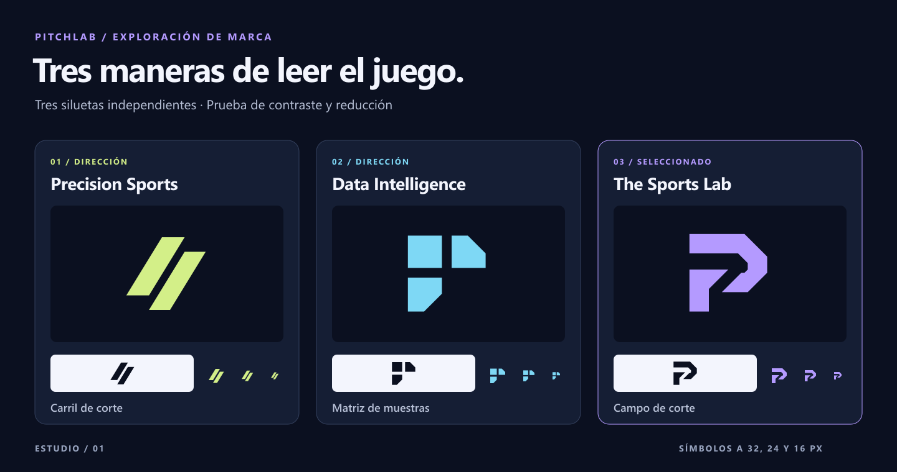

# Investigación y selección

Escala editorial de 1 a 5. Las puntuaciones reflejan una revisión de silueta, contraste, reducción y variedad de soportes.

| Criterio | A · Precision Sports | B · Data Intelligence | C · The Sports Lab |
|---|---:|---:|---:|
| Originalidad | 3 | 4 | 5 |
| Reconocimiento | 4 | 3 | 5 |
| Legibilidad | 5 | 4 | 5 |
| Aplicación digital | 4 | 4 | 5 |
| Escalabilidad | 5 | 4 | 5 |
| Versatilidad | 4 | 4 | 5 |
| Personalidad | 4 | 3 | 5 |
| Distancia de códigos genéricos | 2 | 3 | 4 |

- **Precision Sports / Carril de corte.** Dos carriles cortados convierten la velocidad en una dirección visual. La doble diagonal se acerca a códigos de indumentaria.
- **Data Intelligence / Matriz de muestras.** Tres celdas forman una matriz con un cuadrante libre para la siguiente observación. En monocromo puede leerse como icono de módulos.
- **The Sports Lab / Campo de corte.** Dos piezas enmarcan un corredor abierto. La silueta sugiere una P y el corte, una línea de análisis. El corredor requiere conservar el espacio negativo.

**Selección.** C conserva la lectura del corredor y los dos bloques a 16 px. Su vacío da una firma propia y una regla para movimiento y retículas. A se reduce muy bien, pero la doble diagonal está extendida en el lenguaje deportivo. B expresa muestreo en grande y pierde carácter a escala de favicon.

## Referencias y coincidencias

- Interfaz móvil oscura y compacta, acentos de alta energía y titulares deportivos. PitchLab recoge profundidad y contraste. [Draftea](https://www.draftea.mx/)
- Series, mapas y tablas ponen la evidencia en primer plano. PitchLab adopta densidad con jerarquía y contexto. [Hudl Statsbomb](https://www.hudl.com/products/statsbomb/platform)
- SaaS con baja ornamentación, capas cercanas y jerarquía por contraste y espaciado. Criterio aplicado a navegación y paneles. [Linear](https://linear.app/)
- La interfaz conversacional da prioridad al contenido. El asistente de PitchLab prioriza la respuesta, el periodo y las fuentes. [Claude](https://www.anthropic.com/claude)
- Uso comercial exacto del nombre en análisis deportivo con seguimiento de lanzamientos, métricas y video. [PitchLab Baseball](https://pitchlab.app/)
- Ficha en español de la app bajo el mismo nombre. [App Store · PitchLab – Béisbol](https://apps.apple.com/es/app/pitchlab-b%C3%A9isbol/id6738223162)
- Expediente vinculado a PITCHLAB AI, INC. para software de análisis de rendimiento en deportes de lanzamiento. Estado registral actual sin certificar. [USPTO · expediente 99521304](https://tsdr.uspto.gov/#caseNumber=99521304&caseSearchType=US_APPLICATION&caseType=DEFAULT&searchType=status)
- Pendiente la búsqueda formal denominativa y figurativa para México, además de la revisión en mercados de expansión. [IMPI · MARCia](https://marcia.impi.gob.mx/marcas/search/quick)
- Familia variable para UI y titulares. Incluye español y números tabulares. [Inter · sitio oficial](https://rsms.me/inter/)
- Uso comercial permitido bajo OFL 1.1. Conserva avisos y licencia al redistribuir. [Inter · licencia SIL OFL 1.1](https://github.com/rsms/inter/blob/master/LICENSE.txt)
- Criterios de contraste de texto, componentes e interacción accesible. [W3C · WCAG 2.2](https://www.w3.org/TR/WCAG22/)

La comparación visual fue editorial y se limitó a las referencias consultadas. La silueta con corredor abierto y dos masas se diferencia de sus motivos gráficos. La revisión figurativa exhaustiva está pendiente. La coincidencia verbal con PitchLab Baseball requiere evaluación formal ante el IMPI y en mercados de expansión.
