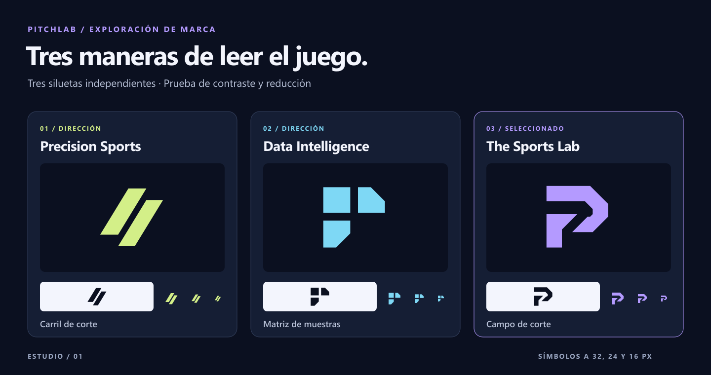

# PitchLab · Manual de identidad

PitchLab es una superapp de inteligencia deportiva por suscripción. Nace en México con alcance internacional y cubre NFL, NCAA Football, fútbol, NHL y MLB. Reúne datos históricos, análisis de partidos, estadísticas avanzadas, probabilidades, simulaciones, backtesting, comparación de cuotas y un asistente de investigación. Su posición es la de un laboratorio con fuentes, contexto y método visibles. Su personalidad es precisa, competitiva, tecnológica, confiable y cercana. Escribe siempre **PitchLab**, con P y L mayúsculas, sin espacio. El eslogan principal es **Lee el juego con datos.**

## Investigación y dirección elegida

Escala editorial de 1 a 5. Las puntuaciones reflejan una revisión de silueta, contraste, reducción y variedad de soportes.

| Criterio | A · Precision Sports | B · Data Intelligence | C · The Sports Lab |
|---|---:|---:|---:|
| Originalidad | 3 | 4 | 5 |
| Reconocimiento | 4 | 3 | 5 |
| Legibilidad | 5 | 4 | 5 |
| Aplicación digital | 4 | 4 | 5 |
| Escalabilidad | 5 | 4 | 5 |
| Versatilidad | 4 | 4 | 5 |
| Personalidad | 4 | 3 | 5 |
| Distancia de códigos genéricos | 2 | 3 | 4 |

- **Precision Sports / Carril de corte.** Dos carriles cortados convierten la velocidad en una dirección visual. La doble diagonal se acerca a códigos de indumentaria.
- **Data Intelligence / Matriz de muestras.** Tres celdas forman una matriz con un cuadrante libre para la siguiente observación. En monocromo puede leerse como icono de módulos.
- **The Sports Lab / Campo de corte.** Dos piezas enmarcan un corredor abierto. La silueta sugiere una P y el corte, una línea de análisis. El corredor requiere conservar el espacio negativo.

**Selección.** C conserva la lectura del corredor y los dos bloques a 16 px. Su vacío da una firma propia y una regla para movimiento y retículas. A se reduce muy bien, pero la doble diagonal está extendida en el lenguaje deportivo. B expresa muestreo en grande y pierde carácter a escala de favicon.

[Fuentes y revisión preliminar](../exploration/RESEARCH_AND_SELECTION.md)

## Construcción, variantes y uso

**The Sports Lab / Campo de corte.** Sobre una retícula de 64 × 64, dos piezas sólidas comparten una envolvente de 48 × 48, de 8 a 56 en ambos ejes. El cuerpo superior pasa de horizontal a un frente facetado. El apoyo inferior abre un corredor de 45° de unos 7,1 módulos medidos perpendicularmente al corte. El vacío sugiere una P y una trayectoria de análisis. Conserva ambas piezas y el vacío. La P abstracta cumple la función de monograma.

**Logotipo.** PitchLab está dibujado con ocho contornos propios. Altura de mayúsculas 42 unidades, altura nominal de minúsculas 31, línea base en y=44 y sobrepaso óptico de 1 unidad en curvas. El peso y el color son constantes en «Pitch» y «Lab». La mayúscula L y el espacio de 7 unidades h–L marcan el cambio de palabra. Usa los contornos oficiales.

**Proporciones.** Isotipo 64:64. Firma horizontal 331:64, símbolo a escala 1 y logotipo a (74, 8). Firma compacta 272:64, logotipo al 80 % en (65, 13,6). Firma apilada 265:132, símbolo al 130 % y nombre centrado. Logotipo 249:43. El isologo 344:80 usa un marco facetado conectado al símbolo por la izquierda y la base, con el nombre dentro.

**Protección.** Para las firmas horizontal y compacta reserva por fuera del viewBox al menos 8/64 de su altura. El isotipo integra 8 módulos de espacio por cada 64 desde su contorno visible. En la apilada reserva 10/132 de su altura, en el logotipo 8/43 y en el isologo 10/80, siempre por fuera de la caja. En avatares y app icons usa el arte con margen preparado para recorte circular.

| Activo | Ancho mínimo digital | Ancho mínimo de impresión | Uso |
|---|---:|---:|---|
| Isotipo | 16 px | 4,5 mm | Favicon e indicador de producto |
| Horizontal | 132 px | 32 mm | Header, landing, email |
| Compacta | 120 px | 30 mm | Menú móvil o navegación densa |
| Apilada | 110 px | 28 mm | Portadas e impresos |
| Logotipo | 100 px | 26 mm | Editorial |
| Isologo | 184 px | 44 mm | Sello editorial o contraportada |

En oscuro usa Pulso y Hielo sobre Tinta, Órbita o Pizarra. En claro usa Iris y Tinta sobre blanco o Hielo. Usa blanco o negro sólidos en monocromo. Para producción a una tinta, el SVG Iris ofrece una única separación de referencia. En fotografía reserva un campo Tinta uniforme. Mantén proporciones, orden, espacio libre y colores. Evita estirar, rotar, reconstruir en texto, trazar contornos, invertir piezas, aplicar efectos y colocar sobre alto detalle.

[Prueba de escala](../exploration/scale/) · [Firma horizontal](../logos/pitchlab-horizontal-dark.svg) · [Isologo](../logos/pitchlab-isologo-dark.svg)

## Paleta

| Token | Nombre | HEX | RGB | Función | Permitido | Restricción |
|---|---|---|---|---|---|---|
| brand-primary | Pulso | #B49AFF | 180, 154, 255 | Acción primaria y firma | Un CTA dominante por región, foco y marca sobre oscuro | Texto Tinta sobre relleno; reservar fuera de series y estados |
| brand-secondary | Iris | #5940B2 | 89, 64, 178 | Firma sobre claro | Isotipo sobre Hielo o blanco | Evitar como texto o control sobre oscuro |
| brand-accent | Eco | #71C9F1 | 113, 201, 241 | Segunda serie comparativa | Comparadores y series con etiqueta y trazo discontinuo | Reservar Info para mensajes de estado |
| background-primary | Tinta | #0B1020 | 11, 16, 32 | Lienzo y texto inverso | App, fondos de firma y texto sobre Pulso | Para texto inverso usar solo sobre fondos claros comprobados |
| background-secondary | Órbita | #10172A | 16, 23, 42 | Navegación | Sidebar, topbar y menú móvil | Separar del lienzo con borde o espacio |
| background-elevated | Umbral | #1A2440 | 26, 36, 64 | Elevación | Diálogos, menús y popovers | Evitar apilar más de dos niveles de superficie |
| surface-default | Pizarra | #151E34 | 21, 30, 52 | Paneles | Cards, tablas y formularios | Agrupar por estructura, sin alternar colores arbitrariamente |
| surface-hover | Bruma | #222D49 | 34, 45, 73 | Interacción hover | Filas, botones secundarios y filtros | Acompañar la interacción con foco visible |
| surface-active | Iris nocturno | #302650 | 48, 38, 80 | Selección persistente | Filtros, pestañas y navegación activa | Añadir etiqueta o indicador y aria-current/aria-selected |
| text-primary | Hielo | #F3F5FD | 243, 245, 253 | Lectura principal | Encabezados, métricas y copy | Sobre superficies oscuras |
| text-secondary | Niebla | #B8C1D7 | 184, 193, 215 | Lectura secundaria | Descripción, ejes, leyenda y ayuda | Conservar jerarquía con peso y tamaño |
| text-muted | Peltre | #98A4BF | 152, 164, 191 | Metadatos legibles | Fuentes, fechas y notas | Evitar opacidad extra en texto informativo |
| border-default | Arista | #33405D | 51, 64, 93 | División ornamental | Separadores internos o cards estáticas | Usar Arista firme si el contorno identifica un control |
| border-strong | Arista firme | #73819F | 115, 129, 159 | Contorno funcional | Controles secundarios, inputs y límites activos | Usar sobre fondos oscuros del sistema |
| success | Menta | #66D9AE | 102, 217, 174 | Operación completada | Estado con icono y texto | Evitar para comunicar rendimiento por defecto |
| warning | Ámbar | #FFC473 | 255, 196, 115 | Atención | Datos parciales o fuera de ventana | Acompañar con motivo visible |
| danger | Coral | #FF9BAA | 255, 155, 170 | Error | Error de proceso o campo | Añadir explicación y recuperación |
| info | Azul guía | #A9BFFF | 169, 191, 255 | Aviso informativo | Disponibilidad, metodología, cambios de fuente | Evitar como segunda serie |
| canvas-light | Blanco | #FFFFFF | 255, 255, 255 | Fondo claro de firma | Documentación o fondos corporativos | Usar firma con Iris y Tinta |
| chart-model | Índigo claro | #D9DFFF | 217, 223, 255 | Serie principal | Modelo o serie enfocada con trazo sólido | Agregar etiqueta directa o leyenda |

En las seis superficies oscuras, los mínimos son Hielo 12,53:1, Niebla 7,57:1 y Peltre 5,45:1. Pulso conserva 5,85:1 como foco. Tinta sobre Pulso alcanza 8,12:1. Iris sobre blanco alcanza 7,50:1. Arista firme conserva 3,49:1 en contornos funcionales. Arista es decorativo. El CSV incluye las 68 combinaciones verificadas.

## Tipografía

Usa Inter Variable (ejes wght y opsz) en display, UI y datos. Peso 400–750 en el sistema, con fallback a Inter y system-ui. Descarga el WOFF2 oficial, sirve el recurso local con font-display: swap y declara font-weight: 100 900. Conserva ñ, acentos, ¿, ¡, %, símbolos de moneda y signos matemáticos habituales. Usa font-variant-numeric: tabular-nums lining-nums en datos comparables. Usa Intl.NumberFormat para es-MX y la configuración regional del usuario. Las maquetas y el manual exportado usan Segoe UI como fuente de sistema disponible. El logotipo conserva sus contornos originales.

[Inter oficial](https://rsms.me/inter/) · [Licencia SIL OFL 1.1](https://github.com/rsms/inter/blob/master/LICENSE.txt)

| Rol | Tamaño / interlínea px | Móvil px | Peso | Tracking |
|---|---:|---:|---:|---:|
| display | 56 / 60 | 40 / 44 | 750 | -0.045 em |
| h1 | 40 / 44 | 32 / 36 | 730 | -0.035 em |
| h2 | 28 / 34 | 24 / 30 | 700 | -0.025 em |
| h3 | 20 / 26 | Igual | 650 | -0.015 em |
| body | 16 / 24 | Igual | 400 | 0 em |
| small | 14 / 20 | Igual | 450 | 0 em |
| caption | 12 / 16 | Igual | 500 | 0.01 em |
| button | 14 / 20 | Igual | 650 | 0 em |
| table | 14 / 20 | Igual | 450 | 0 em |
| numeric-highlight | 36 / 40 | 32 / 36 | 700 | -0.03 em |

## Sistema gráfico

- **Iconos.** Retícula 24 × 24, área activa 18 × 18, trazo 1,75 px, terminales y uniones redondos y radio visual cercano a 2 px. Usa 20 px en filas, 24 px en controles y 32 px en estados. Hereda currentColor. Reserva Pulso para foco y selección. Acompaña cada acción con etiqueta visible o nombre accesible.
- **Retícula Campo de corte.** Módulos de 32 px, líneas Arista con opacidad de 42 % y trayectoria de 2 px con la misma opacidad. Usa un motivo por composición, recortado a un lateral o bajo un área sin texto. Las retículas analíticas se mantienen independientes del patrón decorativo.
- **Ilustración.** Usa diagramas de coordenadas, trayectorias y cortes de campo cuando expliquen un dato. En piezas editoriales emplea la retícula o el isotipo a gran escala.
- **Fotografía.** Usa material propio o licenciado. Prioriza acciones donde se lea la postura, el apoyo o la trayectoria. Recorta el sujeto en un tercio, desatura el fondo y preserva los tonos de piel. Si superpones texto, aplica placa Tinta o cobertura Tinta del 65–80 % y mide contraste sobre el punto más luminoso. Conserva los créditos y las condiciones de uso.
- **Motion.** Entrada de firma con opacidad y 6 px de desplazamiento en 240 ms. El splash cede al contenido al estar listo. Barra indeterminada a 900 ms o valor real si se conoce. Hover en 120 ms, selección y paneles en 180 ms. Curva cubic-bezier(0.2, 0.8, 0.2, 1). Con prefers-reduced-motion elimina desplazamiento y bucles y conserva texto y señal visibles. [Demo local](../applications/motion.html).

## Aplicación en producto

| Elemento | Regla |
|---|---|
| Header | 64 px, fondo Órbita, borde Arista y firma horizontal a 148 px. En móvil usa compacta a 124 px. Nombre accesible «PitchLab · Inicio» si enlaza. |
| Sidebar | 232 px desde 1200 px, fondo Órbita. Filas de 44 px con iconos de 20 px. Selección con Iris nocturno, texto Hielo, indicador Pulso y aria-current="page". |
| Navegación | Menos de 768 px, menú móvil o barra inferior de 64 px con cuatro destinos y «Más». De 768 a 1199 px, rail de 64 px o panel. El drawer captura y devuelve foco y cierra con Escape. |
| Botón primario | Pulso con texto Tinta, radio 8 px, altura mínima 44 px y padding horizontal 16 px. Un CTA primario por región. En hover y pressed usa subrayado o anillo. |
| Botón secundario e inputs | Pizarra, texto Hielo y borde Arista firme. Hover Bruma. Error con Coral, icono y texto asociado al campo. Etiqueta persistente. |
| Cards y superficies | Tinta de fondo, Pizarra en tarjetas, radio 12 px, borde Arista de 1 px y padding 16 o 24 px. Umbral y radio 16 px para overlays. Sombra 0 12px 32px #00000066 solo en overlays. |
| Estadísticas | Cifras tabulares alineadas, unidad visible, ventana y denominador. Jerarquía de cifra 36/40, 32/36 en móvil. Todo cambio incluye dirección, base y periodo. |
| Tablas | Encabezados con scope, filas de 44 px, números a la derecha y texto a la izquierda. Usa aria-sort y unidad en encabezado. En móvil prioriza columnas y permite scroll interno etiquetado. |
| Gráficas | Modelo en Índigo claro con línea continua de 2 px. Serie observada en Eco con patrón 6/4. Rotula ejes y unidad. Leyenda con muestras de trazo, resumen textual y tabla accesible. Interrumpe la línea donde falten datos. |
| Avatares | Usa social/social-profile.png para la cuenta oficial y el isotipo para el asistente. Las personas usan foto o iniciales en neutro. Respeta el área circular central. |
| Estados | Menta, Ámbar, Coral o Azul guía con icono y texto. Carga con aria-busy y mensaje en role="status". Ofrece siguiente acción en vacíos y errores. |
| Asistente | Expón fuentes, periodo, hora de corte e incertidumbre. Permite consultar los datos de soporte. |

**Responsive.** 4 columnas en móvil con margen 16 y gap 12. 8 columnas desde 768 px con margen 24 y gap 16. 12 desde 1200 px con margen 32 y gap 24. Contenido hasta 1440 px. Usa las escalas móviles bajo 768 px.

**Accesibilidad.** Objetivo WCAG 2.2 AA. Texto normal ≥4,5:1, texto grande y elementos funcionales ≥3:1. Anillo Pulso de 2 px con offset de 2 px sobre oscuro. En controles Pulso el offset deja una banda oscura visible entre relleno y foco. Dianas de 44 × 44 px como estándar interno. Prueba teclado, contraste, estados, lectura de datos y movimiento reducido en los flujos reales.

## Aplicaciones

[Galería de producto, redes y comunicación](../applications/index.html) · [Demo de movimiento](../applications/motion.html)

## Identidad verbal

Escribe primero el dato, luego el contexto y después la acción. Usa verbos como comparar, explorar, estimar e investigar. Distingue observación, estimación y simulación. Identifica fuente, periodo, muestra y fecha de actualización cuando sean relevantes. Presenta cuotas como datos comparativos con formato y hora. Evita promesas de ganancias, certeza infalible y lenguaje de depósitos o apuestas.
### Esloganes
| Español | Inglés |
|---|---|
| **Lee el juego con datos.** | Read the game through data. |
| El juego, bajo análisis. | The game under analysis. |
| Cada partido tiene una lectura. | Every game has a story in the data. |
| Encuentra el patrón del partido. | Find the pattern in the game. |
| Del marcador al modelo. | From scoreboard to model. |
| El contexto cambia el juego. | Context changes the game. |
| Los datos detrás del partido. | The data behind the game. |
| Contrasta antes del silbatazo. | Compare before play begins. |
| Una lectura más del juego. | Another way to read the game. |
| Investiga la jugada. | Investigate the play. |

El eslogan une una acción deportiva («leer el juego») con el método («con datos»). Funciona antes y después del partido, en históricos y en simulaciones. La versión inglesa conserva la metáfora.

### Microcopy

| Contexto | Texto | Acción |
|---|---|---|
| Landing | Investiga partidos, contrasta probabilidades y vuelve a los datos que sostienen cada lectura. | Explorar el análisis |
| Login | Entra a tu espacio de análisis. | Iniciar sesión |
| Onboarding | Elige los deportes que quieres seguir. Puedes cambiarlos después. | Guardar preferencias |
| Dashboard | Panorama de la jornada. Datos actualizados a las 18:40, hora de Ciudad de México. | Ver partidos |
| Predicción | El modelo estima 64 % de probabilidad de victoria local. Ventana de referencia de 8 semanas. | Ver metodología |
| Históricos | 128 partidos en esta muestra. La serie va del 5 de septiembre al 24 de octubre. | Cambiar fechas |
| Análisis | Compara la proyección con los resultados observados. | Añadir comparación |
| Asistente | ¿Qué partido quieres investigar? Cuando haya datos, te mostraré la fuente y el periodo. | Consultar |
| Pricing | Compara las funciones incluidas en cada plan. | Comparar planes |
| Estado vacío | No hay partidos para este periodo. Amplía las fechas o cambia de liga. | Cambiar fechas |

## Consistencia

Usa los SVG de logos como máster, los PNG de app-icons y social para publicación y los tokens como contrato de producto. El [handoff](../PITCHLAB_BRAND_HANDOFF.md) detalla la implementación y el inventario. Las maquetas usan datos y planes ilustrativos. La validación de marca ante el IMPI y organismos aplicables sigue pendiente.
