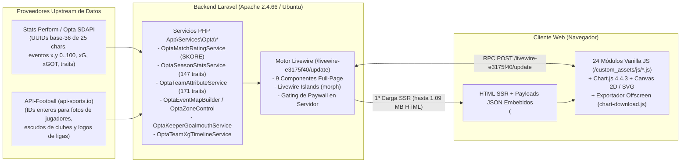

# 01 — Resumen Ejecutivo y Veredicto Forense: Statiskicks (`https://www.statiskicks.com/`)

> **Objetivo Auditado:** `https://www.statiskicks.com/`  
> **Rama / Worktree:** `REA-stats` (`.worktrees/REA-stats`)  
> **Herramienta Principal:** REA (*Reverse Engineer Anything* — 26 registros de evidencia `ev_...`) + 3 Subagentes Especializados (**Gemini 4 Argon High**)  
> **Fecha de Auditoría:** 9 de noviembre de 2026

---

## 1. Síntesis Ejecutiva: ¿Cómo Opera Statiskicks?

**Statiskicks** es una plataforma web hispanohablante de *scouting*, visualización táctica y estadística avanzada de fútbol orientada a aficionados avanzados, periodistas y analistas (con planes **Fan `$0/mes`**, **Plus mensual `$129 MXN/mes`** y **Plus anual `$774 MXN/año`**).

A diferencia de aplicaciones SPA modernas desacopladas (React/Next.js con API REST pública), Statiskicks opera como un **monolito híbrido Server-Driven basado en Laravel + Blade SSR + Livewire v3/v4 (`islands` + `wire:navigate`) + Alpine.js**, combinado con **24 motores de visualización en Vanilla JavaScript y Canvas 2D / SVG + Chart.js 4.4.3** que se descargan **sin minificar y con todos los comentarios internos de desarrollo intactos** en la primera carga de cualquier página.

---

## 2. Hallazgos Principales por Eje de Investigación

### 2.1 Origen de los Datos (`Data Provenance`) — Confirmado al 100% (`[OBSERVADO]`)

La auditoría con REA demostró con evidencia múltiple e convergente que Statiskicks utiliza una arquitectura de **doble proveedor**:

1. **Stats Perform / Opta Sports Data API (SDAPI) como Fuente Primaria de Datos y Eventos:**
   - **Identificadores canónicos:** Todas las ligas, temporadas (`tournamentCalendar`), equipos (`contestant`), jugadores (`person`) y partidos utilizan los **UUIDs alfanuméricos de 24–25 caracteres en base-36 de Opta SDAPI**:
     - Liga MX: `2hsidwomhjsaaytdy9u5niyi4` (Temporada 2026/2027 `tmcl`: `9zum4nxferygj8bb0ldcavxn8`)
     - Premier League: `2kwbbcootiqqgmrzs6o5inle5` · LaLiga: `34pl8szyvrbwcmfkuocjm3r6t` · Champions League: `4zwgbb66rif2spcoeeol2motx`
     - Club América: `eu8c408f59yx7egaqossbv25e` · Real Madrid: `3kq9cckrnlogidldtdie2fkbl`
     - Lionel Messi: `c5ryhn04g9goikd0blmh83aol` · Luis Romo: `1cyhpfi77dom7gmpuownxlcrt`
     - Partido Pumas vs. América: `9dy7dhz5f13b2ejz2a5tok2l0`
   - **Servicios PHP internos expuestos en comentarios JS:** Los archivos JS propietarios nombran explícitamente las clases del backend Laravel:
     - `App\Services\Opta\OptaMatchRatingService` (`format()`, `grade()`)
     - `App\Services\Opta\OptaSeasonStatsService::buildTraitsData()`
     - `App\Services\Opta\OptaTeamAttributeService::forTeam()`
     - `App\Services\Opta\OptaKeeperGoalmouthService`
     - `App\Services\Opta\OptaEventMapBuilder::summary()`
     - `App\Services\Opta\OptaZoneControl`
     - `App\Services\Opta\OptaTeamXgTimelineService`
     - `App\Support\RankBands::gradient()` / `RankBands::third()` / `PlanAccess::allowsMapEvent()`
   - **Coordenadas y nomenclatura Opta:** Eventos sobre cancha normalizada $(x, y) \in [0, 100] \times [0, 100]$ (con inversión del eje $Y$ derecho-a-izquierdo propia de Opta documentada en `event-map.js`), coordenadas de boca de portería `goalmouthY` $\in [44.2, 55.8]$ y `goalmouthZ` $\in [0, 38.0]$, y `raw_name` en inglés idéntico al catálogo de Opta (`"Corners Taken (incl short corners)"`, `"Shots Created"`, `"Successful Open Play Passes"`).

2. **API-Football (`v3.football.api-sports.io` / `media.api-sports.io`) como Fuente Secundaria de Media e Imágenes:**
   - **Fotos de jugadores:** Servidas directamente desde el CDN de API-Sports (`https://media.api-sports.io/football/players/154.png` para Lionel Messi, `35970.png` para Luis Romo, `35603.png` para Henry Martín).
   - **Logos de ligas y escudos de equipos:** Almacenados localmente en `/storage/media/leagues/{id}.png` y `/storage/media/teams/{id}.png` conservando el **ID numérico exacto de API-Football** (`262.png` = Liga MX, `39.png` = Premier League, `140.png` = LaLiga, `2287.png` = Club América, `541.png` = Real Madrid). Además, `sk.css` (líneas 4948–4959) contiene selectores CSS explícitos para `img[src*="/football/teams/"]` y `img[src*="/football/leagues/"]`.

---

### 2.2 Arquitectura del Código, Estructura y Componentes (`[OBSERVADO]`)

| Capa | Tecnología / Módulos Confirmados | Detalles Técnicos Clave |
|---|---|---|
| **Backend & RPC** | Laravel + Livewire (`/livewire-e3175f40/livewire.min.js?id=6b3709b1`) | 9 componentes Livewire de página completa (`home`, `leagues`, `league-detail`, `team-detail`, `players`, `player-detail`, `matches`, `match-detail`, `plans`) + 2 endpoints JSON (`GET /search?q=`, `GET /players/search?q=`). Usa **Livewire Islands (`mode=morph`)** para plantillas/resultados de equipos e historial de partidos de jugadores. |
| **Hidratación de Datos** | `<script type="application/json">` + atributos `data-*` | En lugar de usar una API REST separada para las gráficas, el servidor incrusta bloques JSON masivos en el HTML (`data-attribute-charts-payload` de 120 KB en equipo y 45 KB en jugador, `data-team-profile-payload`, `data-team-xg-rolling-payload`, `data-bootstrap` en mapas, `x-ref="cards"` de 85 KB en alineaciones) o los devuelve vía llamadas RPC a `POST /livewire-e3175f40/update`. |
| **Motores Visuales (24 archivos JS)** | `/custom_assets/js/*.js` (sin minificar, 529 KB en total) | Basados en **Chart.js 4.4.3** (`attribute-charts.js`, `team-age-profile.js`, `team-xg-rolling.js`) y **Canvas 2D / SVG puro** (`event-map.js` de 101 KB, `league-scatter.js` de 62 KB, `league-maps.js` de 47 KB, `team-pass-network.js` de 43 KB, `goalmouth-map.js`, `momentum-chart.js`, `heatmap.js`, `player-heat.js`). |
| **Motor de Exportación y Paywall** | `chart-download.js` (82 KB) + `download-paywall.js` + `search-results-image.js` | Renderizador Canvas 2D offscreen con 6 resoluciones preset (`1080×1080`, `1080×1350`, `1080×1920`, `1600×900`, `1200×630`), rasterizador DOM-a-Canvas propio (`paintHtml`), marca de agua dinámica y bloqueo en fase de captura (`window.addEventListener('click', ..., true)`). |
| **Estilos y UI** | `sk.css` (215 KB) + Bootstrap 5.3.3 + fuente `Inter` | Sistema de tokens CSS dual (`[data-theme="dark"]` / `[data-theme="light"]`), color primario `#1D665D` (verde esmeralda oscuro). Comentarios en `home.css` citan a **`scoutingstats.ai`** como referente visual de la portada y `player-heat.js` cita a **`FotMob`**. |

---

### 2.3 Modelos Estadísticos y Valor Agregado Calculado por Statiskicks (`[RECONSTRUIDO]`)

Sobre los datos crudos de Opta, Statiskicks construye 7 capas analíticas propias:
1. **`SKORE` (`OptaMatchRatingService`):** Calificación numérica en escala `0.00–10.00` (con umbrales `< 6.50` bajo, `6.50–6.99` medio, `>= 7.00` alto) e interpolación continua RGB entre `5.8` y `7.8`.
2. **Percentiles Posicionales y de Equipo (`RankBands`):** Fórmula exacta verificada $\text{round}\left(\frac{\text{count\_strictly\_worse}}{N - 1} \times 100, 2\right)$ sobre 147 métricas de jugador (filtro $>270$ minutos) y 171 métricas de equipo, coloreada con una escala de 4 paradas (`#dc2626` $\to$ `#f97316` $\to$ `#eab308` $\to$ `#16a34a`).
3. **Amenaza Esperada (`xT`):** Calculada sobre pases y conducciones progresivas usando una grilla de valor posicional, clasificando acciones en bandas `negative`, `low`, `mid`, `high`.
4. **Control Territorial (`OptaZoneControl`, `SK-10.4`):** Grilla de $6 \times 4 = 24$ zonas de la cancha (umbral de disputa $45\%–55\%$, dominio $\ge 55\%$).
5. **Clusters de Pases K-Means:** Agrupamiento geométrico de vectores de pase $(x_1, y_1, x_2, y_2)$ en $k \in \{2, 3, 6\}$ clusters con flechas gruesas de centroide.
6. **KDE Heatmap Cuártico (`heatmap.js` / `player-heat.js`):** Estimación de densidad por kernel biweight $(1 - d^2)^2$ en `Float32Array`, normalizada al percentil $98.5$ con corrección $\gamma = 0.7$ y piso `LONE_TOUCH_FLOOR = 1.8` para evitar sesgos en jugadores con pocos minutos.
7. **Proyección de Liga y Media Móvil de xG (`team-xg-rolling.js`):** Ventana móvil de 5 partidos de $xG$ vs $xGA$ con marcadores verticales de cambio de director técnico, más tabla de proyección de liga (`xPts`, posición proyectada, probabilidades de Liguilla/Campeón).

---

## 3. Cuellos de Botella Arquitectónicos Detectados en Statiskicks (Oportunidades para PitchLab)

1. **Lentitud crítica de renderizado en servidor (`10–27 segundos` en `/league/{id}`):**
   - Documentado por el propio autor en el bloque inline 1 de `01-home.html`: *"a league page currently renders in 10–27s, so this was the ordinary case rather than the edge case"*. El cálculo síncrono sobre feeds de Opta durante la petición HTTP bloquea la navegación SPA (`wire:navigate`).
2. **HTML monolítico de `1.09 MB` en `/team/{slug}-{id}`:**
   - La página de equipo serializa las 9 pestañas completas y 171 traits con todos los equipos de la liga en el primer documento HTML (`1,099,328 bytes`), desperdiciando ancho de banda y memoria DOM.
3. **Cascada secuencial de 18 llamadas RPC en Mapas de Liga (`league-maps.js`):**
   - Al abrir la pestaña `Mapas` de una liga, `league-maps.js` ejecuta un bucle `for` secuencial (`await component.call('loadLeagueMap', ...)`) que realiza **18 peticiones POST consecutivas** a `/livewire-e3175f40/update` (una por equipo) para no tumbar el servidor PHP/MySQL.
4. **Exposición total de lógica e ingeniería interna:**
   - Los 24 módulos JS y las hojas CSS se sirven sin empaquetar ni minificar, exponiendo nombres de servicios PHP, estructura interna de tickets (`SK-02.5` a `SK-19`), nombres de desarrolladores y referentes copiados (`scoutingstats.ai`, `FotMob`).

---

## 4. Índice de Reportes Detallados del Dossier

| Reporte | Contenido |
|---|---|
| [01-executive-summary.md](file:///c:/Users/T490s/Desktop/Proyectos/PitchLab/.worktrees/REA-stats/reports/01-executive-summary.md) | Síntesis ejecutiva, diagrama de arquitectura extremo a extremo y veredicto forense. |
| [02-architecture-and-routing.md](file:///c:/Users/T490s/Desktop/Proyectos/PitchLab/.worktrees/REA-stats/reports/02-architecture-and-routing.md) | Stack Laravel/Livewire, inventario completo de rutas, contratos `wire:snapshot`, Livewire Islands, navegación híbrida y modelo de suscripción/paywall. |
| [03-javascript-and-components.md](file:///c:/Users/T490s/Desktop/Proyectos/PitchLab/.worktrees/REA-stats/reports/03-javascript-and-components.md) | Desglose forense módulo por módulo de los 24 archivos JS personalizados, algoritmos matemáticos (KDE, xT, redes de pases, radares, exportador offscreen) y sistema de diseño CSS (`sk.css`). |
| [04-network-and-data-provenance.md](file:///c:/Users/T490s/Desktop/Proyectos/PitchLab/.worktrees/REA-stats/reports/04-network-and-data-provenance.md) | Prueba forense de origen de datos (**Opta SDAPI** + **API-Football**), tabla de las 40 ligas, catálogo completo de los 171 traits de equipo y 147 traits de jugador, esquemas JSON y modelos estadísticos derivados. |
| [05-evidence-register.md](file:///c:/Users/T490s/Desktop/Proyectos/PitchLab/.worktrees/REA-stats/reports/05-evidence-register.md) | Registro completo de los 26 `evidence_id` de REA, hashes SHA-256 de los 160 artefactos recolectados y límites epistemológicos documentados. |
