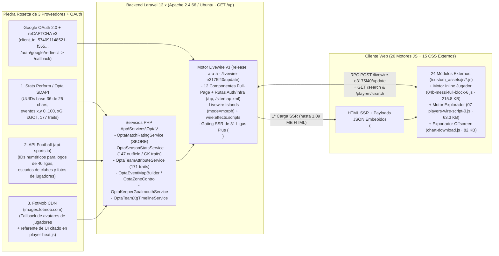

# 01 — Resumen Ejecutivo y Veredicto Forense: Statiskicks (`https://www.statiskicks.com/` · Wave 1 + Wave 2 + Wave 3)

> **Objetivo Auditado:** `https://www.statiskicks.com/`  
> **Rama / Worktree:** `REA-stats` (`.worktrees/REA-stats`)  
> **Herramienta Principal:** REA (*Reverse Engineer Anything* — **65 registros de evidencia `ev_*` retenidos** + **2 `ev_*` de exportación `AgentEnv`** y **4 incógnitas formales `unk_*` con 8 revisiones: 1 resuelta/verificada y 3 abiertas de severidad `low`**) + Equipos de Subagentes Especializados (**Gemini 4 Argon High**) en **3 Olas de Profundidad (Wave 1 + Wave 2 + Wave 3)**  
> **Fecha de Auditoría:** 9 de noviembre de 2026

---

## 1. Síntesis Ejecutiva: ¿Cómo Opera Statiskicks?

**Statiskicks** es una plataforma web hispanohablante de *scouting*, visualización táctica y estadística avanzada de fútbol orientada a aficionados avanzados, periodistas y analistas (con planes **Fan `\$0/mes`**, **Plus mensual `\$129 MXN/mes`** y **Plus anual `\$774 MXN/año`**).

A diferencia de aplicaciones SPA modernas desacopladas (React/Next.js con API REST pública), Statiskicks opera como un **monolito híbrido Server-Driven basado en Laravel 12.x (`GET /up` healthcheck con `@tailwindcss/browser@4`) + Blade SSR + Livewire v3 (`release: a-a-a`, `/livewire-e3175f40/update`, `islands` + `wire:navigate` + `wire:effects.scripts`) + Alpine.js v3 + Bootstrap 5.3.3 + Chart.js 4.4.3**, combinado con **26 motores JavaScript propietarios** (`24` módulos externos + `2` grandes motores inline/wire):
1. **24 motores de visualización externos en Vanilla JavaScript y Canvas 2D / SVG + Chart.js 4.4.3** (`/custom_assets/js/*.js`, `529 KB` sin minificar y con todos los comentarios internos de desarrollo intactos).
2. **El motor inline de perfil de jugador de `215.8 KB`** ([`04b-messi-full-block-6.js`](file:///c:/Users/T490s/Desktop/Proyectos/PitchLab/.worktrees/REA-stats/evidence/javascript/inline-pages/04b-messi-full-block-6.js), `ev_8ebf258ad84c478acf2afb3225c8b83b1692856dbf2e1756943e4c25fab6571c`) que gobierna `similarPlayersPanel`, `comparisonPanel`, los radares superpuestos, las barras de rendimiento, el modal de `Auto-reporte` (`#playerAutoReportModal`), la tabla de ranking y el buscador `/players/search`.
3. **El motor `wire:effects.scripts` del explorador `/players` de `63.3 KB`** ([`07-players-wire-script-0.js`](file:///c:/Users/T490s/Desktop/Proyectos/PitchLab/.worktrees/REA-stats/evidence/javascript/inline-pages/07-players-wire-script-0.js), descubierto y deconstruido en Wave 3 mediante `ev_04b1ede55ec1bd3f547cd81c48dc5a1fc2e4e8b8f9a9020481a3e35092a126e8` y `ev_6f32762bb5eaa2f8561fb62de9190b30fe0080d805e0bb03ad3377847062ea5f`) que registra `playersFilterDraft(initial)` (`1,722` líneas), administra los rangos dinámicos `statRanges`, el catálogo agrupado de 40 ligas (`leagueCatalogGrouped`), 15 posiciones tácticas y presets locales (`sk.players.filterPresets.v1`).
4. **15 hojas de estilo CSS externas modulares (`496 KB`) + 4 bloques `<style>` inline (`84.5 KB`)** con soporte completo de tema oscuro/claro (`[data-theme="dark"]` / `[data-theme="light"]`) y vista táctica móvil vertical (`ev_29b855423c405747f62b135a8e740ea6f51016bfd5f5e06d85762496b82e346e`).

---

## 2. Hallazgos Principales por Eje de Investigación (Wave 1 + Wave 2 + Wave 3)

### 2.1 Origen de los Datos y Piedra Rosetta de Tres Proveedores (`Data Provenance`) — Confirmado y Verificado al 100% (`[OBSERVADO]`)

En la **Wave 3**, la incógnita `unk_c7104fcac7a6781cc23c6d1216a43d4cc6e1e384c408bca299be9c4270d61191` (`data-provider-rosetta-and-locked-leagues`) quedó **formalmente resuelta y verificada (`status: "resolved"`, `disposition: "verified"`, `valid: true, truthVerified: true`)**, demostrando cómo Statiskicks reconcilia tres proveedores deportivos externos más Google OAuth 2.0:

1. **Stats Perform / Opta Sports Data API (SDAPI) como Fuente Primaria Universal de Datos y Eventos:**
   - **Llave primaria universal (UUID base-36 de 25 caracteres):** Todas las competiciones (`leagueId`), temporadas (`tournamentCalendar` / `seasonId`), equipos (`contestant` / `teamId`), jugadores (`person` / `playerId`) y partidos (`fixtureId`) usan el UUID de Opta SDAPI ([rosetta-40-leagues-opta-apifootball.json](file:///c:/Users/T490s/Desktop/Proyectos/PitchLab/.worktrees/REA-stats/evidence/network-schemas/rosetta-40-leagues-opta-apifootball.json), [rosetta-teams-opta-apifootball.json](file:///c:/Users/T490s/Desktop/Proyectos/PitchLab/.worktrees/REA-stats/evidence/network-schemas/rosetta-teams-opta-apifootball.json)):
     - Liga MX: `2hsidwomhjsaaytdy9u5niyi4` · Liga MX Femenil (bloqueada Plus): `7ut48s80k421xixh6ev5i6h62`
     - Premier League: `2kwbbcootiqqgmrzs6o5inle5` · LaLiga: `34pl8szyvrbwcmfkuocjm3r6t` · Champions League: `4zwgbb66rif2spcoeeol2motx`
     - Club América: `eu8c408f59yx7egaqossbv25e` · Real Madrid: `3kq9cckrnlogidldtdie2fkbl`
     - Lionel Messi: `c5ryhn04g9goikd0blmh83aol` · Luis Romo: `1cyhpfi77dom7gmpuownxlcrt` · Luis Malagón (GK): `a1qs3b34p5u2s6mmlhdkgdp7t` · Keylor Navas (GK): `9sme7jykdv8msgfu0nxx6h39x`
   - **Catálogo de 177 métricas Opta y Servicios PHP internos (`App\Services\Opta\*`):**
     - Documentados en [rosetta-177-opta-attributes-catalog.json](file:///c:/Users/T490s/Desktop/Proyectos/PitchLab/.worktrees/REA-stats/evidence/network-schemas/rosetta-177-opta-attributes-catalog.json) y procesados por `OptaMatchRatingService`, `OptaSeasonStatsService::buildTraitsData()`, `OptaTeamAttributeService::forTeam()`, `OptaKeeperGoalmouthService`, `OptaEventMapBuilder::summary()`, `OptaZoneControl`, `OptaTeamXgTimelineService`, `App\Support\RankBands` y `App\Support\PlanAccess`.

2. **API-Football (`v3.football.api-sports.io` / `media.api-sports.io`) como Fuente Secundaria de Identificadores Visuales:**
   - **Logos de las 40 ligas y escudos de equipos:** Almacenados localmente en `/storage/media/leagues/{api_football_id}.png` y `/storage/media/teams/{api_football_id}.png` conservando el **ID numérico exacto de API-Football** (`262.png` = Liga MX, `39.png` = Premier League, `140.png` = LaLiga, `2287.png` = Club América, `541.png` = Real Madrid).
   - **Fotografías principales de jugadores:** Servidas desde `https://media.api-sports.io/football/players/{id}.png` (`154.png` = Lionel Messi, `35970.png` = Luis Romo).

3. **FotMob CDN (`images.fotmob.com`) como Tercer Proveedor de Avatares de Jugadores:**
   - Verificado en Wave 3 en las respuestas de `GET /players/search?q=cristiano` ([30-player-tabs-compare-desempeno-modals-request-63-response.json](file:///c:/Users/T490s/Desktop/Proyectos/PitchLab/.worktrees/REA-stats/evidence/network-schemas/30-player-tabs-compare-desempeno-modals-request-63-response.json)) y `GET /search`: cuando un jugador utiliza avatar de FotMob, el backend devuelve `https://images.fotmob.com/image_resources/playerimages/{fotmob_id}.png` junto al CDN de API-Sports.

4. **Catálogo Completo de 40 Competiciones (`9 Gratuitas Fan` vs `31 Bloqueadas Plus`):**
   - Consolidado en [rosetta-40-leagues-opta-apifootball.json](file:///c:/Users/T490s/Desktop/Proyectos/PitchLab/.worktrees/REA-stats/evidence/network-schemas/rosetta-40-leagues-opta-apifootball.json) y [players-filter-draft-config.json](file:///c:/Users/T490s/Desktop/Proyectos/PitchLab/.worktrees/REA-stats/evidence/network-schemas/players-filter-draft-config.json):
     - **9 Ligas Abiertas (`is_scout: true`, Tier Fan `\$0`):** Liga MX (`262`), Premier League (`39`), LaLiga (`140`), Serie A (`135`), Bundesliga (`78`), Ligue 1 (`61`), Liga Profesional Argentina (`128`), Brasileirão Série A (`71`) y MLS (`253`).
     - **31 Ligas y Copas Bloqueadas (`is_scout: false`, Tier Plus `\$129 MXN/mes`):** Incluyen Liga MX Femenil (`7ut48s80k421xixh6ev5i6h62`), Liga de Expansión MX, UEFA Champions League, Europa League, Conference League, Copa Libertadores, Copa Sudamericana, Liga BetPlay Colombia, Primera División Chile, Liga 1 Perú, Eredivisie, Primeira Liga, Championship, NWSL, Liga F, WSL, entre otras. Al navegar directamente a cualquiera de ellas sin sesión Plus (`ev_a1d8facdf931a87bf33ba5e703e23d73cd2ee0c4550557ba3b84cdb9a1c10088`), Laravel devuelve un bloqueo SSR `<section class="league-locked sk-card">` sin hidratar datos ni disparar RPCs.

---

### 2.2 Arquitectura del Código, Estructura y Componentes (`[OBSERVADO]`)

| Capa | Tecnología / Módulos Confirmados | Detalles Técnicos Clave (Wave 1 + Wave 2 + Wave 3) |
|---|---|---|
| **Backend, Rutas & Auth** | **Laravel 12.x** (`GET /up` healthcheck con `@tailwindcss/browser@4`) + **Livewire v3** (`release: a-a-a`, `/livewire-e3175f40/livewire.min.js?id=6b3709b1`) | **17 rutas auditadas al 100%:** 12 componentes Livewire full-page (`/`, `/leagues`, `/league/{id}`, `/team/{slug}-{id}`, `/players`, `/player/{id}/{slug}`, `/partidos`, `/partido/{slug}-{id}`, `/planes`, `/contacto`, `/privacidad`, `/terminos`), rutas Auth (`/login`, `/register`, `/forgot-password`, `GET /auth/google/redirect`), endpoints JSON (`GET /search?q=`, `GET /players/search?q=`) y rutas de infraestructura (`GET /up`, `GET /robots.txt`, `GET /sitemap.xml` con 31 URLs). |
| **Hidratación, Islands y RPCs Livewire** | `<script type="application/json">`, `data-*`, `wire:effects.scripts` y `POST /livewire-e3175f40/update` | Capturados en vivo todos los contratos RPC e Islands (`__lazyLoadIsland` para `squad`, `results` y `matches`): `loadTraitsData`, `loadRankingData`, `loadPerformanceSummaryData`, `loadHeatmapData`, `loadSimilarPlayersData`, `ensureComparisonDataLoaded`, `loadMapGraphFilterOptions`, `loadMapGraphData` (`involvement`, `shots_xg`, `pass_progressive`), `loadTeamFormationProfile`, `keeperGoalmouth` y `statRanges`. |
| **26 Motores JS (24 Externos + 2 Motores Inline/Wire)** | `/custom_assets/js/*.js` (`529 KB`) + [`04b-messi-full-block-6.js`](file:///c:/Users/T490s/Desktop/Proyectos/PitchLab/.worktrees/REA-stats/evidence/javascript/inline-pages/04b-messi-full-block-6.js) (`215.8 KB`) + [`07-players-wire-script-0.js`](file:///c:/Users/T490s/Desktop/Proyectos/PitchLab/.worktrees/REA-stats/evidence/javascript/inline-pages/07-players-wire-script-0.js) (`63.3 KB`) | Auditados estáticamente en Wave 3 sobre **85 archivos JS** (`ev_6f32762bb5eaa2f8561fb62de9190b30fe0080d805e0bb03ad3377847062ea5f`). Basados en **Chart.js 4.4.3**, **Alpine.js v3** y **Canvas 2D / SVG puro** (`event-map.js` `101 KB`, `league-scatter.js` `62 KB`, `league-maps.js` `47 KB`, `team-pass-network.js` `43 KB`, `goalmouth-map.js`, `momentum-chart.js`, `heatmap.js`, `player-heat.js`, motor de perfil de jugador y motor de filtros `playersFilterDraft`). |
| **Motor de Exportación y Paywall** | `chart-download.js` (`82 KB`) + `download-paywall.js` + `search-results-image.js` | Renderizador Canvas 2D offscreen con 6 resoluciones preset (`1080×1080`, `1080×1350`, `1080×1920`, `1600×900`, `1200×630`), rasterizador DOM-a-Canvas propio (`paintHtml`), modal de auto-reporte `#playerAutoReportModal`, marca de agua dinámica y bloqueo en fase de captura (`window.addEventListener('click', ..., true)`). |
| **Sistema de Diseño CSS (15 hojas externas + 4 inline)** | `sk.css` (`167.8 KB`), `match-detail.css` (`97.4 KB`), `league-detail.css` (`78.4 KB`), etc. | Sistema de tokens CSS dual (`[data-theme="dark"]` / `[data-theme="light"]`, verificado en vivo en `ev_29b85542...`), color primario `#1D665D` y cancha móvil vertical (`390×844`). Comentarios en `home.css` citan a **`scoutingstats.ai`** y `player-heat.js` cita a **`FotMob`**. |

---

### 2.3 Modelos Estadísticos y Valor Agregado Calculado por Statiskicks (`[OBSERVADO]` / `[RECONSTRUIDO]`)

Sobre los datos crudos de Opta, Statiskicks construye 9 capas analíticas propias, todas verificadas con payloads reales en las Waves 1–3:
1. **`SKORE` (`OptaMatchRatingService`):** Calificación numérica en escala `0.00–10.00` (con base `6.0` más contribuciones firmadas por categoría en `ratingBreakdown`: ataque, pases, duelos, defensa, disciplina, portería), historial partido a partido en la pestaña `Desempeño` (`ev_9435086f...`) e interpolación continua RGB entre `5.8` y `7.8`.
2. **Percentiles Posicionales (Jugadores de Campo y Porteros) y de Equipo (`RankBands`):** Fórmula exacta verificada $\text{round}\left(\frac{\text{count\_strictly\_worse}}{N - 1} \times 100, 2\right)$ sobre 147 métricas de jugador de campo, 6 ejes especializados de portero (`Atajadas`, `Prevención`, `Juego aéreo`, `Juego de pies`, `Salidas`, `Distribución`) y 171 métricas de equipo ([rosetta-177-opta-attributes-catalog.json](file:///c:/Users/T490s/Desktop/Proyectos/PitchLab/.worktrees/REA-stats/evidence/network-schemas/rosetta-177-opta-attributes-catalog.json)).
3. **Motor de Jugadores Similares (`loadSimilarPlayersData` + `similarPlayersPanel`):** Vector de percentiles por métrica ponderado por rol posicional, devolviendo el Top de jugadores más parecidos con porcentaje de similitud (`similarity_pct`), radar superpuesto y comparativa de métricas.
4. **Motor de Comparación Cara a Cara (`ensureComparisonDataLoaded` + `comparisonPanel`):** Pool precalculado de `333 KB` combinado con búsqueda asíncrona `GET /players/search?q=`, normalización por 90 minutos vs total y doble radar SVG superpuesto.
5. **Amenaza Esperada (`xT`):** Calculada sobre pases y conducciones progresivas usando una grilla de valor posicional, clasificando acciones en bandas `negative`, `low`, `mid`, `high`.
6. **Control Territorial (`OptaZoneControl`, `SK-10.4`):** Grilla de $6 \times 4 = 24$ zonas de la cancha (umbral de disputa $45\%–55\%$, dominio $\ge 55\%$).
7. **Clusters de Pases K-Means (`pass_progressive`):** Agrupamiento geométrico de vectores de pase $(x_1, y_1, x_2, y_2)$ en $k \in \{2, 3, 6\}$ clusters con flechas gruesas de centroide.
8. **KDE Heatmap Cuártico (`heatmap.js` / `player-heat.js`):** Estimación de densidad por kernel biweight $(1 - d^2)^2$ en `Float32Array`, normalizada al percentil $98.5$ con corrección $\gamma = 0.7$ y piso `LONE_TOUCH_FLOOR = 1.8`.
9. **Mapa de Portería de Guardameta (`OptaKeeperGoalmouthService` + `goalmouth-map.js`):** Proyección frontal de tiros recibidos a portería $(y \in [44.2, 55.8], z \in [0, 38.0])$ con cálculo de `xG`, `xGOT` (`PSxG`) y goles evitados (`prevented`).

---

## 3. Cuellos de Botella Arquitectónicos Detectados en Statiskicks (Oportunidades para PitchLab)

1. **Lentitud crítica de renderizado en servidor (`10–27 segundos` en `/league/{id}`):**
   - Documentado por el propio autor en el bloque inline 1 de `01-home.html`: *"a league page currently renders in 10–27s, so this was the ordinary case rather than the edge case"*. El cálculo síncrono sobre feeds de Opta durante la petición HTTP bloquea la navegación SPA (`wire:navigate`).
2. **HTML monolítico de `1.09 MB` en `/team/{slug}-{id}`, `215.8 KB` de JS inline repetido en cada `/player/{id}/{slug}` y `63.3 KB` inyectados en `wire:effects.scripts` en `/players`:**
   - La página de equipo serializa las 9 pestañas completas y 171 traits con todos los equipos de la liga en el primer documento HTML (`1,099,328 bytes`), mientras que cada perfil de jugador incrusta `215,827 bytes` de JavaScript inline (`04b-messi-full-block-6.js`) y `/players` inyecta `63,346 bytes` (`07-players-wire-script-0.js`) dentro del payload Livewire en lugar de servirlos como módulos estáticos cacheables por CDN.
3. **Cascada secuencial de 18 llamadas RPC en Mapas de Liga (`league-maps.js`):**
   - Al abrir la pestaña `Mapas` de una liga, `league-maps.js` ejecuta un bucle `for` secuencial (`await component.call('loadLeagueMap', ...)`) que realiza **18 peticiones POST consecutivas** a `/livewire-e3175f40/update` (una por equipo) para no saturar el servidor PHP/MySQL.
4. **Exposición total de lógica e ingeniería interna:**
   - Los 26 motores JS, las 15 hojas CSS y el endpoint de diagnóstico `GET /up` se sirven sin ofuscar, exponiendo nombres de servicios PHP, estructura interna de tickets (`SK-02.5` a `SK-19`), nombres de desarrolladores y referentes copiados (`scoutingstats.ai`, `FotMob`).

---

## 4. Índice de Reportes Detallados del Dossier

| Reporte | Contenido |
|---|---|
| [01-executive-summary.md](file:///c:/Users/T490s/Desktop/Proyectos/PitchLab/.worktrees/REA-stats/reports/01-executive-summary.md) | Síntesis ejecutiva, diagrama de arquitectura extremo a extremo y veredicto forense consolidado (Wave 1 + Wave 2 + Wave 3). |
| [02-architecture-and-routing.md](file:///c:/Users/T490s/Desktop/Proyectos/PitchLab/.worktrees/REA-stats/reports/02-architecture-and-routing.md) | Stack **Laravel 12.x** (`GET /up`) + **Livewire v3 (`release: a-a-a`)**, inventario completo de las 17 rutas web e infraestructura (`/robots.txt`, `/sitemap.xml`), gating SSR de las 31 ligas Plus bloqueadas, Islands (`squad`, `results`, `matches`), tema claro/oscuro y vista móvil (`390×844`). |
| [03-javascript-and-components.md](file:///c:/Users/T490s/Desktop/Proyectos/PitchLab/.worktrees/REA-stats/reports/03-javascript-and-components.md) | Desglose forense de los **26 motores JS** (24 módulos externos + `04b-messi-full-block-6.js` de `215.8 KB` + `07-players-wire-script-0.js` de `63.3 KB` analizados sobre 85 archivos en `ev_6f32762b...`), algoritmos matemáticos y arquitectura de las 15 hojas CSS. |
| [04-network-and-data-provenance.md](file:///c:/Users/T490s/Desktop/Proyectos/PitchLab/.worktrees/REA-stats/reports/04-network-and-data-provenance.md) | Prueba forense de la **Piedra Rosetta de Tres Proveedores** (**Opta SDAPI** + **API-Football** + **FotMob CDN**), catálogo completo de las **40 ligas (9 Fan vs 31 Plus)**, las **177 métricas Opta** y esquemas `[OBSERVADO]` de todos los RPCs Livewire. |
| [05-evidence-register.md](file:///c:/Users/T490s/Desktop/Proyectos/PitchLab/.worktrees/REA-stats/reports/05-evidence-register.md) | Registro completo de los **65 `evidence_id` (`ev_*`) retenidos** (+ 2 `ev_*` de `AgentEnv`), las **4 incógnitas formales (`unk_*`, 8 revisiones: 1 resuelta/verificada y 3 abiertas `low`)**, el bundle reproducible [agentenv-statiskicks](file:///c:/Users/T490s/Desktop/Proyectos/PitchLab/.worktrees/REA-stats/evidence/agentenv-statiskicks/README.md) y los **413 artefactos** (`106.9 MB`). |
