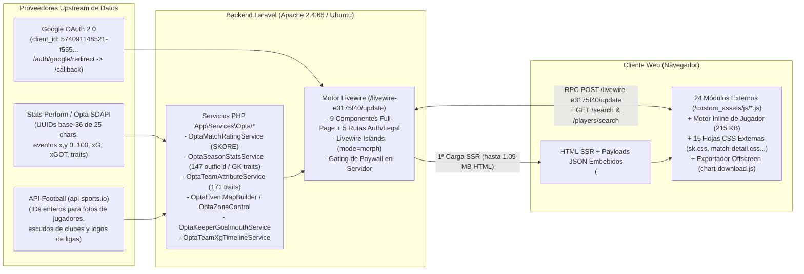

# 01 — Resumen Ejecutivo y Veredicto Forense: Statiskicks (`https://www.statiskicks.com/`)

> **Objetivo Auditado:** `https://www.statiskicks.com/`  
> **Rama / Worktree:** `REA-stats` (`.worktrees/REA-stats`)  
> **Herramienta Principal:** REA (*Reverse Engineer Anything* — **50 registros de evidencia `ev_*`** y **3 incógnitas residuales formales `unk_*`**) + Equipos de Subagentes Especializados (**Gemini 4 Argon High**) en **2 Olas de Profundidad (Wave 1 + Wave 2)**  
> **Fecha de Auditoría:** 9 de noviembre de 2026

---

## 1. Síntesis Ejecutiva: ¿Cómo Opera Statiskicks?

**Statiskicks** es una plataforma web hispanohablante de *scouting*, visualización táctica y estadística avanzada de fútbol orientada a aficionados avanzados, periodistas y analistas (con planes **Fan `\$0/mes`**, **Plus mensual `\$129 MXN/mes`** y **Plus anual `\$774 MXN/año`**).

A diferencia de aplicaciones SPA modernas desacopladas (React/Next.js con API REST pública), Statiskicks opera como un **monolito híbrido Server-Driven basado en Laravel + Blade SSR + Livewire v3/v4 (`islands` + `wire:navigate`) + Alpine.js**, combinado con:
1. **24 motores de visualización externos en Vanilla JavaScript y Canvas 2D / SVG + Chart.js 4.4.3** (`/custom_assets/js/*.js`, `529 KB` sin minificar y con todos los comentarios internos de desarrollo intactos).
2. **Un motor inline oculto de `215.8 KB` por página de jugador** ([`04b-messi-full-block-6.js`](file:///c:/Users/T490s/Desktop/Proyectos/PitchLab/.worktrees/REA-stats/evidence/javascript/inline-pages/04b-messi-full-block-6.js), descubierto y deconstruido en Wave 2 mediante `ev_8ebf258ad84c478acf2afb3225c8b83b1692856dbf2e1756943e4c25fab6571c`) que gobierna `similarPlayersPanel`, `comparisonPanel`, los radares superpuestos, las barras de rendimiento, la tabla de ranking y el buscador `/players/search`.
3. **15 hojas de estilo CSS externas modulares (`496 KB`) + 4 bloques `<style>` inline (`84.5 KB`)** extraídos íntegramente en Wave 2 (`ev_25c63b453dd7eade256fd2fc4611d1d2ea0dc6f6d9801f798278c1182d38a006`).

---

## 2. Hallazgos Principales por Eje de Investigación (Wave 1 + Wave 2)

### 2.1 Origen de los Datos (`Data Provenance`) — Confirmado al 100% (`[OBSERVADO]`)

La auditoría con REA demostró con evidencia múltiple y convergente que Statiskicks utiliza una arquitectura de **doble proveedor deportivo** más **Google OAuth 2.0**:

1. **Stats Perform / Opta Sports Data API (SDAPI) como Fuente Primaria de Datos y Eventos:**
   - **Identificadores canónicos:** Todas las ligas, temporadas (`tournamentCalendar`), equipos (`contestant`), jugadores (`person`) y partidos utilizan los **UUIDs alfanuméricos de 24–25 caracteres en base-36 de Opta SDAPI**:
     - Liga MX: `2hsidwomhjsaaytdy9u5niyi4` (Temporada 2026/2027 `tmcl`: `9zum4nxferygj8bb0ldcavxn8`)
     - Premier League: `2kwbbcootiqqgmrzs6o5inle5` · LaLiga: `34pl8szyvrbwcmfkuocjm3r6t` · Champions League: `4zwgbb66rif2spcoeeol2motx`
     - Club América: `eu8c408f59yx7egaqossbv25e` · Real Madrid: `3kq9cckrnlogidldtdie2fkbl`
     - Lionel Messi: `c5ryhn04g9goikd0blmh83aol` · Luis Romo: `1cyhpfi77dom7gmpuownxlcrt` · Luis Malagón (Portero): `a1qs3b34p5u2s6mmlhdkgdp7t` · Keylor Navas (Portero): `9sme7jykdv8msgfu0nxx6h39x`
     - Partido Pumas vs. América: `9dy7dhz5f13b2ejz2a5tok2l0`
   - **Servicios PHP internos expuestos en comentarios JS y payloads RPC:**
     - `App\Services\Opta\OptaMatchRatingService` (`format()`, `grade()`)
     - `App\Services\Opta\OptaSeasonStatsService::buildTraitsData()`
     - `App\Services\Opta\OptaTeamAttributeService::forTeam()`
     - `App\Services\Opta\OptaKeeperGoalmouthService` (capturado en vivo en Wave 2 vía `keeperGoalmouth(['9sme7jykdv8msgfu0nxx6h39x'])` en [`28-match-alineaciones-rpc-full-request-105-response.json`](file:///c:/Users/T490s/Desktop/Proyectos/PitchLab/.worktrees/REA-stats/evidence/network-schemas/28-match-alineaciones-rpc-full-request-105-response.json))
     - `App\Services\Opta\OptaEventMapBuilder::summary()` y `App\Services\Opta\OptaZoneControl` (capturados en vivo en Wave 2 vía `loadMapGraphData` para `involvement`, `shots_xg` y `pass_progressive` con centroides K-Means en [`26-player-rpc-full-request-64/65/66-response.json`](file:///c:/Users/T490s/Desktop/Proyectos/PitchLab/.worktrees/REA-stats/evidence/network-schemas/26-player-rpc-full-request-66-response.json))
     - `App\Services\Opta\OptaTeamXgTimelineService`
     - `App\Support\RankBands::gradient()` / `RankBands::third()` / `PlanAccess::allowsMapEvent()`
   - **Coordenadas y nomenclatura Opta:** Eventos sobre cancha normalizada $(x, y) \in [0, 100] \times [0, 100]$ (con inversión del eje $Y$ derecho-a-izquierdo propia de Opta documentada en `event-map.js`), coordenadas de boca de portería `goalmouthY` $\in [44.2, 55.8]$ (qualifier Opta `38`) y `goalmouthZ` $\in [0, 38.0]$ (qualifier Opta `39`), y `raw_name` en inglés idéntico al catálogo de Opta (`"Corners Taken (incl short corners)"`, `"Shots Created"`, `"Successful Open Play Passes"`).

2. **API-Football (`v3.football.api-sports.io` / `media.api-sports.io`) como Fuente Secundaria de Media e Imágenes:**
   - **Fotos de jugadores:** Servidas directamente desde el CDN de API-Sports (`https://media.api-sports.io/football/players/154.png` para Lionel Messi, `35970.png` para Luis Romo, `35603.png` para Henry Martín).
   - **Logos de ligas y escudos de equipos:** Almacenados localmente en `/storage/media/leagues/{id}.png` y `/storage/media/teams/{id}.png` conservando el **ID numérico exacto de API-Football** (`262.png` = Liga MX, `39.png` = Premier League, `140.png` = LaLiga, `2287.png` = Club América, `541.png` = Real Madrid).

---

### 2.2 Arquitectura del Código, Estructura y Componentes (`[OBSERVADO]`)

| Capa | Tecnología / Módulos Confirmados | Detalles Técnicos Clave (Wave 1 + Wave 2) |
|---|---|---|
| **Backend, Rutas & Auth** | Laravel + Livewire (`/livewire-e3175f40/livewire.min.js?id=6b3709b1`) | **14 rutas web auditadas al 100%:** 9 componentes Livewire full-page (`home`, `leagues`, `league-detail`, `team-detail`, `players`, `player-detail`, `matches`, `match-detail`, `plans`) + 5 rutas de autenticación y legales (`/login`, `/register`, `/forgot-password`, `/contacto`, `/privacidad`, `/terminos`, más redirección `GET /auth/google/redirect` con `client_id=574091148521-f555efdk865mn8unhiq6f2aaur6j39jv.apps.googleusercontent.com`) + 2 endpoints JSON (`GET /search?q=`, `GET /players/search?q=`). |
| **Hidratación y RPCs Livewire** | `<script type="application/json">`, `data-*` y `POST /livewire-e3175f40/update` | Capturados en vivo todos los contratos RPC diferidos: `loadTraitsData`, `loadRankingData`, `loadPerformanceSummaryData`, `loadHeatmapData` (tanto en jugador de campo como en portero), `loadSimilarPlayersData` (`19.9 KB`), `ensureComparisonDataLoaded` (`333.2 KB`), `loadMapGraphFilterOptions` (`204.7 KB`), `loadMapGraphData` (`268.7 KB` / `225.1 KB` / `233.6 KB`), `loadTeamFormationProfile` (`111.1 KB`), `keeperGoalmouth` (`2.5 KB`) y `statRanges`. |
| **Motores Visuales (24 Externos + Inline)** | `/custom_assets/js/*.js` (`529 KB`) + `04b-messi-full-block-6.js` (`215.8 KB`) | Basados en **Chart.js 4.4.3** (`attribute-charts.js`, `team-age-profile.js`, `team-xg-rolling.js`) y **Canvas 2D / SVG puro** (`event-map.js` de `101 KB`, `league-scatter.js` de `62 KB`, `league-maps.js` de `47 KB`, `team-pass-network.js` de `43 KB`, `goalmouth-map.js`, `momentum-chart.js`, `heatmap.js`, `player-heat.js`, y el motor inline de `/player` para Similares, Comparación y Radares). |
| **Motor de Exportación y Paywall** | `chart-download.js` (`82 KB`) + `download-paywall.js` + `search-results-image.js` | Renderizador Canvas 2D offscreen con 6 resoluciones preset (`1080×1080`, `1080×1350`, `1080×1920`, `1600×900`, `1200×630`), rasterizador DOM-a-Canvas propio (`paintHtml`), marca de agua dinámica y bloqueo en fase de captura (`window.addEventListener('click', ..., true)`). |
| **Sistema de Diseño CSS (15 hojas externas + 4 inline)** | `sk.css` (`167.8 KB`), `match-detail.css` (`97.4 KB`), `league-detail.css` (`78.4 KB`), etc. | Sistema de tokens CSS dual (`[data-theme="dark"]` / `[data-theme="light"]`), color primario `#1D665D` (verde esmeralda oscuro). Comentarios en `home.css` citan a **`scoutingstats.ai`** como referente visual de la portada y `player-heat.js` cita a **`FotMob`**. |

---

### 2.3 Modelos Estadísticos y Valor Agregado Calculado por Statiskicks (`[OBSERVADO]` / `[RECONSTRUIDO]`)

Sobre los datos crudos de Opta, Statiskicks construye 9 capas analíticas propias, todas verificadas con payloads reales en Wave 2:
1. **`SKORE` (`OptaMatchRatingService`):** Calificación numérica en escala `0.00–10.00` (con base `6.0` más contribuciones firmadas por categoría en `ratingBreakdown`: ataque, pases, duelos, defensa, disciplina, portería) e interpolación continua RGB entre `5.8` y `7.8`.
2. **Percentiles Posicionales (Jugadores de Campo y Porteros) y de Equipo (`RankBands`):** Fórmula exacta verificada $\text{round}\left(\frac{\text{count\_strictly\_worse}}{N - 1} \times 100, 2\right)$ sobre 147 métricas de jugador de campo, 6 ejes especializados de portero (`Atajadas`, `Prevención`, `Juego aéreo`, `Juego de pies`, `Salidas`, `Distribución`) y 171 métricas de equipo.
3. **Motor de Jugadores Similares (`loadSimilarPlayersData` + `similarPlayersPanel`):** Vector de percentiles por métrica ponderado por rol posicional, devolviendo el Top de jugadores más parecidos con porcentaje de similitud (`similarity_pct`), radar superpuesto y comparativa de métricas.
4. **Motor de Comparación Cara a Cara (`ensureComparisonDataLoaded` + `comparisonPanel`):** Pool precalculado de `333 KB` combinado con búsqueda asíncrona `GET /players/search?q=`, normalización por 90 minutos vs total y doble radar SVG superpuesto.
5. **Amenaza Esperada (`xT`):** Calculada sobre pases y conducciones progresivas usando una grilla de valor posicional, clasificando acciones en bandas `negative`, `low`, `mid`, `high`.
6. **Control Territorial (`OptaZoneControl`, `SK-10.4`):** Grilla de $6 \times 4 = 24$ zonas de la cancha (umbral de disputa $45\%–55\%$, dominio $\ge 55\%$).
7. **Clusters de Pases K-Means (`pass_progressive`):** Agrupamiento geométrico de vectores de pase $(x_1, y_1, x_2, y_2)$ en $k \in \{2, 3, 6\}$ clusters con flechas gruesas de centroide (observado en vivo en `26-player-rpc-full-request-66-response.json`).
8. **KDE Heatmap Cuártico (`heatmap.js` / `player-heat.js`):** Estimación de densidad por kernel biweight $(1 - d^2)^2$ en `Float32Array`, normalizada al percentil $98.5$ con corrección $\gamma = 0.7$ y piso `LONE_TOUCH_FLOOR = 1.8`.
9. **Mapa de Portería de Guardameta (`OptaKeeperGoalmouthService` + `goalmouth-map.js`):** Proyección frontal de tiros recibidos a portería $(y \in [44.2, 55.8], z \in [0, 38.0])$ con cálculo de `xG`, `xGOT` (`PSxG`) y goles evitados (`prevented`).

---

## 3. Cuellos de Botella Arquitectónicos Detectados en Statiskicks (Oportunidades para PitchLab)

1. **Lentitud crítica de renderizado en servidor (`10–27 segundos` en `/league/{id}`):**
   - Documentado por el propio autor en el bloque inline 1 de `01-home.html`: *"a league page currently renders in 10–27s, so this was the ordinary case rather than the edge case"*. El cálculo síncrono sobre feeds de Opta durante la petición HTTP bloquea la navegación SPA (`wire:navigate`).
2. **HTML monolítico de `1.09 MB` en `/team/{slug}-{id}` y `215 KB` de JS inline repetido en cada `/player/{id}/{slug}`:**
   - La página de equipo serializa las 9 pestañas completas y 171 traits con todos los equipos de la liga en el primer documento HTML (`1,099,328 bytes`), mientras que cada perfil de jugador incrusta `215,827 bytes` de JavaScript inline (`04b-messi-full-block-6.js`) dentro del HTML en lugar de servirlo como archivo cacheable por CDN.
3. **Cascada secuencial de 18 llamadas RPC en Mapas de Liga (`league-maps.js`):**
   - Al abrir la pestaña `Mapas` de una liga, `league-maps.js` ejecuta un bucle `for` secuencial (`await component.call('loadLeagueMap', ...)`) que realiza **18 peticiones POST consecutivas** a `/livewire-e3175f40/update` (una por equipo) para no saturar el servidor PHP/MySQL.
4. **Exposición total de lógica e ingeniería interna:**
   - Los 24 módulos JS externos, los bloques JS inline y las 15 hojas CSS se sirven sin empaquetar ni minificar, exponiendo nombres de servicios PHP, estructura interna de tickets (`SK-02.5` a `SK-19`), nombres de desarrolladores y referentes copiados (`scoutingstats.ai`, `FotMob`).

---

## 4. Índice de Reportes Detallados del Dossier

| Reporte | Contenido |
|---|---|
| [01-executive-summary.md](file:///c:/Users/T490s/Desktop/Proyectos/PitchLab/.worktrees/REA-stats/reports/01-executive-summary.md) | Síntesis ejecutiva, diagrama de arquitectura extremo a extremo y veredicto forense consolidado (Wave 1 + Wave 2). |
| [02-architecture-and-routing.md](file:///c:/Users/T490s/Desktop/Proyectos/PitchLab/.worktrees/REA-stats/reports/02-architecture-and-routing.md) | Stack Laravel/Livewire, inventario completo de las 14 rutas web, todas las pestañas de partido/liga/jugador/explorador, flujo Google OAuth, páginas legales y matriz de las 15 hojas CSS externas. |
| [03-javascript-and-components.md](file:///c:/Users/T490s/Desktop/Proyectos/PitchLab/.worktrees/REA-stats/reports/03-javascript-and-components.md) | Desglose forense de los 24 módulos JS externos + el motor inline de jugador de `215.8 KB` (`04b-messi-full-block-6.js`), algoritmos matemáticos y arquitectura de las 15 hojas CSS. |
| [04-network-and-data-provenance.md](file:///c:/Users/T490s/Desktop/Proyectos/PitchLab/.worktrees/REA-stats/reports/04-network-and-data-provenance.md) | Prueba forense de origen de datos (**Opta SDAPI** + **API-Football**), esquemas `[OBSERVADO]` de todos los RPCs Livewire (incluyendo `keeperGoalmouth`, `loadMapGraphData`, `loadSimilarPlayersData`, `ensureComparisonDataLoaded`, `loadTeamFormationProfile`, perfil de portero y `/players/search`). |
| [05-evidence-register.md](file:///c:/Users/T490s/Desktop/Proyectos/PitchLab/.worktrees/REA-stats/reports/05-evidence-register.md) | Registro completo de los **50 `evidence_id` (`ev_*`)**, las **3 incógnitas residuales formales (`unk_*`)** y el inventario SHA-256 de los **355 artefactos** (`94.6 MB`). |
