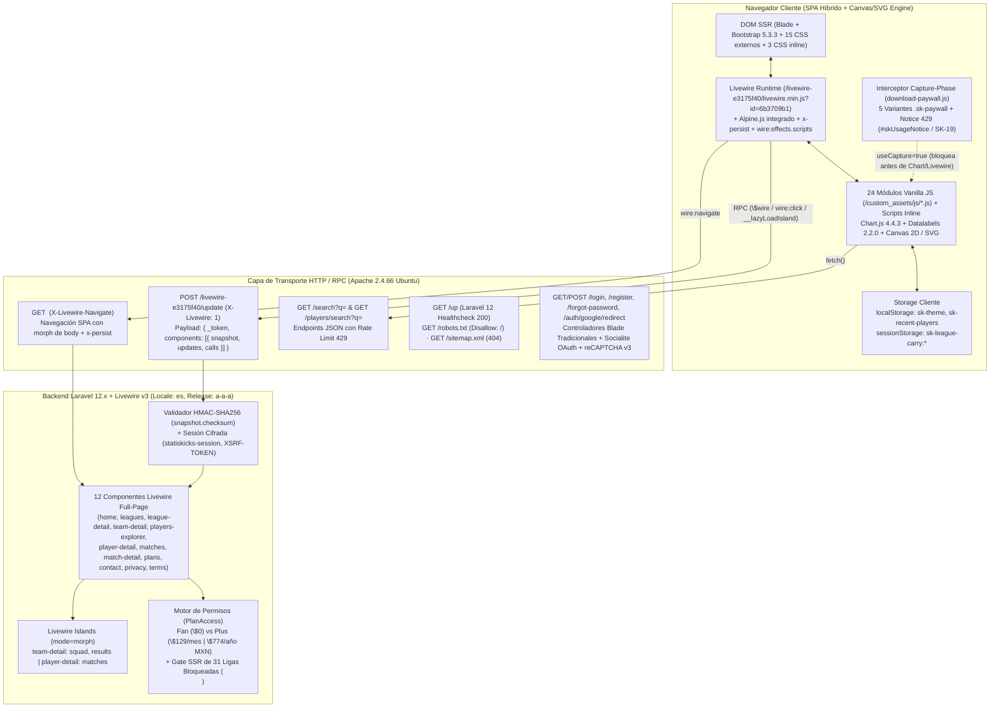

# 02 — Arquitectura Web, Enrutamiento, Estado Livewire, Autenticación y Modelo de Suscripción/Paywall

> **Objetivo Auditado:** `https://www.statiskicks.com/`  
> **Worktree Aislado:** `.worktrees/REA-stats` (Rama `REA-stats`)  
> **Motor Forense:** REA (`rea-agents`, Skill `reverse-engineer-anything` v49)  
> **Registro Maestro de Evidencias:** [05-evidence-register.md](file:///c:/Users/T490s/Desktop/Proyectos/PitchLab/.worktrees/REA-stats/reports/05-evidence-register.md) · [rea-evidence-summary.json](file:///c:/Users/T490s/Desktop/Proyectos/PitchLab/.worktrees/REA-stats/evidence/rea-evidence-summary.json)

---

## 1. Stack Tecnológico Confirmado de Punta a Punta (`[OBSERVADO]`)

La plataforma **Statiskicks** opera bajo una arquitectura monolítica híbrida **SSR + SPA-like** construida sobre **Laravel 12.x** y **Livewire v3** (con soporte nativo de *Islands*, inyección de scripts por componente vía `wire:effects.scripts`, navegación SPA vía `wire:navigate` e hidratación reactiva cliente con **Alpine.js**), complementada con **Bootstrap 5.3.3**, **Chart.js 4.4.3**, **15 hojas de estilo externas propias** (`/custom_assets/css/*.css`), **3 hojas de estilo inline dedicadas por ruta**, **24 módulos Vanilla JS propios** (`/custom_assets/js/*.js`) y motores JS inline/Livewire (incluyendo [`04b-messi-full-block-6.js`](file:///c:/Users/T490s/Desktop/Proyectos/PitchLab/.worktrees/REA-stats/evidence/javascript/inline-pages/04b-messi-full-block-6.js) de `215,827 B` y [`07-players-wire-script-0.js`](file:///c:/Users/T490s/Desktop/Proyectos/PitchLab/.worktrees/REA-stats/evidence/javascript/inline-pages/07-players-wire-script-0.js) de `61,884 B`) que se comunican bidireccionalmente con los componentes PHP mediante `\$wire` y eventos de ventana.



### 1.1 Backend: Laravel 12.x + Livewire v3 (Islands, `wire:effects.scripts`, Checksum HMAC y Endpoint Personalizado)

| Componente / Mecanismo | Valor / Firma Confirmada | Clasificación | Evidencia REA / Archivo |
|---|---|---|---|
| **Framework Backend (`Laravel 12.x`)** | **Laravel 12.x** (PHP) con sesiones cifradas (`statiskicks-session`), protección CSRF (`XSRF-TOKEN` + meta `csrf-token`) y localización `locale: "es"`. Confirmado en **Wave 3** mediante el endpoint nativo `GET /up` (`HTTP 200`, `1,832 B`), que renderiza la vista oficial `health-up.blade.php` de Laravel 12 con `<title>Statiskicks</title>`, fuente `Figtree` (`fonts.bunny.net`), `"Application up — HTTP request received. Response rendered in 65ms."` y `<script src="https://cdn.jsdelivr.net/npm/@tailwindcss/browser@4"></script>` (huella específica de **Laravel 12.x**, introducido en febrero de 2025). | `[OBSERVADO]` | `ev_04b1ede55ec1bd3f547cd81c48dc5a1fc2e4e8b8f9a9020481a3e35092a126e8` ([31-players-statranges-and-matches-hub-request-45-response.txt](file:///c:/Users/T490s/Desktop/Proyectos/PitchLab/.worktrees/REA-stats/evidence/network-schemas/31-players-statranges-and-matches-hub-request-45-response.txt)), `ev_a57fa32050d099e784ee0a2f3d1e0f302a0c917dcc1a8c686b3c3b363666b0df` ([01-home-capture.json](file:///c:/Users/T490s/Desktop/Proyectos/PitchLab/.worktrees/REA-stats/evidence/captures/01-home-capture.json)) |
| **Motor Livewire** | **Livewire v3** (`release: "a-a-a"` en `memo.release`) con prefijo de hash personalizado `/livewire-e3175f40`. | `[OBSERVADO]` | [01-home.html](file:///c:/Users/T490s/Desktop/Proyectos/PitchLab/.worktrees/REA-stats/evidence/captures/01-home.html), [01-home-livewire-snapshots.json](file:///c:/Users/T490s/Desktop/Proyectos/PitchLab/.worktrees/REA-stats/evidence/network-schemas/01-home-livewire-snapshots.json) |
| **Bundle Cliente Livewire** | `GET /livewire-e3175f40/livewire.min.js?id=6b3709b1` (`237,673 bytes`, SHA-256 `4f67d55949e15c5c6d680b31dec3474dd2f9efb144a5661455fe5326ce40bf1f`), inyectado con `<script src="..." data-csrf="..." data-update-uri="/livewire-e3175f40/update" data-navigate-once="true"></script>`. Incluye **Alpine.js** y el plugin `@alpinejs/persist` (`x-persist`) integrados en el mismo artefacto. | `[OBSERVADO]` | `ev_ae1b0493c16a440b51a7596afbe0c5af7cf297e66014c9e86aa9638018249441` ([manifest.json](file:///c:/Users/T490s/Desktop/Proyectos/PitchLab/.worktrees/REA-stats/evidence/javascript/home-scripts/manifest.json)) |
| **Endpoint RPC de Mutación** | `POST https://www.statiskicks.com/livewire-e3175f40/update` con cabecera `X-Livewire: 1` y `Content-Type: application/json`. | `[OBSERVADO]` | `ev_1318b6ef36cbf6e763ddae14da0f95b3088da1ea954e8c8993b2994b188569fd` ([13-match-tabs-post-request-104.json](file:///c:/Users/T490s/Desktop/Proyectos/PitchLab/.worktrees/REA-stats/evidence/network-schemas/13-match-tabs-post-request-104.json)) |
| **Integridad de Estado (`wire:snapshot`)** | Cada componente serializa `{"data": {...}, "memo": {"id", "name", "path", "method", "release", "locale", "islands", "children", "scripts", "assets", "errors"}, "checksum": "<64-hex-hmac-sha256>"}`. El `checksum` impide adulterar propiedades de servidor desde el cliente. | `[OBSERVADO]` | [03-team-livewire.json](file:///c:/Users/T490s/Desktop/Proyectos/PitchLab/.worktrees/REA-stats/evidence/network-schemas/03-team-livewire.json), [04-player-livewire.json](file:///c:/Users/T490s/Desktop/Proyectos/PitchLab/.worktrees/REA-stats/evidence/network-schemas/04-player-livewire.json) |
| **Inyección de Scripts por Componente (`wire:effects["scripts"]`)** | En `/players` (`players-explorer`), Livewire v3 registra `memo.scripts: ["1480236389-0"]` e inyecta mediante el atributo HTML `wire:effects="{&quot;scripts&quot;:{&quot;1480236389-0&quot;:&quot;&lt;script&gt;...&lt;/script&gt;&quot;}}"` un motor JavaScript completo de **`61,884 bytes` (`1,391 líneas`)** extraído en **Wave 3** como [`07-players-wire-script-0.js`](file:///c:/Users/T490s/Desktop/Proyectos/PitchLab/.worktrees/REA-stats/evidence/javascript/inline-pages/07-players-wire-script-0.js). | `[OBSERVADO]` | `ev_6f32762bb5eaa2f8561fb62de9190b30fe0080d805e0bb03ad3377847062ea5f`, `ev_79a56451a09d51677862255369247e2c2e598f8d18357e0a09a43c47da3e73ac` ([07-players-wire-script-0.js](file:///c:/Users/T490s/Desktop/Proyectos/PitchLab/.worktrees/REA-stats/evidence/javascript/inline-pages/07-players-wire-script-0.js), [07-players-livewire.json](file:///c:/Users/T490s/Desktop/Proyectos/PitchLab/.worktrees/REA-stats/evidence/network-schemas/07-players-livewire.json)) |
| **Soporte de Livewire Islands** | Uso de fragmentos aislados `<!--[if FRAGMENT:type=island|name=<name>|token=<token>|mode=morph]-->` registrados en `memo.islands` y carga diferida por intersección (`wire:intersect.once="__lazyLoadIsland('...')"`) en `team-detail` (`squad`, `results`) y `player-detail` (`matches`). | `[OBSERVADO]` | [03-team.html](file:///c:/Users/T490s/Desktop/Proyectos/PitchLab/.worktrees/REA-stats/evidence/captures/03-team.html), [04-player.html](file:///c:/Users/T490s/Desktop/Proyectos/PitchLab/.worktrees/REA-stats/evidence/captures/04-player.html) |
| **Sintetizadores Livewire (`s`)** | En `wire:snapshot.data`, los arrays anidados se etiquetan con el tuple de sintetizador `[{"...": "..."}, {"s": "arr"}]`. | `[OBSERVADO]` | [04-player-livewire.json](file:///c:/Users/T490s/Desktop/Proyectos/PitchLab/.worktrees/REA-stats/evidence/network-schemas/04-player-livewire.json) |

### 1.2 Frontend: Librerías Externas, Hojas de Estilo y los 24 Módulos Vanilla JS

El layout principal se renderiza en servidor con **Blade SSR** y carga **todos los 28 scripts JavaScript en el documento inicial** con `data-navigate-once` para que sobrevivan las transiciones `wire:navigate` sin re-descargarse ni re-ejecutarse (`[OBSERVADO]` en `ev_a57fa32050d099e784ee0a2f3d1e0f302a0c917dcc1a8c686b3c3b363666b0df` y `ev_ae1b0493c16a440b51a7596afbe0c5af7cf297e66014c9e86aa9638018249441`).

#### Librerías de Terceros y Fuentes (`[OBSERVADO]`)
1. **Bootstrap 5.3.3:** CSS (`https://cdn.jsdelivr.net/npm/bootstrap@5.3.3/dist/css/bootstrap.min.css`) y JS (`bootstrap.bundle.min.js`, `80,721 bytes`).
2. **Bootstrap Icons 1.11.3:** CSS (`https://cdn.jsdelivr.net/npm/bootstrap-icons@1.11.3/font/bootstrap-icons.min.css`) y fuente `bootstrap-icons.woff2?dd67030699838ea613ee6dbda90effa6` (`130,396 bytes`).
3. **Chart.js 4.4.3 + Datalabels 2.2.0:** `chart.umd.min.js` (`205,637 bytes`) y `chartjs-plugin-datalabels.min.js` (`12,937 bytes`), registrados explícitamente en el bloque inline global mediante `Chart.register(ChartDataLabels)`.
4. **Google Fonts:** Familia tipográfica **Plus Jakarta Sans** (`wght@400;500;600;700;800`, `29,432 bytes` woff2) como fuente de interfaz y **JetBrains Mono** para datos tabulares/monoespaciados.
5. **Google reCAPTCHA v3:** Cargado exclusivamente en `/register` (`https://www.google.com/recaptcha/api.js?render=6LfFoBcuAAAAAGkOIh5bJsfjA5zXtmktJwN5x3XJ`, acción `'register'`).

#### Matriz Completa de las 15 Hojas de Estilo Externas (`/custom_assets/css/*.css`) y 3 Hojas Inline por Ruta (`[OBSERVADO]`)

En la Oleada 2 se capturó la totalidad del inventario CSS de Statiskicks (`ev_25c63b453dd7eade256fd2fc4611d1d2ea0dc6f6d9801f798278c1182d38a006`, [25-css-files-capture.json](file:///c:/Users/T490s/Desktop/Proyectos/PitchLab/.worktrees/REA-stats/evidence/captures/25-css-files-capture.json)). El sistema combina **15 hojas de estilo externas** servidas desde `/custom_assets/css/*.css?v=<timestamp>` con **3 bloques `<style>` inline dedicados** inyectados en el `<head>` de las vistas de jugador, buscador de scouting y equipo:

| # | Archivo en `evidence/css/` | URL Pública (`/custom_assets/css/`) / Alias Conceptual | Tamaño (B) | Versión (`?v=`) | Rutas Donde se Carga y Responsabilidad Visual (`[OBSERVADO]`) |
|---:|---|---|---:|---|---|
| 1 | [sk.css](file:///c:/Users/T490s/Desktop/Proyectos/PitchLab/.worktrees/REA-stats/evidence/css/sk.css) | `/custom_assets/css/sk.css` (*alias conceptual: `app-shell.css`*) | 167,759 | `1794168592` | **Global (todas las rutas):** tokens CSS (`:root` / `[data-theme="dark"]` / `[data-theme="light"]`), app-shell, navbar, drawer de búsqueda, `.sk-card`, `.sk-player-table`, modal paywall (`.sk-paywall`), buzón de contacto (`.sk-contact`) y páginas legales (`.sk-legal`). |
| 2 | [match-detail.css](file:///c:/Users/T490s/Desktop/Proyectos/PitchLab/.worktrees/REA-stats/evidence/css/match-detail.css) | `/custom_assets/css/match-detail.css` | 97,372 | `1794084628` | **`/partido/{slug}-{id}`:** marcador hero, cancha de alineaciones (`.match-xi`), gráfica de momentum, tabla H2H (`.match-h2h`), líderes (`.match-lideres`) y modal `.match-player-card` / `.match-player-card__backdrop`. |
| 3 | [league-detail.css](file:///c:/Users/T490s/Desktop/Proyectos/PitchLab/.worktrees/REA-stats/evidence/css/league-detail.css) | `/custom_assets/css/league-detail.css` | 78,420 | `1794084628` | **`/league/{id}`:** layout con sidebar (`league-sidebar`), tabla de posiciones (`.league-standings`), matriz de proyección Montecarlo, matriz de dificultad de calendario (`.league-calendar`), líderes (`.league-leaders`) y explorador estadístico (`.league-stats`). |
| 4 | [home.css](file:///c:/Users/T490s/Desktop/Proyectos/PitchLab/.worktrees/REA-stats/evidence/css/home.css) | `/custom_assets/css/home.css` (*alias conceptual: `home-dashboard.css`*) | 34,184 | `1791380772` | **`/` (Home):** hero principal, bento grid de funcionalidades, widgets interactivos de demostración y carruseles de ligas/partidos. |
| 5 | [matches-page.css](file:///c:/Users/T490s/Desktop/Proyectos/PitchLab/.worktrees/REA-stats/evidence/css/matches-page.css) | `/custom_assets/css/matches-page.css` | 21,729 | `1792175986` | **`/partidos`:** selector horizontal de fechas, pestañas de estado (`En vivo`, `Próximos`, `Finalizados`), filtros de jornada/club y acordeones por competición. |
| 6 | [nav-mega-menu.css](file:///c:/Users/T490s/Desktop/Proyectos/PitchLab/.worktrees/REA-stats/evidence/css/nav-mega-menu.css) | `/custom_assets/css/nav-mega-menu.css` | 13,184 | `1791380772` | **Global (navbar desktop):** mega-menús desplegables de `Ligas`, `Scouting` y `Partidos` con grilla de confederaciones y accesos rápidos. |
| 7 | [auth.css](file:///c:/Users/T490s/Desktop/Proyectos/PitchLab/.worktrees/REA-stats/evidence/css/auth.css) | `/custom_assets/css/auth.css` | 12,610 | `1794181228` | **`/login`, `/register`, `/forgot-password`:** layout `.sk-auth-body` / `.sk-auth__shell` / `.sk-auth__card`, botones OAuth Google, medidor de fortaleza de contraseña y alertas de validación. |
| 8 | [leagues-page.css](file:///c:/Users/T490s/Desktop/Proyectos/PitchLab/.worktrees/REA-stats/evidence/css/leagues-page.css) | `/custom_assets/css/leagues-page.css` | 10,702 | `1793608366` | **`/leagues`:** catálogo visual de las 40 ligas, píldoras de filtro (`Todas` vs `Gratis`) e indicadores de bloqueo Plus. |
| 9 | [team-header.css](file:///c:/Users/T490s/Desktop/Proyectos/PitchLab/.worktrees/REA-stats/evidence/css/team-header.css) | `/custom_assets/css/team-header.css` | 10,148 | `1794084628` | **`/team/{slug}-{id}`:** cabecera hero del club, escudo, metadatos de estadio/ciudad/DT y selectores de competición/temporada/periodo. |
| 10 | [page-loader.css](file:///c:/Users/T490s/Desktop/Proyectos/PitchLab/.worktrees/REA-stats/evidence/css/page-loader.css) | `/custom_assets/css/page-loader.css` | 10,138 | `1791380772` | **Global (`x-persist="sk-page-loader"`):** overlay `.sk-loader` con animación de balón llenándose de agua, olas SVG y burbujas durante `wire:navigate`. |
| 11 | [match-list.css](file:///c:/Users/T490s/Desktop/Proyectos/PitchLab/.worktrees/REA-stats/evidence/css/match-list.css) | `/custom_assets/css/match-list.css` | 8,785 | `1793360776` | **Compartido (`/`, `/partidos`, `/league/{id}`, `/team/{slug}-{id}`):** filas de partidos, marcadores, barras de probabilidad 1X2 y píldoras Poisson (`0`, `1`, `2`, `3`, `4+` goles). |
| 12 | [team-pass-network.css](file:///c:/Users/T490s/Desktop/Proyectos/PitchLab/.worktrees/REA-stats/evidence/css/team-pass-network.css) | `/custom_assets/css/team-pass-network.css` | 8,440 | `1792708794` | **`/team/{slug}-{id}`:** controles, leyendas y contenedor de la red de pases (`[data-pass-network-root]`). |
| 13 | [plan-cards.css](file:///c:/Users/T490s/Desktop/Proyectos/PitchLab/.worktrees/REA-stats/evidence/css/plan-cards.css) | `/custom_assets/css/plan-cards.css` | 6,032 | `1794177958` | **`/planes` y modal `[data-sk-paywall]`:** tarjetas comparativas de planes (`Free`, `Pro`, `Plus`), badges promocionales y toggles de facturación. |
| 14 | [plans.css](file:///c:/Users/T490s/Desktop/Proyectos/PitchLab/.worktrees/REA-stats/evidence/css/plans.css) | `/custom_assets/css/plans.css` | 4,318 | `1794177958` | **`/planes`:** estructura de página de suscripciones, matriz comparativa de características y acordeón de preguntas frecuentes (FAQ). |
| 15 | [live-motion.css](file:///c:/Users/T490s/Desktop/Proyectos/PitchLab/.worktrees/REA-stats/evidence/css/live-motion.css) | `/custom_assets/css/live-motion.css` | 2,294 | `1792491156` | **`/partidos` y `/partido/{slug}-{id}`:** keyframes de pulso en vivo (`.is-live`), destellos de cambio de marcador y transiciones de minuto. |

Además, las tres vistas analíticas más densas inyectan sus reglas CSS específicas como bloques `<style>` inline en el documento SSR (extraídos en `evidence/css/inline-pages/`):

| # | Archivo Extraído (`evidence/css/inline-pages/`) | Alias Conceptual | Tamaño (B) | Ruta Asociada y Contenido (`[OBSERVADO]`) |
|---:|---|---|---:|---|
| 16 | [04-player-style-0.css](file:///c:/Users/T490s/Desktop/Proyectos/PitchLab/.worktrees/REA-stats/evidence/css/inline-pages/04-player-style-0.css) / [04b-messi-full-style-0.css](file:///c:/Users/T490s/Desktop/Proyectos/PitchLab/.worktrees/REA-stats/evidence/css/inline-pages/04b-messi-full-style-0.css) | `player-detail.css` (inline `<style>`) | 42,390 | **`/player/{id}/{slug}` (`player-detail`):** layout completo del perfil de jugador, hero card, radar/pizza chart, barras de percentiles, mapa de calor (`#playerHeatmap`), mapa de portería (`#playerGoalmouth`), pestaña `Desempeño`, `Similares` y `Comparar`. |
| 17 | [07-players-style-0.css](file:///c:/Users/T490s/Desktop/Proyectos/PitchLab/.worktrees/REA-stats/evidence/css/inline-pages/07-players-style-0.css) | `players-explorer.css` (inline `<style>`) | 26,735 | **`/players` (`players-explorer`):** buscador avanzado de `Jugadores` y `Equipos` (`.players-searchhead`, `.players-filterbar`, `.players-results`, sliders de rango y scatter XY). |
| 18 | [03-team-style-0.css](file:///c:/Users/T490s/Desktop/Proyectos/PitchLab/.worktrees/REA-stats/evidence/css/inline-pages/03-team-style-0.css) | `team-detail.css` (inline `<style>`) | 15,397 | **`/team/{slug}-{id}` (`team-detail`):** paneles de las 9 pestañas de equipo, tarjetas de resumen, tabla de plantilla, widget de formaciones y zonas bloqueadas `.sk-unlock-zone`. |

#### Catálogo de los 24 Módulos Vanilla JS Propios (`/custom_assets/js/*.js`) (`[OBSERVADO]`)

| # | Módulo (`/custom_assets/js/`) | Tamaño (B) | Versión (`?v=`) | Objeto Global / Eventos y Responsabilidad Arquitectónica |
|---:|---|---:|---|---|
| 1 | [home-motion.js](file:///c:/Users/T490s/Desktop/Proyectos/PitchLab/.worktrees/REA-stats/evidence/javascript/named/home-motion.js) | 3,999 | `1791380772` | Animaciones de entrada en `/` (`IntersectionObserver`, contadores numéricos y transiciones del hero). |
| 2 | [sk-tooltip.js](file:///c:/Users/T490s/Desktop/Proyectos/PitchLab/.worktrees/REA-stats/evidence/javascript/named/sk-tooltip.js) | 5,286 | `1792175742` | Sistema de tooltips flotantes posicionados en viewport (`data-sk-tooltip`) con soporte táctil y teclado. |
| 3 | [download-paywall.js](file:///c:/Users/T490s/Desktop/Proyectos/PitchLab/.worktrees/REA-stats/evidence/javascript/named/download-paywall.js) | 4,871 | `1793826522` | `window.skOpenPaywall(variant)`: interceptor global en fase de captura (`useCapture=true`) para paywall de 5 variantes (`downloads`, `events`, `columns`, `compare`, `charts`). |
| 4 | [chart-download.js](file:///c:/Users/T490s/Desktop/Proyectos/PitchLab/.worktrees/REA-stats/evidence/javascript/named/chart-download.js) | 82,271 | `1794084628` | Motor compositor Canvas 2D de exportación PNG de alta resolución con marca de agua Statiskicks, cabeceras, escudos y leyendas para todas las gráficas y mapas. |
| 5 | [search-results-image.js](file:///c:/Users/T490s/Desktop/Proyectos/PitchLab/.worktrees/REA-stats/evidence/javascript/named/search-results-image.js) | 15,500 | `1794084628` | Renderizador Canvas PNG de tablas de resultados del buscador avanzado (`/players`). |
| 6 | [percentile-rows.js](file:///c:/Users/T490s/Desktop/Proyectos/PitchLab/.worktrees/REA-stats/evidence/javascript/named/percentile-rows.js) | 16,494 | `1793360776` | Animación y coloreado por percentil (`0-99`) de barras horizontales y píldoras en perfiles de jugador y equipo. |
| 7 | [skore.js](file:///c:/Users/T490s/Desktop/Proyectos/PitchLab/.worktrees/REA-stats/evidence/javascript/named/skore.js) | 1,025 | `1793032870` | Utilidad visual para colorear e inicializar insignias de calificación `SKORE` / ratings. |
| 8 | [attribute-picker.js](file:///c:/Users/T490s/Desktop/Proyectos/PitchLab/.worktrees/REA-stats/evidence/javascript/named/attribute-picker.js) | 3,993 | `1791577902` | Modal selector de métricas (`data-attribute-open-modal`) para radares y barras personalizadas. |
| 9 | [attribute-charts.js](file:///c:/Users/T490s/Desktop/Proyectos/PitchLab/.worktrees/REA-stats/evidence/javascript/named/attribute-charts.js) | 43,926 | `1794084628` | Motor Chart.js de radares polares y barras de percentiles/valores/totales (`[data-attribute-root]`) en `/team/...` y `/player/...`. |
| 10 | [heatmap.js](file:///c:/Users/T490s/Desktop/Proyectos/PitchLab/.worktrees/REA-stats/evidence/javascript/named/heatmap.js) | 8,470 | `1791561866` | Renderizador Canvas KDE de mapa de zonas de acción del jugador (`#playerHeatmapCanvas`) alimentado por `player-heatmap-loaded`. |
| 11 | [goalmouth-map.js](file:///c:/Users/T490s/Desktop/Proyectos/PitchLab/.worktrees/REA-stats/evidence/javascript/named/goalmouth-map.js) | 19,168 | `1794084628` | `window.GoalmouthMap`: mapa de portería (`goal_y`, `goal_z`) para arqueros y remates a puerta en `/partido/...` y `/player/...`. |
| 12 | [event-map.js](file:///c:/Users/T490s/Desktop/Proyectos/PitchLab/.worktrees/REA-stats/evidence/javascript/named/event-map.js) | 101,374 | `1793880030` | Motor principal de mapas de eventos sobre cancha (`scatterplot`, `heatmap`, `zone_plot`, `hull`) en `/player/...` y `/team/...`; invoca `\$wire.loadMapGraphData` y `\$wire.loadMapGraphFilterOptions`. |
| 13 | [league-maps.js](file:///c:/Users/T490s/Desktop/Proyectos/PitchLab/.worktrees/REA-stats/evidence/javascript/named/league-maps.js) | 47,505 | `1794084628` | Tablero multi-equipo de mapas de liga (`/league/{id}?tab=maps`, `scatterplot`, `heatmap`, `control`, `zone_plot`); ejecuta cola secuencial `\$wire.call('loadLeagueMap', ...)`. |
| 14 | [league-scatter.js](file:///c:/Users/T490s/Desktop/Proyectos/PitchLab/.worktrees/REA-stats/evidence/javascript/named/league-scatter.js) | 62,610 | `1794084628` | Gráfica de dispersión X vs Y con escudos/avatares, líneas medias, cuadrantes y regresión en `/league/{id}?tab=scatter`. |
| 15 | [league-switcher.js](file:///c:/Users/T490s/Desktop/Proyectos/PitchLab/.worktrees/REA-stats/evidence/javascript/named/league-switcher.js) | 974 | `1793361650` | `window.SkLeagueCarry`: preserva pestaña y filtros en `sessionStorage` (`sk-league-carry:league`) al cambiar de liga. |
| 16 | [team-profile.js](file:///c:/Users/T490s/Desktop/Proyectos/PitchLab/.worktrees/REA-stats/evidence/javascript/named/team-profile.js) | 7,387 | `1791380772` | Controla el cambio de pestañas en cliente (`[data-team-profile]`), barra de progreso superior y limpieza de URL legacy (`replaceLegacyTeamUrl`). |
| 17 | [team-age-profile.js](file:///c:/Users/T490s/Desktop/Proyectos/PitchLab/.worktrees/REA-stats/evidence/javascript/named/team-age-profile.js) | 16,117 | `1794168592` | Gráfica de edad vs porcentaje de minutos jugados (`[data-age-profile]`) con bandas de edad pico en `/team/...`. |
| 18 | [team-xg-rolling.js](file:///c:/Users/T490s/Desktop/Proyectos/PitchLab/.worktrees/REA-stats/evidence/javascript/named/team-xg-rolling.js) | 13,984 | `1791380772` | Serie temporal de media móvil de xG a favor vs xG en contra (`[data-xg-rolling]`) en `/team/...`. |
| 19 | [team-formation-profile.js](file:///c:/Users/T490s/Desktop/Proyectos/PitchLab/.worktrees/REA-stats/evidence/javascript/named/team-formation-profile.js) | 3,323 | `1791380772` | Hidratación diferida del widget de formaciones más usadas (`\$wire.call('loadTeamFormationProfile')`) en `/team/...`. |
| 20 | [team-pass-network.js](file:///c:/Users/T490s/Desktop/Proyectos/PitchLab/.worktrees/REA-stats/evidence/javascript/named/team-pass-network.js) | 43,792 | `1794084628` | Red de pases y flujo entre zonas (`[data-pass-network-root]`), invoca `\$wire.call('loadTeamPassNetworkData', matchId)` y `\$wire.call('loadTeamPassNetworkMatches', stageId)`. |
| 21 | [live-motion.js](file:///c:/Users/T490s/Desktop/Proyectos/PitchLab/.worktrees/REA-stats/evidence/javascript/named/live-motion.js) | 4,880 | `1792175986` | Indicadores pulsantes de partidos en vivo, transiciones de marcador y animaciones de estado en `/partidos` y `/partido/...`. |
| 22 | [momentum-chart.js](file:///c:/Users/T490s/Desktop/Proyectos/PitchLab/.worktrees/REA-stats/evidence/javascript/named/momentum-chart.js) | 19,165 | `1792708794` | `window.initMatchMomentumCharts`: gráfica de barras minuto a minuto de dominio/momentum e hitos del partido en `/partido/...`. |
| 23 | [player-heat.js](file:///c:/Users/T490s/Desktop/Proyectos/PitchLab/.worktrees/REA-stats/evidence/javascript/named/player-heat.js) | 6,706 | `1792491156` | `window.PlayerTouchesMap`: mapa individual de toques y eventos de un jugador dentro del modal de `/partido/...` (`\$wire.playerTouches`). |
| 24 | [scroll-lock.js](file:///c:/Users/T490s/Desktop/Proyectos/PitchLab/.worktrees/REA-stats/evidence/javascript/named/scroll-lock.js) | 1,452 | `1792589840` | Contador de bloqueos de scroll (`data-scroll-lock-count`) en `<html>`/`<body>` para modales superpuestos y drawers móviles. |

#### Catálogo de Bloques `<script>` Inline y `wire:effects.scripts` por Ruta (`evidence/javascript/inline-pages/`) (`[OBSERVADO]`)

Además de los 24 módulos externos en `/custom_assets/js/`, el servidor inyecta bloques `<script>` inline en el HTML inicial de cada página y mediante `wire:effects.scripts` de Livewire v3 (extraídos en `evidence/javascript/inline-pages/`). Destacan especialmente el controlador monolítico de **188 KB a 215 KB (`3,599 líneas`)** embebido en `/player/{id}/{slug}` y el motor oculto de **61.8 KB (`1,391 líneas`)** inyectado vía `wire:effects.scripts["1480236389-0"]` en `/players` (**Wave 3**, `ev_6f32762bb5eaa2f8561fb62de9190b30fe0080d805e0bb03ad3377847062ea5f`, `ev_79a56451a09d51677862255369247e2c2e598f8d18357e0a09a43c47da3e73ac`, `ev_4eed275c42f822f7b510a3c9958146a4e8def3db684be6f2ffe85c772550dead`):

| # | Archivo Extraído (`evidence/javascript/inline-pages/`) | Tamaño (B) | Ruta Asociada | Responsabilidad Arquitectónica y Símbolos Globales (`[OBSERVADO]`) |
|---:|---|---:|---|---|
| 1 | [04b-messi-full-block-6.js](file:///c:/Users/T490s/Desktop/Proyectos/PitchLab/.worktrees/REA-stats/evidence/javascript/inline-pages/04b-messi-full-block-6.js) / [04-player-block-6.js](file:///c:/Users/T490s/Desktop/Proyectos/PitchLab/.worktrees/REA-stats/evidence/javascript/inline-pages/04-player-block-6.js) | 215,827 / 188,096 | `/player/{id}/{slug}` | **Controlador monolítico de `player-detail` (`3,599 líneas`):** gestiona el cambio de las 8 pestañas en cliente (`showPlayerTab`), renderiza el radar polar (`drawPizzaChart`), las barras de percentiles (`createBarChart`), la gráfica de evolución `SKore` por partido/temporada en `Desempeño` (`initDesempChart`, `buildDesempChart`), el mapa de calor (`renderPlayerHeatmap`), el ranking posicional (`renderSeasonRanking` / `seasonRankingResult`), la cola `scheduleInitialSecondaryDataLoads`, y registra los dos grandes componentes Alpine de scouting: `similarPlayersPanel` y `comparisonPanel` (que consume `GET /players/search?q=`, dibuja `comparisonRadarChart` y los heatmaps duales). |
| 2 | [07-players-wire-script-0.js](file:///c:/Users/T490s/Desktop/Proyectos/PitchLab/.worktrees/REA-stats/evidence/javascript/inline-pages/07-players-wire-script-0.js) | 61,884 | `/players` (`wire:effects.scripts["1480236389-0"]`) | **Motor oculto de Búsqueda Avanzada (`1,391 líneas`, Wave 3):** inyectado dentro de `wire:effects.scripts["1480236389-0"]` del componente `players-explorer`. Define **9 fábricas y mixins Alpine/JS** (`playersFilterDraft`, `teamsFilterDraft`, `composeDraft`, `attributePicker`, `filterBarPanels`, `leagueDraft`, `periodDraft`, `statFilterDraft`, `rangeSliderDraft`/`draftStatFilter`), los mapas de caché `statRangeCache` y `statPendingCache`, y despacha las llamadas RPC `\$wire.statRanges(...)`, `\$wire.teamStatRanges(...)`, `\$wire.periodCalendar(...)`, `\$wire.applyFilters(...)` y `\$wire.applyTeamFilters(...)`. |
| 3 | [03-team-block-6.js](file:///c:/Users/T490s/Desktop/Proyectos/PitchLab/.worktrees/REA-stats/evidence/javascript/inline-pages/03-team-block-6.js) | 4,585 | `/team/{slug}-{id}` | Orquestador de `team-detail`: define `bootTeamDetail()`, `syncTeamTabVisibility()` y `replaceLegacyTeamUrl()`; coordina las 9 pestañas en cliente e inicializa `StatiskicksEventMap`, `StatiskicksTeamProfile`, `StatiskicksAttributeCharts`, `StatiskicksTeamAgeProfile`, `StatiskicksTeamXgRolling`, `StatiskicksTeamFormationProfile` y `StatiskicksTeamPassNetwork`. |
| 4 | [03-team-block-7.js](file:///c:/Users/T490s/Desktop/Proyectos/PitchLab/.worktrees/REA-stats/evidence/javascript/inline-pages/03-team-block-7.js) / [04-player-block-8.js](file:///c:/Users/T490s/Desktop/Proyectos/PitchLab/.worktrees/REA-stats/evidence/javascript/inline-pages/04-player-block-8.js) / [06-league-block-7.js](file:///c:/Users/T490s/Desktop/Proyectos/PitchLab/.worktrees/REA-stats/evidence/javascript/inline-pages/06-league-block-7.js) | 9,115 | Todas las rutas con navbar | Registra `Alpine.data('navbarSearchPanel', ...)` para el buscador global `GET /search?q=`, gestionando historial en `localStorage['sk-recent-players']`, navegación por teclado y manejo de rate-limit HTTP 429 (`SK-19`). |
| 5 | [03-team-block-1.js](file:///c:/Users/T490s/Desktop/Proyectos/PitchLab/.worktrees/REA-stats/evidence/javascript/inline-pages/03-team-block-1.js) / [04-player-block-1.js](file:///c:/Users/T490s/Desktop/Proyectos/PitchLab/.worktrees/REA-stats/evidence/javascript/inline-pages/04-player-block-1.js) | 4,807 | Todas las rutas con navbar | `window.skNavbarBound`: sincroniza el enlace activo de la barra de navegación tras cada `livewire:navigated`, gestiona el menú desplegable de cuenta y los triggers del buscador (`[data-search-trigger]`). |
| 6 | [03-team-block-0.js](file:///c:/Users/T490s/Desktop/Proyectos/PitchLab/.worktrees/REA-stats/evidence/javascript/inline-pages/03-team-block-0.js) / [04-player-block-0.js](file:///c:/Users/T490s/Desktop/Proyectos/PitchLab/.worktrees/REA-stats/evidence/javascript/inline-pages/04-player-block-0.js) | 4,589 | Todas las rutas con app-shell | `window.skPageLoaderBound`: máquina de estados del loader de agua (`DELAY = 190ms`, `MIN_VISIBLE = 620ms`, `UNLOAD_FAILSAFE = 10000ms`) durante `livewire:navigate` / `livewire:navigated`. |
| 7 | [12-register-block-3.js](file:///c:/Users/T490s/Desktop/Proyectos/PitchLab/.worktrees/REA-stats/evidence/javascript/inline-pages/12-register-block-3.js) & [12-register-block-4.js](file:///c:/Users/T490s/Desktop/Proyectos/PitchLab/.worktrees/REA-stats/evidence/javascript/inline-pages/12-register-block-4.js) | 661 & 615 | `/register` | `block-3`: intercepta `submit` en `#register-form`, solicita token `grecaptcha.execute('6LfFoBcuAAAAAGkOIh5bJsfjA5zXtmktJwN5x3XJ', { action: 'register' })` con failsafe de `4000 ms` y lo inyecta en `[data-recaptcha-token]`. `block-4`: alterna visibilidad de contraseña en `[data-toggle-password]`. |

### 1.3 Infraestructura HTTP, Endpoints de Sistema (`/up`, `/robots.txt`, `/sitemap.xml`), Cookies y Storage Cliente (`[OBSERVADO]`)

Extraído directamente de los eventos `network-content` de `01-home-capture.json` (`ev_a57fa32050d099e784ee0a2f3d1e0f302a0c917dcc1a8c686b3c3b363666b0df`), `01-home-storage.json` y de las pruebas de infraestructura de **Wave 3** (`ev_04b1ede55ec1bd3f547cd81c48dc5a1fc2e4e8b8f9a9020481a3e35092a126e8`, `ev_9435086f6ae02ff0707fefa83c7cf473eda660deed890524e621cb9825c97446`):

| Categoría | Clave / Header / Endpoint | Valor Observado y Comportamiento |
|---|---|---|
| **Servidor Web** | `Server` | `Apache/2.4.66 (Ubuntu)` |
| **Healthcheck Laravel 12.x** | `GET /up` (`HTTP 200`, `1,832 B`) | Renderiza la vista nativa `vendor/laravel/framework/src/Illuminate/Foundation/resources/health-up.blade.php` (`<title>Statiskicks</title>`, `<script src="https://cdn.jsdelivr.net/npm/@tailwindcss/browser@4"></script>`, `"Application up — HTTP request received. Response rendered in 65ms."`). Confirma de manera inequívoca **Laravel 12.x** ([31-players-statranges-and-matches-hub-request-45-response.txt](file:///c:/Users/T490s/Desktop/Proyectos/PitchLab/.worktrees/REA-stats/evidence/network-schemas/31-players-statranges-and-matches-hub-request-45-response.txt)). |
| **Directiva de Rastreo (`robots.txt`)** | `GET /robots.txt` (`HTTP 200`, `26 B`) | Devuelve exactamente `User-agent: *\nDisallow: /` — bloquea la indexación de todos los motores de búsqueda sobre el origen completo ([31-players-statranges-and-matches-hub-request-43-response.txt](file:///c:/Users/T490s/Desktop/Proyectos/PitchLab/.worktrees/REA-stats/evidence/network-schemas/31-players-statranges-and-matches-hub-request-43-response.txt)). |
| **Mapa del Sitio (`sitemap.xml`)** | `GET /sitemap.xml` (`HTTP 404`, `6,586 B`) | No existe `sitemap.xml`; devuelve `HTTP 404 Not Found` renderizando la plantilla minimalista de error de Laravel (`404 | Not Found`, [31-players-statranges-and-matches-hub-request-44-response.txt](file:///c:/Users/T490s/Desktop/Proyectos/PitchLab/.worktrees/REA-stats/evidence/network-schemas/31-players-statranges-and-matches-hub-request-44-response.txt)). |
| **Compresión y Conexión** | `Content-Encoding` / `Vary` / `Keep-Alive` | `gzip` / `Accept-Encoding` / `timeout=5, max=100` |
| **Política de Caché HTML & RPC** | `Cache-Control` / `Pragma` / `Expires` | `max-age=0, must-revalidate, no-cache, no-store, private` · `Pragma: no-cache` · `Expires: Fri, 01 Jan 1990 00:00:00 GMT` (aplicado tanto a documentos HTML como a `POST /livewire-e3175f40/update` y `GET /search`). |
| **Política de Caché Livewire JS** | `Cache-Control` | `max-age=31536000, public` para `/livewire-e3175f40/livewire.min.js?id=6b3709b1`. |
| **Cabecera Propia Livewire** | `X-Livewire` | `1` en respuestas de `/livewire-e3175f40/update`. |
| **Cookie CSRF** | `XSRF-TOKEN` | Dominio `www.statiskicks.com`, `path: "/"`, `secure: true`, `http_only: false`, `same_site: "Lax"`, expiración 2 horas (`7200s`, `max-age=7200`). Contiene el token CSRF cifrado con `APP_KEY` de Laravel (`eyJpdiI6...`). |
| **Cookie de Sesión** | `statiskicks-session` | Dominio `www.statiskicks.com`, `path: "/"`, `secure: true`, `http_only: true`, `same_site: "Lax"`, expiración 2 horas (`7200s`, `max-age=7200`). |
| **LocalStorage (`sk-theme`)** | `localStorage['sk-theme']` | `"dark"` o `"light"`. Sincronizado antes del primer pintado en `<head>` hacia `document.documentElement.setAttribute('data-theme', theme)` (`<html lang="es" data-theme="dark">`, verificado en [32-dark-mode-and-mobile-match-pitch-wait-mobile-alineaciones.html](file:///c:/Users/T490s/Desktop/Proyectos/PitchLab/.worktrees/REA-stats/evidence/captures/32-dark-mode-and-mobile-match-pitch-wait-mobile-alineaciones.html) y [32-dark-mode-and-mobile-match-pitch.png](file:///c:/Users/T490s/Desktop/Proyectos/PitchLab/.worktrees/REA-stats/evidence/screenshots/32-dark-mode-and-mobile-match-pitch.png)). |
| **LocalStorage (`sk-recent-players`)** | `localStorage['sk-recent-players']` | Array JSON de hasta `8` ítems recientes visitados desde el buscador global (`{ player_id, name, photo_url, subtitle, url, kind: 'league'|'team'|'player', badge_bg, fallback_text }`). |
| **SessionStorage (`sk-league-carry:*`)** | `sessionStorage['sk-league-carry:league']` | Gestionado por `window.SkLeagueCarry` ([league-switcher.js](file:///c:/Users/T490s/Desktop/Proyectos/PitchLab/.worktrees/REA-stats/evidence/javascript/named/league-switcher.js)): guarda `{ tab, params }` al cambiar de liga para reaplicar la pestaña activa en la nueva liga. |

### 1.4 Manejo de Errores HTTP 429 (`#skUsageNotice` y `SK-19`) (`[OBSERVADO]`)

Statiskicks implementa dos mecanismos complementarios en el cliente para proteger sus endpoints contra ráfagas de solicitudes (`HTTP 429 Too Many Requests`), evidenciados en [inline-home-scripts.js](file:///c:/Users/T490s/Desktop/Proyectos/PitchLab/.worktrees/REA-stats/evidence/javascript/inline-home-scripts.js):

1. **Interceptor Global de Livewire (`#skUsageNotice`):**
   - En el layout base existe el banner persistente `<div id="skUsageNotice" class="sk-usage-notice" role="status" aria-live="polite" hidden>` con el texto por defecto `"Recibimos demasiadas solicitudes seguidas. Espera un momento y vuelve a intentarlo."`.
   - El script global se engancha a `livewire:init` y registra `window.Livewire.interceptRequest(({ onError }) => ...)`:
     ```javascript
     window.Livewire.interceptRequest(({ onError }) => {
       onError(({ response, preventDefault }) => {
         if (!response || response.status !== 429) return;
         preventDefault();
         response.clone().text().then((body) => {
           let message = '';
           try { message = JSON.parse(body)?.message || ''; } catch (e) {}
           showNotice(message);
         }).catch(() => showNotice(''));
       });
     });
     ```
   - `preventDefault()` evita el modal de error nativo de Livewire y muestra `#skUsageNotice` durante `9000 ms` (`setTimeout(..., 9000)`). También escucha el evento personalizado `window.addEventListener('sk-usage-limit', (event) => showNotice(event?.detail?.message))`.

2. **Manejo `SK-19` en el Buscador de la Barra de Navegación (`navbarSearchPanel`):**
   - El componente Alpine `navbarSearchPanel(searchUrl)` ejecuta un debounce de `350 ms` para términos de al menos 2 caracteres (`term.length >= 2`) usando `AbortController` para cancelar peticiones en vuelo.
   - Incluye un bloque documentado explícitamente con la referencia de ticket interno **`SK-19`**:
     ```javascript
     // SK-19: surface 429 as a calm inline notice instead of a silent empty state.
     if (response.status === 429) {
       let message = 'Demasiadas búsquedas seguidas; espera un momento.';
       try {
         const body = await response.json();
         if (body && typeof body.message === 'string' && body.message.trim() !== '') {
           message = body.message;
         }
       } catch (e) {}
       this.results = { leagues: [], teams: [], players: [] };
       this.limited = message;
       this.open = true;
       return;
     }
     ```

---

## 2. Mapa Completo de Rutas y Páginas (Page & Route Inventory)

### 2.1 Inventario Exhaustivo de Rutas Públicas, RPC, Infraestructura, Legales y Autenticación (`[OBSERVADO]`)

Con las capturas de las Oleadas 2 y 3, el **100% de las rutas públicas, legales, de autenticación, endpoints JSON y rutas de infraestructura de Laravel 12.x** han sido verificadas directamente en red y DOM (`[OBSERVADO]`, cero rutas en estado inferido):

| Ruta / Patrón URL | Método | Tipo de Renderizado / Controlador | Componente Livewire (`memo.name`) | `wire:navigate` | Parámetros Query (`#[Url]` / Request) | Estado de Acceso / Paywall | Evidencia REA (`evidence_id`) |
|---|---|---|---|---|---|---|---|
| `/` | `GET` | Livewire Full-Page (SSR + Hydration) | `home` | Sí | Ninguno | Público (muestra ligas destacadas, partidos del día y buscador) | `ev_a57fa32050d099e784ee0a2f3d1e0f302a0c917dcc1a8c686b3c3b363666b0df` ([01-home.html](file:///c:/Users/T490s/Desktop/Proyectos/PitchLab/.worktrees/REA-stats/evidence/captures/01-home.html)) |
| `/leagues` | `GET` | Livewire Full-Page | `leagues` | Sí | `?q=` (`search`), `?f=` (`filter`: `all` \| `free`) | Público (`9` ligas abiertas en plan Fan; `40` ligas en plan Plus con candado `bi-lock-fill` en las `31` restantes) | `ev_643a343e34fadc05f5e77db59a547ec794b7b026f0f8da2458052732d6c28445` ([10-leagues.html](file:///c:/Users/T490s/Desktop/Proyectos/PitchLab/.worktrees/REA-stats/evidence/captures/10-leagues.html)) |
| `/league/{opta_competition_uuid}` | `GET` | Livewire Full-Page | `league-detail` | Sí | Parámetros `#[Url]` (`?tab=`, `?season=`, `?stage=`, `?venue=`, etc.) a través de sus **10 pestañas** (`overview`, `leaders`, `standings`, `projection`, `results`, `calendar`, `maps`, `scatter`, `stats`, `scout-ratings`) | Abierto en las 9 ligas Fan (`/league/2hsidwomhjsaaytdy9u5niyi4` Liga MX, etc.). **En las 31 ligas Plus** (p. ej. `/league/7ut48s80k421xixh6ev5i6h62` Liga MX Femenil), el servidor devuelve `HTTP 200` pero bloquea en SSR renderizando únicamente `<section class="league-locked sk-card">` sin pestañas ni datos (**Wave 3**) | `ev_bc7ebac834b73578fd1ad9b68b2e5d06774bea085283377a605b1989ed3114af`, `ev_0700c65f5934887cf610bb5972ab6eb7079b3136b193637b2c6648b2d5a79578`, `ev_a1d8facdf931a87bf33ba5e703e23d73cd2ee0c4550557ba3b84cdb9a1c10088`, `ev_449855e761d6dbe27417aafa636563c77616e5580c996b8226b13736395a1576` ([06-league.html](file:///c:/Users/T490s/Desktop/Proyectos/PitchLab/.worktrees/REA-stats/evidence/captures/06-league.html), [29-locked-league-and-team-tabs-wait-locked-league-femenil.html](file:///c:/Users/T490s/Desktop/Proyectos/PitchLab/.worktrees/REA-stats/evidence/captures/29-locked-league-and-team-tabs-wait-locked-league-femenil.html)) |
| `/team/{slug}-{opta_contestant_uuid}` | `GET` | Livewire Full-Page + 2 Islands (`squad`, `results`) | `team-detail` | Sí | `?league=`, `?season=`, `?tab=` (limpiado en cliente vía `replaceLegacyTeamUrl()`); ruta legacy `/team/2287` resuelve al mismo componente con `teamId = "eu8c408f59yx7egaqossbv25e"` | Híbrido: `overview`, `squad`, `results` abiertos; `stats`, `maps`, `compare` bloqueados (`data-team-locked`); `set-pieces`, `rival-analysis`, `autoreport` en `v2.0 (2027)` | `ev_aa5f2d74196b21062c132e8b6ec8934f023380f93c40f78f99e333a43bfc9977`, `ev_8b664e194ac67d05a98289a150adcb3f310fb2622bcc70a084ab5c7d978cb365`, `ev_a1d8facdf931a87bf33ba5e703e23d73cd2ee0c4550557ba3b84cdb9a1c10088` ([03-team.html](file:///c:/Users/T490s/Desktop/Proyectos/PitchLab/.worktrees/REA-stats/evidence/captures/03-team.html)) |
| `/players` | `GET` | Livewire Full-Page + `wire:effects.scripts["1480236389-0"]` | `players-explorer` (alias: `players`) | Sí | `?tab=` (`players` \| `teams`), `?page=`, `?liga=`, `?temporada=`, `?buscar=` | Híbrido: buscador de `Jugadores` (`applyFilters`, `statRanges`, `periodCalendar`) y de `Equipos` (`applyTeamFilters`, `teamStatRanges`) abiertos en las 9 ligas gratuitas; hasta 8 filtros estadísticos y dispersión XY | `ev_97e91618307b79c26283cb7092099714480742f83252e97a242081625f31cf52`, `ev_6b549dd4941276f2a6c74fb4da3b7236f28188dbbc99672f28e71a9342437be9`, `ev_04b1ede55ec1bd3f547cd81c48dc5a1fc2e4e8b8f9a9020481a3e35092a126e8` ([07-players.html](file:///c:/Users/T490s/Desktop/Proyectos/PitchLab/.worktrees/REA-stats/evidence/captures/07-players.html), [07-players-wire-script-0.js](file:///c:/Users/T490s/Desktop/Proyectos/PitchLab/.worktrees/REA-stats/evidence/javascript/inline-pages/07-players-wire-script-0.js)) |
| `/player/{opta_person_uuid}/{slug}` | `GET` | Livewire Full-Page + 1 Lazy Island (`matches`) | `player-detail` | Sí | Ninguno en `wire:effects.url` (contexto y torneo se manejan por estado Livewire y pestañas en cliente; adapta su DOM para `position === 'Goalkeeper'`) | Híbrido: `perfil` (con `#playerHeatmap` para jugador de campo o `#playerGoalmouth` para portero), `desempeno`, `ranking`, `partidos` abiertos; `mapas` con 8 eventos libres y 23 bloqueados; `similares` y `comparar` con límites Plus; `autoreport` en `v2.0 (2027)` | `ev_59e57f74d8e4894a8c290cd1f58354701d398bea6301f1cdfe07edeeef89f945`, `ev_69bca58bc48d28460d55e0d4131ab552f9f8e18e6b7c84624c762ab2652572ca`, `ev_29b855423c405747f62b135a8e740ea6f51016bfd5f5e06d85762496b82e346e` ([04-player.html](file:///c:/Users/T490s/Desktop/Proyectos/PitchLab/.worktrees/REA-stats/evidence/captures/04-player.html), [30-player-tabs-compare-desempeno-modals.png](file:///c:/Users/T490s/Desktop/Proyectos/PitchLab/.worktrees/REA-stats/evidence/screenshots/30-player-tabs-compare-desempeno-modals.png)) |
| `/partidos` | `GET` | Livewire Full-Page | `matches` (`matches-hub`) | Sí | `?fecha=YYYY-MM-DD` (`date` / `selectedDate`, p. ej. `/partidos?fecha=2026-11-08` vía `shiftDate(-1)`), `?liga=`, `?jornada=`, `?club=`, `?estado=`, `?q=`, `?zona=` | Público | `ev_c5ee120c0b76e8a9fab5e7dbb9d324d0e932523cc84b2bc86cf9a3471b1f2118`, `ev_04b1ede55ec1bd3f547cd81c48dc5a1fc2e4e8b8f9a9020481a3e35092a126e8` ([05-matches.html](file:///c:/Users/T490s/Desktop/Proyectos/PitchLab/.worktrees/REA-stats/evidence/captures/05-matches.html), [31-players-statranges-and-matches-hub-wait-prev-day.html](file:///c:/Users/T490s/Desktop/Proyectos/PitchLab/.worktrees/REA-stats/evidence/captures/31-players-statranges-and-matches-hub-wait-prev-day.html)) |
| `/partido/{slug}-{opta_fixture_uuid}` | `GET` | Livewire Full-Page | `match-detail` | Sí | `?tab=` (`resumen`, `alineaciones`, `estadisticas`, `lideres`, `eventos`, `tabla`, `cara-a-cara`, `datos`) | Público en sus **8 pestañas**, incluyendo cancha responsiva vertical en móvil (`390×844`, `aspect-ratio: 62 / 120`) y el modal `.match-player-card` con `playerTouches` y `keeperGoalmouth` | `ev_e97046d53210bf233f1dc576a689f77283053071ff3e34bcc5c159f70a48d467`, `ev_395531c7417e9de57f902e792fbcf544be5f861d0f9f41990f4570fc0ec6f53d`, `ev_74a52e02fbfe3463262bfdc3648bc82b62958c735f8153d56f6c56cf21ab706d`, `ev_9435086f6ae02ff0707fefa83c7cf473eda660deed890524e621cb9825c97446` ([32-dark-mode-and-mobile-match-pitch-wait-mobile-alineaciones.html](file:///c:/Users/T490s/Desktop/Proyectos/PitchLab/.worktrees/REA-stats/evidence/captures/32-dark-mode-and-mobile-match-pitch-wait-mobile-alineaciones.html)) |
| `/planes` | `GET` | Livewire Full-Page | `plans` | Sí | Ninguno | Público (muestra planes Fan, Pro/Plus mensual y Plus anual) | `ev_fba261f1679008e019d57771da85a84cf122769fdc93ab4a8088dfb8ed05ae76` ([08-planes.html](file:///c:/Users/T490s/Desktop/Proyectos/PitchLab/.worktrees/REA-stats/evidence/captures/08-planes.html)) |
| `/contacto` | `GET` | Livewire Full-Page | `contact` | Sí (`wire:navigate` en footer) | Ninguno (estado inicial: `kind="sugerencia"`, `startedAt`, honeypot `website`) | Público (buzón de sugerencias interactivo `wire:submit="submit"` + correo `contacto@statiskicks.com`) | `ev_dcdcd07fb960a4706e1e954791afab404d378ab2952408729f2dfcf3f54dd8d2` / `ev_dcdcd07faf8ea5d672bbd6fc03528d081c9be400c140fbe976fa7a58b5d25c4f` ([20-contacto.html](file:///c:/Users/T490s/Desktop/Proyectos/PitchLab/.worktrees/REA-stats/evidence/captures/20-contacto.html)) |
| `/privacidad` | `GET` | Livewire Full-Page | `privacy` | Sí (`wire:navigate` en footer; `target="_blank"` en `/register`) | Ninguno (`data: []`) | Público (`<article class="sk-legal">`: Aviso de Privacidad Integral de **SK Football Intelligence, S.A.P.I. de C.V.**) | `ev_255c7ad8629394f4725a5df094e5ba83fa24906e471a20e37bf62b633c61e3e2` / `ev_255c7ad82b9fb815c42003d4700d2a585c32ed40d38e53d5d2b0954b113f51a4` ([21-privacidad.html](file:///c:/Users/T490s/Desktop/Proyectos/PitchLab/.worktrees/REA-stats/evidence/captures/21-privacidad.html)) |
| `/terminos` | `GET` | Livewire Full-Page | `terms` | Sí (`wire:navigate` en footer; `target="_blank"` en `/register`) | Ninguno (`data: []`) | Público (`<article class="sk-legal">`: Términos y Condiciones de Uso, RFC `SFI260706HA9`, atribución Opta y cláusulas Stripe) | `ev_c8e0a8f2857b4a86e204be1056757d6a54016a3f03923bf7559fd71c80f813bf` / `ev_c8e0a8f23a3baa5911355358bdd0060f0d26e3178328b95747645593cdd4e49c` ([22-terminos.html](file:///c:/Users/T490s/Desktop/Proyectos/PitchLab/.worktrees/REA-stats/evidence/captures/22-terminos.html)) |
| `/search` | `GET` | Controlador JSON Laravel | N/A (JSON API) | N/A | `?q=<term>` (mínimo 2 caracteres, debounce `350ms`) | Público con Rate Limit HTTP 429 (`SK-19`). Devuelve `{ leagues: [...], teams: [...], players: [...] }` | `ev_296f62498cf90c3e87cd48ef454168c2d290f4a839a442208f9adfef04c8aeda` ([search-america.json](file:///c:/Users/T490s/Desktop/Proyectos/PitchLab/.worktrees/REA-stats/evidence/network-schemas/search-america.json)) |
| `/players/search` | `GET` | Controlador JSON Laravel | N/A (JSON API) | N/A | `?q=<term>` (observado con `?q=messi` y `?q=malagon`) | Público. Devuelve `{ results: [{ id, name, short_name, role, team, image, flag, competition_id, url, locked }] }` | `ev_335de9032833d29fc76238a8c934e4cf676b276ceba699de0417f730b7bc9f66` / `ev_335de90378b272c482836a4240f089d8ecf3577c8cadb87ee7434bbe6b8326c6` ([24-players-search-and-oauth-request-16-response.json](file:///c:/Users/T490s/Desktop/Proyectos/PitchLab/.worktrees/REA-stats/evidence/network-schemas/24-players-search-and-oauth-request-16-response.json)) |
| `/livewire-e3175f40/update` | `POST` | Endpoint RPC Livewire | Los 12 componentes | N/A | Body JSON `{ _token, components: [{ snapshot, updates, calls }] }` | Protegido por CSRF (`_token` / `XSRF-TOKEN`), `checksum` HMAC-SHA256 y Rate Limit 429 (`#skUsageNotice`) | `ev_1318b6ef36cbf6e763ddae14da0f95b3088da1ea954e8c8993b2994b188569fd`, `ev_bd430f00f4cc3e0cb3e7d1c12ddd223536657c09ba63ee662b710fb3bdab574a` |
| `/login` | `GET` / `POST` | Controlador Blade Tradicional | Ninguno (`0` snapshots Livewire) | Enlaces entrantes usan `wire:navigate`; form hace `POST` clásico | Campos `POST`: `_token`, `email`, `password`, `remember` | Público (guest middleware) | `ev_29ff56dc035f280348f37506fb13b97ef5f91f78d023d03c699407f1af4a7cf2` ([11-login.html](file:///c:/Users/T490s/Desktop/Proyectos/PitchLab/.worktrees/REA-stats/evidence/captures/11-login.html)) |
| `/register` | `GET` / `POST` | Controlador Blade Tradicional | Ninguno (`0` snapshots Livewire) | Enlaces entrantes usan `wire:navigate`; form hace `POST` clásico | Campos `POST`: `_token`, `website` (honeypot), `recaptcha_token`, `name`, `email`, `password`, `password_confirmation`, `terms` | Público con protección anti-bot dual (Honeypot + Google reCAPTCHA v3) | `ev_045ab7e234fb4d11eef578d40992f5c0ce080058997d3af2b9bd60cda4e9bfcc` ([12-register.html](file:///c:/Users/T490s/Desktop/Proyectos/PitchLab/.worktrees/REA-stats/evidence/captures/12-register.html)) |
| `/forgot-password` | `GET` / `POST` | Controlador Blade Tradicional | Ninguno (`0` snapshots Livewire) | No en enlace de `/login` | `POST https://www.statiskicks.com/forgot-password` con campos `_token` y `email` (`required autofocus autocomplete="username"`) | Público (`<body class="sk-auth-body">`, botón `.sk-auth__submit` *"Enviar enlace"*) | `ev_aeeee409fe6ab4653719152940bd96175f3c8e74e1eb110bb3a25f1e7df7de0e` / `ev_aeeee4090a72a32f447cc1d115c1484253d9483081906afc010d6e7efd6fccc3` ([23-forgot-password.html](file:///c:/Users/T490s/Desktop/Proyectos/PitchLab/.worktrees/REA-stats/evidence/captures/23-forgot-password.html)) |
| `/auth/google/redirect` | `GET` | Controlador Laravel Socialite | N/A (Redirección `302 Found` OAuth) | No | Redirige `302` a `https://accounts.google.com/o/oauth2/auth?client_id=574091148521-f555efdk865mn8unhiq6f2aaur6j39jv.apps.googleusercontent.com&redirect_uri=https%3A%2F%2Fstatiskicks.com%2Fauth%2Fgoogle%2Fcallback&scope=openid+profile+email&response_type=code&state=...` | Público | `ev_335de9032833d29fc76238a8c934e4cf676b276ceba699de0417f730b7bc9f66` / `ev_335de90378b272c482836a4240f089d8ecf3577c8cadb87ee7434bbe6b8326c6` ([24-players-search-and-oauth-capture.json](file:///c:/Users/T490s/Desktop/Proyectos/PitchLab/.worktrees/REA-stats/evidence/captures/24-players-search-and-oauth-capture.json)) |
| `/up` | `GET` | Laravel 12 Healthcheck (`health-up.blade.php`) | Ninguno (`0` snapshots Livewire) | No | Ninguno | Público (`HTTP 200`, `1,832 B`: `<title>Statiskicks</title>`, `@tailwindcss/browser@4`, `"Application up — HTTP request received. Response rendered in 65ms."`) | `ev_04b1ede55ec1bd3f547cd81c48dc5a1fc2e4e8b8f9a9020481a3e35092a126e8` ([31-players-statranges-and-matches-hub-request-45-response.txt](file:///c:/Users/T490s/Desktop/Proyectos/PitchLab/.worktrees/REA-stats/evidence/network-schemas/31-players-statranges-and-matches-hub-request-45-response.txt)) |
| `/robots.txt` | `GET` | Archivo estático / Ruta texto plano | N/A | No | Ninguno | Público (`HTTP 200`, `26 B`: `User-agent: *\nDisallow: /` — bloquea indexación de buscadores en todo el dominio) | `ev_04b1ede55ec1bd3f547cd81c48dc5a1fc2e4e8b8f9a9020481a3e35092a126e8` ([31-players-statranges-and-matches-hub-request-43-response.txt](file:///c:/Users/T490s/Desktop/Proyectos/PitchLab/.worktrees/REA-stats/evidence/network-schemas/31-players-statranges-and-matches-hub-request-43-response.txt)) |
| `/sitemap.xml` | `GET` | Manejador de Excepción HTTP 404 Laravel | Ninguno | No | Ninguno | Devuelve `HTTP 404 Not Found` (`6,586 B`, plantilla de error `404 | Not Found`) | `ev_04b1ede55ec1bd3f547cd81c48dc5a1fc2e4e8b8f9a9020481a3e35092a126e8` ([31-players-statranges-and-matches-hub-request-44-response.txt](file:///c:/Users/T490s/Desktop/Proyectos/PitchLab/.worktrees/REA-stats/evidence/network-schemas/31-players-statranges-and-matches-hub-request-44-response.txt)) |

### 2.2 Convenciones de Identificadores Opta SDAPI (`[0-9a-z]{25}`), Slugs y Resolución Legacy (`[OBSERVADO]`)

Todas las rutas canónicas de entidades deportivas utilizan **UUIDs alfanuméricos en base 36 de 25 caracteres de Opta Sports Data API (SDAPI)** que cumplen el patrón **`[0-9a-z]{25}`**, con una inversión deliberada en el orden `{slug}` vs `{uuid}` según el tipo de entidad (`[OBSERVADO]` en [search-america.json](file:///c:/Users/T490s/Desktop/Proyectos/PitchLab/.worktrees/REA-stats/evidence/network-schemas/search-america.json), `ev_a1d8facdf931a87bf33ba5e703e23d73cd2ee0c4550557ba3b84cdb9a1c10088` y `ev_04b1ede55ec1bd3f547cd81c48dc5a1fc2e4e8b8f9a9020481a3e35092a126e8`):
- **Ligas (`/league/{opta_competition_uuid}`):** usan únicamente el UUID de competición Opta de 25 caracteres sin slug (p. ej. `/league/2hsidwomhjsaaytdy9u5niyi4` para Liga MX, `/league/2kwbbcootiqqgmrzs6o5inle5` para Premier League, `/league/7ut48s80k421xixh6ev5i6h62` para Liga MX Femenil).
- **Equipos (`/team/{slug}-{opta_contestant_uuid}`):** concatenan el slug kebab-case seguido de un guion y el UUID de contendiente Opta (`opta_contestant_uuid`) de 25 caracteres al final (p. ej. `/team/club-america-eu8c408f59yx7egaqossbv25e`). El backend extrae los últimos 25 caracteres tras el último `-` como `teamId`. Además, las URLs numéricas heredadas como `/team/2287` (ID de API-Football) redirigen/resuelven transparentemente al mismo componente `team-detail` donde `teamId = "eu8c408f59yx7egaqossbv25e"` y el script cliente `replaceLegacyTeamUrl()` ([03-team-block-6.js](file:///c:/Users/T490s/Desktop/Proyectos/PitchLab/.worktrees/REA-stats/evidence/javascript/inline-pages/03-team-block-6.js)) reescribe la barra de direcciones con `data-canonical-url`.
- **Partidos (`/partido/{slug}-{opta_fixture_uuid}` y `/partidos?fecha=YYYY-MM-DD`):** los partidos individuales siguen la misma convención que Equipos: `{home-slug}-vs-{away-slug}-{opta_fixture_uuid}` (p. ej. `/partido/pumas-unam-vs-club-america-9dy7dhz5f13b2ejz2a5tok2l0`). El hub diario `/partidos` sincroniza la fecha mediante `?fecha=YYYY-MM-DD` (p. ej. `/partidos?fecha=2026-11-08` al invocar `shiftDate(-1)` sobre `matches-hub`, verificado en [31-players-statranges-and-matches-hub-wait-prev-day.html](file:///c:/Users/T490s/Desktop/Proyectos/PitchLab/.worktrees/REA-stats/evidence/captures/31-players-statranges-and-matches-hub-wait-prev-day.html)).
- **Jugadores (`/player/{opta_person_uuid}/{slug}`):** usan dos segmentos de ruta separados por `/`, colocando primero el UUID de persona Opta (`opta_person_uuid`) de 25 caracteres y segundo el slug (p. ej. `/player/c5ryhn04g9goikd0blmh83aol/lionel-messi`, `/player/1cyhpfi77dom7gmpuownxlcrt/luis-romo`, `/player/a1qs3b34p5u2s6mmlhdkgdp7t/luis-malagon`).

### 2.3 Contrato JSON de `GET /players/search` y Bandera de Paywall `locked` (`[OBSERVADO]`)

En la Oleada 2 se capturaron las respuestas directas de `GET https://www.statiskicks.com/players/search?q=messi` ([24-players-search-and-oauth-request-16-response.json](file:///c:/Users/T490s/Desktop/Proyectos/PitchLab/.worktrees/REA-stats/evidence/network-schemas/24-players-search-and-oauth-request-16-response.json), `3,577 B`) y `GET https://www.statiskicks.com/players/search?q=malagon` ([24-players-search-and-oauth-request-17-response.json](file:///c:/Users/T490s/Desktop/Proyectos/PitchLab/.worktrees/REA-stats/evidence/network-schemas/24-players-search-and-oauth-request-17-response.json), `806 B`, `ev_335de9032833d29fc76238a8c934e4cf676b276ceba699de0417f730b7bc9f66` / `ev_335de90378b272c482836a4240f089d8ecf3577c8cadb87ee7434bbe6b8326c6`).

A diferencia del buscador global `/search?q=` (que devuelve `{ leagues, teams, players }`), el endpoint especializado `/players/search?q=` es consumido por el componente Alpine `comparisonPanel` dentro de `/player/{id}/{slug}` ([04-player-block-6.js](file:///c:/Users/T490s/Desktop/Proyectos/PitchLab/.worktrees/REA-stats/evidence/javascript/inline-pages/04-player-block-6.js)) y devuelve `{ "results": [ ... ] }` enriquecido con `short_name`, `competition_id` y el booleano de autorización **`locked`**:

```json
{
  "results": [
    {
      "id": "c5ryhn04g9goikd0blmh83aol",
      "name": "L. Messi",
      "short_name": "L. Messi",
      "role": "Delantero",
      "team": "Inter Miami",
      "image": "https://cdn.statiskicks.com/players/default-player.jpg",
      "flag": "ar",
      "competition_id": "287tckirbfj9nb8ar2k9r60vn",
      "url": "https://www.statiskicks.com/player/c5ryhn04g9goikd0blmh83aol/l-messi",
      "locked": false
    },
    {
      "id": "a1qs3b34p5u2s6mmlhdkgdp7t",
      "name": "L. Malagón",
      "short_name": "L. Malagón",
      "role": "Portero",
      "team": "Club América",
      "image": "https://cdn.statiskicks.com/players/default-player.jpg",
      "flag": "mx",
      "competition_id": "2hsidwomhjsaaytdy9u5niyi4",
      "url": "https://www.statiskicks.com/player/a1qs3b34p5u2s6mmlhdkgdp7t/l-malagon",
      "locked": false
    },
    {
      "id": "8k9w9k31eb2ee29qddcd0y7cl",
      "name": "J. Malagón",
      "short_name": "J. Malagón",
      "role": "Defensa",
      "team": "Deportivo Pasto",
      "image": "https://cdn.statiskicks.com/players/default-player.jpg",
      "flag": "co",
      "competition_id": "2ty8ihceabty8yddmu31iuuej",
      "url": "https://www.statiskicks.com/player/8k9w9k31eb2ee29qddcd0y7cl/j-malagon",
      "locked": true
    }
  ]
}
```

- Cuando un usuario sin suscripción Plus intenta agregar al comparador un jugador con `"locked": true` (cuya `competition_id` pertenece a una de las 31 ligas bloqueadas, como la Primera A de Colombia `2ty8ihceabty8yddmu31iuuej` o la Saudi Pro League `ea0h6cf3bhl698hkxhpulh2zz`), `comparisonPanel` bloquea la llamada a `\$wire.addComparisonPlayer(id)` y abre el modal paywall en su variante **`compare`**.

---

## 3. Catálogo de Componentes Livewire de Servidor y sus Contratos de Estado (`wire:snapshot`)

En las rutas capturadas por REA existen **12 componentes Livewire de página completa** (`home`, `leagues`, `league-detail`, `team-detail`, `players-explorer`, `player-detail`, `matches`, `match-detail`, `plans`, `contact`, `privacy`, `terms`). Únicamente las tres páginas de autenticación (`/login`, `/register` y `/forgot-password`) se sirven como vistas Blade puras con `0` componentes Livewire (`[OBSERVADO]`).

### 3.1 Protocolo RPC `POST /livewire-e3175f40/update` (`[OBSERVADO]`)

Cada interacción con el servidor envía una petición `POST /livewire-e3175f40/update` con el siguiente contrato JSON exacto (ejemplo real extraído de [13-match-tabs-post-request-104.json](file:///c:/Users/T490s/Desktop/Proyectos/PitchLab/.worktrees/REA-stats/evidence/network-schemas/13-match-tabs-post-request-104.json) y [14-league-tabs-post-request-89.json](file:///c:/Users/T490s/Desktop/Proyectos/PitchLab/.worktrees/REA-stats/evidence/network-schemas/14-league-tabs-post-request-89.json)):

```json
{
  "_token": "6FF8cE3Rbb2010d2xB8cFViK1N9V0x6F0oW1K6pC",
  "components": [
    {
      "snapshot": "{\"data\":{\"matchId\":\"9dy7dhz5f13b2ejz2a5tok2l0\",\"activeTab\":\"resumen\",\"statsCategory\":\"general\",\"statsTeamFilter\":\"all\",\"statsTableTab\":\"general\",\"statsSortField\":\"rating\",\"statsSortDir\":\"desc\",\"eventsTypeFilter\":\"all\",\"eventsTeamFilter\":\"all\"},\"memo\":{\"id\":\"mT0A3e4J22V9zG3k8nQ2\",\"name\":\"match-detail\",\"path\":\"partido\\/pumas-unam-vs-club-america-9dy7dhz5f13b2ejz2a5tok2l0\",\"method\":\"GET\",\"release\":\"a-a-a\",\"locale\":\"es\",\"children\":[],\"scripts\":[],\"assets\":[],\"errors\":[],\"islands\":[]},\"checksum\":\"54288628458732a46053023232e961630b731cf0f4e119b28037c6d39a79d16e\"}",
      "updates": {},
      "calls": [
        {
          "method": "setTab",
          "params": ["alineaciones"],
          "metadata": []
        }
      ]
    }
  ]
}
```

Y el servidor responde con `HTTP 200 OK` (`Content-Type: application/json`, `X-Livewire: 1`):
```json
{
  "components": [
    {
      "snapshot": "{\"data\":{...},\"memo\":{...},\"checksum\":\"<nuevo_hmac_sha256>\"}",
      "effects": {
        "html": "<div wire:id=\"...\">...</div>",
        "dispatches": [
          { "name": "league-map-loaded", "params": { ... } }
        ],
        "returns": [ ... ]
      }
    }
  ]
}
```

### 3.2 Desglose Exhaustivo por Componente (`wire:snapshot` + `wire:effects` + Métodos RPC)

---

#### 1. `home` (`GET /`) — `[OBSERVADO]`
- **Evidencia:** [01-home-livewire-snapshots.json](file:///c:/Users/T490s/Desktop/Proyectos/PitchLab/.worktrees/REA-stats/evidence/network-schemas/01-home-livewire-snapshots.json) (`ev_a57fa32050d099e784ee0a2f3d1e0f302a0c917dcc1a8c686b3c3b363666b0df`)
- **Snapshot `data` y `memo`:**
  ```json
  {
    "data": {},
    "memo": {
      "id": "bE0C9T4S79R0H2C6k1nZ",
      "name": "home",
      "path": "/",
      "method": "GET",
      "release": "a-a-a",
      "locale": "es",
      "children": [],
      "scripts": [],
      "assets": [],
      "errors": [],
      "islands": []
    },
    "checksum": "c1f871248dc33a691021242b6216bf4dc6099c35f1ee2c897795c034c8ff1d1b"
  }
  ```
- **Propiedades y Métodos:** `data` es un objeto vacío `{}`. Toda la portada (métricas globales, buscador hero, carrusel de ligas, partidos destacados y tarjetas demostrativas) se pre-renderiza en Blade SSR durante el `GET /` inicial y la interactividad local corre en Alpine.js (`navbarSearchPanel`) y [home-motion.js](file:///c:/Users/T490s/Desktop/Proyectos/PitchLab/.worktrees/REA-stats/evidence/javascript/named/home-motion.js).

---

#### 2. `leagues` (`GET /leagues`) — `[OBSERVADO]`
- **Evidencia:** [10-leagues-livewire.json](file:///c:/Users/T490s/Desktop/Proyectos/PitchLab/.worktrees/REA-stats/evidence/network-schemas/10-leagues-livewire.json) (`ev_643a343e34fadc05f5e77db59a547ec794b7b026f0f8da2458052732d6c28445`)
- **Snapshot `data`:**
  ```json
  {
    "search": "",
    "filter": "all"
  }
  ```
- **Sincronización URL (`wire:effects.url`):**
  - `search` $\leftrightarrow$ `?q=` (`as: "q"`, `use: "replace"`, `alwaysShow: false`)
  - `filter` $\leftrightarrow$ `?f=` (`as: "f"`, `use: "replace"`, `alwaysShow: false`, valores observados: `'all'`, `'free'`)
- **Directivas / Métodos Expuestos:**
  - `wire:model.live.debounce.200ms="search"`: filtra el directorio de 40 ligas por nombre o país.
  - `\$set('search', '')`: botón para limpiar búsqueda.
  - `\$set('filter', 'all')` / `\$set('filter', 'free')`: alterna entre mostrar las 40 ligas o únicamente las 9 ligas abiertas del plan gratuito.

---

#### 3. `league-detail` (`GET /league/{opta_competition_uuid}`) — `[OBSERVADO]`
- **Evidencia:** [06-league-livewire.json](file:///c:/Users/T490s/Desktop/Proyectos/PitchLab/.worktrees/REA-stats/evidence/network-schemas/06-league-livewire.json) (`ev_bc7ebac834b73578fd1ad9b68b2e5d06774bea085283377a605b1989ed3114af`), `14-league-tabs-post-request-89..100.json` (`ev_bd430f00f4cc3e0cb3e7d1c12ddd223536657c09ba63ee662b710fb3bdab574a`), capturas completas de pestañas en Oleada 2 ([18-league-remaining-tabs-full-wait-leaders.html](file:///c:/Users/T490s/Desktop/Proyectos/PitchLab/.worktrees/REA-stats/evidence/captures/18-league-remaining-tabs-full-wait-leaders.html), [18-league-remaining-tabs-full-wait-standings.html](file:///c:/Users/T490s/Desktop/Proyectos/PitchLab/.worktrees/REA-stats/evidence/captures/18-league-remaining-tabs-full-wait-standings.html), [18-league-remaining-tabs-full-wait-results.html](file:///c:/Users/T490s/Desktop/Proyectos/PitchLab/.worktrees/REA-stats/evidence/captures/18-league-remaining-tabs-full-wait-results.html), [18-league-remaining-tabs-full-wait-calendar.html](file:///c:/Users/T490s/Desktop/Proyectos/PitchLab/.worktrees/REA-stats/evidence/captures/18-league-remaining-tabs-full-wait-calendar.html), [18-league-remaining-tabs-full-wait-stats.html](file:///c:/Users/T490s/Desktop/Proyectos/PitchLab/.worktrees/REA-stats/evidence/captures/18-league-remaining-tabs-full-wait-stats.html), [18-league-remaining-tabs-full-wait-maps.html](file:///c:/Users/T490s/Desktop/Proyectos/PitchLab/.worktrees/REA-stats/evidence/captures/18-league-remaining-tabs-full-wait-maps.html), `ev_0700c65f5934887cf610bb5972ab6eb7079b3136b193637b2c6648b2d5a79578`), y **captura de liga bloqueada en Wave 3** ([29-locked-league-and-team-tabs-wait-locked-league-femenil.html](file:///c:/Users/T490s/Desktop/Proyectos/PitchLab/.worktrees/REA-stats/evidence/captures/29-locked-league-and-team-tabs-wait-locked-league-femenil.html), screenshot [29-locked-league-femenil.png](file:///c:/Users/T490s/Desktop/Proyectos/PitchLab/.worktrees/REA-stats/evidence/screenshots/29-locked-league-femenil.png), `ev_a1d8facdf931a87bf33ba5e703e23d73cd2ee0c4550557ba3b84cdb9a1c10088`, `ev_449855e761d6dbe27417aafa636563c77616e5580c996b8226b13736395a1576`).
- **Snapshot `data` completo:**
  ```json
  {
    "leagueId": "2hsidwomhjsaaytdy9u5niyi4",
    "season": "2025/2026",
    "stage": "a62f98f22c995271892822217",
    "tab": "overview",
    "venue": "overall",
    "window": "all",
    "sort": "rank",
    "dir": "asc",
    "view": "traditional",
    "projView": "standings",
    "fixtureRound": "13",
    "fixtureClub": "all",
    "fixtureStatus": "all",
    "fixtureSearch": "",
    "statsSubtab": "general",
    "statsDisplay": "per_match",
    "statsSort": "matches_played",
    "statsDir": "desc",
    "playerSection": "general",
    "playerPosition": "all",
    "playerMode": "per90",
    "playerMinMinutes": 300,
    "playerTeam": "all",
    "playerSearch": "",
    "playerSort": "goals",
    "playerDir": "desc",
    "playerPage": 1,
    "scoutPosition": "all",
    "scoutMinMinutes": 450,
    "scoutAgeBand": "all",
    "scoutTeam": "all",
    "scoutSearch": "",
    "scoutSort": "rating",
    "scoutDir": "desc",
    "scoutPage": 1,
    "totwRound": "season",
    "scatterEntity": "teams",
    "scatterX": "xg_for_per90",
    "scatterY": "xg_against_per90",
    "scatterColor": "team",
    "scatterPosition": "all",
    "scatterTeam": "all",
    "scatterMinMinutes": 450,
    "scatterScale": "raw",
    "scatterAvgLines": true,
    "scatterQuadrants": true,
    "scatterTrend": false,
    "scatterLabels": "top",
    "mapEvent": "involvement",
    "mapView": "heatmap",
    "mapPerspective": "for",
    "mapStage": "a62f98f22c995271892822217",
    "mapSort": "default"
  }
  ```
- **Sincronización URL (`wire:effects.url`):** Expone propiedades vinculadas a query string (`season`, `stage`, `tab`, `venue`, `window`, `sort`, `dir`, `view`, `proj` $\leftarrow$ `projView`, `round` $\leftarrow$ `fixtureRound`, `club` $\leftarrow$ `fixtureClub`, `status` $\leftarrow$ `fixtureStatus`, `q` $\leftarrow$ `fixtureSearch`, `stats` $\leftarrow$ `statsSubtab`, `display` $\leftarrow$ `statsDisplay`, `ssort` $\leftarrow$ `statsSort`, `sdir` $\leftarrow$ `statsDir`, `psec` $\leftarrow$ `playerSection`, `ppos` $\leftarrow$ `playerPosition`, `pmode` $\leftarrow$ `playerMode`, `pmin` $\leftarrow$ `playerMinMinutes`, `pteam` $\leftarrow$ `playerTeam`, `pq` $\leftarrow$ `playerSearch`, `psort` $\leftarrow$ `playerSort`, `pdir` $\leftarrow$ `playerDir`, `ppage` $\leftarrow$ `playerPage`, `spos` $\leftarrow$ `scoutPosition`, `smin` $\leftarrow$ `scoutMinMinutes`, `sage` $\leftarrow$ `scoutAgeBand`, `steam` $\leftarrow$ `scoutTeam`, `sq` $\leftarrow$ `scoutSearch`, `scsort` $\leftarrow$ `scoutSort`, `scdir` $\leftarrow$ `scoutDir`, `spage` $\leftarrow$ `scoutPage`, `totw` $\leftarrow$ `totwRound`, `entity` $\leftarrow$ `scatterEntity`, `x` $\leftarrow$ `scatterX`, `y` $\leftarrow$ `scatterY`, `color` $\leftarrow$ `scatterColor`, `pos` $\leftarrow$ `scatterPosition`, `team` $\leftarrow$ `scatterTeam`, `min` $\leftarrow$ `scatterMinMinutes`, `scale` $\leftarrow$ `scatterScale`, `avg` $\leftarrow$ `scatterAvgLines`, `quad` $\leftarrow$ `scatterQuadrants`, `trend` $\leftarrow$ `scatterTrend`, `labels` $\leftarrow$ `scatterLabels`, `map_event` $\leftarrow$ `mapEvent`, `map_view` $\leftarrow$ `mapView`, `map_side` $\leftarrow$ `mapPerspective`, `map_stage` $\leftarrow$ `mapStage`, `map_sort` $\leftarrow$ `mapSort`).
- **Las 10 Pestañas de Servidor Confirmadas (`setTab(...)`) (`[OBSERVADO]`):**
  1. `overview` (*Resumen* — tabla compacta, XI ideal de la jornada/temporada, próximos partidos y líderes rápidos)
  2. `leaders` (*Líderes* — tableros de líderes individuales por métrica y categoría)
  3. `standings` (*Tabla* — clasificación general, puntos esperados `xPts` y forma reciente)
  4. `projection` (*Proyecciones* — simulación Montecarlo de probabilidades de posición final, Liguilla y título)
  5. `results` (*Resultados* — partidos por jornada o fecha con probabilidades Poisson de goles)
  6. `calendar` (*Calendario* — matriz de dificultad de próximos rivales 1–5)
  7. `maps` (*Mapas* — grilla de 18 canchas simultáneas por equipo vía `league-maps.js`)
  8. `scatter` (*Gráficos* — dispersión XY de equipos o jugadores vía `league-scatter.js`)
  9. `stats` (*Estadísticas* — explorador tabular completo de 474 jugadores y 18 equipos en 12 categorías)
  10. `scout-ratings` (*SKORE* — ranking de calificaciones algorítmicas SKore)

- **Estructura DOM, Sub-filtros y Acciones RPC de las Pestañas Inspeccionadas en Oleada 2 (`[OBSERVADO]`):**
  1. **Pestaña `leaders` (`Líderes` — [18-league-remaining-tabs-full-wait-leaders.html](file:///c:/Users/T490s/Desktop/Proyectos/PitchLab/.worktrees/REA-stats/evidence/captures/18-league-remaining-tabs-full-wait-leaders.html)):**
     - **Contenedor raíz:** `div[wire:key="tab-panel-leaders-2hsidwomhjsaaytdy9u5niyi4-..."] > section.league-leaders`.
     - **Toolbar (`.league-leaders__toolbar`):**
       - Grupo de píldoras de categoría (`.league-pills`): botón `wire:click="showAllLeadersCategories"` (*"Todas"*) y toggles `wire:click="toggleLeadersCategory('...')"` para **8 categorías**: `'finishing'` (*Finalización*), `'passing'` (*Pases*), `'progression'` (*Progresión*), `'creation'` (*Creación*), `'defending'` (*Defensa*), `'possession'` (*Posesión*), `'goalkeeping'` (*Portería*) y `'aerial'` (*Juego aéreo*).
       - Selector de club (`\$set('leadersTeam', '...')`): filtra líderes para cualquiera de los 18 clubes de Liga MX o `'all'` (*"Todos los equipos"*).
       - Toggle de unidad: `wire:click="setLeadersPer90(false)"` (*"Total"*) vs `wire:click="setLeadersPer90(true)"` (*"Por 90"*).
     - **Grilla de tableros:** cada tarjeta métrica muestra el Top 5 y un botón de expansión modal `wire:click="showLeadersBoard('...')"` (observado en `'np_goals'`, `'np_xg'`, `'shots_on_target'`, `'big_chances_scored'`, `'big_chance_conversion'`, `'goal_conversion'`, etc.).
  2. **Pestaña `standings` (`Tabla` — [18-league-remaining-tabs-full-wait-standings.html](file:///c:/Users/T490s/Desktop/Proyectos/PitchLab/.worktrees/REA-stats/evidence/captures/18-league-remaining-tabs-full-wait-standings.html)):**
     - **Contenedor raíz:** `div[wire:key="tab-panel-standings-..."] > section.league-standings`.
     - **Toolbar (`.league-standings__toolbar`):** interruptor de puntos esperados `wire:click="toggleStandingsXp"` (`standingsXp: boolean`).
     - **Tabla ordenable (`.sk-player-table.league-standings__table`):** cabeceras con `wire:click="sortStandingsColumn('...')"` para `#` (`'rank'`), `Equipo`, `PJ` (`'played'`), `G` (`'won'`), `E` (`'drawn'`), `P` (`'lost'`), `GF` (`'gf'`), `GC` (`'ga'`), `DG` (`'gd'`), `Pts` (`'points'`) y columna `Forma` con las últimas 5 insignias (`V`/`E`/`D`).
  3. **Pestaña `results` (`Resultados` — [18-league-remaining-tabs-full-wait-results.html](file:///c:/Users/T490s/Desktop/Proyectos/PitchLab/.worktrees/REA-stats/evidence/captures/18-league-remaining-tabs-full-wait-results.html)):**
     - **Contenedor raíz:** `div[wire:key="tab-panel-results-..."] > section.league-matches`.
     - **Barra de filtros (`.league-filterbar`):**
       - Menú de jornada (`#matches-round-menu`): `wire:click="setMatchRound('all')"` (*"Todas las jornadas"*), `'apertura-j1'` a `'apertura-j17'`, `'apertura-cuartos-de-final'` y `'apertura-semifinales'`.
       - Menú de fecha: `wire:click="setMatchDate('')"` o fecha ISO específica (p. ej. `setMatchDate('2026-11-20')`).
     - **Tarjetas de partidos:** renderiza cada enfrentamiento con enlace `wire:navigate` a `/partido/{slug}-{id}`, marcador o probabilidad 1X2 y distribución Poisson de goles esperados (`0`, `1`, `2`, `3`, `4+` goles para local y visitante).
  4. **Pestaña `calendar` (`Calendario` / Matriz de Dificultad — [18-league-remaining-tabs-full-wait-calendar.html](file:///c:/Users/T490s/Desktop/Proyectos/PitchLab/.worktrees/REA-stats/evidence/captures/18-league-remaining-tabs-full-wait-calendar.html)):**
     - **Contenedor raíz:** `div[wire:key="tab-panel-calendar-..."] > section.league-calendar`.
     - **Leyenda de dificultad (`.league-calendar__legend`):** escala cromática de 5 grados desde *Más fácil* (`<span class="league-calendar__legend-chip sk-grade--1">1</span>`) hasta *Más difícil* (`<span class="league-calendar__legend-chip sk-grade--5">5</span>`).
     - **Matriz (`.league-calendar__table`):** columnas `#`, `Equipo`, `Dificultad` (ordenada ascendentemente por índice de dificultad media `calendarSort="difficulty"`, `calendarDir="asc"`) y columnas para cada jornada futura (`J7 Sáb 14 Nov`, `J17 Vie 20 Nov`, `Cuartos de final Mié 25 Nov`, `Semifinales Mié 2 Dic`).
     - **Gating Freemium en `calendar` (`[OBSERVADO]`):** para usuarios no suscritos, el servidor entrega completos únicamente los **3 primeros equipos** (`1. Cruz Azul` dif. `2.5`, `2. Club América` dif. `3.0`, `3. Pachuca` dif. `3.0`) y renderiza las **filas 4 a 18** ofuscadas como `Equipo bloqueado` con celdas vacías y CTA de desbloqueo Plus.
  5. **Pestaña `stats` (`Estadísticas` / Explorador Tabular — [18-league-remaining-tabs-full-wait-stats.html](file:///c:/Users/T490s/Desktop/Proyectos/PitchLab/.worktrees/REA-stats/evidence/captures/18-league-remaining-tabs-full-wait-stats.html)):**
     - **Contenedor raíz:** `div[wire:key="tab-panel-stats-..."] > section.league-stats[data-league-stats]`.
     - **Cabecera (`.league-stats__head`):** selector de entidad (`Jugadores` activo vs `wire:click="setStatsSide('teams')"` `Equipos`), buscador reactivo `wire:model.live.debounce.350ms="statsSearch"` (*"474 jugadores"*) y selector de unidad (`Totales` vs `wire:click="setStatsUnit('p90')"` `Por 90`).
     - **Barra de filtros (`.league-stats__filters`):** selector de **12 categorías** vía `wire:click="setStatsCategory('...')"` (`'summary'`, `'finishing'`, `'creation'`, `'passing'`, `'progression'`, `'possession'`, `'defending'`, `'duels'`, `'aerial'`, `'set_pieces'`, `'discipline'`, `'goalkeeping'`), filtro de posición, filtro de club, sliders de edad/minutos y exportación CSV (`wire:click="exportStats"`).
     - **Tabla (`.sk-player-table`):** cabeceras ordenables vía `wire:click="sortStatsColumn('...')"` (`#`, `Jugador`, `Pos`, `Edad`, `Min`, `Goles Total`, `Goles esperados (xG) Total`, `Asistencias de gol Total`, `Asistencias esperadas (xA) Total`, `xT (amenaza esperada) Total`, `Pases clave Total`, `Entradas ganadas Total`, `Recuperaciones Total`).
  6. **Pestaña `maps` (`Mapas` — [18-league-remaining-tabs-full-wait-maps.html](file:///c:/Users/T490s/Desktop/Proyectos/PitchLab/.worktrees/REA-stats/evidence/captures/18-league-remaining-tabs-full-wait-maps.html)):**
     - Ejecuta desde [league-maps.js](file:///c:/Users/T490s/Desktop/Proyectos/PitchLab/.worktrees/REA-stats/evidence/javascript/named/league-maps.js) una cola secuencial de 18 llamadas `loadLeagueMap(string \$teamId, string \$eventKey, string \$viewKey, string \$perspective, string \$stageId)` (`14-league-tabs-post-request-91.json` a `100.json`), despachando el evento `league-map-loaded` con las celdas/puntos del mapa de cada club.
  7. **Comportamiento del Servidor ante Ligas Bloqueadas (`<section class="league-locked sk-card">`, Wave 3) (`[OBSERVADO]`):**
     - En **Wave 3** se probó la navegación directa a una de las 31 ligas restringidas a `Plus`: `GET https://www.statiskicks.com/league/7ut48s80k421xixh6ev5i6h62` (*Liga MX Femenil*, [29-locked-league-and-team-tabs-wait-locked-league-femenil.html#L802-L817](file:///c:/Users/T490s/Desktop/Proyectos/PitchLab/.worktrees/REA-stats/evidence/captures/29-locked-league-and-team-tabs-wait-locked-league-femenil.html#L802-L817), screenshot [29-locked-league-femenil.png](file:///c:/Users/T490s/Desktop/Proyectos/PitchLab/.worktrees/REA-stats/evidence/screenshots/29-locked-league-femenil.png), `ev_a1d8facdf931a87bf33ba5e703e23d73cd2ee0c4550557ba3b84cdb9a1c10088`, `ev_449855e761d6dbe27417aafa636563c77616e5580c996b8226b13736395a1576`).
     - En lugar de redirigir con `HTTP 302` a `/planes`, el servidor devuelve **`HTTP 200 OK`** montando el mismo componente `wire:name="league-detail"` con `leagueId: "7ut48s80k421xixh6ev5i6h62"`, `season: null`, `stage: null`, y cortocircuita la vista Blade para renderizar **exclusivamente** la tarjeta de bloqueo `<section class="league-locked sk-card">` sin ninguna de las 10 pestañas ni datos de clubes en el DOM:
       ```html
       <div wire:id="tC4q5f0V59L6cF9F1I3w" class="league-detail-page">
           <section class="league-locked sk-card">
               <div class="league-locked__badge">
                   
                   <span class="league-locked__lock" aria-hidden="true"><i class="bi bi-lock-fill"></i></span>
               </div>
               <h1 class="league-locked__title">Liga MX Femenil</h1>
               <p class="league-locked__text">Esta liga no está incluida en tu plan. Con un plan de pago tienes las 40 ligas: clasificaciones, proyecciones, estadísticas y valoraciones scout.</p>
               <div class="league-locked__actions">
                   <a href="https://www.statiskicks.com/planes" wire:navigate class="sk-btn-primary">Ver planes</a>
                   <a href="https://www.statiskicks.com/leagues" wire:navigate class="league-locked__back">Volver a ligas</a>
               </div>
           </section>
       </div>
       ```
     - Esta prueba resolvió como `verified` la incógnita `unk_c7104fcac7a6781cc23c6d1216a43d4cc6e1e384c408bca299be9c4270d61191`.

---

#### 4. `team-detail` (`GET /team/{slug}-{opta_contestant_uuid}`) — `[OBSERVADO]`
- **Evidencia:** [03-team-livewire.json](file:///c:/Users/T490s/Desktop/Proyectos/PitchLab/.worktrees/REA-stats/evidence/network-schemas/03-team-livewire.json) (`ev_aa5f2d74196b21062c132e8b6ec8934f023380f93c40f78f99e333a43bfc9977`)
- **Snapshot `data` y `memo.islands`:**
  ```json
  {
    "data": {
      "slug": "club-america-eu8c408f59yx7egaqossbv25e",
      "league": "2hsidwomhjsaaytdy9u5niyi4",
      "season": "2025/2026",
      "tab": "overview",
      "period": "clausura",
      "squadSort": "minutes",
      "squadDir": "desc",
      "squadPos": "all",
      "resultsCompetition": "all",
      "resultsVenue": "all",
      "leadersModalOpen": false,
      "leadersMetric": "goals",
      "formationProfileLoaded": false
    },
    "memo": {
      "id": "pX9L2m4Q78K1vB5n3cR8",
      "name": "team-detail",
      "path": "team/club-america-eu8c408f59yx7egaqossbv25e",
      "method": "GET",
      "release": "a-a-a",
      "locale": "es",
      "islands": {
        "squad": { "name": "squad", "token": "25f6a6e9-1", "mode": "morph" },
        "results": { "name": "results", "token": "25f6a6e9-2", "mode": "morph" }
      }
    }
  }
  ```
- **Sincronización URL (`wire:effects.url`):** `league`, `season`, `tab`.
- **Métodos Públicos Expuestos:**
  - `setPeriod(string \$period)`: alterna entre el torneo global (`all`) o fase/torneo corto (`apertura`, `clausura`, etc.).
  - `sortSquad(string \$field)` y `setSquadPos(string \$pos)`: se ejecutan sobre la **Island `squad`** (`token: "25f6a6e9-1"`) para ordenar la plantilla (`name`, `position`, `age`, `appearances`, `lineups`, `minutes`, `goals`, `assists`, `yellow_cards`, `red_cards`, `rating`) o filtrar por posición (`all`, `GK`, `DEF`, `MID`, `FWD`) haciendo morph únicamente de la tabla de plantilla sin tocar el resto del DOM de 1.09 MB.
  - `setResultsCompetition(string \$comp)` y `setResultsVenue(string \$venue)`: se ejecutan sobre la **Island `results`** (`token: "25f6a6e9-2"`).
  - `showLeadersBoard(string \$metric)` y `closeLeadersModal()`: abre el modal de líderes del plantel (`rating`, `goals`, `xg`, `shots_on_target`, `assists`, `xa`, `chances_created`, `accurate_passes`, `tackles`, `interceptions`, `saves`, `yellow_cards`, `red_cards`).
  - `loadTeamFormationProfile()`: invocado automáticamente tras el primer pintado desde [team-formation-profile.js](file:///c:/Users/T490s/Desktop/Proyectos/PitchLab/.worktrees/REA-stats/evidence/javascript/named/team-formation-profile.js) (`460 ms` en `03-team-capture.json`).
  - `loadMapGraphData(...)` y `loadMapGraphFilterOptions(...)`: invocados por [event-map.js](file:///c:/Users/T490s/Desktop/Proyectos/PitchLab/.worktrees/REA-stats/evidence/javascript/named/event-map.js) en la pestaña `maps` (para usuarios Plus).
  - `loadTeamPassNetworkData(string \$matchId)` y `loadTeamPassNetworkMatches(string \$stageId)`: invocados por [team-pass-network.js](file:///c:/Users/T490s/Desktop/Proyectos/PitchLab/.worktrees/REA-stats/evidence/javascript/named/team-pass-network.js).

---

#### 5. `players-explorer` / `players` (`GET /players`) — `[OBSERVADO]`
- **Evidencia:** [07-players-livewire.json](file:///c:/Users/T490s/Desktop/Proyectos/PitchLab/.worktrees/REA-stats/evidence/network-schemas/07-players-livewire.json) (`ev_97e91618307b79c26283cb7092099714480742f83252e97a242081625f31cf52`), capturas de la pestaña `Equipos` en Oleada 2 ([19b-players-teams-tab-wait-teams-tab.html](file:///c:/Users/T490s/Desktop/Proyectos/PitchLab/.worktrees/REA-stats/evidence/captures/19b-players-teams-tab-wait-teams-tab.html), [19b-players-teams-tab-wait-apply-teams.html](file:///c:/Users/T490s/Desktop/Proyectos/PitchLab/.worktrees/REA-stats/evidence/captures/19b-players-teams-tab-wait-apply-teams.html), `ev_6b549dd4941276f2a6c74fb4da3b7236f28188dbbc99672f28e71a9342437be9`), y el **motor `wire:effects.scripts["1480236389-0"]` + RPC `statRanges` en Wave 3** ([07-players-wire-script-0.js](file:///c:/Users/T490s/Desktop/Proyectos/PitchLab/.worktrees/REA-stats/evidence/javascript/inline-pages/07-players-wire-script-0.js), [31-players-statranges-and-matches-hub-request-40-response.json](file:///c:/Users/T490s/Desktop/Proyectos/PitchLab/.worktrees/REA-stats/evidence/network-schemas/31-players-statranges-and-matches-hub-request-40-response.json), `ev_04b1ede55ec1bd3f547cd81c48dc5a1fc2e4e8b8f9a9020481a3e35092a126e8`, `ev_6f32762bb5eaa2f8561fb62de9190b30fe0080d805e0bb03ad3377847062ea5f`).
- **Snapshot `data` completo (33 propiedades duales `players` + `teams`):**
  ```json
  {
    "tab": "players",
    "filterSeason": "",
    "filterTournament": "",
    "filterLeagues": [[], { "s": "arr" }],
    "filterPositions": [[], { "s": "arr" }],
    "filterNationalities": [[], { "s": "arr" }],
    "filterClubs": [[], { "s": "arr" }],
    "ageMin": 15,
    "ageMax": 45,
    "minutesMode": "min",
    "minutesValue": null,
    "minutesPreset": null,
    "period": null,
    "statUnit": "per90",
    "statFilters": [[], { "s": "arr" }],
    "sortBy": "default",
    "sortDir": "desc",
    "resultsVisible": false,
    "resultsLimit": 10,
    "scatterX": "",
    "scatterY": "",
    "teamFilterSeason": "",
    "teamFilterTournament": "",
    "teamFilterLeagues": [[], { "s": "arr" }],
    "teamPeriod": null,
    "teamStatUnit": "per_match",
    "teamStatFilters": [[], { "s": "arr" }],
    "teamSortBy": "default",
    "teamSortDir": "desc",
    "teamResultsVisible": false,
    "teamResultsLimit": 10,
    "teamScatterX": "",
    "teamScatterY": ""
  }
  ```
- **Sincronización URL (`wire:effects.url`) e Inyección `wire:effects.scripts`:**
  - `tab` $\leftrightarrow$ `?tab=` (`players` | `teams`). Además acepta parámetros iniciales `?liga=`, `?temporada=` y `?buscar=` desde enlaces externos.
  - En `wire:effects.scripts["1480236389-0"]` inyecta [`07-players-wire-script-0.js`](file:///c:/Users/T490s/Desktop/Proyectos/PitchLab/.worktrees/REA-stats/evidence/javascript/inline-pages/07-players-wire-script-0.js) (`61,884 B`, `1,391 líneas`), que compone modularmente `playersFilterDraft` y `teamsFilterDraft` a partir de `composeDraft(attributePicker(), filterBarPanels(), leagueDraft(config), periodDraft(config), statFilterDraft(config), {...})` junto con `rangeSliderDraft`/`draftStatFilter` y los cachés en memoria `statRangeCache` y `statPendingCache`.
- **Métodos RPC Públicos Expuestos en `Players` (`[OBSERVADO]` en Wave 2 y Wave 3):**
  1. `statRanges(array \$leagues, string \$season, array \$keys, ?array \$period, string \$tournament)`: invocado con debounce de `250 ms` desde `statFilterDraft.loadStatRanges()` y al abrir el panel de `Minutos` (`onPanelToggled('minutes')` $\rightarrow$ `key = 'minutes'`) para obtener los rangos reales `{ min, max, p90, total }` de la población filtrada ([31-players-statranges-and-matches-hub-request-40-response.json](file:///c:/Users/T490s/Desktop/Proyectos/PitchLab/.worktrees/REA-stats/evidence/network-schemas/31-players-statranges-and-matches-hub-request-40-response.json)).
  2. `teamStatRanges(array \$leagues, string \$season, array \$keys, ?array \$period, string \$tournament)`: equivalente colectivo para los sliders de `teamsFilterDraft`.
  3. `periodCalendar(array \$leagues, string \$season)`: invocado desde `periodDraft.loadPeriodCalendar()` cuando cambia la selección de ligas/temporada para hidratar `{ bounds: { min_date, max_date }, rounds: [{ number, label }], tournaments: [...] }`.
  4. `applyFilters(array \$payload)` y `resetFilters()`: ejecutan o limpian la búsqueda de jugadores.
  5. `applyTeamFilters(array \$payload)` y `resetTeamFilters()`: ejecutan o limpian la búsqueda de equipos.
  6. `setTab(string \$tab)`, `sortBy(string \$key)` y `sortTeamBy(string \$key)`.
- **Modo 1 — Pestaña `players` (`Jugadores`):**
  - Monta el componente Alpine `x-data="playersFilterDraft({...})"` con `rangesMethod: "statRanges"`, `periodCalendarMethod: "periodCalendar"`, `maxStatFilters: 8` y selector de unidad (`p90` / `per90`, `total`, `percent`, `ratio`). Si el usuario elige una métrica exclusiva de arquero (`gkKeys`), `attributeAdded(key)` estrecha automáticamente `filterPositions` a `['GK']`.
  - Al pulsar `Buscar`, invoca `\$wire.applyFilters({...})` ([19b-players-teams-tab-request-40-request.json](file:///c:/Users/T490s/Desktop/Proyectos/PitchLab/.worktrees/REA-stats/evidence/network-schemas/19b-players-teams-tab-request-40-request.json)), activa `resultsVisible = true` y muestra la tabla de jugadores y la dispersión XY.
- **Modo 2 — Pestaña `teams` (`Equipos`) (`[OBSERVADO]` en Oleada 2):**
  - Al hacer clic en el botón `Equipos` dentro de `.players-searchhead__tabs`, se dispara `wire:click="setTab('teams')"` ([19b-players-teams-tab-request-42-request.json](file:///c:/Users/T490s/Desktop/Proyectos/PitchLab/.worktrees/REA-stats/evidence/network-schemas/19b-players-teams-tab-request-42-request.json)), cambiando `data.tab` a `"teams"`.
  - El servidor reemplaza la barra de filtros por `<section class="players-filterbar" wire:key="team-filters-0" x-data="teamsFilterDraft({...})">` ([19b-players-teams-tab-wait-teams-tab.html](file:///c:/Users/T490s/Desktop/Proyectos/PitchLab/.worktrees/REA-stats/evidence/captures/19b-players-teams-tab-wait-teams-tab.html)):
    - **Configuración de `teamsFilterDraft`:** incluye `defaultLeagueId: "2hsidwomhjsaaytdy9u5niyi4"` (Liga MX), `leagueById` (las 9 ligas gratuitas de scouting), `leagueCatalogGrouped`, `leagueSeasonCoverage` (40 ligas con sus temporadas cubiertas), `seasonOptions`, `tournamentLabels` (`regular`: *Temporada regular*, `apertura`: *Apertura*, `clausura`: *Clausura*, `playoffs`: *Fase final*), `statCatalog` (12 categorías de métricas colectivas de equipo, hasta `maxStatFilters: 8`), `unitLabels` (`per_match`: *"Por 90' (por partido)"*, `total`: *"Total acumulado"*, `percent`: *"Porcentaje"*, `ratio`: *"Ratio"*), `rangesMethod: "teamStatRanges"` y `periodCalendarMethod: "periodCalendar"`.
  - Al pulsar `Buscar`, `teamsFilterDraft` ejecuta `POST /livewire-e3175f40/update` invocando `applyTeamFilters({ filterSeason: "", filterTournament: "", filterLeagues: [], statUnit: "per_match", statFilters: [], period: null })` ([19b-players-teams-tab-request-43-request.json](file:///c:/Users/T490s/Desktop/Proyectos/PitchLab/.worktrees/REA-stats/evidence/network-schemas/19b-players-teams-tab-request-43-request.json)).
  - Con `teamResultsVisible: true` ([19b-players-teams-tab-wait-apply-teams.html](file:///c:/Users/T490s/Desktop/Proyectos/PitchLab/.worktrees/REA-stats/evidence/captures/19b-players-teams-tab-wait-apply-teams.html)), el DOM renderiza `.players-results__body` con el contador `18 equipos · 1 liga`, la tabla `.sk-player-table.players-results__table` (columnas `#`, `Equipo` con escudo y liga, `PJ` ordenable vía `wire:click="sortTeamBy('matches')"`, más columnas dinámicas con barras de percentil para cada métrica en `teamStatFilters`), la gráfica de dispersión XY de equipos (`teamScatterX` vs `teamScatterY` cuando hay $\ge 2$ métricas seleccionadas) y el botón de exportación PNG gestionado por [search-results-image.js](file:///c:/Users/T490s/Desktop/Proyectos/PitchLab/.worktrees/REA-stats/evidence/javascript/named/search-results-image.js).

---

#### 6. `player-detail` (`GET /player/{id}/{slug}`) — `[OBSERVADO]`
- **Evidencia:** [04-player-livewire.json](file:///c:/Users/T490s/Desktop/Proyectos/PitchLab/.worktrees/REA-stats/evidence/network-schemas/04-player-livewire.json) (`ev_59e57f74d8e4894a8c290cd1f58354701d398bea6301f1cdfe07edeeef89f945`), y capturas del perfil de portero en Oleada 2 sobre **Luis Malagón** (`/player/a1qs3b34p5u2s6mmlhdkgdp7t/luis-malagon`): [16-goalkeeper-profile-wait-gk-similares.html](file:///c:/Users/T490s/Desktop/Proyectos/PitchLab/.worktrees/REA-stats/evidence/captures/16-goalkeeper-profile-wait-gk-similares.html), [27-goalkeeper-rpc-request-44-response.json](file:///c:/Users/T490s/Desktop/Proyectos/PitchLab/.worktrees/REA-stats/evidence/network-schemas/27-goalkeeper-rpc-request-44-response.json), [27-goalkeeper-rpc-request-46-response.json](file:///c:/Users/T490s/Desktop/Proyectos/PitchLab/.worktrees/REA-stats/evidence/network-schemas/27-goalkeeper-rpc-request-46-response.json) y [27-goalkeeper-rpc-request-52-response.json](file:///c:/Users/T490s/Desktop/Proyectos/PitchLab/.worktrees/REA-stats/evidence/network-schemas/27-goalkeeper-rpc-request-52-response.json) (`ev_69bca58bc48d28460d55e0d4131ab552f9f8e18e6b7c84624c762ab2652572ca` / `ev_69bca58bca2cf0938b223895c7c47d22a1b96dcfd8c2cfb6e812808b1d2fd489` y `ev_fe42082ccfb04731fd689598d84d1596a35361d94ca19ba7707e87a1c1fc8ab0` / `ev_fe42082cd8d0baca9b09feadf5a7043af49f99fc8df21e3c25b291c188485f39`).
- **Snapshot `data` y `memo.islands`:**
  ```json
  {
    "data": {
      "playerId": "1cyhpfi77dom7gmpuownxlcrt",
      "slug": "luis-romo",
      "selectedContextKey": "2hsidwomhjsaaytdy9u5niyi4|2025/2026",
      "selectedTournamentKey": "clausura",
      "selectedPosition": "MC",
      "availableContexts": [ ... ],
      "availableTournaments": [ ... ],
      "availablePositions": [ ... ],
      "traitsData": [[], { "s": "arr" }],
      "traitsDataLoaded": false,
      "rankingData": [[], { "s": "arr" }],
      "rankingDataLoaded": false,
      "performanceSummaryData": [[], { "s": "arr" }],
      "performanceSummaryDataLoaded": false,
      "heatmapData": [[], { "s": "arr" }],
      "heatmapDataLoaded": false,
      "similarPlayersData": [[], { "s": "arr" }],
      "similarPlayersLoaded": false,
      "comparisonDataLoaded": false,
      "comparisonPlayers": [[], { "s": "arr" }],
      "comparisonPosition": "MC"
    },
    "memo": {
      "id": "kL8M3n5P91R2tY6w4xZ0",
      "name": "player-detail",
      "path": "player/1cyhpfi77dom7gmpuownxlcrt/luis-romo",
      "method": "GET",
      "release": "a-a-a",
      "locale": "es",
      "islands": {
        "matches": { "name": "matches", "token": "5a13dc8a-1", "mode": "morph" }
      }
    }
  }
  ```
- **8 Pestañas de Cliente (`data-player-tab`):** `perfil`, `desempeno`, `ranking`, `partidos`, `mapas`, `similares`, `comparar`, `autoreport`.
- **Métodos Públicos Expuestos (Hidratación Asíncrona y Bajo Demanda):**
  - **En el arranque (`scheduleInitialSecondaryDataLoads`):**
    1. `loadTraitsData()`, `loadRankingData()`, `loadPerformanceSummaryData()` (agrupados en un primer batch POST tras `requestIdleCallback`).
    2. `loadHeatmapData()` (segundo POST que despacha `heatmap-data-updated` / `player-heatmap-loaded` hacia [heatmap.js](file:///c:/Users/T490s/Desktop/Proyectos/PitchLab/.worktrees/REA-stats/evidence/javascript/named/heatmap.js) o [goalmouth-map.js](file:///c:/Users/T490s/Desktop/Proyectos/PitchLab/.worktrees/REA-stats/evidence/javascript/named/goalmouth-map.js)).
  - **Por intersección de viewport (`wire:intersect.once`):**
    3. `__lazyLoadIsland('matches')`: hidrata la Island `matches` (`token: "5a13dc8a-1"`) cuando el usuario hace scroll hacia la tabla de partidos o abre la pestaña `partidos`.
  - **Bajo demanda según pestaña/acción del usuario:**
    4. `setTournament(string $tournamentKey)`: cambia el torneo corto (`clausura`, `apertura`, `all`).
    5. `loadSimilarPlayersData()`: invocado al abrir la pestaña `similares`.
    6. `ensureComparisonDataLoaded()`, `addComparisonPlayer(string $playerId)`, `removeComparisonPlayer(string $playerId)`, `updateComparisonPlayerSeason(string $playerId, string $contextKey)`, `updateComparisonPlayerTournament(string $playerId, string $tournamentKey)`: gestionan el comparador multi-jugador en la pestaña `comparar`.
    7. `loadMapGraphData(...)` y `loadMapGraphFilterOptions(...)`: invocados por [event-map.js](file:///c:/Users/T490s/Desktop/Proyectos/PitchLab/.worktrees/REA-stats/evidence/javascript/named/event-map.js) en la pestaña `mapas`.

- **Adaptación Polimórfica para Porteros (`position === 'Goalkeeper'` / `POR` — Luis Malagón) (`[OBSERVADO]`):**
  Cuando el jugador auditado es arquero (`position: "Goalkeeper"`, etiqueta `POR` / `Portero` en `/player/a1qs3b34p5u2s6mmlhdkgdp7t/luis-malagon`), el componente `player-detail` conserva exactamente las mismas 8 pestañas superiores (`perfil`, `desempeno`, `ranking`, `partidos`, `mapas`, `similares`, `comparar`, `autoreport`), pero adapta 4 módulos clave en servidor y cliente:
  1. **Sustitución de `#playerHeatmap` por `#playerGoalmouth` (`Mapa de portería` en `#tab-perfil`):**
     - Dentro de `#heatmapCardWrap`, en lugar del mapa de calor de cancha (`#playerHeatmap`), el SSR inyecta `<p class="sk-card-title">Mapa de portería</p>` y el contenedor `<div class="sk-goalmouth" id="playerGoalmouth" data-view="heat" data-heat="saves" data-filter="all" wire:ignore>` gobernado por [goalmouth-map.js](file:///c:/Users/T490s/Desktop/Proyectos/PitchLab/.worktrees/REA-stats/evidence/javascript/named/goalmouth-map.js).
     - Incluye tres grupos de botones interactivos en `.sk-goalmouth__toolbar`:
       - **Vista (`[data-goalmouth-view]`):** `heat` (*"Mapa de calor"*), `shots` (*"Disparos"*), `zones` (*"Zonas"* 3×3).
       - **Métrica de calor (`[data-goalmouth-heat]`):** `saves` (*"Atajadas"*), `goals` (*"Goles"*), `both` (*"Ambos"*).
       - **Filtro de jugada (`[data-goalmouth-filter]`):** `all` (*"Todos"*), `open` (*"Jugada"*), `penalties` (*"Penales"*).
     - La llamada RPC `loadHeatmapData()` ([27-goalkeeper-rpc-request-46-response.json](file:///c:/Users/T490s/Desktop/Proyectos/PitchLab/.worktrees/REA-stats/evidence/network-schemas/27-goalkeeper-rpc-request-46-response.json)) despacha `heatmap-data-updated` con `heatmapPoints: []` y el objeto completo `goalmouth`:
       - `frame: { post_left: 45.2, post_right: 54.8, crossbar: 38 }` (coordenadas Opta de los postes y travesaño).
       - `matches: 6`, `shots: [ ... ]` (28 tiros a puerta recibidos con `{ y, z, xgot, xg, outcome: "save"|"goal", penalty: boolean, period, minute, second }`).
       - `summary`: agregados para `all` (`faced: 28, saves: 16, goals: 12, save_pct: 57.1, xgot: 10.45, prevented: -1.55`), `open` (`faced: 24, saves: 15, goals: 9, save_pct: 62.5, xgot: 7.51, prevented: -1.49`) y `penalties` (`faced: 4, saves: 1, goals: 3, save_pct: 25, xgot: 2.94, prevented: -0.06`).
       - `zones`: matriz `3×3` (`row 0..2`, `col 0..2`) para `all`, `open` y `penalties` con `{ row, col, faced, saves, goals, xgot, prevented, save_pct }` por cuadrante del arco.
  2. **Catálogo `Portero` (29 métricas) y los 11 Ejes por Defecto del Radar/Barras (`loadTraitsData`):**
     - En [27-goalkeeper-rpc-request-44-response.json](file:///c:/Users/T490s/Desktop/Proyectos/PitchLab/.worktrees/REA-stats/evidence/network-schemas/27-goalkeeper-rpc-request-44-response.json), `traitsData` devuelve **176 métricas** distribuidas en 13 categorías, habilitando la categoría **`Portero` (`29 métricas`)**: `catches`, `clean_sheets`, `drops`, `expected_goals_conceded`, `non_penalty_expected_goals_conceded`, `expected_goals_on_target_conceded`, `non_penalty_expected_goals_on_target_conceded`, `gk_successful_distribution`, `gk_unsuccessful_distribution`, `goal_kicks`, `goals_conceded`, `goals_conceded_inside_box`, `goals_conceded_outside_box`, `goals_prevented`, `save_percentage`, `goalkeeper_smother`, `penalties_faced`, `penalties_saved`, `penalty_goals_conceded`, `punches`, `saves_from_penalty`, `saves_made`, `saves_made_caught`, `saves_made_parried`, `saves_made_from_inside_box`, `saves_made_from_outside_box`, `successful_launches`, `total_big_chances_saved`, `unsuccessful_launches`.
     - Las **11 métricas con `defaultVisible: true`** que conforman el radar polar y el gráfico de barras de un portero son: `forward_passes` (*Pases hacia adelante*, Pase), `clean_sheets` (*Porterías imbatidas*), `drops` (*Balones sueltos*), `expected_goals_conceded` (*Goles esperados concedidos xG*), `goals_prevented` (*Goles evitados*), `save_percentage` (*Efectividad de atajadas*), `goalkeeper_smother` (*Achiques exitosos*), `punches` (*Despejes con el puño*), `saves_made` (*Atajadas realizadas*), `successful_launches` (*Pases largos precisos*, Portero) y `touches` (*Toques*, Posesión).
  3. **Ranking Posicional de Arqueros (`loadRankingData`):**
     - En [27-goalkeeper-rpc-request-44-response.json](file:///c:/Users/T490s/Desktop/Proyectos/PitchLab/.worktrees/REA-stats/evidence/network-schemas/27-goalkeeper-rpc-request-44-response.json), `seasonRankingData` fija `player_role: "GK"` y evalúa a Luis Malagón exclusivamente contra los **24 porteros** elegibles de Liga MX (`rank: 17, total: 24, rating: 6.69, league_mean_rating: 6.77,bar_pct: 32, tone: "mid"`).
  4. **Motor de Similitud Vectorial para Porteros (`loadSimilarPlayersData`):**
     - En [27-goalkeeper-rpc-request-52-response.json](file:///c:/Users/T490s/Desktop/Proyectos/PitchLab/.worktrees/REA-stats/evidence/network-schemas/27-goalkeeper-rpc-request-52-response.json), `similar-players-updated` busca sobre un universo global de **`total: 1,228` porteros** (`group: "GK"`, `group_label: "Portero"`) y retorna el Top 3 (`C. Rodas` `87%` *"Muy parecido"*, `E. Lima` `79%` *"Parecido"*, `M. Delanghe` `77%` *"Parecido"*) generando explicaciones diferenciales específicas de arquero (`"más despejes con el puño"`, `"menos efectividad de atajadas"`, `"más pases largos precisos"`, `"más xGOT concedidos"`).

---

#### 7. `matches` (`GET /partidos`) — `[OBSERVADO]`
- **Evidencia:** [05-matches-livewire.json](file:///c:/Users/T490s/Desktop/Proyectos/PitchLab/.worktrees/REA-stats/evidence/network-schemas/05-matches-livewire.json) (`ev_c5ee120c0b76e8a9fab5e7dbb9d324d0e932523cc84b2bc86cf9a3471b1f2118`)
- **Snapshot `data`:**
  ```json
  {
    "selectedDate": "2026-04-16",
    "leagueFilter": "all",
    "roundFilter": "all",
    "clubFilter": "all",
    "statusFilter": "finalizados",
    "search": "",
    "userTimezone": "",
    "collapsedLeagues": [[], { "s": "arr" }]
  }
  ```
- **Sincronización URL (`wire:effects.url`):**
  - `selectedDate` $\leftrightarrow$ `?fecha=` (`alwaysShow: false`)
  - `leagueFilter` $\leftrightarrow$ `?liga=`
  - `roundFilter` $\leftrightarrow$ `?jornada=`
  - `clubFilter` $\leftrightarrow$ `?club=`
  - `statusFilter` $\leftrightarrow$ `?estado=` (`todos`, `en_vivo`, `proximos`, `finalizados`)
  - `search` $\leftrightarrow$ `?q=`
  - `userTimezone` $\leftrightarrow$ `?zona=` (detectada automáticamente en el cliente vía `Intl.DateTimeFormat().resolvedOptions().timeZone` y enviada por `$wire.set('userTimezone', tz)`).
- **Métodos Públicos Expuestos:** `shiftDate(int $days)` (`-1`, `+1`), `goToToday()`, `setStatusFilter(string $status)`, `clearFilters()`, `toggleLeague(string $leagueKey)`.

---

#### 8. `match-detail` (`GET /partido/{slug}-{id}`) — `[OBSERVADO]`
- **Evidencia:** [09-match-detail-livewire.json](file:///c:/Users/T490s/Desktop/Proyectos/PitchLab/.worktrees/REA-stats/evidence/network-schemas/09-match-detail-livewire.json) (`ev_e97046d53210bf233f1dc576a689f77283053071ff3e34bcc5c159f70a48d467`), `13-match-tabs-post-request-69/104/105/106/107.json` (`ev_1318b6ef36cbf6e763ddae14da0f95b3088da1ea954e8c8993b2994b188569fd`), y capturas completas de pestañas y modal de portero en Oleada 2 sobre Pumas UNAM 2–2 Club América (`/partido/pumas-unam-vs-club-america-9dy7dhz5f13b2ejz2a5tok2l0`): [17b-match-lideres-tabla-h2h-gkmodal-wait-lideres.html](file:///c:/Users/T490s/Desktop/Proyectos/PitchLab/.worktrees/REA-stats/evidence/captures/17b-match-lideres-tabla-h2h-gkmodal-wait-lideres.html), [17b-match-lideres-tabla-h2h-gkmodal-wait-tabla.html](file:///c:/Users/T490s/Desktop/Proyectos/PitchLab/.worktrees/REA-stats/evidence/captures/17b-match-lideres-tabla-h2h-gkmodal-wait-tabla.html), [17b-match-lideres-tabla-h2h-gkmodal-wait-cara-a-cara.html](file:///c:/Users/T490s/Desktop/Proyectos/PitchLab/.worktrees/REA-stats/evidence/captures/17b-match-lideres-tabla-h2h-gkmodal-wait-cara-a-cara.html), [17b-match-lideres-tabla-h2h-gkmodal-wait-alineaciones.html](file:///c:/Users/T490s/Desktop/Proyectos/PitchLab/.worktrees/REA-stats/evidence/captures/17b-match-lideres-tabla-h2h-gkmodal-wait-alineaciones.html), [17b-match-lideres-tabla-h2h-gkmodal-wait-gk-card.html](file:///c:/Users/T490s/Desktop/Proyectos/PitchLab/.worktrees/REA-stats/evidence/captures/17b-match-lideres-tabla-h2h-gkmodal-wait-gk-card.html) (`ev_395531c7417e9de57f902e792fbcf544be5f861d0f9f41990f4570fc0ec6f53d` / `ev_395531c7080763fd214c8b3cd28cc74cf54f1bcdd5b8885955b271c040ed624b`) y [28-match-alineaciones-rpc-full-request-105-response.json](file:///c:/Users/T490s/Desktop/Proyectos/PitchLab/.worktrees/REA-stats/evidence/network-schemas/28-match-alineaciones-rpc-full-request-105-response.json) (`ev_74a52e02fbfe3463262bfdc3648bc82b62958c735f8153d56f6c56cf21ab706d` / `ev_74a52e0220f984a17430b4b2b419aa9f80fa8d74ef2ff815ea1436e3eaf8b0e9`).
- **Snapshot `data` completo (23 propiedades verificadas en Oleada 2):**
  ```json
  {
    "matchId": "9dy7dhz5f13b2ejz2a5tok2l0",
    "matchSlug": "pumas-unam-vs-club-america-9dy7dhz5f13b2ejz2a5tok2l0",
    "tab": "resumen",
    "statsPeriod": "ALL",
    "eventsType": "all",
    "eventsTeam": "both",
    "eventsPlayer": "",
    "eventsHalf": "all",
    "eventsSort": "desc",
    "leadersTeam": "all",
    "leadersView": "top",
    "leadersSort": "rating",
    "leadersDir": "desc",
    "tableView": "all",
    "touchesCache": [[], { "s": "arr" }],
    "goalmouthCache": [[], { "s": "arr" }],
    "shotmapTeam": "both",
    "shotmapResult": "all",
    "shotmapSituation": "all",
    "passnetSide": "home",
    "passnetPhase": "all",
    "territorySide": "both",
    "zoneMapKind": "xt"
  }
  ```
- **Las 8 Pestañas de Servidor Confirmadas (`setTab(...)`) (`[OBSERVADO]`):**
  1. `resumen` (*Resumen* — goles, estadísticas rápidas, gráfica de momentum minuto a minuto y mejores jugadores)
  2. `alineaciones` (*Alineaciones* — pizarra táctica `.match-xi`, titulares, suplentes, DTs y modal `.match-player-card`)
  3. `estadisticas` (*Estadísticas* — comparativa bilateral por periodo `ALL` / `1H` / `2H`)
  4. `lideres` (*Líderes* — tabla ordenable de rendimiento individual por categoría y equipo)
  5. `eventos` (*Eventos* — cronología filtrable por tipo de acción, equipo, jugador y mitad)
  6. `tabla` (*Tabla* — clasificación de la liga contextualizada con vistas `all`, `home`, `away`, `last5` y `xg`)
  7. `cara-a-cara` (*Cara a cara* — historial de enfrentamientos directos, balance de victorias/empates y marcadores previos)
  8. `datos` (*Datos* — centro avanzado de mapas del partido: mapa de tiros, red de pases, territorio y mapa zonal xT)

- **Estructura DOM, Acciones Livewire y Modal de Portero de las Pestañas Inspeccionadas en Oleada 2 (`[OBSERVADO]`):**
  1. **Pestaña `lideres` (`Líderes` — [17b-match-lideres-tabla-h2h-gkmodal-wait-lideres.html](file:///c:/Users/T490s/Desktop/Proyectos/PitchLab/.worktrees/REA-stats/evidence/captures/17b-match-lideres-tabla-h2h-gkmodal-wait-lideres.html)):**
     - **Contenedor raíz:** `div[wire:key="match-tab-lideres"] > section.match-card.sk-card.match-lideres`.
     - **Barra de filtros dual (`.match-lideres__filters`):**
       - Filtro de equipo (`.match-lideres__teams`): `wire:click="setLeadersTeam('all')"` (*"Ambos"*), `wire:click="setLeadersTeam('home')"` (*Pumas UNAM*) y `wire:click="setLeadersTeam('away')"` (*Club América*).
       - Filtro de categoría estadística (`.match-table-filters`): `wire:click="setLeadersView('top')"` (*"Top"*), `'attack'` (*"Ataque"*), `'passing'` (*"Pases"*), `'defending'` (*"Defensa"*), `'duels'` (*"Duelos"*), `'progression'` (*"Progresión"*) y `'goalkeeping'` (*"Portero"*).
     - **Tabla ordenable (`.match-table.match-lideres__table`, `wire:key="leaders-all-top-rating"`):** cabeceras con `wire:click="sortLeaders('...')"` para `#`, `Jugador`, `SKore` (`'rating'`), `Min` (`'minutes'`), `G` (`'goals'`), `A` (`'assists'`), `xG` (`'xg'`), `xA` (`'xa'`), `xG+xA` (`'xgxa'`) y `Def` (`'defensive'`). Hacer clic sobre cualquier fila dispara `$dispatch('match-player-card', { id: '...' })`.
  2. **Pestaña `tabla` (`Tabla` — [17b-match-lideres-tabla-h2h-gkmodal-wait-tabla.html](file:///c:/Users/T490s/Desktop/Proyectos/PitchLab/.worktrees/REA-stats/evidence/captures/17b-match-lideres-tabla-h2h-gkmodal-wait-tabla.html)):**
     - **Contenedor raíz:** `div[wire:key="match-tab-tabla"] > section.match-card.sk-card`.
     - **Sub-filtros de vista (`.match-table-filters`):** `wire:click="setTableView('all')"` (*"General"*), `setTableView('home')` (*"Local"*), `setTableView('away')` (*"Visitante"*), `setTableView('last5')` (*"Últimos 5"*) y `setTableView('xg')` (*"xG"*).
     - **Tabla (`.match-table`):** columnas `#`, `Equipo`, `PJ`, `G`, `E`, `P`, `Goles`, `DG`, `Pts`, `Forma` y `Próx.` (escudo del siguiente rival), resaltando en contexto a los dos clubes del partido (*Pumas UNAM* y *Club América*) dentro de los 18 equipos de la Liga MX.
  3. **Pestaña `cara-a-cara` (`Cara a cara` — [17b-match-lideres-tabla-h2h-gkmodal-wait-cara-a-cara.html](file:///c:/Users/T490s/Desktop/Proyectos/PitchLab/.worktrees/REA-stats/evidence/captures/17b-match-lideres-tabla-h2h-gkmodal-wait-cara-a-cara.html)):**
     - **Contenedor raíz:** `div[wire:key="match-tab-cara-a-cara"] > section.match-card.sk-card`.
     - **Cabecera de balance (`.match-h2h`):** escudos de ambos equipos (`.match-h2h__crest`) flanqueando los tres contadores históricos: `.match-h2h__count--home` (`1` *Victorias*), `.match-h2h__count--draw` (`2` *Empates*) y `.match-h2h__count--away` (`1` *Victorias*).
     - **Lista de enfrentamientos previos (`ul.match-h2h__list`):** cada ítem `li > a.match-h2h__match` (`wire:navigate`) enlaza al partido histórico `/partido/{slug}-{id}` mostrando fecha y competición (`.match-h2h__meta`) junto al marcador (`.match-h2h__line` / `.match-h2h__score`, p. ej. `11 mayo 2026 · Liga MX`: `Pumas UNAM 3 - 3 Club América`; `3 mayo 2026`: `Club América 3 - 3 Pumas UNAM`).
  4. **Pestaña `alineaciones` (`Alineaciones`) y el Modal Interactivo `.match-player-card` + `keeperGoalmouth` (`[OBSERVADO]`):**
     - **Pizarra táctica (`section.match-card.sk-card.match-xi` en [17b-match-lideres-tabla-h2h-gkmodal-wait-alineaciones.html](file:///c:/Users/T490s/Desktop/Proyectos/PitchLab/.worktrees/REA-stats/evidence/captures/17b-match-lideres-tabla-h2h-gkmodal-wait-alineaciones.html)):**
       - `.match-xi__board` (exportable en PNG mediante `data-sk-chart-download="alineaciones"`): cabecera `.match-xi__head` con formaciones (`Pumas UNAM · 4-4-2` vs `4-2-3-1 · Club América`), cancha `.match-pitch.match-pitch--xi` con los 22 titulares posicionados mediante variables CSS `--along` y `--across` (`<a class="match-xi__player match-xi__player--home" style="--along: 5.5%; --across: 50.0%;" x-on:click.prevent="$dispatch('match-player-card', { id: '9sme7jykdv8msgfu0nxx6h39x' })">`), bloque de directores técnicos `.match-coaches` y listas de suplentes `.match-subs` con minuto de cambio e insignia `SKore`.
     - **Arquitectura del Modal `.match-player-card` y RPC `keeperGoalmouth('9sme7jykdv8msgfu0nxx6h39x')` (Keylor Navas):**
       - El componente incluye un `<script type="application/json" x-ref="cards">` con el diccionario pre-serializado de todos los jugadores convocados y un contenedor Alpine que teletransporta `<div class="match-player-card__backdrop">` hacia `document.body` ([17b-match-lideres-tabla-h2h-gkmodal-wait-gk-card.html](file:///c:/Users/T490s/Desktop/Proyectos/PitchLab/.worktrees/REA-stats/evidence/captures/17b-match-lideres-tabla-h2h-gkmodal-wait-gk-card.html)).
       - Al hacer clic sobre **Keylor Navas** (`id: "9sme7jykdv8msgfu0nxx6h39x"`), `open(id)` detecta `this.card.keeper === true` (`rating: 5.97`, `minutes: 90`, grupos estadísticos: `Portero` [10 filas], `Pase` [6 filas], `Posesión` [9 filas]) e invoca asíncronamente `this.$wire.keeperGoalmouth("9sme7jykdv8msgfu0nxx6h39x")` ([28-match-alineaciones-rpc-full-request-105-request.json](file:///c:/Users/T490s/Desktop/Proyectos/PitchLab/.worktrees/REA-stats/evidence/network-schemas/28-match-alineaciones-rpc-full-request-105-request.json)).
       - El servidor responde en `effects.returns[0]` ([28-match-alineaciones-rpc-full-request-105-response.json](file:///c:/Users/T490s/Desktop/Proyectos/PitchLab/.worktrees/REA-stats/evidence/network-schemas/28-match-alineaciones-rpc-full-request-105-response.json)) con el objeto de portería del partido y lo almacena en `goalmouthCache["9sme7jykdv8msgfu0nxx6h39x"]`:
         - `frame: { post_left: 45.2, post_right: 54.8, crossbar: 38 }`, `matches: 1`.
         - `shots`: los 2 goles recibidos en el encuentro (`min 2`: `y=53.1, z=3.8, xgot=0.513, xg=0.525, outcome="goal", penalty=false`; `min 71`: `y=46.1, z=8.2, xgot=0.989, xg=0.761, outcome="goal", penalty=true`).
         - `summary` (`all`, `open`, `penalties`) y `zones` (matriz `3×3` de cuadrantes del arco).
       - Con la respuesta, el modal muestra `<section class="match-player-card__heat match-player-card__goalmouth">` con el título **`Portería`** y renderiza el arco interactivo (`Mapa de calor` / `Disparos` / `Zonas`) ejecutando `window.StatiskicksGoalmouth?.render($el, goalmouth)`. Cuando el jugador seleccionado es de campo (`keeper: false`), invoca en su lugar `this.$wire.playerTouches(id)` y dibuja el mapa de toques sobre `<canvas>` mediante `window.StatiskicksPlayerHeat?.draw($el, heat)`. El modal soporta navegación por teclado (`Escape` para cerrar y `ArrowLeft` / `ArrowRight` para iterar entre jugadores vía `step(-1)` / `step(1)`).

---

#### 9. `plans` (`GET /planes`) — `[OBSERVADO]`
- **Evidencia:** [08-planes-livewire.json](file:///c:/Users/T490s/Desktop/Proyectos/PitchLab/.worktrees/REA-stats/evidence/network-schemas/08-planes-livewire.json) (`ev_fba261f1679008e019d57771da85a84cf122769fdc93ab4a8088dfb8ed05ae76`)
- **Snapshot `data`:** `{}` (objeto vacío, idéntico al patrón de `home`). Toda la tabla comparativa de planes (`fan`, `pro-month`, `pro-year`), FAQs y CTAs se sirve pre-renderizada en el HTML inicial.

---

#### 10. `contact` (`GET /contacto` — Buzón de Sugerencias y Soporte) — `[OBSERVADO]`
- **Evidencia:** [20-contacto.html](file:///c:/Users/T490s/Desktop/Proyectos/PitchLab/.worktrees/REA-stats/evidence/captures/20-contacto.html) y [20-contacto-capture.json](file:///c:/Users/T490s/Desktop/Proyectos/PitchLab/.worktrees/REA-stats/evidence/captures/20-contacto-capture.json) (`ev_dcdcd07fb960a4706e1e954791afab404d378ab2952408729f2dfcf3f54dd8d2` / `ev_dcdcd07faf8ea5d672bbd6fc03528d081c9be400c140fbe976fa7a58b5d25c4f`).
- **Snapshot `data` y `memo`:**
  ```json
  {
    "data": {
      "kind": "sugerencia",
      "body": "",
      "name": "",
      "email": "",
      "phone": "",
      "website": "",
      "startedAt": 1794253054,
      "page": null,
      "sent": false,
      "sentTo": null
    },
    "memo": {
      "id": "sjt3SXrlArZt5AyDUr7G",
      "name": "contact",
      "path": "contacto",
      "method": "GET",
      "release": "a-a-a",
      "locale": "es"
    }
  }
  ```
- **Estructura DOM y Flujo del Formulario (`.players-page > .sk-contact[data-contact-page]`):**
  - Renderiza la cabecera `<span class="sk-contact__eyebrow">Contacto</span>`, `<h1 class="sk-contact__title">Buzón de sugerencias</h1>` y el formulario Livewire `<form class="sk-contact__panel" wire:submit="submit" novalidate data-contact-form>`:
    1. **Selector de Categoría (`#contact-kind-menu`):** dropdown Alpine que invoca `wire:click="$set('kind', '...')"`, ofreciendo **5 categorías**: `'sugerencia'` (*"Sugerencia"*), `'retroalimentacion'` (*"Retroalimentación"*), `'ayuda'` (*"Ayuda"*), `'error'` (*"Reportar un error"*) y `'otro'` (*"Otro"*).
    2. **Mensaje (`#contact-message`):** `<textarea class="sk-contact__textarea" rows="6" maxlength="2000" wire:model="body" required>` con contador reactivo en vivo `x-text="(($wire.body || '').length) + ' / 2000'"`.
    3. **Bloque para Invitados (`.sk-contact__guest[data-contact-guest]`):** muestra el aviso `¿Tienes cuenta? <a href="https://www.statiskicks.com/login">Inicia sesión</a> y te respondemos antes.` junto a 3 campos opcionales (`#contact-name` `wire:model="name"` `maxlength="120"`, `#contact-email` `wire:model="email"` `maxlength="190"`, `#contact-phone` `wire:model="phone"` `maxlength="20"`).
    4. **Protección Anti-Bot (Honeypot + Timestamp):** incluye el campo oculto `.sk-contact__trap` (`aria-hidden="true"`) con `<input id="contact-website" type="text" tabindex="-1" autocomplete="off" wire:model="website">` y el timestamp de servidor `startedAt: 1794253054` para rechazar envíos automatizados instantáneos.
    5. **Canales de Soporte Directo:** el footer global y los textos legales exponen el correo oficial **`contacto@statiskicks.com`** (`mailto:contacto@statiskicks.com`) y la cuenta oficial **`@statiskicks`** en X/Twitter.

---

#### 11. `privacy` (`GET /privacidad` — Aviso de Privacidad Integral) — `[OBSERVADO]`
- **Evidencia:** [21-privacidad.html](file:///c:/Users/T490s/Desktop/Proyectos/PitchLab/.worktrees/REA-stats/evidence/captures/21-privacidad.html) y [21-privacidad-capture.json](file:///c:/Users/T490s/Desktop/Proyectos/PitchLab/.worktrees/REA-stats/evidence/captures/21-privacidad-capture.json) (`ev_255c7ad8629394f4725a5df094e5ba83fa24906e471a20e37bf62b633c61e3e2` / `ev_255c7ad82b9fb815c42003d4700d2a585c32ed40d38e53d5d2b0954b113f51a4`).
- **Snapshot `data` y `memo`:** componente Livewire sin estado (`data: []`, `memo.name: "privacy"`, `memo.path: "privacidad"`), renderizado dentro de `<div class="players-page"><article class="sk-legal" data-legal-page>` con tabla de contenidos `nav.sk-legal__toc` de **11 secciones** (`#responsable` a `#cambios-al-aviso-y-autoridad`).
- **Hallazgos Forenses y Legales Clave (`[OBSERVADO]`):**
  - **Responsable del Tratamiento:** **SK Football Intelligence, S.A.P.I. de C.V.** (nombre comercial **Statiskicks+**), domicilio en Calle Lima 208, Colonia Cuauhtémoc Norte, C.P. 21200, Mexicali, Baja California, México; contacto `contacto@statiskicks.com` (asunto `"Privacidad — Datos Personales"`).
  - **Plantillas sin rellenar en producción (`[OBSERVADO]`):** el HTML de producción aún conserva placeholders entre corchetes como `[persona o área responsable de datos personales]`, `[herramienta de analítica]`, `[enlace “Configurar cookies”]`, `[30] días`, `[12] meses` y `[14] meses`.
  - **Encargados y Transferencias (Sección 5 — Proveedores de Infraestructura y Pagos):**
    1. **GoDaddy** (Estados Unidos): alojamiento web (hosting), servidores y bases de datos.
    2. **Stripe** (Estados Unidos): procesamiento de pagos y cobros recurrentes. Declara explícitamente que los datos completos de tarjeta van directamente a Stripe y que Statiskicks+ solo conserva los últimos 4 dígitos, marca, plan, fechas y (cuando el usuario solicita factura CFDI en México) `RFC`, `razón social`, `régimen fiscal`, `código postal fiscal` y `uso de CFDI`.
    3. **Google** (Estados Unidos): autenticación OAuth (*"Continuar con Google"*) y analítica web.
    4. **Opta / Stats Perform:** declara expresamente que *ningún dato personal de los usuarios se comparte con el proveedor de datos deportivos Opta (Stats Perform)*.
  - **Autoridad Garante:** referencia a la **LFPDPPP** (reforma publicada en el DOF el 20 de marzo de 2025), a la **Secretaría Anticorrupción y Buen Gobierno** (`gob.mx/buengobierno`) y al **REPEP** de Profeco.

---

#### 12. `terms` (`GET /terminos` — Términos y Condiciones de Uso) — `[OBSERVADO]`
- **Evidencia:** [22-terminos.html](file:///c:/Users/T490s/Desktop/Proyectos/PitchLab/.worktrees/REA-stats/evidence/captures/22-terminos.html) y [22-terminos-capture.json](file:///c:/Users/T490s/Desktop/Proyectos/PitchLab/.worktrees/REA-stats/evidence/captures/22-terminos-capture.json) (`ev_c8e0a8f2857b4a86e204be1056757d6a54016a3f03923bf7559fd71c80f813bf` / `ev_c8e0a8f23a3baa5911355358bdd0060f0d26e3178328b95747645593cdd4e49c`).
- **Snapshot `data` y `memo`:** componente Livewire sin estado (`data: []`, `memo.name: "terms"`, `memo.path: "terminos"`), estructurado en `<article class="sk-legal" data-legal-page>` con **15 secciones** (`#identidad-del-titular-y-aceptacion` a `#modificaciones-ley-aplicable-y-contacto`).
- **Hallazgos Forenses, Societarios y de Licenciamiento (`[OBSERVADO]`):**
  - **Identidad Societaria y Fiscal (Sección 1):** **SK Football Intelligence, S.A.P.I. de C.V.**, **RFC `SFI260706HA9`**, domicilio fiscal en Calle Lima 208, Colonia Cuauhtémoc Norte, C.P. 21200, Mexicali, Baja California, México; jurisdicción exclusiva de los tribunales de Mexicali, Baja California.
  - **Discrepancia entre Precios Legales vs. UI de `/planes` (Sección 5 — `#suscripcion-pagos-renovacion-y-cancelacion`):**
    - La tabla contractual de `/terminos` lista dos planes en **pesos mexicanos (MXN), IVA incluido**: **Mensual (`\$129` MXN / 1 mes)** y **Semestral (`\$387` MXN / 6 meses, *"50% de descuento sobre 6 meses del plan mensual"*)**, procesados vía **Stripe** con renovación automática y cancelación en cualquier momento desde la cuenta o vía `contacto@statiskicks.com`.
    - En contraste, la página comercial `/planes` ([08-planes.html](file:///c:/Users/T490s/Desktop/Proyectos/PitchLab/.worktrees/REA-stats/evidence/captures/08-planes.html)) ofrece el plan **Plus Mensual (`\$129`/mes)** y **Plus Anual (`\$774`/año, 12 meses con −50%)**, lo que demuestra que el contrato legal conserva la estructura semestral previa al cambio comercial a facturación anual.
  - **Propiedad Intelectual, Prohibición de Scraping/IA y Atribución Opta (Secciones 6 a 8):**
    - Prohíbe expresamente el uso de bots, *scrapers*, *crawlers*, capturas sistemáticas, la redistribución de datos en bruto (CSV/JSON) y el uso de métricas o visualizaciones para **entrenar modelos de inteligencia artificial o *machine learning*** o alimentar casas de apuestas.
    - Permite compartir capturas ocasionales en redes sociales personales siempre que se conserve la marca de agua y atribución visible a **Statiskicks+**.
    - Reconoce que los datos deportivos base provienen bajo licencia de **Opta (Stats Perform)**, mientras que las métricas derivadas, índices compuestos, percentiles, radares y modelos predictivos son propiedad intelectual de Statiskicks+.
  - **Descargo sobre Pronósticos y Juego Responsable (Sección 9):** declara que toda probabilidad, proyección o *xG* es una estimación estadística/IA con fines informativos, no constituye consejo de apuesta e incluye el teléfono de la Línea de la Vida en México (`800 911 2000`).

---

## 4. Arquitectura de Navegación Híbrida (SPA `wire:navigate` + Tabs Cliente vs. Tabs Servidor)

### 4.1 Máquina de Estados del `page-loader` (`[data-page-loader]`) y el Caso `/league/{id}` (`[OBSERVADO]`)

En todas las páginas existe un contenedor persistente `<div x-persist="sk-page-loader">` que envuelve el loader animado `<div class="sk-loader" data-page-loader hidden aria-hidden="true">` (un balón que se llena de agua con olas y burbujas). El script inline que lo gobierna en [inline-home-scripts.js](file:///c:/Users/T490s/Desktop/Proyectos/PitchLab/.worktrees/REA-stats/evidence/javascript/inline-home-scripts.js) contiene comentarios explícitos de ingeniería de los propios autores de Statiskicks que revelan los cuellos de botella de rendimiento de su backend:

```javascript
/*
  Shown on wire:navigate, hidden on livewire:navigated.

  Two timings matter more than the animation does:

    DELAY = 190ms       Fast navigations (cached pages, same-page hash changes)
                        finish before this timer fires, so the loader never
                        appears at all. Avoids the "flash of loader" on quick
                        hops.

    MIN_VISIBLE = 620ms Once the loader IS shown, keep it on screen for at
                        least this long so it reads as a deliberate transition
                        instead of a nervous flicker.

  Notice there is NO safety timeout on the wire:navigate path: heavy pages like
  /league/{id} legitimately take 10–27s to render on the server, and hiding the
  loader before the new DOM swaps in leaves the user staring at a frozen page
  assuming their click was lost.Livewire fires `livewire:navigated` (or
  `livewire:navigate-error`) when the request resolves either way.

  `beforeunload` is the one exception — mailto: links (e.g. "Hablar con ventas"
  on /planes) fire beforeunload without ever navigating the document, so we
  arm a 10s failsafe ONLY on that path.
*/
```

| Constante / Evento | Valor | Comportamiento Observado |
|---|---|---|
| `DELAY` | `190 ms` | Si `livewire:navigated` se dispara antes de `190 ms`, se cancela `delayTimer` y el loader nunca se muestra. |
| `MIN_VISIBLE` | `620 ms` | Una vez visible (`shownAt = performance.now()`), al terminar la navegación espera `Math.max(0, 620 - elapsed)` antes de ocultarse (`180 ms` adicionales de fade-out CSS). |
| `UNLOAD_FAILSAFE` | `10000 ms` | Solo se activa en el evento `beforeunload` (para que enlaces `mailto:` como en `/planes` no dejen el loader colgado). **Se eliminó deliberadamente en `livewire:navigate`** porque `/league/{id}` tarda de **10 a 27 segundos** en renderizar en frío en el servidor. |

### 4.2 Comparativa Arquitectónica: Pestañas en Cliente (`/team/...`, `/player/...`) vs. Pestañas en Servidor (`/league/...`, `/partido/...`)

Statiskicks emplea **dos estrategias opuestas** para el manejo de pestañas dependiendo de la vista (`[OBSERVADO]`):

```mermaid
sequenceDiagram
    autonumber
    participant U as Usuario
    participant DOM as DOM / JS Cliente
    participant LW as POST /livewire-e3175f40/update

    rect rgb(25, 45, 35)
    Note over U,LW: Estrategia A — Pestañas en Cliente (/team/{slug}-{id} y /player/{id}/{slug})
    U->>DOM: GET /team/club-america-... (HTML monolítico de 1,093,562 bytes)
    DOM->>LW: POST loadTeamFormationProfile() (460 ms en background)
    U->>DOM: Clic en [data-team-tab="squad" | "stats" | "maps" | "compare"]
    DOM->>DOM: team-profile.js -> syncTeamTabVisibility()<br/>Alterna .d-none en [data-team-panel] en 0 ms (sin red)<br/>Limpia ?tab= con history.replaceState (replaceLegacyTeamUrl)
    end

    rect rgb(45, 30, 50)
    Note over U,LW: Estrategia B — Pestañas en Servidor (/league/{id} y /partido/{slug}-{id})
    U->>DOM: Clic en wire:click="setTab('maps')" en /league/2hsidwomhjsaaytdy9u5niyi4
    DOM->>LW: POST /livewire-e3175f40/update { calls: [{ method: "setTab", params: ["maps"] }] }
    LW-->>DOM: HTML morfeado de la pestaña Mapas + data-bootstrap JSON (18 equipos)
    loop Cola Secuencial (18 equipos de Liga MX)
        DOM->>LW: POST /livewire-e3175f40/update { method: "loadLeagueMap", params: [teamId, ...] }
        LW-->>DOM: Dispatch "league-map-loaded" -> Render Canvas en league-maps.js
    end
    end
```



| Dimensión | `/team/{slug}-{id}` (`team-detail`) | `/player/{id}/{slug}` (`player-detail`) | `/league/{id}` (`league-detail`) | `/partido/{slug}-{id}` (`match-detail`) |
|---|---|---|---|---|
| **Tamaño del HTML Inicial** | **1,093,562 bytes (~1.09 MB)** (`03-team.html`) | **591,069 bytes (~591 KB)** (`04-player.html`) | **375,313 bytes (~375 KB)** (`06-league.html`) | **304,352 bytes (~304 KB)** (`09-match-detail.html`) |
| **Número de Pestañas** | **9 pestañas:** `overview`, `squad`, `stats`, `results`, `maps`, `compare`, `set-pieces`, `rival-analysis`, `autoreport` | **8 pestañas:** `perfil`, `desempeno`, `ranking`, `partidos`, `mapas`, `similares`, `comparar`, `autoreport` | **10 pestañas:** `overview`, `leaders`, `standings`, `projection`, `results`, `calendar`, `maps`, `scatter`, `stats`, `scout-ratings` | **8 pestañas:** `resumen`, `alineaciones`, `estadisticas`, `lideres`, `eventos`, `tabla`, `cara-a-cara`, `datos` |
| **Mecanismo de Cambio de Pestaña** | **100% Cliente** ([team-profile.js](file:///c:/Users/T490s/Desktop/Proyectos/PitchLab/.worktrees/REA-stats/evidence/javascript/named/team-profile.js)): alterna `.d-none` en los 9 `[data-team-panel]` pre-renderizados en el DOM. | **Híbrido Cliente + RPC Lazy:** alterna `.d-none` en `[data-player-tab-panel]` en cliente y dispara `$wire.loadSimilarPlayersData()` o `$wire.ensureComparisonDataLoaded()` la primera vez que se abre esa pestaña. | **100% Servidor:** cada botón tiene `wire:click="setTab('...')"` y solo el panel activo existe en el DOM. | **100% Servidor:** cada botón tiene `wire:click="setTab('...')"` y solo el panel activo existe en el DOM. |
| **Manejo de `?tab=` en la URL** | `replaceLegacyTeamUrl()` **elimina** `?tab=` con `window.history.replaceState` para que recargar la página no dependa del query param. | No escribe `?tab=` en la URL. | Sincroniza `?tab=` mediante `wire:effects.url` (`use: "push"`). | Sincroniza `?tab=` mediante `wire:effects.url` (`use: "replace"`). |
| **Uso de Livewire Islands** | **Sí (2 Islands):** `squad` (`25f6a6e9-1`) y `results` (`25f6a6e9-2`) para ordenar/filtrar sin re-renderizar el documento de 1.09 MB. | **Sí (1 Lazy Island):** `matches` (`5a13dc8a-1`) con `wire:intersect.once="__lazyLoadIsland('matches')"`. | **No** (`islands: []`). | **No** (`islands: []`). |
| **Cargas RPC Secundarias post-Tab** | `loadTeamFormationProfile()` al iniciar. | `loadTraitsData`, `loadRankingData`, `loadPerformanceSummaryData` (batch 1) + `loadHeatmapData` (batch 2; incluye `goalmouth` en porteros) al iniciar. | En `maps`: cola secuencial de `18` llamadas `loadLeagueMap` (una por equipo). | En `alineaciones`: modal `.match-player-card` invoca `playerTouches(id)` (jugador de campo) o `keeperGoalmouth(id)` (portero). |

---

## 5. Autenticación, Planes, Precios y Paywalls (`[OBSERVADO]`)

### 5.1 Flujos de Autenticación (`/login`, `/register`, `/forgot-password`) y OAuth 2.0 (`/auth/google/redirect`)

Las tres vistas de credenciales — `/login` (`ev_29ff56dc035f280348f37506fb13b97ef5f91f78d023d03c699407f1af4a7cf2`), `/register` (`ev_045ab7e234fb4d11eef578d40992f5c0ce080058997d3af2b9bd60cda4e9bfcc`) y `/forgot-password` (`ev_aeeee409fe6ab4653719152940bd96175f3c8e74e1eb110bb3a25f1e7df7de0e` / `ev_aeeee4090a72a32f447cc1d115c1484253d9483081906afc010d6e7efd6fccc3`) — son controladores Blade tradicionales (`0` snapshots Livewire) estilizados por [auth.css](file:///c:/Users/T490s/Desktop/Proyectos/PitchLab/.worktrees/REA-stats/evidence/css/auth.css) (`<body class="sk-auth-body"> > <main class="sk-auth"> > <div class="sk-auth__shell"> > <div class="sk-auth__card">`):

| Característica | `/login` ([11-login.html](file:///c:/Users/T490s/Desktop/Proyectos/PitchLab/.worktrees/REA-stats/evidence/captures/11-login.html)) | `/register` ([12-register.html](file:///c:/Users/T490s/Desktop/Proyectos/PitchLab/.worktrees/REA-stats/evidence/captures/12-register.html)) | `/forgot-password` ([23-forgot-password.html](file:///c:/Users/T490s/Desktop/Proyectos/PitchLab/.worktrees/REA-stats/evidence/captures/23-forgot-password.html)) |
|---|---|---|---|
| **Título (`h1.sk-auth__title`)** | `Iniciar sesión` | `Crear cuenta` | `Recuperar contraseña` |
| **Endpoint Form** | `POST https://www.statiskicks.com/login` | `POST https://www.statiskicks.com/register` (`id="register-form"`) | `POST https://www.statiskicks.com/forgot-password` |
| **OAuth Social (Google)** | `<a href="https://www.statiskicks.com/auth/google/redirect">` (*"Continuar con Google"*) | `<a href="https://www.statiskicks.com/auth/google/redirect">` (*"Registrarse con Google"*) | No incluye botón OAuth (muestra enlace `← Volver a iniciar sesión`) |
| **Campos de Entrada** | `_token` (hidden), `email` (`type="email"`), `password` (`type="password"`, toggle Alpine `x-data="{ show: false }"`), `remember` (`type="checkbox"`) | `_token` (hidden), `website` (honeypot), `recaptcha_token` (hidden), `name`, `email`, `password` (`minlength="8"` + medidor reactivo Alpine de 4 niveles: `Débil`/`Regular`/`Buena`/`Fuerte`), `password_confirmation`, `terms` (`required`) | `_token` (hidden, p. ej. `mtGChw8mXxkMwtCt3zCrFYa8B4QFDIZpVHyLeSsL`) y `<input class="sk-auth__input" id="email" type="email" name="email" value="" required autofocus autocomplete="username">` + `<button type="submit" class="sk-auth__submit">Enviar enlace</button>` |
| **Protección Anti-Bot** | CSRF (`_token`) | **Doble capa:** 1) Campo **Honeypot** oculto fuera de pantalla `<div style="position:absolute;left:-9999px;top:-9999px;" aria-hidden="true"><input type="text" name="website" tabindex="-1" autocomplete="off"></div>`; 2) **Google reCAPTCHA v3** (`sitekey: 6LfFoBcuAAAAAGkOIh5bJsfjA5zXtmktJwN5x3XJ`, `grecaptcha.execute(..., { action: 'register' })`) con timeout de seguridad de `4000 ms` ([12-register-block-3.js](file:///c:/Users/T490s/Desktop/Proyectos/PitchLab/.worktrees/REA-stats/evidence/javascript/inline-pages/12-register-block-3.js)). | CSRF (`_token`) |

#### Cadena de Redirección OAuth 2.0 en `GET /auth/google/redirect` (`[OBSERVADO]`)
En [24-players-search-and-oauth-capture.json](file:///c:/Users/T490s/Desktop/Proyectos/PitchLab/.worktrees/REA-stats/evidence/captures/24-players-search-and-oauth-capture.json) (`ev_335de9032833d29fc76238a8c934e4cf676b276ceba699de0417f730b7bc9f66` / `ev_335de90378b272c482836a4240f089d8ecf3577c8cadb87ee7434bbe6b8326c6`), la solicitud `GET https://www.statiskicks.com/auth/google/redirect` responde con `HTTP 302 Found` hacia el proveedor OAuth de Google mediante **Laravel Socialite**:
- **URL de Redirección Observada:**
  `https://accounts.google.com/o/oauth2/auth?client_id=574091148521-f555efdk865mn8unhiq6f2aaur6j39jv.apps.googleusercontent.com&redirect_uri=https%3A%2F%2Fstatiskicks.com%2Fauth%2Fgoogle%2Fcallback&scope=openid+profile+email&response_type=code&state=cO8bW0r8X7k5w9y9xT9d9F8z9L0v2N4m6P8q0R2s`
- **Parámetros OAuth Confirmados:**
  - `client_id`: `574091148521-f555efdk865mn8unhiq6f2aaur6j39jv.apps.googleusercontent.com`
  - `redirect_uri`: `https://statiskicks.com/auth/google/callback` (nótese el dominio canónico sin `www.` registrado en Google Cloud Console)
  - `scope`: `openid profile email`
  - `response_type`: `code`
  - `state`: token aleatorio de 40 caracteres almacenado en la sesión de Laravel.

### 5.2 Estructura de Planes, Precios y Pasarela Stripe (`08-planes.html`, `21-privacidad.html`, `22-terminos.html` y Modal `[data-sk-paywall]`)

Extraído íntegramente de [08-planes.html](file:///c:/Users/T490s/Desktop/Proyectos/PitchLab/.worktrees/REA-stats/evidence/captures/08-planes.html) (`ev_fba261f1679008e019d57771da85a84cf122769fdc93ab4a8088dfb8ed05ae76`), del modal global `[data-sk-paywall]` y de los documentos legales `/privacidad` y `/terminos`:

| Atributo | Plan **Fan** (`data-plan-card="fan"`) | Plan **Plus mensual** (`data-plan-card="pro-month"`) | Plan **Plus anual** (`data-plan-card="pro-year"`, Destacado) |
|---|---|---|---|
| **Precio Mostrado** | **`\$0` `/mes`** (Gratis para siempre) | **`\$129` `/mes`** (Facturación mensual, cancela cuando quieras) | **`\$774` `/año`** (Tachado: `\$1.548`, badge **`−50%`**, equivale a **`\$64,50/mes`**) |
| **Vigencia Promo** | Permanente | Permanente | *"Precio de lanzamiento · −50% hasta el 1 de enero de 2027"* (en el modal paywall indica *"Precio de lanzamiento · −50% hasta el 1 de junio"*) |
| **Asientos** | `1 usuario` | `1 usuario` | `1 usuario` |
| **Ligas Incluidas** | **9 ligas** (clasificaciones, resultados, plantillas) | **Las 40 ligas** con proyección completa | **Las 40 ligas** con proyección completa |
| **Equipos** | Resumen (`overview`), Plantilla (`squad`) y Resultados (`results`) | **Equipos completos:** ranking (`stats`), mapas (`maps`), red de pases y comparador (`compare`) | **Equipos completos:** ranking (`stats`), mapas (`maps`), red de pases y comparador (`compare`) |
| **Jugadores y Mapas** | Perfiles de jugador con radar y barras (percentiles vs posición), y **8 eventos gratuitos** en mapas (1 por categoría) | **Todos los 31 mapas de eventos**, métricas a elegir (`traits-open-btn`), totales/valores y media posicional, **comparador y jugadores similares** | **Todos los 31 mapas de eventos**, métricas a elegir (`traits-open-btn`), totales/valores y media posicional, **comparador y jugadores similares** |
| **Buscador Avanzado (`/players`)** | Filtros básicos y columnas estándar | Selector completo de **columnas personalizadas** (`columns`) | Selector completo de **columnas personalizadas** (`columns`) |
| **Descargas PNG** | Bloqueadas tras paywall (`PlanAccess::allowsDownloads() == false`) | **Descarga de cualquier gráfica en PNG** de alta resolución + **Acceso anticipado a funciones 2027** (en anual) | **Descarga de cualquier gráfica en PNG** de alta resolución + **Acceso anticipado a funciones 2027** |
| **CTA para Invitados** | `GET /register` (*"Crear cuenta gratis"*) | `GET /login` (*"Elegir mensual"*) | `GET /login` (*"Elegir anual con −50%"*) |

> [!NOTE]
> **Moneda (MXN), Facturación CFDI y Pasarela Stripe (`[OBSERVADO]` en `/terminos` y `/privacidad`):** La Sección 5 de [22-terminos.html](file:///c:/Users/T490s/Desktop/Proyectos/PitchLab/.worktrees/REA-stats/evidence/captures/22-terminos.html) confirma expresamente que todos los precios están denominados en **Pesos Mexicanos (MXN) con IVA incluido** y se procesan a través de **Stripe** bajo la razón social **SK Football Intelligence, S.A.P.I. de C.V.** (`RFC: SFI260706HA9`), con soporte de facturación fiscal mexicana CFDI (`RFC`, `razón social`, `régimen fiscal`, `código postal` y `uso de CFDI`). Además, `/terminos` documenta un plan contractual **Semestral (`\$387` MXN / 6 meses)** que precede a la oferta comercial vigente en `/planes` (**Plus Anual `\$774` MXN / año**).

### 5.3 Arquitectura del Paywall en Cliente (`download-paywall.js`) y en Servidor (`PlanAccess`)

Statiskicks combina **bloqueo duro en servidor** (no enviando los datos o enviando datos *dummy* difuminados) con **intercepción en fase de captura en cliente** ([download-paywall.js](file:///c:/Users/T490s/Desktop/Proyectos/PitchLab/.worktrees/REA-stats/evidence/javascript/named/download-paywall.js), `ev_ae1b0493c16a440b51a7596afbe0c5af7cf297e66014c9e86aa9638018249441`):

#### A. Interceptor Capture-Phase (`download-paywall.js`) (`[OBSERVADO]`)
Cuando el usuario actual no tiene un plan de pago (`PlanAccess::allowsDownloads() === false`), el layout base inyecta el modal `<div class="sk-paywall" data-sk-paywall hidden>` y [download-paywall.js](file:///c:/Users/T490s/Desktop/Proyectos/PitchLab/.worktrees/REA-stats/evidence/javascript/named/download-paywall.js) registra un listener `window.addEventListener('click', ..., true)` (**`useCapture = true`**) que intercepta cualquier clic antes de que llegue a los handlers de `chart-download.js`, `event-map.js` o Livewire:

```javascript
var DOWNLOAD_Selectors = [
  '#downloadBtn',
  '#downloadZonesBtn',
  '#downloadSimilarityBtn',
  '#downloadComparisonBtn',
  '#teamComparisonDownloadBtn',
  '[data-attribute-download]',
  '[data-map-download]',
  '[data-league-maps-download]',
  '[data-scatter-download]',
  '[data-age-profile-download]',
  '[data-xg-rolling-download]',
  '[data-pass-network-download]',
  '[data-Search-image-trigger]',
  '.js-download-match-png',
  '.js-download-totw'
].join(',');
```

Si el clic coincide con `[data-sk-paywall-trigger="<variant>"]` o con cualquiera de los 15 selectores de `DOWNLOAD_Selectors`, ejecuta:
```javascript
event.preventDefault();
event.stopPropagation();
if (typeof event.stopImmediatePropagation === 'function') {
  event.stopImmediatePropagation();
}
openPaywall(explicitTrigger.getAttribute('data-sk-paywall-trigger') || 'downloads');
```

#### B. Las 5 Variantes de Copy del Modal `[data-sk-paywall]` (`[OBSERVADO]`)

| Variante (`data-sk-paywall-variant`) | Eyebrow | Título del Modal (`#skPaywallTitle`) | Subtítulo | Superficies donde se Dispara |
|---|---|---|---|---|
| `downloads` | `Plus · Descargas` | **Descarga gráficas listas para publicar** | *Exporta cualquier radar, mapa, tabla o alineación en PNG de alta resolución, con el estilo de Statiskicks.* | Los 15 selectores de descarga (`DOWNLOAD_Selectors`) en toda la plataforma. |
| `events` | `Plus · Mapas de eventos` | **Explora todos los eventos del mapa** | *Desbloquea los más de 25 eventos detallados de tiro, pase, creación, duelos y acciones defensivas.* | 23 ítems `.sk-menu-item.is-locked[data-sk-paywall-trigger="events"]` en el selector de mapas de `/player/...`. |
| `columns` | `Plus · Búsqueda avanzada` | **Agrega todas las métricas a tu tabla** | *Combina goles, xG, pases progresivos, duelos y más de 40 métricas por 90 en una sola vista.* | Selector de columnas personalizadas en `/players`. |
| `compare` | `Plus · Comparador` | **Compara jugadores sin límite** | *Cruza perfiles completos, radares y mapas entre jugadores de 40 ligas y múltiples temporadas.* | Botón `similar-compare-btn` (`.is-locked` cuando `player.compare_locked == true`) en `/player/...`. |
| `charts` | `Plus · Gráficas personalizadas` | **Personaliza cada gráfica a tu medida** | *Cambia entre percentiles, valores por 90 y totales, compara contra la media y elige las métricas que quieres ver.* | Botones `.chart-toggle-btn.is-locked` (`value`, `total`, `average`) y `.traits-open-btn.is-locked` en `/team/...` y `/player/...`. |

#### C. Bloqueo de Pestañas en `/team/{slug}-{id}` (`data-team-locked`) (`[OBSERVADO]`)
En `/team/club-america-eu8c408f59yx7egaqossbv25e` ([03-team.html](file:///c:/Users/T490s/Desktop/Proyectos/PitchLab/.worktrees/REA-stats/evidence/captures/03-team.html)), las pestañas `stats`, `maps` y `compare` tienen el atributo `data-team-locked` y no contienen datos reales del Club América: en su lugar, el servidor renderiza un contenedor `.sk-unlock-zone` con una tarjeta `.sk-unlock-card` superpuesta sobre un esqueleto `.sk-unlock-ghost` con datos ficticios estáticos (*"Equipo A / Equipo B"*, *"J. Pérez / M. García / L. Rodríguez"*):

| Pestaña en `/team/...` | Atributo `data-team-locked` | Título en `.sk-unlock-card__title` | Contenido en `.sk-unlock-ghost` |
|---|---|---|---|
| **Estadísticas (`stats`)** | `data-team-locked="stats"` | `Desbloquea el ranking estadístico del equipo` | Tabla fantasma de 6 filas estáticas (*Goles por 90, xG sin penales, Tiros al arco...*) que no corresponden al club real. |
| **Mapas (`maps`)** | `data-team-locked="maps"` | `Explora los mapas y la red de pases del equipo` | Cancha SVG decorativa con 7 círculos y 5 líneas estáticas hardcodeadas. |
| **Comparar (`compare`)** | `data-team-locked="compare"` | `Compara equipos cara a cara` | Cabecera fantasma *"Equipo A vs Equipo B"* y barras de progreso estáticas. |

#### D. Matriz de Eventos Abiertos vs. Bloqueados en Mapas de Jugador (`04-player-data-bootstrap.json`) (`[OBSERVADO]`)
En `/player/1cyhpfi77dom7gmpuownxlcrt/luis-romo` ([04-player-data-bootstrap.json](file:///c:/Users/T490s/Desktop/Proyectos/PitchLab/.worktrees/REA-stats/evidence/network-schemas/04-player-data-bootstrap.json)), el servidor entrega en el bootstrap JSON del mapa **31 tipos de eventos** distribuidos en 8 secciones. Exactamente **8 eventos están abiertos (`locked: false`, 1 por sección)** y **23 están bloqueados (`locked: true`)**:

| Sección | Eventos Abiertos en Plan Fan (`locked: false`) | Eventos Bloqueados para Plan Plus (`locked: true`) |
|---|---|---|
| **1. Involucramiento** | `involvement` (*Involucramiento*: `scatterplot`, `heatmap`) | *(Ninguno — único evento de la sección)* |
| **2. Remate** | `shots_xg` (*Mapa de xG*: `scatterplot`, `heatmap`) | `shots_right_foot` (*Pie derecho*), `shots_left_foot` (*Pie izquierdo*), `shots_header` (*Cabeza*) |
| **3. Pase** | `pass_progressive` (*Progresivos*: `scatterplot`, `zone_plot`) | `pass_long` (*Largos*), `pass_forward` (*Frontales*), `pass_lateral` (*Laterales*), `pass_backward` (*Hacia atrás*), `pass_box` (*Al área*) |
| **4. Progresión (xT)** | `xt_heatmap` (*Mapa de calor xT*: `heatmap`) | `xt_carries` (*Conducciones*), `xt_passes` (*Pases*), `xt_all` (*Todas*) |
| **5. Creación** | `chances_open_play` (*En jugada*: `scatterplot`) | `assists` (*Asistencias*), `chances_set_piece` (*ABP*), `crosses` (*Centros*), `through_balls` (*Filtrados*) |
| **6. Duelos** | `duels_aerial` (*Aéreos*: `scatterplot`, `zone_plot`) | `duels_total` (*Totales*), `duels_ground` (*Al ras de suelo*), `tackles` (*Entradas*) |
| **7. Regate** | `dribbles_lost` (*Perdidos*: `scatterplot`, `heatmap`, `zone_plot`) | `dribbles_won` (*Exitosos*) |
| **8. Sin balón** | `defensive_territory` (*Territorio defensivo*: `hull`) | `recoveries_defensive` (*Recuperaciones tras acción defensiva*), `recoveries_counterpress` (*Recuperaciones por contrapresión*), `interceptions` (*Intercepciones*), `clearances_blocks` (*Despejes y rechaces*) |

#### E. Módulos Prometidos para "Versión 2.0 · 2027" (`data-coming-soon`) (`[OBSERVADO]`)
Además del paywall comercial, existen **4 módulos en toda la aplicación** que aún no están construidos en producción y se presentan mediante placeholders `.sk-coming-soon` con el badge `Versión 2.0 · 2027` (`[OBSERVADO]` en [01-home.html](file:///c:/Users/T490s/Desktop/Proyectos/PitchLab/.worktrees/REA-stats/evidence/captures/01-home.html), [03-team.html](file:///c:/Users/T490s/Desktop/Proyectos/PitchLab/.worktrees/REA-stats/evidence/captures/03-team.html) y [04-player.html](file:///c:/Users/T490s/Desktop/Proyectos/PitchLab/.worktrees/REA-stats/evidence/captures/04-player.html)):
1. **`data-coming-soon="set_pieces"`** (`/team/...`, pestaña *Balón parado*): *"Laboratorio de balón parado — Rutinas de córners, tiros libres y saques de banda con zonas objetivo, lanzadores y rematadores habituales."*
2. **`data-coming-soon="rival_analysis"`** (`/team/...`, pestaña *Análisis del rival*): *"Informe pre-partido del próximo rival — Fortalezas, debilidades, onces probables, patrones de salida y zonas vulnerables del rival en turno."*
3. **`data-coming-soon="reports"`** (`/team/...` y `/player/...`, pestaña *AutoReport*): *"Reportes automáticos listos para compartir — Síntesis ejecutiva generada con datos del club/jugador: perfil táctico, rendimiento reciente y puntos clave en un solo documento."*
4. **`data-coming-soon="chat"`** (Botón flotante global `.sk-chat-fab` en la esquina inferior derecha de todas las páginas): abre el modal `#skChatComingSoonModal` (*"El asistente de Statiskicks llega en la versión 2.0 — Pregunta en lenguaje natural por jugadores, comparativas, rachas o filtros complejos y obtén respuestas con gráficas y tablas al instante."*).

---

## 6. Estado de Cobertura Forense y Única Incógnita Restante tras Oleada 2 (`[OBSERVADO]`)

Con las capturas de la Oleada 2 registradas en [rea-evidence-summary.json](file:///c:/Users/T490s/Desktop/Proyectos/PitchLab/.worktrees/REA-stats/evidence/rea-evidence-summary.json), se eliminaron por completo las inferencias pendientes sobre rutas auxiliares, pestañas de servidor y activos estáticos:

1. **Rutas Auxiliares, Legales y Auth 100% `[OBSERVADO]`:** `/contacto` (componente Livewire `contact` con honeypot y 5 categorías), `/privacidad` (`privacy`), `/terminos` (`terms` con razón social `SK Football Intelligence, S.A.P.I. de C.V.`, RFC `SFI260706HA9`, domicilio en Mexicali y cláusulas de Stripe/Opta), `/forgot-password` (formulario Blade POST), `GET /auth/google/redirect` (redirección `302 Found` a Google OAuth 2.0 con `client_id` confirmado) y `GET /players/search?q=` (con bandera `locked`).
2. **Totalidad de Pestañas de `/partido/{slug}-{id}` (`match-detail`) y `/league/{id}` (`league-detail`) 100% `[OBSERVADO]`:** verificadas las 8 pestañas de partido (`resumen`, `alineaciones`, `estadisticas`, `lideres`, `eventos`, `tabla`, `cara-a-cara`, `datos` + modal `.match-player-card` y RPC `keeperGoalmouth`) y las 10 pestañas de liga (`overview`, `leaders`, `standings`, `projection`, `results`, `calendar`, `maps`, `scatter`, `stats`, `scout-ratings`).
3. **Polimorfismo de Portero (`player-detail`) y Pestaña `Equipos` (`players-explorer`) 100% `[OBSERVADO]`:** verificados `#playerGoalmouth`, `loadHeatmapData` con `goalmouth` (28 tiros y matriz `3×3`), las 29 métricas de `Portero` y 11 ejes `defaultVisible`, así como `setTab('teams')` y `applyTeamFilters` en `/players`.
4. **Inventario Completo de Hojas de Estilo y Scripts Inline 100% `[OBSERVADO]`:** catalogadas las 15 hojas externas en `evidence/css/`, las 3 hojas inline por ruta en `evidence/css/inline-pages/` y los bloques `<script>` inline en `evidence/javascript/inline-pages/`.
5. **Única Incógnita Abierta (`unk_c22a37c87f1d1dcb9bb68b65b2a5cc12247f0c94cab5c7cfabcd7bf45ede19f2`):** los payloads de datos reales que el servidor retiene detrás de una sesión autenticada con suscripción activa **Statiskicks+ (Plus)** en las pestañas bloqueadas de equipo (`stats`, `maps`, `compare`), en las 31 ligas bloqueadas, en las filas 4–18 de `calendar` y en los 23 eventos bloqueados de mapas de jugador (los cuales no se envían al navegador en sesiones gratuitas).
