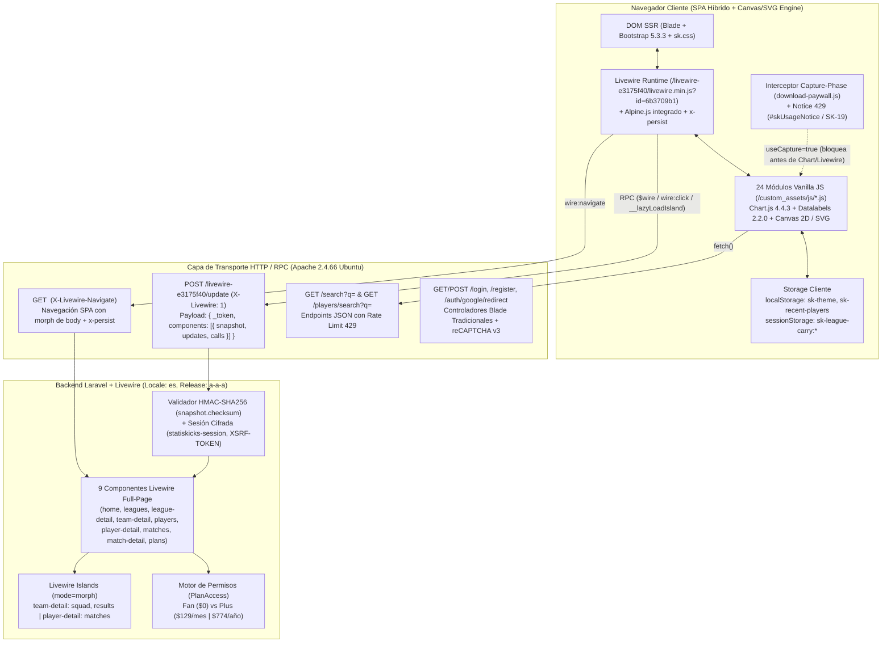

# 02 — Arquitectura Web, Enrutamiento, Estado Livewire, Autenticación y Modelo de Suscripción/Paywall

> **Objetivo Auditado:** `https://www.statiskicks.com/`  
> **Worktree Aislado:** `.worktrees/REA-stats` (Rama `REA-stats`)  
> **Motor Forense:** REA (`rea-agents`, Skill `reverse-engineer-anything` v49)  
> **Registro Maestro de Evidencias:** [05-evidence-register.md](file:///c:/Users/T490s/Desktop/Proyectos/PitchLab/.worktrees/REA-stats/reports/05-evidence-register.md) · [rea-evidence-summary.json](file:///c:/Users/T490s/Desktop/Proyectos/PitchLab/.worktrees/REA-stats/evidence/rea-evidence-summary.json)

---

## 1. Stack Tecnológico Confirmado de Punta a Punta (`[OBSERVADO]`)

La plataforma **Statiskicks** opera bajo una arquitectura monolítica híbrida **SSR + SPA-like** construida sobre **Laravel** y **Livewire** (con soporte nativo de *Islands*, navegación SPA vía `wire:navigate` y hidratación reactiva cliente con **Alpine.js**), complementada con **Bootstrap 5.3.3**, **Chart.js 4.4.3** y **24 módulos Vanilla JS propios** que se comunican bidireccionalmente con los componentes PHP mediante `$wire` y eventos de ventana.



### 1.1 Backend: Laravel + Livewire (Islands, Checksum HMAC y Endpoint Personalizado)

| Componente / Mecanismo | Valor / Firma Confirmada | Clasificación | Evidencia REA / Archivo |
|---|---|---|---|
| **Framework Backend** | **Laravel** (PHP) con sesiones cifradas (`statiskicks-session`), protección CSRF (`XSRF-TOKEN` + meta `csrf-token`) y localización `locale: "es"`. | `[OBSERVADO]` | `ev_a57fa32050d099e784ee0a2f3d1e0f302a0c917dcc1a8c686b3c3b363666b0df` ([01-home-capture.json](file:///c:/Users/T490s/Desktop/Proyectos/PitchLab/.worktrees/REA-stats/evidence/captures/01-home-capture.json)) |
| **Motor Livewire** | **Livewire** (`release: "a-a-a"` en `memo.release`) con prefijo de hash personalizado `/livewire-e3175f40`. | `[OBSERVADO]` | [01-home.html](file:///c:/Users/T490s/Desktop/Proyectos/PitchLab/.worktrees/REA-stats/evidence/captures/01-home.html), [01-home-livewire-snapshots.json](file:///c:/Users/T490s/Desktop/Proyectos/PitchLab/.worktrees/REA-stats/evidence/network-schemas/01-home-livewire-snapshots.json) |
| **Bundle Cliente Livewire** | `GET /livewire-e3175f40/livewire.min.js?id=6b3709b1` (`237,673 bytes`, SHA-256 `4f67d55949e15c5c6d680b31dec3474dd2f9efb144a5661455fe5326ce40bf1f`), inyectado con `<script src="..." data-csrf="..." data-update-uri="/livewire-e3175f40/update" data-navigate-once="true"></script>`. Incluye **Alpine.js** y el plugin `@alpinejs/persist` (`x-persist`) integrados en el mismo artefacto. | `[OBSERVADO]` | `ev_ae1b0493c16a440b51a7596afbe0c5af7cf297e66014c9e86aa9638018249441` ([manifest.json](file:///c:/Users/T490s/Desktop/Proyectos/PitchLab/.worktrees/REA-stats/evidence/javascript/home-scripts/manifest.json)) |
| **Endpoint RPC de Mutación** | `POST https://www.statiskicks.com/livewire-e3175f40/update` con cabecera `X-Livewire: 1` y `Content-Type: application/json`. | `[OBSERVADO]` | `ev_1318b6ef36cbf6e763ddae14da0f95b3088da1ea954e8c8993b2994b188569fd` ([13-match-tabs-post-request-104.json](file:///c:/Users/T490s/Desktop/Proyectos/PitchLab/.worktrees/REA-stats/evidence/network-schemas/13-match-tabs-post-request-104.json)) |
| **Integridad de Estado (`wire:snapshot`)** | Cada componente serializa `{"data": {...}, "memo": {"id", "name", "path", "method", "release", "locale", "islands", "children", "errors"}, "checksum": "<64-hex-hmac-sha256>"}`. El `checksum` impide adulterar propiedades de servidor desde el cliente. | `[OBSERVADO]` | [03-team-livewire.json](file:///c:/Users/T490s/Desktop/Proyectos/PitchLab/.worktrees/REA-stats/evidence/network-schemas/03-team-livewire.json), [04-player-livewire.json](file:///c:/Users/T490s/Desktop/Proyectos/PitchLab/.worktrees/REA-stats/evidence/network-schemas/04-player-livewire.json) |
| **Soporte de Livewire Islands** | Uso de fragmentos aislados `<!--[if FRAGMENT:type=island|name=<name>|token=<token>|mode=morph]-->` registrados en `memo.islands` y carga diferida por intersección (`wire:intersect.once="__lazyLoadIsland('...')"`) en `team-detail` (`squad`, `results`) y `player-detail` (`matches`). | `[OBSERVADO]` | [03-team.html](file:///c:/Users/T490s/Desktop/Proyectos/PitchLab/.worktrees/REA-stats/evidence/captures/03-team.html), [04-player.html](file:///c:/Users/T490s/Desktop/Proyectos/PitchLab/.worktrees/REA-stats/evidence/captures/04-player.html) |
| **Sintetizadores Livewire (`s`)** | En `wire:snapshot.data`, los arrays anidados se etiquetan con el tuple de sintetizador `[{"...": "..."}, {"s": "arr"}]`. | `[OBSERVADO]` | [04-player-livewire.json](file:///c:/Users/T490s/Desktop/Proyectos/PitchLab/.worktrees/REA-stats/evidence/network-schemas/04-player-livewire.json) |

### 1.2 Frontend: Librerías Externas, Hojas de Estilo y los 24 Módulos Vanilla JS

El layout principal se renderiza en servidor con **Blade SSR** y carga **todos los 28 scripts JavaScript en el documento inicial** con `data-navigate-once` para que sobrevivan las transiciones `wire:navigate` sin re-descargarse ni re-ejecutarse (`[OBSERVADO]` en `ev_a57fa32050d099e784ee0a2f3d1e0f302a0c917dcc1a8c686b3c3b363666b0df` y `ev_ae1b0493c16a440b51a7596afbe0c5af7cf297e66014c9e86aa9638018249441`).

#### Librerías de Terceros y Fuentes (`[OBSERVADO]`)
1. **Bootstrap 5.3.3:** CSS (`https://cdn.jsdelivr.net/npm/bootstrap@5.3.3/dist/css/bootstrap.min.css`) y JS (`bootstrap.bundle.min.js`, `80,721 bytes`).
2. **Bootstrap Icons 1.11.3:** CSS (`https://cdn.jsdelivr.net/npm/bootstrap-icons@1.11.3/font/bootstrap-icons.min.css`) y fuente `bootstrap-icons.woff2?dd67030699838ea613ee6dbda90effa6` (`130,396 bytes`).
3. **Chart.js 4.4.3 + Datalabels 2.2.0:** `chart.umd.min.js` (`205,637 bytes`) y `chartjs-plugin-datalabels.min.js` (`12,937 bytes`), registrados explícitamente en el bloque inline global mediante `Chart.register(ChartDataLabels)`.
4. **Google Fonts:** Familia tipográfica **Plus Jakarta Sans** (`wght@400;500;600;700;800`, `29,432 bytes` woff2) como fuente de interfaz y **JetBrains Mono** para datos tabulares/monoespaciados.
5. **Google reCAPTCHA v3:** Cargado exclusivamente en `/register` (`https://www.google.com/recaptcha/api.js?render=6LfFoBcuAAAAAGkOIh5bJsfjA5zXtmktJwN5x3XJ`, acción `'register'`).

#### Hojas de Estilo Propia (`[OBSERVADO]`)
- [sk.css](file:///c:/Users/T490s/Desktop/Proyectos/PitchLab/.worktrees/REA-stats/evidence/css/sk.css) (`/custom_assets/css/sk.css?v=1794168592`, `215,616 bytes`, SHA-256 `2c340879ba9660e66c69a5542f975ac73dd36c01316354175a3faa73bf9324c3`): sistema de diseño completo con soporte dual `html[data-bs-theme="dark"]` / `html[data-bs-theme="light"]`.
- [leagues-directory.css](file:///c:/Users/T490s/Desktop/Proyectos/PitchLab/.worktrees/REA-stats/evidence/css/leagues-directory.css) (`/custom_assets/css/leagues-directory.css?v=1793556280`, `22,223 bytes`, SHA-256 `0c7bd9f883e954f855699cf940b5af0bfba6d39a2797e7312e5da818ebdf4451`): estilos específicos para `/leagues`.

#### Catálogo de los 24 Módulos Vanilla JS Propios (`/custom_assets/js/*.js`) (`[OBSERVADO]`)

| # | Módulo (`/custom_assets/js/`) | Tamaño (B) | Versión (`?v=`) | Objeto Global / Eventos y Responsabilidad Arquitectónica |
|---:|---|---:|---|---|
| 1 | [home-motion.js](file:///c:/Users/T490s/Desktop/Proyectos/PitchLab/.worktrees/REA-stats/evidence/javascript/named/home-motion.js) | 3,999 | `1791380772` | Animaciones de entrada en `/` (`IntersectionObserver`, contadores numéricos y transiciones del hero). |
| 2 | [sk-tooltip.js](file:///c:/Users/T490s/Desktop/Proyectos/PitchLab/.worktrees/REA-stats/evidence/javascript/named/sk-tooltip.js) | 5,286 | `1792175742` | Sistema de tooltips flotantes posicionados en viewport (`data-sk-tooltip`) con soporte táctil y teclado. |
| 3 | [download-paywall.js](file:///c:/Users/T490s/Desktop/Proyectos/PitchLab/.worktrees/REA-stats/evidence/javascript/named/download-paywall.js) | 4,871 | `1793826522` | `window.skOpenPaywall(variant)`: interceptor global en fase de captura (`useCapture=true`) para paywall de 5 variantes (`downloads`, `events`, `columns`, `compare`, `charts`). |
| 4 | [chart-download.js](file:///c:/Users/T490s/Desktop/Proyectos/PitchLab/.worktrees/REA-stats/evidence/javascript/named/chart-download.js) | 82,271 | `1794084628` | Motor compositor Canvas 2D de exportación PNG de alta resolución con marca de agua Statiskicks, cabeceras, escudos y leyendas para todas las gráficas y mapas. |
| 5 | [search-results-image.js](file:///c:/Users/T490s/Desktop/Proyectos/PitchLab/.worktrees/REA-stats/evidence/javascript/named/search-results-image.js) | 15,500 | `1794084628` | Renderizador Canvas PNG de tablas de resultados del buscador avanzado (`/players`). |
| 6 | [percentile-rows.js](file:///c:/Users/T490s/Desktop/Proyectos/PitchLab/.worktrees/REA-stats/evidence/javascript/named/percentile-rows.js) | 16,494 | `1793360776` | Animación y coloreado por percentil (`0-99`) de barras horizontales y píldoras en perfiles de jugador y equipo. |
| 7 | [skore.js](file:///c:/Users/T490s/Desktop/Proyectos/PitchLab/.worktrees/REA-stats/evidence/javascript/named/skore.js) | 1,025 | `1793032870` | Utilidad visual para colorear e inicializar insignias de calificación `SKORE` / ratings. |
| 8 | [attribute-picker.js](file:///c:/Users/T490s/Desktop/Proyectos/PitchLab/.worktrees/REA-stats/evidence/javascript/named/attribute-picker.js) | 3,993 | `1791577902` | Modal selector de métricas (`data-attribute-open-modal`) para radares y barras personalizadas. |
| 9 | [attribute-charts.js](file:///c:/Users/T490s/Desktop/Proyectos/PitchLab/.worktrees/REA-stats/evidence/javascript/named/attribute-charts.js) | 43,926 | `1794084628` | Motor Chart.js de radares polares y barras de percentiles/valores/totales (`[data-attribute-root]`) en `/team/...` y `/player/...`. |
| 10 | [heatmap.js](file:///c:/Users/T490s/Desktop/Proyectos/PitchLab/.worktrees/REA-stats/evidence/javascript/named/heatmap.js) | 8,470 | `1791561866` | Renderizador Canvas KDE de mapa de zonas de acción del jugador (`#playerHeatmapCanvas`) alimentado por `player-heatmap-loaded`. |
| 11 | [goalmouth-map.js](file:///c:/Users/T490s/Desktop/Proyectos/PitchLab/.worktrees/REA-stats/evidence/javascript/named/goalmouth-map.js) | 19,168 | `1794084628` | `window.GoalmouthMap`: mapa de portería (`goal_y`, `goal_z`) para arqueros y remates a puerta en `/partido/...` y `/player/...`. |
| 12 | [event-map.js](file:///c:/Users/T490s/Desktop/Proyectos/PitchLab/.worktrees/REA-stats/evidence/javascript/named/event-map.js) | 101,374 | `1793880030` | Motor principal de mapas de eventos sobre cancha (`scatterplot`, `heatmap`, `zone_plot`, `hull`) en `/player/...` y `/team/...`; invoca `$wire.loadMapGraphData` y `$wire.loadMapGraphFilterOptions`. |
| 13 | [league-maps.js](file:///c:/Users/T490s/Desktop/Proyectos/PitchLab/.worktrees/REA-stats/evidence/javascript/named/league-maps.js) | 47,505 | `1794084628` | Tablero multi-equipo de mapas de liga (`/league/{id}?tab=maps`, `scatterplot`, `heatmap`, `control`, `zone_plot`); ejecuta cola secuencial `$wire.call('loadLeagueMap', ...)`. |
| 14 | [league-scatter.js](file:///c:/Users/T490s/Desktop/Proyectos/PitchLab/.worktrees/REA-stats/evidence/javascript/named/league-scatter.js) | 62,610 | `1794084628` | Gráfica de dispersión X vs Y con escudos/avatares, líneas medias, cuadrantes y regresión en `/league/{id}?tab=scatter`. |
| 15 | [league-switcher.js](file:///c:/Users/T490s/Desktop/Proyectos/PitchLab/.worktrees/REA-stats/evidence/javascript/named/league-switcher.js) | 974 | `1793361650` | `window.SkLeagueCarry`: preserva pestaña y filtros en `sessionStorage` (`sk-league-carry:league`) al cambiar de liga. |
| 16 | [team-profile.js](file:///c:/Users/T490s/Desktop/Proyectos/PitchLab/.worktrees/REA-stats/evidence/javascript/named/team-profile.js) | 7,387 | `1791380772` | Controla el cambio de pestañas en cliente (`[data-team-profile]`), barra de progreso superior y limpieza de URL legacy (`replaceLegacyTeamUrl`). |
| 17 | [team-age-profile.js](file:///c:/Users/T490s/Desktop/Proyectos/PitchLab/.worktrees/REA-stats/evidence/javascript/named/team-age-profile.js) | 16,117 | `1794168592` | Gráfica de edad vs porcentaje de minutos jugados (`[data-age-profile]`) con bandas de edad pico en `/team/...`. |
| 18 | [team-xg-rolling.js](file:///c:/Users/T490s/Desktop/Proyectos/PitchLab/.worktrees/REA-stats/evidence/javascript/named/team-xg-rolling.js) | 13,984 | `1791380772` | Serie temporal de media móvil de xG a favor vs xG en contra (`[data-xg-rolling]`) en `/team/...`. |
| 19 | [team-formation-profile.js](file:///c:/Users/T490s/Desktop/Proyectos/PitchLab/.worktrees/REA-stats/evidence/javascript/named/team-formation-profile.js) | 3,323 | `1791380772` | Hidratación diferida del widget de formaciones más usadas (`$wire.call('loadTeamFormationProfile')`) en `/team/...`. |
| 20 | [team-pass-network.js](file:///c:/Users/T490s/Desktop/Proyectos/PitchLab/.worktrees/REA-stats/evidence/javascript/named/team-pass-network.js) | 43,792 | `1794084628` | Red de pases y flujo entre zonas (`[data-pass-network-root]`), invoca `$wire.call('loadTeamPassNetworkData', matchId)` y `$wire.call('loadTeamPassNetworkMatches', stageId)`. |
| 21 | [live-motion.js](file:///c:/Users/T490s/Desktop/Proyectos/PitchLab/.worktrees/REA-stats/evidence/javascript/named/live-motion.js) | 4,880 | `1792175986` | Indicadores pulsantes de partidos en vivo, transiciones de marcador y animaciones de estado en `/partidos` y `/partido/...`. |
| 22 | [momentum-chart.js](file:///c:/Users/T490s/Desktop/Proyectos/PitchLab/.worktrees/REA-stats/evidence/javascript/named/momentum-chart.js) | 19,165 | `1792708794` | `window.initMatchMomentumCharts`: gráfica de barras minuto a minuto de dominio/momentum e hitos del partido en `/partido/...`. |
| 23 | [player-heat.js](file:///c:/Users/T490s/Desktop/Proyectos/PitchLab/.worktrees/REA-stats/evidence/javascript/named/player-heat.js) | 6,706 | `1792491156` | `window.PlayerTouchesMap`: mapa individual de toques y eventos de un jugador dentro del modal de `/partido/...` (`$wire.playerTouches`). |
| 24 | [scroll-lock.js](file:///c:/Users/T490s/Desktop/Proyectos/PitchLab/.worktrees/REA-stats/evidence/javascript/named/scroll-lock.js) | 1,452 | `1792589840` | Contador de bloqueos de scroll (`data-scroll-lock-count`) en `<html>`/`<body>` para modales superpuestos y drawers móviles. |

### 1.3 Infraestructura HTTP, Cabeceras, Cookies y Storage Cliente (`[OBSERVADO]`)

Extraído directamente de los eventos `network-content` de `01-home-capture.json` (`ev_a57fa32050d099e784ee0a2f3d1e0f302a0c917dcc1a8c686b3c3b363666b0df`) y `01-home-storage.json`:

| Categoría | Clave / Header | Valor Observado y Comportamiento |
|---|---|---|
| **Servidor Web** | `Server` | `Apache/2.4.66 (Ubuntu)` |
| **Compresión y Conexión** | `Content-Encoding` / `Vary` / `Keep-Alive` | `gzip` / `Accept-Encoding` / `timeout=5, max=100` |
| **Política de Caché HTML & RPC** | `Cache-Control` / `Pragma` / `Expires` | `max-age=0, must-revalidate, no-cache, no-store, private` · `Pragma: no-cache` · `Expires: Fri, 01 Jan 1990 00:00:00 GMT` (aplicado tanto a documentos HTML como a `POST /livewire-e3175f40/update` y `GET /search`). |
| **Política de Caché Livewire JS** | `Cache-Control` | `max-age=31536000, public` para `/livewire-e3175f40/livewire.min.js?id=6b3709b1`. |
| **Cabecera Propia Livewire** | `X-Livewire` | `1` en respuestas de `/livewire-e3175f40/update`. |
| **Cookie CSRF** | `XSRF-TOKEN` | Dominio `www.statiskicks.com`, `path: "/"`, `secure: true`, `http_only: false`, `same_site: "Lax"`, expiración 2 horas (`7200s`, `max-age=7200`). Contiene el token CSRF cifrado con `APP_KEY` de Laravel (`eyJpdiI6...`). |
| **Cookie de Sesión** | `statiskicks-session` | Dominio `www.statiskicks.com`, `path: "/"`, `secure: true`, `http_only: true`, `same_site: "Lax"`, expiración 2 horas (`7200s`, `max-age=7200`). |
| **LocalStorage (`sk-theme`)** | `localStorage['sk-theme']` | `"dark"` (por defecto si no existe clave previa) o `"light"`. Sincronizado antes del primer pintado en `<head>` hacia `document.documentElement.setAttribute('data-bs-theme', theme)`. |
| **LocalStorage (`sk-recent-players`)** | `localStorage['sk-recent-players']` | Array JSON de hasta `8` ítems recientes visitados desde el buscador global (`{ player_id, name, photo_url, subtitle, url, kind: 'league'|'team'|'player', badge_bg, fallback_text }`). |
| **SessionStorage (`sk-league-carry:*`)** | `sessionStorage['sk-league-carry:league']` | Gestionado por `window.SkLeagueCarry` ([league-switcher.js](file:///c:/Users/T490s/Desktop/Proyectos/PitchLab/.worktrees/REA-stats/evidence/javascript/named/league-switcher.js)): guarda `{ tab, params }` al cambiar de liga para reaplicar la pestaña activa en la nueva liga. |

### 1.4 Manejo de Errores HTTP 429 (`#skUsageNotice` y `SK-19`) (`[OBSERVADO]`)

Statiskicks implementa dos mecanismos complementarios en el cliente para proteger sus endpoints contra ráfagas de solicitudes (`HTTP 429 Too Many Requests`), evidenciados en [inline-home-scripts.js](file:///c:/Users/T490s/Desktop/Proyectos/PitchLab/.worktrees/REA-stats/evidence/javascript/inline-home-scripts.js):

1. **Interceptor Global de Livewire (`#skUsageNotice`):**
   - En el layout base existe el banner persistente `<div id="skUsageNotice" class="sk-usage-notice" role="status" aria-live="polite" hidden>` con el texto por defecto `"Recibimos demasiadas solicitudes seguidas. Espera un momento y vuelve a intentarlo."`.
   - El script global se engancha a `livewire:init` y registra `window.Livewire.interceptRequest(({ onError }) => ...)`:
     ```javascript
     window.Livewire.interceptRequest(({ onError }) => {
       onError(({ response, preventDefault }) => {
         if (!response || response.status !== 429) return;
         preventDefault();
         response.clone().text().then((body) => {
           let message = '';
           try { message = JSON.parse(body)?.message || ''; } catch (e) {}
           showNotice(message);
         }).catch(() => showNotice(''));
       });
     });
     ```
   - `preventDefault()` evita el modal de error nativo de Livewire y muestra `#skUsageNotice` durante `9000 ms` (`setTimeout(..., 9000)`). También escucha el evento personalizado `window.addEventListener('sk-usage-limit', (event) => showNotice(event?.detail?.message))`.

2. **Manejo `SK-19` en el Buscador de la Barra de Navegación (`navbarSearchPanel`):**
   - El componente Alpine `navbarSearchPanel(searchUrl)` ejecuta un debounce de `350 ms` para términos de al menos 2 caracteres (`term.length >= 2`) usando `AbortController` para cancelar peticiones en vuelo.
   - Incluye un bloque documentado explícitamente con la referencia de ticket interno **`SK-19`**:
     ```javascript
     // SK-19: surface 429 as a calm inline notice instead of a silent empty state.
     if (response.status === 429) {
       let message = 'Demasiadas búsquedas seguidas; espera un momento.';
       try {
         const body = await response.json();
         if (body && typeof body.message === 'string' && body.message.trim() !== '') {
           message = body.message;
         }
       } catch (e) {}
       this.results = { leagues: [], teams: [], players: [] };
       this.limited = message;
       this.open = true;
       return;
     }
     ```

---

## 2. Mapa Completo de Rutas y Páginas (Page & Route Inventory)

### 2.1 Inventario Exhaustivo de Rutas Públicas, RPC y Autenticación (`[OBSERVADO]`)

| Ruta / Patrón URL | Método | Tipo de Renderizado / Controlador | Componente Livewire (`memo.name`) | `wire:navigate` | Parámetros Query (`#[Url]` / Request) | Estado de Acceso / Paywall | Evidencia REA (`evidence_id`) |
|---|---|---|---|---|---|---|---|
| `/` | `GET` | Livewire Full-Page (SSR + Hydration) | `home` | Sí | Ninguno | Público (muestra ligas destacadas, partidos del día y buscador) | `ev_a57fa32050d099e784ee0a2f3d1e0f302a0c917dcc1a8c686b3c3b363666b0df` ([01-home.html](file:///c:/Users/T490s/Desktop/Proyectos/PitchLab/.worktrees/REA-stats/evidence/captures/01-home.html)) |
| `/leagues` | `GET` | Livewire Full-Page | `leagues` | Sí | `?q=` (`search`), `?f=` (`filter`: `all` \| `free`) | Público (`9` ligas abiertas en plan Fan; `40` ligas en plan Plus con candado `bi-lock-fill` en las `31` restantes) | `ev_643a343e34fadc05f5e77db59a547ec794b7b026f0f8da2458052732d6c28445` ([10-leagues.html](file:///c:/Users/T490s/Desktop/Proyectos/PitchLab/.worktrees/REA-stats/evidence/captures/10-leagues.html)) |
| `/league/{id}` | `GET` | Livewire Full-Page | `league-detail` | Sí | `33` parámetros `#[Url]` (`?tab=`, `?season=`, `?stage=`, `?venue=`, `?window=`, `?sort=`, `?dir=`, `?view=`, `?x=`, `?y=`, `?map_event=`, etc.) | Abierto en las 9 ligas Fan (`liga_mx`, `premier_league`, `laliga`, etc.); bloqueado en ligas Plus | `ev_bc7ebac834b73578fd1ad9b68b2e5d06774bea085283377a605b1989ed3114af`, `ev_bd430f00f4cc3e0cb3e7d1c12ddd223536657c09ba63ee662b710fb3bdab574a` ([06-league.html](file:///c:/Users/T490s/Desktop/Proyectos/PitchLab/.worktrees/REA-stats/evidence/captures/06-league.html)) |
| `/team/{slug}-{id}` | `GET` | Livewire Full-Page + 2 Islands (`squad`, `results`) | `team-detail` | Sí | `?league=`, `?season=`, `?tab=` (limpiado en cliente vía `replaceLegacyTeamUrl()`) | Híbrido: `overview`, `squad`, `results` abiertos; `stats`, `maps`, `compare` bloqueados (`data-team-locked`); `set-pieces`, `rival-analysis`, `autoreport` en `v2.0 (2027)` | `ev_aa5f2d74196b21062c132e8b6ec8934f023380f93c40f78f99e333a43bfc9977`, `ev_8b664e194ac67d05a98289a150adcb3f310fb2622bcc70a084ab5c7d978cb365` ([03-team.html](file:///c:/Users/T490s/Desktop/Proyectos/PitchLab/.worktrees/REA-stats/evidence/captures/03-team.html)) |
| `/players` | `GET` | Livewire Full-Page | `players` | Sí | `?tab=` (`activeTab`), `?page=` (`paginators.page`), más parámetros de entrada `?liga=`, `?temporada=`, `?buscar=` | Híbrido: filtros básicos abiertos; selector de columnas adicionales bloqueado (`data-sk-paywall-trigger="columns"`) | `ev_97e91618307b79c26283cb7092099714480742f83252e97a242081625f31cf52` ([07-players.html](file:///c:/Users/T490s/Desktop/Proyectos/PitchLab/.worktrees/REA-stats/evidence/captures/07-players.html)) |
| `/player/{id}/{slug}` | `GET` | Livewire Full-Page + 1 Lazy Island (`matches`) | `player-detail` | Sí | Ninguno en `wire:effects.url` (contexto y torneo se manejan por estado Livewire y pestañas en cliente) | Híbrido: `perfil`, `desempeno`, `ranking`, `partidos` abiertos (con controles `total`/`average`/`traits` bloqueados); `mapas` con 8 eventos libres y 23 bloqueados; `similares` y `comparar` con límites Plus; `autoreport` en `v2.0 (2027)` | `ev_59e57f74d8e4894a8c290cd1f58354701d398bea6301f1cdfe07edeeef89f945`, `ev_bba17f5b8205d109afaa59748445fa3e6b8b763f44c88cfbb1a22847a3d405b9` ([04-player.html](file:///c:/Users/T490s/Desktop/Proyectos/PitchLab/.worktrees/REA-stats/evidence/captures/04-player.html)) |
| `/partidos` | `GET` | Livewire Full-Page | `matches` | Sí | `?fecha=` (`selectedDate`), `?liga=` (`leagueFilter`), `?jornada=` (`roundFilter`), `?club=` (`clubFilter`), `?estado=` (`statusFilter`), `?q=` (`search`), `?zona=` (`userTimezone`) | Público | `ev_c5ee120c0b76e8a9fab5e7dbb9d324d0e932523cc84b2bc86cf9a3471b1f2118` ([05-matches.html](file:///c:/Users/T490s/Desktop/Proyectos/PitchLab/.worktrees/REA-stats/evidence/captures/05-matches.html)) |
| `/partido/{slug}-{id}` | `GET` | Livewire Full-Page | `match-detail` | Sí | `?tab=` (`activeTab`), `?tabla=` (`statsTableTab`), `?cat=` (`statsCategory`), `?equipo=` (`statsTeamFilter`) | Público (con descargas PNG sujetas a `download-paywall.js` en plan Fan) | `ev_e97046d53210bf233f1dc576a689f77283053071ff3e34bcc5c159f70a48d467`, `ev_1318b6ef36cbf6e763ddae14da0f95b3088da1ea954e8c8993b2994b188569fd` ([09-match-detail.html](file:///c:/Users/T490s/Desktop/Proyectos/PitchLab/.worktrees/REA-stats/evidence/captures/09-match-detail.html)) |
| `/planes` | `GET` | Livewire Full-Page | `plans` | Sí | Ninguno | Público (muestra planes Fan, Plus mensual y Plus anual) | `ev_fba261f1679008e019d57771da85a84cf122769fdc93ab4a8088dfb8ed05ae76` ([08-planes.html](file:///c:/Users/T490s/Desktop/Proyectos/PitchLab/.worktrees/REA-stats/evidence/captures/08-planes.html)) |
| `/search` | `GET` | Controlador JSON Laravel | N/A (JSON API) | N/A | `?q=<term>` (mínimo 2 caracteres, debounce `350ms`) | Público con Rate Limit HTTP 429 (`SK-19`). Devuelve `{ leagues: [...], teams: [...], players: [...] }` | `ev_296f62498cf90c3e87cd48ef454168c2d290f4a839a442208f9adfef04c8aeda` ([search-america.json](file:///c:/Users/T490s/Desktop/Proyectos/PitchLab/.worktrees/REA-stats/evidence/network-schemas/search-america.json)) |
| `/players/search` | `GET` | Controlador JSON Laravel | N/A (JSON API) | N/A | `?q=<term>` | Público (usado por el buscador de comparación dentro de `/player/{id}/{slug}`) | `ev_59e57f74d8e4894a8c290cd1f58354701d398bea6301f1cdfe07edeeef89f945` ([04-player.html](file:///c:/Users/T490s/Desktop/Proyectos/PitchLab/.worktrees/REA-stats/evidence/captures/04-player.html)) |
| `/livewire-e3175f40/update` | `POST` | Endpoint RPC Livewire | Todos los componentes | N/A | Body JSON `{ _token, components: [{ snapshot, updates, calls }] }` | Protegido por CSRF (`_token` / `XSRF-TOKEN`), `checksum` HMAC-SHA256 y Rate Limit 429 (`#skUsageNotice`) | `ev_1318b6ef36cbf6e763ddae14da0f95b3088da1ea954e8c8993b2994b188569fd`, `ev_bd430f00f4cc3e0cb3e7d1c12ddd223536657c09ba63ee662b710fb3bdab574a` |
| `/login` | `GET` / `POST` | Controlador Blade Tradicional | Ninguno (`0` snapshots Livewire) | Enlaces entrantes usan `wire:navigate`; form hace `POST` clásico | Campos `POST`: `_token`, `email`, `password`, `remember` | Público (guest middleware) | `ev_29ff56dc035f280348f37506fb13b97ef5f91f78d023d03c699407f1af4a7cf2` ([11-login.html](file:///c:/Users/T490s/Desktop/Proyectos/PitchLab/.worktrees/REA-stats/evidence/captures/11-login.html)) |
| `/register` | `GET` / `POST` | Controlador Blade Tradicional | Ninguno (`0` snapshots Livewire) | Enlaces entrantes usan `wire:navigate`; form hace `POST` clásico | Campos `POST`: `_token`, `website` (honeypot), `recaptcha_token`, `name`, `email`, `password`, `password_confirmation`, `terms` | Público con protección anti-bot dual (Honeypot + Google reCAPTCHA v3) | `ev_045ab7e234fb4d11eef578d40992f5c0ce080058997d3af2b9bd60cda4e9bfcc` ([12-register.html](file:///c:/Users/T490s/Desktop/Proyectos/PitchLab/.worktrees/REA-stats/evidence/captures/12-register.html)) |
| `/forgot-password` | `GET` / `POST` | Controlador Blade Tradicional | `[INFERIDO]` Ninguno | No en enlace de `/login` | Recuperación de contraseña por correo | Público | [11-login.html](file:///c:/Users/T490s/Desktop/Proyectos/PitchLab/.worktrees/REA-stats/evidence/captures/11-login.html) |
| `/auth/google/redirect` | `GET` | Controlador Laravel Socialite | N/A (Redirección 302 OAuth) | No | Redirige al flujo OAuth 2.0 de Google Accounts | Público | [11-login.html](file:///c:/Users/T490s/Desktop/Proyectos/PitchLab/.worktrees/REA-stats/evidence/captures/11-login.html), [12-register.html](file:///c:/Users/T490s/Desktop/Proyectos/PitchLab/.worktrees/REA-stats/evidence/captures/12-register.html) |
| `/contacto` | `GET` | Vista Legal / Informativa | `[INFERIDO]` Estática / Blade | Sí (`wire:navigate` en footer) | Ninguno | Público | [01-home.html](file:///c:/Users/T490s/Desktop/Proyectos/PitchLab/.worktrees/REA-stats/evidence/captures/01-home.html) |
| `/privacidad` | `GET` | Vista Legal / Informativa | `[INFERIDO]` Estática / Blade | Sí (`wire:navigate` en footer; `target="_blank"` en `/register`) | Ninguno | Público | [01-home.html](file:///c:/Users/T490s/Desktop/Proyectos/PitchLab/.worktrees/REA-stats/evidence/captures/01-home.html), [12-register.html](file:///c:/Users/T490s/Desktop/Proyectos/PitchLab/.worktrees/REA-stats/evidence/captures/12-register.html) |
| `/terminos` | `GET` | Vista Legal / Informativa | `[INFERIDO]` Estática / Blade | Sí (`wire:navigate` en footer; `target="_blank"` en `/register`) | Ninguno | Público | [01-home.html](file:///c:/Users/T490s/Desktop/Proyectos/PitchLab/.worktrees/REA-stats/evidence/captures/01-home.html), [12-register.html](file:///c:/Users/T490s/Desktop/Proyectos/PitchLab/.worktrees/REA-stats/evidence/captures/12-register.html) |

### 2.2 Convenciones de Identificadores y Slugs en las Rutas (`[OBSERVADO]`)

De las URLs capturadas y los payloads de `/search?q=america` ([search-america.json](file:///c:/Users/T490s/Desktop/Proyectos/PitchLab/.worktrees/REA-stats/evidence/network-schemas/search-america.json)), se observa una inversión deliberada en el orden `{slug}` vs `{id}` según la entidad:
- **Ligas (`/league/{id}`):** usan únicamente el UUID alfanumérico de 25 caracteres de Opta/Stats Perform sin slug (p. ej. `/league/2hsidwomhjsaaytdy9u5niyi4` para Liga MX, `/league/2kwbbcootiqqgmrzs6o5inle5` para Premier League).
- **Equipos (`/team/{slug}-{id}`):** concatenan el slug kebab-case seguido de un guion y el ID alfanumérico de 25 caracteres al final (p. ej. `/team/club-america-eu8c408f59yx7egaqossbv25e`, `/team/america-de-cali-73432acd792j22936n9AD76g3`). El backend extrae los últimos 25 caracteres tras el último `-` como `teamId`.
- **Partidos (`/partido/{slug}-{id}`):** siguen la misma convención que Equipos: `{home-slug}-vs-{away-slug}-{25-char-id}` (p. ej. `/partido/pumas-unam-vs-club-america-9dy7dhz5f13b2ejz2a5tok2l0`).
- **Jugadores (`/player/{id}/{slug}`):** usan dos segmentos de ruta separados por `/`, colocando primero el ID de 25 caracteres y segundo el slug (p. ej. `/player/1cyhpfi77dom7gmpuownxlcrt/luis-romo`, `/player/c5ryhn04g9goikd0blmh83aol/lionel-messi`).

---

## 3. Catálogo de Componentes Livewire de Servidor y sus Contratos de Estado (`wire:snapshot`)

En las 12 rutas capturadas por REA existen **9 componentes Livewire de página completa** (`home`, `leagues`, `league-detail`, `team-detail`, `players`, `player-detail`, `matches`, `match-detail`, `plans`). Las páginas `/login` y `/register` no montan ningún componente Livewire (`[OBSERVADO]`).

### 3.1 Protocolo RPC `POST /livewire-e3175f40/update` (`[OBSERVADO]`)

Cada interacción con el servidor envía una petición `POST /livewire-e3175f40/update` con el siguiente contrato JSON exacto (ejemplo real extraído de [13-match-tabs-post-request-104.json](file:///c:/Users/T490s/Desktop/Proyectos/PitchLab/.worktrees/REA-stats/evidence/network-schemas/13-match-tabs-post-request-104.json) y [14-league-tabs-post-request-89.json](file:///c:/Users/T490s/Desktop/Proyectos/PitchLab/.worktrees/REA-stats/evidence/network-schemas/14-league-tabs-post-request-89.json)):

```json
{
  "_token": "6FF8cE3Rbb2010d2xB8cFViK1N9V0x6F0oW1K6pC",
  "components": [
    {
      "snapshot": "{\"data\":{\"matchId\":\"9dy7dhz5f13b2ejz2a5tok2l0\",\"activeTab\":\"resumen\",\"statsCategory\":\"general\",\"statsTeamFilter\":\"all\",\"statsTableTab\":\"general\",\"statsSortField\":\"rating\",\"statsSortDir\":\"desc\",\"eventsTypeFilter\":\"all\",\"eventsTeamFilter\":\"all\"},\"memo\":{\"id\":\"mT0A3e4J22V9zG3k8nQ2\",\"name\":\"match-detail\",\"path\":\"partido\\/pumas-unam-vs-club-america-9dy7dhz5f13b2ejz2a5tok2l0\",\"method\":\"GET\",\"release\":\"a-a-a\",\"locale\":\"es\",\"children\":[],\"scripts\":[],\"assets\":[],\"errors\":[],\"islands\":[]},\"checksum\":\"54288628458732a46053023232e961630b731cf0f4e119b28037c6d39a79d16e\"}",
      "updates": {},
      "calls": [
        {
          "method": "setTab",
          "params": ["alineaciones"],
          "metadata": []
        }
      ]
    }
  ]
}
```

Y el servidor responde con `HTTP 200 OK` (`Content-Type: application/json`, `X-Livewire: 1`):
```json
{
  "components": [
    {
      "snapshot": "{\"data\":{...},\"memo\":{...},\"checksum\":\"<nuevo_hmac_sha256>\"}",
      "effects": {
        "html": "<div wire:id=\"...\">...</div>",
        "dispatches": [
          { "name": "league-map-loaded", "params": { ... } }
        ],
        "returns": [ ... ]
      }
    }
  ]
}
```

### 3.2 Desglose Exhaustivo por Componente (`wire:snapshot` + `wire:effects` + Métodos RPC)

---

#### 1. `home` (`GET /`) — `[OBSERVADO]`
- **Evidencia:** [01-home-livewire-snapshots.json](file:///c:/Users/T490s/Desktop/Proyectos/PitchLab/.worktrees/REA-stats/evidence/network-schemas/01-home-livewire-snapshots.json) (`ev_a57fa32050d099e784ee0a2f3d1e0f302a0c917dcc1a8c686b3c3b363666b0df`)
- **Snapshot `data` y `memo`:**
  ```json
  {
    "data": {},
    "memo": {
      "id": "bE0C9T4S79R0H2C6k1nZ",
      "name": "home",
      "path": "/",
      "method": "GET",
      "release": "a-a-a",
      "locale": "es",
      "children": [],
      "scripts": [],
      "assets": [],
      "errors": [],
      "islands": []
    },
    "checksum": "c1f871248dc33a691021242b6216bf4dc6099c35f1ee2c897795c034c8ff1d1b"
  }
  ```
- **Propiedades y Métodos:** `data` es un objeto vacío `{}`. Toda la portada (métricas globales, buscador hero, carrusel de ligas, partidos destacados y tarjetas demostrativas) se pre-renderiza en Blade SSR durante el `GET /` inicial y la interactividad local corre en Alpine.js (`navbarSearchPanel`) y [home-motion.js](file:///c:/Users/T490s/Desktop/Proyectos/PitchLab/.worktrees/REA-stats/evidence/javascript/named/home-motion.js).

---

#### 2. `leagues` (`GET /leagues`) — `[OBSERVADO]`
- **Evidencia:** [10-leagues-livewire.json](file:///c:/Users/T490s/Desktop/Proyectos/PitchLab/.worktrees/REA-stats/evidence/network-schemas/10-leagues-livewire.json) (`ev_643a343e34fadc05f5e77db59a547ec794b7b026f0f8da2458052732d6c28445`)
- **Snapshot `data`:**
  ```json
  {
    "search": "",
    "filter": "all"
  }
  ```
- **Sincronización URL (`wire:effects.url`):**
  - `search` $\leftrightarrow$ `?q=` (`as: "q"`, `use: "replace"`, `alwaysShow: false`)
  - `filter` $\leftrightarrow$ `?f=` (`as: "f"`, `use: "replace"`, `alwaysShow: false`, valores observados: `'all'`, `'free'`)
- **Directivas / Métodos Expuestos:**
  - `wire:model.live.debounce.200ms="search"`: filtra el directorio de 40 ligas por nombre o país.
  - `$set('search', '')`: botón para limpiar búsqueda.
  - `$set('filter', 'all')` / `$set('filter', 'free')`: alterna entre mostrar las 40 ligas o únicamente las 9 ligas abiertas del plan gratuito.

---

#### 3. `league-detail` (`GET /league/{id}`) — `[OBSERVADO]`
- **Evidencia:** [06-league-livewire.json](file:///c:/Users/T490s/Desktop/Proyectos/PitchLab/.worktrees/REA-stats/evidence/network-schemas/06-league-livewire.json) (`ev_bc7ebac834b73578fd1ad9b68b2e5d06774bea085283377a605b1989ed3114af`) y `14-league-tabs-post-request-89..100.json` (`ev_bd430f00f4cc3e0cb3e7d1c12ddd223536657c09ba63ee662b710fb3bdab574a`)
- **Snapshot `data` completo (34 propiedades):**
  ```json
  {
    "leagueId": "2hsidwomhjsaaytdy9u5niyi4",
    "season": "2025/2026",
    "stage": "a62f98f22c995271892822217",
    "tab": "overview",
    "venue": "overall",
    "window": "all",
    "sort": "rank",
    "dir": "asc",
    "view": "traditional",
    "projView": "standings",
    "fixtureRound": "13",
    "fixtureClub": "all",
    "fixtureStatus": "all",
    "fixtureSearch": "",
    "statsSubtab": "general",
    "statsDisplay": "per_match",
    "statsSort": "matches_played",
    "statsDir": "desc",
    "playerSection": "general",
    "playerPosition": "all",
    "playerMode": "per90",
    "playerMinMinutes": 300,
    "playerTeam": "all",
    "playerSearch": "",
    "playerSort": "goals",
    "playerDir": "desc",
    "playerPage": 1,
    "scoutPosition": "all",
    "scoutMinMinutes": 450,
    "scoutAgeBand": "all",
    "scoutTeam": "all",
    "scoutSearch": "",
    "scoutSort": "rating",
    "scoutDir": "desc",
    "scoutPage": 1,
    "totwRound": "season",
    "scatterEntity": "teams",
    "scatterX": "xg_for_per90",
    "scatterY": "xg_against_per90",
    "scatterColor": "team",
    "scatterPosition": "all",
    "scatterTeam": "all",
    "scatterMinMinutes": 450,
    "scatterScale": "raw",
    "scatterAvgLines": true,
    "scatterQuadrants": true,
    "scatterTrend": false,
    "scatterLabels": "top",
    "mapEvent": "involvement",
    "mapView": "heatmap",
    "mapPerspective": "for",
    "mapStage": "a62f98f22c995271892822217",
    "mapSort": "default"
  }
  ```
- **Sincronización URL (`wire:effects.url`):** Expone **33 propiedades vinculadas a query string** (`season`, `stage`, `tab`, `venue`, `window`, `sort`, `dir`, `view`, `proj` $\leftarrow$ `projView`, `round` $\leftarrow$ `fixtureRound`, `club` $\leftarrow$ `fixtureClub`, `status` $\leftarrow$ `fixtureStatus`, `q` $\leftarrow$ `fixtureSearch`, `stats` $\leftarrow$ `statsSubtab`, `display` $\leftarrow$ `statsDisplay`, `ssort` $\leftarrow$ `statsSort`, `sdir` $\leftarrow$ `statsDir`, `psec` $\leftarrow$ `playerSection`, `ppos` $\leftarrow$ `playerPosition`, `pmode` $\leftarrow$ `playerMode`, `pmin` $\leftarrow$ `playerMinMinutes`, `pteam` $\leftarrow$ `playerTeam`, `pq` $\leftarrow$ `playerSearch`, `psort` $\leftarrow$ `playerSort`, `pdir` $\leftarrow$ `playerDir`, `ppage` $\leftarrow$ `playerPage`, `spos` $\leftarrow$ `scoutPosition`, `smin` $\leftarrow$ `scoutMinMinutes`, `sage` $\leftarrow$ `scoutAgeBand`, `steam` $\leftarrow$ `scoutTeam`, `sq` $\leftarrow$ `scoutSearch`, `scsort` $\leftarrow$ `scoutSort`, `scdir` $\leftarrow$ `scoutDir`, `spage` $\leftarrow$ `scoutPage`, `totw` $\leftarrow$ `totwRound`, `entity` $\leftarrow$ `scatterEntity`, `x` $\leftarrow$ `scatterX`, `y` $\leftarrow$ `scatterY`, `color` $\leftarrow$ `scatterColor`, `pos` $\leftarrow$ `scatterPosition`, `team` $\leftarrow$ `scatterTeam`, `min` $\leftarrow$ `scatterMinMinutes`, `scale` $\leftarrow$ `scatterScale`, `avg` $\leftarrow$ `scatterAvgLines`, `quad` $\leftarrow$ `scatterQuadrants`, `trend` $\leftarrow$ `scatterTrend`, `labels` $\leftarrow$ `scatterLabels`, `map_event` $\leftarrow$ `mapEvent`, `map_view` $\leftarrow$ `mapView`, `map_side` $\leftarrow$ `mapPerspective`, `map_stage` $\leftarrow$ `mapStage`, `map_sort` $\leftarrow$ `mapSort`).
- **10 Pestañas de Servidor (`tab`):**
  1. `overview` (Resumen)
  2. `standings` (Clasificación)
  3. `projection` (Proyecciones)
  4. `fixtures` (Partidos)
  5. `team-stats` (Estadísticas de equipos)
  6. `player-stats` (Estadísticas de jugadores)
  7. `scout-ratings` (SKORE)
  8. `team-of-the-week` (XI Ideal)
  9. `maps` (Mapas)
  10. `scatter` (Gráficos)
- **Métodos Públicos Expuestos:**
  - `setTab(string $tab)`: cambia la pestaña activa y re-renderiza el panel en el servidor.
  - `sortBy(string $column)`: ordena la tabla de clasificación (`rank`, `played`, `won`, `drawn`, `lost`, `gf`, `ga`, `gd`, `pts`, `xg`, `xga`, `xgd`, `xpts`).
  - `sortScoutStatsBy(string $column)` y `resetScoutFilters()`: ordena (`player`, `team`, `age`, `minutes`, `rating`) y limpia filtros en la pestaña `scout-ratings`.
  - `loadLeagueMap(string $teamId, string $eventKey, string $viewKey, string $perspective, string $stageId)`: invocado secuencialmente desde [league-maps.js](file:///c:/Users/T490s/Desktop/Proyectos/PitchLab/.worktrees/REA-stats/evidence/javascript/named/league-maps.js) para cada uno de los 18 clubes de la liga (`14-league-tabs-post-request-91.json` a `100.json`), despachando el evento `league-map-loaded` con las celdas/puntos del mapa de cada equipo.

---

#### 4. `team-detail` (`GET /team/{slug}-{id}`) — `[OBSERVADO]`
- **Evidencia:** [03-team-livewire.json](file:///c:/Users/T490s/Desktop/Proyectos/PitchLab/.worktrees/REA-stats/evidence/network-schemas/03-team-livewire.json) (`ev_aa5f2d74196b21062c132e8b6ec8934f023380f93c40f78f99e333a43bfc9977`)
- **Snapshot `data` y `memo.islands`:**
  ```json
  {
    "data": {
      "slug": "club-america-eu8c408f59yx7egaqossbv25e",
      "league": "2hsidwomhjsaaytdy9u5niyi4",
      "season": "2025/2026",
      "tab": "overview",
      "period": "clausura",
      "squadSort": "minutes",
      "squadDir": "desc",
      "squadPos": "all",
      "resultsCompetition": "all",
      "resultsVenue": "all",
      "leadersModalOpen": false,
      "leadersMetric": "goals",
      "formationProfileLoaded": false
    },
    "memo": {
      "id": "pX9L2m4Q78K1vB5n3cR8",
      "name": "team-detail",
      "path": "team/club-america-eu8c408f59yx7egaqossbv25e",
      "method": "GET",
      "release": "a-a-a",
      "locale": "es",
      "islands": {
        "squad": { "name": "squad", "token": "25f6a6e9-1", "mode": "morph" },
        "results": { "name": "results", "token": "25f6a6e9-2", "mode": "morph" }
      }
    }
  }
  ```
- **Sincronización URL (`wire:effects.url`):** `league`, `season`, `tab`.
- **Métodos Públicos Expuestos:**
  - `setPeriod(string $period)`: alterna entre el torneo global (`all`) o fase/torneo corto (`apertura`, `clausura`, etc.).
  - `sortSquad(string $field)` y `setSquadPos(string $pos)`: se ejecutan sobre la **Island `squad`** (`token: "25f6a6e9-1"`) para ordenar la plantilla (`name`, `position`, `age`, `appearances`, `lineups`, `minutes`, `goals`, `assists`, `yellow_cards`, `red_cards`, `rating`) o filtrar por posición (`all`, `GK`, `DEF`, `MID`, `FWD`) haciendo morph únicamente de la tabla de plantilla sin tocar el resto del DOM de 1.09 MB.
  - `setResultsCompetition(string $comp)` y `setResultsVenue(string $venue)`: se ejecutan sobre la **Island `results`** (`token: "25f6a6e9-2"`).
  - `showLeadersBoard(string $metric)` y `closeLeadersModal()`: abre el modal de líderes del plantel (`rating`, `goals`, `xg`, `shots_on_target`, `assists`, `xa`, `chances_created`, `accurate_passes`, `tackles`, `interceptions`, `saves`, `yellow_cards`, `red_cards`).
  - `loadTeamFormationProfile()`: invocado automáticamente tras el primer pintado desde [team-formation-profile.js](file:///c:/Users/T490s/Desktop/Proyectos/PitchLab/.worktrees/REA-stats/evidence/javascript/named/team-formation-profile.js) (`460 ms` en `03-team-capture.json`).
  - `loadMapGraphData(...)` y `loadMapGraphFilterOptions(...)`: invocados por [event-map.js](file:///c:/Users/T490s/Desktop/Proyectos/PitchLab/.worktrees/REA-stats/evidence/javascript/named/event-map.js) en la pestaña `maps` (para usuarios Plus).
  - `loadTeamPassNetworkData(string $matchId)` y `loadTeamPassNetworkMatches(string $stageId)`: invocados por [team-pass-network.js](file:///c:/Users/T490s/Desktop/Proyectos/PitchLab/.worktrees/REA-stats/evidence/javascript/named/team-pass-network.js).

---

#### 5. `players` (`GET /players`) — `[OBSERVADO]`
- **Evidencia:** [07-players-livewire.json](file:///c:/Users/T490s/Desktop/Proyectos/PitchLab/.worktrees/REA-stats/evidence/network-schemas/07-players-livewire.json) (`ev_97e91618307b79c26283cb7092099714480742f83252e97a242081625f31cf52`)
- **Snapshot `data` (29 propiedades):**
  ```json
  {
    "paginators": [{ "page": 1 }, { "s": "arr" }],
    "activeTab": "general",
    "league": "all",
    "season": "all",
    "stage": "all",
    "team": "all",
    "position": "all",
    "secondaryPosition": "all",
    "nationality": "all",
    "foot": "all",
    "ageRange": "all",
    "minAge": 15,
    "maxAge": 45,
    "heightRange": "all",
    "minHeight": 150,
    "maxHeight": 210,
    "weightRange": "all",
    "minWeight": 50,
    "maxWeight": 110,
    "marketValueRange": "all",
    "minMinutes": 200,
    "maxMinutes": null,
    "minMatches": 1,
    "minStarts": 0,
    "statMode": "per90",
    "search": "",
    "sortBy": "rating",
    "sortDir": "desc",
    "statFilters": [[], { "s": "arr" }],
    "statRanges": [[], { "s": "arr" }],
    "customColumns": [["rating", "goals", "assists", "xg", "xa"], { "s": "arr" }]
  }
  ```
- **Sincronización URL (`wire:effects.url`):** `activeTab` $\leftrightarrow$ `?tab=`, `paginators.page` $\leftrightarrow$ `?page=`. Además acepta parámetros iniciales `?liga=`, `?temporada=` y `?buscar=` desde enlaces externos (como la portada).
- **Métodos Públicos Expuestos:**
  - `sort(string $column)`: ordena por `name`, `team`, `age`, `minutes` o cualquiera de las métricas activas.
  - `setStatMode(string $mode)`: alterna entre `'per90'` y `'total'`.
  - `resetAllFilters()`: restaura todos los filtros demográficos, de minutos y rangos estadísticos.
  - `previousPage('page')`, `nextPage('page')`, `gotoPage(int $page, 'page')`: paginación Livewire `WithPagination`.

---

#### 6. `player-detail` (`GET /player/{id}/{slug}`) — `[OBSERVADO]`
- **Evidencia:** [04-player-livewire.json](file:///c:/Users/T490s/Desktop/Proyectos/PitchLab/.worktrees/REA-stats/evidence/network-schemas/04-player-livewire.json) (`ev_59e57f74d8e4894a8c290cd1f58354701d398bea6301f1cdfe07edeeef89f945`)
- **Snapshot `data` y `memo.islands`:**
  ```json
  {
    "data": {
      "playerId": "1cyhpfi77dom7gmpuownxlcrt",
      "slug": "luis-romo",
      "selectedContextKey": "2hsidwomhjsaaytdy9u5niyi4|2025/2026",
      "selectedTournamentKey": "clausura",
      "selectedPosition": "MC",
      "availableContexts": [ ... ],
      "availableTournaments": [ ... ],
      "availablePositions": [ ... ],
      "traitsData": [[], { "s": "arr" }],
      "traitsDataLoaded": false,
      "rankingData": [[], { "s": "arr" }],
      "rankingDataLoaded": false,
      "performanceSummaryData": [[], { "s": "arr" }],
      "performanceSummaryDataLoaded": false,
      "heatmapData": [[], { "s": "arr" }],
      "heatmapDataLoaded": false,
      "similarPlayersData": [[], { "s": "arr" }],
      "similarPlayersLoaded": false,
      "comparisonDataLoaded": false,
      "comparisonPlayers": [[], { "s": "arr" }],
      "comparisonPosition": "MC"
    },
    "memo": {
      "id": "kL8M3n5P91R2tY6w4xZ0",
      "name": "player-detail",
      "path": "player/1cyhpfi77dom7gmpuownxlcrt/luis-romo",
      "method": "GET",
      "release": "a-a-a",
      "locale": "es",
      "islands": {
        "matches": { "name": "matches", "token": "5a13dc8a-1", "mode": "morph" }
      }
    }
  }
  ```
- **8 Pestañas de Cliente (`data-player-tab`):** `perfil`, `desempeno`, `ranking`, `partidos`, `mapas`, `similares`, `comparar`, `autoreport`.
- **Métodos Públicos Expuestos (Hidratación Asíncrona y Bajo Demanda):**
  - **En el arranque (`scheduleInitialSecondaryDataLoads`):**
    1. `loadTraitsData()`, `loadRankingData()`, `loadPerformanceSummaryData()` (agrupados en un primer batch POST de `416 ms` tras `requestIdleCallback`).
    2. `loadHeatmapData()` (segundo POST de `158 ms` que despacha el evento `player-heatmap-loaded` hacia [heatmap.js](file:///c:/Users/T490s/Desktop/Proyectos/PitchLab/.worktrees/REA-stats/evidence/javascript/named/heatmap.js)).
  - **Por intersección de viewport (`wire:intersect.once`):**
    3. `__lazyLoadIsland('matches')`: hidrata la Island `matches` (`token: "5a13dc8a-1"`) cuando el usuario hace scroll hacia la tabla de partidos o abre la pestaña `partidos`.
  - **Bajo demanda según pestaña/acción del usuario:**
    4. `setTournament(string $tournamentKey)`: cambia el torneo corto (`clausura`, `apertura`, `all`).
    5. `loadSimilarPlayersData()`: invocado al abrir la pestaña `similares`.
    6. `ensureComparisonDataLoaded()`, `addComparisonPlayer(string $playerId)`, `removeComparisonPlayer(string $playerId)`, `updateComparisonPlayerSeason(string $playerId, string $contextKey)`, `updateComparisonPlayerTournament(string $playerId, string $tournamentKey)`: gestionan el comparador multi-jugador en la pestaña `comparar`.
    7. `loadMapGraphData(...)` y `loadMapGraphFilterOptions(...)`: invocados por [event-map.js](file:///c:/Users/T490s/Desktop/Proyectos/PitchLab/.worktrees/REA-stats/evidence/javascript/named/event-map.js) en la pestaña `mapas`.

---

#### 7. `matches` (`GET /partidos`) — `[OBSERVADO]`
- **Evidencia:** [05-matches-livewire.json](file:///c:/Users/T490s/Desktop/Proyectos/PitchLab/.worktrees/REA-stats/evidence/network-schemas/05-matches-livewire.json) (`ev_c5ee120c0b76e8a9fab5e7dbb9d324d0e932523cc84b2bc86cf9a3471b1f2118`)
- **Snapshot `data`:**
  ```json
  {
    "selectedDate": "2026-04-16",
    "leagueFilter": "all",
    "roundFilter": "all",
    "clubFilter": "all",
    "statusFilter": "finalizados",
    "search": "",
    "userTimezone": "",
    "collapsedLeagues": [[], { "s": "arr" }]
  }
  ```
- **Sincronización URL (`wire:effects.url`):**
  - `selectedDate` $\leftrightarrow$ `?fecha=` (`alwaysShow: false`)
  - `leagueFilter` $\leftrightarrow$ `?liga=`
  - `roundFilter` $\leftrightarrow$ `?jornada=`
  - `clubFilter` $\leftrightarrow$ `?club=`
  - `statusFilter` $\leftrightarrow$ `?estado=` (`todos`, `en_vivo`, `proximos`, `finalizados`)
  - `search` $\leftrightarrow$ `?q=`
  - `userTimezone` $\leftrightarrow$ `?zona=` (detectada automáticamente en el cliente vía `Intl.DateTimeFormat().resolvedOptions().timeZone` y enviada por `$wire.set('userTimezone', tz)`).
- **Métodos Públicos Expuestos:** `shiftDate(int $days)` (`-1`, `+1`), `goToToday()`, `setStatusFilter(string $status)`, `clearFilters()`, `toggleLeague(string $leagueKey)`.

---

#### 8. `match-detail` (`GET /partido/{slug}-{id}`) — `[OBSERVADO]`
- **Evidencia:** [09-match-detail-livewire.json](file:///c:/Users/T490s/Desktop/Proyectos/PitchLab/.worktrees/REA-stats/evidence/network-schemas/09-match-detail-livewire.json) (`ev_e97046d53210bf233f1dc576a689f77283053071ff3e34bcc5c159f70a48d467`) y `13-match-tabs-post-request-69/104/105/106/107.json` (`ev_1318b6ef36cbf6e763ddae14da0f95b3088da1ea954e8c8993b2994b188569fd`)
- **Snapshot `data`:**
  ```json
  {
    "matchId": "9dy7dhz5f13b2ejz2a5tok2l0",
    "activeTab": "resumen",
    "statsCategory": "general",
    "statsTeamFilter": "all",
    "statsTableTab": "general",
    "statsSortField": "rating",
    "statsSortDir": "desc",
    "eventsTypeFilter": "all",
    "eventsTeamFilter": "all"
  }
  ```
- **Sincronización URL (`wire:effects.url`):**
  - `activeTab` $\leftrightarrow$ `?tab=`
  - `statsTableTab` $\leftrightarrow$ `?tabla=`
  - `statsCategory` $\leftrightarrow$ `?cat=`
  - `statsTeamFilter` $\leftrightarrow$ `?equipo=`
- **8 Pestañas de Servidor (`activeTab`):**
  1. `resumen` (Resumen)
  2. `alineaciones` (Alineación)
  3. `estadisticas` (Estadísticas)
  4. `eventos` (Eventos)
  5. `datos` (Jugadores)
  6. `cara_a_cara` (H2H)
  7. `clasificacion` (Tabla)
  8. `proyeccion` (Simulación)
- **Métodos Públicos Expuestos:**
  - `setTab(string $tab)`: cambia la pestaña activa mediante round-trip a `POST /livewire-e3175f40/update`.
  - `loadPlayerEvents()`: invocado automáticamente en cliente al entrar en la pestaña `alineaciones` (`13-match-tabs-post-request-105.json`); devuelve en `effects.returns[0]` un diccionario JSON de `85 KB` indexado por `playerId` con estadísticas detalladas, minutos, dorsal, posición, calificación `SKORE` y banderas `is_goalkeeper`.
  - `playerTouches(string $playerId)`: invocado al hacer clic sobre un jugador de campo en la alineación; devuelve los puntos `(x, y)` de toques y acciones para renderizar `window.PlayerTouchesMap` ([player-heat.js](file:///c:/Users/T490s/Desktop/Proyectos/PitchLab/.worktrees/REA-stats/evidence/javascript/named/player-heat.js)).
  - `keeperGoalmouth(string $playerId)`: invocado al hacer clic sobre un portero en la alineación; devuelve los remates recibidos en coordenadas de portería `(goal_y, goal_z)` para `window.GoalmouthMap` ([goalmouth-map.js](file:///c:/Users/T490s/Desktop/Proyectos/PitchLab/.worktrees/REA-stats/evidence/javascript/named/goalmouth-map.js)).
  - `setStatsCategory(string $cat)`, `setStatsTeamFilter(string $team)`, `setStatsTableTab(string $tab)`, `sortStatsBy(string $field)`.
  - `setEventsTypeFilter(string $type)`, `setEventsTeamFilter(string $team)`.
  - `refreshLiveMatchData()`: método de polling manual/automático para actualizar partidos en curso.

---

#### 9. `plans` (`GET /planes`) — `[OBSERVADO]`
- **Evidencia:** [08-planes-livewire.json](file:///c:/Users/T490s/Desktop/Proyectos/PitchLab/.worktrees/REA-stats/evidence/network-schemas/08-planes-livewire.json) (`ev_fba261f1679008e019d57771da85a84cf122769fdc93ab4a8088dfb8ed05ae76`)
- **Snapshot `data`:** `{}` (objeto vacío, idéntico al patrón de `home`). Toda la tabla comparativa de planes (`fan`, `pro-month`, `pro-year`), FAQs y CTAs se sirve pre-renderizada en el HTML inicial.

---

## 4. Arquitectura de Navegación Híbrida (SPA `wire:navigate` + Tabs Cliente vs. Tabs Servidor)

### 4.1 Máquina de Estados del `page-loader` (`[data-page-loader]`) y el Caso `/league/{id}` (`[OBSERVADO]`)

En todas las páginas existe un contenedor persistente `<div x-persist="sk-page-loader">` que envuelve el loader animado `<div class="sk-loader" data-page-loader hidden aria-hidden="true">` (un balón que se llena de agua con olas y burbujas). El script inline que lo gobierna en [inline-home-scripts.js](file:///c:/Users/T490s/Desktop/Proyectos/PitchLab/.worktrees/REA-stats/evidence/javascript/inline-home-scripts.js) contiene comentarios explícitos de ingeniería de los propios autores de Statiskicks que revelan los cuellos de botella de rendimiento de su backend:

```javascript
/*
  Shown on wire:navigate, hidden on livewire:navigated.

  Two timings matter more than the animation does:

    DELAY = 190ms       Fast navigations (cached pages, same-page hash changes)
                        finish before this timer fires, so the loader never
                        appears at all. Avoids the "flash of loader" on quick
                        hops.

    MIN_VISIBLE = 620ms Once the loader IS shown, keep it on screen for at
                        least this long so it reads as a deliberate transition
                        instead of a nervous flicker.

  Notice there is NO safety timeout on the wire:navigate path: heavy pages like
  /league/{id} legitimately take 10–27s to render on the server, and hiding the
  loader before the new DOM swaps in leaves the user staring at a frozen page
  assuming their click was lost.Livewire fires `livewire:navigated` (or
  `livewire:navigate-error`) when the request resolves either way.

  `beforeunload` is the one exception — mailto: links (e.g. "Hablar con ventas"
  on /planes) fire beforeunload without ever navigating the document, so we
  arm a 10s failsafe ONLY on that path.
*/
```

| Constante / Evento | Valor | Comportamiento Observado |
|---|---|---|
| `DELAY` | `190 ms` | Si `livewire:navigated` se dispara antes de `190 ms`, se cancela `delayTimer` y el loader nunca se muestra. |
| `MIN_VISIBLE` | `620 ms` | Una vez visible (`shownAt = performance.now()`), al terminar la navegación espera `Math.max(0, 620 - elapsed)` antes de ocultarse (`180 ms` adicionales de fade-out CSS). |
| `UNLOAD_FAILSAFE` | `10000 ms` | Solo se activa en el evento `beforeunload` (para que enlaces `mailto:` como en `/planes` no dejen el loader colgado). **Se eliminó deliberadamente en `livewire:navigate`** porque `/league/{id}` tarda de **10 a 27 segundos** en renderizar en frío en el servidor. |

### 4.2 Comparativa Arquitectónica: Pestañas en Cliente (`/team/...`, `/player/...`) vs. Pestañas en Servidor (`/league/...`, `/partido/...`)

Statiskicks emplea **dos estrategias opuestas** para el manejo de pestañas dependiendo de la vista (`[OBSERVADO]`):

```mermaid
sequenceDiagram
    autonumber
    participant U as Usuario
    participant DOM as DOM / JS Cliente
    participant LW as POST /livewire-e3175f40/update

    rect rgb(25, 45, 35)
    Note over U,LW: Estrategia A — Pestañas en Cliente (/team/{slug}-{id} y /player/{id}/{slug})
    U->>DOM: GET /team/club-america-... (HTML monolítico de 1,093,562 bytes)
    DOM->>LW: POST loadTeamFormationProfile() (460 ms en background)
    U->>DOM: Clic en [data-team-tab="squad" | "stats" | "maps" | "compare"]
    DOM->>DOM: team-profile.js -> syncTeamTabVisibility()<br/>Alterna .d-none en [data-team-panel] en 0 ms (sin red)<br/>Limpia ?tab= con history.replaceState (replaceLegacyTeamUrl)
    end

    rect rgb(45, 30, 50)
    Note over U,LW: Estrategia B — Pestañas en Servidor (/league/{id} y /partido/{slug}-{id})
    U->>DOM: Clic en wire:click="setTab('maps')" en /league/2hsidwomhjsaaytdy9u5niyi4
    DOM->>LW: POST /livewire-e3175f40/update { calls: [{ method: "setTab", params: ["maps"] }] }
    LW-->>DOM: HTML morfeado de la pestaña Mapas + data-bootstrap JSON (18 equipos)
    loop Cola Secuencial (18 equipos de Liga MX)
        DOM->>LW: POST /livewire-e3175f40/update { method: "loadLeagueMap", params: [teamId, ...] }
        LW-->>DOM: Dispatch "league-map-loaded" -> Render Canvas en league-maps.js
    end
    end
```



| Dimensión | `/team/{slug}-{id}` (`team-detail`) | `/player/{id}/{slug}` (`player-detail`) | `/league/{id}` (`league-detail`) | `/partido/{slug}-{id}` (`match-detail`) |
|---|---|---|---|---|
| **Tamaño del HTML Inicial** | **1,093,562 bytes (~1.09 MB)** (`03-team.html`) | **591,069 bytes (~591 KB)** (`04-player.html`) | **375,313 bytes (~375 KB)** (`06-league.html`) | **304,352 bytes (~304 KB)** (`09-match-detail.html`) |
| **Número de Pestañas** | **9 pestañas:** `overview`, `squad`, `stats`, `results`, `maps`, `compare`, `set-pieces`, `rival-analysis`, `autoreport` | **8 pestañas:** `perfil`, `desempeno`, `ranking`, `partidos`, `mapas`, `similares`, `comparar`, `autoreport` | **10 pestañas:** `overview`, `standings`, `projection`, `fixtures`, `team-stats`, `player-stats`, `scout-ratings`, `team-of-the-week`, `maps`, `scatter` | **8 pestañas:** `resumen`, `alineaciones`, `estadisticas`, `eventos`, `datos`, `cara_a_cara`, `clasificacion`, `proyeccion` |
| **Mecanismo de Cambio de Pestaña** | **100% Cliente** ([team-profile.js](file:///c:/Users/T490s/Desktop/Proyectos/PitchLab/.worktrees/REA-stats/evidence/javascript/named/team-profile.js)): alterna `.d-none` en los 9 `[data-team-panel]` pre-renderizados en el DOM. | **Híbrido Cliente + RPC Lazy:** alterna `.d-none` en `[data-player-tab-panel]` en cliente y dispara `$wire.loadSimilarPlayersData()` o `$wire.ensureComparisonDataLoaded()` la primera vez que se abre esa pestaña. | **100% Servidor:** cada botón tiene `wire:click="setTab('...')"` y solo el panel activo existe en el DOM. | **100% Servidor:** cada botón tiene `wire:click="setTab('...')"` y solo el panel activo existe en el DOM. |
| **Manejo de `?tab=` en la URL** | `replaceLegacyTeamUrl()` **elimina** `?tab=` con `window.history.replaceState` para que recargar la página no dependa del query param. | No escribe `?tab=` en la URL. | Sincroniza `?tab=` mediante `wire:effects.url` (`use: "push"`). | Sincroniza `?tab=` mediante `wire:effects.url` (`use: "replace"`). |
| **Uso de Livewire Islands** | **Sí (2 Islands):** `squad` (`25f6a6e9-1`) y `results` (`25f6a6e9-2`) para ordenar/filtrar sin re-renderizar el documento de 1.09 MB. | **Sí (1 Lazy Island):** `matches` (`5a13dc8a-1`) con `wire:intersect.once="__lazyLoadIsland('matches')"`. | **No** (`islands: []`). | **No** (`islands: []`). |
| **Cargas RPC Secundarias post-Tab** | `loadTeamFormationProfile()` al iniciar. | `loadTraitsData`, `loadRankingData`, `loadPerformanceSummaryData` (batch 1) + `loadHeatmapData` (batch 2) al iniciar. | En `maps`: cola secuencial de `18` llamadas `loadLeagueMap` (una por equipo). | En `alineaciones`: llamada automática a `loadPlayerEvents()` (`85 KB` JSON) + `playerTouches`/`keeperGoalmouth` al clicar jugador. |

---

## 5. Autenticación, Planes, Precios y Paywalls (`[OBSERVADO]`)

### 5.1 Flujos de Autenticación (`11-login.html`, `12-register.html`)

Tanto `/login` (`ev_29ff56dc035f280348f37506fb13b97ef5f91f78d023d03c699407f1af4a7cf2`) como `/register` (`ev_045ab7e234fb4d11eef578d40992f5c0ce080058997d3af2b9bd60cda4e9bfcc`) son vistas Blade tradicionales sin componentes Livewire:

| Característica | `/login` ([11-login.html](file:///c:/Users/T490s/Desktop/Proyectos/PitchLab/.worktrees/REA-stats/evidence/captures/11-login.html)) | `/register` ([12-register.html](file:///c:/Users/T490s/Desktop/Proyectos/PitchLab/.worktrees/REA-stats/evidence/captures/12-register.html)) |
|---|---|---|
| **Endpoint Form** | `POST https://www.statiskicks.com/login` | `POST https://www.statiskicks.com/register` (`id="register-form"`) |
| **OAuth Social (Google)** | `<a href="https://www.statiskicks.com/auth/google/redirect">` (*"Continuar con Google"*) | `<a href="https://www.statiskicks.com/auth/google/redirect">` (*"Registrarse con Google"*) |
| **Campos de Entrada** | `_token` (hidden), `email` (`type="email"`), `password` (`type="password"`, toggle Alpine `x-data="{ show: false }"`), `remember` (`type="checkbox"`) | `_token` (hidden), `website` (honeypot), `recaptcha_token` (hidden), `name`, `email`, `password` (`minlength="8"` + medidor reactivo Alpine de 4 niveles: `Débil`/`Regular`/`Buena`/`Fuerte`), `password_confirmation`, `terms` (`required`) |
| **Protección Anti-Bot** | CSRF (`_token`) | **Doble capa:** 1) Campo **Honeypot** oculto fuera de pantalla `<div style="position:absolute;left:-9999px;top:-9999px;" aria-hidden="true"><input type="text" name="website" tabindex="-1" autocomplete="off"></div>`; 2) **Google reCAPTCHA v3** (`sitekey: 6LfFoBcuAAAAAGkOIh5bJsfjA5zXtmktJwN5x3XJ`, `grecaptcha.execute(..., { action: 'register' })`) con timeout de seguridad de `4000 ms` para no bloquear el submit si el script de Google falla. |
| **Recuperación de Clave** | `<a href="https://www.statiskicks.com/forgot-password">` (*"¿Olvidaste tu contraseña?"*) | N/A |

### 5.2 Estructura de Planes y Precios (`08-planes.html` y Modal `[data-sk-paywall]`)

Extraído íntegramente de [08-planes.html](file:///c:/Users/T490s/Desktop/Proyectos/PitchLab/.worktrees/REA-stats/evidence/captures/08-planes.html) (`ev_fba261f1679008e019d57771da85a84cf122769fdc93ab4a8088dfb8ed05ae76`) y del modal global `[data-sk-paywall]`:

| Atributo | Plan **Fan** (`data-plan-card="fan"`) | Plan **Plus mensual** (`data-plan-card="pro-month"`) | Plan **Plus anual** (`data-plan-card="pro-year"`, Destacado) |
|---|---|---|---|
| **Precio Mostrado** | **`$0` `/mes`** (Gratis para siempre) | **`$129` `/mes`** (Facturación mensual, cancela cuando quieras) | **`$774` `/año`** (Tachado: `$1.548`, badge **`−50%`**, equivale a **`$64,50/mes`**) |
| **Vigencia Promo** | Permanente | Permanente | *"Precio de lanzamiento · −50% hasta el 1 de enero de 2027"* (en el modal paywall indica *"Precio de lanzamiento · −50% hasta el 1 de junio"*) |
| **Asientos** | `1 usuario` | `1 usuario` | `1 usuario` |
| **Ligas Incluidas** | **9 ligas** (clasificaciones, resultados, plantillas) | **Las 40 ligas** con proyección completa | **Las 40 ligas** con proyección completa |
| **Equipos** | Resumen (`overview`), Plantilla (`squad`) y Resultados (`results`) | **Equipos completos:** ranking (`stats`), mapas (`maps`), red de pases y comparador (`compare`) | **Equipos completos:** ranking (`stats`), mapas (`maps`), red de pases y comparador (`compare`) |
| **Jugadores y Mapas** | Perfiles de jugador con radar y barras (percentiles vs posición), y **8 eventos gratuitos** en mapas (1 por categoría) | **Todos los 31 mapas de eventos**, métricas a elegir (`traits-open-btn`), totales/valores y media posicional, **comparador y jugadores similares** | **Todos los 31 mapas de eventos**, métricas a elegir (`traits-open-btn`), totales/valores y media posicional, **comparador y jugadores similares** |
| **Buscador Avanzado (`/players`)** | Filtros básicos y columnas estándar | Selector completo de **columnas personalizadas** (`columns`) | Selector completo de **columnas personalizadas** (`columns`) |
| **Descargas PNG** | Bloqueadas tras paywall (`PlanAccess::allowsDownloads() == false`) | **Descarga de cualquier gráfica en PNG** de alta resolución + **Acceso anticipado a funciones 2027** (en anual) | **Descarga de cualquier gráfica en PNG** de alta resolución + **Acceso anticipado a funciones 2027** |
| **CTA para Invitados** | `GET /register` (*"Crear cuenta gratis"*) | `GET /login` (*"Elegir mensual"*) | `GET /login` (*"Elegir anual con −50%"*) |

> [!NOTE]
> **Moneda de los precios (`[INFERIDO]`):** Los importes `$129/mes` y `$774/año` (`$1,548` regular) están expresados en **Pesos Mexicanos (MXN)**, consistente con el mercado primario de Statiskicks (Liga MX como liga por defecto `2hsidwomhjsaaytdy9u5niyi4` y copy en español mexicano).

### 5.3 Arquitectura del Paywall en Cliente (`download-paywall.js`) y en Servidor (`PlanAccess`)

Statiskicks combina **bloqueo duro en servidor** (no enviando los datos o enviando datos *dummy* difuminados) con **intercepción en fase de captura en cliente** ([download-paywall.js](file:///c:/Users/T490s/Desktop/Proyectos/PitchLab/.worktrees/REA-stats/evidence/javascript/named/download-paywall.js), `ev_ae1b0493c16a440b51a7596afbe0c5af7cf297e66014c9e86aa9638018249441`):

#### A. Interceptor Capture-Phase (`download-paywall.js`) (`[OBSERVADO]`)
Cuando el usuario actual no tiene un plan de pago (`PlanAccess::allowsDownloads() === false`), el layout base inyecta el modal `<div class="sk-paywall" data-sk-paywall hidden>` y [download-paywall.js](file:///c:/Users/T490s/Desktop/Proyectos/PitchLab/.worktrees/REA-stats/evidence/javascript/named/download-paywall.js) registra un listener `window.addEventListener('click', ..., true)` (**`useCapture = true`**) que intercepta cualquier clic antes de que llegue a los handlers de `chart-download.js`, `event-map.js` o Livewire:

```javascript
var DOWNLOAD_Selectors = [
  '#downloadBtn',
  '#downloadZonesBtn',
  '#downloadSimilarityBtn',
  '#downloadComparisonBtn',
  '#teamComparisonDownloadBtn',
  '[data-attribute-download]',
  '[data-map-download]',
  '[data-league-maps-download]',
  '[data-scatter-download]',
  '[data-age-profile-download]',
  '[data-xg-rolling-download]',
  '[data-pass-network-download]',
  '[data-Search-image-trigger]',
  '.js-download-match-png',
  '.js-download-totw'
].join(',');
```

Si el clic coincide con `[data-sk-paywall-trigger="<variant>"]` o con cualquiera de los 15 selectores de `DOWNLOAD_Selectors`, ejecuta:
```javascript
event.preventDefault();
event.stopPropagation();
if (typeof event.stopImmediatePropagation === 'function') {
  event.stopImmediatePropagation();
}
openPaywall(explicitTrigger.getAttribute('data-sk-paywall-trigger') || 'downloads');
```

#### B. Las 5 Variantes de Copy del Modal `[data-sk-paywall]` (`[OBSERVADO]`)

| Variante (`data-sk-paywall-variant`) | Eyebrow | Título del Modal (`#skPaywallTitle`) | Subtítulo | Superficies donde se Dispara |
|---|---|---|---|---|
| `downloads` | `Plus · Descargas` | **Descarga gráficas listas para publicar** | *Exporta cualquier radar, mapa, tabla o alineación en PNG de alta resolución, con el estilo de Statiskicks.* | Los 15 selectores de descarga (`DOWNLOAD_Selectors`) en toda la plataforma. |
| `events` | `Plus · Mapas de eventos` | **Explora todos los eventos del mapa** | *Desbloquea los más de 25 eventos detallados de tiro, pase, creación, duelos y acciones defensivas.* | 23 ítems `.sk-menu-item.is-locked[data-sk-paywall-trigger="events"]` en el selector de mapas de `/player/...`. |
| `columns` | `Plus · Búsqueda avanzada` | **Agrega todas las métricas a tu tabla** | *Combina goles, xG, pases progresivos, duelos y más de 40 métricas por 90 en una sola vista.* | Selector de columnas personalizadas en `/players`. |
| `compare` | `Plus · Comparador` | **Compara jugadores sin límite** | *Cruza perfiles completos, radares y mapas entre jugadores de 40 ligas y múltiples temporadas.* | Botón `similar-compare-btn` (`.is-locked` cuando `player.compare_locked == true`) en `/player/...`. |
| `charts` | `Plus · Gráficas personalizadas` | **Personaliza cada gráfica a tu medida** | *Cambia entre percentiles, valores por 90 y totales, compara contra la media y elige las métricas que quieres ver.* | Botones `.chart-toggle-btn.is-locked` (`value`, `total`, `average`) y `.traits-open-btn.is-locked` en `/team/...` y `/player/...`. |

#### C. Bloqueo de Pestañas en `/team/{slug}-{id}` (`data-team-locked`) (`[OBSERVADO]`)
En `/team/club-america-eu8c408f59yx7egaqossbv25e` ([03-team.html](file:///c:/Users/T490s/Desktop/Proyectos/PitchLab/.worktrees/REA-stats/evidence/captures/03-team.html)), las pestañas `stats`, `maps` y `compare` tienen el atributo `data-team-locked` y no contienen datos reales del Club América: en su lugar, el servidor renderiza un contenedor `.sk-unlock-zone` con una tarjeta `.sk-unlock-card` superpuesta sobre un esqueleto `.sk-unlock-ghost` con datos ficticios estáticos (*"Equipo A / Equipo B"*, *"J. Pérez / M. García / L. Rodríguez"*):

| Pestaña en `/team/...` | Atributo `data-team-locked` | Título en `.sk-unlock-card__title` | Contenido en `.sk-unlock-ghost` |
|---|---|---|---|
| **Estadísticas (`stats`)** | `data-team-locked="stats"` | `Desbloquea el ranking estadístico del equipo` | Tabla fantasma de 6 filas estáticas (*Goles por 90, xG sin penales, Tiros al arco...*) que no corresponden al club real. |
| **Mapas (`maps`)** | `data-team-locked="maps"` | `Explora los mapas y la red de pases del equipo` | Cancha SVG decorativa con 7 círculos y 5 líneas estáticas hardcodeadas. |
| **Comparar (`compare`)** | `data-team-locked="compare"` | `Compara equipos cara a cara` | Cabecera fantasma *"Equipo A vs Equipo B"* y barras de progreso estáticas. |

#### D. Matriz de Eventos Abiertos vs. Bloqueados en Mapas de Jugador (`04-player-data-bootstrap.json`) (`[OBSERVADO]`)
En `/player/1cyhpfi77dom7gmpuownxlcrt/luis-romo` ([04-player-data-bootstrap.json](file:///c:/Users/T490s/Desktop/Proyectos/PitchLab/.worktrees/REA-stats/evidence/network-schemas/04-player-data-bootstrap.json)), el servidor entrega en el bootstrap JSON del mapa **31 tipos de eventos** distribuidos en 8 secciones. Exactamente **8 eventos están abiertos (`locked: false`, 1 por sección)** y **23 están bloqueados (`locked: true`)**:

| Sección | Eventos Abiertos en Plan Fan (`locked: false`) | Eventos Bloqueados para Plan Plus (`locked: true`) |
|---|---|---|
| **1. Involucramiento** | `involvement` (*Involucramiento*: `scatterplot`, `heatmap`) | *(Ninguno — único evento de la sección)* |
| **2. Remate** | `shots_xg` (*Mapa de xG*: `scatterplot`, `heatmap`) | `shots_right_foot` (*Pie derecho*), `shots_left_foot` (*Pie izquierdo*), `shots_header` (*Cabeza*) |
| **3. Pase** | `pass_progressive` (*Progresivos*: `scatterplot`, `zone_plot`) | `pass_long` (*Largos*), `pass_forward` (*Frontales*), `pass_lateral` (*Laterales*), `pass_backward` (*Hacia atrás*), `pass_box` (*Al área*) |
| **4. Progresión (xT)** | `xt_heatmap` (*Mapa de calor xT*: `heatmap`) | `xt_carries` (*Conducciones*), `xt_passes` (*Pases*), `xt_all` (*Todas*) |
| **5. Creación** | `chances_open_play` (*En jugada*: `scatterplot`) | `assists` (*Asistencias*), `chances_set_piece` (*ABP*), `crosses` (*Centros*), `through_balls` (*Filtrados*) |
| **6. Duelos** | `duels_aerial` (*Aéreos*: `scatterplot`, `zone_plot`) | `duels_total` (*Totales*), `duels_ground` (*Al ras de suelo*), `tackles` (*Entradas*) |
| **7. Regate** | `dribbles_lost` (*Perdidos*: `scatterplot`, `heatmap`, `zone_plot`) | `dribbles_won` (*Exitosos*) |
| **8. Sin balón** | `defensive_territory` (*Territorio defensivo*: `hull`) | `recoveries_defensive` (*Recuperaciones tras acción defensiva*), `recoveries_counterpress` (*Recuperaciones por contrapresión*), `interceptions` (*Intercepciones*), `clearances_blocks` (*Despejes y rechaces*) |

#### E. Módulos Prometidos para "Versión 2.0 · 2027" (`data-coming-soon`) (`[OBSERVADO]`)
Además del paywall comercial, existen **4 módulos en toda la aplicación** que aún no están construidos en producción y se presentan mediante placeholders `.sk-coming-soon` con el badge `Versión 2.0 · 2027` (`[OBSERVADO]` en [01-home.html](file:///c:/Users/T490s/Desktop/Proyectos/PitchLab/.worktrees/REA-stats/evidence/captures/01-home.html), [03-team.html](file:///c:/Users/T490s/Desktop/Proyectos/PitchLab/.worktrees/REA-stats/evidence/captures/03-team.html) y [04-player.html](file:///c:/Users/T490s/Desktop/Proyectos/PitchLab/.worktrees/REA-stats/evidence/captures/04-player.html)):
1. **`data-coming-soon="set_pieces"`** (`/team/...`, pestaña *Balón parado*): *"Laboratorio de balón parado — Rutinas de córners, tiros libres y saques de banda con zonas objetivo, lanzadores y rematadores habituales."*
2. **`data-coming-soon="rival_analysis"`** (`/team/...`, pestaña *Análisis del rival*): *"Informe pre-partido del próximo rival — Fortalezas, debilidades, onces probables, patrones de salida y zonas vulnerables del rival en turno."*
3. **`data-coming-soon="reports"`** (`/team/...` y `/player/...`, pestaña *AutoReport*): *"Reportes automáticos listos para compartir — Síntesis ejecutiva generada con datos del club/jugador: perfil táctico, rendimiento reciente y puntos clave en un solo documento."*
4. **`data-coming-soon="chat"`** (Botón flotante global `.sk-chat-fab` en la esquina inferior derecha de todas las páginas): abre el modal `#skChatComingSoonModal` (*"El asistente de Statiskicks llega en la versión 2.0 — Pregunta en lenguaje natural por jugadores, comparativas, rachas o filtros complejos y obtén respuestas con gráficas y tablas al instante."*).
