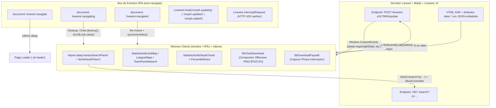

# 03 — Análisis Forense Exhaustivo de JavaScript, Componentes Interactivos y Sistema de Diseño CSS

> **Clasificación Epistemológica:**
> - `[OBSERVADO]`: Evidencia directa extraída byte a byte de los artefactos capturados por REA (`scripts-index.json`, los 24 módulos en `evidence/javascript/named/`, `inline-home-scripts.js`, y las 5 hojas de estilo en `evidence/css/`).
> - `[INFERIDO]`: Conclusión técnica deducida directamente de contratos de datos, firmas de eventos, nombres de métodos y comentarios del desarrollador en los scripts.
> - `[RECONSTRUIDO]`: Arquitectura o flujo de extremo a extremo (servidor Laravel/Livewire ↔ cliente JS/Alpine/Canvas/SVG) reconstruido a partir de las fronteras observadas.
> - `[DESCONOCIDO]`: Implementación interna del servidor no expuesta al cliente.
>
> **Referencias de Evidencia REA (`evidence_id`):**
> - Captura y sesión padre de escenario web: `ev_9e16df560f7b4515f78a74c98f23526df34fa3ee180451991dfd5c4b6c5ec2d7` (`[OBSERVADO]`)
> - Análisis de aplicación JavaScript y grafo AST/semántico: `ev_a859568ca7db50587c1641eb0abe6a44c8aa6a0ed8d47ba2ce6572109480017a` (`[OBSERVADO]`)
> - Exportación forense de scripts aislados (`scripts-index.json` + 28 bundles): `ev_ae1b0493c16a440b51a7596afbe0c5af7cf297e66014c9e86aa9638018249441` (`[OBSERVADO]`)

---

## 1. Inventario Completo de Bundles y Scripts Exportados por REA

`[OBSERVADO]` La exportación `ev_ae1b0493c16a440b51a7596afbe0c5af7cf297e66014c9e86aa9638018249441` (`evidence/javascript/scripts-index.json`) contiene **28 scripts externos** cargados en la aplicación: **4 librerías de terceros/framework** (`Bootstrap 5.3.3`, `Chart.js 4.4.3`, `chartjs-plugin-datalabels 2.2.0`, `Livewire v3`) y **24 módulos propietarios personalizados** servidos desde `/custom_assets/js/*.js` **sin minificar y con todos los comentarios originales de ingeniería intactos**.

### 1.1 Tabla Maestra de Scripts (`scripts-index.json`)

| # | Nombre (`named/`) | archivo Aislado (`isolated/`) | URL de Origen (`[OBSERVADO]`) | Bytes | SHA-256 (`[OBSERVADO]`) | Versión / Cache-Busting | Rol Arquitectónico |
|---:|---|---|---|---:|---|---|---|
| 1 | *(terceros)* `bootstrap.bundle.min.js` | `source-1-65a4e20def0c.js` | `https://cdn.jsdelivr.net/npm/bootstrap@5.3.3/dist/js/bootstrap.bundle.min.js` | 80,721 | `0833b2e9c3a26c258476c46266e6877fc75218625162e0460be9a3a098a61c6c` | `5.3.3` | UI base, dropdowns y grillas |
| 2 | *(terceros)* `chart.umd.min.js` | `source-2-bad047a9ef8d.js` | `https://cdn.jsdelivr.net/npm/chart.js@4.4.3/dist/chart.umd.min.js` | 205,637 | `d46d97a1fd022c5fb29fa2f45ebcbc32202d73aeebf076ce5f7248f5498fc7d7` | `4.4.3` | Motor base Canvas 2D para gráficas |
| 3 | *(terceros)* `chartjs-plugin-datalabels.min.js` | `source-3-fb8836e73e9e.js` | `https://cdn.jsdelivr.net/npm/chartjs-plugin-datalabels@2.2.0/dist/chartjs-plugin-datalabels.min.js` | 12,937 | `20c08f3d9c6d2ef76df6d6a6f1127c0013339fe32add24222276c398c6308c38` | `2.2.0` | Plugin de etiquetas sobre Chart.js |
| 4 | `home-motion.js` | `source-4-c7fe787fdac7.js` | `https://www.statiskicks.com/custom_assets/js/home-motion.js?v=1791380772` | 3,999 | `22559f239e73a2d3cfc2933aceaa258693487e84ef9e9513a20eb7c70d18f1d6` | `?v=1791380772` | Animación `IntersectionObserver` y conteo numérico en portada |
| 5 | `sk-tooltip.js` | `source-5-46db82468da9.js` | `https://www.statiskicks.com/custom_assets/js/sk-tooltip.js?v=1792175742` | 5,286 | `fe7367342c87234dc2fa7e0157511fd63252c25e9bcaafa004668144720bca8b` | `?v=1792175742` | Singleton global de tooltips (`[data-sk-tip]`) con deslizamiento |
| 6 | `download-paywall.js` | `source-6-452bdea5e355.js` | `https://www.statiskicks.com/custom_assets/js/download-paywall.js?v=1793826522` | 4,871 | `607fc88ac6d0f2a549f033851901599a3b1afb1cc771ae1904e8f11ccec67e3c` | `?v=1793826522` | Interceptor en fase de captura para paywall (`downloads`, `charts`, `events`) |
| 7 | `chart-download.js` | `source-7-663134bd268b.js` | `https://www.statiskicks.com/custom_assets/js/chart-download.js?v=1794084628` | 82,271 | `1b5758059e8826e09c245ca01e94963880d38b8b1fb416493f4588815490eada` | `?v=1794084628` | Compositor universal offscreen Canvas/SVG/HTML a PNG/JPG + trigger CSV |
| 8 | `search-results-image.js` | `source-8-25e6f0c6f333.js` | `https://www.statiskicks.com/custom_assets/js/search-results-image.js?v=1794084628` | 15,500 | `25372b446898cb2530c1975c9050d492f82fd9df045033a3bfdfa697a000169f` | `?v=1794084628` | Renderizador Canvas de tablas de búsqueda avanzada (`search-results`) |
| 9 | `percentile-rows.js` | `source-9-6735a04ebe07.js` | `https://www.statiskicks.com/custom_assets/js/percentile-rows.js?v=1793360776` | 16,494 | `0c3610604969038c0cf35435cb87fd4547652088dad675798567d0423998c7c1` | `?v=1793360776` | Plugin Chart.js para barras horizontales de percentiles y gradientes |
| 10 | `skore.js` | `source-10-e77eee2dce07.js` | `https://www.statiskicks.com/custom_assets/js/skore.js?v=1793032870` | 1,025 | `67c17289fb0d3ba5d9a011729ca66f2c0cf4b6553b15d889175b419d5a5dc9c6` | `?v=1793032870` | Formateador y clasificador de calificación `SKore` (`high`/`mid`/`low`) |
| 11 | `attribute-picker.js` | `source-11-fd1c644002f3.js` | `https://www.statiskicks.com/custom_assets/js/attribute-picker.js?v=1791577902` | 3,993 | `558267b51ef8c3d6531378faad3aa2fa3ca911005cf807c216b70e81f54208ed` | `?v=1791577902` | Mixin Alpine.js para modal selector de atributos con búsqueda NFD |
| 12 | `attribute-charts.js` | `source-12-585c1bdae331.js` | `https://www.statiskicks.com/custom_assets/js/attribute-charts.js?v=1794084628` | 43,926 | `e18e09e5eb7df4f53bf7359a6b880e8345042e128d4b6e4f9b37a9f419cb6dda` | `?v=1794084628` | Orquestador de barras de percentiles, Pizza/Radar Canvas y tabla Ranking |
| 13 | `heatmap.js` | `source-13-f7887986293d.js` | `https://www.statiskicks.com/custom_assets/js/heatmap.js?v=1791561866` | 8,470 | `ae977db0cf0906866538b5a5794ee07784cc89094997dbee21e6b943d32b5d91` | `?v=1791561866` | Motor matemático KDE (kernel cuártico/biweight + LUT gamma 0.7) |
| 14 | `goalmouth-map.js` | `source-14-980ee3e50473.js` | `https://www.statiskicks.com/custom_assets/js/goalmouth-map.js?v=1794084628` | 19,168 | `9f0355309588c0a610eea120f783753795a981ee05222a8db951c644b9db89a3` | `?v=1794084628` | Mapa SVG/Canvas de portería para arqueros (Calor, Remates xGOT, Zonas 3×3) |
| 15 | `event-map.js` | `source-15-73a1d39a98cd.js` | `https://www.statiskicks.com/custom_assets/js/event-map.js?v=1793880030` | 101,374 | `2ea7370b26667ae8bcfe84789682a80a7fc8d3d7f4da7a65929203a3eb80471d` | `?v=1793880030` | Motor principal de mapas de eventos en cancha (tiros, pases, duelos, xT, zonas, hulls) |
| 16 | `league-maps.js` | `source-16-13c0da1067e8.js` | `https://www.statiskicks.com/custom_assets/js/league-maps.js?v=1794084628` | 47,505 | `8dc40486c29927a54150723be3a9260add810eeb7c75a9dedb64996df70c9f5f` | `?v=1794084628` | Grilla small-multiples de mapas de liga con cola secuencial Livewire |
| 17 | `league-scatter.js` | `source-17-05a4e0eddaec.js` | `https://www.statiskicks.com/custom_assets/js/league-scatter.js?v=1794084628` | 62,610 | `f1ad9e5d980503c9d6aca9747f536d1a37dc913947642829145e8d238c38c88f` | `?v=1794084628` | Gráfico SVG de dispersión (jugadores/equipos), regresión OLS y brush 2D |
| 18 | `league-switcher.js` | `source-18-f25d1a6b4827.js` | `https://www.statiskicks.com/custom_assets/js/league-switcher.js?v=1793361650` | 974 | `bb18600c8c581ceede69688481ab0612772eeb0061d716da71b249f68efbb29a` | `?v=1793361650` | Persistencia en `sessionStorage` de estado de mapas/dispersión entre ligas |
| 19 | `team-profile.js` | `source-19-e6f602faed13.js` | `https://www.statiskicks.com/custom_assets/js/team-profile.js?v=1791380772` | 7,387 | `988e995db44d6d408fb99ea5eb30a212f584f7f6b910c1b36c4cb17b4dcae813` | `?v=1791380772` | Controlador de tooltips para barras de Identidad Táctica del equipo |
| 20 | `team-age-profile.js` | `source-20-bca2672472b2.js` | `https://www.statiskicks.com/custom_assets/js/team-age-profile.js?v=1794168592` | 16,117 | `e07abe994dfbf94e98e191d066a40463e516de94414e56df99604e2b534d7f7a` | `?v=1794168592` | Scatter Chart.js de Edad vs % Minutos con banda de apogeo (24–29 años) |
| 21 | `team-xg-rolling.js` | `source-21-958e2a628d73.js` | `https://www.statiskicks.com/custom_assets/js/team-xg-rolling.js?v=1791380772` | 13,984 | `9c5c70564ce37db63366d9db0ee8e44dadf009a11d19588df4f1b162da642997` | `?v=1791380772` | Serie temporal Chart.js de media móvil (5 partidos) de xG vs xGA y cambios de DT |
| 22 | `team-formation-profile.js` | `source-22-62e3c1317a4e.js` | `https://www.statiskicks.com/custom_assets/js/team-formation-profile.js?v=1791380772` | 3,323 | `ce680500d130ce08de8b755287790804d529a1e20c7da941c6107f110fd7a00e` | `?v=1791380772` | Cargador asíncrono Livewire del perfil de formaciones del equipo |
| 23 | `team-pass-network.js` | `source-23-01b960dff6c5.js` | `https://www.statiskicks.com/custom_assets/js/team-pass-network.js?v=1794084628` | 43,792 | `a37025c7884995e1c017ef0db0bbd96853353809105ae4135bd598e50f56c400` | `?v=1794084628` | Red de pases SVG (440×620) con aristas Bézier + Matriz de pases HTML/Canvas |
| 24 | `live-motion.js` | `source-24-0753dcbb2d46.js` | `https://www.statiskicks.com/custom_assets/js/live-motion.js?v=1792175986` | 4,880 | `63ece23dfa253f2ad5bb9c709dfd4c11f7f37c6faf372e6bce7b21b4b2fe458e` | `?v=1792175986` | Hooks de morphing Livewire para partidos en vivo y reloj interpolado cada 15s |
| 25 | `momentum-chart.js` | `source-25-eb16742dc1bc.js` | `https://www.statiskicks.com/custom_assets/js/momentum-chart.js?v=1792708794` | 19,165 | `7c85598927d5e81fce72b9a1b2d54feec95dceff0a5a9c407ebf6d07aedd92a1` | `?v=1792708794` | Controlador interactivo SVG de Momentum del partido (curva/barras, zoom, xT 5 min) |
| 26 | `player-heat.js` | `source-26-771d75031e3b.js` | `https://www.statiskicks.com/custom_assets/js/player-heat.js?v=1792491156` | 6,706 | `14d579d847824dcf3a38f993be443dd95ca8d1a17711cc9ddc7f5c4631e2b98e` | `?v=1792491156` | Mapa de calor individual en modal de jugador de partido con reveal radial |
| 27 | `scroll-lock.js` | `source-27-cdb6dff94fa9.js` | `https://www.statiskicks.com/custom_assets/js/scroll-lock.js?v=1792589840` | 1,452 | `14b451fbb0042bd23c1f1aade6d1603e210ce55a359ef050d332c6e5e36ad92d` | `?v=1792589840` | Bloqueo de scroll del `<body>` por conteo de referencias (`owners = new Set()`) |
| 28 | *(framework)* `livewire.min.js` | `source-28-e7f099a319f8.js` | `https://www.statiskicks.com/livewire-e3175f40/livewire.min.js?id=6b3709b1` | 237,673 | `4f67d55949e15c5c6d680b31dec3474dd2f9efb144a5661455fe5326ce40bf1f` | `?id=6b3709b1` | Runtime oficial de Laravel Livewire v3 (incluye Alpine.js v3 integrado) |

### 1.2 Artefactos Adicionales de Código Cliente y Hojas de Estilo

| Artefacto Local | Ruta en Worktree | Tamaño (Decodificado) | SHA-256 (Archivo) | SHA-256 (Contenido UTF-8) |
|---|---|---:|---|---|
| `inline-home-scripts.js` | `evidence/javascript/inline-home-scripts.js` | 771 líneas | *(agregado de 37 bloques inline)* | — |
| `sk.css` | `evidence/css/sk.css` | 161,710 B (6,050 líneas) | `f50cfbfe08bd79a820adb9db6c2c882762d108385f121e8a854ac87464b70a25` | `2c340879ba9660e66c69a5542f975ac73dd36c01316354175a3faa73bf9324c3` |
| `home.css` | `evidence/css/home.css` | 25,638 B (1,046 líneas) | `1f1607f3e14d223056e3dbfe48fcd12a4fd1e9808a39ef84e5a293fb375fa820` | `9df1c77dff801892233bff923e4e72a59071d7a46152e4726188b73168c583c1` |
| `nav-mega-menu.css` | `evidence/css/nav-mega-menu.css` | 12,758 B (426 líneas) | `89df151750c97f11c674743a0e680bc434abbf99b24b90d3b4372fa0ca57fd04` | `843148b1aa4744c831575de19b624d100adb22c22fdc996994773050bf05d233` |
| `page-loader.css` | `evidence/css/page-loader.css` | 9,874 B (264 líneas) | `64d27324277e121469f37a1e9858061e4b485eb8bc90850e0aa1c6231f29289e` | `dfae99edd30c4bbd2873eb0e712af34a046efe96fa411af3710b66621398008b` |
| `plan-cards.css` | `evidence/css/plan-cards.css` | 4,522 B (203 líneas) | `099167b53317604f1f4a6fe176f41c937ba7a35823dab79f0d7b2af0fadf2b0c` | `e89284781b405a1de46f49e94f5c28d406c13f7362354ef7edec0e6d5c8c9838` |

> `[INFERIDO]` **Análisis de los timestamps `?v=`:** Los 24 scripts se sirven directamente desde `public/custom_assets/js/` sin empaquetador (no usan Vite/Webpack para estos módulos) y emplean un entero estilo epoch (`1791380772` a `1794168592`). Notablemente, `chart-download.js`, `search-results-image.js`, `attribute-charts.js`, `goalmouth-map.js`, `league-maps.js`, `league-scatter.js` y `team-pass-network.js` comparten exactamente `?v=1794084628`, lo que demuestra un despliegue sincronizado de la funcionalidad de exportación de gráficas (`SK-18` / `Fase 6`), seguido de un hotfix posterior únicamente en `team-age-profile.js` (`?v=1794168592`, diferencia de `83,964` segundos ≈ 23.3 horas).

---

## 2. Arquitectura de Integración Livewire + Alpine.js + Chart.js + Canvas/SVG

`[RECONSTRUIDO]` La aplicación no es una SPA en React/Vue, sino un **monolito híbrido Laravel + Livewire v3 (`/livewire-e3175f40/update`) + Alpine.js v3 + motores imperativos en Vanilla JS (IIFEs en `window.*`)**.



### 2.1 Patrón de Hidratación por Atributos `data-*` y Aislamiento `wire:ignore`
`[OBSERVADO]` Para evitar que el algoritmo de *DOM morphing* de Livewire destruya los `<canvas>` o `<svg>` interactivos, los contenedores gráficos usan `wire:ignore` y reciben su estado inicial mediante JSON serializado en atributos HTML o `<script type="application/json">`:
- **Atributos `data-*` con JSON directo:**
  - `data-sk-event-map`: JSON de bootstrap con `{ componentId, dataMethod, filterMethod, dataEvent, filterEvent, initialFilters, initialData }` (`event-map.js`).
  - `data-team-pass-network`: JSON de red y matriz de pases (`team-pass-network.js`).
  - `data-team-formation-profile`: JSON de formaciones (`team-formation-profile.js`).
  - `data-team-profile-payload`: `<script type="application/json">` con las fases e indicadores tácticos (`team-profile.js`).
  - `data-team-age-profile-chart`: JSON con puntos de edad vs % de minutos (`team-age-profile.js`).
  - `data-team-xg-rolling-chart`: JSON con series móviles de xG y xGA (`team-xg-rolling.js`).
  - `data-sk-goalmouth`: JSON de tiros recibidos por el arquero (`goalmouth-map.js`).
  - `data-sk-player-heat`: JSON de toques del jugador en el partido (`player-heat.js`).
  - `data-mm-data`: JSON de momentum minuto a minuto (`momentum-chart.js`).
  - `data-sk-player-card`: JSON de metadatos de tarjeta para exportación de imagen (`chart-download.js`).
  - `data-sk-export-table`: JSON de hasta 20 filas exportadas por `Players::exportTable()` (`search-results-image.js`).

### 2.2 RPC Cliente → Servidor (`window.Livewire.find(id).call(...)`)
`[OBSERVADO]` Cuando un módulo JS necesita datos pesados bajo demanda sin re-renderizar toda la vista Blade, localiza el contenedor `[wire\:id]` ancestro y ejecuta llamadas RPC directas al componente Livewire:
1. **`event-map.js`**:
   - `component.call(bootstrap.filterMethod, competitionId, seasonId, teamId, stage, requestId)`
   - `component.call(bootstrap.dataMethod, eventKey, viewKey, options, filters, requestId)`
2. **`league-maps.js`** (`LeagueDetail`):
   - `await component.call('loadLeagueMap', teamId, event, view, variant, stage, side)` — **ejecutado en una cola secuencial (`pump()`) un equipo a la vez**, priorizando las tarjetas visibles en el viewport, para que el backend PHP nunca construya más de un mapa de equipo por petición HTTP (`[OBSERVADO]` en `league-maps.js#L180-L245`).
3. **`league-scatter.js`** (`LeagueDetail`):
   - `await component.call('loadScatter', population, xKey, xUnit, yKey, yUnit)`
4. **`team-formation-profile.js`**:
   - `component.call('loadTeamFormationProfile', requestId)`
5. **`team-pass-network.js`**:
   - `component.call('loadTeamPassNetwork', selection, requestId)`
6. **`chart-download.js`**:
   - `component.call(csvMethod)` (leído de `data-sk-export-csv`, p. ej. para descargar CSV desde el menú unificado de exportación).

### 2.3 Eventos del Servidor → Cliente y Control de Concurrencia (`requestId`)
`[OBSERVADO]` En lugar de depender únicamente del retorno de la promesa RPC, varios componentes Livewire despachan eventos de ventana (`$this->dispatch(...)`), escuchados mediante `window.addEventListener`:
- `team-formation-profile-updated` (`detail.data`, `detail.requestId`)
- `team-pass-network-data-updated` (`detail.data`, `detail.requestId`)
- Eventos dinámicos configurados en `event-map.js` (`bootstrap.filterEvent` → `detail.mapGraphFilters`, `bootstrap.dataEvent` → `detail.mapGraphData`).
- Todos los módulos asíncronos incrementan un contador local `requestId` (`++state.requestSeq`) y descartan respuestas cuyo `detail.requestId` no coincida con la última solicitud activa, evitando condiciones de carrera (*race conditions*).

### 2.4 Ciclo de Vida SPA (`wire:navigate`) y Hooks en `inline-home-scripts.js`
`[OBSERVADO]` El archivo `evidence/javascript/inline-home-scripts.js` (37 bloques `<script>` extraídos del HTML base) revela la fontanería global del layout persistente:
1. **Bloque Inline 0 (`<head>`):** Añade `document.documentElement.classList.add('sk-home-motion')` antes del primer pintado para que `[data-sk-reveal]` solo oculte elementos si JS está activo.
2. **Bloque Inline 1 (`window.skPageLoaderBound`):** Controla el overlay `.sk-loader` (`[data-page-loader]`):
   - Escucha `livewire:navigate` y programa la aparición tras `DELAY = 190ms` (evita parpadeos en transiciones rápidas desde caché).
   - En `livewire:navigated`, garantiza una permanencia mínima `MIN_VISIBLE = 620ms` y desvanece en `260ms`.
   - Escucha `beforeunload` para navegaciones completas, con un salvavidas `UNLOAD_FAILSAFE = 10000ms` documentado en un comentario revelador: *"a league page currently renders in 10–27s, so this was the ordinary case rather than the edge case"* (`[OBSERVADO]`).
3. **Bloque Inline 2 (`window.skNavbarBound`):** Dado que la barra de navegación usa `@persist('navbar')` de Livewire, el servidor no vuelve a renderizarla al navegar. La función `syncActiveNav()` escucha `livewire:navigated`, lee `window.location.pathname` y compara contra los prefijos separados por `|` en `data-nav-match` (con verificación de frontera de segmento `/` para que `/player/{id}` active **Scouting** sin colisionar con `/players` de **Búsqueda Avanzada**, y `/league/{id}` active **Ligas**).
4. **Bloque Inline 4 (Tema Claro/Oscuro):** Lee `localStorage.getItem('sk-theme')` o `prefers-color-scheme: dark`, aplica `data-theme="dark|light"` en `<html>`, y sincroniza el icono móvil (`#themeIconMobile`) mediante un `MutationObserver` sobre `data-theme`.
5. **Bloque Inline 32 (Limpieza pre-navegación):** En `document.addEventListener('livewire:navigating')`, elimina `sk-search-open` y `league-modal-open` de `document.body` e itera sobre `Object.values(Chart.instances || {})` ejecutando `chart.destroy()` para liberar contextos WebGL/2D antes de que Livewire reemplace el DOM.
6. **Bloque Inline 33 (`window.skShowUsageNotice` — Ticket `SK-19`):** Registra un interceptor global en `window.Livewire.interceptRequest(({ onError }) => ...)` que captura respuestas **HTTP `429 Too Many Requests`**, ejecuta `preventDefault()` para suprimir el modal de error nativo de Livewire, extrae el JSON `message` (o muestra `"Recibimos demasiadas solicitudes seguidas. Espera un momento y vuelve a intentarlo."`) y despliega el toast `#skUsageNotice` durante `9000ms`.
7. **Bloques Inline 34–35 (Normalización de Origen Livewire):** Carga `/livewire-e3175f40/livewire.min.js?id=6b3709b1` y ejecuta `normalizeLivewireEndpointConfig()`, reescribiendo `data-update-uri` y `data-module-url` al `window.location.origin` actual para evitar errores CORS cuando se accede con o sin `www.`.
8. **Bloque Inline 36 (`Alpine.data('navbarSearchPanel')`):** Componente Alpine del buscador global (`#navbarSearchRoot`):
   - Consulta `GET /search?q={term}` con *debounce* de `350ms`, mínimo 2 caracteres, cabecera `Accept: application/json` y cancelación de vuelos previos vía `AbortController`.
   - Maneja explícitamente `res.status === 429` (`SK-19`) mostrando el aviso en línea (`this.limited`) en lugar de `"No se encontraron resultados"`.
   - Espera el esquema JSON `{ leagues: [...], teams: [...], players: [...] }` donde cada ítem contiene `id`, `name`, `image`, `alpha2` (ligas), `country` (equipos) o `flag`, `role`, `team` (jugadores).
   - Persiste los últimos 8 elementos visitados en `localStorage` bajo la clave `'sk-recent-players'` (etiquetados con `kind: 'league' | 'team' | 'player'`).
   - Si falta la foto de un jugador, genera un avatar de respaldo en `https://ui-avatars.com/api/?name=${encodeURIComponent(name)}&background=1D665D&color=fff&size=80`.

---

## 3. Desglose Forense Módulo por Módulo (Los 24 Archivos JS Personalizados)

### 3.1 `home-motion.js` (`22559f239e73a2d3cfc2933aceaa258693487e84ef9e9513a20eb7c70d18f1d6`)
- **Propósito (`[OBSERVADO]`):** Animación de entrada por scroll (`[data-sk-reveal]`) y conteo progresivo de cifras (`[data-sk-count]`) en la portada (`.sk-home`).
- **Estructura DOM esperada:**
  - Elementos con `data-sk-reveal`: reciben la clase `.is-visible` al entrar en el viewport (`IntersectionObserver` con `threshold: 0.12`, `rootMargin: '0px 0px -8% 0px'`).
  - Elementos con `data-sk-count="<entero>"` y `data-sk-suffix="<sufijo>"`: contienen el valor final formateado por el servidor en `textContent`.
- **Algoritmo matemático:**
  - Duración `COUNT_MS = 1100` ms usando interpolación *easeOutQuart*:
    $$e(t) = 1 - (1 - t)^4, \quad t = \min\left(1, \frac{\text{now} - t_0}{1100}\right)$$
  - Formatea miles con punto (`group(n)` aplicando `/\B(?=(\d{3})+(?!\d))/g, '.'`, idéntico a `number_format($n, 0, ',', '.')` en PHP) y al llegar a $t=1$ restaura el `finalText` literal enviado por el servidor.

### 3.2 `sk-tooltip.js` (`fe7367342c87234dc2fa7e0157511fd63252c25e9bcaafa004668144720bca8b`)
- **Propósito (`[OBSERVADO]`):** Singleton global `window.StatiskicksTooltip` que reemplaza el atributo `title` nativo por un tooltip flotante `<div class="sk-tip" role="tooltip">` en `document.body`.
- **Atributos DOM leídos:**
  - `data-sk-tip`: cuerpo del tooltip (admite saltos de línea `\n`, renderizados como múltiples `<span>`).
  - `data-sk-tip-title`: título opcional en negrita (`<strong class="sk-tip__title">`).
- **Cálculo geométrico y cinemática:**
  - Calcula `target.getBoundingClientRect()` con margen `GAP = 8` px y margen de pantalla `EDGE = 8` px.
  - Posiciona encima por defecto; si `top < EDGE`, invierte debajo (`.sk-tip--below`).
  - Calcula la posición horizontal del triángulo indicador (*caret*) como `--sk-tip-caret: clamp(12px, targetCenterX - left, tipWidth - 12px)`.
  - Si el usuario pasa de un elemento `[data-sk-tip]` a otro dentro de `LEAVE_GRACE = 100` ms, activa `.is-gliding` para interpolar suavemente `left` y `top` durante `400ms` (`cubic-bezier(0.25, 1, 0.5, 1)`).

### 3.3 `download-paywall.js` (`607fc88ac6d0f2a549f033851901599a3b1afb1cc771ae1904e8f11ccec67e3c`)
- **Propósito (`[OBSERVADO]`):** Portero cliente (`window.SkDownloadPaywall`) que intercepta clics en **fase de captura (`window.addEventListener('click', ..., true)`)** antes de que lleguen a `chart-download.js`, `attribute-charts.js` o `wire:click` de Livewire.
- **Mecanismo de control (`[OBSERVADO]`):**
  - El servidor solo incluye el partial `layouts/partials/download-paywall` (`[data-sk-paywall]`) cuando el plan del usuario tiene restricciones (`PlanAccess::allowsDownloads() === false` o sin acceso a personalización de gráficas/eventos).
  - Maneja 3 variantes (`[data-sk-paywall-variant="downloads|charts|events"]`):
    1. `downloads`: intercepta `.sk-chart-download-btn, [data-sk-chart-source], .sk-data-download-btn, [data-sk-download]` cuando existe `[data-sk-paywall-downloads]`.
    2. `charts`: intercepta `[data-sk-paywall-trigger="charts"]`.
    3. `events`: intercepta `[data-sk-paywall-trigger="events"]` (`PlanAccess::allowsMapEvent()`).
  - Ejecuta `event.preventDefault()`, `event.stopPropagation()` y `event.stopImmediatePropagation()`, abriendo el modal `.sk-paywall` con transición de `220ms`.

### 3.4 `chart-download.js` (`1b5758059e8826e09c245ca01e94963880d38b8b1fb416493f4588815490eada`)
- **Propósito (`[OBSERVADO]`):** Motor universal de composición y exportación de gráficas a imagen (`PNG`/`JPG`) y disparador de exportación `CSV` (`window.SkChartDownload`, 2,053 líneas, tickets `SK-18`, `SK-18.2`, `SK-18.3`, `Fase 6`).
- **Presets de Dimensiones (`SIZES`):**
  - `original`: `"Tamaño original"` (usa el bounding box de la gráfica a `EXPORT_SCALE = 2`).
  - `square`: `"Cuadrado"` (`1080 × 1080` px, `1:1`).
  - `portrait`: `"Vertical"` (`1080 × 1350` px, `4:5`).
  - `story`: `"Historia"` (`1080 × 1920` px, `9:16`, con zona segura central `safe: 1420` px para no quedar cubierto por la UI de Instagram/TikTok).
  - `landscape`: `"Horizontal"` (`1600 × 900` px, `16:9`).
  - `link`: `"Enlace"` (`1200 × 630` px, OpenGraph/X card).
- **Arquitectura de Fuentes de Renderizado (`resolveSource`):**
  1. **`canvasSource` (Chart.js / Canvas 2D):**
     - Si el canvas pertenece a una instancia de `Chart.getChart(canvas)` y el preset cambia la relación de aspecto, ejecuta `chartInto()`: clona el árbol DOM en un contenedor fuera de pantalla (`left: -100000px`), instancia o redimensiona el Chart.js a las dimensiones exactas del preset con `devicePixelRatio: scale`, captura el frame y restaura el original.
     - Si el canvas expone `canvas.skTurned(w, h)` (`event-map.js`) y el área de dibujo es más alta que ancha (`portrait` o `story`), rota la cancha 90° en sentido antihorario (ataque hacia arriba).
  2. **`svgSource` y `svgLegendSource`:**
     - Clona el `<svg>`, resuelve las variables CSS (`var(--*)`) inyectando los estilos computados (`inlineComputedStyle` para 17 propiedades SVG: `fill`, `stroke`, `font-*`, `opacity`, etc.), serializa con `XMLSerializer` a un `Blob('image/svg+xml')` y lo dibuja sobre un canvas escalado.
  3. **`layeredSource`:**
     - Compone contenedores multicapa (p. ej. SVG de cancha + `<canvas>` de mapa de calor + leyenda SVG) replicando en Canvas 2D el `mix-blend-mode` CSS (`ctx.globalCompositeOperation = blend`) y la `opacity` computada de cada capa.
  4. **`htmlSource` / `htmlInto` (`paintHtml`):**
     - Un motor propio de **rasterización DOM-a-Canvas** sin usar `html2canvas`:
     - Clona la tarjeta fuera de pantalla (`htmlInto`), elimina directivas reactivas (`x-*`, `wire:*`, `@*`, `:*` mediante `stripLive`), ejecuta `fitText` (`[data-sk-fit]`) para ajustar tamaños de fuente y recorre el árbol pintando:
       - Fondos sólidos y gradientes lineales CSS (`htmlGradient`, parseando ángulos y paradas `rgb/hex` + porcentaje para `.sk-rank-bars--graded`).
       - Bordes (`paintBorders`) y líneas divisorias.
       - Nodos de texto línea por línea midiendo cada carácter/línea con `document.createRange().getClientRects()`.
       - Imágenes con `crossOrigin = 'anonymous'` (`paintHtmlImage`), aplicando `border-radius` circular y `filter: brightness(0) / invert(1)` en tema claro/oscuro.
       - **Síntesis local de avatares (`paintAvatar`):** Detecta URLs de `ui-avatars.com` (que carecen de cabeceras CORS y contaminarían el canvas con `SecurityError: Tainted canvases may not be exported`), extrae los parámetros `?name=...&background=...&color=...` de la URL y dibuja el círculo y las iniciales directamente en Canvas 2D.
  5. **Fuentes registradas en `window.SkChartDownloadSources`:** `'search-results'`, `'league-maps'`, `'pass-matrix'`, `'momentum'`, `'html'`.
- **Composición del Marco (`paintFrame`) y Marca de Agua:**
  - Lee `data-sk-player-card` (JSON con `{ kind: 'player'|'team', name, club, league, season, age, position, photo, color }` o arreglo de hasta 3 jugadores en `Comparar`), dibujando foto circular (o escudo completo si `kind === 'team'`), nombre, edad, posición y competición en la cabecera.
  - Dibuja título (`data-sk-chart-title`), subtítulo contextual (`data-sk-chart-context`) y píldoras de filtros activos (`readControlLines`: temporada, competición, etapa, minutos).
  - En el pie izquierdo carga `../logos/logo_white.png`, recorta automáticamente los píxeles transparentes sobrantes (`trimLogo` escaneando el canal alfa en `getImageData`) y lo tiñe con el color de texto del tema usando `globalCompositeOperation = 'source-in'` (`tintLogo`).

### 3.5 `search-results-image.js` (`25372b446898cb2530c1975c9050d492f82fd9df045033a3bfdfa697a000169f`)
- **Propósito (`[OBSERVADO]`):** Registra `window.SkChartDownloadSources['search-results']` para exportar como imagen las tablas y gráficas de barras de una sola métrica en Búsqueda Avanzada (`Players::exportTable()`), estadísticas de liga y plantilla de equipo.
- **Esquema JSON de entrada (`button.dataset.skExportTable`):**
  ```json
  {
    "mode": "table | chart",
    "title": "Goles por 90",
    "context": "Liga MX · Apertura 2026 · Mín. 450 min",
    "subjectHeader": "Jugador",
    "subjectKind": "player | team",
    "showSkore": true,
    "diverging": false,
    "barGradient": { "low": "#...", "mid_from": "#...", "mid_to": "#...", "high": "#..." },
    "extras": [{ "key": "pos", "label": "Pos" }, { "key": "age", "label": "Edad" }],
    "stats": [{ "key": "goals_p90", "label": "Goles / 90" }],
    "rows": [{
      "rank": 1,
      "name": "Nombre",
      "sub": "Club",
      "image": "https://...",
      "subImage": "https://...",
      "extras": { "pos": "DC", "age": "26" },
      "skore": { "text": "7.45", "grade": "high" },
      "values": {
        "goals_p90": { "text": "0.82", "ratio": 94, "share": 0.85, "band": "high" }
      }
    }]
  }
  ```
- **Renderizado geométrico en Canvas:**
  - Permite al usuario elegir cuántas filas incluir (`5`, `10`, `15` o `20` filas mediante el control segmentado `data-sk-export-rows`).
  - En modo `table`: pinta celdas con fondo verde proporcional a `value.ratio / 100` (`--wash-green` con opacidad escalada por `0.38` en claro y `0.28` en oscuro).
  - En modo `chart` (1 atributo): dibuja barras horizontales con gradiente de 4 paradas (`barGradient`) o **barras divergentes centradas en cero** (`data.diverging === true`, diseñado en `Fase 5 B1` para *Goles prevenidos* de arqueros, donde `value.share` varía en $[-1, 1]$ desde el eje central `zeroX = trackX + trackW / 2`).

### 3.6 `percentile-rows.js` (`0c3610604969038c0cf35435cb87fd4547652088dad675798567d0423998c7c1`)
- **Propósito (`[OBSERVADO]`):** Motor compartido `window.StatiskicksPercentileRows` que dibuja las listas de barras horizontales de percentiles sobre un `<canvas>` Chart.js (`type: 'bar'`, `indexAxis: 'y'`).
- **Geometría y Constantes (`ROW_LAYOUT`):**
  - `rowPitch: 50` px por atributo (`topPad: 8`, `bottomPad: 4`, altura total del canvas $= 12 + N \times 50$ px).
  - Las barras nativas de Chart.js se configuran con `backgroundColor: 'rgba(0,0,0,0)'` y `hoverBackgroundColor: 'rgba(0,0,0,0)'`; todo el dibujo ocurre en el hook `afterDatasetsDraw` del plugin `statiskicksPercentileRows-{id}`:
    - Línea superior: etiqueta del atributo a la izquierda (`12px Inter 600`), truncada con `…` si excede el ancho de la pista.
    - Línea inferior: pista redondeada (`barHeight: 14` px, `barRadius: 7` px) que termina antes del badge derecho (`badgeGap: 10` px, `badgeMinWidth: 42` px, `badgeHeight: 24` px).
    - **Gradiente de relleno (`trackFillStyle`):** Construye un `ctx.createLinearGradient(trackLeft, 0, trackRight, 0)` sobre el ancho completo de la pista usando los 4 colores de `entry.gradient` (`low` en $0$, `mid_from` en $0.40$, `mid_to` en $0.70$, `high` en $1.0$, espejo exacto de `App\Support\RankBands::gradient()`).
    - **Marca de promedio poblacional:** Si `entry.averageRatio` está presente (vista `Valor` o `Total` del jugador), dibuja una línea vertical punteada (`setLineDash([2, 2])`) sobre la barra en $x = \text{trackLeft} + \text{trackWidth} \times \frac{\text{averageRatio}}{100}$.
    - **Umbrales de color del badge (`getPercentileColor`):**
      - $\ge 70$: `--rank-high` (`#93CC63` claro / `#B2D98B` oscuro)
      - $\ge 40$: `--rank-mid` (`#F0C32E` claro / `#FFDC51` oscuro)
      - $< 40$: `--rank-low` (`#F2924A` claro / `#FFAA60` oscuro)
      - Tinta del número dentro del badge: siempre oscura `#0e1e14` (`--rank-ink`).

### 3.7 `skore.js` (`67c17289fb0d3ba5d9a011729ca66f2c0cf4b6553b15d889175b419d5a5dc9c6`)
- **Propósito (`[OBSERVADO]`):** Gemelo en cliente (`window.StatiskicksSkore`) de `App\Services\Opta\OptaMatchRatingService::format()` y `::grade()`.
- **Reglas exactas (`[OBSERVADO]`):**
  - `HIGH = 7.0`, `MID = 6.5`.
  - `format(value)`: `Number(value).toFixed(2)` (p. ej. `7.20`), o `'—'` si no es finito.
  - `grade(value)`: devuelve `'high'` si $v \ge 7.0$, `'mid'` si $6.5 \le v < 7.0$, `'low'` si $v < 6.5$, o `'none'`.

### 3.8 `attribute-picker.js` (`558267b51ef8c3d6531378faad3aa2fa3ca911005cf807c216b70e81f54208ed`)
- **Propósito (`[OBSERVADO]`):** Mixin Alpine.js (`window.skAttributePicker`) para el modal `"Seleccionar atributos"` (`resources/views/livewire/partials/players-attribute-picker.blade.php`), compartido por `players.blade.php` y `league-scatter.js`.
- **Lógica interna:**
  - Normalización de búsqueda sin tildes (`foldText`): `.normalize('NFD').replace(/[\u0300-\u036f]/g, '').toLowerCase().trim()`.
  - Calcula el estado de cada categoría (`pickerCategoryState(cat)` → `'all' | 'partial' | 'none'`) ignorando métricas deshabilitadas por el filtro actual (`pickerDisabled(key)`).
  - Animación de apertura en dos cuadros `requestAnimationFrame` (`openModalBackdrop` / `closeModalBackdrop`, `MODAL_CLOSE_MS = 220` ms) coordinada con `StatiskicksScrollLock`.

### 3.9 `attribute-charts.js` (`e18e09e5eb7df4f53bf7359a6b880e8345042e128d4b6e4f9b37a9f419cb6dda`)
- **Propósito (`[OBSERVADO]`):** Motor de visualización de atributos para la pestaña **Perfil** del jugador (`OptaSeasonStatsService::buildTraitsData()`) y las pestañas **Resumen** / **Ranking** del equipo (`OptaTeamAttributeService::forTeam()`).
- **Esquema JSON de un `trait` (`[OBSERVADO]`):**
  ```json
  {
    "key": "goals_p90",
    "label": "Goles",
    "raw_name": "Goals",
    "category": "Finalización",
    "val": 0.64,
    "percentile": 88,
    "benchmark": 1.12,
    "benchmark_percentile": 99,
    "population_average": 0.31,
    "population_average_percentile": 50,
    "unit": "",
    "lowerIsBetter": false,
    "defaultVisible": true,
    "total_only": false,
    "rank": 3,
    "rank_total": 42,
    "bar_gradient": {
      "percentile": { "low": "#...", "mid_from": "#...", "mid_to": "#...", "high": "#..." }
    },
    "total": {
      "val": 14,
      "percentile": 92,
      "population_average": 6.4,
      "population_average_percentile": 50,
      "benchmark": 21,
      "benchmark_percentile": 99,
      "rank": 2,
      "rank_total": 42
    }
  }
  ```
- **Tres unidades de visualización (`activeUnit`):**
  1. `'percentile'`: muestra el percentil `0–99` en el badge; las barras y el radar miden `trait.percentile`.
  2. `'value'` (`p90` en jugador / `per_match` en equipo): la longitud de la barra **sigue siendo `trait.percentile`** (`getTraitDisplayRatio` devuelve siempre el percentil por decisión de producto del `2026-10-09`), pero el badge muestra `formatTraitNumber(trait.val) + trait.unit` y el tooltip añade el promedio poblacional (`population_average`).
  3. `'total'`: la función `traitForUnit(trait, 'total')` fusiona el sub-objeto `trait.total` sobre el `trait` base (y desbloquea atributos con `total_only: true` como `"Partidos jugados"` o `"Minutos jugados"`, `Fase 3`).
- **Gráfico Polar "Pizza Chart" (`renderPizzaCanvas` / `drawPizzaChart`):**
  - Dibuja desde cero en Canvas 2D (sin usar el `radar` de Chart.js):
  - Radio interno `innerR = size * 0.05`, radio externo `outerR = size * 0.34`, brecha de etiquetas `labelGap = size * 0.05`.
  - Anillos concéntricos de referencia en los percentiles `25`, `50` y `75` y rayos divisores entre sectores.
  - Cada sector $i \in [0, N-1]$ abarca un ángulo $\Delta\theta = \frac{2\pi}{N}$ comenzando en $-\frac{\pi}{2}$, con radio:
    $$r_i = r_{\text{inner}} + \frac{\text{clamp}(\text{percentile}_i \cdot \text{progress}, 0, 100)}{100} \cdot (r_{\text{outer}} - r_{\text{inner}})$$
  - Color de relleno fijo `#4CAF7B` (`rgba(76, 175, 123, 0.72)` en claro, `0.78` en oscuro) con borde `#4CAF7B` de `1.5px`.
  - Si `activeUnit === 'value'` o `'total'` en perfil de jugador, dibuja un arco punteado (`setLineDash([4, 3])`) en cada sector a la altura de `population_average_percentile`.
  - **Etiquetas tangenciales rotadas (`drawRotatedLabel`):** Rota el texto (`angle + PI/2`, o `angle - PI/2` en la mitad inferior $\sin(\theta) > 0.01$ para que nunca quede de cabeza) y envuelve líneas a un máximo de 14 caracteres (`wrapLabel`).
  - **Protección contra crash de memoria en iOS (`getSafeCanvasDpr`):** Limita `devicePixelRatio` a `1.5` en pantallas móviles (`<= 768px` o `pointer: coarse`) para evitar que WebKit Jetsam mate la pestaña al animar dos canvas de alta densidad a 60fps.
- **Tabla de Ranking (`rankingRows` — `beta-feature-2`):**
  - Ordena o agrupa por categoría (`category`, `label` o `rank` usando la posición relativa $\frac{\text{rank}-1}{\text{rank\_total}}$) y colorea el chip `"X de Y"` por tercios (`rankThird(rank, total)`, gemelo de `App\Support\RankBands::third()`): primer tercio `'high'`, segundo `'mid'`, último `'low'`.

### 3.10 `heatmap.js` (`ae977db0cf0906866538b5a5794ee07784cc89094997dbee21e6b943d32b5d91`)
- **Propósito (`[OBSERVADO]`):** Motor compartido `window.StatiskicksHeatmap` de estimación de densidad por núcleos (KDE) sobre grillas 2D en `Float32Array`.
- **Formulación matemática exacta (`computeDensityField`):**
  1. **Radio del kernel:** `RADIUS_SHARE = 0.095` del lado corto del rectángulo de dibujo (`shortSide = Math.min(drawRect.width, drawRect.height)`, o `options.shortSide`):
     $$R = \max\left(9, \text{round}(0.095 \cdot \text{shortSide})\right)$$
  2. **Función Kernel Cuártica (Biweight):** Para cada punto $(x_p, y_p, w_p)$ con peso $w_p = \max(0, \text{weight})$ (donde $w_p = 1$ por conteo, o bien `xG` en tiros / `xT` en pases y conducciones) y cada píxel $(x, y)$ dentro de la caja $[x_p - R, x_p + R] \times [y_p - R, y_p + R]$ con distancia normalizada $d^2 = \frac{(x - x_p)^2 + (y - y_p)^2}{R^2} < 1$:
     $$K(d) = w_p \cdot \left(1 - d^2\right)^2$$
  3. **Normalización por Percentil 98.5 (`REFERENCE_PERCENTILE = 0.985`):**
     - Filtra las celdas activas con densidad $\ge 0.01 \cdot \text{peak}$ (`COVERAGE_FLOOR = 0.01`).
     - Construye un histograma de `HISTOGRAM_BINS = 512` contenedores entre $0$ y $\text{peak}$ y acumula hasta alcanzar el $98.5\%$ de las celdas activas, acotado inferiormente por $0.05 \cdot \text{peak}$ (`MIN_PEAK_RATIO = 0.05`).
     - *Justificación documentada en código:* Evita que una esquina con 15 saques de esquina acumulados apague el resto del campo a tonos fríos.
  4. **Tabla de Color (LUT de 1024 pasos) y Corrección Gamma (`GAMMA = 0.7`):**
     - Para cada píxel con intensidad normalizada $u = \text{clamp}(\text{grid}[i] / \text{reference}, 0, 1)$, si $u \ge 0.035$ (`FLOOR_STOP`), indexa la paleta precalculada de 1024 niveles donde cada nivel aplica $t = (k / 1023)^{0.7}$:
     - **Paleta Oscura (`DARK_STOPS`):** Transparente → Violeta `[90, 0, 130, 65]` ($0.12$) → Azul `[40, 80, 200, 135]` ($0.30$) → Turquesa `[0, 175, 175, 185]` ($0.50$) → Amarillo `[255, 220, 40, 225]` ($0.75$) → Rojo-Naranja `[255, 60, 20, 255]` ($1.00$).
     - **Paleta Clara (`LIGHT_STOPS`):** Transparente → Verde claro `[178, 217, 139, 95]` ($0.12$) → Verde `[112, 186, 118, 155]` ($0.30$) → Lima `[190, 214, 74, 195]` ($0.50$) → Ámbar `[245, 184, 46, 225]` ($0.75$) → Rojo `[220, 60, 65, 255]` ($1.00$).

### 3.11 `goalmouth-map.js` (`9f0355309588c0a610eea120f783753795a981ee05222a8db951c644b9db89a3`)
- **Propósito (`[OBSERVADO]`):** Mapa interactivo de portería (`window.StatiskicksGoalmouth`, `spec beta-final-changes fase 2`) alimentado por `OptaKeeperGoalmouthService`.
- **Geometría del Arco y Coordenadas:**
  - Lienzo SVG `360 × 196` con postes interiores en `GOAL = { left: 30, right: 330, top: 22, bottom: 122 }` (`300 × 100` unidades SVG, proporción `3:1`, que aproxima los `7.32m × 2.44m` reglamentarios).
  - Perspectiva vista desde el punto penal hacia el arco: izquierda `"Derecha del portero"`, derecha `"Izquierda del portero"`.
  - Coordenadas de entrada normalizadas en $[0, 100] \times [0, 100]$:
    $$X_{\text{svg}} = 30 + \frac{\text{clamp}(x, 0, 100)}{100} \cdot 300, \qquad Y_{\text{svg}} = 122 - \frac{\text{clamp}(y, 0, 100)}{100} \cdot 100$$
- **Filtros y Vistas:**
  - **Filtros (`filter`):** `'all'` (Todos), `'open_play'` (`!shot.penalty`, Sin penales), `'penalties'` (`shot.penalty`, Solo penales).
  - **Vista `heat` (Calor):** Renderiza un canvas de `600 × 200` px incrustado como `<image>` dentro del `clipPath` del arco, pasando `shortSide: 600` a `StatiskicksHeatmap` para que el radio del kernel sea el $9.5\%$ del ancho del arco ($\approx 70$ cm reales). Ofrece 3 modos de calor:
    - `'saves'` (Atajadas): paleta estándar de la plataforma.
    - `'goals'` (Goles): paleta propia rosa-a-violeta en claro (`[252,187,204]` → `[73,16,120]`) y vino-a-rosa en oscuro (`[92,20,76]` → `[255,212,232]`), con `GOAL_GAMMA = 0.7`.
    - `'both'` (Ambos): superpone la imagen de goles sobre la de atajadas y añade anillos tenues (`r = 2.2`) para inspección con tooltip.
  - **Vista `shots` (Remates):** Dibuja un `<circle>` por cada tiro con radio escalado por `xGOT`:
    $$r = \begin{cases} 3.5 + 9 \sqrt{\max(0, \text{xgot})} & \text{si } \text{xgot} \neq \text{null} \\ 5 & \text{si } \text{xgot} = \text{null} \end{cases}$$
  - **Vista `zones` (Zonas):** Cuadrícula `3 × 3` (9 zonas del arco) coloreada según porcentaje de atajadas (`>= 70%` `high`, `>= 40%` `mid`, `< 40%` `low`), mostrando `save_pct%` y `saves/shots`.
  - **Resumen (`[data-goalmouth-stat]`):** Calcula en cliente `faced`, `saves`, `goals`, `save_pct`, `xgot` acumulado y **Goles prevenidos** ($\text{prevented} = \sum \text{xGOT} - \text{goles}$, con signo explícito `+` y clases `.is-positive` / `.is-negative`).

### 3.12 `event-map.js` (`2ea7370b26667ae8bcfe84789682a80a7fc8d3d7f4da7a65929203a3eb80471d`)
- **Propósito (`[OBSERVADO]`):** Motor maestro de mapas de eventos en cancha (`window.StatiskicksEventMap`, 2,345 líneas), utilizado tanto en páginas de Jugador, Equipo y Partido como por `league-maps.js`.
- **Geometría de Cancha (`getPitchBox` y `paintPitch`):**
  - Coordenadas normalizadas `0..100` en ambos ejes, orientación horizontal (ataque de izquierda $x=0$ a derecha $x=100$).
  - Comentario forense clave en línea 892 (`[OBSERVADO]`): **`"left = own goal, right = opponent goal, top = left touchline (the builder flips Opta's y)"`**. Es decir, el backend (`OptaEventMapBuilder`) invierte el eje $Y$ de Opta ($y_{\text{builder}} = 100 - y_{\text{opta}}$) antes de enviarlo al cliente para que $y=0$ corresponda a la banda izquierda en pantalla ($Y_{\text{canvas}} = \text{top} + \frac{y}{100}\cdot H$).
  - Márgenes de cancha: `l: 3.5%`, `r: 3.5%`, `t: 7.5%`, `b: 7.5%`.
  - Dimensiones internas trazadas en `paintPitch`:
    - Áreas grandes: $x \in [0, 12], y \in [28, 72]$ y $x \in [88, 100], y \in [28, 72]$.
    - Áreas chicas: $x \in [0, 5], y \in [39, 61]$ y $x \in [95, 100], y \in [39, 61]$.
    - Puntos de penal: $(12, 50)$ y $(88, 50)$; círculo central de radio $0.09 \cdot W_{\text{pitch}}$.
    - Porterías exteriores: ancho $1.2\%$ fuera de la línea de fondo, $y \in [44, 56]$.
- **Escalado adaptativo y factor de aglomeración (`crowding`):**
  - Escala base de marcas `unit = clamp(pw / 700, 0.85, 1.5) * dpr` (`MARK_REFERENCE_PITCH = 700`).
  - Cuando hay más de 80 puntos en el mapa, adelgaza radios y grosores mediante:
    $$\text{crowding}(N) = \max\left(0.65,\; \min\left(1,\; 1 - 0.35 \log_{10}\frac{N}{80}\right)\right)$$
- **Modos de Visualización (`viewKey`):**
  1. **`scatterplot`:**
     - **Tiros (`isShotMap`):** Círculos cuyo radio depende de `point.xg` solo si `summary.xg_reliable === true`:
       $$r = \min\left(16,\; 5 + 14\sqrt{\max(0, \text{xg})}\right) \cdot \text{unit} \cdot \text{crowd}$$
       Los goles se rellenan en verde (`#82c45a`) con estrella/borde blanco; los no-goles en gris neutro (`rgba(148,163,184,0.34)`).
     - **Pases, Centros, Ocasiones, Conducciones y Saques de banda (`hasArrows`):** Dibuja línea desde $(x, y)$ hasta $(end\_x, end\_y)$, un pequeño punto de origen (`r = 2.2` px) y punta de flecha triangular (`headLen = 7.5` px, ángulo $\pm \frac{\pi}{6}$).
     - **Mapa de Amenaza Esperada (`xT` — `variant === 'xt'`):** Colorea cada acción por su banda `point.xt_band`:
       - `'negative'` ($\text{xT} < 0$): Rosa/Coral `#f87171`
       - `'low'`: Ámbar `#facc15`
       - `'mid'`: Verde claro `#a3e635`
       - `'high'`: Verde esmeralda `#22c55e`
     - **Ocasiones creadas (`variant === 'chance'`):** Distingue asistencias de gol (`point.assist === true`, verde) de pases clave (`#fbbf24`, ámbar).
  2. **`heatmap`:**
     - Exige al menos `MIN_HEATMAP_POINTS = 10` puntos con peso positivo; si hay menos de 10, degrada automáticamente a puntos con el aviso `"Mostrando puntos por muestra reducida"`.
     - Pinta el campo KDE en un canvas offscreen a resolución CSS (`1x`) y lo compone sobre la cancha usando `globalCompositeOperation = isDark ? 'screen' : 'multiply'`.
  3. **`zone_plot` (Grilla `5 × 6` = 30 zonas):**
     - Lee `payload.zones` (`col: 0..4`, `row: 0..5`), sombreando cada celda en verde con $\alpha = 0.14 + 0.48 \cdot \frac{\text{amount}}{\text{top}}$ e imprimiendo el conteo (o suma de xT con signo) y el `success_rate%`.
  4. **`control` (`OptaZoneControl`, Ticket `SK-10.4`, Grilla `6 × 4` = 24 zonas):**
     - Colorea cada celda según `cell.state`: `'controlled'` ($>55\%$ de toques en la zona → `--result-win`), `'conceded'` ($<45\%$ → `--result-loss`) o `'contested'` ($45\%\text{–}55\%$), con opacidad proporcional a $\min(1, |\text{share} - 50| / 30)$.
  5. **`hull` (Territorio Defensivo / Envolventes Convexas):**
     - Dibuja polígonos `payload.hulls` (`{ player_id, player_name, count, points: [[x,y], ...], centroid: [cx, cy] }`), permitiendo ajustar el número de clústeres (`[data-map-cluster-count]`) y eliminar valores atípicos (`[data-map-remove-outliers]`).
- **Divisiones Interactivas de Cancha y Motor `INSIGHTS` en Cliente:**
  - El usuario puede superponer `thirds` (**Tercios**: Defensivo, Medio, Ofensivo, $3 \times 1$) o `zones` (**18 Zonas**: cuadrícula $6 \times 3$ numerada del `1` al `18` por columnas de izquierda a derecha y de arriba a abajo), hacer clic en una zona para enfocarla (`paintFocus` oscurece el resto de la cancha con regla `evenodd`) y filtrar por resultado (`[data-map-outcome="success|miss"]`) **sin consultar al servidor**.
  - El objeto `INSIGHTS` recalcula en tiempo real sobre `visiblePoints(payload)` tanto las tarjetas superiores (`summary`) como los desgloses laterales:
    - `shots`: Goles, Tiros, `% a puerta`, `xG` y `xG/tiro` (solo si `xg_reliable`), desglose por parte del cuerpo (`Pie derecho`, `Pie izquierdo`, `Cabeza`, `Otro`) y tiros de jugada abierta (excluyendo `point.penalty`).
    - `passes`: Completados, Intentados, `% precisión`, distancia media (calculada en metros reales escalando $\Delta x \cdot 1.05$ y $\Delta y \cdot 0.68$), desglose por tercio de origen y conteo de `progressive` e `into_box`.
    - `duels`: Ganados, Disputados, `% éxito`, desglose `Duelos en el suelo` vs `Duelos aéreos` (`point.aerial`) y tercio del campo.
    - `xt`: `xT total` ($\ge 0$), `xT neto`, `xT / acción`, acciones con `xT > 0`, y comparativa `Pases` vs `Conducciones` (`point.kind === 'carry'`).
    - `chances`: Asistencias, Pases clave, total creadas, desglosadas en `En jugada`, `Centros` (`point.cross`) y `Pases filtrados` (`point.through`).
- **Transiciones Visuales:** Al cambiar de filtro o evento, copia el canvas saliente a un `<canvas class="event-map-canvas-ghost">` superpuesto que se desvanece (`sk-event-map-ghost-out`, `220ms`) mientras el nuevo mapa se dibuja debajo (`crossfadeOnChange`).

### 3.13 `league-maps.js` (`8dc40486c29927a54150723be3a9260add810eeb7c75a9dedb64996df70c9f5f`)
- **Propósito (`[OBSERVADO]`):** Pestaña **Mapas** de la página de Liga (`window.StatiskicksLeagueMaps`, Ticket `SK-02.8`), que muestra una grilla *small-multiples* con un mapa de cancha por cada equipo de la liga.
- **Arquitectura de Carga y Renderizado:**
  - En lugar de enviar puntos crudos para los ~18–20 equipos a la vez, cuando la vista es `heatmap` el servidor envía `payload.heat`: una lista de celdas pre-agrupadas `[[x, y, weight], ...]` que el cliente pasa a `StatiskicksHeatmap.density()`.
  - Soporta reordenamiento instantáneo en cliente (`[data-maps-sort="table|metric"]`, `Fase 5 L3`): ordena las tarjetas por posición en la tabla (`data-maps-standing`) o por el valor de la métrica (`per_match * focusShare`, o zonas controladas en `control`), aplicando la propiedad CSS `style.order` dentro de cada grupo/conferencia (`data-maps-group`).
  - Incluye su propio compositor de exportación (`SkChartDownloadSources['league-maps']`) que redistribuye todas las tarjetas de equipos de la liga en una grilla óptima (`arranged(box)`) con encabezados de conferencia, leyenda común y marca de agua.

### 3.14 `league-scatter.js` (`f1ad9e5d980503c9d6aca9747f536d1a37dc913947642829145e8d238c38c88f`)
- **Propósito (`[OBSERVADO]`):** Pestaña **Dispersión** de la página de Liga (`window.StatiskicksLeagueScatter`, 1,525 líneas, Tickets `SK-02.5` y `SK-02.12`).
- **Cálculos Estadísticos y Geométricos en Cliente:**
  - Lienzo SVG `780 × 500` con área de ploteo `PLOT = { left: 68, right: 748, top: 28, bottom: 442 }` (`680 × 414`).
  - **Inversión de Ejes (`Fase 5 L2`):** Si un atributo tiene `axis.lower === true` (métricas donde menos es mejor, p. ej. goles encajados o PPDA), invierte la escala lineal (`scale(domain, range, true)`) para que el cuadrante superior derecho **siempre represente el mejor rendimiento en ambos ejes**, añadiendo el sufijo `" · invertido (menos es mejor)"` al título del eje.
  - **Regresión Lineal OLS (`regression(points)`):** Calcula en cliente la recta de mínimos cuadrados ordinarios y el coeficiente de correlación de Pearson $r$:
    $$\text{slope} = \frac{\sum (x_i - \bar{x})(y_i - \bar{y})}{\sum (x_i - \bar{x})^2}, \quad \text{intercept} = \bar{y} - \text{slope}\cdot\bar{x}, \quad r = \frac{\sum (x_i - \bar{x})(y_i - \bar{y})}{\sqrt{\sum (x_i - \bar{x})^2 \sum (y_i - \bar{y})^2}}$$
    Dibuja el segmento recortado al rectángulo `PLOT` (`clipSegment`) y muestra `Tendencia (r = ±0.XX)` en el tooltip.
  - **Selección por Arrastre Rectangular 2D (`Brush`):** El usuario puede arrastrar el puntero sobre el SVG (`pointerDown` / `pointerMove` / `pointerUp`, umbral `DRAG_THRESHOLD = 5` px) dibujando `.league-scatter__brush` para etiquetar en lote todos los puntos contenidos en el rectángulo (o des-etiquetarlos si todos ya estaban activos).
  - **Solucionador Voraz de Colisiones de Etiquetas (`drawLabels`):** Para cada punto etiquetado, prueba $4 \text{ distancias } (0, 14, 30, 50\text{ px}) \times 8 \text{ direcciones cardinales/diagonales}$, penalizando solapamientos de cajas (`overlapArea * 1000` y cruces con otros puntos `+400`), y traza una línea guía (`<line class="league-scatter__leader">`) cuando la etiqueta se desplaza lejos del punto.
  - **Conversión CORS de Escudos a Base64 (`crestHref`):** Descarga los escudos de los equipos vía `fetch(url, { mode: 'cors' })` y los convierte con `FileReader.readAsDataURL` para que al exportar el SVG a PNG/JPG en `chart-download.js`, las imágenes `<image>` internas del SVG no sean bloqueadas por la política de seguridad del navegador.

### 3.15 `league-switcher.js` (`bb18600c8c581ceede69688481ab0612772eeb0061d716da71b249f68efbb29a`)
- **Propósito (`[OBSERVADO]`):** Utilidad `window.SkLeagueCarry` (29 líneas) que guarda en `sessionStorage` (`sk-league-carry:maps` y `sk-league-carry:scatter`) la configuración activa de las pestañas Mapas y Dispersión cuando el usuario cambia de liga desde el selector lateral (evento `'sk:league-switch'`), restaurándola automáticamente en la nueva liga.
fw
### 3.16 `team-profile.js` (`988e995db44d6d408fb99ea5eb30a212f584f7f6b910c1b36c4cb17b4dcae813`)
- **Propósito (`[OBSERVADO]`):** Controlador de tooltips interactivos (`window.StatiskicksTeamProfile`) para la tarjeta de **Identidad Táctica** en la página de Equipo (`[data-sk-team-profile]`).
- **Esquema JSON (`[data-team-profile-payload]`):**
  - Contiene `identity.phases[].traits[]` con `{ label, available, value, average, percentile, rank, rank_total, low_label, high_label, reversed, decimals, unit }`.
  - Si `trait.reversed === true`, intercambia `low_label` y `high_label` (`leftLabel ↔ rightLabel`) y muestra en un tooltip flotante el valor del equipo, el promedio de la liga, el percentil y la posición (`#rank / rank_total`).

### 3.17 `team-age-profile.js` (`e07abe994dfbf94e98e191d066a40463e516de94414e56df99604e2b534d7f7a`)
- **Propósito (`[OBSERVADO]`):** Gráfica Chart.js `scatter` (`window.StatiskicksTeamAgeProfile`) que cruza la **Edad** del plantel (eje X) contra el **% de Minutos Jugados** (eje Y, rango `-5%..110%`).
- **Plugins personalizados de Canvas (`[OBSERVADO]`):**
  - `teamAgeProfileBackground`: sombrea la franja vertical de plenitud futbolística (`prime_min = 24` a `prime_max = 29` años) con relleno verde (`rgba(178, 217, 139, 0.14)`), rotula las 3 zonas superiores (`JÓVENES`, `EN APOGEO`, `EXPERIMENTADOS`) y traza líneas horizontales discontinuas en `50% minutos` y `75% minutos`.
  - `teamAgeProfileCollisions`: separa horizontalmente (`14px`) a los jugadores que comparten exactamente la misma edad y porcentaje de minutos (`distributeDuplicatePoints`), calcula el radio de cada punto como $\text{clamp}(4 + \text{minutes\_share}/20, 4, 8)$ y ejecuta un algoritmo multi-carril (`layoutLabels`, hasta 8 carriles verticales) con líneas guía para mostrar los nombres de todos los jugadores sin solapamientos.

### 3.18 `team-xg-rolling.js` (`9c5c70564ce37db63366d9db0ee8e44dadf009a11d19588df4f1b162da642997`)
- **Propósito (`[OBSERVADO]`):** Gráfica Chart.js `line` (`window.StatiskicksTeamXgRolling`) de evolución de **xG a favor (`--xg-for`) vs xG en contra (`--xg-against`)** producida por `OptaTeamXgTimelineService`.
- **Estructura de datos y detalles revelados (`[OBSERVADO]`):**
  - Ventana móvil de **5 partidos**: el comentario en código explica que *"the first four matches hold their place on the axis but carry no average"* (`rolling_xg: null` en los índices `0..3`).
  - Los puntos contienen `{ index, date_label, month_label, season_label, opponent, is_home, goals_for, goals_against, xg, xga, rolling_xg, rolling_xga, manager }`.
  - El plugin `teamXgRollingMarkers` dibuja líneas verticales sólidas en los inicios de temporada (`season_starts`) y líneas verticales punteadas en los **cambios de entrenador** (`coach_changes`: `{ index, manager }`), reservando una banda superior (`bandHeight`) con resolución de colisiones en hasta 2 filas para imprimir el nombre del nuevo DT.

### 3.19 `team-formation-profile.js` (`ce680500d130ce08de8b755287790804d529a1e20c7da941c6107f110fd7a00e`)
- **Propósito (`[OBSERVADO]`):** Cargador asíncrono (`window.StatiskicksTeamFormationProfile`) para la tarjeta de formaciones utilizadas por el equipo (`[data-team-formation-profile]`).
- **Comportamiento:** Si el HTML inicial tiene `loading: true`, invoca `component.call('loadTeamFormationProfile', requestId)` y al recibir `'team-formation-profile-updated'` actualiza la formación principal (`most_used.formation`, `most_used.share%`), el listado de esquemas y un aviso ámbar si `payload.budget_truncated === true` (`"Muestra parcial: N partidos"`).

### 3.20 `team-pass-network.js` (`a37025c7884995e1c017ef0db0bbd96853353809105ae4135bd598e50f56c400`)
- **Propósito (`[OBSERVADO]`):** Renderizador dual (`window.StatiskicksTeamPassNetwork`, 1,050 líneas) de la **Red de Pases en cancha SVG (`440 × 620`)** y la **Matriz de Pases (`pass_matrix`)**.
- **Reglas tácticas y matemáticas de la Red de Pases (`[OBSERVADO]`):**
  - Cancha vertical `440 × 620` (ataque de abajo hacia arriba: $X_{\text{svg}} = 24 + \frac{x}{100}\cdot 392$, $Y_{\text{svg}} = 596 - \frac{y}{100}\cdot 572$).
  - **Diferencia entre alcance de Equipo vs Partido (`scope`):**
    - En página de Equipo (`scope !== 'match'`): *"Formación {X} · Acciones previas a la primera sustitución, expulsión o cambio táctico."* Los nodos representan las 11 posiciones tácticas de la formación elegida (`node.role`, `node.role_name`, `node.players[]`).
    - En página de Partido (`scope === 'match'`): *"Todo el partido; cada cambio ocupa el lugar del jugador que sale."* Los nodos muestran la foto circular del jugador (`node.photo` dentro de un `<clipPath>`), el apellido corto (`shortName`) y un punto ámbar en la esquina superior derecha si el puesto tuvo sustituciones (`node.players.length > 1`).
  - **Escalado de Nodos y Aristas:**
    - Radio del nodo: $r = 12 + 12\sqrt{\text{clamp}(\text{involvement\_per90} / \max(\text{involvement\_per90}), 0, 1)} \in [12, 24]$ px.
    - Grosor de arista: $w = 1.5 + 6.5 \cdot \text{clamp}(\text{passes\_per90} / \max(\text{passes\_per90}), 0, 1) \in [1.5, 8.0]$ px.
    - Curvatura de aristas recíprocas (`pathFor`): si existe pase en ambas direcciones ($A \leftrightarrow B$), desplaza el punto de control de una curva cuadrática de Bézier (`M ... Q cx cy ...`) perpendicularmente en `bend = 17` px para que las dos flechas no se pisen.
    - Umbral de visualización: muestra aristas con $\text{passes\_per90} \ge \text{edge\_threshold\_per90}$ (por defecto `5` pases/90) más hasta 3 aristas adicionales destacadas por xT (`display_reasons`).
    - Coloración: si `xt_available === true`, colorea nodos y aristas según `xt_per90` (ámbar si $< -0.002$, gris neutro en $[-0.002, 0.005]$, verde azulado progresivo si $> 0.005$).
- **Matriz de Pases (`renderPassMatrix` y `SkChartDownloadSources['pass-matrix']`):**
  - Tabla cuadrada dirigida (`Pasador → Receptor`) filtrable por estilo de pase (`matrix.styles`), que muestra el número de pases completados y colorea la celda según `passes_per90` (calculado por cada 90 minutos compartidos en cancha, `shared_minutes`).

### 3.21 `live-motion.js` (`63ece23dfa253f2ad5bb9c709dfd4c11f7f37c6faf372e6bce7b21b4b2fe458e`)
- **Propósito (`[OBSERVADO]`):** Animaciones en tiempo real e interpolación de reloj para partidos en vivo (`window.skLiveMotionBound`, Tickets `SK-16 / SK-17`).
- **Mecanismo (`[OBSERVADO]`):**
  - Se engancha a `Livewire.hook('morph.updating')`, `'morph.added'` y `'morph.updated'` durante el *polling* de 30 segundos:
    - Si `data-live-score` cambia entre actualizaciones, añade `.live-goal--home` / `.live-goal--away` y `.live-row-goal` para iluminar el marcador.
    - Si `data-live-reds` aumenta, añade `.live-red`.
    - Cuando entra un nuevo evento `[data-live-item]` en `[data-live-feed]`, le aplica `.live-enter`.
  - **Reloj interpolado (`tick` cada 15 segundos):** Calcula el desfase entre el reloj del servidor (`[data-live-now]`) y `Date.now()`, e incrementa localmente el minuto de cada partido en curso (`[data-live-minute]`, `[data-live-at]`, `[data-live-cap="45|90"]`), formateando el tiempo añadido como `45+2'` o `90+4'` con un tope de seguridad de `+15` minutos sobre la última lectura del servidor.

### 3.22 `momentum-chart.js` (`7c85598927d5e81fce72b9a1b2d54feec95dceff0a5a9c407ebf6d07aedd92a1`)
- **Propósito (`[OBSERVADO]`):** Capa interactiva sobre el gráfico SVG de **Momentum del Partido** (`window.skMomentumBound`, Ticket `SK-17`, SVG `720 × 208` con eje central en $y = 90$).
- **Matemática y Controles (`[OBSERVADO]`):**
  - Transformación no lineal de amplitud (`yPct`):
    $$Y_{\text{svg}}(v) = 90 - \text{sign}(v) \cdot \sqrt{\frac{|v|}{\max}} \cdot 80$$
  - Permite alternar entre vista **Curva** (`curve`) y **Barras por minuto** (`bars`), guardando la preferencia en `localStorage` (`'sk.momentum.view'`).
  - Soporta **Zoom y Paneo horizontal** modificando el `viewBox` del SVG (`wheel`, botones `+/-` y arrastre con puntero) hasta una ventana mínima de `MIN_SPAN_MINUTES = 12` minutos.
  - Al pasar el cursor sobre el minuto $i$, calcula la **suma móvil de xT de los últimos 5 minutos** para cada equipo:
    $$\text{xT}_{5\text{m}}(\text{side}, i) = \sum_{k=\max(0, i-4)}^{i} \text{data}[\text{side}][k]$$
    mostrándola como `"xT en los últimos 5 minutos"`.
  - Renderiza marcadores de gol (`.mm-goal`) con foto del goleador, minuto, marcador parcial, etiqueta de penal (`PG`) o autogol (`OG`) y asistente (`Asist. ...`).

### 3.23 `player-heat.js` (`14d579d847824dcf3a38f993be443dd95ca8d1a17711cc9ddc7f5c4631e2b98e`)
- **Propósito (`[OBSERVADO]`):** Mapa de calor individual dentro del modal de jugador en la página de Partido (`window.StatiskicksPlayerHeat`, Ticket `SK-17`).
- **Diferencia algorítmica clave respecto a `event-map.js` (`[OBSERVADO]`):**
  - Comentario literal en línea 16: **`"Unlike the map, a sub's handful of touches still gets the density, not dots: the card is one player's match, and FotMob's draws it however few there are."`**
  - Para que un suplente con 1–3 toques no pinte una mancha roja al $100\%$ de intensidad, impone un piso mínimo a la referencia de normalización KDE:
    $$\text{field.reference} = \max\left(\text{field.reference},\; \text{LONE\_TOUCH\_FLOOR}\right), \quad \text{LONE\_TOUCH\_FLOOR} = 1.8$$
  - Anima la aparición del mapa mediante un recorte circular (`ctx.arc(originX, originY, maxRadius * eased, 0, 2*PI)`) que se expande durante `900ms` desde el **centroide geométrico** de los toques del jugador.

### 3.24 `scroll-lock.js` (`14b451fbb0042bd23c1f1aade6d1603e210ce55a359ef050d332c6e5e36ad92d`)
- **Propósito (`[OBSERVADO]`):** Gestor de bloqueo de scroll (`window.StatiskicksScrollLock`) basado en un conjunto de propietarios (`owners = new Set()`).
- **Funcionamiento:** Al llamar `lock(ownerKey)` (`'navbar-search'`, `'attribute-picker'`, `'match-player'`, etc.), mide `window.innerWidth - document.documentElement.clientWidth`, asigna `--sk-scrollbar-gap` en `<body>` y añade `.sk-modal-open` (`overflow: hidden; padding-right: var(--sk-scrollbar-gap)`). Solo libera el scroll cuando el último modal llama `unlock(ownerKey)` o cuando se dispara `livewire:navigating`.


---

## 4. Pistas de Procedencia de Datos (`Data Provenance`) y Fugas de Arquitectura Backend en el Código Cliente

`[OBSERVADO]` Dado que los 24 módulos JS y las 5 hojas CSS se sirven en producción con comentarios de ingeniería completos, su inspección forense revela con certeza absoluta la arquitectura de datos del backend Laravel, los proveedores de datos externos y el historial de decisiones de producto.

### 4.1 Doble Proveedor de Datos Confirmado: Opta (Stats Perform) + API-Football (`api-sports.io`)

1. **Evidencia Directa de Opta / Stats Perform (`[OBSERVADO]`):**
   - **Sistema de coordenadas `0–100 × 0–100` con inversión de eje Y:** En `event-map.js` (línea 892) el autor documenta explícitamente:
     > `"Each point is at (x, y) in 0..100: left = own goal, right = opponent goal, top = left touchline (the builder flips Opta's y)."`
     En el estándar F24/MA3 de Opta, $x \in [0, 100]$ va de portería propia a rival y $y \in [0, 100]$ tiene $y=100$ en la banda izquierda y $y=0$ en la banda derecha; el servicio backend `OptaEventMapBuilder` transforma $y' = 100 - y_{\text{opta}}$ antes de serializar el JSON.
   - **Coordenadas de portería (`goalMouthY`, `goalMouthZ`) e indicadores `xG` / `xGOT`:** En `goalmouth-map.js` y `OptaKeeperGoalmouthService`, cada tiro a puerta incluye coordenadas proyectadas sobre el plano del arco normalizadas a $0..100$ (con `0` en el poste derecho del portero y `100` en el izquierdo) y la métrica `xgot` (*Expected Goals on Target*), a partir de la cual se calcula `prevented = sum(xgot) - goals` (*Goles prevenidos*).
   - **Bandera de fiabilidad de xG (`summary.xg_reliable`):** En `event-map.js`, el radio de los tiros solo se escala por `xg` cuando `summary.xg_reliable === true` (de lo contrario todos los tiros tienen radio uniforme y las tarjetas de `xG` se ocultan), lo que demuestra que el backend ingiere ligas con cobertura de eventos Opta pero con distinta disponibilidad o calidad de modelo `xG` según la competición/temporada.

2. **Evidencia Directa de API-Football (`api-sports.io`) para Activos Multimedia (`[OBSERVADO]`):**
   - En `sk.css` (líneas 4941–4961), el selector CSS que añade un resplandor blanco a los escudos oscuros en modo oscuro declara literalmente:
     ```css
     /* Every crest is the media host's or our mirror's, so the rule reads the src. */
     [data-theme="dark"] img[src*="/media/teams/"],
     [data-theme="dark"] img[src*="/football/teams/"],
     [data-theme="dark"] img[src*="/media/leagues/"],
     [data-theme="dark"] img[src*="/football/leagues/"]
     ```
   - `[INFERIDO]` Las rutas `/football/teams/{id}.png` y `/football/leagues/{id}.png` corresponden a la estructura canónica del CDN de **API-Football / API-Sports (`media.api-sports.io/football/teams/...`)**, mientras que `/media/teams/` y `/media/leagues/` corresponden al espejo local (`mirror`) en el servidor de Statiskicks.

### 4.2 Catálogo de Clases PHP, Servicios y Vistas Blade Filtrados en Comentarios JS/CSS

`[OBSERVADO]` Los comentarios de los archivos JS y CSS exponen los nombres exactos de las clases del backend Laravel (`app/`), configuraciones y plantillas Blade (`resources/views/`):

| Símbolo Backend / Ruta Laravel (`[OBSERVADO]`) | Archivo Cliente donde se Filtra | Rol en el Backend (`[RECONSTRUIDO]`) |
|---|---|---|
| `App\Services\Opta\OptaMatchRatingService::format()` y `::grade()` | `skore.js` (`L4`), `sk.css` (`L3999`) | Calcula y clasifica la nota `SKore` ($\ge 7.0$ `high`, $\ge 6.5$ `mid`, $< 6.5$ `low`). |
| `OptaSeasonStatsService::buildTraitsData()` | `attribute-charts.js` (`L4`) | Construye el arreglo de atributos, percentiles, promedios poblacionales y totales por temporada para jugadores. |
| `OptaTeamAttributeService::forTeam()` | `attribute-charts.js` (`L5`) | Construye las métricas agregadas por partido y totales para el perfil y ranking de equipos. |
| `OptaKeeperGoalmouthService` | `goalmouth-map.js` (`L5`) | Procesa los tiros recibidos por el arquero (`x, y, xgot, outcome, penalty`) y la grilla `3×3` de zonas del arco. |
| `OptaEventMapBuilder::summary()` | `event-map.js` (`L1630`) | Construye los puntos de eventos en cancha (invirtiendo $Y$ de Opta) y el resumen estadístico inicial. |
| `OptaZoneControl` | `event-map.js` (`L1218`) | Calcula el dominio territorial en la cuadrícula `6×4` (24 zonas: `controlled`, `conceded`, `contested`). |
| `OptaTeamXgTimelineService` | `team-xg-rolling.js` (`L5`) | Calcula la serie temporal de xG/xGA con media móvil de 5 partidos y detecta cambios de entrenador (`coach_changes`). |
| `App\Support\RankBands::gradient()`, `::divergingGradient()`, `::style()`, `::third()` | `percentile-rows.js`, `attribute-charts.js`, `search-results-image.js`, `sk.css` | Define las bandas de color de percentiles (`40` y `70`/`80`) y los tercios de ranking (`1 de N`). |
| `AttributeRanking::view()` | `attribute-charts.js` (`L658`) | Componente/soporte que renderiza la tabla de Ranking de atributos (`beta-feature-2`). |
| `PlanAccess::allowsDownloads()` y `PlanAccess::allowsMapEvent()` | `download-paywall.js` (`L5`), `event-map.js` | Control de acceso por suscripción (planes `Fan`, `Plus mensual`, `Plus anual`). |
| `Players::exportTable()`, `Players::formatStatValue()`, `Players::washStyle()`, `Players::searchLimit()` | `search-results-image.js` (`L4`), `sk.css` (`L4365`, `L5333`) | Componente Livewire de Búsqueda Avanzada (`/players`), límite de filas gratuitas y exportación de tabla. |
| `LeagueDetail::loadLeagueMap()` y `LeagueDetail::loadScatter()` | `league-maps.js`, `league-scatter.js` | Métodos RPC del componente Livewire de detalle de liga (`/league/{id}`). |
| `Home::comparison()` | `home.css` (`L482`) | Genera la matriz comparativa de características por plan en la portada. |
| `config/plans.php` y `lang/es/coming_soon.php` | `plan-cards.css` (`L58`), `sk.css` (`L5402`) | Archivos de configuración de planes comerciales y textos de funcionalidades versión 2.0 (`AutoReport`, `Balón parado`, `Análisis del rival`, `Chat`). |

### 4.3 Tickets Internos, Fases de Desarrollo, Autores y Competidores de Referencia

`[OBSERVADO]` Los comentarios documentan el sistema de tickets internos (`SK-*`), las fases de entrega y los referentes visuales directos utilizados por el equipo:
- **Tickets identificados:**
  - `SK-02.5`: Gráfico de dispersión de liga (`league-scatter.js`).
  - `SK-02.8`: Mapas de equipos en liga (`league-maps.js`).
  - `SK-02.12`: Soporte de torneos por ventana/etapa (`Apertura` / `Clausura`) en dispersión (`league-scatter.js`).
  - `SK-10.4`: Zonas de control `OptaZoneControl` (`event-map.js`).
  - `SK-10.5`: Índice de dificultad de calendario `FDR 1..5` (`--sk-fdr-1..5` en `sk.css`).
  - `SK-16` y `SK-17`: Animaciones en vivo de partidos (`live-motion.js`), gráfico de Momentum (`momentum-chart.js`) y mapa de calor individual (`player-heat.js`).
  - `SK-18`, `SK-18.2`, `SK-18.3`: Sistema de exportación de gráficas, inclusión de tarjeta de jugador/equipo y formatos para redes sociales (`chart-download.js`).
  - `SK-19`: Límites de uso (*rate limiting* HTTP 429 en Livewire, buscador y descargas CSV, más campo *honeypot* anti-bots en `/contacto` y registro).
- **Personas y Fechas citadas en comentarios:** `Dario` (`28 Oct`, `29 Oct`, `30 Oct`, `2 Nov`, `5 Nov`, `6 Nov`) y `owner` (`7 Nov`, `8 Nov 2026`), además de decisiones fechadas el `2026-10-09` y `2026-10-22`.
- **Competidores explícitamente citados como referencia de diseño:**
  1. **`scoutingstats.ai`** (`home.css`, línea 4): *"Structural debt to scoutingstats.ai, which is the reference this page was asked to rhyme with: a wide vertical rhythm, an eyebrow pill carrying real numbers above a display headline, one product artifact beside the hero copy, numbered capability cards, and a trust section that argues with figures rather than adjectives."*
  2. **`FotMob`** (`player-heat.js`, línea 16): *"Unlike the map, a sub's handful of touches still gets the density, not dots: the card is one player's match, and FotMob's draws it however few there are."*

---

## 5. Sistema de Diseño y Arquitectura CSS (`evidence/css/`)

`[OBSERVADO]` El sistema visual se distribuye en 5 hojas de estilo servidas en `/custom_assets/css/` (almacenadas en Base64 dentro de `evidence/css/`):
1. **`sk.css` (`161,710` bytes decodificados, `6,050` líneas):** Hoja maestra global con todos los tokens de tema, navbar, footer, tablas de estadísticas, barras de rango, mapas de eventos, selector de atributos, menú de exportación, paywall y avisos de límites.
2. **`home.css` (`25,638` bytes decodificados, `1,046` líneas):** Estilos de la portada (`.sk-home`), incluyendo el hero con doble gradiente radial, buscador principal, banda de cifras, tarjetas numeradas de capacidades, tabla comparativa de planes (`Home::comparison()`) y carruseles continuos de escudos/ligas (`.sk-home-marquee`).
3. **`nav-mega-menu.css` (`12,758` bytes decodificados, `426` líneas):** Mega-menú desplegable de `Ligas` (`.nav-mega-menu--leagues`, fijo a `--sk-navbar-height` con columna lateral de `172px` + grilla desplazable de 4 columnas de regiones) y menús compactos (`.nav-mega-menu--compact`), incluyendo el puente invisible `::after` de `14.6px` para no perder el `:hover` al bajar el cursor.
4. **`page-loader.css` (`9,874` bytes decodificados, `264` líneas):** Overlay de transición de página (`.sk-loader`, `z-index: 2000`) que utiliza `../logos/footer_logo.png` como máscara alfa CSS (`mask-image`) recortada al isotipo SK (`96×52` px dentro de un lienzo de `140×140` px, escalado por `--sk-mark-scale: 1.55`) y rellenada por un cuerpo de agua animado (`@keyframes sk-fill`, dos olas SVG en contrafase `sk-wave` / `sk-wave-back`, 4 burbujas `sk-bubble` y un barrido de brillo `sk-shine`).
5. **`plan-cards.css` (`4,522` bytes decodificados, `203` líneas):** Tarjetas de planes comerciales (`Fan`, `Plus mensual`, `Plus anual`, `.sk-home-plan`) y botones píldora (`.sk-home-btn--primary`, `.sk-home-btn--ghost`) compartidos entre `/` y `/planes`.

### 5.1 Paleta Base y Tokens Semánticos (`:root`, `[data-theme="light"]`, `[data-theme="dark"]`)

`[OBSERVADO]` Todos los componentes CSS y los motores Canvas/SVG leen exclusivamente variables CSS definidas en `:root` (`sk.css#L15-L413`), garantizando paridad cromática entre el DOM y los gráficos dibujados por JavaScript (`getComputedStyle(document.documentElement)`):

| Token CSS | Valor en Tema Claro (`[data-theme="light"]`) | Valor en Tema Oscuro (`[data-theme="dark"]`) | Rol Semántico |
|---|---|---|---|
| `--clr-pistachio` | `#B2D98B` | `#B2D98B` | Verde pistacho primario de marca (rellenos de acento) |
| `--clr-eucalyptus` | `#1D665D` | `#1D665D` | Verde eucalipto profundo de marca |
| `--clr-black-glaze` | `#061611` | `#061611` | Negro verdoso profundo para fondos oscuros fijos (footer) |
| `--clr-off-white` | `#D2D2D2` | `#D2D2D2` | Blanco hueso para texto sobre superficies oscuras |
| `--bg` | `#FFFFFF` | `#0A0F13` | Fondo principal de página |
| `--bg-secondary` | `#F4F6F5` | `#111f16` | Superficie secundaria / bandas de categoría |
| `--bg-card` | `#ffffff` | `#15212A` | Superficie de tarjetas y paneles |
| `--bg-hover` | `#E8ECEA` | `#050e08` | Superficie de controles en estado `:hover` |
| `--text` | `#101511` | `#D2D2D2` | Tinta principal de texto |
| `--text-secondary` | `#414B44` | `#a0b8a6` | Tinta secundaria |
| `--text-muted` | `#6E7A6F` | `#6e8a72` | Tinta atenuada / metadatos |
| `--border` / `--border-light` | `#DDE2DF` / `#EBEEEC` | `#B4B4B4` / `#172a1e` | Bordes de contenedores y divisores de filas |
| `--accent-ink` | `#0E6E55` | `var(--clr-pistachio)` (`#B2D98B`) | Tinta de acento con contraste AA para texto y enlaces activos |
| `--pitch-fill` / `--pitch-line` | `#ffffff` / `rgba(16,21,17,0.26)` | `#050605` / `rgba(255,255,255,0.18)` | Fondo y líneas de cal de todas las canchas Canvas/SVG |
| `--chart-surface` | `#ffffff` | `#17231b` | Superficie interior de gráficas |
| `--chart-label` / `--chart-tick` | `#141A15` / `#55625A` | `#E8EFE9` / `rgba(255,255,255,0.62)` | Etiquetas y ejes de Chart.js / SVG |
| `--series-1` / `--series-2` / `--series-3` | `#216E4E` / `#1D4FD8` / `#A65107` | `#B2D98B` / `#60a5fa` / `#f59e0b` | Series categóricas multijugador/multiequipo |
| `--rank-high` / `--rank-mid` / `--rank-low` | `#93CC63` / `#F0C32E` / `#F2924A` | `#B2D98B` / `#FFDC51` / `#FFAA60` | Semáforo de percentiles ($\ge 70/80$, $\ge 40$, $< 40$) y `SKore` |
| `--compare-1` / `--compare-2` / `--compare-3` | `#3CC3B1` / `#061412` / `#1F665D` | `#3CC3B1` / `#EBF9F7` / `#1F665D` | Rampa eucalipto ($\Delta E \ge 25.2$) para pestaña `Comparar` |
| `--result-win` / `--result-draw` / `--result-loss` | `#1F7A68` / `#9A6400` / `#AE4444` | `#3d9a8a` / `#e8930a` / `#c96a6a` | Colores de Victoria / Empate / Derrota, xG/xGA y FDR (`--sk-fdr-1..5`) |

### 5.2 Tipografía, Layout, Capas (`z-index`) y Accesibilidad (`prefers-reduced-motion`)

- **Tipografía y Geometría Global (`[OBSERVADO]`):**
  - Familia tipográfica única: `'Inter', sans-serif` en todo el DOM y en todas las llamadas `ctx.font` de Canvas.
  - Ancho máximo de columna (`--sk-content-max`): `1320px` por defecto, ampliado a `1520px` en monitores grandes (`@media (min-width: 1400px)`).
  - Altura de la barra de navegación: `--sk-navbar-h: 44px` + `--sk-navbar-gap: 0.4rem` arriba y abajo (`--sk-navbar-total`).
  - Recorte óptico del logo en navbar: el archivo PNG es de `80×80` px con `23px` transparentes arriba y abajo; `.sk-navbar .brand img` aplica `--sk-logo-h: 56px` y `margin-block: calc(var(--sk-logo-h) * -23 / 80)` para eliminar las bandas transparentes sin recortar el arte.
- **Jerarquía de Capas `z-index` Documentada (`[OBSERVADO]`):**
  - `999`: Cajón de navegación móvil (`.sk-nav-drawer`)
  - `1000`: Barra de navegación sticky (`.sk-navbar`)
  - `1001`: Mega-menú desplegable de ligas (`.nav-mega-menu`)
  - `1050`: Botón flotante de Chat v2.0 (`sk-chat-fab`)
  - `1080–1090`: Tooltips globales (`.sk-tip`) y menú de exportación de gráficas (`.sk-export-menu`)
  - `1100`: Modal de Paywall (`.sk-paywall`)
  - `1200–1201`: Modal de búsqueda global (`#navbarSearchRoot`) y modal selector de atributos
  - `1300`: Toast de límite de uso HTTP 429 (`#skUsageNotice`, `SK-19`)
  - `2000`: Loader de transición de página con efecto de agua (`.sk-loader`)
- **Soporte Estricto de `prefers-reduced-motion: reduce` (`[OBSERVADO]`):**
  - Todos los archivos CSS y los 24 módulos JS verifican `window.matchMedia('(prefers-reduced-motion: reduce)').matches`: desactivan desplazamientos (`transform`), detienen los carruseles `.sk-home-marquee` mostrando la lista de escudos envuelta en una sola vista (`flex-wrap: wrap`) y fijan el nivel de agua de `.sk-loader__water` en `translateY(38%)` sin olas ni burbujas.
